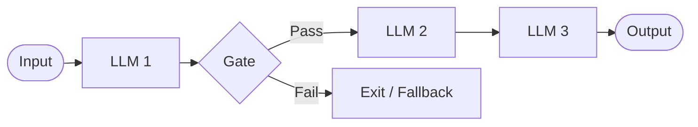
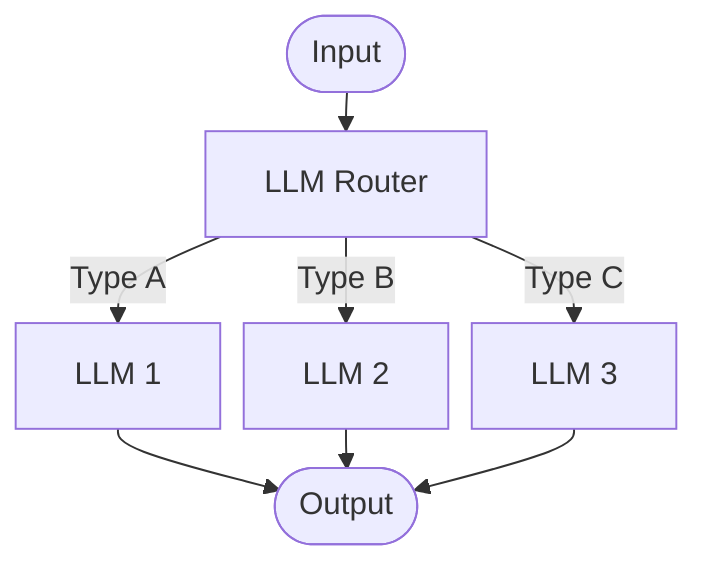
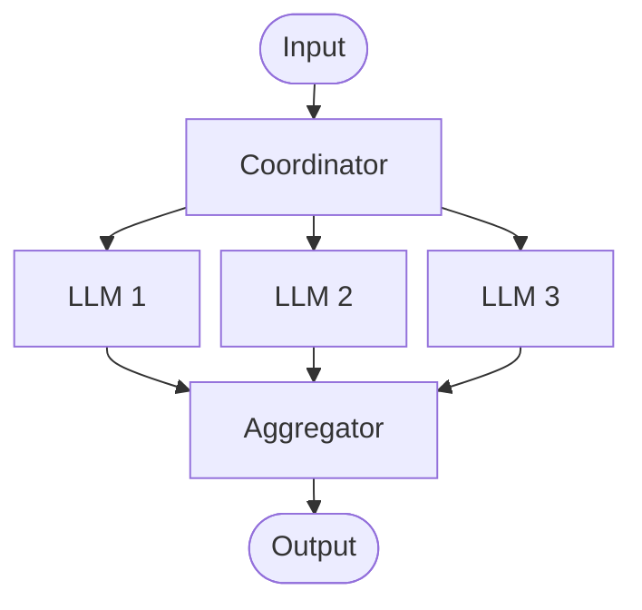
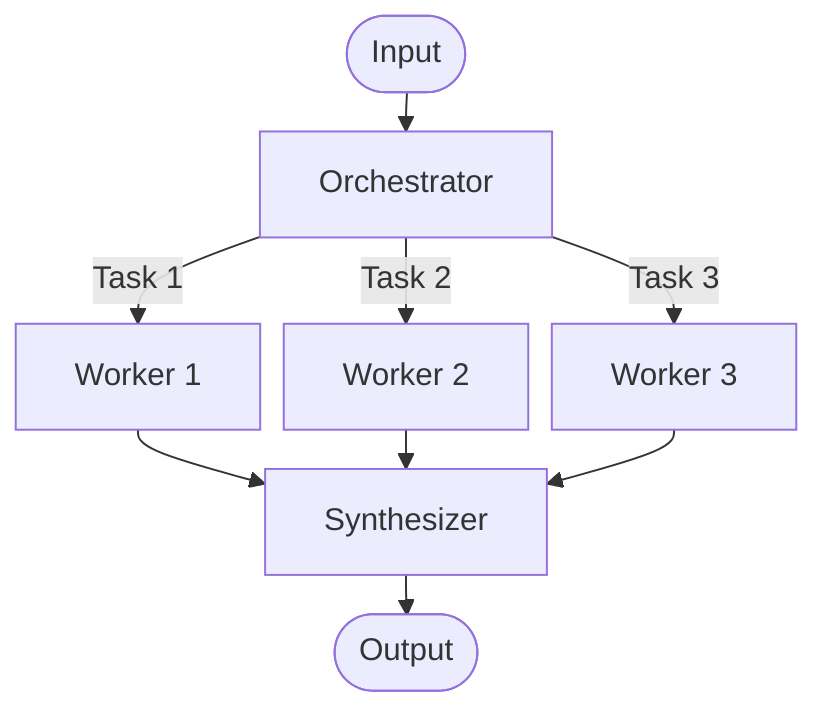
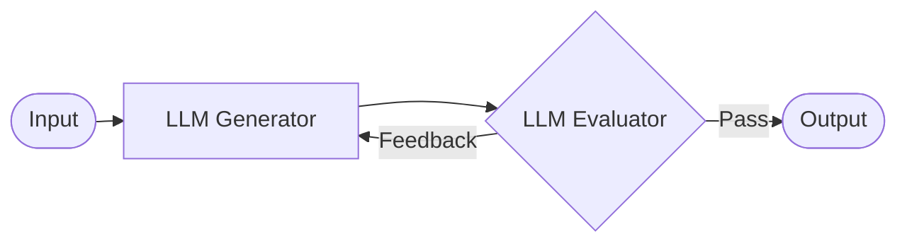
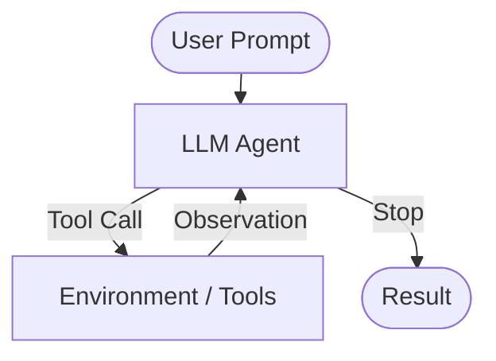

---
tags:
  - ai
  - ai-agents
  - mcp
  - workflows
  - architecture
created: 2026-11-06
course: "AI Engineer Agentic Track: The Complete Agent & MCP Course"
module: "Week 1.1 - Concepts & Architectural Patterns"
---

# Concepts & Agentic Architectures

> [!info] Navigation
> Next lesson: [[Week 1.2|Week 1.2 - Agent Traps, Risks & Engineering Mindset]].

---

## AI Agents - 3 Primary Definitions

1. **Autonomous execution:** AI systems capable of performing tasks independently.
2. **LLM-guided orchestration:** A system where an LLM guides the workflow dynamically based on user prompts.
3. **Tool-use loop:** An LLM that utilizes external tools in an iterative loop to achieve specific goals.

---

## Agentic Systems - Anthropic Distinction

Anthropic categorizes agentic architectures into two fundamental types:

- **Workflows:** Systems where LLMs and tools are orchestrated through **predefined code paths** (deterministic routing, explicit branching).
- **Agents:** Dynamic systems where LLMs direct their own processes and tool usage, maintaining autonomous control over how they accomplish tasks.

---

## Workflow Design Patterns

### 1. Prompt Chaining
Decomposes a complex task into a sequential pipeline of fixed sub-tasks, passing intermediate results with optional validation gates.

---

### 2. Routing
Directs an input into a specialized sub-task or domain-specific prompt/model, ensuring clear separation of concerns.

---

### 3. Parallelization
Breaks down tasks to run multiple subtasks concurrently (either sectioning independent tasks or ensembling/voting for higher reliability).

---

### 4. Orchestrator-Worker
A central orchestrator LLM dynamically breaks down a complex problem into subtasks on the fly, delegates them to worker LLMs, and synthesizes the outputs.

---

### 5. Evaluator-Optimizer
One LLM generates candidate solutions while another evaluates/critiques them, creating an iterative refinement loop until quality criteria are met.

---

## Agents Design Patterns

Autonomous agents operate in open-ended execution loops without a rigid, predefined path:

1. **Open-ended problem solving:** The model decides which actions to take next.
2. **Feedback loops:** Results from actions/environment inform subsequent thoughts.
3. **No fixed path:** Trajectories emerge dynamically based on tool responses.

