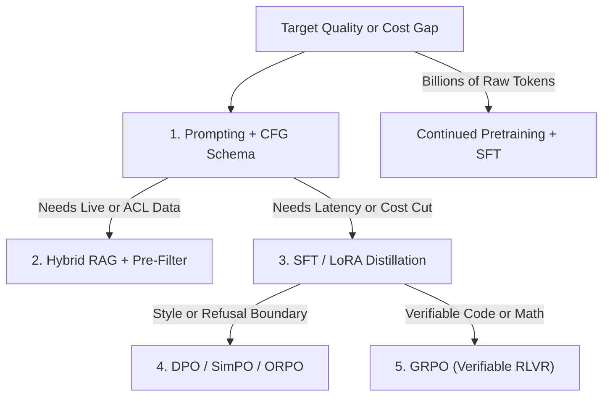
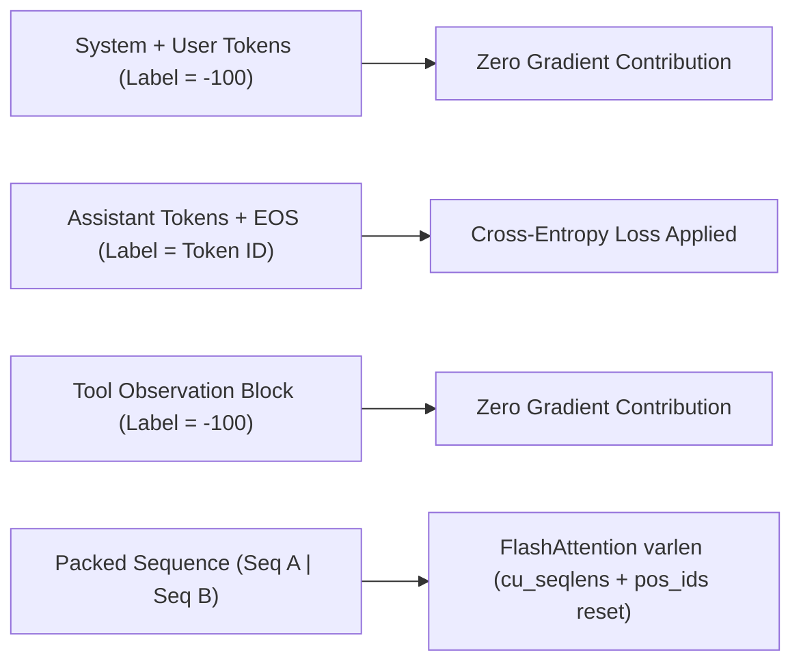
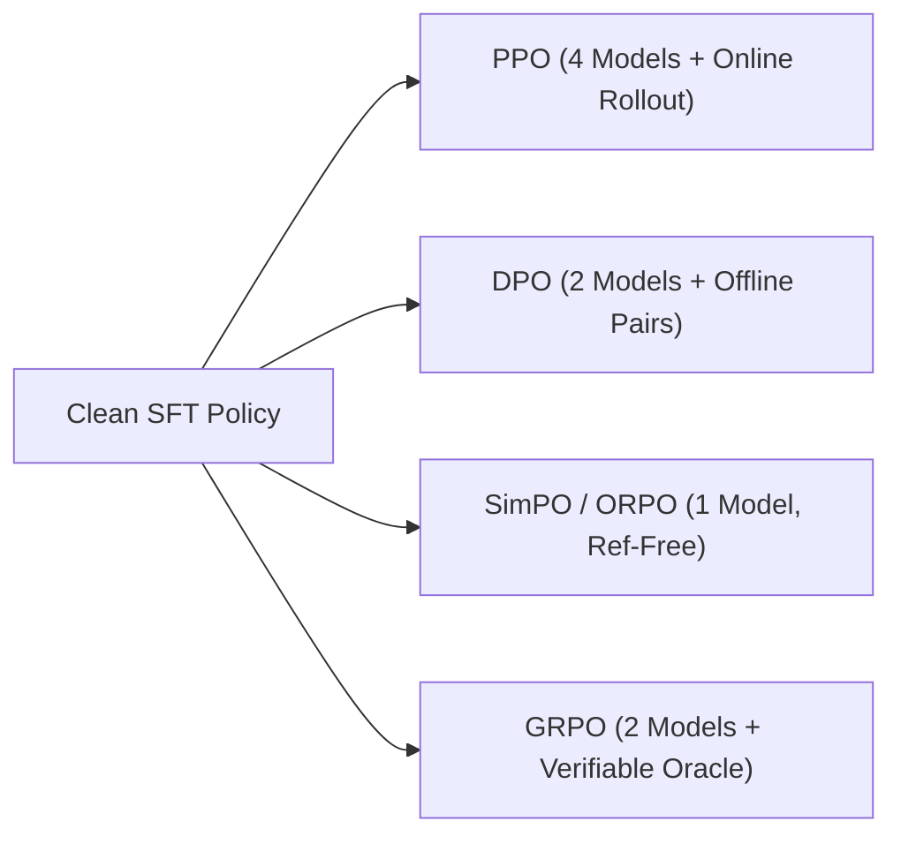

---
tags:
  - ai
  - ai-engineering
  - fine-tuning
  - lora
  - qlora
  - alignment
  - rlhf
  - dpo
  - grpo
created: 2026-11-13
updated: 2026-11-13
status: 🟢
level: mid-to-senior
---
# Fine-Tuning, LoRA & Alignment

> [!abstract] Core Engineering Invariant
> Weight adaptation modifies **conditional generation behavior, formatting priors, latency economics, and reasoning search policies**—never deterministic access-controlled facts. Exhaust prompt engineering, constrained decoding, and [[AI/AI Engineering/Production RAG Architecture|Production RAG Architecture]] before committing to dataset curation, GPU training budgets, and checkpoint regression gates.

**Navigation:** [[AI/AI Engineering Hub|AI Engineering Hub]] · [[AI/AI Engineering/LLM Internals, Inference & Economics|LLM Internals, Inference & Economics]] · [[AI/AI Engineering/Context Engineering & Structured Outputs|Context Engineering & Structured Outputs]] · [[AI/AI Engineering/Production RAG Architecture|Production RAG Architecture]] · [[AI/AI Engineering/LLM Evaluation, Guardrails & Security|LLM Evaluation, Guardrails & Security]] · [[Programming/Machine Learning/Deep Learning Guide|Deep Learning Guide]] · [[Programming/Machine Learning/MLOps & Production ML Guide|MLOps & Production ML Guide]]

---

## 1. First-Principles Mechanics: Adaptation Boundaries, PEFT & Post-Training

Customizing a foundation model alters the parameters $\theta$ governing the conditional distribution $P_\theta(y_t \mid x, y_{<t})$. Every engineering lever operates at a distinct layer of the inference and optimization stack, with sharply different failure boundaries and operational maintenance costs.

### The Customization Escalation Ladder



1. **Prompt Conditioning & Constrained Decoding:** Injects behavioral priors into the KV prefix at inference time and enforces syntactic validity via finite-state machine (FSM) logit masks (see [[AI/AI Engineering/Context Engineering & Structured Outputs|Context Engineering & Structured Outputs]]). Zero weight updates; sub-minute iteration cycle.
2. **Hybrid RAG + Metadata ACLs:** Keeps mutable facts, regulatory policies, and tenant-isolated records in external storage queried at runtime. Enforces row-level permissions deterministically before vectors enter the prompt.
3. **Continued Pretraining (CPT):** Resumes causal next-token prediction across **billions of unlabeled domain tokens** (proprietary codebases, clinical notes, legal corpora) without loss masking, shifting internal token representations before downstream SFT. Fails badly on small datasets (`< 10M` tokens) by corrupting general instruction fluency.
4. **Supervised Fine-Tuning (SFT):** Trains on curated `(prompt, response)` or multi-turn tool trajectories with assistant-only loss masking, internalizing rigid schemas, tool syntax, or frontier-teacher reasoning patterns into compact 3B–14B student models to eliminate multi-thousand-token few-shot prompts.
5. **Preference & Verifiable Alignment (DPO / SimPO / ORPO / GRPO):** Moves beyond imitation of positive examples by introducing **contrastive negative gradient signal**, sharpening decision boundaries against verbose filler, over-refusals, subtle tool errors, or unverified reasoning paths.

> [!warning] The Mutable Fact Fallacy
> Transformer parameters encode continuous statistical associations across overlapping weights—not isolated key-value records. Storing daily-changing prices, company policies, or private tenant facts inside weights sacrifices provenance citations, breaks Row-Level Security (RLS), induces hallucinated blends across neighboring training records, and forces a full train-eval-deploy cycle on every document edit. Keep facts in RAG and behavior in weights.

---

### Pretraining vs. Supervised Fine-Tuning: `-100` Loss Masking & Chat Template Parity

Standard causal language modeling minimizes cross-entropy across every token position $t \in \{1, \dots, L-1\}$:

$$\mathcal{L}_{\text{CLM}}(\theta) = -\frac{1}{L} \sum_{t=1}^{L} \log P_\theta(x_t \mid x_{<t})$$

While **pretraining and CPT** compute this loss across every token in the raw corpus, applying unweighted causal loss during **SFT** degrades instruction-following models severely:

- **Assistant-Only Loss Masking (`ignore_index = -100`):** PyTorch `torch.nn.CrossEntropyLoss(ignore_index=-100)` zeros out gradients for any target index whose label equals `-100`. During SFT on multi-turn chat or tool trajectories, labels MUST assign `-100` to all **system instructions**, **user turns**, **external tool observation blocks (`role: "tool"`)**, and **padding tokens**, retaining actual vocabulary token IDs strictly for **assistant tokens** and each turn's terminating **EOS token** (`<|im_end|>`, `<|eot_id|>`).
- **Why Unmasked Prompt Loss Breaks Production Agents:** Supervising user turns and `role: "tool"` payloads forces gradient capacity to predict user inputs and external API responses. At serving time, unmasked SFT models frequently echo user questions verbatim or hallucinate fake `<|tool_response|>` observation blocks rather than stopping at the `EOS` / tool-call delimiter.
- **`pad_token != eos_token` Invariant:** Setting `tokenizer.pad_token = tokenizer.eos_token` without explicit `-100` masking on padding indices creates a destructive conflict: either unmasked pad tokens over-penalize the `EOS` distribution, or naive collators mask *every* occurrence of `eos_token_id`—destroying the gradient signal on the true end-of-turn stop token and causing **infinite generation until `max_new_tokens`**. Always assign a dedicated reserved pad token (such as `<|finetune_right_pad_id|>`) or explicitly preserve the true turn-terminating `EOS` inside `labels`.
- **Training-Serving Template Parity:** Any single character mismatch—a trailing space, missing newline, or wrong special token ID—between Hugging Face `apply_chat_template()` during SFT and the serving engine (`vLLM`, `SGLang`, `llama.cpp`) shifts token boundaries inside BPE (see [[AI/AI Engineering/LLM Internals, Inference & Economics|LLM Internals, Inference & Economics]]) and collapses output accuracy.



### FlashAttention-2, Sequence Packing (`packing=True`) & Unpadding (`varlen`)

Real conversational SFT datasets exhibit heavy right-skewed length distributions (median ~450 tokens, p99 ~8,192 tokens). **Naive batch padding** expands every short example to `max_seq_len` (or batch max length), wasting $60\%$–$85\%$ of Tensor Core FLOPs and VRAM activations computing attention over masked pad tokens.

Concatenating multiple sequences naively into one fixed 4,096-token row (`"\n".join(samples)`) without structural boundaries introduces **cross-sample attention bleed**: tokens in Conversation $B$ attend backward into unrelated tokens from Conversation $A$ and receive inflated Rotary Position Embedding (RoPE) offsets starting at index $L_A$ rather than $0$.

**FlashAttention-2 Block-Diagonal Packing (`varlen`)** solves both problems simultaneously:
1. Concatenate $m$ distinct tokenized conversations back-to-back into a single 1D packed tensor (no pad tokens between samples).
2. Pass cumulative boundary offsets `cu_seqlens = [0, L_1, L_1 + L_2, ..., sum(L_i)]` to `flash_attn_varlen_func`.
3. Reset `position_ids` to `[0, 1, ..., L_i - 1]` independently at the start of every packed sequence.

Because `flash_attn_varlen_func` restricts attention tiles strictly inside each `[cu_seqlens[i], cu_seqlens[i+1])` diagonal block and RoPE uses per-example `position_ids`, Tensor Cores execute at near-100% dense density with **exact mathematical equivalence to un-packed batching** and zero cross-document leakage. Modern `trl.SFTTrainer` supports this automatically via `SFTConfig(packing=True)` paired with `attn_implementation="flash_attention_2"`.

---

### PEFT Internals: LoRA, rsLoRA, DoRA & QLoRA Memory Architecture

#### Why Full Fine-Tuning Exhausts Single-Node VRAM

Mixed-precision (`BF16`) full fine-tuning with standard `FP32` AdamW for a Transformer with $\Psi$ parameters stores four static tensors per parameter before any sequence activations exist:
- **BF16 Weights:** $2\Psi$ bytes
- **BF16 Gradients:** $2\Psi$ bytes
- **FP32 Master Weight Copy:** $4\Psi$ bytes (required so tiny LR updates `1e-5` do not underflow BF16 7-bit mantissas)
- **FP32 AdamW Optimizer States ($m_t, v_t$):** $4\Psi + 4\Psi = 8\Psi$ bytes

$$\text{Static VRAM}_{\text{Full BF16 + AdamW}} = 2\Psi + 2\Psi + 4\Psi + 8\Psi = 16\Psi\text{ bytes}$$

For an $8.03\text{B}$ model, static memory alone requires $128.48\text{ GB}$; for a $70\text{B}$ model, static state requires **$1.12\text{ TB}$** before activations or logit tensors!

#### Low-Rank Adaptation (LoRA), rsLoRA & DoRA

LoRA freezes base weights $W_0 \in \mathbb{R}^{d_{\text{out}} \times d_{\text{in}}}$ and constrains weight updates to a rank-$r$ matrix factorization ($r \ll \min(d_{\text{in}}, d_{\text{out}})$):

$$h = W_0 x + \Delta W x = W_0 x + \frac{\alpha}{r} B A x$$

where $A \in \mathbb{R}^{r \times d_{\text{in}}}$ and $B \in \mathbb{R}^{d_{\text{out}} \times r}$.

- **Zero-Shock Initialization Invariant:** Initialize $A \sim \mathcal{N}(0, \sigma^2)$ (Kaiming uniform) and $B = \mathbf{0}$. At step $t = 0$, $\Delta W = B A = \mathbf{0}$, guaranteeing training starts from the exact pretrained forward distribution.
- **Standard Scaling vs. Rank-Stabilized LoRA (`use_rslora=True`):** Standard LoRA scales updates by $\frac{\alpha}{r}$. At high ranks ($r \in \{64, 128, 256\}$), the $1/r$ factor shrinks adapter step magnitudes and slows convergence. **rsLoRA** replaces $\frac{\alpha}{r}$ with $\frac{\alpha}{\sqrt{r}}$, maintaining invariant singular-value variance across ranks and stabilizing high-rank capacity expansion without re-tuning learning rates.
- **Weight-Decomposed LoRA (`use_dora=True`):** Decomposes pretrained weights into columnwise Euclidean magnitude $m \in \mathbb{R}^{1 \times d_{\text{in}}}$ and unit direction $\frac{W_0}{\|W_0\|_c}$, applying the low-rank adapter strictly to the directional matrix:

$$W_{\text{DoRA}} = m \odot \frac{W_0 + \frac{\alpha}{r} B A}{\|W_0 + \frac{\alpha}{r} B A\|_c}$$

DoRA mirrors the magnitude-vs-direction learning dynamics of full fine-tuning, often improving reasoning and extraction metrics by $+1\%$–$3\%$ at low ranks ($r = 8$–$16$). At training time, computing column norms adds ~15–25% activation/compute overhead; at inference time, merged weights fold back into standard dense matrices with **zero serving overhead**.
- **Target Module Selection (`target_modules="all-linear"`):** Adapting only attention query/value projections (`q_proj`, `v_proj`) freezes MLP knowledge gates (`gate_proj`, `up_proj`, `down_proj`) and attention output projections (`o_proj`, `k_proj`). Empirical evaluations consistently show adapting **all 7 Transformer linear projections** (`q, k, v, o, gate, up, down_proj`) captures complex structured extraction, code syntax, and reasoning patterns far more effectively.

#### QLoRA Internals: `NF4`, Double Quantization & Paged AdamW

QLoRA reduces frozen base weight VRAM by $\sim 4\times$ without sacrificing downstream task accuracy via three coordinated mechanisms:

1. **4-Bit NormalFloat (`NF4`):** Pretrained Transformer linear weights follow zero-mean normal distributions $\mathcal{N}(0, \sigma^2)$ per block. Rather than spacing 16 quantization levels uniformly (`INT4`), `NF4` places quantization buckets at **equal-probability quantiles of $\mathcal{N}(0, 1)$**, minimizing information-theoretic quantization error. During forward and backward GEMMs, blocks are dequantized on-the-fly in SRAM/registers to **`bnb_4bit_compute_dtype=torch.bfloat16`**—storing base weights in 4 bits while computing gradients in full BF16 dynamic range.
2. **Double Quantization (`bnb_4bit_use_double_quant=True`):** Standard 64-weight blockwise quantization stores one 32-bit FP32 absmax scale factor per 64 weights ($32/64 = 0.50\text{ bits/param}$). Double quantization quantizes those FP32 scale factors into 8-bit `FP8` across 256-scale superblocks, cutting metadata overhead from $0.50$ bits/param down to:
   $$\frac{8}{64} + \frac{32}{64 \times 256} = 0.125 + 0.00195 \approx \mathbf{0.127\text{ bits/param}} \implies \mathbf{4.127\text{ bits/param}} \approx \mathbf{0.516\text{ bytes/param}}$$
   This saves $\sim 0.373$ bits/param ($\sim 3.1\text{ GB}$ on a 70B model).
3. **Paged Optimizers (`paged_adamw_8bit`):** Stores quantized 8-bit AdamW moments and uses NVIDIA CUDA Unified Memory to automatically page optimizer state tensors out to CPU host RAM whenever long-context micro-batches spike activation VRAM—preventing transient OOM crashes.

#### Complete VRAM Accounting Formula (Weights + Grads + Optim + Activations + Logits)

Total peak GPU VRAM during a training step equals five concrete terms:

$$\text{VRAM}_{\text{peak}} = \text{VRAM}_{\text{base}} + \text{VRAM}_{\text{adapter+opt}} + \text{VRAM}_{\text{activations}} + \text{VRAM}_{\text{logits}} + \text{VRAM}_{\text{CUDA/frag}}$$

1. **Embeddings & LM Head (`BF16`):** $2 \times 2 \times |V| \times d_{\text{model}}$ when untied (`128,256 * 4096 * 2 * 2 = 2.10 GB` on 8B; `128,256 * 8192 * 2 * 2 = 4.20 GB` on 70B).
2. **Activations (`gradient_checkpointing=True`):** Recomputes intermediate layer activations during the backward pass instead of caching all $L$ layers simultaneously, reducing activation storage from $O(L \cdot B \cdot S \cdot d)$ down to $O(L \cdot B \cdot S \cdot d_{\text{ckpt}}) \approx 1.5$–$4\text{ GB}$ for `micro_batch_size=1`, `seq_len=4096`.
3. **The 128k-Vocab Logits Tensor Trap:** On modern wide-vocabulary architectures (`Llama-3` 128k, `Qwen-2.5` 151k, `Gemma-2` 256k), materializing full BF16 logits for loss computation allocates:
   $$\text{VRAM}_{\text{logits}} = B \times S \times |V| \times 2\text{ bytes}$$
   At $B = 4, S = 4{,}096, |V| = 128{,}256$: $4 \times 4096 \times 128{,}256 \times 2 = \mathbf{4.20\text{ GB}}$ (doubling to **$8.40\text{ GB}$** if upcast to FP32 before cross-entropy!). Dropping `per_device_train_batch_size=1` or using **Liger Kernel fused linear cross-entropy** eliminates this spike completely.

---

### Alignment & Post-Training Algorithms: PPO vs. DPO vs. SimPO/ORPO vs. GRPO



#### 1. RLHF via PPO (Proximal Policy Optimization)

Trains an explicit Bradley-Terry Reward Model $r_\phi(x, y)$ on human preference tuples $(x, y_w \succ y_l)$, then optimizes policy $\pi_\theta$ via online rollouts regularized against the frozen SFT reference $\pi_{\text{ref}}$:

$$\max_{\theta} \mathbb{E}_{x \sim \mathcal{D},\, y \sim \pi_\theta(\cdot \mid x)}\Big[r_\phi(x, y) - \beta \, D_{\text{KL}}\big(\pi_\theta(y \mid x) \,\|\, \pi_{\text{ref}}(y \mid x)\big)\Big]$$

- **Memory Cost:** Requires **4 concurrent models** in distributed VRAM (Actor $\pi_\theta$, Reference $\pi_{\text{ref}}$, Reward $r_\phi$, Value/Critic $V_\psi$).
- **Reward Hacking & KL Collapse:** If KL coefficient $\beta$ is too weak, $\pi_\theta$ discovers adversarial shortcuts inside $r_\phi$ (excessive length, bullet spam, sycophantic disclaimers) that score high surrogate reward while degrading real human utility. If $\beta \to 0$, policy entropy collapses to repetitive degenerate outputs.

#### 2. DPO (Direct Preference Optimization)

DPO proves analytically that the optimal policy solving the KL-constrained RLHF objective satisfies $r(x, y) = \beta \log \frac{\pi_\theta(y \mid x)}{\pi_{\text{ref}}(y \mid x)} + \beta \log Z(x)$. Substituting this closed form into the Bradley-Terry preference likelihood cancels the intractable partition function $Z(x)$ cleanly:

$$\mathcal{L}_{\text{DPO}}(\pi_\theta; \pi_{\text{ref}}) = -\mathbb{E}_{(x, y_w, y_l)}\left[\log \sigma\left(\beta \log \frac{\pi_\theta(y_w \mid x)}{\pi_{\text{ref}}(y_w \mid x)} - \beta \log \frac{\pi_\theta(y_l \mid x)}{\pi_{\text{ref}}(y_l \mid x)}\right)\right]$$

- **LoRA Reference Trick (`ref_model=None`):** When training a LoRA adapter over a base SFT checkpoint, TRL computes $\log \pi_{\text{ref}}(y \mid x)$ simply by temporarily disabling the LoRA adapter (`model.disable_adapter()`), running 2-model DPO inside **1 base model's VRAM footprint**.
- **Critical Failure Mode — Likelihood Displacement:** Notice the DPO gradient only enforces widening the *relative gap* $\log \frac{\pi_\theta(y_w)}{\pi_{\text{ref}}(y_w)} - \log \frac{\pi_\theta(y_l)}{\pi_{\text{ref}}(y_l)}$. When $\beta$ is too small or data is off-policy, **both** $\log \pi_\theta(y_w)$ and $\log \pi_\theta(y_l)$ can plummet simultaneously while `logp(chosen) - logp(rejected)` rises! This destroys calibrated generation likelihood, causing truncated JSON or dropped closing braces.
- **Two Mandatory Defenses:**
  1. **Clean On-Policy SFT Before DPO:** Always run SFT on the target distribution *before* DPO so $y_w$ lies close to $\pi_{\text{ref}}$ (`logp` starts calibrated).
  2. **RPO / NLL Anchoring (`rpo_alpha > 0`):** Add a weighted supervised cross-entropy term $\alpha_{\text{RPO}} \cdot \mathcal{L}_{\text{NLL}}(y_w \mid x)$ inside `DPOConfig(rpo_alpha=0.2)` to anchor $\log \pi_\theta(y_w)$ upward.

#### 3. Reference-Free Preference Alignment: SimPO & ORPO

- **SimPO (`CPOConfig(loss_type="simpo")`):** Removes $\pi_{\text{ref}}$ entirely, substituting the **length-normalized average log-probability** $\frac{\beta}{|y|} \log \pi_\theta(y \mid x)$ minus a fixed margin $\gamma > 0$ (`simpo_gamma`):
  $$\mathcal{L}_{\text{SimPO}}(\pi_\theta) = -\mathbb{E}_{(x, y_w, y_l)}\left[\log \sigma\left(\frac{\beta}{|y_w|} \log \pi_\theta(y_w \mid x) - \frac{\beta}{|y_l|} \log \pi_\theta(y_l \mid x) - \gamma\right)\right]$$
  Length normalization prevents verbosity hacking while halving reference forward-pass memory and compute.
- **ORPO (`ORPOConfig`):** Combines SFT cross-entropy and an odds-ratio preference penalty $\log \frac{\text{odds}_\theta(y_w \mid x)}{\text{odds}_\theta(y_l \mid x)}$ into a **single unified training pass**, avoiding a separate SFT stage for rapid prototyping on small preference sets.

#### 4. GRPO (Group Relative Policy Optimization / DeepSeek-R1 RLVR)

When tasks have **deterministic programmatic verifiers** (unit test suites, SQL `EXPLAIN`, JSON Schema validators, symbolic math checkers), **Reinforcement Learning with Verifiable Rewards (RLVR)** via **GRPO** outperforms offline SFT/DPO dramatically:

1. For each prompt $x$, sample a rollout group of $G$ candidate trajectories $\{o_1, \dots, o_G\} \sim \pi_{\theta_{\text{old}}}(\cdot \mid x)$ (`num_generations=8`).
2. Evaluate every rollout deterministically via verifiable reward functions $R_i = \sum_m w_m \, r_m(x, o_i)$.
3. Compute the **group-relative standardized advantage** directly across the $G$ siblings—eliminating the Value/Critic network $V_\psi$ completely:

$$A_i = \frac{R_i - \text{mean}(\{R_1, \dots, R_G\})}{\text{std}(\{R_1, \dots, R_G\}) + \epsilon}$$

4. Optimize a clipped PPO surrogate objective constrained by per-token KL divergence against $\pi_{\text{ref}}$ (`beta > 0`, typically `0.02–0.05`). Because reward functions execute verifiable compilers/oracles rather than learned neural reward models, GRPO resists neural reward hacking while encouraging self-correction and multi-step verification inside `<think>...</think>` blocks.

---

## 2. Real-World Use Cases & Trade-Off Decision Matrix

| Technique | Models in VRAM | Data Required | Training Compute | Primary Production Sweet Spot | Anti-Pattern (Do Not Use) |
| :--- | :--- | :--- | :--- | :--- | :--- |
| **Prompt + CFG Schema** | $0$ (Inference only) | $3$–$10$ few-shot examples | Zero | Rapid prototyping, strict JSON adherence on frontier models | High-volume calls paying 3k static prompt tokens/req |
| **Hybrid RAG + ACLs** | $0$ (Index only) | Chunked docs + RBAC tags | Embedding only | Mutable policies, live catalogs, multi-tenant data isolation | Teaching DSL syntax, style, or sub-200ms extraction |
| **Continued Pretraining (CPT)** | $1$ ($\pi_\theta$) | $100\text{M}$–$10\text{B}$ raw tokens | Very High | Unseen domain notation, proprietary languages, genomics | `< 10M` token corpora or structured chat formatting |
| **SFT / QLoRA Distillation** | $1$ ($\pi_\theta$) | $1\text{k}$–$20\text{k}$ verified demos | Low (hours on 1 GPU) | **Frontier-to-8B distillation**, tool-call accuracy, DSL/SQL syntax | Injecting volatile enterprise facts or pricing |
| **DPO / SimPO** | $2$ (DPO) / $1$ (SimPO) | $2\text{k}$–$30\text{k}$ `(x, y_w, y_l)` pairs | Low–Moderate | Tone control, conciseness, eliminating over-refusal or schema glitches | Fixing broken underlying task reasoning or missing knowledge |
| **GRPO (RLVR)** | $2$ ($\pi_\theta, \pi_{\text{ref}}$) | Prompts + code/test oracle | High (online rollouts) | Code repair, SQL generation, multi-step math, verifiable tool routing | Open-ended creative writing lacking crisp automated verifiers |

### Five Concrete Production Scenarios

1. **Frontier-to-8B Distillation for Strict Tool & JSON Extraction:** A support classifier paying `$0.025/call` on a frontier model with a 2,200-token few-shot prompt logs 15,000 production inputs, runs rejection-sampled teacher generation filtered by strict Pydantic schemas + SME audit, and distills into a QLoRA `8B` student. Removing the 2,200-token prompt drops TTFT under `120 ms` and cuts monthly inference spend by $18\times$.
2. **Domain SQL / Internal DSL Adaptation (SFT + Schema Injection):** An analytics platform adapts `Qwen2.5-Coder-7B` via BF16 LoRA (`r=32`, `all-linear`, `assistant_only_loss=True`) to master proprietary PostgreSQL window-function conventions and internal query idioms, while table schemas remain dynamically injected at inference time via RAG so schema changes require zero retraining.
3. **Eliminating Robotic Verbosity & False Refusals via DPO / SimPO:** After SFT stabilizes JSON tool calls, human reviewers flag 22% of responses as excessively apologetic or failing negative length constraints. Logging corrected responses alongside rejected drafts creates $(x, y_w, y_l)$ pairs trained for 1 epoch with `DPOConfig(beta=0.1, rpo_alpha=0.2)` (or `CPOConfig(loss_type="simpo")`).
4. **Verifiable Python / SQL Reasoning via GRPO (RLVR):** An internal data-engineering copilot achieves only `63%` pass rate after SFT on multi-join analytics queries. Applying `GRPOTrainer` (`num_generations=8`) scored by live PostgreSQL `EXPLAIN` syntax validation + unit-test result equality raises pass rate to `86%` without needing labeled chain-of-thought reasoning traces.
5. **Continual Learning Without Catastrophic Forgetting:** A quarterly model refresh updates domain tool schemas without collapsing general coding or instruction adherence by blending **80% curated new domain trajectories + 20% stratified general IFEval/safety/code replay data** and gating checkpoints simultaneously across both in-domain and general regression suites (see [[AI/AI Engineering/LLM Evaluation, Guardrails & Security|LLM Evaluation, Guardrails & Security]]).

---

## 3. Step-by-Step Practical Application: End-to-End Post-Training Pipeline

```text
post_training/
├── pyproject.toml
├── data_prep/
│   └── validate_and_dedup.py      # Schema validation, near-dedup, eval decontamination, replay mix
├── scripts/
│   ├── train_sft_qlora.py         # QLoRA NF4 + rsLoRA + assistant_only_loss + packing=True
│   ├── train_dpo.py               # SFT->DPO with rpo_alpha + likelihood displacement monitor
│   ├── train_grpo_rlvr.py         # GRPOTrainer with verifiable JSON + Python sandbox rewards
│   └── merge_export_and_gate.py   # BF16 LoRA merge (NEVER into 4-bit!), parity check, vLLM/GGUF, CI gate
└── configs/
    └── deepspeed_zero2.json       # Multi-GPU ZeRO-2 offload config
```

### Module 1: Dataset Validator, Near-Deduplication & Eval Decontamination (`data_prep/validate_and_dedup.py`)

Data defects—duplicate templates, benchmark leakage from eval suites into training splits, and unvalidated tool schemas—corrupt fine-tuned models far faster than suboptimal hyperparameters. Run this pre-flight validator before launching any GPU job.

```python
from __future__ import annotations

import hashlib
import json
import random
from pathlib import Path
from typing import Any


def normalize_text(text: str) -> str:
    return " ".join(text.lower().split())


def char_ngrams(text: str, n: int = 5) -> set[str]:
    norm = normalize_text(text)
    if len(norm) < n:
        return {norm}
    return {norm[i : i + n] for i in range(len(norm) - n + 1)}


def jaccard_similarity(a: set[str], b: set[str]) -> float:
    if not a and not b:
        return 1.0
    union = len(a | b)
    return len(a & b) / union if union else 0.0


def validate_chat_record(record: dict[str, Any]) -> list[str]:
    errors: list[str] = []
    msgs = record.get("messages")
    if not isinstance(msgs, list) or len(msgs) < 2:
        return ["messages must be a list with >= 2 turns"]
    has_assistant = False
    for idx, msg in enumerate(msgs):
        role = msg.get("role")
        content = msg.get("content")
        if role not in {"system", "user", "assistant", "tool"}:
            errors.append(f"turn {idx} invalid role={role!r}")
        if not isinstance(content, str) or not content.strip():
            if not msg.get("tool_calls"):
                errors.append(f"turn {idx} empty content without tool_calls")
        if role == "assistant":
            has_assistant = True
    if not has_assistant:
        errors.append("conversation contains zero assistant turns")
    return errors


def curate_sft_dataset(
    *,
    domain_jsonl: Path,
    replay_jsonl: Path,
    eval_holdout_jsonl: Path,
    output_jsonl: Path,
    replay_ratio: float = 0.20,
    near_dup_threshold: float = 0.85,
    seed: int = 42,
) -> dict[str, int]:
    """Validates, deduplicates, decontaminates against eval holdout, and mixes replay."""
    eval_fingerprints: list[set[str]] = []
    for line in eval_holdout_jsonl.read_text(encoding="utf-8").splitlines():
        if not line.strip():
            continue
        row = json.loads(line)
        user_text = " ".join(
            m["content"] for m in row.get("messages", []) if m.get("role") == "user" and m.get("content")
        )
        eval_fingerprints.append(char_ngrams(user_text))

    seen_exact: set[str] = set()
    kept_shingles: list[set[str]] = []
    clean_domain: list[dict[str, Any]] = []
    stats = {"raw": 0, "invalid": 0, "exact_dup": 0, "near_dup": 0, "contaminated": 0, "kept_domain": 0}

    for line in domain_jsonl.read_text(encoding="utf-8").splitlines():
        if not line.strip():
            continue
        stats["raw"] += 1
        row = json.loads(line)
        if validate_chat_record(row):
            stats["invalid"] += 1
            continue

        canonical = json.dumps(row["messages"], sort_keys=True, ensure_ascii=False)
        digest = hashlib.sha256(canonical.encode("utf-8")).hexdigest()
        if digest in seen_exact:
            stats["exact_dup"] += 1
            continue

        user_prompt = " ".join(
            m["content"] for m in row["messages"] if m.get("role") == "user" and m.get("content")
        )
        shingles = char_ngrams(user_prompt)

        # 13-gram / 5-gram overlap check against held-out eval prompts prevents test leakage
        if any(jaccard_similarity(shingles, ev) >= near_dup_threshold for ev in eval_fingerprints):
            stats["contaminated"] += 1
            continue

        if any(jaccard_similarity(shingles, prev) >= near_dup_threshold for prev in kept_shingles[-500:]):
            stats["near_dup"] += 1
            continue

        seen_exact.add(digest)
        kept_shingles.append(shingles)
        clean_domain.append({"messages": row["messages"], "source": "domain"})
        stats["kept_domain"] += 1

    replay_rows: list[dict[str, Any]] = []
    if replay_jsonl.exists():
        for line in replay_jsonl.read_text(encoding="utf-8").splitlines():
            if not line.strip():
                continue
            row = json.loads(line)
            if not validate_chat_record(row):
                replay_rows.append({"messages": row["messages"], "source": "replay"})

    rng = random.Random(seed)
    target_replay = int(len(clean_domain) * (replay_ratio / max(1e-6, 1.0 - replay_ratio)))
    sampled_replay = rng.sample(replay_rows, min(target_replay, len(replay_rows))) if replay_rows else []

    combined = clean_domain + sampled_replay
    rng.shuffle(combined)
    output_jsonl.parent.mkdir(parents=True, exist_ok=True)
    with output_jsonl.open("w", encoding="utf-8") as fh:
        for item in combined:
            fh.write(json.dumps(item, ensure_ascii=False) + "\n")

    stats["replay_added"] = len(sampled_replay)
    stats["total_written"] = len(combined)
    return stats
```

### Module 2: Production QLoRA SFT Script (`scripts/train_sft_qlora.py`)

Uses `BitsAndBytesConfig` (`nf4` + double quantization + `bf16` compute), `LoraConfig` targeting `"all-linear"` with `use_rslora=True`, `SFTConfig` with `assistant_only_loss=True`, `packing=True`, `paged_adamw_8bit`, FlashAttention-2 varlen boundaries, and explicit `pad_token != eos_token` safety.

```python
from __future__ import annotations

import argparse
import torch
from datasets import load_dataset
from peft import LoraConfig, TaskType, prepare_model_for_kbit_training
from transformers import AutoModelForCausalLM, AutoTokenizer, BitsAndBytesConfig
from trl import SFTConfig, SFTTrainer


def parse_args() -> argparse.Namespace:
    parser = argparse.ArgumentParser(description="Train QLoRA SFT with assistant-only loss and packing.")
    parser.add_argument("--model-id", default="Qwen/Qwen2.5-7B-Instruct")
    parser.add_argument("--train-file", required=True)
    parser.add_argument("--eval-file", required=True)
    parser.add_argument("--output-dir", default="checkpoints/sft-qlora")
    parser.add_argument("--max-length", type=int, default=4096)
    parser.add_argument("--lora-r", type=int, default=32)
    parser.add_argument("--lora-alpha", type=int, default=64)
    parser.add_argument("--use-dora", action="store_true")
    parser.add_argument("--epochs", type=float, default=2.0)
    parser.add_argument("--lr", type=float, default=1.5e-4)
    return parser.parse_args()


def configure_tokenizer(model_id: str) -> AutoTokenizer:
    tokenizer = AutoTokenizer.from_pretrained(model_id, use_fast=True)
    # Never overload pad_token = eos_token without dedicated pad ID if vocab offers reserved slot
    if tokenizer.pad_token is None:
        if "<|finetune_right_pad_id|>" in tokenizer.get_vocab():
            tokenizer.pad_token = "<|finetune_right_pad_id|>"
        elif "<|endoftext|>" in tokenizer.get_vocab() and tokenizer.eos_token != "<|endoftext|>":
            tokenizer.pad_token = "<|endoftext|>"
        else:
            tokenizer.add_special_tokens({"pad_token": "<|pad|>"})
    tokenizer.padding_side = "right"
    return tokenizer


def main() -> None:
    args = parse_args()
    tokenizer = configure_tokenizer(args.model_id)

    bnb_config = BitsAndBytesConfig(
        load_in_4bit=True,
        bnb_4bit_quant_type="nf4",
        bnb_4bit_use_double_quant=True,
        bnb_4bit_compute_dtype=torch.bfloat16,
    )

    model = AutoModelForCausalLM.from_pretrained(
        args.model_id,
        quantization_config=bnb_config,
        torch_dtype=torch.bfloat16,
        attn_implementation="flash_attention_2",
        device_map="auto",
    )
    if len(tokenizer) > model.get_input_embeddings().weight.shape[0]:
        model.resize_token_embeddings(len(tokenizer))

    model.config.use_cache = False  # Mandatory when gradient_checkpointing=True
    model = prepare_model_for_kbit_training(model, use_gradient_checkpointing=True)

    peft_config = LoraConfig(
        r=args.lora_r,
        lora_alpha=args.lora_alpha,
        lora_dropout=0.05,
        bias="none",
        task_type=TaskType.CAUSAL_LM,
        target_modules="all-linear",
        use_rslora=True,
        use_dora=args.use_dora,
    )

    dataset = load_dataset(
        "json",
        data_files={"train": args.train_file, "validation": args.eval_file},
    )

    sft_config = SFTConfig(
        output_dir=args.output_dir,
        max_length=args.max_length,
        packing=True,                        # FlashAttention-2 varlen cu_seqlens packing
        assistant_only_loss=True,            # Masks system, user, and tool tokens to -100
        num_train_epochs=args.epochs,
        per_device_train_batch_size=2,
        per_device_eval_batch_size=2,
        gradient_accumulation_steps=8,       # Effective batch size = 16 packed sequences
        learning_rate=args.lr,
        lr_scheduler_type="cosine",
        warmup_ratio=0.05,
        weight_decay=0.01,
        max_grad_norm=1.0,
        optim="paged_adamw_8bit",            # Evicts optimizer spikes via Unified Memory
        bf16=True,
        fp16=False,
        gradient_checkpointing=True,
        gradient_checkpointing_kwargs={"use_reentrant": False},
        logging_steps=10,
        eval_strategy="steps",
        eval_steps=50,
        save_strategy="steps",
        save_steps=50,
        load_best_model_at_end=True,
        metric_for_best_model="eval_loss",
        save_total_limit=3,
        report_to="none",
    )

    trainer = SFTTrainer(
        model=model,
        args=sft_config,
        train_dataset=dataset["train"],
        eval_dataset=dataset["validation"],
        processing_class=tokenizer,
        peft_config=peft_config,
    )
    trainer.train()
    trainer.save_model(args.output_dir)
    tokenizer.save_pretrained(args.output_dir)


if __name__ == "__main__":
    main()
```

### Module 3: Preference Alignment with DPO + Displacement Monitor (`scripts/train_dpo.py`)

Runs DPO **strictly on top of a merged SFT policy** (or loads the SFT adapter and stacks/continues PEFT), sets `ref_model=None` so PEFT toggles the adapter off for $\pi_{\text{ref}}$ forward passes inside a single model's VRAM, enables `rpo_alpha=0.2` to anchor chosen log-probabilities, and attaches a `TrainerCallback` warning immediately if `logps/chosen` collapses.

```python
from __future__ import annotations

import argparse
import logging
import torch
from datasets import load_dataset
from peft import LoraConfig, TaskType
from transformers import AutoModelForCausalLM, AutoTokenizer, TrainerCallback, TrainerControl, TrainerState, TrainingArguments
from trl import DPOConfig, DPOTrainer

logging.basicConfig(level=logging.INFO)
logger = logging.getLogger("dpo-train")


class LikelihoodDisplacementMonitor(TrainerCallback):
    """Detects DPO collapse where reward margin grows while chosen log-prob plummets."""

    def __init__(self, min_chosen_logp: float = -80.0) -> None:
        self.min_chosen_logp = min_chosen_logp

    def on_log(
        self,
        args: TrainingArguments,
        state: TrainerState,
        control: TrainerControl,
        logs: dict[str, float] | None = None,
        **kwargs,
    ) -> None:
        if not logs:
            return
        chosen_lp = logs.get("logps/chosen")
        rejected_lp = logs.get("logps/rejected")
        margin = logs.get("rewards/margins")
        if chosen_lp is not None and rejected_lp is not None:
            logger.info(
                "step=%s logps/chosen=%.2f logps/rejected=%.2f margin=%.3f",
                state.global_step,
                chosen_lp,
                rejected_lp,
                margin or 0.0,
            )
            if chosen_lp < self.min_chosen_logp:
                logger.warning(
                    "LIKELIHOOD DISPLACEMENT ALERT: logps/chosen=%.2f dropped below %.2f. "
                    "Increase beta (0.1->0.2) or rpo_alpha.",
                    chosen_lp,
                    self.min_chosen_logp,
                )


def parse_args() -> argparse.Namespace:
    parser = argparse.ArgumentParser(description="Run DPO alignment from merged SFT checkpoint.")
    parser.add_argument("--sft-merged-model", required=True, help="Path to BF16 merged SFT checkpoint.")
    parser.add_argument("--train-file", required=True, help="JSONL with prompt, chosen, rejected.")
    parser.add_argument("--eval-file", required=True)
    parser.add_argument("--output-dir", default="checkpoints/dpo-aligned")
    parser.add_argument("--beta", type=float, default=0.1)
    parser.add_argument("--rpo-alpha", type=float, default=0.2)
    parser.add_argument("--lr", type=float, default=5e-6)
    return parser.parse_args()


def main() -> None:
    args = parse_args()
    tokenizer = AutoTokenizer.from_pretrained(args.sft_merged_model, use_fast=True)
    if tokenizer.pad_token is None:
        tokenizer.pad_token = tokenizer.eos_token

    model = AutoModelForCausalLM.from_pretrained(
        args.sft_merged_model,
        torch_dtype=torch.bfloat16,
        attn_implementation="flash_attention_2",
        device_map="auto",
    )
    model.config.use_cache = False

    peft_config = LoraConfig(
        r=16,
        lora_alpha=32,
        lora_dropout=0.05,
        bias="none",
        task_type=TaskType.CAUSAL_LM,
        target_modules="all-linear",
        use_rslora=True,
    )

    dataset = load_dataset(
        "json",
        data_files={"train": args.train_file, "validation": args.eval_file},
    )

    dpo_config = DPOConfig(
        output_dir=args.output_dir,
        beta=args.beta,
        rpo_alpha=args.rpo_alpha,             # Anchors chosen NLL against likelihood displacement
        loss_type="sigmoid",
        num_train_epochs=1.0,
        per_device_train_batch_size=2,
        gradient_accumulation_steps=8,
        learning_rate=args.lr,                # 10x–30x lower than SFT LoRA LR
        lr_scheduler_type="cosine",
        warmup_ratio=0.10,
        max_length=2048,
        max_prompt_length=1024,
        bf16=True,
        gradient_checkpointing=True,
        gradient_checkpointing_kwargs={"use_reentrant": False},
        logging_steps=10,
        eval_strategy="steps",
        eval_steps=25,
        save_strategy="steps",
        save_steps=25,
        report_to="none",
    )

    trainer = DPOTrainer(
        model=model,
        ref_model=None,                       # Uses base SFT weights with PEFT adapter disabled
        args=dpo_config,
        train_dataset=dataset["train"],
        eval_dataset=dataset["validation"],
        processing_class=tokenizer,
        peft_config=peft_config,
        callbacks=[LikelihoodDisplacementMonitor()],
    )
    trainer.train()
    trainer.save_model(args.output_dir)
    tokenizer.save_pretrained(args.output_dir)


if __name__ == "__main__":
    main()
```

### Module 4: Verifiable Reasoning RL via GRPO (`scripts/train_grpo_rlvr.py`)

This script trains a policy using **GRPO** with two deterministic reward functions: a structural XML/JSON schema reward (`format_and_json_reward`) giving smooth partial credit so group variance stays non-zero early in training, and a **subprocess-isolated Python execution oracle** (`python_unit_test_reward`) verifying actual functional correctness against test assertions.

```python
from __future__ import annotations

import argparse
import json
import re
import subprocess
import sys
import torch
from datasets import Dataset
from peft import LoraConfig, TaskType
from transformers import AutoModelForCausalLM, AutoTokenizer
from trl import GRPOConfig, GRPOTrainer

CODE_BLOCK_RE = re.compile(r"<think>(.*?)</think>\s*\x60{3}python\s*(.*?)\x60{3}", re.DOTALL)
JSON_BLOCK_RE = re.compile(r"\x60{3}json\s*(\{.*?\})\s*\x60{3}", re.DOTALL)


def extract_text(completion) -> str:
    if isinstance(completion, list) and completion:
        return str(completion[0].get("content", ""))
    return str(completion)


def structural_format_reward(completions, **kwargs) -> list[float]:
    """Smooth partial reward shaping prevents zero-std stagnation in early rollouts."""
    rewards: list[float] = []
    for comp in completions:
        text = extract_text(comp)
        score = 0.0
        if "<think>" in text and "</think>" in text:
            score += 0.25
        if CODE_BLOCK_RE.search(text):
            score += 0.25
        rewards.append(score)
    return rewards


def python_execution_reward(prompts, completions, test_harness, **kwargs) -> list[float]:
    """Verifiable RLVR oracle executing generated Python against unit assertions in isolated subprocess."""
    rewards: list[float] = []
    for comp, harness in zip(completions, test_harness):
        text = extract_text(comp)
        match = CODE_BLOCK_RE.search(text)
        if not match:
            rewards.append(0.0)
            continue

        candidate_code = match.group(2)
        script = f"{candidate_code}\n\n{harness}\n"
        try:
            proc = subprocess.run(
                [sys.executable, "-I", "-c", script],
                capture_output=True,
                text=True,
                timeout=2.0,
                check=False,
            )
            rewards.append(1.0 if proc.returncode == 0 else 0.0)
        except subprocess.TimeoutExpired:
            rewards.append(0.0)
    return rewards


def json_contract_reward(completions, required_keys, **kwargs) -> list[float]:
    """Deterministic JSON schema oracle usable alongside or instead of code execution."""
    rewards: list[float] = []
    for comp, keys in zip(completions, required_keys):
        text = extract_text(comp)
        match = JSON_BLOCK_RE.search(text)
        if not match:
            rewards.append(0.0)
            continue
        try:
            parsed = json.loads(match.group(1))
        except json.JSONDecodeError:
            rewards.append(0.1)
            continue
        if isinstance(parsed, dict) and all(k in parsed for k in keys):
            rewards.append(1.0)
        else:
            rewards.append(0.3)
    return rewards


def build_demo_verifiable_dataset() -> Dataset:
    return Dataset.from_dict(
        {
            "prompt": [
                (
                    "Write a Python function `normalize_cents(amount_str: str) -> int` that parses "
                    "'$19.99' into 1999 without float rounding bugs. Wrap reasoning in <think>...</think> "
                    "followed by a fenced \x60\x60\x60python block."
                ),
                (
                    "Write a Python function `dedup_preserve_order(items: list[str]) -> list[str]` "
                    "keeping first occurrences. Wrap reasoning in <think>...</think> followed by \x60\x60\x60python."
                ),
            ],
            "test_harness": [
                "assert normalize_cents('$19.99') == 1999\nassert normalize_cents('$0.05') == 5\nassert normalize_cents('$120.00') == 12000",
                "assert dedup_preserve_order(['b', 'a', 'b', 'c', 'a']) == ['b', 'a', 'c']",
            ],
        }
    )


def main() -> None:
    parser = argparse.ArgumentParser(description="Train reasoning policy with GRPO RLVR.")
    parser.add_argument("--sft-model", default="Qwen/Qwen2.5-Coder-3B-Instruct")
    parser.add_argument("--output-dir", default="checkpoints/grpo-rlvr")
    parser.add_argument("--num-generations", type=int, default=8)
    args = parser.parse_args()

    tokenizer = AutoTokenizer.from_pretrained(args.sft_model, use_fast=True)
    if tokenizer.pad_token is None:
        tokenizer.pad_token = tokenizer.eos_token

    model = AutoModelForCausalLM.from_pretrained(
        args.sft_model,
        torch_dtype=torch.bfloat16,
        attn_implementation="flash_attention_2",
        device_map="auto",
    )

    peft_config = LoraConfig(
        r=32,
        lora_alpha=64,
        target_modules="all-linear",
        task_type=TaskType.CAUSAL_LM,
        use_rslora=True,
    )

    grpo_config = GRPOConfig(
        output_dir=args.output_dir,
        learning_rate=1e-5,
        per_device_train_batch_size=1,
        gradient_accumulation_steps=4,
        num_generations=args.num_generations,  # Rollout group G for relative advantage baseline
        max_prompt_length=512,
        max_completion_length=1024,
        beta=0.04,                             # KL tether toward reference SFT policy
        num_train_epochs=2,
        bf16=True,
        logging_steps=5,
        save_steps=50,
        report_to="none",
    )

    trainer = GRPOTrainer(
        model=model,
        reward_funcs=[structural_format_reward, python_execution_reward],
        args=grpo_config,
        train_dataset=build_demo_verifiable_dataset(),
        processing_class=tokenizer,
        peft_config=peft_config,
    )
    trainer.train()
    trainer.save_model(args.output_dir)


if __name__ == "__main__":
    main()
```

### Module 5: Safe BF16 Adapter Merging, Parity Verification, Serving Export & CI Gate (`scripts/merge_export_and_gate.py`)

> [!danger] Never Merge LoRA Directly Into 4-Bit `bitsandbytes` Weights
> Calling `merge_and_unload()` while the base model is loaded in `load_in_4bit=True` (`NF4`) forces quantized dequantization, addition, and re-quantization inside 4-bit buckets—introducing massive precision degradation. Always reload the **unquantized BF16/FP16 base model**, attach the trained LoRA adapter, execute `merge_and_unload()`, save the full BF16 weights, and *only then* quantize cleanly (FP8, AWQ, or GGUF) for serving.

```python
from __future__ import annotations

import argparse
import json
import sys
from pathlib import Path
from typing import Callable

import torch
from peft import PeftModel
from transformers import AutoModelForCausalLM, AutoTokenizer


def merge_lora_in_bf16(base_model_id: str, adapter_dir: Path, merged_out_dir: Path) -> None:
    """Reloads full-precision BF16 base weights, merges adapter cleanly, and saves with tokenizer."""
    tokenizer = AutoTokenizer.from_pretrained(adapter_dir, use_fast=True)
    base_model = AutoModelForCausalLM.from_pretrained(
        base_model_id,
        torch_dtype=torch.bfloat16,
        device_map="cpu",  # CPU merge avoids GPU VRAM pressure on 70B merges
    )
    if len(tokenizer) > base_model.get_input_embeddings().weight.shape[0]:
        base_model.resize_token_embeddings(len(tokenizer))

    peft_model = PeftModel.from_pretrained(base_model, str(adapter_dir), torch_dtype=torch.bfloat16)
    merged = peft_model.merge_and_unload()

    merged_out_dir.mkdir(parents=True, exist_ok=True)
    merged.save_pretrained(merged_out_dir, safe_serialization=True, max_shard_size="5GB")
    tokenizer.save_pretrained(merged_out_dir)


def verify_template_and_generation_parity(
    adapter_dir: Path,
    merged_dir: Path,
    sample_messages: list[dict[str, str]],
) -> None:
    """Asserts bit-identical prompt rendering between training adapter tokenizer and merged artifact."""
    tok_train = AutoTokenizer.from_pretrained(adapter_dir, use_fast=True)
    tok_merged = AutoTokenizer.from_pretrained(merged_dir, use_fast=True)
    rendered_a = tok_train.apply_chat_template(sample_messages, tokenize=False, add_generation_prompt=True)
    rendered_b = tok_merged.apply_chat_template(sample_messages, tokenize=False, add_generation_prompt=True)
    if rendered_a != rendered_b:
        raise RuntimeError("Chat template parity check failed between adapter and merged checkpoint!")
    if tok_merged.eos_token_id != tok_train.eos_token_id:
        raise RuntimeError("EOS token ID mismatch after merge!")


def run_multi_objective_release_gate(
    *,
    domain_score: float,
    ifeval_score: float,
    humaneval_score: float,
    min_domain: float = 0.88,
    min_ifeval: float = 0.80,
    min_humaneval: float = 0.65,
) -> bool:
    """Blocks promotion if domain gains cause catastrophic regression on general benchmarks."""
    passed = (
        domain_score >= min_domain
        and ifeval_score >= min_ifeval
        and humaneval_score >= min_humaneval
    )
    report = {
        "gate_passed": passed,
        "metrics": {
            "domain": {"score": domain_score, "threshold": min_domain},
            "ifeval": {"score": ifeval_score, "threshold": min_ifeval},
            "humaneval": {"score": humaneval_score, "threshold": min_humaneval},
        },
    }
    print(json.dumps(report, indent=2))
    return passed


if __name__ == "__main__":
    parser = argparse.ArgumentParser(description="Merge LoRA in BF16 and run promotion gate.")
    parser.add_argument("--base-model", required=True)
    parser.add_argument("--adapter-dir", type=Path, required=True)
    parser.add_argument("--merged-dir", type=Path, required=True)
    parser.add_argument("--domain-score", type=float, required=True)
    parser.add_argument("--ifeval-score", type=float, required=True)
    parser.add_argument("--humaneval-score", type=float, required=True)
    cli_args = parser.parse_args()

    merge_lora_in_bf16(cli_args.base_model, cli_args.adapter_dir, cli_args.merged_dir)
    verify_template_and_generation_parity(
        cli_args.adapter_dir,
        cli_args.merged_dir,
        [{"role": "user", "content": "Return status JSON."}],
    )
    ok = run_multi_objective_release_gate(
        domain_score=cli_args.domain_score,
        ifeval_score=cli_args.ifeval_score,
        humaneval_score=cli_args.humaneval_score,
    )
    sys.exit(0 if ok else 1)
```

### Production Serving Options: Merged BF16/FP8 vs. vLLM Multi-LoRA Punica Kernels vs. GGUF

Once merged (or kept as multi-tenant LoRA adapters), deploy via one of two production serving architectures:

```bash
# Option A: Merged Checkpoint Export -> Quantized vLLM Serving (Lowest single-model latency)
vllm serve ./checkpoints/merged-sql-8b \
  --dtype bfloat16 \
  --quantization fp8 \
  --enable-prefix-caching \
  --max-model-len 8192

# Option B: Multi-Tenant Multi-LoRA Serving (S-LoRA / Punica batched kernels on 1 shared base)
vllm serve Qwen/Qwen2.5-7B-Instruct \
  --enable-lora \
  --max-loras 8 \
  --max-lora-rank 64 \
  --lora-modules sql-v2=./checkpoints/sft-sql support-v4=./checkpoints/dpo-support

# Option C: llama.cpp GGUF Conversion for Edge / Local Apple Silicon Inference
python llama.cpp/convert_hf_to_gguf.py ./checkpoints/merged-sql-8b --outfile model-f16.gguf
./llama.cpp/build/bin/llama-quantize model-f16.gguf model-Q4_K_M.gguf Q4_K_M
```

In **vLLM Multi-LoRA mode**, incoming OpenAI-compatible requests select `model="sql-v2"` or `model="support-v4"` dynamically; Punica SGMV kernels batch heterogeneous adapters inside a single GPU forward pass without duplicating the $14\text{ GB}$ base weights in VRAM!

---

## 4. Hyperparameter, Capacity & Distributed Sizing Reference

| Parameter | SFT (QLoRA / LoRA) Default | DPO / SimPO Default | GRPO (RLVR) Default | Engineering Rationale & Boundary Sensitivity |
| :--- | :--- | :--- | :--- | :--- |
| **`r` (LoRA Rank)** | `16`–`32` (`64` dense code) | `16` | `16`–`32` | Controls subspace expressiveness; higher `r` without replay overfits small corpora |
| **`lora_alpha`** | `2 * r` (or `r` w/ `rsLoRA`) | `2 * r` | `2 * r` | Sets effective step scaling ($\alpha/r$ or $\alpha/\sqrt{r}$) |
| **`use_rslora` / `use_dora`** | `True` / optional | `True` / `False` | `True` / `False` | `rsLoRA` stabilizes $r \ge 64$; `DoRA` aids low-$r$ extraction at ~20% compute cost |
| **`target_modules`** | `"all-linear"` | `"all-linear"` | `"all-linear"` | Adapts both attention (`q,k,v,o`) and SwiGLU MLP (`gate,up,down_proj`) |
| **`lora_dropout`** | `0.05` (`0.0` Unsloth) | `0.05` | `0.0` | Mild regularization on small SFT sets; `0.0` unlocks fused Triton kernels |
| **`learning_rate`** | `1e-4` to `2e-4` (`1e-5` Full FT) | `5e-7` to `5e-6` | `1e-6` to `1e-5` | LoRA adapters need ~10–20$\times$ higher LR than full FT; DPO demands very low LR |
| **`beta` (KL Tether)** | N/A | `0.1`–`0.2` (`2.0` SimPO) | `0.02`–`0.05` | Lower `beta` risks likelihood displacement & KL collapse; higher `beta` freezes policy |
| **`num_epochs`** | `1`–`3` | `1` | `1`–`3` | $> 3$ SFT epochs on $< 5\text{k}$ samples induces memorization and diversity collapse |
| **`packing`** | `True` (with FlashAttn-2) | `False` | `False` | Cuts SFT GPU hours 2–4$\times$; always verify `cu_seqlens` varlen support |

### Distributed Scaling Strategies (Single-GPU, Unsloth, DeepSpeed ZeRO & FSDP2)

- **Single-GPU QLoRA + Unsloth:** Custom Triton kernels fuse RoPE, RMSNorm, SwiGLU, and cross-entropy while offloading activation checkpoints cleanly, yielding $2\times$ throughput and $50\%$ lower activation VRAM without distributed communication overhead.
- **DDP (`torchrun`):** Replicates entire model + optimizer per GPU; use ONLY when model fits inside 1 GPU and you want near-linear batch scaling across 2–8 GPUs.
- **DeepSpeed ZeRO-2 / FSDP `SHARD_GRAD_OP`:** Shards optimizer states + gradients across $N_{\text{GPU}}$ ranks while keeping model parameters intact per rank during forward/backward—ideal sweet spot for BF16 LoRA/Full FT on 8B–32B models across $4$–$8\times$ 80 GB GPUs (`2x–3x` less all-gather traffic than ZeRO-3).
- **DeepSpeed ZeRO-3 / PyTorch FSDP2 (`FULL_SHARD`):** Shards parameters, gradients, and optimizer states across all ranks (`(16 * Psi) / N_GPU` static VRAM per GPU), enabling Full Fine-Tuning or multi-GPU QLoRA of 70B+ models across multi-GPU nodes.

```json
// configs/deepspeed_zero2.json
{
  "bf16": { "enabled": true },
  "zero_optimization": {
    "stage": 2,
    "allgather_partitions": true,
    "allgather_bucket_size": 2e8,
    "overlap_comm": true,
    "reduce_scatter": true,
    "reduce_bucket_size": 2e8,
    "contiguous_gradients": true
  },
  "gradient_accumulation_steps": "auto",
  "gradient_clipping": 1.0,
  "train_micro_batch_size_per_gpu": "auto"
}
```

---

## 5. Production Debugging & Training Diagnostics Playbook

| Training / Serving Symptom | Underlying Root Cause | Exact Diagnostics (Logs / NVIDIA / Code) | Concrete Engineering Remediation |
| :--- | :--- | :--- | :--- |
| **Loss spikes to `NaN` or `inf` within first 100 steps under `FP16`** | `FP16` has only **5 exponent bits** (max value `65,504`), overflowing during Transformer attention/norm gradient bursts | Inspect `grad_norm` (`inf` before `NaN`), check `fp16=True` + `GradScaler` unscale warnings | Switch strictly to **`bf16=True, fp16=False`** (8 exponent bits matching FP32 dynamic range up to `3.4e38`) on Ampere/Hopper/Ada GPUs. |
| **OOM on forward/loss step despite small parameter footprint (`8B` on `24 GB`)** | 128k–151k vocabulary logits tensor (`B * S * 128k * 2–4 B` $\to$ `4–8 GB`) or single extreme sequence length outlier | Profile `torch.cuda.max_memory_allocated()`, inspect `max(len(input_ids))` percentiles | Set `per_device_train_batch_size=1`, filter `> 4096` outliers, use Liger fused cross-entropy, enable `gradient_checkpointing_kwargs={"use_reentrant": False}`. |
| **DPO `rewards/margins` rises cleanly, yet output quality collapses (truncated JSON, gibberish)** | **Likelihood Displacement**: `beta` too weak (`0.01`) or missing pre-DPO SFT alignment caused `logps/chosen` and `logps/rejected` both to collapse | Plot `logps/chosen`, `logps/rejected`, and `rewards/margins` side-by-side (`logps/chosen` trending steeply negative) | Raise `beta` to `0.1`–`0.2`, add `rpo_alpha=0.2`, lower LR to `5e-6`, train strictly 1 epoch from an on-policy SFT checkpoint. |
| **GRPO training stalls with `reward_std == 0.0` across steps** | All $G$ sampled rollouts score identically ($0.0$ if task too hard, $1.0$ if trivial), producing zero relative advantage $A_i = 0$ | Inspect `reward_std` and `kl` logs per batch (`A_i = (R_i - mean)/(std + eps) == 0`) | Filter trivial/impossible prompts via pass-rate curriculum (`0.1 < p < 0.9`); add continuous partial format/syntax rewards (`structural_format_reward`). |
| **Eval loss reaches `0.12` in training, yet vLLM serving accuracy drops below base model** | Merged LoRA directly into **4-bit `bnb` base weights**, OR chat template mismatch between `SFTTrainer` and vLLM, OR masked `EOS` | Run `verify_template_and_generation_parity()`, inspect raw token IDs (`eos_token_id`, stop strings) emitted by vLLM | Reload unquantized **BF16** base weights before `merge_and_unload()`; align exact Jinja template; keep turn-ending `EOS` unmasked (`!= -100`). |
| **Model echoes user prompt or emits fake tool output blocks** | Naive `labels = input_ids.copy()` computed cross-entropy across user and `role: "tool"` turns | Inspect dataset collator `labels`: check whether non-assistant tokens equal `-100` | Enable `assistant_only_loss=True` / `completion_only_loss=True` and verify `sum(labels != -100)` covers strictly assistant tokens + EOS. |

---

## 6. Worked Exercises

### Exercise 1: Exact Parameter & Static VRAM Sizing for an 8B Model

You are sizing fine-tuning for a Llama-3-8B architecture (`8.03B` total params):
- `vocab_size = 128,256`, `d_model = 4,096` $\implies$ untied `embed_tokens` + `lm_head` $= 1.05\text{B}$ params; $L = 32$ Transformer blocks $= 6.98\text{B}$ params.
- Per Transformer block: `q_proj, o_proj` ($4096 \to 4096$), GQA `k_proj, v_proj` ($4096 \to 1024$), SwiGLU `gate_proj, up_proj` ($4096 \to 14336$) and `down_proj` ($14336 \to 4096$).

Compute:
1. Exact trainable parameter count for **LoRA ($r = 16$, all 7 linear projections, `bias="none"`)**.
2. Static VRAM (base weights + trainable params + grads + optimizer states, in decimal GB) for **Full BF16 FT**, **BF16 LoRA**, and **QLoRA (`NF4` + Double Quant + `BF16` embeddings)**, and determine single-GPU feasibility on `24 GB` RTX 4090 vs `80 GB` A100.

### Solution 1

**1. Exact LoRA ($r = 16$) Trainable Parameter Count:**
For linear layer $W \in \mathbb{R}^{d_{\text{out}} \times d_{\text{in}}}$, LoRA adds $r(d_{\text{in}} + d_{\text{out}})$ parameters:
- `q_proj` + `o_proj`: $2 \times 16 \times (4096 + 4096) = 262{,}144$
- `k_proj` + `v_proj`: $2 \times 16 \times (4096 + 1024) = 163{,}840$
- `gate_proj` + `up_proj` + `down_proj`: $3 \times 16 \times (4096 + 14336) = 884{,}736$
- **Per-layer total:** $262{,}144 + 163{,}840 + 884{,}736 = 1{,}310{,}720$
- **Across 32 layers:** $32 \times 1{,}310{,}720 = \mathbf{41{,}943{,}040}$ trainable parameters ($\approx 41.94\text{M}$, or $0.522\%$ of $8.03\text{B}$).

**2. Static VRAM Comparison (Before Activations & Logits):**
- **Full BF16 FT + FP32 AdamW ($16\Psi$):** $16 \times 8.03\text{ GB} = \mathbf{128.48\text{ GB}}$ $\implies$ Fails on both `24 GB` and single `80 GB` GPUs; requires multi-GPU FSDP/ZeRO-3.
- **BF16 LoRA ($r = 16$):** $2 \times 8.03\text{ GB}$ base ($16.06\text{ GB}$) $+ 16 \times 41.94\text{M}$ adapter+AdamW ($\approx 0.67\text{ GB}$) $= \mathbf{16.73\text{ GB}}$ $\implies$ Risky/OOM on `24 GB` once 4k activations + 128k logits are added; fits comfortably on `80 GB` A100.
- **QLoRA (`NF4` + Double Quant):**
  - `embed_tokens` + `lm_head` in BF16: $1.05\text{B} \times 2\text{ B} = 2.10\text{ GB}$.
  - $6.98\text{B}$ linear block weights at $0.516\text{ B/param}$: $3.60\text{ GB}$.
  - Adapter + AdamW: $0.67\text{ GB}$ (or $< 0.25\text{ GB}$ with `paged_adamw_8bit`).
  - **Static Total:** $\approx \mathbf{6.37\text{ GB}}$ $\implies$ Leaves $> 17.5\text{ GB}$ free on a **`24 GB` RTX 4090 / A10G** for activations and logits!

---

### Exercise 2: Debugging Degenerate SFT Behavior (Prompt Echoing, Infinite Output, Attention Bleed)

An engineer runs SFT on multi-turn tool-use conversations and observes 3 failures after deployment:
1. The model echoes user inputs verbatim or hallucinates fake `<|tool|>` observation payloads.
2. Generation runs continuously until `max_new_tokens` on 30% of short replies.
3. Facts from training conversation $A$ bleed into completions resembling conversation $B$.

Diagnose every root cause inside the preprocessing code below and provide the exact fix:

```python
tokenizer.pad_token = tokenizer.eos_token
raw = tokenizer("\n".join(samples), max_length=4096, truncation=True, padding="max_length")
dataset = [{"input_ids": ids, "labels": ids.copy(), "attention_mask": mask} for ids, mask in zip(raw["input_ids"], raw["attention_mask"])]
```

### Solution 2

**Root Causes:**
1. **Prompt Echoing & Fake Tool Payloads (`labels = ids.copy()`):** Computing cross-entropy loss across all tokens trains the model to generate user messages and `role: "tool"` observation payloads instead of predicting exclusively assistant actions.
2. **Infinite Generation (`pad_token = eos_token` + unmasked/over-masked EOS):** Overloading `eos_token` as `pad_token` without separating turn-ending EOS from padding breaks termination calibration—either teaching degenerate trailing padding or masking EOS globally so the model never stops.
3. **Cross-Sample Attention Bleed (`"\n".join(samples)`):** Joining independent samples without `EOS` delimiters, `cu_seqlens`, and per-document `position_ids` resets allows tokens in Sample $B$ to attend backward across Sample $A$.

**Exact Fix:**
Assign a distinct pad token (`<|finetune_right_pad_id|>`), set `labels = -100` for all system, user, tool observation, and padding tokens while keeping assistant tokens + turn-terminating `EOS` unmasked, and pass `SFTConfig(packing=True, assistant_only_loss=True)` paired with `attn_implementation="flash_attention_2"` (`varlen` `cu_seqlens` + reset `position_ids`).

---

### Exercise 3: Choosing RAG vs. CPT vs. SFT vs. DPO vs. GRPO Across 4 Enterprise Cases

Select and justify the optimal customization approach for each independent system requirement:
- **Case A:** Legal/HR assistant querying 12,000 internal policy PDFs updated daily where EU employees must never retrieve US compensation memos.
- **Case B:** Clinical intake JSON extractor spending `$0.03/call` at `1.9 s` latency on a frontier model with a 1,800-token few-shot prompt (`100k` calls/day).
- **Case C:** Internal PostgreSQL + Python analytics agent whose queries pass only `61%` of executable `EXPLAIN` and unit-test assertions after SFT.
- **Case D:** Customer-facing writing assistant with solid SFT formatting, where human editors reject `25%` of outputs for robotic phrasing or false refusals (`chosen`/`rejected` logged).

### Solution 3

- **Case A $\to$ Hybrid RAG + Metadata ACL Pre-Filtering:** Daily policy churn forbids weight retraining, and EU/US access isolation requires deterministic DB/vector-store pre-filtering rather than statistical weights.
- **Case B $\to$ QLoRA/LoRA SFT Distillation (Frontier Teacher $\to$ 8B Student):** Collect 5,000–10,000 schema-validated pairs, drop the 1,800-token few-shot prefix, and distill into an 8B student—cutting latency under `200 ms` and spend by $> 15\times$.
- **Case C $\to$ GRPO (Verifiable RLVR):** Live PostgreSQL `EXPLAIN` + Python unit tests provide deterministic binary/graded rewards without training a reward model or critic network, directly optimizing multi-step reasoning against executable ground truth.
- **Case D $\to$ DPO (or SimPO):** Stylistic tone and over-refusal boundaries lack deterministic unit tests, making offline pairwise preference optimization (`DPOConfig(beta=0.1, rpo_alpha=0.2)`) over logged `(chosen, rejected)` pairs ideal.

---

### Exercise 4: Recovering from Catastrophic Forgetting & Likelihood Displacement

After running BF16 LoRA SFT (`r=64`, `lr=5e-4`, 5 epochs on 2,500 medical extraction pairs) followed by DPO (`beta=0.01`, 3 epochs), evaluation reveals:
- Target Medical JSON Extraction: **$62\% \to 91\%$**
- General Instruction Following (IFEval): **$84\% \to 59\%$**
- Coding Benchmark (HumanEval): **$71\% \to 53\%$**
- DPO logs show `rewards/margins` rose to `+2.6` while **both** `logps/chosen` and `logps/rejected` dropped steeply (`-4.2` and `-6.8` normalized drift), and serving outputs drop trailing `}` braces.

Diagnose all 3 failures and prescribe the concrete fix.

### Solution 4

**Root-Cause Diagnosis:**
1. **Catastrophic Forgetting (Zero Replay + Over-Training):** 5 epochs at `r=64`, `lr=5e-4` on 2,500 narrow samples without general replay data overwrote shared general capabilities (`IFEval -25%`, `HumanEval -18%`).
2. **DPO Likelihood Displacement (`beta=0.01`, 3 epochs, no NLL anchor):** Near-zero KL penalty (`0.01`) allowed both chosen and rejected log-probabilities to drop globally while widening their relative difference, destroying calibrated probability mass on syntax tokens (`}` and `EOS`).
3. **Missing Multi-Objective Release Gate:** Checkpoint promotion tracked only target extraction accuracy.

**Remediation Plan:**
1. Blend **20% general instruction/code/safety replay** into the SFT split (`curate_sft_dataset`).
2. Tighten SFT to **2 epochs**, `r=16`, `lora_alpha=32`, `use_rslora=True`, `lr=1.5e-4` with early stopping on validation task pass rate.
3. Re-run DPO for **1 epoch** with `beta=0.15`, `rpo_alpha=0.2`, `lr=5e-6` while monitoring `logps/chosen` via `LikelihoodDisplacementMonitor`, and enforce `run_multi_objective_release_gate` (`domain >= 88%`, `IFEval >= 80%`, `HumanEval >= 65%`).

---

### Exercise 5: Fitting a 70B Model onto a Single 48 GB GPU & Fixing a 128k-Vocab Logit OOM

You have a single **48 GB NVIDIA L40S** GPU (`48.0 GB` VRAM) and must SFT a **Llama-3-70B-Instruct** model (`70.55B` total params: `vocab_size=128,256`, `d_model=8,192`, `80` layers, `2.10B` params in untied `embed_tokens` + `lm_head`, `68.45B` params in 80 Transformer linear blocks):
1. Compute the exact byte-level VRAM budget proving whether **QLoRA (`NF4` + Double Quant, `r=16` all-linear, `paged_adamw_8bit`)** fits inside `48.0 GB` at `seq_len=2,048`, `micro_batch_size=1`.
2. When an engineer bumps `per_device_train_batch_size=4` (still `seq_len=2,048`) to speed up training, the job crashes with `CUDA OutOfMemoryError` inside `F.cross_entropy(logits.float(), labels)` even though model + optimizer only use `~40.6 GB`. Compute the exact size of the offending logits tensor and list two production fixes.

### Solution 5

**1. Byte-Level 70B QLoRA Static + Activation Budget (`48 GB` L40S):**
- **Embeddings + `lm_head` (BF16):** $2.10\text{B} \times 2\text{ B} = \mathbf{4.20\text{ GB}}$.
- **68.45B Linear Blocks (`NF4` + Double Quant at $0.516\text{ B/param}$):** $68.45\text{B} \times 0.516\text{ B} = \mathbf{35.32\text{ GB}}$.
- **LoRA ($r=16$, all 7 linears across 80 layers):** Roughly $\sim 207\text{M}$ trainable params:
  - BF16 adapter weights: $0.41\text{ GB}$
  - BF16 adapter gradients: $0.41\text{ GB}$
  - `paged_adamw_8bit` moments ($2\text{ B/param}$ paged cleanly to CPU RAM during spikes): $\sim 0.41\text{ GB}$ (total static footprint $\approx \mathbf{40.75\text{ GB}}$).
- **Activation Checkpointing + Logits (`B=1, S=2048`):**
  - Checkpointed layer boundary activations: $\sim 2.0$–$3.0\text{ GB}$.
  - BF16 logits (`1 * 2048 * 128,256 * 2 B`): $\mathbf{0.53\text{ GB}}$ ($\mathbf{1.05\text{ GB}}$ if cast to FP32).
  - **Peak Total:** $\approx \mathbf{43.8\text{ GB}} < 48.0\text{ GB}$ $\implies$ **Fits on a single 48 GB GPU** (saving `~7.2 GB` headroom if embeddings/head are quantized or CPU-offloaded).

**2. Diagnosing the `B=4` Logits OOM Spike:**
At `B = 4, S = 2,048, |V| = 128,256`, casting logits to FP32 inside standard cross-entropy allocates:
$$\text{Logits FP32} = 4 \times 2{,}048 \times 128{,}256 \times 4\text{ bytes} = 4{,}202{,}692{,}608\text{ bytes} \approx \mathbf{4.20\text{ GB}}$$
Plus the original `2.10 GB` BF16 logits tensor simultaneously live in memory ($\mathbf{6.30\text{ GB}}$ combined for logits alone!), pushing `40.75 + 2.5 + 6.30 = 49.55 GB > 48.0 GB`!

**Two Fixes:**
1. Keep **`per_device_train_batch_size=1`** and raise `gradient_accumulation_steps` by $4\times$ (exact same optimization math with $4\times$ smaller logits spike).
2. Enable **chunked / fused linear cross-entropy** (e.g., Liger Kernel `use_liger_kernel=True` in `SFTConfig`), which computes cross-entropy across small token chunks without materializing the `[B, S, 128256]` logits tensor in HBM at all.

---

### Exercise 6: Fixing GRPO Reward Hacking & Broken 4-Bit Adapter Merging

An engineer runs QLoRA (`NF4`) + GRPO on a SQL reasoning agent (`num_generations=8`), then deploys the artifact. Two failures occur:
1. During GRPO training, the model learns to emit valid syntax `<think>SELECT 1</think>` containing 400 tokens of repeated SQL keywords to maximize an uncalibrated `length_bonus` reward, while actual SQL query test accuracy stalls at `18%`.
2. After fixing the reward function and raising validation accuracy to `84%`, the engineer runs `model.merge_and_unload()` directly on the `load_in_4bit=True` QLoRA model and deploys to vLLM—causing live validation accuracy to crash to **`49%`**!

Diagnose both failures and specify the exact engineering corrections.

### Solution 6

**1. Fixing GRPO Reward Hacking & Accuracy Stagnation:**
- **Root Cause:** Continuous length/keyword bonuses reward surface gaming without solving the task; when execution pass rates are low (`18%`), any noisy continuous signal dominates the group-relative advantage $A_i = (R_i - \mu_G)/\sigma_G$, steering the policy toward verbose nonsense.
- **Fix:** Remove length bonuses immediately. Gate auxiliary format rewards strictly behind execution correctness (`total_reward = exec_pass + 0.15 * valid_tags if exec_pass > 0 else 0.05 * valid_tags`), or require schema/AST parseability first (`sqlglot` + live `EXPLAIN`). Pre-warm on SFT trajectories so initial execution pass rates sit around `25%–50%`, maximizing GRPO group variance $\sigma_G > 0$.

**2. Fixing 4-Bit `merge_and_unload()` Precision Collapse:**
- **Root Cause:** Merging BF16 LoRA deltas $\frac{\alpha}{r}BA$ into a model loaded with `load_in_4bit=True` forces `peft`/`bitsandbytes` to dequantize `NF4` weights, add $\Delta W$, and re-quantize into coarse 4-bit buckets across all layers—corrupting weight precision (`84% -> 49%`).
- **Fix:** Reload the **unquantized `torch.bfloat16` base model** (`merge_lora_in_bf16`), merge the trained LoRA adapter cleanly in BF16 (`peft_model.merge_and_unload()`), verify `verify_template_and_generation_parity()`, and *only afterward* serve in `vLLM` using FP8/AWQ quantization—or serve the unmerged LoRA directly via `vllm serve --enable-lora` over the clean base weights.
