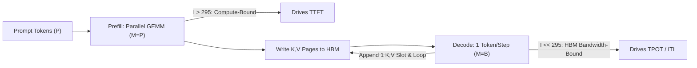
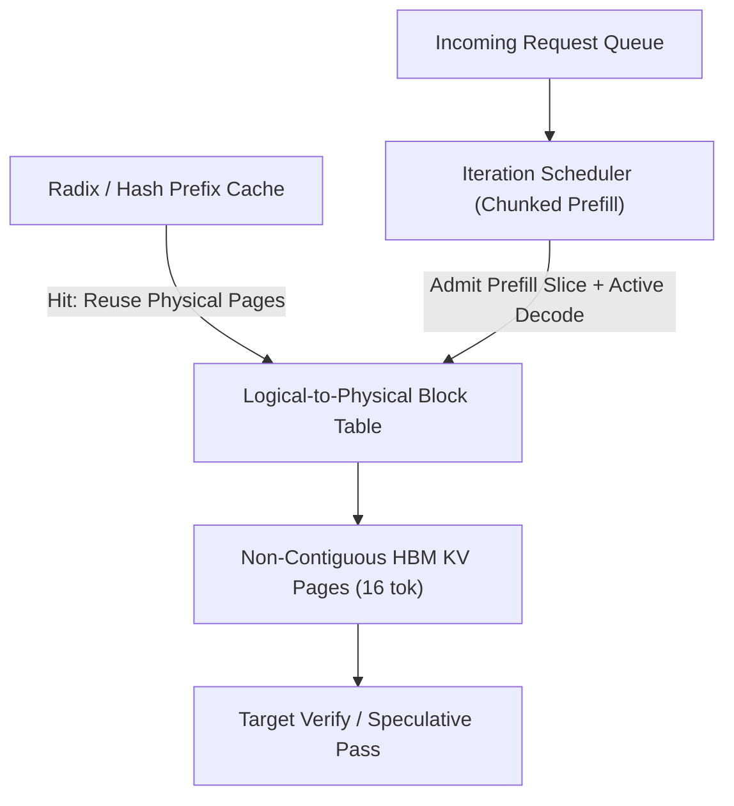
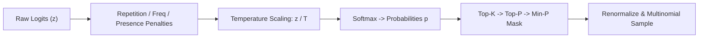

---
tags:
  - ai-engineering
  - llm-inference
  - kv-cache
  - quantization
  - economics
created: 2026-11-13
updated: 2026-11-13
status: 🟢
level: mid-to-senior
---

# LLM Internals, Inference & Economics

> [!abstract] Scope & Dependencies
> Book-replacement engineering reference covering byte-level BPE tokenization, Transformer autoregressive execution physics, roofline arithmetic intensity, exact KV-cache memory equations, PagedAttention and continuous batching internals, speculative decoding proofs, quantization kernels, complete capacity/benchmark tooling, production vLLM serving configurations, and TCO optimization.
> Navigation: [[AI/AI Engineering Hub|AI Engineering Hub]] · Prereq: [[Programming/Machine Learning/Deep Learning Guide|Deep Learning Guide]] · Related: [[AI/AI Engineering/Context Engineering & Structured Outputs|Context Engineering & Structured Outputs]], [[AI/AI Engineering/Production RAG Architecture|Production RAG Architecture]], [[AI/AI Engineering/Fine-Tuning, LoRA & Alignment|Fine-Tuning, LoRA & Alignment]], [[Programming/Software Engineering/DevOps/Observability|Observability]]

---

## 1. First-Principles Mechanics & Complete Architecture

### 1.1 Byte-Level BPE Tokenization & Vocabulary Physics

Autoregressive language models operate exclusively on discrete integer sequences $x = (x_1, x_2, \dots, x_P) \in \{0, \dots, |V|-1\}^P$ mapped through a fixed vocabulary $V$ (typically $|V| \in [32{,}000, 256{,}000]$). Modern production tokenizers (`o200k_base` at $200{,}019$ tokens, `cl100k_base` at $100{,}277$, Llama-3/4 at $128{,}256$, Qwen2.5/3 at $151{,}665$) implement **Byte-Level Byte Pair Encoding (BBPE)** preceded by a regex pre-tokenization pass:

1. **Pre-Tokenization Splitting**: A deterministic regular expression partitions raw text before merging so merges cannot span semantic boundaries (for example, preventing digits from merging across punctuation, or limiting whitespace runs). In `o200k_base`, the regex explicitly limits digit chunks to 1–3 digits, stabilizing arithmetic representation compared to older tokenizers.
2. **UTF-8 Byte Decomposition**: Every split substring converts into raw UTF-8 bytes (`0x00–0xFF`). Because all 256 single-byte values exist as base tokens in $V$, `<UNK>` out-of-vocabulary failures never occur regardless of Unicode script or binary escape characters.
3. **Deterministic Greedy Merge Execution**: The tokenizer loads a static priority rank table $\text{rank}(u, v) \in \mathbb{N}$ learned during corpus compression. At inference time, it repeatedly locates the adjacent symbol pair $(u, v)$ with the lowest rank integer inside the pre-token and replaces it with the merged token $uv$ until no valid merge rules remain.
4. **Embedding & LM-Head Footprint**: Expanding $|V|$ from $32\text{k}$ (`Llama-2`) to $128\text{k}$ (`Llama-3`) or $200\text{k}$ (`GPT-4o`) reduces sequence length by ~15–20% on English and ~30–40% on multilingual/code payloads (directly cutting decode steps and KV-cache duration). The cost is linear parameter growth in the input embedding matrix $W_E \in \mathbb{R}^{|V| \times d_{\text{model}}}$ and output unembedding head $W_U \in \mathbb{R}^{d_{\text{model}} \times |V|}$ (untied in Llama-3-8B: $2 \times 128{,}256 \times 4{,}096 \times 2\text{ B} \approx 2.10\text{ GB}$ just for vocabulary matrices, plus larger final logits GEMM).

### Production Failure Modes of Subword Tokenization

| Edge Case | Root Mechanism | Production Impact | Mitigation |
| :--- | :--- | :--- | :--- |
| **Multi-digit arithmetic** | Arbitrary corpus chunking (`380` = 1 token, `381` = `38` + `1` or distinct IDs) | Transformer cannot address individual place-value digits cleanly; off-by-one totals | Offload arithmetic to deterministic Python/calculator tools; enforce fixed 1–3 digit chunking |
| **Character-level operations** | Subword token IDs map to opaque $d_{\text{model}}$ vectors lacking character offsets | Fails letter counting (`"strawberry"`), string reversal, exact substring length checks | Never rely on zero-shot LLM character slicing; execute deterministic code assertions |
| **Leading-space asymmetry** | `" dog"` (`Ġdog`) and `"dog"` map to completely independent rows in $W_E$ | Prompt templates ending with a trailing space (`"Answer: "`) force unspaced token probabilities, distorting first-token logits | Strip trailing whitespace on all prompt templates prior to dispatch |
| **JSON punctuation overhead** | Braces, quotes, newlines, indentation spaces, and repeated schema keys consume 15–35% of tokens | Inflates TTFT prefill FLOPs, increases decode billing, crowds context budgets | Emit compact JSON (`separators=(",", ":")`) or TSV/CSV for dense homogeneous arrays |
| **Non-English token inflation** | Merge priority tables skew heavily toward English prose and source code | Spanish/Portuguese ~1.3–1.6x tokens; CJK/Arabic/Hindi **2x–4x tokens** | Benchmark token counts per locale; choose `o200k_base` / Qwen2.5+ multilingual vocabularies |
| **Special-token injection & drift** | Chat templates inject control IDs (`<\|begin_of_text\|>`, `<\|eot_id\|>`); raw string interpolation mimics delimiters | Model terminates generation prematurely or executes injected assistant/system role turns | Pass structured message arrays directly to engine chat-template renderers; escape special control strings |

> [!warning] Token Inflation Breaks Both Latency SLAs and Context Limits
> Because decode latency scales linearly with generated tokens $G$ and attention FLOPs scale quadratically at extreme prompt lengths $P$, a 3x non-English token inflation factor yields a **3x higher output cost**, **3x slower end-to-end streaming**, and **67% lower semantic context capacity** inside identical token limits.

```python
import tiktoken


def inspect_token_mechanics(model: str = "gpt-4o") -> None:
    """Display exact BBPE splits, byte lengths, and leading-space ID divergence."""
    enc = tiktoken.encoding_for_model(model)
    samples = [
        "dog",
        " dog",
        "123456789",
        '{"status": "approved", "score": 0.95}',
        '{"status":"approved","score":0.95}',
        "分散システム監視の異常検知",
    ]
    for text in samples:
        ids = enc.encode(text)
        pieces = [enc.decode([tid]) for tid in ids]
        ratio = len(text.encode("utf-8")) / max(len(ids), 1)
        print(f"tokens={len(ids):2d} | bytes/tok={ratio:.2f} | ids={ids[:4]} | {pieces}")


if __name__ == "__main__":
    inspect_token_mechanics()
```

---

### 1.2 Transformer Autoregressive Inference Physics: Prefill vs Decode

Inside each decoder layer $l \in \{1, \dots, L\}$, input hidden states $H \in \mathbb{R}^{B \times S \times d_{\text{model}}}$ undergo RMSNorm, linear projections $W_Q, W_K, W_V$, Rotary Position Embeddings (**RoPE**), Causal Scaled Dot-Product Attention, output projection $W_O$, and a **SwiGLU** feed-forward network (`down(silu(gate(x)) * up(x))`). Every linear projection multiplies activations by weight matrices stored in GPU High Bandwidth Memory (**HBM**).

Whether a GPU kernel is limited by Tensor Core math pipelines or HBM memory buses depends strictly on **Arithmetic Intensity** ($I$) relative to the accelerator's hardware **Roofline Ridge Point**:

$$I = \frac{\text{Total Floating-Point Operations (FLOPs)}}{\text{Total Bytes Transferred Between HBM and SRAM}}$$

$$\text{Hardware Ridge Point} = \frac{\text{Peak Tensor Core FLOP/s}}{\text{HBM Memory Bandwidth (Bytes/s)}}$$

For an **NVIDIA H100 SXM (80GB HBM3)**:
- Peak dense **BF16 / FP16** Tensor Core throughput: **$989\text{ TFLOPS}$** ($989 \times 10^{12}\text{ FLOP/s}$)
- Peak **FP8 (`E4M3`)** Tensor Core throughput: **$1{,}979\text{ TFLOPS}$** ($1{,}979 \times 10^{12}\text{ FLOP/s}$)
- Sustained HBM3 memory bandwidth: **$3.35\text{ TB/s}$** ($3.35 \times 10^{12}\text{ B/s}$)

$$\text{Ridge Point}_{\text{BF16}} = \frac{989 \times 10^{12}}{3.35 \times 10^{12}} \approx \mathbf{295.2\text{ FLOPs/byte}}$$

$$\text{Ridge Point}_{\text{FP8}} = \frac{1{,}979 \times 10^{12}}{3.35 \times 10^{12}} \approx \mathbf{590.7\text{ FLOPs/byte}}$$

Every GPU kernel executing with $I < 295.2\text{ FLOPs/byte}$ in BF16 is **memory-bandwidth-bound**: Tensor Core ALUs sit idle while warps stall waiting for weights and KV-cache rows to stream from HBM into on-chip SRAM registers.



#### Deriving Prefill vs Decode Arithmetic Intensity

Consider a dense linear layer $Y = X W$ where $X \in \mathbb{R}^{M \times K}$ and $W \in \mathbb{R}^{K \times N}$ ($M = B \cdot S_{\text{step}}$ active tokens processed together, weights stored at $b_w$ bytes/element, activations at $b_a$ bytes/element):
- **Multiply-Accumulate FLOPs**: $2 M K N$
- **HBM Bytes Read/Written**: $K N b_w + M K b_a + M N b_a$

$$I_{\text{linear}}(M) = \frac{2 M K N}{K N b_w + M(K + N) b_a}$$

1. **Prefill Phase ($M = P \gg 1$, e.g., $P = 2{,}048$)**:
   Because $K, N \in [4{,}096, 28{,}672]$ and $M$ is thousands of tokens, $K N b_w$ becomes negligible compared to compute reuse across $M$ rows:
   $$I_{\text{prefill}} \approx \frac{2 M}{b_a} \quad \text{or for } M \le K: I_{\text{prefill}} \approx \frac{2 P}{b_w}$$
   Even for $P = 512$ in BF16 ($b_w = 2$), $I \approx 512 \text{ FLOPs/byte} > 295.2$, **saturating H100 Tensor Cores**. Prefill executes as high-utilization **GEMM** (General Matrix-Matrix Multiply) kernels.
   - Total prefill linear FLOPs for a dense $N_{\text{params}}$ model across $P$ tokens: $\approx 2 \cdot N_{\text{params}} \cdot P$.
   - Total prefill self-attention FLOPs (across causal lower triangle): $2 \cdot L \cdot (2 \cdot P^2 \cdot d_{\text{model}}) = 4 L d_{\text{model}} P^2$ (note $Q K^T$ uses $P^2 d$ MACs and $A V$ uses $P^2 d$ MACs, halved by causal masking to $2 P^2 d$ FLOPs per projection $\to 2 L d_{\text{model}} P^2$ causal or $4 L d_{\text{model}} P^2$ unmasked upper bound). Above $P \approx 64\text{k–}128\text{k}$, quadratic $O(P^2)$ attention FLOPs surpass $O(P)$ FFN GEMM FLOPs and dominate TTFT.

2. **Decode Phase ($B$ concurrent requests, 1 token per request $\implies M = B$)**:
   At batch size $B = 1$, $M = 1 \ll K, N$, so $M(K+N)b_a \ll K N b_w$:
   $$I_{\text{decode}}(B=1) \approx \frac{2 \times 1}{b_w} = \begin{cases} \mathbf{1.0\text{ FLOP/byte}} & \text{BF16 weights } (b_w=2) \\ \mathbf{2.0\text{ FLOPs/byte}} & \text{FP8 weights } (b_w=1) \\ \mathbf{4.0\text{ FLOPs/byte}} & \text{INT4 weights } (b_w=0.5) \end{cases}$$
   At $B=1$, Tensor Cores operate at **$1.0 / 295.2 \approx 0.34\%$ utilization**! Decode executes as **GEMV** (Vector-Matrix Multiply) completely starved by HBM reads. Raising batch size to $B = 295$ theoretically hits the BF16 ridge point for weights, *except* attention KV-cache loading has $I_{\text{attn}} \approx 1\text{ FLOP/byte}$ **even when batched**, because each request in a batch attends only to its own private KV-cache!

#### Phase Comparison & Hardware Bounds

| Dimension | Prefill Phase | Decode Phase |
| :--- | :--- | :--- |
| **Execution Pattern** | Parallel forward pass across all $P$ prompt tokens simultaneously | Sequential autoregressive step emitting 1 token per active sequence |
| **Core Kernel Primitive** | Compute-dense **GEMM** ($P \times K$ by $K \times N$) | Memory-bound **GEMV** ($B=1$) or skinny GEMM ($B \in [8, 128]$) |
| **Arithmetic Intensity (H100 BF16)** | $> 295\text{ FLOPs/byte}$ for $P \ge 300$ | $\approx B\text{ FLOPs/byte}$ for FFN; $\approx 1\text{ FLOP/byte}$ for attention KV reads |
| **Primary Bottleneck** | **Tensor Core FLOPs** (+ $O(P^2)$ attention at $P > 32\text{k}$) | **HBM3 Bandwidth** (streaming weights + all active KV-caches every step) |
| **Primary SLA Metric** | **TTFT** (Time-to-First-Token) | **TPOT** (Time-Per-Output-Token) / **ITL** (Inter-Token Latency) |
| **Optimization Levers** | FP8 Tensor Cores, Tensor Parallelism, Prefix Caching, Chunked Prefill | Weight Quantization (FP8/AWQ), GQA/MLA, Continuous Batching, Speculative Decoding |

#### End-to-End Latency & Bandwidth Floor Equations

$$\text{E2E Latency} = \text{TTFT}(P) + (G - 1) \times \text{TPOT}(B, P + G)$$

For a dense model of $N$ parameters at weight precision $b_w$ bytes/param serving batch size $B$ with total active KV-cache bytes $\text{KV}_{\text{batch}}$ across all $B$ sequences, the physical HBM streaming floor per decode step is:

$$\text{TPOT}_{\min}(B) \ge \frac{N \cdot b_w + \text{KV}_{\text{batch}}}{\text{Effective HBM Bandwidth}}$$

For **Llama-3-70B in BF16** ($N = 70.6 \times 10^9$, $141.2\text{ GB}$ weights) across 4x H100 (`TP=4`, aggregate $4 \times 3.35 = 13.4\text{ TB/s}$ HBM3, assuming ~80% achieved bandwidth $\approx 10.7\text{ TB/s}$ plus NCCL AllReduce overhead):
- Streaming weights alone at $B=1$ costs $\approx 141.2 / 10{,}700 \approx 13.2\text{ ms/token}$ plus ~2–3 ms AllReduce synchronization ($\le 65\text{ tok/s}$).
- At $B = 64$ with average context $16\text{k}$ tokens (`5.0 GiB` KV per request $\implies 320\text{ GiB}$ active KV across 4 GPUs!), reading the KV-cache alone adds $343.6\text{ GB} / 10{,}700\text{ GB/s} \approx 32.1\text{ ms/token}$—KV bandwidth overtakes model weight bandwidth!

> [!info] FlashAttention-2/3 & FlashDecoding Mechanics
> Standard materialization of $S = Q K^T \in \mathbb{R}^{P \times P}$ requires writing and reading $O(P^2)$ intermediate matrices to HBM, exhausting VRAM above $P=16\text{k}$. **FlashAttention** tiles $Q, K, V$ blocks inside ultra-fast on-chip **SRAM** (~20 MB per H100 at >30 TB/s) using **online softmax** running max/sum rescaling, never writing $P \times P$ to HBM (`O(P)` memory). However, **attention FLOPs remain $O(P^2)$**, so prefill TTFT still grows quadratically at extreme lengths. During long-context low-batch decode, **FlashDecoding** partitions the KV sequence across multiple streaming multiprocessors (Split-K) and merges partial log-sum-exp outputs, eliminating SM underutilization when $B \times n_{\text{kv\_heads}}$ is smaller than the GPU's 132 SMs.

---

### 1.3 KV-Cache Memory Equations & Attention Topologies

Under causal masking, a token at position $t$ depends only on tokens $\le t$, so prior Key ($K$) and Value ($V$) projections remain invariant across future decode steps. Caching $K$ and $V$ turns $O(G^2)$ decode FLOPs into $O(G)$ compute at the expense of $O(B \cdot S)$ HBM allocation.

$$\text{KV Bytes per Token} = 2 \times n_{\text{layers}} \times n_{\text{kv\_heads}} \times d_{\text{head}} \times \text{bytes\_per\_elem}$$

$$\text{Total KV Bytes}(B, S) = B \times S \times \text{KV Bytes per Token}$$

- **$2$**: Separate Key and Value projection caches per layer.
- **$n_{\text{kv\_heads}}$**: Reduced relative to query heads $n_{\text{q\_heads}}$ via **Grouped-Query Attention (GQA)** or **Multi-Query Attention (MQA, $n_{\text{kv\_heads}}=1$)**—sharing one $K, V$ head across $g = n_{\text{q\_heads}} / n_{\text{kv\_heads}}$ query heads.
- **DeepSeek MLA (Multi-Head Latent Attention)**: Projects hidden state $h_t$ into a single compressed low-rank KV latent vector $c_t^{KV} \in \mathbb{R}^{d_c}$ ($d_c = 512$) plus a small decoupled RoPE key ($d_r = 64$), caching only $576$ scalars per layer instead of $2 \times n_{\text{kv\_heads}} \times d_{\text{head}}$—cutting KV-cache by **>85% vs GQA** while maintaining expressiveness via weight absorption at inference!
- **MoE (Mixture-of-Experts) Nuance**: Models like **Mixtral-8x22B** or **DeepSeek-V3 (671B total / 37B active)** execute only $k=2$ or $k=8$ experts per token (lowering FLOPs and decode weight reads for small $B$), **but** all expert weights still occupy static HBM (requiring multi-GPU Memory/EP), and KV-cache sizing depends strictly on attention layers and active heads/latents.

| Model Architecture | Layers ($L$) | $n_{\text{q\_heads}}$ | $n_{\text{kv\_heads}}$ | $d_{\text{head}}$ | KV / Token (BF16) | KV @ 32,768 Tokens |
| :--- | :---: | :---: | :---: | :---: | :---: | :---: |
| **Llama-3-8B (GQA 4:1)** | 32 | 32 | 8 | 128 | **128 KiB** | **4.00 GiB** |
| **Qwen2.5-32B (GQA 5:1)** | 64 | 40 | 8 | 128 | **256 KiB** | **8.00 GiB** |
| **Llama-3-70B (GQA 8:1)** | 80 | 64 | 8 | 128 | **320 KiB** | **10.00 GiB** |
| **Hypothetical 70B MHA** | 80 | 64 | 64 | 128 | **2,560 KiB** | **80.00 GiB** |
| **Llama-3-70B (FP8 KV)** | 80 | 64 | 8 | 128 | **160 KiB** | **5.00 GiB** |
| **DeepSeek-V3 (MLA)** | 61 | 128 | Latent ($512+64$) | — | **~68.6 KiB** | **~2.14 GiB** |

*(Note: $1\text{ KiB} = 1{,}024\text{ B}$; $1\text{ GiB} = 1{,}024^3\text{ B}$; $32{,}768 = 2^{15}$.)*

#### Parallelism Topologies: TP vs PP vs DP

- **Tensor Parallelism (`TP=k`)**: Splits attention heads and MLP columns/rows across $k$ GPUs on the same node over high-bandwidth **NVLink** (`900 GB/s` on H100 SXM). Cuts both weights and KV-cache per GPU by $k$ and slashes single-request latency, **but** executes **2 `AllReduce` barriers per layer** ($2 \times 80 = 160$ syncs per generated token on 70B!). Never run `TP` across slow PCIe links or inter-node Ethernet; if `TP > n_kv_heads` (e.g., `TP=16` on `n_kv_heads=8`), KV heads must replicate across GPUs, wasting VRAM.
- **Data Parallelism (`DP=r` Independent Replicas)**: Deploy two `TP=4` replicas across an `8x H100` node instead of `TP=8` whenever a 70B FP8/AWQ model fits in `TP=4` (or `TP=2`). Halving `TP` cuts AllReduce overhead and avoids cross-NUMA socket penalties, doubling peak cluster throughput.
- **Pipeline Parallelism (`PP`)**: Assigns contiguous layer ranges across nodes (`Layers 0..39` on Node 1, `40..79` on Node 2). Needs tiny point-to-point activation transfers instead of AllReduces, ideal when a massive model (405B/671B) exceeds one node's VRAM, at the cost of micro-batch pipeline bubbles and zero single-request latency improvement.

---

### 1.4 Serving Engine Internals: Scheduling, Caching & Speculative Decoding



1. **PagedAttention (vLLM / SGLang)**:
   Pre-allocating contiguous `max_model_len` (e.g., 128k) KV buffers per incoming request causes 60–80% HBM waste via internal over-allocation and external fragmentation. **PagedAttention** partitions KV HBM into fixed-size physical **KV Blocks** (typically `block_size = 16` tokens) indexed via a per-request **Block Table**, applying the exact same logical-to-physical indirection used by OS virtual memory page tables:
   - Internal waste drops to **$<4\%$** (solely the partially filled final block).
   - **Copy-on-Write (CoW) Sharing**: Parallel beam search, `n > 1` sampling, or shared system prompts point to the same physical blocks with reference counts; a block duplicates only when diverging tokens write to it.
   - **Preemption Policies**: When total active KV blocks hit 100% capacity, the scheduler preempts the newest/lowest-priority request—either **Recomputing** its KV pages when space frees (faster than CPU swap over PCIe for short prompts on fast GPUs) or **Swapping** pages to pinned CPU RAM (`--swap-space`).

2. **Continuous Batching & Chunked Prefill**:
   - **Static Batching Waste**: If 8 requests start together and 7 finish at 50 tokens while 1 generates 1,000 tokens, 7/8ths of the batch slots sit idle for 950 steps. **Iteration-Level (Continuous) Batching** checks for `<EOS>` or `max_tokens` after every single forward pass, immediately freeing finished KV blocks and admitting queued requests.
   - **Chunked Prefill**: Without chunking, admitting a single 32k-token prompt executes one monolithic compute-bound prefill pass across all SMs, stalling every concurrent decode sequence for 500–1,500 ms (**p99 ITL spike**). **Chunked Prefill** bounds total tokens processed per iteration via `max_num_batched_tokens` (e.g., `512` or `2048`): decode requests get priority slots first (e.g., 32 decode tokens), and the remaining token budget fills with one contiguous slice of the waiting prefill prompt. ITL jitter collapses while prefill Piggybacks compute onto decode weight reads!

3. **Prefix Caching (`SGLang RadixAttention` & `vLLM APC`)**:
   - **vLLM Automatic Prefix Caching (APC)**: Hashes each full `16`-token block sequentially: $h_i = \text{hash}(h_{i-1}, \text{tokens}[i \cdot 16 : (i+1) \cdot 16])$. Identical prefixes across requests hit the hash table in $O(1)$ and attach directly to cached physical KV blocks (`ref_count += 1`), skipping prefill compute completely.
   - **SGLang RadixAttention**: Maintains an LRU **Radix Tree** storing variable-length token edges mapped to KV pages—naturally handling multi-turn conversation branching, tree-of-thought rollouts, and few-shot subsets without fixed 16-token block alignment penalties.
   - **Disaggregated Prefill / Decode (`P/D Disaggregation`)**: At extreme scale (long prompts + tight ITL SLAs), serving engines separate dedicated **Prefill Workers** (compute-optimized, generating and transmitting KV blocks over RDMA/NVLink) from **Decode Workers** (bandwidth-optimized, running high-batch decode steps with zero prefill interference).

4. **Speculative Decoding (Mathematically Lossless Acceleration)**:
   Since single-batch decode runs at $I \approx 1\text{ FLOP/byte}$, verifying $\gamma$ candidate tokens in parallel costs almost the exact same wall-clock time as generating 1 token!
   - **Execution Loop**:
     1. A tiny fast draft mechanism $M_q$ (e.g., a 1B model, **EAGLE-2/3** lightweight autoregressive head reusing target hidden states, or **N-gram / suffix matching** for RAG copy tasks) generates $\gamma$ draft tokens $(x_1, \dots, x_\gamma)$ along with draft probabilities $q(x_t \mid x_{<t})$.
     2. Target model $M_p$ runs **one batched forward pass** over all $\gamma + 1$ positions simultaneously, yielding exact target probabilities $p(x_t \mid x_{<t})$.
     3. **Lossless Rejection Sampling**: Sequentially for $t = 1 \dots \gamma$, draw $r_t \sim \text{Uniform}(0, 1)$:
        - If $r_t \le \min\left(1, \frac{p(x_t)}{q(x_t)}\right)$, **accept** $x_t$.
        - Upon the first rejection at step $k$, discard $x_k \dots x_\gamma$ and sample a single corrected token from the normalized residual distribution:
          $$p_{\text{res}}(x) = \frac{\max\left(0, p(x) - q(x)\right)}{\sum_{x'} \max\left(0, p(x') - q(x')\right)}$$
        - If all $\gamma$ tokens pass, sample the bonus $(\gamma+1)$-th token directly from $p(x_{\gamma+1})$.
   - **Mathematical Proof of Exact Equivalence**: For any token $x$:
     $$P(\text{emit } x) = q(x)\min\left(1, \frac{p(x)}{q(x)}\right) + \left(1 - \sum_{x'} q(x')\min\left(1, \frac{p(x')}{q(x')}\right)\right) p_{\text{res}}(x)$$
     Note that $q(x)\min(1, p(x)/q(x)) = \min(q(x), p(x))$, and $\sum_{x'} \min(q(x'), p(x')) = 1 - \sum_{x'} \max(0, p(x') - q(x'))$. Substituting yields:
     $$P(\text{emit } x) = \min(q(x), p(x)) + \max(0, p(x) - q(x)) = p(x)$$
     Thus the marginal output distribution equals $M_p$ **identically**.
   - **Speedup Bound**: Let $\alpha \in [0, 1]$ be per-token acceptance probability and $c = T_{\text{draft\_step}} / T_{\text{target\_step}}$ be relative draft step cost. Expected accepted tokens per verification cycle is $\mathbb{E}[\text{tokens}] = \frac{1 - \alpha^{\gamma+1}}{1 - \alpha}$, giving net wall-clock speedup:
     $$\text{Speedup} = \frac{1 - \alpha^{\gamma+1}}{(1 - \alpha)(c \cdot \gamma + 1)}$$
     Note that speculative decoding increases total compute FLOPs, so it **helps** at low-to-moderate batch sizes ($B \le 16$) where Tensor Cores have spare FLOP headroom, and **hurts** under saturated high-batch compute regimes!

---

### 1.5 Decoding Pipeline, Sampling Math & Logprob Calibration

The transformer final RMSNorm + LM Head produces raw logits $z \in \mathbb{R}^{|V|}$. Serving engines apply transformations in strict sequential order:



- **Penalties (Applied Directly to Logits Before Softmax)**:
  - `frequency_penalty` ($c_f$): $z'_t = z_t - c_f \cdot \text{count}(t)$ — linearly suppresses repetitive phrases.
  - `presence_penalty` ($c_p$): $z'_t = z_t - c_p \cdot \mathbb{I}[\text{count}(t) > 0]$ — flat shift encouraging novel vocabulary.
  - `repetition_penalty` ($r \ge 1.0$, `llama.cpp`/HuggingFace): Divides positive logits by $r$ and multiplies negative logits by $r$ (`z'_t = z_t / r` if $z_t > 0$ else $z_t \cdot r$).
  - **JSON/Code Trap**: Never apply `frequency_penalty > 0` or `repetition_penalty > 1.05` on structured JSON or code—recurring syntax tokens (`"`, `:`, `}`, `item_id`, `return`) get progressively penalized until syntax corrupts.
- **Temperature ($T$)**: $p_i = \frac{\exp(z_i / T)}{\sum_j \exp(z_j / T)}$. As $T \to 0$, distribution mass concentrates on $\arg\max_i z_i$. Even at `temperature=0.0`, dynamic batching alters parallel floating-point summation order inside CUDA GEMM/FlashAttention kernels (`(a + b) + c != a + (b + c)` in IEEE/BF16), causing rare tie-break flips across identical inputs unless fixed seeds and batch-invariant kernels are enabled.
- **Top-$K$ vs Top-$P$ (Nucleus) vs Min-$P$**:
  - **Top-$K$**: Truncates to fixed cardinality $K$. Too restrictive on flat distributions, too permissive when 1 token holds `99.8%` probability.
  - **Top-$P$**: Retains smallest sorted subset $V^{(P)}$ where $\sum_{i \in V^{(P)}} p_i \ge P$ (`0.90–0.95`). Still admits flat tail noise if paired with $T > 1.0$.
  - **Min-$P$**: Filters out tokens where $p_i < \text{min\_p} \times p_{\max}$ (`0.05–0.10`). Automatically clamps to 1–2 tokens when the model is confident ($p_{\max}=0.94 \implies \text{threshold}=0.047$) while allowing broad exploration at genuine branching points ($p_{\max}=0.15 \implies \text{threshold}=0.0075$).
- **Logprob Confidence Calibration**:
  Requesting `logprobs=True, top_logprobs=5` exposes $\ell_t = \log p(x_t \mid x_{<t})$.
  - **Binary Classification Score**: Normalize competing class token probabilities:
    $$P(\text{YES}) = \frac{e^{\ell_{\text{YES}}}}{e^{\ell_{\text{YES}}} + e^{\ell_{\text{NO}}}}$$
  - **Length-Normalized Sequence Score**: Avoid raw sum $\sum \ell_t$ (monotonically penalizes longer answers); compute geometric-mean confidence $\exp\left(\frac{1}{G}\sum \ell_t\right)$ or minimum-token logprob $\min_t \ell_t$ to locate uncertain spans.
  - **Post-Training Calibration Warning**: RLHF/DPO sharpens logit margins (`0.999` predicted probability on incorrect answers). Always fit **temperature scaling** or **Platt scaling** on a labeled calibration split before gating automated human-escalation thresholds.

---

### 1.6 Quantization Mechanics: Weights, Activations & KV-Cache

| Format | Bits / Weight | Quantization Scheme | Quality Delta (70B / 8B) | Hardware & Kernel Execution | Production Sweet Spot |
| :--- | :---: | :--- | :--- | :--- | :--- |
| **BF16 / FP16** | 16-bit (`2.0 B`) | 1 sign, 8 exp (BF16) / 5 exp (FP16), 7/10 mantissa | `0%` (Reference) | Native Tensor Cores; BF16 avoids FP16 underflow/overflow without loss scaling | Evaluation gold baselines, RL/LoRA base weights |
| **FP8 (`E4M3`)** | 8-bit (`1.0 B`) | `W8A8` + FP8 KV-cache; dynamic per-token/per-block scaling | `<0.5%` | **2x Tensor Core FLOPs** (H100/B200) + **2x HBM BW savings** | Default production serving on Hopper / Blackwell / Ada |
| **AWQ (INT4)** | 4-bit (`~0.56 B`) | `W4A16` group-128; scales top ~1% activation-salient weight channels before rounding | `0.5–1.5%` (70B) / `1–3%` (8B) | Fused **Marlin / GEMV** kernels dequantize INT4 $\to$ FP16 in registers on the fly | High single-stream TPS & memory-constrained L40S/A100/H100 |
| **GPTQ (INT4)** | 4-bit (`~0.56 B`) | `W4A16` group-128; layer-wise second-order Hessian (`OBS`) error compensation | `0.8–2.0%` / `2–4%` | ExLlamaV2 / Marlin kernels; sensitive if calibration corpus diverges from target domain | Legacy W4A16 checkpoints when AWQ unavailable |
| **GGUF `Q4_K_M`** | ~4.85-bit effective | Super-blocks (`256` weights); promotes sensitive `attn_v`, `ffn_down`, `output` tensors to `Q6_K` | `1–2%` / `2–4%` | `llama.cpp` fused SIMD/Metal/CUDA MMQ kernels | Local dev, Apple Silicon unified memory, CPU+GPU hybrid |
| **FP4 / NVFP4** | 4-bit (`~0.53 B`) | Micro-scaling (`E2M1` + FP8 block scale per 16/32 elems) | `<1%` (Blackwell native) | Hardware FP4 Tensor Cores on NVIDIA B200/GB200 | Next-gen frontier model dense/MoE serving |
| **INT3 / INT2 / IQ2** | 2–3 bit | Extreme sub-4-bit compression | **Severe (>5–25% drop)** | **Accuracy cliff**: JSON schemas break, multilingual grammar & tool selection collapse | Emergency extreme-RAM edge use only; avoid in production |

#### SmoothQuant & Activation Outliers
Large transformers exhibit massive systematic activation outliers ($10\times\text{–}100\times$ channel magnitude) concentrated in fixed hidden channels across all tokens, making naive INT8 activation quantization (`W8A8`) catastrophically lossy. **SmoothQuant** mathematically migrates quantization difficulty from activations $X$ into weights $W$ via a per-channel smoothing vector $s_j = \max(|X_j|)^\alpha / \max(|W_j|)^{1-\alpha}$:

$$Y = (X \cdot \text{diag}(s)^{-1}) \cdot (\text{diag}(s) \cdot W) = \hat{X} \hat{W}$$

With $\alpha = 0.5$, activation spikes flatten into an INT8-friendly range while weights absorb the variance smoothly. Similarly, **FP8 (`E4M3`)** preserves dynamic range via 4 exponent bits and micro-block scaling (`DeepSeek-V3` 1x128 activation / 128x128 weight tile scaling), avoiding SmoothQuant calibration fragility.

> [!danger] The Sub-4-Bit & Small-Model Quantization Rule
> Quantization degradation is strongly asymmetric across parameter scale: a **70B AWQ INT4** model (`~39 GB` weights) routinely beats an **8B BF16** model (`16 GB`) on reasoning and structured tool adherence, whereas quantizing a small **3B–8B** model below 4 bits destroys instruction hierarchy, JSON formatting, and non-English fluency.

---

## 2. Real-World Use Cases & Architectural Decision Matrix

| Engineering Scenario | Recommended Serving Stack | Precision & KV Choice | Parallelism & Optimization | Why Alternatives Fail |
| :--- | :--- | :--- | :--- | :--- |
| **High-Volume Invoice / Ticket Extraction (10M req/mo)** | Managed Tier-2 API or self-hosted `vLLM` on `2x L40S` / `1x H100` | `FP8` weights + `FP8` KV (H100) or `AWQ W4A16` (L40S) | Continuous batching + Automatic Prefix Caching (`APC`) + guided JSON | Running BF16 wastes 2x HBM and cuts batch capacity in half; uncached frontier Tier-3 destroys gross margins |
| **64k–128k Long-Context Legal / Code RAG Copilot** | `vLLM` / `SGLang` on `4x H100 80GB` | `FP8` weights + `FP8` KV-cache (halves 10 GiB/req KV to 5 GiB) | `TP=4` + **Chunked Prefill** (`max_num_batched_tokens=1024`) + Prefix Caching | Disabling chunked prefill causes 1s+ `p99 ITL` freeze spikes for every concurrent user during prefill |
| **Ultra-Low-Latency Voice AI / IDE Autocomplete (`TTFT <150ms, ITL <15ms`)** | Dedicated GPU replicas (`SGLang` / `TRT-LLM`) or P/D Disaggregation | `AWQ INT4` or `FP8` on `TP=2` NVLink | **Speculative Decoding** (EAGLE-3 or suffix/N-gram) + low batch (`B <= 8`) | Large `TP=8` adds AllReduce sync tax; oversized batches push decode past ITL budget |
| **Air-Gapped Multi-Tenant Healthcare SaaS (20 Fine-Tuned Clients)** | Single shared `vLLM` base deployment + dynamic **LoRA Multiplexing** | `FP8` or `BF16` base weights + quantized LoRA adapters (`r=16`) | Base weights shared in HBM; adapters hot-swapped per request via `model="tenant-a"` | Spinning 20 isolated GPU pods burns 20x VRAM and idles at <10% utilization |
| **Bursty Internal Enterprise Assistant (Peaks 9am–11am, Idle Nights)** | **Managed Serverless API** + 3-Tier Semantic Router | Provider-managed + Prompt Caching breakpoints | Route 50% simple to Nano, 35% to Workhorse, 15% to Frontier | Self-hosted dedicated H100 nodes bill `$3–$4/GPU-hr` 24/7 while averaging `<20%` utilization |

### Self-Hosted vs Managed API Break-Even Equation

Let $C_{\text{gpu}}$ be hourly cluster cost (`$/hr`), $U \in (0, 1]$ be average sustained effective GPU utilization across a 24-hour cycle, $R_{\text{eff}}$ be sustained output tokens/sec across active batches (with $k_{\text{in/out}}$ input-to-output ratio), and $P_{\text{api\_out}}, P_{\text{api\_in}}$ be blended cached/uncached API prices per 1M tokens:

$$\text{Self-Hosted Cost per 1M Output Tokens} = \frac{C_{\text{gpu}}}{3{,}600 \times U \times R_{\text{eff}} / 10^6}$$

Self-hosting achieves lower direct inference COGS than managed Tier-2 APIs typically when **sustained 24/7 GPU utilization exceeds 35–45%** (before engineering/SRE overhead) OR when hard regulatory VPC residency / custom fine-tunes mandate dedicated weights. Below 30% utilization, idle night/weekend GPU hours erase per-token savings.

---

## 3. Step-by-Step Practical Application: Capacity Planner, Async Benchmark Harness & vLLM Production Stack

### Production Project Layout

```text
inference-ops/
├── pyproject.toml
├── src/
│   └── inference_ops/
│       ├── __init__.py
│       ├── calculator.py       # Exact KV-cache, roofline & TCO calculator
│       └── benchmark.py        # Async SSE TTFT, p99 ITL, Goodput & cache probe
├── deploy/
│   ├── vllm-serve.sh           # Single-node tuned vLLM launch flags
│   └── k8s-vllm-deploy.yaml    # Production Kubernetes Deployment + Prometheus scrape
└── tests/
    └── test_calculator.py      # Deterministic unit tests for sizing & TCO math
```

### `pyproject.toml`

```toml
[project]
name = "inference-ops"
version = "0.2.0"
requires-python = ">=3.11"
dependencies = [
    "httpx>=0.27.0",
    "tiktoken>=0.8.0",
]

[project.optional-dependencies]
dev = [
    "pytest>=8.3.0",
    "pytest-asyncio>=0.24.0",
]
```

### `src/inference_ops/calculator.py` — Exact KV-Cache, Roofline & Token Economics Engine

```python
from __future__ import annotations

from dataclasses import dataclass
import math


BYTES_PER_DTYPE: dict[str, float] = {
    "bf16": 2.0,
    "fp16": 2.0,
    "fp8": 1.0,
    "int8": 1.0,
    "awq_int4": 0.5625,  # 4-bit weight + group-128 FP16 scale/zero overhead
    "gptq_int4": 0.5625,
}

GIB = 1024**3
MIB = 1024**2
KIB = 1024


@dataclass(frozen=True, slots=True)
class ModelArchSpec:
    name: str
    total_params_b: float
    active_params_b: float
    n_layers: int
    n_q_heads: int
    n_kv_heads: int
    d_head: int
    mla_kv_lora_rank: int | None = None
    mla_qk_rope_head_dim: int | None = None


@dataclass(frozen=True, slots=True)
class GpuClusterSpec:
    name: str
    gpu_count: int
    vram_gib_per_gpu: float
    gpu_memory_utilization: float
    peak_bf16_tflops: float
    peak_fp8_tflops: float
    hbm_bandwidth_gbps: float
    hourly_cluster_usd: float
    activation_reserve_gib_per_gpu: float = 2.0
    cuda_context_gib_per_gpu: float = 1.2


@dataclass(frozen=True, slots=True)
class CapacityReport:
    model_name: str
    weight_dtype: str
    kv_dtype: str
    weights_gib_total: float
    usable_pool_gib_total: float
    available_kv_gib: float
    kv_kib_per_token: float
    kv_gib_per_seq: float
    max_concurrent_seqs: int
    min_tpot_ms_at_bs1: float
    ridge_point_flops_per_byte: float


@dataclass(frozen=True, slots=True)
class CacheEconomicsReport:
    baseline_monthly_usd: float
    optimized_monthly_usd: float
    monthly_savings_usd: float
    savings_pct: float
    effective_input_multiplier: float


LLAMA_3_8B = ModelArchSpec(
    name="Llama-3.1-8B",
    total_params_b=8.03,
    active_params_b=8.03,
    n_layers=32,
    n_q_heads=32,
    n_kv_heads=8,
    d_head=128,
)

LLAMA_3_70B = ModelArchSpec(
    name="Llama-3.1-70B",
    total_params_b=70.55,
    active_params_b=70.55,
    n_layers=80,
    n_q_heads=64,
    n_kv_heads=8,
    d_head=128,
)

DEEPSEEK_V3 = ModelArchSpec(
    name="DeepSeek-V3-671B",
    total_params_b=671.0,
    active_params_b=37.0,
    n_layers=61,
    n_q_heads=128,
    n_kv_heads=128,
    d_head=128,
    mla_kv_lora_rank=512,
    mla_qk_rope_head_dim=64,
)

H100_SXM_4X = GpuClusterSpec(
    name="4x-H100-SXM-80GB",
    gpu_count=4,
    vram_gib_per_gpu=80.0,
    gpu_memory_utilization=0.90,
    peak_bf16_tflops=989.0,
    peak_fp8_tflops=1979.0,
    hbm_bandwidth_gbps=3350.0,
    hourly_cluster_usd=11.96,
    activation_reserve_gib_per_gpu=2.0,
    cuda_context_gib_per_gpu=0.0,  # absorbed by 0.90 gpu_memory_utilization cap
)


def kv_bytes_per_token(model: ModelArchSpec, kv_dtype: str = "bf16") -> float:
    """Compute exact KV-cache bytes per token for GQA/MHA or DeepSeek MLA."""
    elem_bytes = BYTES_PER_DTYPE[kv_dtype]
    if model.mla_kv_lora_rank is not None:
        rope_dim = model.mla_qk_rope_head_dim or 0
        # MLA stores 1 compressed latent vector + 1 shared RoPE key vector per layer
        return float(model.n_layers * (model.mla_kv_lora_rank + rope_dim) * elem_bytes)
    return float(2 * model.n_layers * model.n_kv_heads * model.d_head * elem_bytes)


def compute_capacity_report(
    model: ModelArchSpec,
    cluster: GpuClusterSpec,
    context_tokens: int,
    weight_dtype: str = "bf16",
    kv_dtype: str = "bf16",
    paged_block_size: int = 16,
) -> CapacityReport:
    """Calculate VRAM allocation, PagedAttention fragmentation floor, and concurrency."""
    if weight_dtype not in BYTES_PER_DTYPE or kv_dtype not in BYTES_PER_DTYPE:
        raise ValueError(f"Unsupported dtype: weight={weight_dtype}, kv={kv_dtype}")
    if model.mla_kv_lora_rank is None and model.n_kv_heads < cluster.gpu_count:
        # Under TP > n_kv_heads, engines replicate KV heads across tensor-parallel ranks.
        kv_replication_factor = cluster.gpu_count / model.n_kv_heads
    else:
        kv_replication_factor = 1.0

    weight_bytes_total = model.total_params_b * 1e9 * BYTES_PER_DTYPE[weight_dtype]
    weights_gib_total = weight_bytes_total / GIB

    usable_per_gpu = (
        cluster.vram_gib_per_gpu * cluster.gpu_memory_utilization
        - cluster.cuda_context_gib_per_gpu
        - cluster.activation_reserve_gib_per_gpu
    )
    usable_pool_gib_total = usable_per_gpu * cluster.gpu_count
    available_kv_gib = usable_pool_gib_total - weights_gib_total

    token_bytes = kv_bytes_per_token(model, kv_dtype) * kv_replication_factor
    aligned_tokens = math.ceil(context_tokens / paged_block_size) * paged_block_size
    kv_gib_per_seq = (aligned_tokens * token_bytes) / GIB

    max_seqs = max(0, int(math.floor(available_kv_gib / kv_gib_per_seq))) if available_kv_gib > 0 else 0

    # Theoretical minimum single-stream TPOT bound assuming 80% achieved HBM bandwidth
    active_weight_bytes = model.active_params_b * 1e9 * BYTES_PER_DTYPE[weight_dtype]
    seq_kv_bytes = context_tokens * kv_bytes_per_token(model, kv_dtype)
    effective_bw_bytes_per_sec = cluster.gpu_count * cluster.hbm_bandwidth_gbps * 1e9 * 0.80
    min_tpot_ms = ((active_weight_bytes + seq_kv_bytes) / effective_bw_bytes_per_sec) * 1000.0

    peak_tflops = cluster.peak_fp8_tflops if weight_dtype == "fp8" else cluster.peak_bf16_tflops
    ridge_point = (peak_tflops * 1e12) / (cluster.hbm_bandwidth_gbps * 1e9)

    return CapacityReport(
        model_name=model.name,
        weight_dtype=weight_dtype,
        kv_dtype=kv_dtype,
        weights_gib_total=round(weights_gib_total, 2),
        usable_pool_gib_total=round(usable_pool_gib_total, 2),
        available_kv_gib=round(available_kv_gib, 2),
        kv_kib_per_token=round(token_bytes / KIB, 2),
        kv_gib_per_seq=round(kv_gib_per_seq, 3),
        max_concurrent_seqs=max_seqs,
        min_tpot_ms_at_bs1=round(min_tpot_ms, 2),
        ridge_point_flops_per_byte=round(ridge_point, 1),
    )


def compute_prefix_cache_tco(
    monthly_requests: int,
    static_prefix_tokens: int,
    dynamic_input_tokens: int,
    output_tokens: int,
    base_input_per_1m: float,
    cached_read_multiplier: float,
    cache_write_multiplier: float,
    output_per_1m: float,
    cache_hit_rate: float,
) -> CacheEconomicsReport:
    """Compute exact monthly token spend with prompt-cache read/write economics."""
    total_input = static_prefix_tokens + dynamic_input_tokens
    baseline_in = (monthly_requests * total_input / 1e6) * base_input_per_1m
    baseline_out = (monthly_requests * output_tokens / 1e6) * output_per_1m
    baseline_total = baseline_in + baseline_out

    effective_prefix_units = static_prefix_tokens * (
        cache_hit_rate * cached_read_multiplier
        + (1.0 - cache_hit_rate) * cache_write_multiplier
    )
    effective_input_tokens = effective_prefix_units + dynamic_input_tokens
    opt_in = (monthly_requests * effective_input_tokens / 1e6) * base_input_per_1m
    opt_total = opt_in + baseline_out
    savings = baseline_total - opt_total
    return CacheEconomicsReport(
        baseline_monthly_usd=round(baseline_total, 2),
        optimized_monthly_usd=round(opt_total, 2),
        monthly_savings_usd=round(savings, 2),
        savings_pct=round((savings / baseline_total) * 100.0, 2) if baseline_total > 0 else 0.0,
        effective_input_multiplier=round(effective_input_tokens / total_input, 4),
    )


if __name__ == "__main__":
    for w_dt, kv_dt in [("bf16", "bf16"), ("fp8", "fp8"), ("awq_int4", "fp8")]:
        rep = compute_capacity_report(LLAMA_3_70B, H100_SXM_4X, context_tokens=32768, weight_dtype=w_dt, kv_dtype=kv_dt)
        print(rep)
```

### `src/inference_ops/benchmark.py` — Async SSE Streaming Benchmark & Goodput Harness

```python
from __future__ import annotations

import argparse
import asyncio
from dataclasses import dataclass, field
import json
import os
import statistics
import time
from typing import Any
import httpx


@dataclass(slots=True)
class RequestTelemetry:
    ok: bool
    ttft_ms: float = 0.0
    e2e_ms: float = 0.0
    itl_ms_list: list[float] = field(default_factory=list)
    prompt_tokens: int = 0
    cached_tokens: int = 0
    completion_tokens: int = 0
    error: str | None = None


def percentile(sorted_vals: list[float], pct: float) -> float:
    if not sorted_vals:
        return 0.0
    idx = (len(sorted_vals) - 1) * (pct / 100.0)
    lo = int(idx)
    hi = min(lo + 1, len(sorted_vals) - 1)
    frac = idx - lo
    return sorted_vals[lo] * (1.0 - frac) + sorted_vals[hi] * frac


async def run_single_stream(
    client: httpx.AsyncClient,
    base_url: str,
    api_key: str,
    model: str,
    static_prefix: str,
    query: str,
    max_tokens: int,
) -> RequestTelemetry:
    """Measure true SSE Time-To-First-Token, per-chunk ITL, and cache hit counts."""
    headers = {
        "Authorization": f"Bearer {api_key}",
        "Content-Type": "application/json",
    }
    payload: dict[str, Any] = {
        "model": model,
        "messages": [
            {"role": "system", "content": static_prefix},
            {"role": "user", "content": query},
        ],
        "max_tokens": max_tokens,
        "temperature": 0.0,
        "stream": True,
        "stream_options": {"include_usage": True},
    }

    t_start = time.perf_counter()
    t_first_token: float | None = None
    t_prev_token: float | None = None
    itl_list: list[float] = []
    usage_info: dict[str, Any] = {}
    emitted_chunks = 0

    try:
        async with client.stream(
            "POST",
            f"{base_url.rstrip('/')}/chat/completions",
            headers=headers,
            json=payload,
        ) as resp:
            if resp.status_code != 200:
                body = (await resp.aread()).decode("utf-8", errors="replace")
                return RequestTelemetry(ok=False, error=f"HTTP {resp.status_code}: {body[:200]}")

            async for line in resp.aiter_lines():
                if not line or not line.startswith("data: "):
                    continue
                raw = line[6:].strip()
                if raw == "[DONE]":
                    break
                event = json.loads(raw)
                if event.get("usage"):
                    usage_info = event["usage"]
                choices = event.get("choices") or []
                if choices:
                    delta = choices[0].get("delta", {})
                    if delta.get("content") or delta.get("reasoning_content"):
                        now = time.perf_counter()
                        emitted_chunks += 1
                        if t_first_token is None:
                            t_first_token = now
                        elif t_prev_token is not None:
                            itl_list.append((now - t_prev_token) * 1000.0)
                        t_prev_token = now

        t_end = time.perf_counter()
        if t_first_token is None:
            return RequestTelemetry(ok=False, error="Stream closed with zero content tokens")

        prompt_details = usage_info.get("prompt_tokens_details") or {}
        prompt_toks = int(usage_info.get("prompt_tokens", 0))
        cached_toks = int(prompt_details.get("cached_tokens", 0))
        comp_toks = int(usage_info.get("completion_tokens", emitted_chunks))

        return RequestTelemetry(
            ok=True,
            ttft_ms=(t_first_token - t_start) * 1000.0,
            e2e_ms=(t_end - t_start) * 1000.0,
            itl_ms_list=itl_list,
            prompt_tokens=prompt_toks,
            cached_tokens=cached_toks,
            completion_tokens=comp_toks,
        )
    except Exception as exc:
        return RequestTelemetry(ok=False, error=str(exc))


async def benchmark_concurrency(
    base_url: str,
    api_key: str,
    model: str,
    total_requests: int,
    concurrency: int,
    max_tokens: int,
    ttft_sla_ms: float,
    tpot_sla_ms: float,
) -> dict[str, Any]:
    """Drive bounded concurrent SSE load and report TTFT, p99 ITL, TPS, and Goodput."""
    static_prefix = (
        "You are a deterministic technical analyzer. Follow schema constraints strictly. "
        + ("Reference policy invariant section. " * 260)  # >1,500 tokens for prefix cache trigger
    )
    sem = asyncio.Semaphore(concurrency)
    limits = httpx.Limits(max_connections=concurrency + 16, max_keepalive_connections=concurrency)

    async with httpx.AsyncClient(timeout=httpx.Timeout(120.0), limits=limits) as client:
        async def worker(idx: int) -> RequestTelemetry:
            async with sem:
                query = f"Summarize status code {400 + (idx % 50)} in 3 concise bullet points."
                return await run_single_stream(
                    client, base_url, api_key, model, static_prefix, query, max_tokens
                )

        wall_start = time.perf_counter()
        results = await asyncio.gather(*(worker(i) for i in range(total_requests)))
        wall_sec = time.perf_counter() - wall_start

    ok_runs = [r for r in results if r.ok]
    ttfts = sorted(r.ttft_ms for r in ok_runs)
    all_itls = sorted(x for r in ok_runs for x in r.itl_ms_list)
    total_out = sum(r.completion_tokens for r in ok_runs)
    total_in = sum(r.prompt_tokens for r in ok_runs)
    total_cached = sum(r.cached_tokens for r in ok_runs)

    goodput_count = 0
    for r in ok_runs:
        mean_tpot = (r.e2e_ms - r.ttft_ms) / max(r.completion_tokens - 1, 1)
        if r.ttft_ms <= ttft_sla_ms and mean_tpot <= tpot_sla_ms:
            goodput_count += 1

    return {
        "total_requests": total_requests,
        "succeeded": len(ok_runs),
        "failed": total_requests - len(ok_runs),
        "wall_seconds": round(wall_sec, 2),
        "system_output_tps": round(total_out / max(wall_sec, 1e-6), 2),
        "ttft_p50_ms": round(percentile(ttfts, 50), 2),
        "ttft_p99_ms": round(percentile(ttfts, 99), 2),
        "itl_p50_ms": round(percentile(all_itls, 50), 2),
        "itl_p99_ms": round(percentile(all_itls, 99), 2),
        "itl_mean_ms": round(statistics.mean(all_itls), 2) if all_itls else 0.0,
        "prefix_cache_hit_ratio": round(total_cached / max(total_in, 1), 4),
        "goodput_pct": round((goodput_count / total_requests) * 100.0, 2),
    }


def main() -> None:
    parser = argparse.ArgumentParser(description="Async LLM Streaming & Goodput Benchmark")
    parser.add_argument("--base-url", default=os.getenv("OPENAI_BASE_URL", "http://localhost:8000/v1"))
    parser.add_argument("--api-key", default=os.getenv("OPENAI_API_KEY", "EMPTY"))
    parser.add_argument("--model", required=True)
    parser.add_argument("--requests", type=int, default=40)
    parser.add_argument("--concurrency", type=int, default=8)
    parser.add_argument("--max-tokens", type=int, default=128)
    parser.add_argument("--ttft-sla-ms", type=float, default=600.0)
    parser.add_argument("--tpot-sla-ms", type=float, default=35.0)
    args = parser.parse_args()

    summary = asyncio.run(
        benchmark_concurrency(
            base_url=args.base_url,
            api_key=args.api_key,
            model=args.model,
            total_requests=args.requests,
            concurrency=args.concurrency,
            max_tokens=args.max_tokens,
            ttft_sla_ms=args.ttft_sla_ms,
            tpot_sla_ms=args.tpot_sla_ms,
        )
    )
    print(json.dumps(summary, indent=2))


if __name__ == "__main__":
    main()
```

### `deploy/vllm-serve.sh` & `deploy/k8s-vllm-deploy.yaml` — Production Serving Config

```bash
#!/usr/bin/env bash
set -euo pipefail

export CUDA_VISIBLE_DEVICES=0,1,2,3
export NCCL_P2P_DISABLE=0
export NCCL_IB_DISABLE=0
export VLLM_USE_V1=1

exec vllm serve meta-llama/Llama-3.3-70B-Instruct \
  --host 0.0.0.0 \
  --port 8000 \
  --tensor-parallel-size 4 \
  --quantization fp8 \
  --kv-cache-dtype fp8 \
  --calculate-kv-scales \
  --max-model-len 32768 \
  --gpu-memory-utilization 0.90 \
  --enable-prefix-caching \
  --enable-chunked-prefill \
  --max-num-batched-tokens 2048 \
  --max-num-seqs 128 \
  --swap-space 8 \
  --disable-log-requests
```

```yaml
apiVersion: apps/v1
kind: Deployment
metadata:
  name: vllm-llama70b-fp8
  labels:
    app: vllm-inference
spec:
  replicas: 2
  selector:
    matchLabels:
      app: vllm-inference
  template:
    metadata:
      labels:
        app: vllm-inference
      annotations:
        prometheus.io/scrape: "true"
        prometheus.io/port: "8000"
        prometheus.io/path: "/metrics"
    spec:
      containers:
        - name: vllm
          image: vllm/vllm-openai:v0.8.4
          args:
            - "--model=meta-llama/Llama-3.3-70B-Instruct"
            - "--tensor-parallel-size=4"
            - "--quantization=fp8"
            - "--kv-cache-dtype=fp8"
            - "--max-model-len=32768"
            - "--gpu-memory-utilization=0.90"
            - "--enable-prefix-caching"
            - "--enable-chunked-prefill"
            - "--max-num-batched-tokens=2048"
            - "--max-num-seqs=128"
          env:
            - name: VLLM_USE_V1
              value: "1"
            - name: HF_TOKEN
              valueFrom:
                secretKeyRef:
                  name: hf-credentials
                  key: token
          ports:
            - name: http
              containerPort: 8000
          resources:
            limits:
              nvidia.com/gpu: "4"
              memory: "256Gi"
            requests:
              nvidia.com/gpu: "4"
              cpu: "32"
              memory: "192Gi"
          volumeMounts:
            - name: shm
              mountPath: /dev/shm
          readinessProbe:
            httpGet:
              path: /health
              port: 8000
            initialDelaySeconds: 90
            periodSeconds: 10
          livenessProbe:
            httpGet:
              path: /health
              port: 8000
            initialDelaySeconds: 180
            periodSeconds: 30
            failureThreshold: 3
      volumes:
        - name: shm
          emptyDir:
            medium: Memory
            sizeLimit: 32Gi
```

*(Critical Kubernetes Detail: `/dev/shm` defaults to `64 MB` in Docker/K8s, which immediately crashes PyTorch/NCCL `TP=4` shared-memory IPC unless explicitly mounted as a `Memory`-backed `emptyDir` of `16–32 GiB`!)*

### `tests/test_calculator.py` — Verification Unit Tests

```python
import pytest

from inference_ops.calculator import (
    DEEPSEEK_V3,
    H100_SXM_4X,
    LLAMA_3_70B,
    LLAMA_3_8B,
    compute_capacity_report,
    compute_prefix_cache_tco,
    kv_bytes_per_token,
)


def test_kv_bytes_per_token_gqa_and_mla() -> None:
    assert kv_bytes_per_token(LLAMA_3_8B, "bf16") == 131_072.0   # 128 KiB
    assert kv_bytes_per_token(LLAMA_3_70B, "bf16") == 327_680.0  # 320 KiB
    assert kv_bytes_per_token(LLAMA_3_70B, "fp8") == 163_840.0   # 160 KiB
    # DeepSeek-V3 MLA: 61 * (512 + 64) * 2 = 70,272 bytes (~68.625 KiB)
    assert kv_bytes_per_token(DEEPSEEK_V3, "bf16") == 70_272.0


def test_llama70b_fp8_triples_32k_concurrency() -> None:
    bf16 = compute_capacity_report(LLAMA_3_70B, H100_SXM_4X, 32768, "bf16", "bf16")
    fp8 = compute_capacity_report(LLAMA_3_70B, H100_SXM_4X, 32768, "fp8", "fp8")
    assert bf16.kv_gib_per_seq == pytest.approx(10.0, rel=1e-3)
    assert fp8.kv_gib_per_seq == pytest.approx(5.0, rel=1e-3)
    assert bf16.max_concurrent_seqs == 14
    assert fp8.max_concurrent_seqs == 42


def test_prefix_cache_tco_80pct_hit_rate() -> None:
    report = compute_prefix_cache_tco(
        monthly_requests=10_000_000,
        static_prefix_tokens=3_200,
        dynamic_input_tokens=800,
        output_tokens=400,
        base_input_per_1m=3.00,
        cached_read_multiplier=0.10,
        cache_write_multiplier=1.25,
        output_per_1m=15.00,
        cache_hit_rate=0.80,
    )
    assert report.baseline_monthly_usd == 180_000.00
    assert report.effective_input_multiplier == 0.464
    assert report.optimized_monthly_usd == 115_680.00
```

---

## 4. Serving SLA Taxonomy, Reference Flags & Subtle Edge Cases

### SLA Metrics & Goodput

Raw **System Output Throughput (TPS)** misleads capacity planning because saturating `batch_size = 512` raises aggregate cluster TPS while dragging single-user `TPOT` from `15 ms` to `120 ms` (8 tok/s—unusable for interactive UI streaming). Always optimize **Goodput**: the maximum request rate ($\text{req/s}$) satisfying ALL user-facing SLA constraints simultaneously (e.g., `p95 TTFT <= 500 ms` AND `p99 ITL <= 40 ms`).

### Critical Production Edge Cases

1. **Non-Determinism at `temperature = 0.0`**:
   Varying active batch sizes alter CUDA reduction splits in matrix multiplications (`cuBLAS`) and FlashAttention accumulations. Floating-point addition is non-associative, shifting tail logits by $10^{-4}$ and flipping close token ties. Require deterministic batch-invariant kernels or accept minor variance even at `T=0`, logging `system_fingerprint` and exact token IDs for reproducibility.
2. **Reasoning Model Output-Token & KV-Cache Explosion**:
   Reasoning models (`o3`, `DeepSeek-R1`, Claude extended thinking) emit `1,000–15,000` hidden thinking tokens *before* emitting the first user-visible JSON token. Those internal reasoning tokens count as **billed output tokens**, expand the **KV-cache linearly**, and delay **visible TTFT** by tens of seconds—always enforce strict `max_completion_tokens` / `reasoning_effort` budgets and expose progress heartbeats.
3. **KV-Cache Preemption Thrashing**:
   If incoming request rate triggers `max_num_seqs` admitting 120 sequences that subsequently generate 8,000 tokens each, total KV pages exceed HBM capacity. The scheduler repeatedly swaps/preempts tail requests and recomputes them, causing throughput collapse and wild `p99 ITL` oscillations. Tune `--gpu-memory-utilization` carefully (`0.88–0.92`) and reserve headroom for peak output lengths.
4. **CUDA Graph Capture VRAM Overhead**:
   vLLM captures CUDA graphs for discrete batch sizes (`[1, 2, 4, 8, ..., 256]`) to eliminate Python host-launch latency during decode. At high `max-num-seqs`, captured graph buffers consume `1–3 GiB` per GPU *before* KV block allocation. If OOM happens during warmup, inspect `--max-seq-len-to-capture` or pass `--enforce-eager` temporarily to isolate capture overhead vs weight/KV sizing.
5. **Prefix Cache Alignment & Eviction Churn**:
   In vLLM APC, KV blocks cache only complete `16`-token multiples (`floor(P / 16) * 16`). If a 4,000-token prefix shifts by 1 token at byte 10, every single downstream block hash changes. Furthermore, on overloaded GPUs with tiny KV pools (`<20 GiB` free), active decode blocks evict idle prefix blocks within seconds, cutting hit rates during traffic bursts unless KV headroom is sized for prefix retention.
6. **Multi-LoRA Base Adapter Fragmentation**:
   Serving dozens of LoRA adapters (`--enable-lora --max-loras 16 --max-lora-rank 64`) allocates pre-sized LoRA weight buffers inside HBM (`max_loras * adapter_size`), cutting available KV cache. Keep `--max-lora-rank` tight (`16` or `32`) and `--max-cpu-loras` pinned to host memory for cold adapters.

---

## 5. Production Debugging, Profiling & Operations Playbook

### Telemetry Triage Matrix

| Production Symptom | Likely Root Cause | Verification Metric / Command | Remediation |
| :--- | :--- | :--- | :--- |
| **`p50 ITL` normal, `p99 ITL` spikes `>500 ms` periodically** | Monolithic prefill of long prompts starving active decode batches | `vllm:time_per_output_token_seconds` histogram; check `--enable-chunked-prefill` | Enable `--enable-chunked-prefill` and cap `--max-num-batched-tokens 1024` |
| **Sudden `TTFT` jump across all requests (`200ms -> 3s`)** | Prefix cache invalidation or KV pool eviction thrashing | `vllm:prefix_cache_hits_total / queries_total`; diff tokens `0..64` | Pin static prompt + sorted tool JSON at byte 0; expand KV pool or drop `FP16 -> FP8` KV |
| **Goodput plateaus early; `vllm:num_preemptions_total` climbing** | Over-admission (`max_num_seqs` too high for long output tails) causing recompute/swap storms | `curl -s localhost:8000/metrics \| grep preemption`; `vllm:gpu_cache_usage_perc > 0.98` | Lower `--max-num-seqs`, enable `--kv-cache-dtype fp8`, add autoscaling replicas |
| **`TP=8` slower than `TP=4` at moderate load; high GPU idle wait** | Cross-socket NUMA or PCIe `AllReduce` stall between GPU pairs | `nvidia-smi topo -m` (look for `SYS`/`PHB` instead of `NV18`); `nsys` NCCL trace | Split `TP=8` into `2x TP=4` DP replicas aligned to NVLink domains; mount `/dev/shm` `32Gi` |
| **`CUDA out of memory` during model load or CUDA graph warmup** | Insufficient headroom for activations/CUDA graphs or stale zombie GPU processes | `nvidia-smi`; check `--gpu-memory-utilization` & `--max-model-len` | Lower `--gpu-memory-utilization` (`0.88`), quantize `FP8`/`AWQ`, verify `--max-model-len` |
| **High output TPS benchmark, terrible real streaming UX** | Measuring batch `256` offline throughput rather than interactive `Goodput` | Check `TPOT > 50 ms` under peak concurrency load | Enforce token-bucket admission / queueing at API gateway; cap active batch size via SLA load test |

### Live Diagnostic Commands

```bash
# 1. Inspect GPU NVLink topology, HBM usage, and memory controller load
nvidia-smi topo -m
nvidia-smi dmon -s um -d 1 -c 20

# 2. Scrape vLLM live scheduling, KV saturation, preemptions & prefix cache metrics
curl -s http://localhost:8000/metrics | grep -E \
  "num_requests_(running|waiting)|gpu_cache_usage_perc|num_preemptions_total|prefix_cache|time_to_first_token|time_per_output_token"

# 3. Profile 10 seconds of GPU kernels & NCCL AllReduce stalls via Nsight Systems
nsys profile -t cuda,nvtx,osrt --cuda-memory-usage=true -o vllm_trace \
  python -m inference_ops.benchmark --model meta-llama/Llama-3.3-70B-Instruct --requests 20 --concurrency 8

# 4. Inspect actual token ID divergence across two prompt variants in Python
python -c '
import tiktoken; enc = tiktoken.get_encoding("o200k_base")
a = enc.encode("System policy.\nUser: hi")
b = enc.encode("System policy. \nUser: hi")
print("Diff index:", next((i for i,(x,y) in enumerate(zip(a,b)) if x!=y), min(len(a),len(b))))
'
```

---

## 6. Worked Exercises

### Exercise 1: Exact KV-Cache VRAM & Concurrency Sizing (Llama-3-8B vs 70B)

You are deploying Llama-3-8B on `1x H100 80GB` (`74.5 GiB` usable HBM after CUDA context, with `2.0 GiB` reserved for activations/CUDA graphs and `15.0 GiB` for BF16 weights) and Llama-3-70B on `4x H100 80GB` with Tensor Parallelism `TP=4` (`275 GiB` combined usable pool after GPU utilization cap, `131.5 GiB` BF16 weights, `8.0 GiB` activations).

1. Compute the exact KV-cache footprint per token and per **32,768-token** sequence in **BF16** for:
   - Llama-3-8B ($n_{\text{layers}}=32, n_{\text{kv\_heads}}=8, d_{\text{head}}=128$)
   - Llama-3-70B ($n_{\text{layers}}=80, n_{\text{kv\_heads}}=8, d_{\text{head}}=128$)
2. Calculate the maximum concurrent full-32K requests on each deployment.
3. Recompute max concurrency for Llama-3-70B if both weights (`~65.8 GiB`) and KV-cache are quantized to **FP8**.

#### Solution 1

1. **KV-Cache Bytes per Token & per 32K Context**:
   Using $\text{KV bytes/token} = 2 \cdot n_{\text{layers}} \cdot n_{\text{kv\_heads}} \cdot d_{\text{head}} \cdot \text{bytes\_per\_elem}$:
   - **Llama-3-8B (BF16, 2 bytes)**:
     $$\text{KV/token} = 2 \times 32 \times 8 \times 128 \times 2 = 131{,}072\text{ bytes} = 128\text{ KiB/token}$$
     $$\text{KV}_{32\text{K}} = 32{,}768 \times 128\text{ KiB} = 4{,}194{,}304\text{ KiB} = \mathbf{4.00\text{ GiB/request}}$$
   - **Llama-3-70B (BF16, 2 bytes)**:
     $$\text{KV/token} = 2 \times 80 \times 8 \times 128 \times 2 = 327{,}680\text{ bytes} = 320\text{ KiB/token}$$
     $$\text{KV}_{32\text{K}} = 32{,}768 \times 320\text{ KiB} = 10{,}485{,}760\text{ KiB} = \mathbf{10.00\text{ GiB/request}}$$
   Despite having 8.75x more parameters, 70B's KV-cache is only **2.5x** larger than 8B because both share `n_kv_heads = 8` (GQA 8:1 vs 4:1). Across `TP=4`, each GPU holds `8 / 4 = 2` KV heads (`2.5 GiB` per 32K request per GPU).

2. **Max Concurrent 32K Sequences (BF16)**:
   - **Llama-3-8B (`1x H100`)**:
     $$\text{Available KV Pool} = 74.5 - 15.0 - 2.0 = 57.5\text{ GiB}$$
     $$\text{Max Concurrency} = \left\lfloor \frac{57.5}{4.00} \right\rfloor = \mathbf{14\text{ concurrent 32K requests}}$$
   - **Llama-3-70B (`4x H100`, TP=4)**:
     $$\text{Available KV Pool} = 275.0 - 131.5 - 8.0 = 135.5\text{ GiB}$$
     $$\text{Max Concurrency} = \left\lfloor \frac{135.5}{10.00} \right\rfloor = \mathbf{13\text{ concurrent 32K requests}}$$

3. **Llama-3-70B with FP8 Weights + FP8 KV-Cache**:
   - FP8 KV-cache halves `bytes_per_elem` from `2` to `1` $\implies 160\text{ KiB/token} \implies \mathbf{5.00\text{ GiB}}$ per 32K sequence.
   - Weights drop from `131.5 GiB` to `65.8 GiB`:
     $$\text{Available KV Pool} = 275.0 - 65.8 - 8.0 = 201.2\text{ GiB}$$
     $$\text{Max Concurrency} = \left\lfloor \frac{201.2}{5.00} \right\rfloor = \mathbf{40\text{ concurrent 32K requests}}$$
   FP8 **triples** 32K concurrency (`13 -> 40`) on identical hardware while doubling Tensor Core prefill FLOPs.

---

### Exercise 2: Diagnosing a Production Latency Spike (TTFT vs ITL Telemetry)

A self-hosted vLLM cluster serving a 32B AWQ model suddenly violates latency SLAs during peak hours. Telemetry shows two distinct symptom patterns across consecutive incidents:
- **Incident A**: Average batch size is `6`. `p50 TTFT` stays at `180 ms`, `p50 ITL` stays at `22 ms`, but **`p99 ITL` spikes to `950 ms`** intermittently every few seconds.
- **Incident B**: `p50 TTFT` jumps from `220 ms` to **`3,800 ms`**, while `p99 ITL` remains steady at `35 ms`. Prefix cache hit rate dropped from `82%` to `4%`.

Diagnose the exact physical mechanism behind each incident and specify the engine/application fix.

#### Solution 2

- **Incident A Root Cause (Prefill Starvation / Head-of-Line Blocking)**:
  - Healthy median TTFT (`180 ms`) and median ITL (`22 ms`) prove HBM bandwidth is not saturated at `batch_size = 6`.
  - The periodic `950 ms` `p99 ITL` spike fires whenever an incoming long-context request (e.g., 16k–32k tokens) triggers a monolithic **compute-bound prefill** pass. Because GPU kernels execute sequentially across the shared iteration step, active decode requests freeze for the entire `~950 ms` prefill forward pass.
  - **Fix**: Enable **Chunked Prefill** (`--enable-chunked-prefill`, setting `--max-num-batched-tokens 512` or `1024`). The scheduler slices the 32k prompt into bounded 512-token chunks, piggybacking one prefill chunk alongside active decode tokens per iteration so `p99 ITL` stays bounded under `40–60 ms`.

- **Incident B Root Cause (Prefix Cache Invalidation -> Redundant Compute-Bound Prefill)**:
  - Steady ITL (`35 ms`) eliminates decode HBM saturation or KV preemption thrashing.
  - The `82% -> 4%` prefix cache collapse forces the engine to recompute full $O(P^2)$ prefill GEMMs across long prompts on 96% of incoming requests, driving `TTFT` from `220 ms` to `3,800 ms`.
  - **Fix**: Audit the prompt constructor for dynamic prefixes injected ahead of static instructions (`request_id`, `datetime.utcnow()`, or non-deterministically sorted tool JSON keys). Pin the immutable system prompt + sorted tool definitions at byte `0` so vLLM APC / RadixAttention hits restore `80%+` reuse.

---

### Exercise 3: Monthly TCO & ROI Calculation (Prefix Caching + 3-Tier Router)

An application processes **10,000,000 requests/month**. Each request averages **4,000 input tokens** (`3,200` static system prompt/tools/few-shot + `800` dynamic query/RAG context) and **400 output tokens**.
Reference API pricing per 1M tokens:
- **Tier 1 (Nano)**: `$0.10` input · `$0.40` output (no caching needed)
- **Tier 2 (Workhorse)**: `$0.40` input · `$0.04` cached read · `$0.50` cache write · `$1.60` output
- **Tier 3 (Frontier)**: `$3.00` input · `$0.30` cached read · `$3.75` cache write · `$15.00` output

Currently, **100% of requests** hit Tier 3 without prefix caching. You propose:
1. Refactoring prompts to achieve an **80% prefix cache hit rate** on the `3,200` static tokens (remaining 20% pay the `1.25x` cache write rate; `800` dynamic tokens always pay `1.0x` base input).
2. Deploying a Tier 1 Classifier on every request (`900` input tokens + `20` output tokens per request) that routes **50%** to Tier 1 directly, **35%** to Tier 2, and **15%** to Tier 3.

Compute exact baseline monthly cost, optimized monthly cost, net savings, and percentage reduction.

#### Solution 3

1. **Baseline Monthly Cost (10M requests on uncached Tier 3)**:
   - Total Input: $10\text{M} \times 4{,}000 = 40{,}000\text{M}$ tokens $\times \$3.00 = \$120{,}000$
   - Total Output: $10\text{M} \times 400 = 4{,}000\text{M}$ tokens $\times \$15.00 = \$60{,}000$
   - **Baseline Total**: **$\$180{,}000/\text{month}$**

2. **Effective Input Cost Multiplier Under 80% Cache Hit Rate**:
   - Per request `4,000` input tokens break down into:
     - `2,560` cached read tokens (`80%` of `3,200`) at `0.10x` base input $= 256$ base-equivalent tokens
     - `640` cache write tokens (`20%` of `3,200`) at `1.25x` base input $= 800$ base-equivalent tokens
     - `800` uncached dynamic tokens at `1.00x` base input $= 800$ base-equivalent tokens
   - Effective input tokens per request $= 256 + 800 + 800 = 1{,}856$ base-equivalent tokens (**$46.4\%$** of uncached input cost, i.e., **53.6% input savings**).

3. **Optimized Cost by Component**:
   - **Tier 1 Router Overhead (10M calls)**:
     - Input: $10\text{M} \times 900 = 9{,}000\text{M} \times \$0.10 = \$900$
     - Output: $10\text{M} \times 20 = 200\text{M} \times \$0.40 = \$80$
     - Router Subtotal = **$\$980$**
   - **Tier 1 Execution (50% = 5M requests, uncached Tier 1)**:
     - Input: $5\text{M} \times 4{,}000 = 20{,}000\text{M} \times \$0.10 = \$2{,}000$
     - Output: $5\text{M} \times 400 = 2{,}000\text{M} \times \$0.40 = \$800$
     - Tier 1 Subtotal = **$\$2{,}800$**
   - **Tier 2 Execution (35% = 3.5M requests, with 80% prefix cache)**:
     - Effective input: $3.5\text{M} \times 1{,}856 = 6{,}496\text{M} \times \$0.40 = \$2{,}598.40$
     - Output: $3.5\text{M} \times 400 = 1{,}400\text{M} \times \$1.60 = \$2{,}240.00$
     - Tier 2 Subtotal = **$\$4{,}838.40$**
   - **Tier 3 Execution (15% = 1.5M requests, with 80% prefix cache)**:
     - Effective input: $1.5\text{M} \times 1{,}856 = 2{,}784\text{M} \times \$3.00 = \$8{,}352.00$
     - Output: $1.5\text{M} \times 400 = 600\text{M} \times \$15.00 = \$9{,}000.00$
     - Tier 3 Subtotal = **$\$17{,}352.00$**

4. **Total Optimized Monthly Cost & ROI**:
   - **Optimized Total**: $\$980 + \$2{,}800 + \$4{,}838.40 + \$17{,}352.00 = \mathbf{\$25{,}970.40/\text{month}}$
   - **Monthly Savings**: $\$180{,}000 - \$25{,}970.40 = \mathbf{\$154{,}029.60/\text{month}}$ (**$85.6\%$ TCO reduction**).
   - Output tokens receive zero caching discount, so retaining 100% of output generation on Tier 3 (`$60,000`) alone exceeds the entire optimized multi-tier architecture more than 2x.

---

### Exercise 4: Sampling & Confidence Parameter Debugging

Diagnose and fix two production configurations:
1. **Invoice Extraction Pipeline** (`temperature=0.8, top_k=50, frequency_penalty=0.7`): Periodically invents non-existent tax categories, emits valid JSON ~90% of the time, but drops closing braces or alters repeated line-item field keys (`"item_id"` $\to$ `"itemId"`).
2. **Ideation Brainstorming Agent** (`temperature=0.0, top_p=0.95, repetition_penalty=1.0`): Produces identical opening phrasing across samples; raising `temperature=1.4` with `top_p=0.95` fixes repetition but triggers incoherent gibberish tokens mid-sentence.

#### Solution 4

1. **Invoice Extraction Diagnosis & Fix**:
   - **Root Causes**: `temperature=0.8, top_k=50` diffuses probability mass across tail tokens where deterministic extraction demands `argmax` precision; worse, `frequency_penalty=0.7` subtracts $0.7 \times \text{count}(t)$ on every recurring JSON syntax token (`"`, `:`, `}`, `"item_id"`) across multi-row arrays, pushing logits onto invalid key variants (`"itemId"`) or truncated braces.
   - **Fix**: Set `temperature=0.0`, `frequency_penalty=0.0`, `presence_penalty=0.0`, remove `top_k`, and enforce CFG/FSM constrained structured outputs (see [[AI/AI Engineering/Context Engineering & Structured Outputs|Context Engineering & Structured Outputs]]). Use `top_logprobs` calibration margins only for automated review escalation.

2. **Brainstorming Agent Diagnosis & Fix**:
   - **Root Causes**: `temperature=0.0` forces deterministic greedy selection (`argmax`), neutralizing `top_p=0.95`. Raising `temperature=1.4` flattens logits globally so thousands of improbable tail tokens accumulate inside the `0.95` cumulative nucleus mass, sampling gibberish.
   - **Fix**: Set `temperature=0.85–0.95` and apply **`min_p=0.05–0.08`** (scaling truncation relative to $p_{\max}$ so high-confidence syntax words stay tightly pruned while genuinely diverse semantic branches remain selectable).

---

### Exercise 5: Roofline Arithmetic Intensity & Speculative Decoding Speedup

You serve a dense **32B BF16** model ($N = 32 \times 10^9$ params, $K=5{,}120$, $N_{\text{ffn}}=13{,}824$) on `1x H100 SXM` (`989 TFLOPS BF16`, `3.35 TB/s HBM3`, achieving ~80% HBM bandwidth). Ignore KV-cache reads for this short-context calculation:

1. Compute the linear-layer **Arithmetic Intensity** ($I$) at batch sizes $B = 1$, $B = 64$, and $B = 512$, and identify whether each batch regime is **memory-bound** or **compute-bound** on H100.
2. For an interactive single-user coding session ($B = 1$), you attach an EAGLE-3 draft head generating $\gamma = 5$ candidate tokens per cycle with per-draft-step relative cost $c = 0.08$ (`8%` of one target forward pass) and measured domain acceptance rate $\alpha = 0.80$. Compute the **expected accepted tokens per verification step** and the **net wall-clock TPS speedup**.

#### Solution 5

1. **Arithmetic Intensity Across Batch Sizes**:
   For $Y = X W$ with $X \in \mathbb{R}^{B \times K}, W \in \mathbb{R}^{K \times N}$ in BF16 ($b_w = b_a = 2$ bytes):
   $$I(B) = \frac{2 B K N}{2 K N + 2 B (K + N)} = \frac{B K N}{K N + B(K + N)}$$
   Using $K = 5{,}120, N = 13{,}824$ ($K N = 70{,}778{,}880$, $K + N = 18{,}944$):
   - At **$B = 1$**:
     $$I(1) = \frac{70{,}778{,}880}{70{,}778{,}880 + 18{,}944} \approx \mathbf{1.00\text{ FLOP/byte}} \ll 295.2 \implies \textbf{Severely HBM Bandwidth-Bound}$$
   - At **$B = 64$**:
     $$I(64) = \frac{64 \times 70{,}778{,}880}{70{,}778{,}880 + 64 \times 18{,}944} = \frac{4.530 \times 10^9}{7.199 \times 10^7} \approx \mathbf{62.9\text{ FLOPs/byte}} < 295.2 \implies \textbf{Still HBM Bandwidth-Bound}$$
   - At **$B = 512$**:
     $$I(512) = \frac{512 \times 70{,}778{,}880}{70{,}778{,}880 + 512 \times 18{,}944} = \frac{3.624 \times 10^{10}}{8.048 \times 10^7} \approx \mathbf{450.3\text{ FLOPs/byte}} > 295.2 \implies \textbf{Compute-Bound}$$
   Notice why batching up to $B=64$ leaves Tensor Cores under 25% utilization on FFN layers, explaining why weight quantization (`FP8` or `AWQ`) yields large decode speedups throughout low-to-medium batch regimes.

2. **Speculative Decoding Speedup ($\gamma = 5, c = 0.08, \alpha = 0.80$)**:
   - **Expected Tokens Emitted per Cycle**:
     $$\mathbb{E}[\text{tokens}] = \frac{1 - \alpha^{\gamma + 1}}{1 - \alpha} = \frac{1 - 0.80^6}{1 - 0.80} = \frac{1 - 0.262144}{0.20} = \frac{0.737856}{0.20} = \mathbf{3.689\text{ tokens/cycle}}$$
   - **Relative Wall-Clock Time per Cycle**:
     Because target verification processes all $\gamma + 1 = 6$ tokens in one memory-bound pass ($I \approx 6\text{ FLOPs/byte} \ll 295.2$), the target verification step takes $\approx 1.0\times$ baseline decode time, plus $\gamma$ tiny draft steps ($5 \times 0.08 = 0.40\times$):
     $$T_{\text{cycle}} = 1.0 + (c \cdot \gamma) = 1.0 + (0.08 \times 5) = 1.40\times\text{ single-step latency}$$
   - **Net TPS Speedup**:
     $$\text{Speedup} = \frac{3.689}{1.40} = \mathbf{2.64\times\text{ faster single-user decode TPS}}$$
   Without changing target output probabilities by even $10^{-9}$, EAGLE-3 turns `30 tok/s` into `79 tok/s`.

---

### Exercise 6: Diagnosing `TP=8` PCIe Scaling Collapse & Preemption Thrashing

An engineering team migrates a `Llama-3.3-70B` service onto an `8x L40S 48GB` PCIe node (`384 GB` total VRAM, `864 GB/s` bandwidth per GPU) with `--tensor-parallel-size 8`, BF16 weights (`141 GB`), and `--max-num-seqs 256`. Under 60 concurrent users, `ITL` reaches **`280 ms` (`3.5 tok/s`)**, Prometheus logs **`vllm:num_preemptions_total = 412`** over 5 minutes, and `nvidia-smi topo -m` prints `PHB`/`SYS` between GPUs `0–3` and `4–7`.

Diagnose why performance collapsed and specify the optimal reconfiguration on the exact same 8 GPUs.

#### Solution 6

1. **Root Causes**:
   - **Cross-NUMA PCIe `AllReduce` Bottleneck (`TP=8` on PCIe `PHB`/`SYS`)**: L40S GPUs lack NVLink. Every decode token executes `160` blocking NCCL `AllReduce` barriers (`2 * 80 layers`) traversing PCIe switches (`PHB`) and CPU QPI/UPI NUMA interconnects (`SYS`). Synchronization latency dwarfs compute, collapsing single-step decode to `3.5 tok/s`.
   - **BF16 Memory Bloat & Preemption Thrashing**: BF16 weights (`141 GB`) plus `max_num_seqs=256` without FP8/AWQ compression leave insufficient KV pages under peak active concurrency (`vllm:num_preemptions_total = 412`), forcing continuous KV eviction and prefill recomputation loops.

2. **Optimal Reconfiguration on `8x L40S`**:
   - **Quantize Weights (`AWQ W4A16` or `FP8` on Ada L40S) + `FP8` KV-Cache**: Shrinks 70B weights from `141 GB` down to **`~39 GB` (AWQ)** or **`~70 GB` (FP8)**.
   - **Split `TP=8` into `2x TP=4` (or `4x TP=2` if AWQ!) Independent Replicas Behind a Load Balancer**: On `AWQ` (`~39 GB`), `TP=2` across two GPUs within the same PCIe switch (`PIX`/`NODE`, `96 GB` total VRAM) leaves `~45 GB` for FP8 KV-cache, cuts `AllReduce` participants from 8 down to 2, eliminates cross-NUMA `SYS` traffic completely, and gives **4 independent data-parallel replicas**!
   - **Cap Admission & Enable Chunked Prefill**: Set `--max-num-seqs 48` per replica (`192` cluster-wide), `--enable-chunked-prefill`, `--max-num-batched-tokens 1024`, and `--enable-prefix-caching`—eliminating `num_preemptions_total` and boosting aggregate Goodput `4x–6x`.
