---
tags:
  - dashboard
  - english
  - cambridge
  - exam-prep
banner: "https://images.unsplash.com/photo-1456513080510-7bf3a84b82f8?w=1200"
banner_y: 0.3
created: 2026-11-02
---
# 🏛️ Cambridge Exam Suite — Reading & Use of English Master System (1,000 Tests)

> [!abstract] Portal Central de Preparación Cambridge B2 First (FCE) & C1 Advanced (CAE)
> Bienvenido al centro neurálgico de exámenes Cambridge. Este entorno de **1,000 tests completos y rigurosos** distribuidos en **16 volúmenes temáticos** está diseñado para llevarte desde un nivel B2 consolidado hasta la maestría C1 mediante práctica deliberada, desglose sintáctico profundo, análisis de distractores y repetición espaciada nativa.

---

## 📊 Matriz Global de los 1,000 Tests Operativos

```dataview
TABLE volume as "Volumen", part as "Parte del Examen", total_tests as "Tests", file.tags as "Etiquetas"
FROM "English/Cambridge Exam Suite"
WHERE file.name != "Cambridge Exam Suite Hub"
SORT volume asc
```

---

## 🗂️ Arquitectura Curricular de la Suite (16 Volúmenes — 1,000 Tests)

```mermaid
flowchart TD
    Hub["🏛️ Cambridge Exam Suite (1,000 Tests)"]
    
    Hub --> P1["🧩 Part 1: Multiple Choice Cloze (250 Tests)"]
    Hub --> P2["⚙️ Part 2: Open Cloze (250 Tests)"]
    Hub --> P3["🧬 Part 3: Word Formation (250 Tests)"]
    Hub --> P4["👑 Part 4: Key Word Transformations (250 Tests)"]
    
    P1 --> V01["Vol 01: Tests 001-050 (Collocations)"]
    P1 --> V02["Vol 02: Tests 051-100 (Prepositions)"]
    P1 --> V07["Vol 07: Tests 101-175 (C1 Nuances)"]
    P1 --> V08["Vol 08: Tests 176-250 (Phrasal Collocations)"]
    
    P2 --> V03["Vol 03: Tests 251-300 (Grammar Mastery)"]
    P2 --> V09["Vol 09: Tests 301-375 (Prepositional Mastery)"]
    P2 --> V10["Vol 10: Tests 376-450 (Relatives & Inversions)"]
    P2 --> V11["Vol 11: Tests 451-500 (Discourse & Ellipsis)"]
    
    P3 --> V04["Vol 04: Tests 501-550 (Prefixes & Roots)"]
    P3 --> V12["Vol 12: Tests 551-625 (Negative Prefixes)"]
    P3 --> V13["Vol 13: Tests 626-700 (Abstract Nominalization)"]
    P3 --> V14["Vol 14: Tests 701-750 (Internal Mutations & Verbs)"]
    
    P4 --> V05["Vol 05: Tests 751-800 (Conditionals & Passives)"]
    P4 --> V06["Vol 06: Tests 801-850 (Inversions & Reporting)"]
    P4 --> V15["Vol 15: Tests 851-925 (Subjunctive & Wishes)"]
    P4 --> V16["Vol 16: Tests 926-1000 (Passives, Causatives & Idioms)"]
```



---

### 🧩 Bloque I: Part 1 — Multiple Choice Cloze (250 Tests: 001 al 250)
*Evalúa: Colocaciones léxicas fijas, preposiciones dependientes, modismos, matices C1 y phrasal verbs.*
*Mazo Anki / Spaced Repetition:* `#flashcards/cambridge/part1`

1. **[[English/Cambridge Exam Suite/Volume 01 - Multiple Choice Cloze (Part 1 - Collocations & Idioms)|Volume 01 — Collocations & Idioms]]**
   - **Rango:** Tests 001 al 050 (50 Tests)
   - **Enfoque:** Distinción *Make vs Do*, modismos formales (*bear in mind, cast doubt on, shed light on, come to terms with, run the risk*), locuciones preposicionales (*at fault, in advance, on purpose, with a view to*).
2. **[[English/Cambridge Exam Suite/Volume 02 - Multiple Choice Cloze (Part 1 - Preposition & Phrasal Traps)|Volume 02 — Preposition & Phrasal Traps]]**
   - **Rango:** Tests 051 al 100 (50 Tests)
   - **Enfoque:** Preposiciones dependientes con verbos y adjetivos (*insist on, succeed in, rely on, object to, capable of, superior/inferior to*), phrasal verbs de 3 partículas (*put up with, look up to, run out of, get rid of*).
3. **[[English/Cambridge Exam Suite/Volume 07 - Multiple Choice Cloze (Part 1 - Advanced C1 Nuances)|Volume 07 — Advanced C1 Nuances]]**
   - **Rango:** Tests 101 al 175 (75 Tests)
   - **Enfoque:** Matices léxicos de alta precisión (*glance/glimpse/peer/gaze, imply/infer, eligible/illegible, comprehensive/comprehensible, prevalent/pervasive, imminent/eminent*), colocaciones académicas y de registro culto.
4. **[[English/Cambridge Exam Suite/Volume 08 - Multiple Choice Cloze (Part 1 - Phrasal Collocations II)|Volume 08 — Phrasal Collocations II]]**
   - **Rango:** Tests 176 al 250 (75 Tests)
   - **Enfoque:** Phrasal verbs avanzados (*bring about, bring up, carry out, call off, come across, figure out, give in, hold up, look down on, make out, pass out, put off, set off, take over, turn down*).

---

### ⚙️ Bloque II: Part 2 — Open Cloze (250 Tests: 251 al 500)
*Evalúa: Palabras gramaticales puramente estructurales (preposiciones compuestas, conjunciones, pronombres, cuantificadores, auxiliares).*
*Mazo Anki / Spaced Repetition:* `#flashcards/cambridge/part2`

5. **[[English/Cambridge Exam Suite/Volume 03 - Open Cloze (Part 2 - Structural & Connector Words)|Volume 03 — Structural & Connector Words]]**
   - **Rango:** Tests 251 al 300 (50 Tests)
   - **Enfoque:** Conectores preposicionales (*in spite of, due to, in order to, on behalf of*), pronombres relativos (*whose, which, what*), cuantificadores restrictivos (*little, few, all, no*), inversiones condicionales (*Had we known, Were they to experience*).
6. **[[English/Cambridge Exam Suite/Volume 09 - Open Cloze (Part 2 - Conjunctions & Prepositional Mastery)|Volume 09 — Conjunctions & Prepositional Mastery]]**
   - **Rango:** Tests 301 al 375 (75 Tests)
   - **Enfoque:** Locuciones preposicionales fijas (*in spite of, on account of, with a view to, at the expense of, by means of, in accordance with*), conjunciones (*rather than, provided that, lest, unless, whether... or*), adjetivos de régimen fijo (*capable of, prone to, susceptible to, superior to*).
7. **[[English/Cambridge Exam Suite/Volume 10 - Open Cloze (Part 2 - Relatives, Inversions & Determiners)|Volume 10 — Relatives, Inversions & Determiners]]**
   - **Rango:** Tests 376 al 450 (75 Tests)
   - **Enfoque:** Pronombres relativos (*whose, whom, which, what, whereby*), oraciones hendidas (*cleft sentences: It was... that, What we need is*), inversiones negativas (*seldom, rarely, barely, hardly, scarcely, no sooner, under no circumstances, at no time*).
8. **[[English/Cambridge Exam Suite/Volume 11 - Open Cloze (Part 2 - Advanced Connectors & Structural Ellipsis)|Volume 11 — Advanced Connectors & Structural Ellipsis]]**
   - **Rango:** Tests 451 al 500 (50 Tests)
   - **Enfoque:** Marcadores discursivos formales (*no matter what, let alone, much less, apart from*), fórmulas subjuntivas arcaicas (*come what may, be that as it may, suffice it to say*), modismos de inutilidad (*there is no telling, it is no use, no wonder*), inversiones hipotéticas (*were it not for, had it not been for, but for*).

---

### 🧬 Bloque III: Part 3 — Word Formation (250 Tests: 501 al 750)
*Evalúa: Derivación morfológica a partir de raíces léxicas en mayúsculas mediante prefijos, sufijos, polaridad negativa y cambios internos.*
*Mazo Anki / Spaced Repetition:* `#flashcards/cambridge/part3`

9. **[[English/Cambridge Exam Suite/Volume 04 - Word Formation (Part 3 - Prefixes, Suffixes & Roots)|Volume 04 — Prefixes, Suffixes & Roots]]**
   - **Rango:** Tests 501 al 550 (50 Tests)
   - **Enfoque:** Prefijos negativos y reversivos (*un-, in-, im-, il-, ir-, dis-, mis-*), nominalización abstracta (*-ity, -ance, -ence, -tion, -ment, -hood, -th*), cambios vocálicos y derivados complejos (*irreplaceable, inaccessible, undoubtedly*).
10. **[[English/Cambridge Exam Suite/Volume 12 - Word Formation (Part 3 - Negative Prefixes & Prefixed Stems)|Volume 12 — Negative Prefixes & Prefixed Stems]]**
    - **Rango:** Tests 551 al 625 (75 Tests)
    - **Enfoque:** Prefijos asimilados (*il-, im-, in-, ir-*), prefijos privativos (*un-, dis-, mis-*), prefijos de grado cuantitativo (*under-, over-*) y prefijos competitivos (*out-, counter-*).
11. **[[English/Cambridge Exam Suite/Volume 13 - Word Formation (Part 3 - Abstract Nouns & Nominalization)|Volume 13 — Abstract Nouns & Nominalization]]**
    - **Rango:** Tests 626 al 700 (75 Tests)
    - **Enfoque:** Sufijos de cualidad abstracta (*-ity, -ty, -ance, -ence, -itude*), procesos nominales (*-ation, -ition, -tion*), sufijos de agente (*-ant, -ent*) y trampas de pluralización (*observations, indications, applicants*).
12. **[[English/Cambridge Exam Suite/Volume 14 - Word Formation (Part 3 - Internal Changes & Verbal Derivations)|Volume 14 — Internal Changes & Verbal Derivations]]**
    - **Rango:** Tests 701 al 750 (50 Tests)
    - **Enfoque:** Mutaciones vocálicas y consonánticas (*strong->strength, long->length, wide->width, broad->breadth, deep->depth, high->height, choose->choice, lose->loss, prove->proof, bleed, breathe, halve*), sufijos causativos verbales (*-en: sharpen, lengthen, strengthen*), prefijos verbales (*en-, be-*).

---

### 👑 Bloque IV: Part 4 — Key Word Transformations (250 Tests: 751 al 1000)
*Evalúa: Reescribir oraciones completas manteniendo el significado exacto utilizando una palabra clave obligatoria (2 a 5/6 palabras). ¡Hasta 2 puntos por pregunta!*
*Mazo Anki / Spaced Repetition:* `#flashcards/cambridge/part4`

13. **[[English/Cambridge Exam Suite/Volume 05 - Key Word Transformations (Part 4 - Conditionals, Modals & Passive)|Volume 05 — Conditionals, Modals & Passive Voice]]**
    - **Rango:** Tests 751 al 800 (50 Tests)
    - **Enfoque:** Condicionales de todos los tipos (*unless, but for, had it not been for, as long as*), inversiones hipotéticas (*Were the company to..., Had I known*), voz pasiva personal e impersonal (*it is believed that, is known to be*), causativas (*have/get something done*), modales deductivos pasados (*must have, cannot have*).
14. **[[English/Cambridge Exam Suite/Volume 06 - Key Word Transformations (Part 4 - Inversions, Reported Speech & Advanced)|Volume 06 — Inversions, Reported Speech & Advanced Idioms]]**
    - **Rango:** Tests 801 al 850 (50 Tests)
    - **Enfoque:** Inversiones sintácticas (*Hardly... when, No sooner... than, Under no circumstances, Seldom, Little did he know, Not only*), verbos de reporte con régimen preposicional (*accused of, apologized for, denied having, insisted on, warned against*), modismos C1 (*make sense of, bear in mind*).
15. **[[English/Cambridge Exam Suite/Volume 15 - Key Word Transformations (Part 4 - Inversions, Conditionals & Wishes)|Volume 15 — Inversions, Conditionals & Wishes]]**
    - **Rango:** Tests 851 al 925 (75 Tests)
    - **Enfoque:** Inversiones condicionales complejas (*Had it not been for, Were it to come to light, Should you happen to*), lamentos y pasado irreal (*wish + past perfect, if only, would rather you had told me, it is high time we left*), fórmulas de finalidad y precaución (*lest someone should, for fear of, with a view to recruiting*).
16. **[[English/Cambridge Exam Suite/Volume 16 - Key Word Transformations (Part 4 - Passives, Reporting & Idioms)|Volume 16 — Passives, Reporting & Idioms]]**
    - **Rango:** Tests 926 al 1000 (75 Tests)
    - **Enfoque:** Pasivas complejas con infinitivo perfecto (*is thought to have been written, is reported to have resigned*), causativas de imposición (*was made to clean, got him to admit*), verbos de reporte especializados (*confessed to having forged, congratulated on, discouraged from*) y modismos idiomáticos obligatorios C1 (*take it for granted, make allowances for, come to terms with, reached the pinnacle of*).

---

## 🚀 Cómo Estudiar con la Suite

### 1. 📖 Modo Interactivo en Obsidian (Lectura Documental)
- Abre directamente cualquiera de los 16 volúmenes en Obsidian.
- Cada ejercicio presenta su encabezado numerado con etiqueta de mazo, el contexto completo y las opciones o palabras clave.
- Justo debajo verás la solución completa con la regla gramatical formal, la justificación sintáctica, el desglose pormenorizado de por qué falla cada distractor y la traducción fiel al español.

### 2. 🧠 Modo Anki / Repetición Espaciada (Algoritmo SM-2 en Obsidian)
- Presiona `Alt + R` en cualquier momento dentro de Obsidian.
- Se abrirá el modal de **Spaced Repetition**. Verás los mazos de Cambridge organizados por componente:
  - `flashcards/cambridge/part1` (250 preguntas de selección múltiple, colocaciones y modismos)
  - `flashcards/cambridge/part2` (250 ejercicios de Open Cloze de gramática pura estructural)
  - `flashcards/cambridge/part3` (250 ejercicios de Word Formation y derivación morfológica)
  - `flashcards/cambridge/part4` (250 transformaciones de oraciones clave con palabra fija)
- Durante la sesión de tarjetas:
  - **Anverso:** Te muestra el enunciado con el hueco y las alternativas o pistas clave.
  - **Reverso:** Te muestra la respuesta correcta, la estructura, la justificación pedagógica, el análisis de trampas y la traducción.
  - Al calificar tu nivel de recuerdo (*Again, Hard, Good, Easy*), el plugin recalcula el intervalo óptimo para que nunca olvides una estructura.

---

## 🎯 Las 4 Reglas de Oro de Cambridge Use of English

> [!tip] 1. Part 1: Trampas Preposicionales y Colocacionales
> Las 4 opciones casi siempre significan lo mismo en español (*hacer, lograr, decidir*). **Nunca traduzcas palabra por palabra**. Mira siempre las palabras que están **inmediatamente antes e inmediatamente después del hueco**. Pregúntate: *¿Qué preposición rige este verbo? ¿Qué sustantivo casa naturalmente con este adjetivo?*

> [!tip] 2. Part 2: Palabras Estructurales Exclusivas
> En Open Cloze **NUNCA** tendrás que escribir un sustantivo común o un adjetivo descriptivo (como *computer* o *fast*). La respuesta es siempre una "palabra gramatical": preposiciones (*in, on, at, for, by*), artículos y cuantificadores (*a, the, few, little, all*), pronombres relativos (*who, which, whose, that, what*), conjunciones (*although, unless, despite, while*) o auxiliares (*had, were, been, being*).

> [!tip] 3. Part 3: La Regla de las 3 Preguntas de Morfología
> Al ver la palabra raíz:
> 1. **¿Qué categoría necesito?** (tras adjetivo -> sustantivo; antes de sustantivo -> adjetivo; modificando verbo -> adverbio en *-ly*).
> 2. **¿Necesita polaridad NEGATIVA?** (¡Más del 40% de los huecos de Cambridge requieren prefijos como *un-, in-, im-, il-, ir-, dis-*!).
> 3. **¿Necesita estar en PLURAL?** (Observa si el verbo de la oración es *are/were* o si hay cuantificadores como *numerous/many*).

> [!tip] 4. Part 4: Reglas Inviolables de Transformación
> 1. **NUNCA cambies la palabra clave** dada en mayúsculas (no la pongas en plural ni le agregues *-ed*).
> 2. **Límite estricto de palabras:** Escribe entre **2 y 5 palabras** (en B2) o **3 y 6 palabras** (en C1).
> 3. **Las contracciones cuentan como DOS palabras:** *don't* = 2 palabras (*do not*). Si estás al límite de palabras, expande o contrae según convenga.

---
*Módulo generado e integrado en el Zettelkasten como parte de la Cambridge C1 Mastery Engine.*
