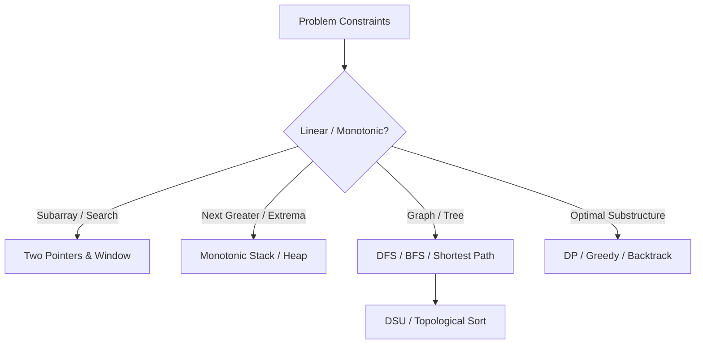

---
tags:
  - dashboard
  - algorithms
banner: "https://images.unsplash.com/photo-1509228468518-180dd4864904?w=1200"
banner_y: 0.5
created: 2025-12-29
updated: 2026-11-13
status: 🟢
level: mid-to-senior
---
# 🧮 Algorithms & LeetCode Roadmap

> [!abstract] Navigation & Scope
> Parent Hub: [[Programming/Programming Hub|Programming Hub]]
> Central index for algorithmic pattern recognition, formal loop/state invariants, asymptotic complexity budgeting, and interview problem tracking.

---

## 📊 Progress

```chart
type: bar
labels: [Easy, Medium, Hard]
series:
  - title: Solved
    data: [0, 0, 0]
  - title: Target
    data: [50, 30, 10]
width: 80%
labelColors: true
beginAtZero: true
```

| Difficulty | Solved | Target |
|------------|:------:|:------:|
| 🟢 Easy | `$= dv.pages('"Programming/Algorithms"').file.tasks.where(t => t.text.includes("🟢") && t.completed).length` | 50 |
| 🟡 Medium | `$= dv.pages('"Programming/Algorithms"').file.tasks.where(t => t.text.includes("🟡") && t.completed).length` | 30 |
| 🔴 Hard | `$= dv.pages('"Programming/Algorithms"').file.tasks.where(t => t.text.includes("🔴") && t.completed).length` | 10 |

---

## 🧭 Pattern Mastery Guides

| Guide | Core Primitives & Proofs | Primary Complexity Targets |
|-------|--------------------------|----------------------------|
| [[Programming/Algorithms/Two Pointers, Sliding Window & Hashing|Two Pointers, Sliding Window & Hashing]] | Monotonic $O(n)$ amortization, Floyd cycle entry proof, variable/non-shrinking windows, prefix-sum modulo signs, monotonic predicate binary search | $O(n)$ time / $O(1)$–$O(n)$ space, $O(\log R)$ search |
| [[Programming/Algorithms/Trees, Graphs & Shortest Paths|Trees, Graphs & Shortest Paths]] | Iterative vs recursive DFS, Tree DP single-branch returns, Binary Lifting LCA, multi-source BFS, 3-color cycle detection, Kahn's sort, Dijkstra / Bellman-Ford / 0-1 BFS, Tarjan low-link | $O(V + E)$, $O((V + E)\log V)$, $O(VE)$ |
| [[Programming/Algorithms/Dynamic Programming, Greedy & Backtracking|Dynamic Programming, Greedy & Backtracking]] | State transitions & 1D rolling compression, 0/1 backward vs unbounded forward knapsack, interval DP, FSM stock DP, $O(n \log n)$ patience sorting LIS, exchange arguments, backtracking dedup pruning | $O(nW) \to O(W)$, $O(n \log n)$, $O(k \cdot b^d)$ |
| [[Programming/Algorithms/Heaps, Tries, Union-Find & Monotonic Stacks|Heaps, Tries, Union-Find & Monotonic Stacks]] | Floyd bottom-up $O(N)$ heapify proof, two-heap median & lazy deletion, monotonic stack/deque invariants, DSU $O(\alpha(N))$, bitwise XOR Trie, Quickselect $O(N)$ | $O(N)$, $O(N \log K)$, $O(N \cdot \alpha(N))$ |



---

## ⏱️ Complexity Reference Table

### Input Constraint Budget ($10^8$ Ops/Sec Rule of Thumb)

| Max Input $N$ | Target Complexity | Viable Pattern Families |
|:-------------:|-------------------|-------------------------|
| $N \le 12$ | $O(N!)$ or $O(N \cdot 2^N)$ | Permutations, N-Queens, TSP bitmask DP |
| $N \le 22$ | $O(2^N)$ | Subsets backtracking, meet-in-the-middle ($N \le 40$) |
| $N \le 500$ | $O(N^3)$ | Floyd-Warshall, Interval DP (`Burst Balloons`) |
| $N \le 5 \times 10^3$ | $O(N^2)$ | 2D sequence DP (`Edit Distance`), quadratic pair checks |
| $N \le 10^5$ | $O(N \log N)$ or $O(N)$ | Sorting, Binary Search on Answer, Heaps, DSU, Sliding Window, Tree DP |
| $N \ge 10^7$ | $O(\log N)$ or $O(1)$ | Binary Search, Math / Closed Form, Bitwise Manipulation |

### Core Data Structure Operations

| Structure | Lookup / Peek | Insert | Delete | Notes |
|-----------|---------------|--------|--------|-------|
| Dynamic Array | $O(1)$ index / $O(N)$ scan | $O(1)$ amortized end / $O(N)$ mid | $O(1)$ end / $O(N)$ mid | Cache-friendly contiguous memory |
| Hash Map / Set | $O(1)$ avg / $O(N)$ worst | $O(1)$ avg | $O(1)$ avg | Vulnerable to hash collisions without randomized seed |
| Binary Heap | $O(1)$ top (`min`/`max`) | $O(\log N)$ | $O(\log N)$ pop / $O(1)$ lazy mark | $O(N)$ bottom-up `heapify` build |
| Monotonic Stack / Deque | $O(1)$ top/front | $O(1)$ amortized | $O(1)$ amortized | Each index pushed and popped at most once |
| Disjoint Set Union (DSU) | $O(\alpha(N))$ `find` | $O(\alpha(N))$ `union` | Not natively supported | Path compression + union by rank/size |
| Trie (Prefix Tree) | $O(L)$ word length | $O(L)$ | $O(L)$ with ref-count/leaf prune | Independent of total word count $N$ |

---

## 📚 Problems by Topic

### Arrays & Strings
- [ ] Two Sum 🟢 #arrays
- [ ] Valid Palindrome 🟢 #strings
- [ ] Three Sum 🟡 #arrays
- [ ] Container With Most Water 🟡 #arrays
- [ ] Longest Substring Without Repeating 🟡 #strings

### Linked Lists
- [ ] Reverse Linked List 🟢 #linkedlist
- [ ] Merge Two Sorted Lists 🟢 #linkedlist
- [ ] Linked List Cycle 🟢 #linkedlist
- [ ] Remove Nth Node From End 🟡 #linkedlist

### Trees
- [ ] Max Depth of Binary Tree 🟢 #trees
- [ ] Invert Binary Tree 🟢 #trees
- [ ] Validate BST 🟡 #trees
- [ ] Level Order Traversal 🟡 #trees

### Dynamic Programming
- [ ] Climbing Stairs 🟢 #dp
- [ ] House Robber 🟡 #dp
- [ ] Coin Change 🟡 #dp
- [ ] Longest Common Subsequence 🟡 #dp

### Graphs
- [ ] Number of Islands 🟡 #graphs
- [ ] Clone Graph 🟡 #graphs
- [ ] Course Schedule 🟡 #graphs

---

## ✅ Completed Problems

```tasks
done
path includes Programming/Algorithms
```

---

## 📝 Pattern Notes
```dataview
TABLE WITHOUT ID
	file.link as "Pattern",
	dateformat(file.cday, "MMM dd") as "Added"
FROM "Programming/Algorithms"
WHERE !contains(file.name, "_Index")
SORT file.cday desc
```

---

## 🔗 Resources
- [LeetCode](https://leetcode.com) — Timed problem sets and company-tagged drills
- [NeetCode Roadmap](https://neetcode.io/roadmap) — Structured dependency DAG for pattern progression
- [Blind 75](https://leetcode.com/discuss/general-discussion/460599/) — High-yield core interview problem baseline
- [CP-Algorithms](https://cp-algorithms.com/) — Formal mathematical proofs for graph, string, and range-query algorithms
