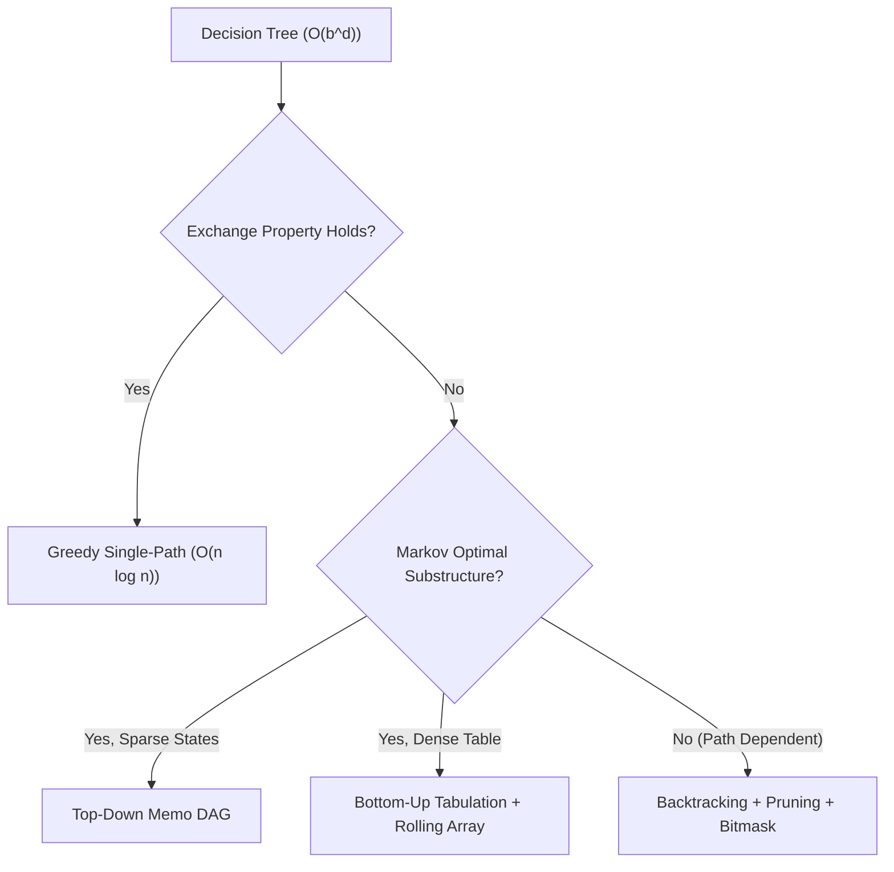
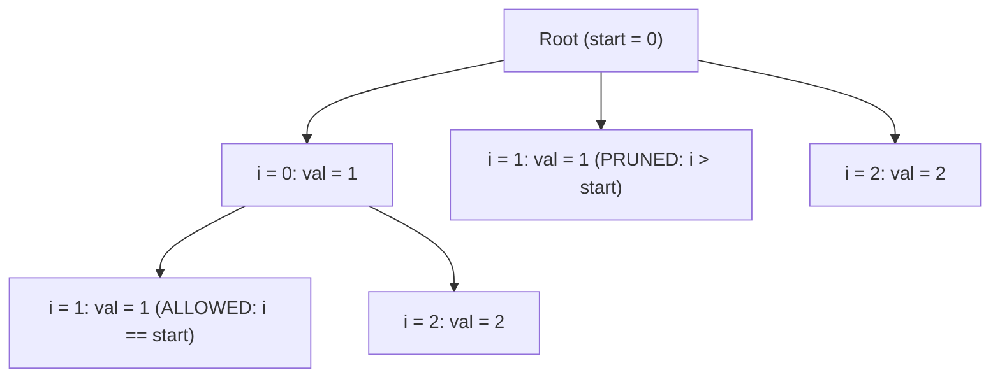

---
tags:
  - algorithm
created: 2026-11-13
updated: 2026-11-13
status: 🟢
level: mid-to-senior
---
# Dynamic Programming, Greedy & Backtracking

> [!abstract] Navigation & Scope
> Roadmap: [[Programming/Algorithms/Algorithms & LeetCode Roadmap|Algorithms & LeetCode Roadmap]] | Hub: [[Programming/Programming Hub|Programming Hub]]
> Related Patterns: [[Programming/Algorithms/Two Pointers, Sliding Window & Hashing|Two Pointers, Sliding Window & Hashing]] | [[Programming/Algorithms/Trees, Graphs & Shortest Paths|Trees, Graphs & Shortest Paths]] | [[Programming/Algorithms/Heaps, Tries, Union-Find & Monotonic Stacks|Heaps, Tries, Union-Find & Monotonic Stacks]]

---

## 1. Unified State-Space & Decision Framework

### 1.1 State-Space Trees, Quotient DAGs & Paradigm Selection
Every sequential optimization or combinatorial enumeration problem defines an implicit **decision tree** where each node represents a partial prefix of choices and edges represent valid next actions. Exploring this tree naively runs in exponential time $O(b^d)$ ($b$ branching factor, $d$ decision depth). Three algorithmic paradigms control this combinatorial explosion through distinct structural properties:



1. **Greedy ($O(n)$ or $O(n \log n)$)**: Collapses branching factor $b$ to $1$. At each step, an **Exchange Argument** or underlying matroid structure guarantees that committing to the locally extremal choice preserves reachability of at least one global optimum without backtracking.
2. **Dynamic Programming ($O(|S| \cdot \text{transition})$)**: Collapses equivalent exponential histories into equivalence classes via the **Markov property** (future transitions depend solely on a compact summary tuple `state`, never on the sequence of prior decisions that reached it). Quotienting the search tree by state equality turns a $b^d$ tree into a polynomial **Directed Acyclic Graph (DAG)**.
3. **Backtracking ($O(k \cdot b^d)$ pruned)**: When constraints depend on the exact set of past choices (or when the goal demands listing **all** valid combinations/permutations rather than counting or optimizing one scalar), no Markov quotient suffices. Backtracking traverses the search tree depth-first, mutating state in place, rolling back on exit, and pruning entire subtrees early via bounding, sorting, or bitmask constraint propagation.

### 1.2 Greedy Exchange Arguments & Counterexample Refutation

A greedy strategy is provably optimal iff two properties hold:
- **Greedy Choice Property**: A globally optimal solution exists that includes the greedy first choice.
- **Optimal Substructure**: Removing that greedy choice leaves a smaller instance whose optimal solution combines cleanly with the greedy choice.

#### Formal 4-Step Exchange Argument Proof Template
1. **Define Choices**: Let $G = (g_1, g_2, \dots, g_m)$ be the solution constructed by the greedy rule, and let $O = (o_1, o_2, \dots, o_k)$ be an arbitrary globally optimal solution.
2. **Locate Earliest Divergence**: If $G$ and $O$ are not identical, pick the smallest index $j$ where $g_j \ne o_j$ (after aligning identical prefixes $g_1 = o_1, \dots, g_{j-1} = o_{j-1}$).
3. **Construct Exchanged Solution $O'$**: Replace $o_j$ (or swap a pair $(o_i, o_j)$) in $O$ with $g_j$.
4. **Prove Dominance**: Prove both (a) $O'$ remains **feasible** under all problem constraints, and (b) $\text{objective}(O')$ is at least as good as $\text{objective}(O)$. Repeating this exchange converts $O$ into $G$ without losing optimality.

#### Activity / Interval Selection: Why Earliest Finish Time Wins & Alternatives Fail
Given closed-open intervals $[s_i, e_i)$, select the maximum cardinality subset of pairwise non-overlapping intervals.

- **Proof for Earliest Finish Time (EFT)**: Sort intervals ascending by finish time $e_i$. Let $g_1$ be the first greedy choice (minimum $e$) and $O = (o_1, o_2, \dots, o_k)$ be any optimal non-overlapping schedule sorted by start/finish time. Since $g_1$ has the global minimum finish time across all intervals, $g_1.\text{end} \le o_1.\text{end} \le o_2.\text{start}$. Replacing $o_1$ with $g_1$ yields $O' = (g_1, o_2, \dots, o_k)$, which remains strictly non-overlapping and has identical cardinality $|O'| = |O| = k$. By induction on the remaining suffix starting at $\ge g_1.\text{end}$, EFT achieves maximum cardinality in $O(n \log n)$ time.
- **Refutation Counterexamples for Broken Heuristics**:

| Greedy Heuristic | Concrete Counterexample | Heuristic Choice (Count) | Optimal Choice (Count) | Structural Failure Mode |
|------------------|-------------------------|--------------------------|------------------------|-------------------------|
| **Earliest Start Time** | `[0, 100), [1, 2), [3, 4)` | `[0, 100)` (`1`) | `[1, 2), [3, 4)` (`2`) | Long interval starting early blocks all short downstream intervals |
| **Shortest Duration** | `[0, 5), [4, 7), [6, 11)` | `[4, 7)` (`1`) | `[0, 5), [6, 11)` (`2`) | Short bridge interval straddles two independent intervals |
| **Fewest Conflicts** | Four stacked copies of `[0, 3)`, `[2, 5)`, `[4, 7)`, `[6, 9)` plus bridge `[2, 5)` intersecting `[1, 3)`/`[4, 6)` chains | Picks high-overlap middle bridge after tie-break (`3`) | Alternates endpoints (`4`) | Local degree ignores downstream bottleneck chains |

#### Additional Proven Greedy Invariants
- **Jump Game II ($O(n)$ time, $O(1)$ space)**: Maintain current BFS hop boundary `cur_end` and maximum reachable index `farthest`. Scanning $i = 0 \dots n - 2$, update `farthest = max(farthest, i + nums[i])`. When $i == \text{cur\_end}$, every index in the current hop layer has been inspected, forcing `jumps += 1; cur_end = farthest`—exact breadth-first hop-layer expansion without a queue.
- **Gas Station ($O(n)$ time, $O(1)$ space)**: Maintain `total_tank` and `curr_tank`. Whenever `curr_tank < 0` at index `i`, reset `start = i + 1; curr_tank = 0`. **Proof**: Starting at `start` entered any intermediate station $j \in [\text{start}, i]$ with `tank >= 0`; starting fresh at $j$ with `0` fuel provides strictly less or equal fuel along $[j..i]$, so $j$ also fails at or before $i$. If `sum(gas) >= sum(cost)`, the surviving `start` completes the loop.

### 1.3 The 5-Step DP Formulation Methodology


1. **Exact State Definition**: Specify the exact mathematical meaning of every dimension—for example, `dp[i][cap][hold]` = maximum profit obtainable over prefix `prices[0..i-1]` using at most `cap` transactions and ending in holding state `hold`. Every state invariant must satisfy the Markov property.
2. **Acyclic Transition Recurrence**: Express `dp[state]` purely as a function of strictly smaller topological subproblems so the dependency graph contains zero cycles.
3. **Base Cases & Overflow-Safe Sentinels**: Separate valid empty states (`dp[0] = 0` for optimization, `dp[0] = 1` for counting) from unreachable states (`+INF` for minimization, `-INF` for maximization). In fixed-width typed arrays (`Int32Array`, C++ `int`), choose bounded sentinels like `amount + 1` or `1_000_000_000` rather than `INT_MAX` so `INF + 1` never overflows to negative.
4. **Topological Evaluation Order**: Evaluate dependencies before dependents. For bottom-up tables, verify whether dependencies point backward (`i - 1`, `j - 1`), forward (`i + 1` in palindrome substrings), or by interval span (`r - l`).
5. **Space Rolling Direction ($O(nW) \to O(W)$)**: When row `i` depends solely on row `i - 1` (and possibly already-computed entries in row `i`), collapse the row dimension into 1D by enforcing strict forward, backward, or diagonal-saving (`prev_diag`) loop ordering.

#### Top-Down Memoization vs. Bottom-Up Tabulation Tradeoffs

| Engineering Dimension | Top-Down Memoization | Bottom-Up Tabulation |
|-----------------------|----------------------|----------------------|
| **Reachable State Density** | Evaluates **only reachable states** (wins when transitions skip most grid cells) | Evaluates every state in dense loop bounds |
| **Stack & Memory Safety** | Vulnerable to Python `RecursionError` (default 1,000 frames) and per-call frame overhead | $O(1)$ call stack; strictly iterative |
| **Cache Locality & Vectorization** | Hash map / dict lookups scatter across heap memory | Contiguous `Int32Array` / flat list enables linear cache prefetching and 1D space folding |
| **Path Reconstruction** | Stores parent choices or re-walks memo table | Either backtracks 2D table via gradient checks or keeps compact `parent[]` array |

### 1.4 Knapsack Loop Invariants, Counting Order & Bitset Acceleration

#### 0/1 vs. Unbounded Knapsack Inner-Loop Direction Proof
Suppose we fold `dp[i][w]` into a 1D array `dp[0..W]`. At outer iteration `i` (item with weight `wt` and value `val`), updating `dp[w]` reads `dp[w - wt]`:

| Knapsack Variant | Reuse Constraint | Inner Loop Direction | State Held in `dp[w - wt]` When Updating `dp[w]` |
|------------------|------------------|----------------------|--------------------------------------------------|
| **0/1 Knapsack** | At most 1 copy of item `i` | **Backward**: `W` down to `wt` | `w - wt < w` has **not yet** been visited in pass `i`, so `dp[w - wt]` equals `dp[i - 1][w - wt]` (row `i - 1`, blocking self-chaining). |
| **Unbounded Knapsack** | Unlimited copies of item `i` | **Forward**: `wt` up to `W` | `w - wt < w` has **already** been visited in pass `i`, so `dp[w - wt]` equals `dp[i][w - wt]` (row `i`, permitting unlimited reuse of item `i`). |

#### Combinations vs. Permutations Counting Invariant (`dp[0] = 1`)
- **Outer `coin`, Inner `amt = coin..target` (Combinations)**: Every amount state passes sequentially through `coin_0`, then `coin_1`, etc., enforcing canonical ordering `c_0 <= c_1 <= ...` so `{1, 2}` is counted **once**.
- **Outer `amt = 1..target`, Inner `coin` (Permutations)**: At each amount, any coin may appear as the final step regardless of which coins came earlier, counting `(1, 2)` and `(2, 1)` as **two** distinct sequences.

#### Bitset / `BigInt` Word-Level Acceleration (`Partition Equal Subset Sum`)
For subset-sum reachability `dp[s] in {0, 1}` over sum $S = \text{total} / 2$, pack boolean states into bit position `s` of an arbitrary-precision bitset (`int` in Python, `bigint` in TypeScript, `std::bitset<N>` in C++):

$$\text{bits} \leftarrow \text{bits} \mid (\text{bits} \ll x)$$

Starting from `bits = 1` (only sum `0` reachable), left-shifting `bits` by `x` maps every reachable sum `s` to `s + x` simultaneously in $O(S / w_{\text{word}})$ CPU-word bitwise operations—an immediate $32\times$–$64\times$ practical speedup over scalar inner loops, returning `(bits >> target) & 1 == 1` (early exit whenever `(bits >> target) & 1` becomes true!).

### 1.5 Interval DP, Patience Sorting LIS, Tree DP & State-Machine DP

- **Palindrome Substring Order**: `dp[i][j]` depends on `dp[i + 1][j - 1]` (strictly larger row `i + 1`, smaller column `j - 1`). Standard top-left-to-bottom-right loops read uninitialized zeros! Evaluate either `i` **backward** (`n - 1` down to `0`) with `j` forward (`i` to `n - 1`), or outer loop by substring length `L = 1..n`.
- **Interval DP (`Burst Balloons`) Last-Popped Invariant**: Pad `nums` with sentinel `1` at indices `0` and `n + 1`. Define `dp[l][r]` as the maximum coins obtainable by bursting every balloon strictly inside open interval `(l, r)`. Choosing `k` as the **first** balloon popped fuses `(l, k)` and `(k, r)` into neighboring intervals whose boundary balloons keep changing—destroying subproblem independence. Choosing `k in (l + 1 .. r - 1)` as the **last** balloon popped guarantees both `(l, k)` and `(k, r)` are already empty when `k` pops, fixing `k`'s immediate adjacent neighbors at `nums[l]` and `nums[r]`:
  $$\text{dp}[l][r] = \max_{l < k < r} \big(\text{dp}[l][k] + \text{dp}[k][r] + \text{nums}[l] \cdot \text{nums}[k] \cdot \text{nums}[r]\big)$$
  Evaluate outer loop by interval span `span = r - l` from `2` up to `n + 1` ($O(n^3)$ time, $O(n^2)$ space).
- **Patience Sorting LIS ($O(n \log n)$)**: Maintain `tails[k]` as the minimum achievable ending value of an increasing subsequence of length `k + 1`. Because removing the final element of a length-`(k + 2)` subsequence yields a length-`(k + 1)` subsequence ending strictly below `tails[k + 1]`, `tails` is provably strictly increasing (`tails[k] < tails[k + 1]`) and binary-searchable (`bisect_left` for strict `<`, `bisect_right` for non-decreasing `<=`). Because later smaller values overwrite earlier elements inside `tails` (`[3, 4, 1] -> tails = [1, 4]`), **`tails` computes exact LIS length ONLY—it is NOT a valid subsequence**; sequence reconstruction requires storing `tail_idx[k]` and `parent[i] = tail_idx[pos - 1]`.
- **Tree DP**: Root the tree and return a compact summary tuple from post-order DFS (e.g., `(rob_node, skip_node)` for House Robber III, or `(max_downward_branch, global_diameter)`), eliminating exponential subtree re-traversal in $O(V)$ time.
- **State-Machine DP**: Explicitly enumerate end-of-day states (e.g., `hold`, `sold`, `rest`) and compute all next-day states from frozen previous-day values simultaneously (`next_hold, next_sold, next_rest`) so same-day buy-and-sell chaining cannot occur.

### 1.6 Backtracking State Trees, Pruning & Deduplication



Let $b$ be branching factor, $d$ recursion depth, and $k$ leaf copy cost ($O(n)$). Unpruned backtracking bounds at $O(k \cdot b^d)$: $O(n \cdot 2^n)$ for subsets, $O(n \cdot n!)$ for permutations.

#### Duplicate-Pruning Rules (Requires `nums.sort()` First)
1. **Combinations / Subsets (`start` index)**:
   `if i > start and nums[i] == nums[i - 1]: continue`
   Allows picking a duplicate at a deeper level (`i == start`, forming `[1, 1]`), while pruning duplicate sibling choices at the same recursion level (`i > start`).
2. **Permutations (`used[]` mask)**:
   `if i > 0 and nums[i] == nums[i - 1] and not used[i - 1]: continue`
   Enforces canonical left-to-right consumption of identical values. Using `not used[i - 1]` prunes the entire duplicate subtree immediately at depth 0, whereas `used[i - 1]` explores deep into the invalid subtree before pruning near leaves.

#### Bitmask Constraint Propagation (N-Queens & Sudoku MRV)
Instead of scanning $O(n)$ board rows/diagonals per placement, maintain three integer bitmasks (`cols`, `diag1`, `diag2`). Valid columns in the current row isolate in two CPU instructions:

```text
avail = ((1 << n) - 1) & ~(cols | diag1 | diag2)
bit = avail & -avail     // Extract lowest set bit
avail &= avail - 1       // Clear lowest set bit
```

Propagating diagonal attacks across rows via `((diag1 | bit) << 1) & full_mask` and `(diag2 | bit) >> 1` executes each node transition in $O(1)$ bit operations. For sparse constraint grids (Sudoku), pairing row/col/box 9-bit masks with the **Minimum Remaining Values (MRV)** heuristic (branch next on the empty cell with minimal popcount of candidate bits) reduces search trees by $10^3\times$–$10^5\times$.

---

## 2. Decision Matrix & Production Engineering Applications

### 2.1 Paradigm Selection Decision Matrix

| Problem Structural Traits | Optimal Paradigm | Time / Space | Critical Pitfall if Misapplied |
|---------------------------|------------------|--------------|--------------------------------|
| Local optimal choice strictly dominates all alternatives (Exchange proof holds) | **Greedy** | $O(n)$ or $O(n \log n)$ / $O(1)$ | Applying greedy without proof (e.g., Coin Change on arbitrary denominations `[1, 3, 4], amt=6`) fails optimality |
| 1D sequential decisions with bounded lookback (`i - 1, i - 2`) | **1D Rolling DP** | $O(n)$ / $O(1)$ | Unnecessary $O(n)$ DP array allocation |
| Subset capacity / target sum (`W <= 10^4`) | **0/1 or Unbounded Knapsack** | $O(nW)$ / $O(W)$ | Wrong inner loop direction (forward vs backward) or loop swap (combinations vs permutations) |
| Subset sum boolean reachability (`n <= 10^3, sum <= 10^6`) | **Bitset / `BigInt` DP** | $O(nS / w)$ / $O(S / w)$ | Scalar loops TLE on $10^8$ transitions |
| Two-string alignment / diffing / edit distance | **2D Grid DP + `prev_diag`** | $O(mn)$ / $O(\min(m, n))$ | Overwriting `dp[j]` before saving `prev_diag` (`dp[i-1][j-1]`) |
| Contiguous interval merging / parenthesization (`n <= 500`) | **Interval DP (`span` outer)** | $O(n^3)$ / $O(n^2)$ | Splitting by first action rather than last action breaks boundary independence |
| Cyclic/cooldown/quota trading or sequence transitions | **State-Machine DP** | $O(nK)$ / $O(K)$ | Mutating `hold` before computing `sold` enables illegal same-day chaining |
| Subset TSP / SQL join ordering ($n \le 20$) | **Bitmask Subset DP** | $O(n^2 \cdot 2^n)$ / $O(n \cdot 2^n)$ | Backtracking without bitmask memoization re-evaluates identical subsets $n!$ times |
| Enumerate all valid combinations/permutations/boards | **Backtracking + Pruning** | $O(k \cdot b^d)$ / $O(d)$ | Shallow copy `res.append(path)` without cloning; missing `sort()` before dedup |

### 2.2 Five Concrete Production Engineering Applications

#### 1. Version Control Diffing & DNA Alignment (Edit Distance + Hirschberg)
Tools like `git diff`, operational transformation engines, and genomics aligners compute minimal edit scripts (`KEEP`, `INSERT`, `DELETE`, `REPLACE`) between file revisions or sequences. Standard Wagner-Fischer 2D DP produces exact backpointers in $O(mn)$ space; for multi-megabyte inputs where $O(mn)$ RAM blows heap budgets, **Hirschberg's algorithm** combines divide-and-conquer midpoint splitting with two opposing $O(\min(m, n))$ rolling DP passes to recover the full optimal edit script in $O(\min(m, n))$ memory.

#### 2. SQL Query Planner Join Ordering (Selinger Bitmask Subset DP) & Cloud Bin-Packing
Relational database optimizers (PostgreSQL GEQO threshold below ~12 tables, System R / Selinger planners) compute minimum-cost join trees across $n$ relations via **Bitmask Subset DP** (`dp[mask] = min over submask (dp[submask] + dp[mask ^ submask] + join_cost)`), exploring all $3^n$ connected subset splits rather than $n!$ orderings. Meanwhile, Kubernetes cluster schedulers and cloud spot-bid allocators model CPU/memory bin-packing and budget allocation via bounded 0/1 Knapsack variants and greedy First-Fit Decreasing heuristics.

#### 3. Deep Learning `einsum` Tensor Contraction & Compiler Parenthesization (Interval DP)
Evaluating a chain of tensor contractions $T_1 \times T_2 \times \dots \times T_n$ in PyTorch, JAX, or XLA (`opt_einsum`) can vary by $10^6\times$ in FLOPs depending on parenthesization order. Matrix Chain Multiplication (Interval DP with `span = 2..n`) finds the strictly minimum-FLOP contraction tree in $O(n^3)$ time over $n$ tensors, directly cutting GPU kernel runtime.

#### 4. Viterbi Sequence Decoding & Algorithmic Execution Engines (State-Machine DP)
Hidden Markov Model (HMM) decoding in speech recognition, part-of-speech tagging, and quantitative execution engines (maximizing expected fill PnL under inventory bounds, cooldown timers, and transaction fees) maintain a fixed state vector updated synchronously on each time step—exact State-Machine DP guaranteeing $O(1)$ per-tick memory.

#### 5. Package Dependency Resolvers & SAT/SMT Solvers (Backtracking + MRV + Pruning)
Modern dependency resolvers (`uv`'s PubGrub solver, Cargo, pip) solve NP-complete version-constraint graphs by pairing depth-first backtracking with early conflict pruning, unit propagation, and Minimum Remaining Values (MRV) variable ordering so contradictory dependency branches terminate at shallow depths.

---

## 3. DP Table Visualization Matrices & Path Reconstruction Traces

### 3.1 0/1 Knapsack Matrix, Rolling Trace & Item Reconstruction
Inputs: `weights = [1, 3, 4]`, `values = [15, 20, 30]`, capacity `W = 4`.

**Full 2D Table (`dp[i][w]` = max value using first `i` items with capacity `w`)**:

| Item Prefix `i` (`wt, val`) | `w = 0` | `w = 1` | `w = 2` | `w = 3` | `w = 4` |
|-----------------------------|:-------:|:-------:|:-------:|:-------:|:-------:|
| `i = 0` (empty) | `0` | `0` | `0` | `0` | `0` |
| `i = 1` (`wt=1, val=15`) | `0` | `15` (take) | `15` | `15` | `15` |
| `i = 2` (`wt=3, val=20`) | `0` | `15` (skip) | `15` (skip) | `20` (`max(15, 0+20)`) | **`35`** (`max(15, 15+20)`) |
| `i = 3` (`wt=4, val=30`) | `0` | `15` (skip) | `15` (skip) | `20` (skip) | **`35`** (`max(35, 0+30)`) |

- **1D Backward Pass for `i = 2` (`wt=3, val=20`)** starting from `dp = [0, 15, 15, 15, 15]`:
  - `w = 4`: `dp[4] = max(15, dp[1] + 20) = max(15, 35) = 35` (`dp[1]` is untouched row `i = 1`).
  - `w = 3`: `dp[3] = max(15, dp[0] + 20) = 20`.
- **Broken Forward Pass Bug on `i = 1` (`wt=1, val=15`)**: Iterating `w = 1..4` updates `dp[1]=15`, then reads the **updated** `dp[1]` to set `dp[2]=30`, `dp[3]=45`, `dp[4]=60`—illegally reusing item 1 four times.
- **2D Backpointer Reconstruction from `(i=3, w=4)`**:
  - `dp[3][4] == dp[2][4]` (`35 == 35`) $\implies$ item `3` skipped.
  - `dp[2][4] != dp[1][4]` (`35 != 15`) $\implies$ **take item `2`** (`wt=3, val=20`), `w = 4 - 3 = 1`.
  - `dp[1][1] != dp[0][1]` (`15 != 0`) $\implies$ **take item `1`** (`wt=1, val=15`), `w = 1 - 1 = 0`.
  - Selected items: `[item 1, item 2]` (weight `1 + 3 = 4`, value `15 + 20 = 35`).

### 3.2 Edit Distance 2D Matrix + Backpointer Script (`"horse"` -> `"ros"`)

| Prefix (`word1` \ `word2`) | `""` (`j=0`) | `"r"` (`j=1`) | `"ro"` (`j=2`) | `"ros"` (`j=3`) |
|----------------------------|:------------:|:-------------:|:--------------:|:---------------:|
| `""` (`i=0`) | `0` | `1` | `2` | `3` |
| `"h"` (`i=1`) | `1` | **`1`** (replace `'h'->'r'`) | `2` | `3` |
| `"ho"` (`i=2`) | `2` | `2` | **`1`** (match `'o'=='o'`) | `2` |
| `"hor"` (`i=3`) | `3` | `2` | **`2`** (delete `'r'`) | `2` |
| `"hors"` (`i=4`) | `4` | `3` | `3` | **`2`** (match `'s'=='s'`) |
| `"horse"` (`i=5`) | `5` | `4` | `4` | **`3`** (delete `'e'`) |

Following bold cells from `(5, 3)` back to `(0, 0)` emits exact operations in forward order:
`REPLACE(0, 'h' -> 'r') -> KEEP('o') -> DELETE(2, 'r') -> KEEP('s') -> DELETE(4, 'e')` (`"horse" -> "rorse" -> "rose" -> "ros"`), distance = `3`.

### 3.3 Burst Balloons Upper-Triangular Matrix (`nums = [3, 1, 5, 8]`)
Padded array `A = [1, 3, 1, 5, 8, 1]` (indices `0..5`). Fill strictly by `span = r - l` from `2` to `5`:

| `(l, r)` | `span = 2` | `span = 3` | `span = 4` | `span = 5` | Best `k` & Calculation |
|----------|:----------:|:----------:|:----------:|:----------:|------------------------|
| `(0, 2)` | `3` | | | | `k=1`: `0 + 0 + 1*3*1 = 3` |
| `(1, 3)` | `15` | | | | `k=2`: `0 + 0 + 3*1*5 = 15` |
| `(2, 4)` | `40` | | | | `k=3`: `0 + 0 + 1*5*8 = 40` |
| `(3, 5)` | `40` | | | | `k=4`: `0 + 0 + 5*8*1 = 40` |
| `(0, 3)` | | `30` | | | `k=1`: `0 + 15 + 1*3*5 = 30` (beats `k=2`: `8`) |
| `(1, 4)` | | `135` | | | `k=3`: `15 + 0 + 3*5*8 = 135` (beats `k=2`: `64`) |
| `(2, 5)` | | `48` | | | `k=4`: `40 + 0 + 1*8*1 = 48` (beats `k=3`: `45`) |
| `(0, 4)` | | | `159` | | `k=1`: `0 + 135 + 1*3*8 = 159` |
| `(1, 5)` | | | `159` | | `k=4`: `135 + 0 + 3*8*1 = 159` |
| `(0, 5)` | | | | **`167`** | `k=4`: `159 + 0 + 1*8*1 = 167` |

### 3.4 Patience Sorting LIS & `parent[]` Reconstruction Trap (`nums = [3, 4, 1, 2]`)

| Step `i` | `x = nums[i]` | `pos = bisect_left(tails, x)` | `tails` After | `tail_idx` After | `parent[i]` |
|:--------:|:-------------:|:-----------------------------:|---------------|------------------|-------------|
| `0` | `3` | `0` | `[3]` | `[0]` | `-1` |
| `1` | `4` | `1` | `[3, 4]` | `[0, 1]` | `0` (`nums[0]=3`) |
| `2` | `1` | `0` | `[1, 4]` | `[2, 1]` | `-1` |
| `3` | `2` | `1` | `[1, 2]` | `[2, 3]` | `2` (`nums[2]=1`) |

Notice at step `2` (`x = 1`), `tails = [1, 4]` is **not** a subsequence of `[3, 4, 1]`, yet `len(tails) = 2` is exact and following `parent` from `tail_idx[-1] = 1` reconstructs `[3, 4]`. At step `3` (`x = 2`), `tails = [1, 2]` and `parent` from `tail_idx[-1] = 3` reconstructs `[1, 2]`.

### 3.5 Stock Cooldown FSM State Table (`prices = [1, 2, 3, 0, 2]`)
Initial before day 0: `hold = -inf, sold = -inf, rest = 0`. Simultaneous updates:
`next_hold = max(hold, rest - p)`, `next_sold = hold + p`, `next_rest = max(rest, sold)`.

| Day | `price` | `hold` | `sold` | `rest` | Optimal Meaning at Day End |
|:---:|:-------:|:------:|:------:|:------:|----------------------------|
| `0` | `1` | `-1` | `-inf` | `0` | Bought at `1` (`hold = -1`) or stayed flat (`rest = 0`) |
| `1` | `2` | `-1` | `1` | `0` | Sold at `2` (`sold = 1`) or held `1` (`hold = -1`) |
| `2` | `3` | `-1` | `2` | `1` | Sold `1->3` (`sold = 2`), or cooled down after day-1 sale (`rest = 1`) |
| `3` | `0` | `1` | `-1` | `2` | Bought at `0` from `rest = 1` (`hold = 1`), or cooled down from day-2 sale (`rest = 2`) |
| `4` | `2` | `1` | **`3`** | `2` | Sold day-3 position at `2` (`1 + 2 = 3`) |

Return `max(sold, rest) = max(3, 2) = 3`.

---

## 4. Nine Canonical Dual-Language Implementations & Unit Tests

### 4.1 House Robber (1D Rolling DP) & Jump Game II (Greedy BFS Layers)
- **House Robber Invariant**: `prev2` holds optimal profit up to `i - 2`; `prev1` holds optimal profit up to `i - 1`. Transition `curr = max(prev1, prev2 + num)`.
- **Jump Game II Invariant**: `cur_end` marks end of current BFS hop layer; `farthest` tracks max reach of next layer.
- **Complexity**: Both run in $O(n)$ time and $O(1)$ space.

```python
def rob(nums: list[int]) -> int:
    prev2 = 0
    prev1 = 0
    for x in nums:
        prev2, prev1 = prev1, max(prev1, prev2 + x)
    return prev1


def jump_game_ii(nums: list[int]) -> int:
    if len(nums) <= 1:
        return 0
    jumps = 0
    cur_end = 0
    farthest = 0
    for i in range(len(nums) - 1):
        reach = i + nums[i]
        if reach > farthest:
            farthest = reach
        if i == cur_end:
            jumps += 1
            cur_end = farthest
            if cur_end >= len(nums) - 1:
                break
    return jumps
```

```typescript
function rob(nums: number[]): number {
  let prev2 = 0;
  let prev1 = 0;
  for (const x of nums) {
    const next = Math.max(prev1, prev2 + x);
    prev2 = prev1;
    prev1 = next;
  }
  return prev1;
}

function jumpGameII(nums: number[]): number {
  if (nums.length <= 1) return 0;
  let jumps = 0;
  let curEnd = 0;
  let farthest = 0;
  for (let i = 0; i < nums.length - 1; i++) {
    const reach = i + nums[i];
    if (reach > farthest) farthest = reach;
    if (i === curEnd) {
      jumps += 1;
      curEnd = farthest;
      if (curEnd >= nums.length - 1) break;
    }
  }
  return jumps;
}
```

### 4.2 0/1 Knapsack (With Item Reconstruction) & Partition Equal Subset Sum (Bitset)
- **Complexity**: 0/1 Knapsack reconstruction: $O(nW)$ time, $O(nW)$ space (or $O(W)$ when value-only). Partition Equal Subset Sum Bitset: $O(n \cdot S / w_{\text{word}})$ time.

```python
def knapsack_01_reconstruct(
    weights: list[int], values: list[int], capacity: int
) -> tuple[int, list[int]]:
    n = len(weights)
    dp = [[0] * (capacity + 1) for _ in range(n + 1)]
    for i in range(1, n + 1):
        wt, val = weights[i - 1], values[i - 1]
        prev_row = dp[i - 1]
        cur_row = dp[i]
        for w in range(capacity + 1):
            cur_row[w] = prev_row[w]
            if w >= wt:
                cand = prev_row[w - wt] + val
                if cand > cur_row[w]:
                    cur_row[w] = cand

    chosen_indices: list[int] = []
    w = capacity
    for i in range(n, 0, -1):
        if dp[i][w] != dp[i - 1][w]:
            chosen_indices.append(i - 1)
            w -= weights[i - 1]
    chosen_indices.reverse()
    return dp[n][capacity], chosen_indices


def can_partition_bitset(nums: list[int]) -> bool:
    total = sum(nums)
    if total % 2 != 0:
        return False
    target = total // 2
    bits = 1
    mask = (1 << (target + 1)) - 1
    for x in nums:
        if x <= target:
            bits = (bits | (bits << x)) & mask
            if (bits >> target) & 1:
                return True
    return bool((bits >> target) & 1)
```

```typescript
function knapsack01Reconstruct(
  weights: number[],
  values: number[],
  capacity: number,
): { maxValue: number; indices: number[] } {
  const n = weights.length;
  const dp: Int32Array[] = Array.from(
    { length: n + 1 },
    () => new Int32Array(capacity + 1),
  );

  for (let i = 1; i <= n; i++) {
    const wt = weights[i - 1];
    const val = values[i - 1];
    const prevRow = dp[i - 1];
    const curRow = dp[i];
    for (let w = 0; w <= capacity; w++) {
      curRow[w] = prevRow[w];
      if (w >= wt) {
        const cand = prevRow[w - wt] + val;
        if (cand > curRow[w]) curRow[w] = cand;
      }
    }
  }

  const indices: number[] = [];
  let w = capacity;
  for (let i = n; i >= 1; i--) {
    if (dp[i][w] !== dp[i - 1][w]) {
      indices.push(i - 1);
      w -= weights[i - 1];
    }
  }
  indices.reverse();
  return { maxValue: dp[n][capacity], indices };
}

function canPartitionBitset(nums: number[]): boolean {
  let total = 0;
  for (const x of nums) total += x;
  if (total % 2 !== 0) return false;
  const target = total / 2;
  const targetShift = BigInt(target);
  const mask = (1n << (targetShift + 1n)) - 1n;
  let bits = 1n;

  for (const x of nums) {
    if (x <= target) {
      bits = (bits | (bits << BigInt(x))) & mask;
      if (((bits >> targetShift) & 1n) === 1n) return true;
    }
  }
  return ((bits >> targetShift) & 1n) === 1n;
}
```

### 4.3 Coin Change (Min Coins) & Coin Change II (Combinations)
- **Complexity**: $O(|\text{coins}| \cdot \text{amount})$ time, $O(\text{amount})$ space.

```python
def coin_change_min(coins: list[int], amount: int) -> int:
    inf = amount + 1
    dp = [inf] * (amount + 1)
    dp[0] = 0
    for c in coins:
        for a in range(c, amount + 1):
            cand = dp[a - c] + 1
            if cand < dp[a]:
                dp[a] = cand
    return -1 if dp[amount] == inf else dp[amount]


def coin_change_combinations(coins: list[int], amount: int) -> int:
    dp = [0] * (amount + 1)
    dp[0] = 1
    for c in coins:
        for a in range(c, amount + 1):
            dp[a] += dp[a - c]
    return dp[amount]
```

```typescript
function coinChangeMin(coins: number[], amount: number): number {
  const inf = amount + 1;
  const dp = new Int32Array(amount + 1).fill(inf);
  dp[0] = 0;
  for (const c of coins) {
    for (let a = c; a <= amount; a++) {
      const cand = dp[a - c] + 1;
      if (cand < dp[a]) dp[a] = cand;
    }
  }
  return dp[amount] === inf ? -1 : dp[amount];
}

function coinChangeCombinations(coins: number[], amount: number): number {
  const dp = new Float64Array(amount + 1);
  dp[0] = 1;
  for (const c of coins) {
    for (let a = c; a <= amount; a++) {
      dp[a] += dp[a - c];
    }
  }
  return dp[amount];
}
```

### 4.4 LCS, Rolling Edit Distance ($O(\min(m, n))$ Space) & Edit-Script Reconstruction
- **Invariant**: Rolling 1D sequence DP saves `prev_diag = dp[0]` prior to the inner loop and preserves `saved_top = dp[j]` before overwriting `dp[j]`. Full diffing builds the 2D table and walks backward to emit exact edit operations.
- **Complexity**: Rolling distance $O(mn)$ time / $O(\min(m, n))$ space; script reconstruction $O(mn)$ time and space.

```python
def longest_common_subsequence(text1: str, text2: str) -> int:
    if len(text2) > len(text1):
        text1, text2 = text2, text1
    n = len(text2)
    dp = [0] * (n + 1)
    for ch1 in text1:
        prev_diag = 0
        for j, ch2 in enumerate(text2, start=1):
            saved_top = dp[j]
            if ch1 == ch2:
                dp[j] = prev_diag + 1
            else:
                dp[j] = saved_top if saved_top >= dp[j - 1] else dp[j - 1]
            prev_diag = saved_top
    return dp[n]


def min_distance_rolling(word1: str, word2: str) -> int:
    if len(word2) > len(word1):
        word1, word2 = word2, word1
    m, n = len(word1), len(word2)
    dp = list(range(n + 1))
    for i in range(1, m + 1):
        prev_diag = dp[0]
        dp[0] = i
        c1 = word1[i - 1]
        for j in range(1, n + 1):
            saved_top = dp[j]
            if c1 == word2[j - 1]:
                dp[j] = prev_diag
            else:
                dp[j] = 1 + min(prev_diag, saved_top, dp[j - 1])
            prev_diag = saved_top
    return dp[n]


def edit_distance_script(word1: str, word2: str) -> tuple[int, list[str]]:
    m, n = len(word1), len(word2)
    dp = [[0] * (n + 1) for _ in range(m + 1)]
    for i in range(m + 1):
        dp[i][0] = i
    for j in range(n + 1):
        dp[0][j] = j

    for i in range(1, m + 1):
        for j in range(1, n + 1):
            if word1[i - 1] == word2[j - 1]:
                dp[i][j] = dp[i - 1][j - 1]
            else:
                dp[i][j] = 1 + min(dp[i - 1][j - 1], dp[i - 1][j], dp[i][j - 1])

    ops: list[str] = []
    i, j = m, n
    while i > 0 or j > 0:
        if i > 0 and j > 0 and word1[i - 1] == word2[j - 1]:
            ops.append(f"KEEP '{word1[i - 1]}'")
            i -= 1
            j -= 1
        elif i > 0 and j > 0 and dp[i][j] == dp[i - 1][j - 1] + 1:
            ops.append(f"REPLACE '{word1[i - 1]}'->'{word2[j - 1]}'")
            i -= 1
            j -= 1
        elif i > 0 and dp[i][j] == dp[i - 1][j] + 1:
            ops.append(f"DELETE '{word1[i - 1]}'")
            i -= 1
        else:
            ops.append(f"INSERT '{word2[j - 1]}'")
            j -= 1

    ops.reverse()
    return dp[m][n], ops
```

```typescript
function longestCommonSubsequence(text1: string, text2: string): number {
  if (text2.length > text1.length) {
    [text1, text2] = [text2, text1];
  }
  const n = text2.length;
  const dp = new Int32Array(n + 1);
  for (let i = 0; i < text1.length; i++) {
    let prevDiag = 0;
    const c1 = text1[i];
    for (let j = 1; j <= n; j++) {
      const savedTop = dp[j];
      if (c1 === text2[j - 1]) {
        dp[j] = prevDiag + 1;
      } else {
        dp[j] = savedTop >= dp[j - 1] ? savedTop : dp[j - 1];
      }
      prevDiag = savedTop;
    }
  }
  return dp[n];
}

function minDistanceRolling(word1: string, word2: string): number {
  if (word2.length > word1.length) {
    [word1, word2] = [word2, word1];
  }
  const m = word1.length;
  const n = word2.length;
  const dp = new Int32Array(n + 1);
  for (let j = 0; j <= n; j++) dp[j] = j;

  for (let i = 1; i <= m; i++) {
    let prevDiag = dp[0];
    dp[0] = i;
    const c1 = word1[i - 1];
    for (let j = 1; j <= n; j++) {
      const savedTop = dp[j];
      if (c1 === word2[j - 1]) {
        dp[j] = prevDiag;
      } else {
        dp[j] = 1 + Math.min(prevDiag, savedTop, dp[j - 1]);
      }
      prevDiag = savedTop;
    }
  }
  return dp[n];
}

function editDistanceScript(
  word1: string,
  word2: string,
): { distance: number; ops: string[] } {
  const m = word1.length;
  const n = word2.length;
  const dp: Int32Array[] = Array.from({ length: m + 1 }, () => new Int32Array(n + 1));
  for (let i = 0; i <= m; i++) dp[i][0] = i;
  for (let j = 0; j <= n; j++) dp[0][j] = j;

  for (let i = 1; i <= m; i++) {
    for (let j = 1; j <= n; j++) {
      if (word1[i - 1] === word2[j - 1]) {
        dp[i][j] = dp[i - 1][j - 1];
      } else {
        dp[i][j] = 1 + Math.min(dp[i - 1][j - 1], dp[i - 1][j], dp[i][j - 1]);
      }
    }
  }

  const ops: string[] = [];
  let i = m;
  let j = n;
  while (i > 0 || j > 0) {
    if (i > 0 && j > 0 && word1[i - 1] === word2[j - 1]) {
      ops.push(`KEEP '${word1[i - 1]}'`);
      i -= 1;
      j -= 1;
    } else if (i > 0 && j > 0 && dp[i][j] === dp[i - 1][j - 1] + 1) {
      ops.push(`REPLACE '${word1[i - 1]}'->'${word2[j - 1]}'`);
      i -= 1;
      j -= 1;
    } else if (i > 0 && dp[i][j] === dp[i - 1][j] + 1) {
      ops.push(`DELETE '${word1[i - 1]}'`);
      i -= 1;
    } else {
      ops.push(`INSERT '${word2[j - 1]}'`);
      j -= 1;
    }
  }
  ops.reverse();
  return { distance: dp[m][n], ops };
}
```

### 4.5 Burst Balloons (Interval DP)
- **Complexity**: $O(n^3)$ time, $O(n^2)$ space.

```python
def max_coins(nums: list[int]) -> int:
    arr = [1, *nums, 1]
    n = len(arr)
    dp = [[0] * n for _ in range(n)]

    for span in range(2, n):
        for left in range(n - span):
            right = left + span
            boundary_prod = arr[left] * arr[right]
            left_row = dp[left]
            best = 0
            for k in range(left + 1, right):
                cand = left_row[k] + dp[k][right] + boundary_prod * arr[k]
                if cand > best:
                    best = cand
            left_row[right] = best
    return dp[0][n - 1]
```

```typescript
function maxCoins(nums: number[]): number {
  const arr = [1, ...nums, 1];
  const n = arr.length;
  const dp: Int32Array[] = Array.from({ length: n }, () => new Int32Array(n));

  for (let span = 2; span < n; span++) {
    for (let left = 0; left < n - span; left++) {
      const right = left + span;
      const boundaryProd = arr[left] * arr[right];
      const leftRow = dp[left];
      let best = 0;
      for (let k = left + 1; k < right; k++) {
        const cand = leftRow[k] + dp[k][right] + boundaryProd * arr[k];
        if (cand > best) best = cand;
      }
      leftRow[right] = best;
    }
  }
  return dp[0][n - 1];
}
```

### 4.6 Longest Increasing Subsequence ($O(n \log n)$ Patience Sorting + Reconstruction)
- **Complexity**: $O(n \log n)$ time, $O(n)$ space.

```python
from bisect import bisect_left


def lis_with_reconstruction(nums: list[int]) -> list[int]:
    if not nums:
        return []
    tails: list[int] = []
    tail_idx: list[int] = []
    parent = [-1] * len(nums)

    for i, x in enumerate(nums):
        pos = bisect_left(tails, x)
        if pos == len(tails):
            tails.append(x)
            tail_idx.append(i)
        else:
            tails[pos] = x
            tail_idx[pos] = i
        if pos > 0:
            parent[i] = tail_idx[pos - 1]

    seq: list[int] = []
    curr = tail_idx[-1]
    while curr != -1:
        seq.append(nums[curr])
        curr = parent[curr]
    seq.reverse()
    return seq
```

```typescript
function lisWithReconstruction(nums: number[]): number[] {
  if (nums.length === 0) return [];
  const tails: number[] = [];
  const tailIdx: number[] = [];
  const parent = new Int32Array(nums.length).fill(-1);

  for (let i = 0; i < nums.length; i++) {
    const x = nums[i];
    let lo = 0;
    let hi = tails.length;
    while (lo < hi) {
      const mid = (lo + hi) >> 1;
      if (tails[mid] < x) lo = mid + 1;
      else hi = mid;
    }
    if (lo === tails.length) {
      tails.push(x);
      tailIdx.push(i);
    } else {
      tails[lo] = x;
      tailIdx[lo] = i;
    }
    if (lo > 0) parent[i] = tailIdx[lo - 1];
  }

  const seq: number[] = [];
  let curr = tailIdx[tailIdx.length - 1];
  while (curr !== -1) {
    seq.push(nums[curr]);
    curr = parent[curr];
  }
  seq.reverse();
  return seq;
}
```

### 4.7 State-Machine Stock DP: Cooldown & At Most $K$ Transactions
- **Cooldown Invariant**: Synchronous update over `(hold, sold, rest)`.
- **At Most $K$ Transactions Invariant**: When $k \ge n // 2$, unlimited transactions apply ($O(n)$ greedy slope sum). Otherwise track `buy[t]` and `sell[t]` for $t \in [1..k]$; updating `buy[t] = max(buy[t], sell[t - 1] - price)` and `sell[t] = max(sell[t], buy[t] + price)` in ascending `t` correctly uses current-day `sell[t - 1]` or prior-day `sell[t - 1]` identically because selling and re-buying at the exact same price adds `0` net profit (`+p - p = 0`).
- **Complexity**: Cooldown: $O(n)$ time / $O(1)$ space. $K$ Transactions: $O(nk)$ time / $O(k)$ space.

```python
def max_profit_cooldown(prices: list[int]) -> int:
    if not prices:
        return 0
    neg_inf = float("-inf")
    hold, sold, rest = neg_inf, neg_inf, 0.0
    for p in prices:
        hold, sold, rest = (
            max(hold, rest - p),
            hold + p,
            max(rest, sold),
        )
    return int(max(sold, rest))


def max_profit_k_transactions(k: int, prices: list[int]) -> int:
    n = len(prices)
    if k <= 0 or n <= 1:
        return 0
    if k >= n // 2:
        return sum(max(0, prices[i] - prices[i - 1]) for i in range(1, n))

    neg_inf = -10**15
    buy = [neg_inf] * (k + 1)
    sell = [0] * (k + 1)
    for p in prices:
        for t in range(1, k + 1):
            if sell[t - 1] - p > buy[t]:
                buy[t] = sell[t - 1] - p
            if buy[t] + p > sell[t]:
                sell[t] = buy[t] + p
    return sell[k]
```

```typescript
function maxProfitCooldown(prices: number[]): number {
  if (prices.length === 0) return 0;
  let hold = -Infinity;
  let sold = -Infinity;
  let rest = 0;

  for (const p of prices) {
    const nextHold = Math.max(hold, rest - p);
    const nextSold = hold + p;
    const nextRest = Math.max(rest, sold);
    hold = nextHold;
    sold = nextSold;
    rest = nextRest;
  }
  return Math.max(sold, rest);
}

function maxProfitKTransactions(k: number, prices: number[]): number {
  const n = prices.length;
  if (k <= 0 || n <= 1) return 0;
  if (k >= Math.floor(n / 2)) {
    let total = 0;
    for (let i = 1; i < n; i++) {
      if (prices[i] > prices[i - 1]) total += prices[i] - prices[i - 1];
    }
    return total;
  }

  const buy = new Array<number>(k + 1).fill(-1e15);
  const sell = new Array<number>(k + 1).fill(0);
  for (const p of prices) {
    for (let t = 1; t <= k; t++) {
      if (sell[t - 1] - p > buy[t]) buy[t] = sell[t - 1] - p;
      if (buy[t] + p > sell[t]) sell[t] = buy[t] + p;
    }
  }
  return sell[k];
}
```

### 4.8 House Robber III (Post-Order Tree DP)
- **Complexity**: $O(N)$ time over tree nodes, $O(H)$ recursion stack space.

```python
from typing import Optional


class TreeNode:
    def __init__(
        self,
        val: int = 0,
        left: Optional["TreeNode"] = None,
        right: Optional["TreeNode"] = None,
    ) -> None:
        self.val = val
        self.left = left
        self.right = right


def rob_tree(root: Optional[TreeNode]) -> int:
    def dfs(node: Optional[TreeNode]) -> tuple[int, int]:
        if node is None:
            return (0, 0)
        l_rob, l_skip = dfs(node.left)
        r_rob, r_skip = dfs(node.right)
        take = node.val + l_skip + r_skip
        skip = max(l_rob, l_skip) + max(r_rob, r_skip)
        return (take, skip)

    return max(dfs(root))
```

```typescript
class TreeNode {
  constructor(
    public val: number = 0,
    public left: TreeNode | null = null,
    public right: TreeNode | null = null,
  ) {}
}

function robTree(root: TreeNode | null): number {
  const dfs = (node: TreeNode | null): [number, number] => {
    if (node === null) return [0, 0];
    const [lRob, lSkip] = dfs(node.left);
    const [rRob, rSkip] = dfs(node.right);
    const take = node.val + lSkip + rSkip;
    const skip = Math.max(lRob, lSkip) + Math.max(rRob, rSkip);
    return [take, skip];
  };
  const [takeRoot, skipRoot] = dfs(root);
  return Math.max(takeRoot, skipRoot);
}
```

### 4.9 Backtracking: Combination Sum II, Permutations II & N-Queens Bitmask Solver
- **Complexity**: Combinations/Subsets: $O(n \cdot 2^n)$; Permutations: $O(n \cdot n!)$; N-Queens: $O(N!)$ heavily pruned with $O(1)$ bitwise checks per search node.

```python
def combination_sum2(candidates: list[int], target: int) -> list[list[int]]:
    nums = sorted(candidates)
    res: list[list[int]] = []
    path: list[int] = []

    def dfs(start: int, rem: int) -> None:
        if rem == 0:
            res.append(path[:])
            return
        for i in range(start, len(nums)):
            val = nums[i]
            if val > rem:
                break
            if i > start and val == nums[i - 1]:
                continue
            path.append(val)
            dfs(i + 1, rem - val)
            path.pop()

    dfs(0, target)
    return res


def permute_unique(nums: list[int]) -> list[list[int]]:
    arr = sorted(nums)
    n = len(arr)
    used = [False] * n
    res: list[list[int]] = []
    path: list[int] = []

    def dfs() -> None:
        if len(path) == n:
            res.append(path[:])
            return
        for i in range(n):
            if used[i]:
                continue
            if i > 0 and arr[i] == arr[i - 1] and not used[i - 1]:
                continue
            used[i] = True
            path.append(arr[i])
            dfs()
            path.pop()
            used[i] = False

    dfs()
    return res


def total_n_queens(n: int) -> int:
    if n <= 0:
        return 0
    full_mask = (1 << n) - 1
    count = 0

    def dfs(cols: int, diag1: int, diag2: int) -> None:
        nonlocal count
        if cols == full_mask:
            count += 1
            return
        avail = full_mask & ~(cols | diag1 | diag2)
        while avail:
            bit = avail & -avail
            avail &= avail - 1
            dfs(
                cols | bit,
                ((diag1 | bit) << 1) & full_mask,
                (diag2 | bit) >> 1,
            )

    dfs(0, 0, 0)
    return count
```

```typescript
function combinationSum2(candidates: number[], target: number): number[][] {
  const nums = [...candidates].sort((a, b) => a - b);
  const res: number[][] = [];
  const path: number[] = [];

  const dfs = (start: number, rem: number): void => {
    if (rem === 0) {
      res.push([...path]);
      return;
    }
    for (let i = start; i < nums.length; i++) {
      const val = nums[i];
      if (val > rem) break;
      if (i > start && val === nums[i - 1]) continue;
      path.push(val);
      dfs(i + 1, rem - val);
      path.pop();
    }
  };

  dfs(0, target);
  return res;
}

function permuteUnique(nums: number[]): number[][] {
  const arr = [...nums].sort((a, b) => a - b);
  const n = arr.length;
  const used = new Array<boolean>(n).fill(false);
  const res: number[][] = [];
  const path: number[] = [];

  const dfs = (): void => {
    if (path.length === n) {
      res.push([...path]);
      return;
    }
    for (let i = 0; i < n; i++) {
      if (used[i]) continue;
      if (i > 0 && arr[i] === arr[i - 1] && !used[i - 1]) continue;
      used[i] = true;
      path.push(arr[i]);
      dfs();
      path.pop();
      used[i] = false;
    }
  };

  dfs();
  return res;
}

function totalNQueens(n: number): number {
  if (n <= 0) return 0;
  const fullMask = (1 << n) - 1;
  let count = 0;

  const dfs = (cols: number, diag1: number, diag2: number): void => {
    if (cols === fullMask) {
      count += 1;
      return;
    }
    let avail = fullMask & ~(cols | diag1 | diag2);
    while (avail !== 0) {
      const bit = avail & -avail;
      avail &= avail - 1;
      dfs(
        cols | bit,
        ((diag1 | bit) << 1) & fullMask,
        (diag2 | bit) >>> 1,
      );
    }
  };

  dfs(0, 0, 0);
  return count;
}
```

### 4.10 Executable Verification Suites (Python `unittest` & TypeScript Assertions)

```python
import unittest


class TestDPGreedyBacktracking(unittest.TestCase):
    def test_rob_and_jump(self) -> None:
        self.assertEqual(rob([]), 0)
        self.assertEqual(rob([5]), 5)
        self.assertEqual(rob([2, 7, 9, 3, 1]), 12)
        self.assertEqual(jump_game_ii([2, 3, 1, 1, 4]), 2)
        self.assertEqual(jump_game_ii([0]), 0)

    def test_knapsack_and_partition(self) -> None:
        val, idx = knapsack_01_reconstruct([1, 3, 4], [15, 20, 30], 4)
        self.assertEqual(val, 35)
        self.assertEqual(idx, [0, 1])
        self.assertTrue(can_partition_bitset([1, 5, 11, 5]))
        self.assertFalse(can_partition_bitset([1, 2, 3, 5]))

    def test_coin_change(self) -> None:
        self.assertEqual(coin_change_min([1, 2, 5], 11), 3)
        self.assertEqual(coin_change_min([2], 3), -1)
        self.assertEqual(coin_change_min([1], 0), 0)
        self.assertEqual(coin_change_combinations([1, 2, 5], 5), 4)

    def test_lcs_and_edit_distance(self) -> None:
        self.assertEqual(longest_common_subsequence("abcde", "ace"), 3)
        self.assertEqual(min_distance_rolling("horse", "ros"), 3)
        dist, ops = edit_distance_script("horse", "ros")
        self.assertEqual(dist, 3)
        self.assertEqual(len(ops), 5)

    def test_burst_balloons_and_lis(self) -> None:
        self.assertEqual(max_coins([3, 1, 5, 8]), 167)
        self.assertEqual(max_coins([1, 5]), 10)
        seq = lis_with_reconstruction([10, 9, 2, 5, 3, 7, 101, 18])
        self.assertEqual(len(seq), 4)
        self.assertTrue(all(seq[i] < seq[i + 1] for i in range(len(seq) - 1)))
        self.assertEqual(lis_with_reconstruction([3, 4, 1]), [3, 4])

    def test_stocks_and_tree_dp(self) -> None:
        self.assertEqual(max_profit_cooldown([1, 2, 3, 0, 2]), 3)
        self.assertEqual(max_profit_k_transactions(2, [3, 2, 6, 5, 0, 3]), 7)
        root = TreeNode(3, TreeNode(2, None, TreeNode(3)), TreeNode(3, None, TreeNode(1)))
        self.assertEqual(rob_tree(root), 7)

    def test_backtracking(self) -> None:
        self.assertEqual(combination_sum2([10, 1, 2, 7, 6, 1, 5], 8), [[1, 1, 6], [1, 2, 5], [1, 7], [2, 6]])
        self.assertEqual(permute_unique([1, 1, 2]), [[1, 1, 2], [1, 2, 1], [2, 1, 1]])
        self.assertEqual(total_n_queens(4), 2)
        self.assertEqual(total_n_queens(8), 92)


if __name__ == "__main__":
    unittest.main()
```

```typescript
function assertEqual<T>(actual: T, expected: T, label: string): void {
  const actStr = JSON.stringify(actual);
  const expStr = JSON.stringify(expected);
  if (actStr !== expStr) {
    throw new Error(`FAIL [${label}]: expected ${expStr}, got ${actStr}`);
  }
}

function runAllDPTests(): void {
  assertEqual(rob([2, 7, 9, 3, 1]), 12, "rob");
  assertEqual(jumpGameII([2, 3, 1, 1, 4]), 2, "jumpGameII");

  assertEqual(knapsack01Reconstruct([1, 3, 4], [15, 20, 30], 4), { maxValue: 35, indices: [0, 1] }, "knapsack");
  assertEqual(canPartitionBitset([1, 5, 11, 5]), true, "partition true");
  assertEqual(canPartitionBitset([1, 2, 3, 5]), false, "partition false");

  assertEqual(coinChangeMin([1, 2, 5], 11), 3, "coinMin");
  assertEqual(coinChangeMin([2], 3), -1, "coinMin impossible");
  assertEqual(coinChangeCombinations([1, 2, 5], 5), 4, "coinComb");

  assertEqual(longestCommonSubsequence("abcde", "ace"), 3, "lcs");
  assertEqual(minDistanceRolling("horse", "ros"), 3, "editDist rolling");
  assertEqual(editDistanceScript("horse", "ros").distance, 3, "editDist script");

  assertEqual(maxCoins([3, 1, 5, 8]), 167, "burstBalloons");
  assertEqual(lisWithReconstruction([3, 4, 1]), [3, 4], "lis reconstruction");

  assertEqual(maxProfitCooldown([1, 2, 3, 0, 2]), 3, "cooldown");
  assertEqual(maxProfitKTransactions(2, [3, 2, 6, 5, 0, 3]), 7, "kTrans");

  const tree = new TreeNode(3, new TreeNode(2, null, new TreeNode(3)), new TreeNode(3, null, new TreeNode(1)));
  assertEqual(robTree(tree), 7, "robTree");

  assertEqual(combinationSum2([1, 1, 2, 5], 3), [[1, 2]], "combSum2");
  assertEqual(permuteUnique([1, 1, 2]), [[1, 1, 2], [1, 2, 1], [2, 1, 1]], "permuteUnique");
  assertEqual(totalNQueens(8), 92, "nQueens 8");
}

runAllDPTests();
```

---

## 5. Edge Cases, Profiling & Production Debugging Playbook

1. **Symptom**: 1D 0/1 Knapsack returns inflated values (`60` instead of `35` on `weights=[1,3,4], values=[15,20,30], W=4`).
   - **Root Cause**: Inner weight loop iterates forward (`for w in range(wt, W + 1)`), allowing item `i` to chain onto already-updated `dp[w - wt]` in the same pass.
   - **Diagnostic**: Print `dp` row after item 0 (`wt=1, val=15`); observe `[0, 15, 30, 45, 60]` instead of `[0, 15, 15, 15, 15]`.
   - **Fix**: Reverse the inner loop to `for w in range(W, wt - 1, -1)`.
2. **Symptom**: Coin Change II returns `9` instead of `4` on `coins = [1, 2, 5], amount = 5`.
   - **Root Cause**: Outer loop iterates `amount` while inner loop iterates `coins`, counting ordered permutations (`1+2` and `2+1` separately) rather than combinations.
   - **Diagnostic**: Inspect `dp[3]` after step `a = 3`: `dp[3]` equals `3` (`1+1+1`, `1+2`, `2+1`) instead of `2`.
   - **Fix**: Place `for coin in coins` outside `for amt in range(coin, amount + 1)`.
3. **Symptom**: Rolling 1D `Edit Distance` or `LCS` miscalculates matches (`editDistance("horse", "ros")` returns `2` or `4` instead of `3`).
   - **Root Cause**: `dp[j]` overwrote `dp[i - 1][j]` before column `j + 1` read it as `dp[i - 1][j]`.
   - **Diagnostic**: Compare 1D output against 2D reference table row-by-row on `"ab"`, `"ab"`.
   - **Fix**: Save `saved_top = dp[j]` prior to writing `dp[j]`, then set `prev_diag = saved_top`.
4. **Symptom**: Typed-array DP (`Int32Array`) produces negative costs (`-2147483648`) when minimizing unreachable states.
   - **Root Cause**: `0x7fffffff + 1` wraps signed 32-bit integers via two's complement overflow.
   - **Diagnostic**: Print minimum candidate `dp[a - c] + 1`; spot `-2147483648 < dp[a]`.
   - **Fix**: Initialize minimization tables with bounded sentinel (`amount + 1` or `0x3f3f3f3f`) or `Infinity` in JS `Float64Array`.
5. **Symptom**: Stock Cooldown DP produces extra illegal profit by buying and selling on the same day.
   - **Root Cause**: Updating `hold = max(hold, rest - p)` in place, then immediately computing `sold = hold + p` reads the same-day `hold`.
   - **Diagnostic**: Test `[5, 5]` with `cooldown`: same-day buy+sell yields `0` seamlessly or exploits `rest - p + p` bypassing cooldown.
   - **Fix**: Use simultaneous tuple assignment or frozen `nextHold`, `nextSold`, `nextRest` temporaries.
6. **Symptom**: Interval DP (`Burst Balloons`) or Palindrome DP returns `0` for valid multi-element intervals.
   - **Root Cause**: Row `i` iterated top-down (`0..n-1`) while reading `dp[i + 1][j - 1]`, or `left..right` iterated forward while reading `dp[k][right]`.
   - **Diagnostic**: Log `(l, k, right, dp[k][right])`; verify `dp[k][right]` is still uncomputed `0`.
   - **Fix**: Drive outer loop strictly by ascending interval width `span = 2..n+1` (or `i` descending for palindromes).
7. **Symptom**: Backtracking output contains `[[], [], ...]` or duplicate permutations.
   - **Root Cause**: `res.append(path)` pushes a mutable reference rather than a shallow clone (`path[:]` / `[...path]`), or `nums` was not sorted before applying `nums[i] == nums[i - 1]`.
   - **Diagnostic**: Print `id(res[0]), id(path)` in Python; inspect unsorted `[2, 1, 2]`.
   - **Fix**: Always `sort()` input prior to duplicate checks and append `path[:]` / `[...path]`.
8. **Symptom**: Top-down Python `@functools.lru_cache` triggers `RecursionError` on $N = 10^4$ inputs or leaks instance memory in long-running services.
   - **Root Cause**: Default stack limit `1000` overflows on linear chains; decorating instance methods (`@lru_cache` on `def solve(self, i)`) pins `self` inside the class-level cache forever!
   - **Diagnostic**: Measure `tracemalloc` across repeated solver instances or inspect `gc.get_referrers(solver)`.
   - **Fix**: Put `@cache` strictly on inner closures inside the method or rewrite as bottom-up iteration.

---

## 6. Worked Exercises

### Exercise 1: Coin Change vs. Coin Change II — Loop Order & Permutation Bug (Medium)
Given `coins = [1, 2, 5]`, `amount = 5`:
1. Explain why swapping loops changes **Coin Change II** (combinations) into permutations while leaving **Coin Change** (minimum coins) unchanged.
2. Trace both loop orders on `coins = [1, 2, 5], amount = 5` and implement both in Python and TypeScript.

### Solution 1
1. **Idempotence vs. Counting**: Minimization (`min(dp[a], dp[a - c] + 1)`) collapses distinct coin orderings (`1 + 2` and `2 + 1` both have coin count `2`), so loop order does not alter optimal length. Counting (`dp[a] += dp[a - c]`) accumulates paths: outer-`coin` imposes canonical coin ordering (combinations), whereas outer-`amount` allows every coin to append at every step (permutations).
2. **Trace on `coins = [1, 2, 5], amount = 5` (`dp[0] = 1`)**:
   - **Correct (Outer `coin`, Inner `a` forward — Combinations)**:
     - After `coin = 1`: `dp = [1, 1, 1, 1, 1, 1]`
     - After `coin = 2`: `dp = [1, 1, 2, 2, 3, 3]` (`dp[5] = 3`)
     - After `coin = 5`: `dp = [1, 1, 2, 2, 3, 4]` (`dp[5] = 4`)
   - **Swapped Loop Order (Outer `a`, Inner `coin` — Permutations)**:
     - `a = 1`: `dp[1] = dp[0] = 1`
     - `a = 2`: `dp[2] = dp[1] + dp[0] = 2` (`[1,1], [2]`)
     - `a = 3`: `dp[3] = dp[2] + dp[1] = 3` (`[1,1,1], [2,1], [1,2]`)
     - `a = 4`: `dp[4] = dp[3] + dp[2] = 5`
     - `a = 5`: `dp[5] = dp[4] + dp[3] + dp[0] = 5 + 3 + 1 = 9`.

```python
def solve_coin_variants(coins: list[int], amount: int) -> tuple[int, int]:
    inf = amount + 1
    min_dp = [inf] * (amount + 1)
    ways_dp = [0] * (amount + 1)
    min_dp[0] = 0
    ways_dp[0] = 1
    for c in coins:
        for a in range(c, amount + 1):
            if min_dp[a - c] + 1 < min_dp[a]:
                min_dp[a] = min_dp[a - c] + 1
            ways_dp[a] += ways_dp[a - c]
    return (-1 if min_dp[amount] == inf else min_dp[amount]), ways_dp[amount]
```

```ts
function solveCoinVariants(
  coins: number[],
  amount: number,
): { minCoins: number; combinations: number } {
  const inf = amount + 1;
  const minDp = new Int32Array(amount + 1).fill(inf);
  const waysDp = new Float64Array(amount + 1);
  minDp[0] = 0;
  waysDp[0] = 1;

  for (const c of coins) {
    for (let a = c; a <= amount; a++) {
      if (minDp[a - c] + 1 < minDp[a]) minDp[a] = minDp[a - c] + 1;
      waysDp[a] += waysDp[a - c];
    }
  }
  return {
    minCoins: minDp[amount] === inf ? -1 : minDp[amount],
    combinations: waysDp[amount],
  };
}
```

- **Complexity**: $O(\text{len(coins)} \cdot \text{amount})$ time, $O(\text{amount})$ space.

---

### Exercise 2: Edit Distance with 1D Compression & Script Reconstruction (Medium/Hard)
1. Trace the 1D rolling `dp` array and `prev_diag` register on `word1 = "horse"`, `word2 = "ros"`.
2. Show the exact cell corrupted if `prev_diag` is omitted, and provide the dual Python + TypeScript implementations for $O(\min(m, n))$ space.

### Solution 2
1. **Why Omitting `prev_diag` Fails**: Writing `dp[j]` in-place destroys `dp[i - 1][j]` before column `j + 1` reads it as its upper-left diagonal `dp[i - 1][j]`. For example, at `i = 2 ('o')`, after computing `dp[1] = 2`, column `j = 2 ('o' == 'o')` needs `dp[1][1] = 1`, NOT the newly overwritten `dp[2][1] = 2`!
2. **Rolling Array Trace on `"horse"` -> `"ros"`**:

   | Row (`i`, char) | `dp[0..3]` After Pass (`"", "r", "ro", "ros"`) | Critical Diagonal Transition |
   |-----------------|------------------------------------------------|------------------------------|
   | Init (`i=0`) | `[0, 1, 2, 3]` | Base insertions |
   | `i=1 ('h')` | `[1, 1, 2, 3]` | `j=1`: `1 + min(prev_diag=0, top=1, left=1) = 1` |
   | `i=2 ('o')` | `[2, 2, 1, 2]` | `j=2 ('o'=='o')`: `dp[2] = prev_diag (dp[1][1]) = 1` |
   | `i=3 ('r')` | `[3, 2, 2, 2]` | `j=1 ('r'=='r')`: `dp[1] = prev_diag (dp[2][0]) = 2` |
   | `i=4 ('s')` | `[4, 3, 3, 2]` | `j=3 ('s'=='s')`: `dp[3] = prev_diag (dp[3][2]) = 2` |
   | `i=5 ('e')` | `[5, 4, 4, 3]` | `j=3 ('e'!='s')`: `1 + min(prev_diag=3, top=2, left=4) = 3` |

   (Refer to Section 4.4 for the complete Python 3.12 and TypeScript `min_distance_rolling` and `edit_distance_script` implementations.)
- **Complexity**: $O(mn)$ time, $O(\min(m, n))$ space (distance-only) or $O(mn)$ space (with edit-script backpointers).

---

### Exercise 3: Stock Cooldown (FSM) & House Robber III (Tree DP) (Medium)
1. Trace `(hold, sold, rest)` on `prices = [1, 2, 3, 0, 2]` and prove why mutating `hold` before `sold` violates the 1-day cooldown constraint.
2. Implement `rob_tree` in Python and TypeScript returning `(take, skip)` per node.

### Solution 3
1. **Same-Day Chaining Bug**: If `hold` is overwritten (`hold = max(hold, rest - p)`) prior to evaluating `sold = hold + p`, then on any day where `rest - p > old_hold`, `sold` evaluates `(rest - p) + p = rest` (buying and selling instantaneously on the same day, or selling immediately after buying when `p` shifts). Simultaneous assignment freezes prior-day values for all three transitions.
2. **State Trace (`[1, 2, 3, 0, 2]`)**: Day 0 `(-1, -inf, 0)` -> Day 1 `(-1, 1, 0)` -> Day 2 `(-1, 2, 1)` -> Day 3 `(1, -1, 2)` -> Day 4 `(1, 3, 2)` -> `max(3, 2) = 3`.
   (Refer to Sections 4.7 and 4.8 for complete dual-language `max_profit_cooldown` and `rob_tree` implementations.)
- **Complexity**: Stock Cooldown $O(n)$ time / $O(1)$ space; House Robber III $O(N)$ time / $O(H)$ stack space.

---

### Exercise 4: Combination Sum II Deduplication & N-Queens Bitmask Pruning (Medium/Hard)
1. Trace `combination_sum2([1, 1, 2, 5], 3)` and explain why `i > start and nums[i] == nums[i - 1]` outputs `[1, 2]` once while still permitting `[1, 1]` when `target = 2`.
2. Derive the bit-shift diagonal propagation formulas `((diag1 | bit) << 1) & full_mask` and `(diag2 | bit) >> 1` for N-Queens.

### Solution 4
1. **Trace (`[1, 1, 2, 5], target = 3`)**:
   - `dfs(start=0, rem=3, path=[])`:
     - `i=0 (val=1)`: enters `dfs(start=1, rem=2, path=[1])`:
       - `i=1 (val=1)`: `i == start (1 == 1)` is permitted -> `dfs(start=2, rem=1, path=[1, 1])` (subsequent `2, 5 > 1` break). If `target` were `2`, this branch would record `[1, 1]`.
       - `i=2 (val=2)`: `rem - 2 == 0` -> appends `[1, 2]`, then `i=3 (val=5) > 2` breaks.
     - `i=1 (val=1)`: `i > start (1 > 0)` and `nums[1] == nums[0]` -> skipped at depth 0, pruning the duplicate `[1, 2]` branch.
     - `i=2 (val=2)`: enters `dfs(start=3, rem=1, path=[2])` (`5 > 1` breaks).
     - `i=3 (val=5)`: `5 > 3` breaks.
2. **Bit-Shift Diagonal Geometry**: A queen at `(r, c)` sets bit `c` (`1 << c` or `1 << (n - 1 - c)`). On row `r + 1`, its `\` anti-diagonal shifts one column right (`<< 1`, masked by `full_mask = (1 << n) - 1` so bits beyond column `n - 1` drop off), and its `/` main diagonal shifts one column left (`>> 1`, unsigned `>>> 1` in TypeScript). Using `avail = full_mask & ~(cols | diag1 | diag2)`, `bit = avail & -avail`, and `avail &= avail - 1` visits strictly valid columns in $O(1)$ per step. (Refer to Section 4.9 for full Python and TypeScript code.)
- **Complexity**: Combination Sum II $O(n \cdot 2^n)$ worst-case time; N-Queens $O(N!)$ pruned search with $O(1)$ per-node conflict check.

---

### Exercise 5: Activity Selection Exchange Proof, Counterexamples & Burst Balloons (Hard)
1. Prove formally using the 4-step Exchange Argument why **Earliest Finish Time** solves unweighted Activity Selection optimally, and construct minimal counterexamples breaking **Shortest Duration** and **Earliest Start Time**.
2. Explain why Burst Balloons fails under a **first-popped** recurrence and trace the `span = 5` transition for `dp[0][5]` on `nums = [3, 1, 5, 8]`.

### Solution 5
1. **Exchange Proof for Earliest Finish Time**:
   - Let $G = (g_1, g_2, \dots, g_m)$ be greedy choices sorted by increasing finish time, and $O = (o_1, o_2, \dots, o_k)$ be an optimal sorted schedule.
   - Because $g_1$ minimizes finish time across all available intervals, $g_1.\text{end} \le o_1.\text{end}$.
   - Replacing $o_1$ with $g_1$ produces $O' = (g_1, o_2, \dots, o_k)$. Since $o_1.\text{end} \le o_2.\text{start}$, we have $g_1.\text{end} \le o_2.\text{start}$, preserving non-overlap feasibility and exact cardinality $|O'| = |O| = k$.
   - Inducting on remaining intervals with `start >= g1.end` establishes $|G| = |O|$.
   - **Counterexamples**:
     - *Earliest Start Fails*: `[[0, 10], [1, 3], [4, 6]]` -> heuristic picks `[0, 10]` (size `1`), optimal picks `[1, 3], [4, 6]` (size `2`).
     - *Shortest Duration Fails*: `[[0, 5], [4, 7], [6, 11]]` -> heuristic picks `[4, 7]` (size `1`), optimal picks `[0, 5], [6, 11]` (size `2`).
2. **Burst Balloons Last-Popped Derivation (`[3, 1, 5, 8]`)**:
   Popping `k` first leaves `(l, k)` and `(k, r)` adjacent to each other, so popping a balloon inside `(l, k)` later changes the right neighbor seen by `(k, r)`—subproblems interact! Defining `k` as the **last** balloon popped inside `(l, r)` ensures both subintervals are already empty when `k` pops, guaranteeing neighbors `arr[l] = 1` and `arr[r] = 1` for `dp[0][5]`:
   - `k = 1 (val=3)`: `dp[0][1] + dp[1][5] + 1*3*1 = 0 + 159 + 3 = 162`
   - `k = 2 (val=1)`: `dp[0][2] + dp[2][5] + 1*1*1 = 3 + 48 + 1 = 52`
   - `k = 3 (val=5)`: `dp[0][3] + dp[3][5] + 1*5*1 = 30 + 40 + 5 = 75`
   - `k = 4 (val=8)`: `dp[0][4] + dp[4][5] + 1*8*1 = 159 + 0 + 8 = 167` (maximum).

```python
def max_non_overlapping_intervals(intervals: list[tuple[int, int]]) -> list[tuple[int, int]]:
    ordered = sorted(intervals, key=lambda iv: iv[1])
    selected: list[tuple[int, int]] = []
    last_end = float("-inf")
    for start, end in ordered:
        if start >= last_end:
            selected.append((start, end))
            last_end = end
    return selected
```

```ts
function maxNonOverlappingIntervals(intervals: [number, number][]): [number, number][] {
  const ordered = [...intervals].sort((a, b) => a[1] - b[1]);
  const selected: [number, number][] = [];
  let lastEnd = -Infinity;
  for (const [start, end] of ordered) {
    if (start >= lastEnd) {
      selected.push([start, end]);
      lastEnd = end;
    }
  }
  return selected;
}
```

- **Complexity**: Interval Scheduling $O(n \log n)$ time, $O(n)$ space; Burst Balloons $O(n^3)$ time, $O(n^2)$ space.

---

### Exercise 6: Bitset Subset Sum Acceleration & LIS Reconstruction Trap (Hard)
1. Trace the integer bitmask `bits` (in binary) for `nums = [1, 5, 11, 5]` in `can_partition_bitset`.
2. Trace `lis_with_reconstruction` on `nums = [10, 9, 2, 5, 3, 7, 101, 18]` and demonstrate why returning `tails` directly fails on `[3, 4, 1]`.

### Solution 6
1. **Bitset Trace on `nums = [1, 5, 11, 5]` (`total = 22`, `target = 11`, `mask = (1 << 12) - 1`)**:
   - Init: `bits = 0b0000_0000_0001` (sum `0` reachable).
   - `x = 1`: `bits |= bits << 1` $\implies$ `0b0000_0000_0011` (sums `{0, 1}`).
   - `x = 5`: `bits |= bits << 5` $\implies$ `0b0000_0110_0011` (sums `{0, 1, 5, 6}`).
   - `x = 11`: `(bits << 11) & mask` sets bit `11` (`0b1000_0110_0011`) $\implies$ bit `11` is `1`, early-returns `True`!
2. **LIS Trace on `[10, 9, 2, 5, 3, 7, 101, 18]`**:

   | `i` | `x` | `pos` | `tails` After | `tail_idx` After | `parent[i]` |
   |:---:|:---:|:-----:|---------------|------------------|-------------|
   | `0` | `10` | `0` | `[10]` | `[0]` | `-1` |
   | `1` | `9` | `0` | `[9]` | `[1]` | `-1` |
   | `2` | `2` | `0` | `[2]` | `[2]` | `-1` |
   | `3` | `5` | `1` | `[2, 5]` | `[2, 3]` | `2` (`2`) |
   | `4` | `3` | `1` | `[2, 3]` | `[2, 4]` | `2` (`2`) |
   | `5` | `7` | `2` | `[2, 3, 7]` | `[2, 4, 5]` | `4` (`3`) |
   | `6` | `101` | `3` | `[2, 3, 7, 101]` | `[2, 4, 5, 6]` | `5` (`7`) |
   | `7` | `18` | `3` | `[2, 3, 7, 18]` | `[2, 4, 5, 7]` | `5` (`7`) |

   Backtracking from `tail_idx[-1] = 7` (`18 -> 7 -> 3 -> 2`) reverses to `[2, 3, 7, 18]` (valid subsequence of length `4`). On `[3, 4, 1]`, `tails` ends as `[1, 4]` (invalid because `1` appears after `4`), whereas `parent` backtracks from `tail_idx[-1] = 1` (`4 -> 3`) to return valid `[3, 4]`. (Refer to Sections 4.2 and 4.6 for complete dual-language implementations.)
- **Complexity**: Partition Bitset $O(nS / w_{\text{word}})$ time; Patience Sorting LIS $O(n \log n)$ time, $O(n)$ space.
