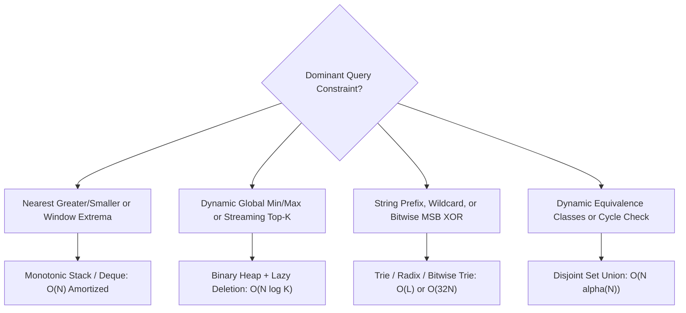
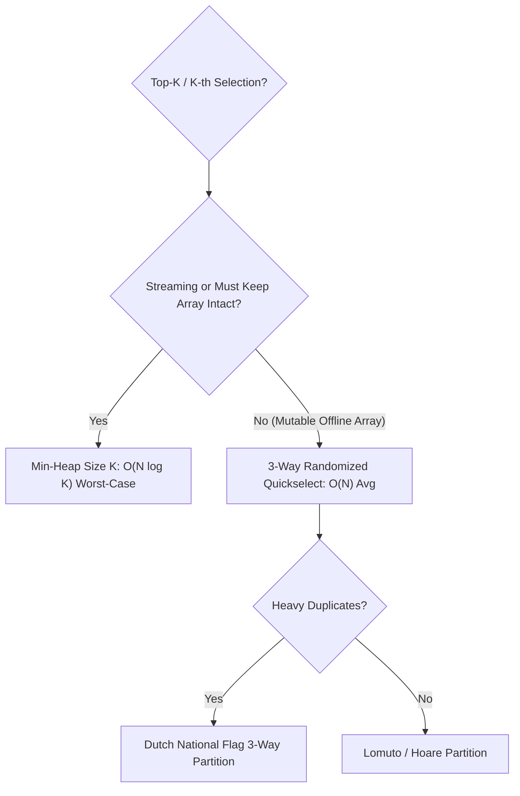
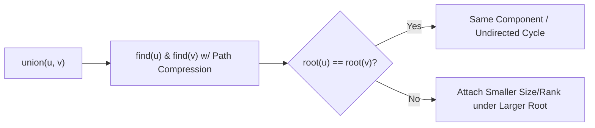

---
tags:
  - algorithm
  - data-structures
  - heaps
  - tries
  - union-find
  - monotonic-stack
created: 2026-11-13
updated: 2026-11-13
status: 🟢
level: mid-to-senior
---
# Heaps, Tries, Union-Find & Monotonic Stacks

> [!abstract] Navigation & Scope
> Roadmap: [[Programming/Algorithms/Algorithms & LeetCode Roadmap|Algorithms & LeetCode Roadmap]] | Hub: [[Programming/Programming Hub|Programming Hub]]
> Companion Guides: [[Programming/Algorithms/Two Pointers, Sliding Window & Hashing|Two Pointers, Sliding Window & Hashing]] | [[Programming/Algorithms/Trees, Graphs & Shortest Paths|Trees, Graphs & Shortest Paths]] | [[Programming/Algorithms/Dynamic Programming, Greedy & Backtracking|Dynamic Programming, Greedy & Backtracking]]
> Systems Mapping: [[Programming/Software Engineering/System Design/Caching|Caching]] | [[Programming/Software Engineering/System Design/Rate Limiting|Rate Limiting]] | [[Programming/Software Engineering/DevOps/Observability|Observability]]

---

## 1. First-Principles Mechanics & Complete Architecture

Linear scans fail when queries depend on nearest dominance boundaries, dynamic global extrema, shared string/bit prefixes, or evolving equivalence classes. The four data structures in this handbook eliminate quadratic $O(N^2)$ recomputation by maintaining strict structural invariants that permanently prune dominated candidates or compress traversal paths.



### 1.1 Monotonic Stack & Monotonic Deque

A monotonic stack stores array **indices** (never just raw values) whose corresponding values satisfy a strict or non-strict total order from stack bottom to stack top. Its power comes from **dominance elimination**: whenever an incoming element `nums[i]` breaks the monotonic ordering against `nums[stack[-1]]`, the top element has found its exact nearest boundary and can never be the optimal boundary for any future element past `i`.

#### Formal Amortized $O(N)$ Proof (Push-Pop Accounting)

Consider scanning an array of length $N$ from `i = 0` to `N - 1`. Although each outer loop iteration contains an inner `while` loop that pops elements, the total work across the entire scan is strictly linear:

1. **Push Count**: Each index $j \in \{0, 1, \dots, N - 1\}$ is pushed onto the stack **at most once** (or at most twice in a `2N` circular-array pass).
2. **Pop Count**: An index can only be popped if it currently resides on the stack, and once popped it is never re-pushed. Therefore, the total number of `pop()` executions across all $N$ outer iterations combined is bounded above by $N$.
3. **Total Work**: Using the potential function $\Phi(\text{stack}) = |\text{stack}|$, each outer iteration incurs $O(1)$ actual work for the push plus $\Delta \Phi$ amortized over pops, yielding at most $2N$ stack mutations and strictly $\Theta(N)$ worst-case time complexity and $O(N)$ auxiliary space.

#### Monotonic Stack Variants & Exact Pop Semantics

| Target Boundary | Stack Order (Bottom $\to$ Top) | Pop Condition (`x = nums[i]`) | Information Resolved on Pop (`j = stack.pop()`) |
|-----------------|--------------------------------|-------------------------------|-------------------------------------------------|
| **Next Greater / Prev Greater** | Strictly or non-strictly decreasing | `nums[stack[-1]] < x` (or `<=`) | `i` is Next Greater of `j`; new `stack[-1]` is Prev Greater of `j` |
| **Next Smaller / Prev Smaller** | Strictly or non-strictly increasing | `nums[stack[-1]] > x` (or `>=`) | `i` is Next Smaller of `j`; new `stack[-1]` is Prev Smaller of `j` |
| **Circular Array Next Greater** | Decreasing over `i in 0..2n-1` | `nums[stack[-1]] < nums[i % n]` | Push indices only when `i < n` (or overwrite cleanly); `n` wrap resolved in $2N$ |
| **Histogram Largest Rectangle** | Non-strictly increasing + sentinel `0` | `heights[stack[-1]] >= cur_h` | `i` is right `<` bound; `stack[-1]` (or `-1`) is left `<=` bound; width `i - left - 1` |
| **Trapping Rain Water (Horizontal)** | Non-strictly decreasing | `h[stack[-1]] < h[i]` | `mid = stack.pop()` is floor; `left = stack[-1]` and `i` bound water layer height `min(h[left], h[i]) - h[mid]` |

#### Circular Array Wrap (`2N` Indexing)

In a circular array of length $N$, the next greater element of index $j$ may lie at an index $k < j$ after wrapping past $N - 1$. Instead of physically concatenating `nums + nums` (which doubles memory allocation to $2N$), simulate concatenation virtually by iterating `i` from `0` to `2 * n - 1` and reading `cur = nums[i % n]`. Only indices `i < n` need to be pushed onto the stack if every unresolved index will already be present before the second pass begins—any element still left on the stack after index `2n - 1` is guaranteed to be a global maximum whose answer remains `-1`.

#### Duplicate Tie-Breaking Proof (*Sum of Subarray Minimums*)

When summing $\min(\text{subarray})$ across all $\frac{N(N+1)}{2}$ subarrays via per-element contribution (`nums[j] * left_span * right_span`), arrays containing duplicate values such as `[2, 2]` will **double-count** subarrays covering both `2`s if both left and right searches stop strictly (`<`) or both stop non-strictly (`<=`).

To partition all subarrays containing a minimum value $v$ into disjoint ownership sets, assign each subarray uniquely to its **leftmost** occurrence of $v$:

- **Left Boundary (`prev_less`)**: Nearest index `L < j` with `nums[L] < nums[j]` (strictly smaller; skips equal elements to the left, stopping only at strictly smaller values).
- **Right Boundary (`next_less_or_equal`)**: Nearest index `R > j` with `nums[R] <= nums[j]` (smaller or equal; stops immediately at the next equal element).

For `[2, 2]` at indices `0, 1`:
- Index `0` (`val = 2`): `L = -1` (count `1`), `R = 1` (stops at index `1`, count `1`). Owns `1 * 1 = 1` subarray: `[2]` (at `0`).
- Index `1` (`val = 2`): `L = -1` (skips index `0` because `2` is not `< 2`, count `2`), `R = 2` (count `1`). Owns `2 * 1 = 2` subarrays: `[2]` (at `1`) and `[2, 2]` (at `0..1`).

Total distinct subarrays owned = `1 + 2 = 3`, matching $\frac{2 \times 3}{2} = 3$ with zero overlap and zero omissions. Notice a single increasing monotonic stack popping on `nums[stack[-1]] >= cur` (plus a trailing sentinel `-inf` at `i = n`) yields **both** `R = i` and `L = stack[-1]` simultaneously inside one pop loop.

#### Largest Rectangle in Histogram Sentinel & Equal-Bar Proof

Given `heights` of length $N$, append a virtual sentinel bar `cur_h = 0` at `i = N` and treat an empty stack's left boundary as `-1`. When bar `h = heights[stack.pop()]` is popped by incoming `cur_h` (`heights[popped] >= cur_h`):

- Every bar between the new `stack[-1]` (strictly smaller or equal to `h`, or `-1`) and `i` (smaller or equal to `h`) that already popped must have been strictly taller than `h` (otherwise it would not have popped prior to `i` or would still sit below `popped` on the stack).
- Therefore, `h` is guaranteed to be the minimum height over the open index interval `(left_bound, i)`, which contains `width = i - left_bound - 1` bars.
- **What about adjacent equal bars `[5, 5]`?** Popping index `0` (`h = 5`) when index `1` (`h = 5`) arrives assigns index `0` a prematurely narrow width (`1`), **but** index `1` remains on the stack inheriting `left_bound = -1`. When index `1` eventually pops, it computes the exact full width spanning both bars (`5 * 2 = 10`).

#### Monotonic Deque (Sliding Window Maximum & Negative-Element Prefix Windows)

A monotonic deque maintains **indices** in a double-ended queue satisfying two simultaneous invariants across every window `[i - k + 1 .. i]`:

1. **Temporal Expiration Invariant**: Every index `idx` inside `dq` satisfies `idx > i - k`. Because indices are pushed monotonically from left to right, only `dq[0]` needs checking (`if dq[0] <= i - k: dq.popleft()`).
2. **Value Dominance Invariant**: Values `nums[dq[0]] > nums[dq[1]] > ... > nums[dq[-1]]` remain strictly decreasing from front to back. Before appending `i`, pop from the back while `nums[dq[-1]] <= nums[i]`, because any older element `j < i` with `nums[j] <= nums[i]` expires **earlier** than `i` and can never surpass `nums[i]` while `i` is inside the window.

Why storing raw values fails: on `[3, 1, 3, 2]` with `k = 3`, a value-only deque cannot distinguish whether the front `3` belongs to expired index `0` or still-valid index `2`. Storing indices makes expiration exact in $O(1)$.

**Extension to Arrays with Negative Values (*Shortest Subarray with Sum at Least $K$*)**: Standard two-pointer sliding windows fail when `nums` contains negative integers because prefix sums `P[i]` lose monotonicity. Maintaining a **monotonically increasing** deque of prefix-sum indices `P[dq[0]] < P[dq[1]] < ...` recovers $O(N)$ time:
- **Pop from front**: While `dq` is non-empty and `P[i] - P[dq[0]] >= K`, update `best = min(best, i - dq[0])` and `dq.popleft()`. Any future `i' > i` paired with `dq[0]` would yield a strictly longer length `i' - dq[0] > i - dq[0]`, so `dq[0]` can never produce a shorter valid subarray.
- **Pop from back**: While `dq` is non-empty and `P[dq[-1]] >= P[i]`, `dq.pop()`. Since `i > dq[-1]` and `P[i] <= P[dq[-1]]`, starting at `i` yields both a **larger or equal** prefix difference `P[r] - P[i] >= P[r] - P[dq[-1]]` AND a **strictly shorter** subarray `r - i < r - dq[-1]`.

---

### 1.2 Binary Heaps, Floyd's $O(N)$ Proof & Lazy Deletion

A binary heap embeds a complete binary tree into a contiguous zero-indexed dynamic array `h`, eliminating per-node child/parent pointer overhead (16–24 bytes saved per node) and preserving spatial cache locality across sift loops:

- `left(i) = 2 * i + 1`
- `right(i) = 2 * i + 2`
- `parent(i) = (i - 1) >> 1` (for `i > 0`)

#### Floyd's Bottom-Up `heapify` $O(N)$ Proof vs. $O(N \log N)$ Repeated `push`

Constructing a heap from an unsorted array of $N$ elements behaves asymmetrically depending on sift direction:

- **Naive Repeated `heappush` ($\Omega(N \log N)$)**: Inserting elements sequentially at index `N - 1` and sifting **upward** forces the bottom half of the tree ($\lceil N / 2 \rceil$ leaves at depth $\lfloor \log_2 N \rfloor$) to travel up to $\lfloor \log_2 N \rfloor$ levels in the worst case (e.g., inserting elements sorted in reverse order). Work sums to $\sum_{i=1}^{N} \lfloor \log_2 i \rfloor = \Theta(N \log N)$.
- **Floyd's Bottom-Up `heapify` ($O(N)$)**: Leaves (`i >= N // 2`) already satisfy the heap property trivially as 1-node subtrees. Iterating `i` downward from the last internal node `N // 2 - 1` down to `0` and calling `sift_down(i)` ensures both subtrees `left(i)` and `right(i)` are already valid heaps before `i` sifts down.

At height $h$ measured upward from the leaf layer ($h = 0$ are leaves, $h = \lfloor \log_2 N \rfloor$ is the root), there are at most $\lceil N / 2^{h+1} \rceil$ nodes, and each node at height $h$ performs at most $h$ swaps (or $2h$ comparisons) during `sift_down`:

$$T(N) \le \sum_{h=1}^{\lfloor \log_2 N \rfloor} \left\lceil \frac{N}{2^{h+1}} \right\rceil \cdot h \le \frac{N}{2} \sum_{h=1}^{\infty} \frac{h}{2^h} + \sum_{h=1}^{\lfloor \log_2 N \rfloor} h$$

Differentiating the geometric series $\sum_{h=0}^{\infty} r^h = \frac{1}{1 - r}$ for $|r| < 1$ gives $\sum_{h=1}^{\infty} h r^{h-1} = \frac{1}{(1 - r)^2}$, so multiplying by $r$:

$$\sum_{h=1}^{\infty} h r^h = \frac{r}{(1 - r)^2} \quad \xrightarrow{r = \frac{1}{2}} \quad \frac{1/2}{(1/2)^2} = 2$$

Substituting back yields $T(N) \le \frac{N}{2} \cdot 2 + O(\log^2 N) = N + O(\log^2 N) = O(N)$ swaps in the absolute worst case (and $\le 2N$ element comparisons).

#### Two-Heaps Streaming Median & Lazy Deletion Invariants

To track the median of a dynamic multiset under insertions, maintain two heaps partitioning the sorted elements into a lower half `low` (max-heap, stored negated in Python `heapq`) and an upper half `high` (min-heap):

1. **Order Invariant**: Every element in `low` is $\le$ every element in `high` (`-low[0] <= high[0]`).
2. **Size Balance Invariant**: `low_size == high_size` (even total, median is `(-low[0] + high[0]) / 2.0`) or `low_size == high_size + 1` (odd total, median is `-low[0]`).

When deletions of arbitrary non-root elements occur (as in *Sliding Window Median*), neither Python's `heapq` nor a simple binary heap supports $O(\log N)$ arbitrary removal without maintaining an external `index_map` updated on every swap. **Lazy Deletion** solves arbitrary deletion cleanly:

1. **Tombstone Ledger**: Maintain `delayed: dict[int, int]` counting pending deletions per value, plus exact logical counters `low_size` and `high_size` (never `len(low)` / `len(high)`, which include dead tombstones).
2. **Routing Outgoing Elements**: When `out_val` leaves the window, increment `delayed[out_val] += 1`. Determine which heap logically owns `out_val` by comparing against the live boundary `top_low = -low[0]`: if `out_val <= top_low`, decrement `low_size -= 1` (and immediately prune `low` if `out_val == top_low`), otherwise decrement `high_size -= 1` (and prune `high` if `out_val == high[0]`).
3. **Rebalance + Root Prune Coupling**: Whenever `low_size > high_size + 1` or `low_size < high_size`, transfer the **live** root between heaps (`prune` before reading `low[0]` or `high[0]`), and ALWAYS `prune(low)` and `prune(high)` after rebalancing so neither heap root ever exposes a tombstoned entry! Failing to prune after a transfer can leave a newly exposed tombstone sitting at `low[0]`, corrupting both the next incoming comparison and the reported median.

#### $K$-Way Merge ($O(N \log K)$) & Quickselect Comparison

When merging $K$ sorted lists totaling $N$ elements, pushing all $N$ items into one heap costs $O(N \log N)$ time and $O(N)$ heap memory. Pushing only the current head of each non-empty list keeps heap size bounded by $K$: each of the $N$ pops and successor pushes costs $O(\log K)$, yielding $O(N \log K)$ time and $O(K)$ auxiliary heap space. In Python, always store `(val, list_idx, node_or_elem_idx)` so integer `list_idx` breaks ties without attempting `<` comparison on `ListNode` objects (which raises `TypeError`).



| Selection Strategy | Time Complexity | Auxiliary Space | Streaming Compatible | Heavy Duplicate Behavior |
|--------------------|-----------------|-----------------|----------------------|--------------------------|
| **Min-Heap of Size $K$** | $O(N \log K)$ worst-case | $O(K)$ | Yes (single pass) | Unaffected (`<= root` skipped in $O(1)$) |
| **Floyd Heapify + $K$ Pops** | $O(N + K \log N)$ worst-case | $O(1)$ in-place or $O(N)$ | No (requires all $N$ items) | Unaffected |
| **2-Way Quickselect** | $O(N)$ expected, $O(N^2)$ worst | $O(1)$ iterative | No (mutates input) | **Degrades to $O(N^2)$** on all-equal arrays! |
| **3-Way Quickselect** | $O(N)$ expected | $O(1)$ iterative | No (mutates input) | **$O(N)$** (`== pivot` block skipped wholesale) |

---

### 1.3 Trie (Prefix Tree), Word-Boundary Pruning & Bitwise XOR Trie

A Trie stores keys (strings or fixed-width bitvectors) along root-to-node edge paths so shared prefixes share identical ancestor chains. Lookup and insertion take $O(L)$ time proportional solely to key length $L$, completely independent of the total dictionary size $N$.

#### Node Fan-Out Memory Math & Radix Path Compression

Choosing the child representation inside `TrieNode` directly determines memory footprint and CPU cache efficiency:

- **Fixed-Size Child Array (`children: [None] * 26`)**: Direct $O(1)$ offset indexing (`ord(c) - 97`) with zero hashing overhead, ideal for dense lowercase ASCII dictionaries (`a-z`). However, in 64-bit Python, each 26-pointer list occupies $56 + 26 \times 8 = 264$ bytes plus the `TrieNode` object header (`__dict__` adds ~104 bytes unless `__slots__` is declared). A sparse trie of $10^5$ unique character states consumes >35 MiB for empty `None` slots alone.
- **Hash Map (`dict[str, TrieNode]` / JS `Map<string, TrieNode>`)**: Allocates entries only for populated outgoing edges, reducing memory drastically for sparse dictionaries or full Unicode alphabets, at the cost of hash computation and pointer indirection.
- **Radix / Patricia Trie (Compressed Trie)**: Collapses every chain of single-child non-terminal nodes into a single edge labeled by a substring slice (e.g., `"http://"` stored as one edge rather than 7 chained nodes). Reduces total node count from $O(\sum |W_i|)$ characters down to strictly $\le 2N - 1$ nodes for $N$ stored strings, dramatically improving L1/L2 cache hit rates in HTTP routers and CIDR tables.

#### Word-Boundary Markers & Leaf-Removal Pruning (*Word Search II*)

Never rely on "node has no children" to determine word termination; `"app"` and `"apple"` share a chain where `"app"` terminates at an internal node. Store an explicit terminal flag or reference (`word: str | None = None`, or `pass_count` + `end_count` when deletion/prefix-counting is needed).

In backtracking search against a static grid (*Word Search II*), matched words must **never** be re-discovered by subsequent grid cells. Clearing `node.word = None` prevents duplicate outputs, yet leaves dead branches intact in the trie—causing every remaining cell to traverse long shared prefixes like `"aaaaaaaaaa"` repeatedly ($O(M N \cdot 4^L)$). **Bottom-up leaf pruning** eliminates exhausted branches dynamically:

1. Store `parent_ref` or prune upon unwinding recursion: after clearing `next_node.word = None` and returning from neighbor DFS, if `len(next_node.children) == 0`, execute `del node.children[ch]` (or `node.child_count -= 1` in array-backed tries).
2. The trie shrinks monotonically toward empty during the grid scan, turning worst-case benchmark matrices from TLE into near-linear traversals.

#### Bitwise XOR Trie ($O(N \cdot B)$) & MSB Dominance Proof

For integers bounded by $B$ bits (for 32-bit signed/unsigned non-negative ints, $B = 31$ with bit indices `b = 30` down to `0`), represent every number as a fixed-depth binary path in a trie where each node has two slots `children[0]` and `children[1]`.

To find $\max_{y \in S} (x \oplus y)$ for a query `x`: traverse from MSB (`b = B - 1`) down to LSB (`b = 0`). At bit `b`, let `bit = (x >> b) & 1` and `want = bit ^ 1`. If `curr.children[want]` exists, follow `want` and set bit `b` in the XOR accumulator (`res |= (1 << b)`); otherwise follow `bit` (contributing `0` at bit `b`).

**MSB Dominance Proof**: Suppose at bit position $k$, two paths exist (`want` yielding XOR bit `1` at $k$, and `bit` yielding XOR bit `0` at $k$). Even if choosing `bit` could somehow achieve `1` at **every** lower bit position $0 \dots k - 1$, its total contribution across bits $0 \dots k$ is strictly bounded by:

$$\sum_{j=0}^{k-1} 2^j = 2^k - 1 < 2^k$$

Therefore, maximizing the most significant differing bit strictly dominates any combination of all lower bits combined, proving greedy MSB selection produces the exact global maximum XOR in $O(B)$ time per query.

**Offline Sorted Variant (*Maximum XOR With an Element From Array*)**: When queries restrict candidates to `nums[j] <= m_i`, sort `nums` ascending, sort queries `(m_i, x_i, orig_idx)` by `m_i` ascending, and advance a single pointer `ptr` inserting `nums[ptr] <= m_i` into one persistent bitwise trie before answering query `i` in $O(B)$ time—total $O(N \log N + Q \log Q + (N + Q)B)$.

---

### 1.4 Disjoint Set Union (Union-Find), Weighted DSU & Rollback DSU

Disjoint Set Union maintains a partition of $N$ elements into disjoint sets supporting near-constant `find(x)` (canonical root representative) and `union(u, v)` (merging two sets).



#### Complexity Hierarchy: Why Both Heuristics Are Required

- **Naive Unbalanced DSU**: Attaching `parent[root_u] = root_v` arbitrarily produces $O(N)$ degenerate chains ($O(N)$ per `find`).
- **Union by Size / Rank Alone**: Attaching the smaller subtree (or lower upper-bound `rank`) under the larger root guarantees tree height never exceeds $\lfloor \log_2 N \rfloor$, bounding `find` to $O(\log N)$ worst-case.
- **Path Compression Alone**: Setting `parent[x] = find(parent[x])` (or iterative **path halving**: `while parent[x] != x: parent[x] = parent[parent[x]]; x = parent[x]`) without rank/size balancing yields $O(\log N)$ amortized time per operation.
- **Path Compression + Union by Size/Rank**: Tarjan's potential proof bounds $M$ operations on $N$ elements at $O(M \cdot \alpha(N))$, where $\alpha(N)$ is the inverse Ackermann function ($\alpha(N) \le 4$ for any $N \le 2^{2^{65536}}$).

#### Weighted / Potential DSU (Ratios & Modulo-Parity Bipartite Conflicts)

Standard DSU tracks only connectivity. Augmenting each edge `x -> parent[x]` with a relative group element `weight[x]` converts DSU into an online algebraic solver for transitive relations:

1. **Multiplicative Ratio DSU (`u / v = k`)**: Maintain invariant $\text{weight}[x] = \frac{\text{val}[x]}{\text{val}[\text{parent}[x]]}$ (with `weight[root] = 1.0`).
   - **Path Compression (`find(x)`)**: Before overwriting `parent[x] = root`, recurse on `orig_p = parent[x]` to obtain `(root, p_to_root)`, then update `weight[x] *= p_to_root` because $\frac{x}{\text{root}} = \frac{x}{\text{orig\_p}} \cdot \frac{\text{orig\_p}}{\text{root}}$.
   - **Union (`u / v = k`)**: Given `ru, wu = find(u)` and `rv, wv = find(v)` (meaning $u = w_u \cdot r_u$ and $v = w_v \cdot r_v$), attaching `parent[ru] = rv` requires:
     $$\text{weight}[r_u] = \frac{r_u}{r_v} = \frac{u / w_u}{v / w_v} = k \cdot \frac{w_v}{w_u}$$
   - **Consistency Check (`ru == rv`)**: If `u` and `v` are already connected, verify $|w_u / w_v - k| < \epsilon$; contradiction detected in $O(\alpha(N))$!

2. **Additive / Parity DSU (`(val[u] - val[v]) % M = k`)**: Replace multiplication/division with addition/subtraction modulo $M$. For $M = 2$, `parity[x] = (val[x] ^ val[parent[x]])` enables online **Bipartite Graph Check** (`is_bipartite` edge stream): `ru == rv` triggers an odd-cycle conflict immediately if `(pu ^ pv) != 1` (two endpoints forced into the same color).

#### Rollback DSU & Offline Dynamic Connectivity

Standard DSU cannot handle arbitrary edge deletions directly because separating merged trees requires undoing path compressions. Two production techniques handle edge deletions:

1. **Time-Reversal (Offline Pure Deletions)**: When the graph starts connected and queries only *delete* edges (e.g., *Bricks Falling When Hit*), apply all deletions upfront to construct the final state, then replay deletions **backward in time** as DSU `union` insertions.
2. **DSU with Rollback Stack (Segment Tree Over Time for Mixed Insert/Delete)**:
   - **CRITICAL INVARIANT**: **Disable Path Compression completely!** Path compression mutates an unbounded number of ancestor pointers per `find`, making $O(1)$ rollback impossible. Keep **Union by Size** (or Rank) strictly, guaranteeing $O(\log N)$ worst-case `find` and `union`.
   - On every `union(u, v)`: compute `ru = find(u)`, `rv = find(v)`. Even if `ru == rv`, push a sentinel frame or only push non-no-op merges to `history` (recording `(rv, prev_size_of_ru)` before setting `parent[rv] = ru; size[ru] += prev_size_of_rv; components -= 1`).
   - `snapshot()` returns `len(history)`; `rollback(target_len)` pops frames backward restoring `parent[rv] = rv; size[ru] -= size[rv]; components += 1` in $O(1)$ per undone union. Pairing Rollback DSU with a Segment Tree over query time `[0..Q-1]` solves arbitrary dynamic edge additions and deletions offline in $O((Q + E) \log Q \log N)$ total time.

---

## 2. Real-World Use Cases, Production Systems Mapping & Decision Matrix

Senior systems engineers encounter these four primitives directly inside telemetry pipelines, routers, storage engines, and compilers—often hidden behind higher-level abstractions.

### Production Systems Mapping

1. **Monotonic Stack & Deque in Time-Series Telemetry & Financial Engines**:
   - **PromQL `rate()` / Counter-Reset Cleaning**: Network interface counters (`bytes_tx_total`) increase monotonically except on process restarts or 64-bit wraparounds. Pre-scanning raw samples with monotonic invariants strips reset drops before computing finite-difference rates; similarly, calculating rolling `max_over_time[5m]` across million-point Prometheus TSDB chunks uses a monotonic deque indexed by sample timestamp `(ts >= cur_ts - window_ms)` in $O(1)$ amortized per sample rather than $O(W)$ per tick.
   - **Financial Order-Book / OHLC Span Engines**: Computing historical breakout spans (number of consecutive prior candles where `high[j] <= high[i]`) or real-time rolling high/low channels over 1-second tick streams runs inside an $O(1)$ amortized monotonic stack/deque on the market-data feed thread without GC churn.

2. **Binary Heaps & Lazy Deletion in Kernels, Storage Engines & Latency Monitors**:
   - **OS & `libuv` Timer Min-Heaps**: As detailed in [[Programming/Backend/Backend Core (Node, Event Loop, Auth & Concurrency)|Backend Core]], event loops schedule millions of socket timeouts (`setTimeout`, TCP retransmit timers) inside a binary min-heap keyed by monotonic expiration tick. Cancelled sockets mark timers tombstoned or delete via intrusive heap back-pointers (`heap_node` index inside the socket struct) rather than scanning.
   - **LSM-Tree SSTable Compaction ($K$-Way Merge)**: RocksDB, Pebble, and Cassandra merge $K$ sorted immutable SSTable runs using a Tournament Tree / Binary Min-Heap of size $K$, streaming sorted `(key, seq_num, value)` records directly to disk with bounded $O(K)$ RAM regardless of multi-terabyte SSTable size.
   - **Sliding-Window Streaming p50/p99 Latency Trackers**: Service sidecars tracking exact rolling p50 (Median) or p90/p99 over the last $W$ seconds or $K$ requests use an asymmetric Two-Heap (`low` sized at $\lceil p \cdot K \rceil$, `high` holding the remainder) coupled with Lazy Deletion (`delayed` map + logical size counters) when fixed-bucket HDR histograms lose precision across bimodal distributions.

3. **Tries & Radix Tries in Network Routing, Web Servers & Autocomplete**:
   - **IPv4 / IPv6 CIDR Longest-Prefix-Match (LPM) Routers**: Linux kernel FIB tables and BGP software routers match incoming destination IP addresses against hundreds of thousands of CIDR prefixes (`10.20.0.0/16` vs `10.20.4.0/24`) using Bitwise / Multi-bit Stride Radix Tries (DXR, LC-trie, DIR-24-8), resolving the most specific matching route in $O(32)$ (or $O(1)$–$O(4)$ cache lines) independent of routing table size.
   - **High-Throughput HTTP Routers (`httprouter`, `Fastify` `find-my-way`)**: Route static segments, `:param` wildcards, and `*catchall` paths via compressed Radix Trees instead of linear RegExp iteration, guaranteeing $O(\text{URL length})$ dispatch latency.
   - **Low-Latency Search Autocomplete**: Caching top-$K$ popular query strings directly at each Trie prefix node reduces autocomplete suggestion latency to a single $O(L)$ prefix walk with zero subtree DFS at query time.

4. **Disjoint Set Union in Query Optimizers, Static Analysis & Cluster Topology**:
   - **SQL Query Optimizer Column Equivalence Classes**: PostgreSQL's planner (`EquivalenceClass`) groups transitively equal join columns (`a.id = b.user_id AND b.user_id = c.uid`) via union-find merging so index predicates pushed onto `a.id` propagate automatically to `c.uid`.
   - **Build / Dependency Cycle & Connectivity Verification**: Detecting conflicting equivalence constraints or clustering microservice topologies across dynamic failover edges (`Rollback DSU` over maintenance intervals).

### Decision Matrix: Selecting the Right Structure

| Problem Signal | Preferred Structure | Why Alternatives Lose | Time / Space |
|----------------|--------------------|-----------------------|--------------|
| Nearest larger/smaller element to left/right | **Monotonic Stack** | Nested scan is $O(N^2)$; Balanced BST / Heap adds $\log N$ factor | $O(N)$ / $O(N)$ |
| Fixed/variable sliding-window `max` or `min` | **Monotonic Deque** | Heap + lazy delete is $O(N \log K)$; Segment Tree adds $O(\log N)$ constant | $O(N)$ / $O(K)$ |
| Sliding-window **median** or $p$-th quantile | **Two-Heaps + Lazy Delete** | Monotonic deque only tracks extrema (`0th`/`100th` percentile), not interior ranks | $O(N \log K)$ / $O(K)$ |
| Merge $K$ sorted streams or Top-$K$ unbounded stream | **Binary Min-Heap** | Sorting all $N$ elements costs $O(N \log N)$ and $O(N)$ memory | $O(N \log K)$ / $O(K)$ |
| Static array $K$-th largest (mutation permitted) | **3-Way Randomized Quickselect** | Heap pays $O(N \log K)$ vs $O(N)$ expected; 2-way degrades to $O(N^2)$ on ties | $O(N)$ avg / $O(1)$ |
| Prefix lookup, wildcard DFS, CIDR LPM | **Trie / Compressed Radix Trie** | Hash map cannot query shared prefixes or longest-prefix-match without $O(L^2)$ slices | $O(L)$ / $O(\sum L)$ |
| Max XOR pair / subarray XOR maximization | **Bitwise XOR Trie** | Brute force pairs $O(N^2)$; sorting cannot inspect bitwise complements per bit | $O(N B)$ / $O(N B)$ |
| Online undirected connectivity / Kruskal MST | **DSU (Compression + Rank)** | Re-running BFS/DFS per edge query costs $O(Q(V+E))$ vs $O(\alpha(N))$ | $O(E \alpha(V))$ / $O(V)$ |
| Offline mixed edge insertions + deletions | **Rollback DSU + SegTree** | Standard DSU cannot undo path compression; dynamic link-cut trees are overly complex | $O(Q \log Q \log N)$ / $O(N + Q)$ |

---

## 3. Step-by-Step Practical Application: Production Engineering & Complete Implementations

Before diving into algorithmic patterns, establish production-grade reusable primitives—especially in **TypeScript**, which ships **no standard library Priority Queue / Binary Heap** in ECMAScript or Node.js.

### 3.1 Reusable Production TypeScript Generic `MinHeap<T>` (with Floyd $O(N)$ Build)

Using a zero-indexed flat array with a strict comparator `(a: T, b: T) => number` (negative when `a` has higher priority than `b`) handles min-heaps, max-heaps, and object priorities cleanly without runtime allocation spikes.

```ts
// src/structures/min-heap.ts
export type Comparator<T> = (a: T, b: T) => number;

export class MinHeap<T> {
  private readonly heap: T[];
  private readonly compare: Comparator<T>;

  constructor(compare: Comparator<T> = (a, b) => (a < b ? -1 : a > b ? 1 : 0), initialItems: T[] = []) {
    this.compare = compare;
    this.heap = initialItems.slice();
    if (this.heap.length > 1) {
      this.heapify(); // Floyd's O(N) bottom-up build
    }
  }

  get size(): number {
    return this.heap.length;
  }

  isEmpty(): boolean {
    return this.heap.length === 0;
  }

  peek(): T | undefined {
    return this.heap[0];
  }

  push(item: T): void {
    this.heap.push(item);
    this.siftUp(this.heap.length - 1);
  }

  pop(): T | undefined {
    const n = this.heap.length;
    if (n === 0) return undefined;
    const top = this.heap[0];
    const last = this.heap.pop()!;
    if (n > 1) {
      this.heap[0] = last;
      this.siftDown(0);
    }
    return top;
  }

  private heapify(): void {
    for (let i = (this.heap.length >> 1) - 1; i >= 0; i--) {
      this.siftDown(i);
    }
  }

  private siftUp(idx: number): void {
    const target = this.heap[idx];
    while (idx > 0) {
      const parentIdx = (idx - 1) >> 1;
      const parent = this.heap[parentIdx];
      if (this.compare(target, parent) >= 0) break;
      this.heap[idx] = parent;
      idx = parentIdx;
    }
    this.heap[idx] = target; // Hole-method writes target once instead of 3-way swapping per level
  }

  private siftDown(idx: number): void {
    const n = this.heap.length;
    const half = n >> 1;
    const target = this.heap[idx];
    while (idx < half) {
      let childIdx = (idx << 1) + 1;
      let child = this.heap[childIdx];
      const rightIdx = childIdx + 1;
      if (rightIdx < n && this.compare(this.heap[rightIdx], child) < 0) {
        childIdx = rightIdx;
        child = this.heap[rightIdx];
      }
      if (this.compare(target, child) <= 0) break;
      this.heap[idx] = child;
      idx = childIdx;
    }
    this.heap[idx] = target;
  }
}
```

> [!tip] Hole-Sifting Optimization (`siftUp` / `siftDown`)
> Assigning `this.heap[idx] = child` downward and placing `target` once at the final resting index cuts array writes per heap level from 3 (full swap) to 1 (single assignment), reducing cache-line dirtiness by ~3x in tight priority-queue loops.

---

### 3.2 Production System Module: IPv4 CIDR Longest-Prefix-Match Router + Streaming Latency Median Engine

In real edge proxies and observability agents, two patterns converge: matching destination IPs against CIDR routing rules in $O(32)$ via a **Bitwise Radix/Prefix Trie**, and tracking sliding-window latency medians across the last $W$ requests via **Two-Heaps + Lazy Deletion**.

```
routing-telemetry-service/
├── src/
│   ├── cidr-router.ts        # 32-bit unsigned Bitwise Trie with LPM lookup
│   ├── telemetry-median.ts   # Sliding-window median via Two-Heaps + Lazy Deletion
│   └── router.test.ts        # Deterministic unit tests using node:test
└── package.json
```

```ts
// src/cidr-router.ts
export interface RouteRule {
  cidr: string;
  nextHop: string;
  prefixLen: number;
}

class CidrTrieNode {
  children: [CidrTrieNode | null, CidrTrieNode | null] = [null, null];
  rule: RouteRule | null = null;
}

export class CidrLpmRouter {
  private readonly root = new CidrTrieNode();

  static parseIpv4(ip: string): number {
    const parts = ip.split('.');
    if (parts.length !== 4) {
      throw new Error(`Invalid IPv4 address: ${ip}`);
    }
    let val = 0;
    for (let i = 0; i < 4; i++) {
      const octet = Number(parts[i]);
      if (!Number.isInteger(octet) || octet < 0 || octet > 255) {
        throw new Error(`Invalid IPv4 octet in ${ip}`);
      }
      // Unsigned assembly via multiplication avoids signed 32-bit overflow before masking
      val = val * 256 + octet;
    }
    return val >>> 0;
  }

  insert(cidr: string, nextHop: string): void {
    const [ipStr, lenStr] = cidr.split('/');
    const prefixLen = Number(lenStr);
    if (!Number.isInteger(prefixLen) || prefixLen < 0 || prefixLen > 32) {
      throw new Error(`Invalid CIDR prefix length: ${cidr}`);
    }
    const ipInt = CidrLpmRouter.parseIpv4(ipStr);
    let curr = this.root;
    for (let depth = 0; depth < prefixLen; depth++) {
      // Shift right by (31 - depth) using unsigned >>> so bit 31 never sign-extends
      const bit = (ipInt >>> (31 - depth)) & 1;
      let next = curr.children[bit];
      if (!next) {
        next = new CidrTrieNode();
        curr.children[bit] = next;
      }
      curr = next;
    }
    curr.rule = { cidr, nextHop, prefixLen };
  }

  lookup(destIp: string): RouteRule | null {
    const ipInt = CidrLpmRouter.parseIpv4(destIp);
    let curr: CidrTrieNode | null = this.root;
    let bestMatch: RouteRule | null = curr.rule; // Handles default route 0.0.0.0/0 cleanly

    for (let depth = 0; depth < 32 && curr !== null; depth++) {
      const bit = (ipInt >>> (31 - depth)) & 1;
      curr = curr.children[bit];
      if (curr && curr.rule !== null) {
        bestMatch = curr.rule; // Deeper prefix overrides shallower match
      }
    }
    return bestMatch;
  }
}
```

```ts
// src/telemetry-median.ts
import { MinHeap } from './min-heap.ts';

export class SlidingLatencyTracker {
  private readonly windowSize: number;
  private readonly low = new MinHeap<number>((a, b) => b - a); // Max-heap for lower half
  private readonly high = new MinHeap<number>((a, b) => a - b); // Min-heap for upper half
  private readonly delayed = new Map<number, number>();
  private readonly ring: number[] = [];
  private lowSize = 0;
  private highSize = 0;
  private head = 0;

  constructor(windowSize: number) {
    if (windowSize <= 0) throw new Error('windowSize must be positive');
    this.windowSize = windowSize;
  }

  record(latencyMs: number): number {
    this.ring.push(latencyMs);
    this.addValue(latencyMs);

    if (this.ring.length - this.head > this.windowSize) {
      const expired = this.ring[this.head++];
      this.removeValue(expired);
      // Periodically compact ring storage to prevent unbounded prefix array retention
      if (this.head > 1024 && this.head * 2 >= this.ring.length) {
        this.ring.splice(0, this.head);
        this.head = 0;
      }
    }
    return this.getMedian();
  }

  getMedian(): number {
    this.prune(this.low);
    this.prune(this.high);
    if (this.lowSize === 0) return 0;
    if (this.lowSize > this.highSize) return this.low.peek()!;
    return (this.low.peek()! + this.high.peek()!) / 2;
  }

  private addValue(num: number): void {
    this.prune(this.low);
    if (this.lowSize > 0 && num <= this.low.peek()!) {
      this.low.push(num);
      this.lowSize++;
    } else {
      this.prune(this.high);
      if (this.highSize === 0 || num < this.high.peek()!) {
        this.low.push(num);
        this.lowSize++;
      } else {
        this.high.push(num);
        this.highSize++;
      }
    }
    this.rebalance();
  }

  private removeValue(num: number): void {
    this.prune(this.low);
    this.prune(this.high);
    const inLow = this.lowSize > 0 && num <= this.low.peek()!;
    this.delayed.set(num, (this.delayed.get(num) ?? 0) + 1);
    if (inLow) {
      this.lowSize--;
      if (num === this.low.peek()) this.prune(this.low);
    } else {
      this.highSize--;
      if (num === this.high.peek()) this.prune(this.high);
    }
    this.rebalance();
  }

  private rebalance(): void {
    if (this.lowSize > this.highSize + 1) {
      this.prune(this.low);
      this.high.push(this.low.pop()!);
      this.lowSize--;
      this.highSize++;
      this.prune(this.low);
    } else if (this.lowSize < this.highSize) {
      this.prune(this.high);
      this.low.push(this.high.pop()!);
      this.highSize--;
      this.lowSize++;
      this.prune(this.high);
    }
  }

  private prune(heap: MinHeap<number>): void {
    while (!heap.isEmpty()) {
      const top = heap.peek()!;
      const count = this.delayed.get(top) ?? 0;
      if (count === 0) break;
      if (count === 1) this.delayed.delete(top);
      else this.delayed.set(top, count - 1);
      heap.pop();
    }
  }
}
```

```ts
// src/router.test.ts (Executable via: node --experimental-strip-types --test src/router.test.ts)
import test from 'node:test';
import assert from 'node:assert/strict';
import { CidrLpmRouter } from './cidr-router.ts';
import { SlidingLatencyTracker } from './telemetry-median.ts';

test('CidrLpmRouter selects deepest matching CIDR prefix over default/broad prefixes', () => {
  const router = new CidrLpmRouter();
  router.insert('0.0.0.0/0', 'gw-default');
  router.insert('10.20.0.0/16', 'gw-vpc');
  router.insert('10.20.4.0/24', 'gw-subnet-a');
  router.insert('10.20.4.128/25', 'gw-canary');

  assert.equal(router.lookup('192.168.1.1')?.nextHop, 'gw-default');
  assert.equal(router.lookup('10.20.99.5')?.nextHop, 'gw-vpc');
  assert.equal(router.lookup('10.20.4.12')?.nextHop, 'gw-subnet-a');
  assert.equal(router.lookup('10.20.4.200')?.nextHop, 'gw-canary');
});

test('SlidingLatencyTracker maintains exact sliding median under duplicates and expiration', () => {
  const tracker = new SlidingLatencyTracker(3);
  assert.equal(tracker.record(10), 10);
  assert.equal(tracker.record(30), 20);
  assert.equal(tracker.record(20), 20); // Window [10, 30, 20] -> 20
  assert.equal(tracker.record(20), 20); // Window [30, 20, 20] -> 20 (duplicate boundary)
  assert.equal(tracker.record(50), 20); // Window [20, 20, 50] -> 20
  assert.equal(tracker.record(60), 50); // Window [20, 50, 60] -> 50
});
```

---

### 3.3 Nine Canonical Algorithms in Dual Language (Python 3.12 + TypeScript)

Every problem below includes invariant verification, dual-language idiomatic implementations with complete type signatures, and zero-ellipses production guards.

#### Problem 1: Sliding Window Maximum (Monotonic Deque)

Maintain a strictly decreasing deque of indices; evict expired front indices (`dq[0] <= i - k`) and dominated back indices (`nums[dq[-1]] <= x`). In TypeScript, avoid `Array.shift()` (which costs $O(K)$ memory shift) by implementing a fixed-capacity circular ring buffer (`Int32Array`) of size `k` (or `n`) for true $O(1)$ front eviction.

```python
from collections import deque


def max_sliding_window(nums: list[int], k: int) -> list[int]:
    if not nums or k <= 0:
        return []
    dq: deque[int] = deque()
    res: list[int] = []
    for i, x in enumerate(nums):
        if dq and dq[0] <= i - k:
            dq.popleft()
        while dq and nums[dq[-1]] <= x:
            dq.pop()
        dq.append(i)
        if i >= k - 1:
            res.append(nums[dq[0]])
    return res
```

```ts
function maxSlidingWindow(nums: number[], k: number): number[] {
  const n = nums.length;
  if (n === 0 || k <= 0) return [];
  // Monotonic deque implemented as a contiguous ring/head-tail index queue (zero Array.shift())
  const dq = new Int32Array(n);
  let head = 0;
  let tail = 0; // Active elements occupy dq[head .. tail - 1]
  const res: number[] = [];

  for (let i = 0; i < n; i++) {
    if (head < tail && dq[head] <= i - k) {
      head++;
    }
    const x = nums[i];
    while (head < tail && nums[dq[tail - 1]] <= x) {
      tail--;
    }
    dq[tail++] = i;
    if (i >= k - 1) {
      res.push(nums[dq[head]]);
    }
  }
  return res;
}
```

#### Problem 2: Largest Rectangle in Histogram (Monotonic Stack + Sentinel `0`)

Maintain a non-strictly increasing stack of bar indices. Appending a sentinel `0` at index `n` guarantees every remaining bar pops and resolves its maximal spanned width `i - left_bound - 1`.

```python
def largest_rectangle_area(heights: list[int]) -> int:
    stack: list[int] = []
    max_area = 0
    n = len(heights)

    for i in range(n + 1):
        cur_h = 0 if i == n else heights[i]
        while stack and heights[stack[-1]] >= cur_h:
            h = heights[stack.pop()]
            left_bound = stack[-1] if stack else -1
            width = i - left_bound - 1
            area = h * width
            if area > max_area:
                max_area = area
        stack.append(i)
    return max_area
```

```ts
function largestRectangleArea(heights: number[]): number {
  const stack: number[] = [];
  let maxArea = 0;
  const n = heights.length;

  for (let i = 0; i <= n; i++) {
    const curH = i === n ? 0 : heights[i];
    while (stack.length > 0 && heights[stack[stack.length - 1]] >= curH) {
      const h = heights[stack.pop()!];
      const leftBound = stack.length === 0 ? -1 : stack[stack.length - 1];
      const width = i - leftBound - 1;
      const area = h * width;
      if (area > maxArea) maxArea = area;
    }
    stack.push(i);
  }
  return maxArea;
}
```

#### Problem 3: Sum of Subarray Minimums (Asymmetric Tie-Breaking Monotonic Stack)

Assign each subarray uniquely to its leftmost minimum: pop on `arr[stack[-1]] >= cur` (strictly `<` boundary on the left, `<=` boundary on the right). Because `left_count * right_count * arr[mid]` can exceed $2^{31} - 1$ before modulo, JavaScript uses `BigInt` (`1000000007n`) or safe integer modular multiplication.

```python
def sum_subarray_mins(arr: list[int]) -> int:
    MOD = 10**9 + 7
    n = len(arr)
    stack: list[int] = []
    total = 0

    for i in range(n + 1):
        cur = -1 if i == n else arr[i]  # arr[i] >= 1 in standard problem; -inf works for negatives
        while stack and (i == n or arr[stack[-1]] >= cur):
            mid = stack.pop()
            left = stack[-1] if stack else -1
            right = i
            total = (total + arr[mid] * (mid - left) * (right - mid)) % MOD
        stack.append(i)
    return total
```

```ts
function sumSubarrayMins(arr: number[]): number {
  const MOD = 1_000_000_007n;
  const n = arr.length;
  const stack: number[] = [];
  let total = 0n;

  for (let i = 0; i <= n; i++) {
    const cur = i === n ? -Infinity : arr[i];
    while (stack.length > 0 && (i === n || arr[stack[stack.length - 1]] >= cur)) {
      const mid = stack.pop()!;
      const left = stack.length === 0 ? -1 : stack[stack.length - 1];
      const count = BigInt(mid - left) * BigInt(i - mid);
      total = (total + BigInt(arr[mid]) * count) % MOD;
    }
    stack.push(i);
  }
  return Number(total);
}
```

#### Problem 4: Next Greater Element II (Circular `2N` Wrap)

Simulate a doubled array using `idx = i % n` over `0 <= i < 2 * n`. Only indices from the first pass (`i < n`) need to be pushed onto the decreasing stack; the second pass resolves wrap-around elements without extra allocations.

```python
def next_greater_elements_circular(nums: list[int]) -> list[int]:
    n = len(nums)
    ans = [-1] * n
    stack: list[int] = []

    for i in range(2 * n):
        cur = nums[i % n]
        while stack and nums[stack[-1]] < cur:
            ans[stack.pop()] = cur
        if i < n:
            stack.append(i)
    return ans
```

```ts
function nextGreaterElementsCircular(nums: number[]): number[] {
  const n = nums.length;
  const ans = new Array<number>(n).fill(-1);
  const stack: number[] = [];

  for (let i = 0; i < 2 * n; i++) {
    const cur = nums[i % n];
    while (stack.length > 0 && nums[stack[stack.length - 1]] < cur) {
      ans[stack.pop()!] = cur;
    }
    if (i < n) {
      stack.push(i);
    }
  }
  return ans;
}
```

#### Problem 5: Sliding Window Median (Two-Heaps + Lazy Deletion)

Python implementation paired with the TypeScript `SlidingLatencyTracker` already built in Section 3.2. Notice how `balance` (`low_size - high_size`) tracks the structural delta cleanly in 1 integer instead of two size variables if preferred, though explicit `low_size` / `high_size` makes debugging traces unmistakable.

```python
import heapq
from collections import defaultdict


def median_sliding_window(nums: list[int], k: int) -> list[float]:
    low: list[int] = []   # Max-heap storing negated values
    high: list[int] = []  # Min-heap storing raw values
    delayed: dict[int, int] = defaultdict(int)
    low_size = 0
    high_size = 0

    def prune(heap: list[int], is_max_heap: bool) -> None:
        while heap:
            val = -heap[0] if is_max_heap else heap[0]
            if delayed[val] > 0:
                delayed[val] -= 1
                if delayed[val] == 0:
                    del delayed[val]
                heapq.heappop(heap)
            else:
                break

    def rebalance() -> None:
        nonlocal low_size, high_size
        if low_size > high_size + 1:
            prune(low, True)
            heapq.heappush(high, -heapq.heappop(low))
            low_size -= 1
            high_size += 1
            prune(low, True)
        elif low_size < high_size:
            prune(high, False)
            heapq.heappush(low, -heapq.heappop(high))
            high_size -= 1
            low_size += 1
            prune(high, False)

    def current_median() -> float:
        prune(low, True)
        prune(high, False)
        if k & 1:
            return float(-low[0])
        return (-low[0] + high[0]) / 2.0

    for i in range(k):
        heapq.heappush(low, -nums[i])
        low_size += 1
    for _ in range(k // 2):
        heapq.heappush(high, -heapq.heappop(low))
        low_size -= 1
        high_size += 1

    res = [current_median()]
    for i in range(k, len(nums)):
        out_val = nums[i - k]
        in_val = nums[i]
        prune(low, True)
        prune(high, False)
        in_low = low_size > 0 and out_val <= -low[0]
        delayed[out_val] += 1

        if in_low:
            low_size -= 1
            if low and out_val == -low[0]:
                prune(low, True)
        else:
            high_size -= 1
            if high and out_val == high[0]:
                prune(high, False)

        prune(low, True)
        if low_size > 0 and in_val <= -low[0]:
            heapq.heappush(low, -in_val)
            low_size += 1
        else:
            prune(high, False)
            if high_size == 0 or in_val < high[0]:
                heapq.heappush(low, -in_val)
                low_size += 1
            else:
                heapq.heappush(high, in_val)
                high_size += 1

        rebalance()
        res.append(current_median())
    return res
```

**Dry-Run Trace on `nums = [1, 3, -1, -3, 5, 3, 6, 7], k = 3`**:

| Step (`i`) | Out / In | `low` Logical (Negated Raw) / Size | `high` Logical / Size | `delayed` Ledger | Rebalance & Prune Action | Median |
|:----------:|:--------:|------------------------------------|-----------------------|------------------|--------------------------|:------:|
| Init `0..2` | `-, [1,3,-1]` | `{1, -1}` (`[-1, 1]`), `2` | `{3}`, `1` | `{}` | Initial $k$ split | `1.0` |
| `3` (`-3`) | Out `1`, In `-3` | `{-1, -3}` (`[1, 3]`), `2` | `{3}`, `1` | `{}` | Out `1 == -low[0]` $\to$ prune `1`; push `-3` to `low` | `-1.0` |
| `4` (`5`) | Out `3`, In `5` | `{-1, -3}` (`[1, 3]`), `2` | `{5}`, `1` | `{}` | Out `3 == high[0]` $\to$ prune `3`; push `5` to `high` | `-1.0` |
| `5` (`3`) | Out `-1`, In `3` | `{3, -3}` (`[-3, 3]`), `2` | `{5}`, `1` | `{}` | Out `-1 == -low[0]` $\to$ prune `-1`; push `3` to `high`, move `3` to `low` | `3.0` |
| `6` (`6`) | Out `-3`, In `6` | `{5, 3}` (`[-5, -3, 3]`), `2` | `{6}`, `1` | `{-3: 1}` | Out `-3` buried in `low`; push `6` to `high`, move `5` to `low` | `5.0` |
| `7` (`7`) | Out `5`, In `7` | `{6, 3}` (`[-6, -3, 3]`), `2` | `{7}`, `1` | `{-3: 1}` | Out `5 == -low[0]` $\to$ prune `5`; push `7` to `high`, move `6` to `low` | `6.0` |

Output: `[1.0, -1.0, -1.0, 3.0, 5.0, 6.0]`.

#### Problem 6: Merge $K$ Sorted Linked Lists ($K$-Way Min-Heap)

Store `(node.val, list_idx, node)` in Python (`list_idx` breaks ties cleanly so Python never compares `ListNode < ListNode`) and use `MinHeap<ListNode>` in TypeScript.

```python
import heapq
from typing import Optional


class ListNode:
    def __init__(self, val: int = 0, next: Optional["ListNode"] = None) -> None:
        self.val = val
        self.next = next


def merge_k_lists(lists: list[Optional[ListNode]]) -> Optional[ListNode]:
    heap: list[tuple[int, int, ListNode]] = []
    for idx, head in enumerate(lists):
        if head is not None:
            heap.append((head.val, idx, head))
    heapq.heapify(heap)  # O(K) Floyd build

    dummy = tail = ListNode()
    while heap:
        _, idx, node = heapq.heappop(heap)
        tail.next = node
        tail = node
        if node.next is not None:
            heapq.heappush(heap, (node.next.val, idx, node.next))
    return dummy.next
```

```ts
class ListNodeTS {
  val: number;
  next: ListNodeTS | null;
  constructor(val = 0, next: ListNodeTS | null = null) {
    this.val = val;
    this.next = next;
  }
}

function mergeKLists(lists: Array<ListNodeTS | null>): ListNodeTS | null {
  const initialHeads: ListNodeTS[] = [];
  for (const head of lists) {
    if (head !== null) initialHeads.push(head);
  }
  const heap = new MinHeap<ListNodeTS>((a, b) => a.val - b.val, initialHeads);

  const dummy = new ListNodeTS();
  let tail = dummy;
  while (!heap.isEmpty()) {
    const node = heap.pop()!;
    tail.next = node;
    tail = node;
    if (node.next !== null) {
      heap.push(node.next);
    }
  }
  return dummy.next;
}
```

#### Problem 7: Word Search II (Trie + Grid Backtracking + Bottom-Up Leaf Pruning)

Pruning empty child nodes immediately after returning from recursive neighbors shrinks the trie to zero nodes once all words are found, eliminating repeated sweeps over dense shared-prefix boards.

```python
class WordTrieNode:
    __slots__ = ("children", "word")

    def __init__(self) -> None:
        self.children: dict[str, WordTrieNode] = {}
        self.word: str | None = None


def find_words(board: list[list[str]], words: list[str]) -> list[str]:
    root = WordTrieNode()
    for w in words:
        curr = root
        for ch in w:
            if ch not in curr.children:
                curr.children[ch] = WordTrieNode()
            curr = curr.children[ch]
        curr.word = w

    rows, cols = len(board), len(board[0])
    found: list[str] = []

    def dfs(r: int, c: int, parent: WordTrieNode) -> None:
        ch = board[r][c]
        node = parent.children.get(ch)
        if node is None:
            return

        if node.word is not None:
            found.append(node.word)
            node.word = None  # Prevent duplicate hits

        board[r][c] = "#"  # Mark visited in-place
        for dr, dc in ((1, 0), (-1, 0), (0, 1), (0, -1)):
            nr, nc = r + dr, c + dc
            if 0 <= nr < rows and 0 <= nc < cols and board[nr][nc] in node.children:
                dfs(nr, nc, node)
        board[r][c] = ch

        # Bottom-up leaf pruning: remove exhausted trie branches permanently
        if not node.children and node.word is None:
            del parent.children[ch]

    for r in range(rows):
        for c in range(cols):
            if board[r][c] in root.children:
                dfs(r, c, root)
    return found
```

```ts
class WordTrieNodeTS {
  children = new Map<string, WordTrieNodeTS>();
  word: string | null = null;
}

function findWords(board: string[][], words: string[]): string[] {
  const root = new WordTrieNodeTS();
  for (const w of words) {
    let curr = root;
    for (const ch of w) {
      let next = curr.children.get(ch);
      if (!next) {
        next = new WordTrieNodeTS();
        curr.children.set(ch, next);
      }
      curr = next;
    }
    curr.word = w;
  }

  const rows = board.length;
  const cols = board[0].length;
  const found: string[] = [];
  const dirs = [
    [1, 0],
    [-1, 0],
    [0, 1],
    [0, -1],
  ];

  function dfs(r: number, c: number, parent: WordTrieNodeTS): void {
    const ch = board[r][c];
    const node = parent.children.get(ch);
    if (!node) return;

    if (node.word !== null) {
      found.push(node.word);
      node.word = null;
    }

    board[r][c] = '#';
    for (const [dr, dc] of dirs) {
      const nr = r + dr;
      const nc = c + dc;
      if (nr >= 0 && nr < rows && nc >= 0 && nc < cols && node.children.has(board[nr][nc])) {
        dfs(nr, nc, node);
      }
    }
    board[r][c] = ch;

    if (node.children.size === 0 && node.word === null) {
      parent.children.delete(ch);
    }
  }

  for (let r = 0; r < rows; r++) {
    for (let c = 0; c < cols; c++) {
      if (root.children.has(board[r][c])) {
        dfs(r, c, root);
      }
    }
  }
  return found;
}
```

#### Problem 8: Maximum XOR of Two Numbers in an Array (Bitwise XOR Trie)

Notice the TypeScript detail: JavaScript bitwise operators treat operands as 32-bit **signed** integers (`1 << 31` evaluates to `-2147483648`!). Always use `>>>` for unsigned bit extraction and compute `maxBit` safely (`31 - Math.clz32(maxVal)` for positive `maxVal`), adding `curXor |= 1 << b` only when `b <= 30`, or multiplying by `2 ** b` if 32nd bit (`b = 31`) is ever used.

```python
class BitTrieNode:
    __slots__ = ("children",)

    def __init__(self) -> None:
        self.children: list[BitTrieNode | None] = [None, None]


def find_maximum_xor(nums: list[int]) -> int:
    if len(nums) < 2:
        return 0
    max_val = max(nums)
    if max_val == 0:
        return 0
    max_bit = max_val.bit_length() - 1

    root = BitTrieNode()
    for num in nums:
        curr = root
        for b in range(max_bit, -1, -1):
            bit = (num >> b) & 1
            nxt = curr.children[bit]
            if nxt is None:
                nxt = BitTrieNode()
                curr.children[bit] = nxt
            curr = nxt

    best = 0
    for num in nums:
        curr = root
        cur_xor = 0
        for b in range(max_bit, -1, -1):
            bit = (num >> b) & 1
            want = bit ^ 1
            if curr.children[want] is not None:
                cur_xor |= 1 << b
                curr = curr.children[want]  # type: ignore[assignment]
            else:
                curr = curr.children[bit]  # type: ignore[assignment]
        if cur_xor > best:
            best = cur_xor
    return best
```

```ts
class BitTrieNodeTS {
  children: [BitTrieNodeTS | null, BitTrieNodeTS | null] = [null, null];
}

function findMaximumXOR(nums: number[]): number {
  if (nums.length < 2) return 0;
  let maxVal = 0;
  for (const num of nums) {
    if (num > maxVal) maxVal = num;
  }
  if (maxVal === 0) return 0;
  // Unsigned 32-bit MSB index (0..31) via Math.clz32
  const maxBit = 31 - Math.clz32(maxVal >>> 0);

  const root = new BitTrieNodeTS();
  for (const num of nums) {
    let curr = root;
    for (let b = maxBit; b >= 0; b--) {
      const bit = (num >>> b) & 1;
      let next = curr.children[bit];
      if (!next) {
        next = new BitTrieNodeTS();
        curr.children[bit] = next;
      }
      curr = next;
    }
  }

  let best = 0;
  for (const num of nums) {
    let curr = root;
    let curXor = 0;
    for (let b = maxBit; b >= 0; b--) {
      const bit = (num >>> b) & 1;
      const want = bit ^ 1;
      if (curr.children[want] !== null) {
        curXor += 2 ** b; // Avoids signed 1 << 31 becoming negative in JS
        curr = curr.children[want]!;
      } else {
        curr = curr.children[bit]!;
      }
    }
    if (curXor > best) best = curXor;
  }
  return best;
}
```

#### Problem 9: Weighted Ratio DSU (`Evaluate Division`) & Rollback DSU

Combining **Weighted DSU** (solving transitive equation queries `a / b = k`) and **Rollback DSU** (supporting undoable unions for offline dynamic connectivity without path compression) completes the production DSU toolkit.

```python
class WeightedDSU:
    def __init__(self) -> None:
        self.parent: dict[str, str] = {}
        self.weight: dict[str, float] = {}  # Invariant: node / parent[node] = weight[node]

    def find(self, x: str) -> tuple[str, float]:
        if x not in self.parent:
            self.parent[x] = x
            self.weight[x] = 1.0
            return x, 1.0
        if self.parent[x] != x:
            root, parent_to_root = self.find(self.parent[x])
            self.parent[x] = root
            self.weight[x] *= parent_to_root
        return self.parent[x], self.weight[x]

    def union(self, u: str, v: str, val: float) -> None:
        ru, wu = self.find(u)
        rv, wv = self.find(v)
        if ru != rv:
            self.parent[ru] = rv
            self.weight[ru] = val * wv / wu

    def query(self, u: str, v: str) -> float:
        if u not in self.parent or v not in self.parent:
            return -1.0
        ru, wu = self.find(u)
        rv, wv = self.find(v)
        return wu / wv if ru == rv else -1.0


class RollbackDSU:
    """DSU with Union-by-Size ONLY (NO path compression) enabling O(1) rollback per union."""

    def __init__(self, n: int) -> None:
        self.parent = list(range(n))
        self.size = [1] * n
        self.components = n
        self.history: list[tuple[int, int]] = []  # (merged_child_root, receiving_root)

    def find(self, x: int) -> int:
        while self.parent[x] != x:
            x = self.parent[x]  # Strictly read-only traversal
        return x

    def union(self, u: int, v: int) -> bool:
        ru = self.find(u)
        rv = self.find(v)
        if ru == rv:
            return False
        if self.size[ru] < self.size[rv]:
            ru, rv = rv, ru
        self.parent[rv] = ru
        self.size[ru] += self.size[rv]
        self.components -= 1
        self.history.append((rv, ru))
        return True

    def snapshot(self) -> int:
        return len(self.history)

    def rollback(self, target_snap: int) -> None:
        while len(self.history) > target_snap:
            child_root, parent_root = self.history.pop()
            self.parent[child_root] = child_root
            self.size[parent_root] -= self.size[child_root]
            self.components += 1
```

```ts
export class WeightedDSUTS {
  private readonly parent = new Map<string, string>();
  private readonly weight = new Map<string, number>();

  find(x: string): [string, number] {
    if (!this.parent.has(x)) {
      this.parent.set(x, x);
      this.weight.set(x, 1.0);
      return [x, 1.0];
    }
    const p = this.parent.get(x)!;
    if (p !== x) {
      const [root, pToRoot] = this.find(p);
      this.parent.set(x, root);
      this.weight.set(x, this.weight.get(x)! * pToRoot);
    }
    return [this.parent.get(x)!, this.weight.get(x)!];
  }

  union(u: string, v: string, val: number): void {
    const [ru, wu] = this.find(u);
    const [rv, wv] = this.find(v);
    if (ru !== rv) {
      this.parent.set(ru, rv);
      this.weight.set(ru, (val * wv) / wu);
    }
  }

  query(u: string, v: string): number {
    if (!this.parent.has(u) || !this.parent.has(v)) return -1.0;
    const [ru, wu] = this.find(u);
    const [rv, wv] = this.find(v);
    return ru === rv ? wu / wv : -1.0;
  }
}

export class RollbackDSUTS {
  private readonly parent: Int32Array;
  private readonly size: Int32Array;
  private readonly history: Array<[number, number]> = [];
  components: number;

  constructor(n: number) {
    this.parent = new Int32Array(n);
    this.size = new Int32Array(n).fill(1);
    for (let i = 0; i < n; i++) this.parent[i] = i;
    this.components = n;
  }

  find(x: number): number {
    while (this.parent[x] !== x) {
      x = this.parent[x];
    }
    return x;
  }

  union(u: number, v: number): boolean {
    let ru = this.find(u);
    let rv = selfFind(this.parent, v);
    if (ru === rv) return false;
    if (this.size[ru] < this.size[rv]) {
      [ru, rv] = [rv, ru];
    }
    this.parent[rv] = ru;
    this.size[ru] += this.size[rv];
    this.components--;
    this.history.push([rv, ru]);
    return true;
  }

  snapshot(): number {
    return this.history.length;
  }

  rollback(targetSnap: number): void {
    while (this.history.length > targetSnap) {
      const [childRoot, parentRoot] = this.history.pop()!;
      this.parent[childRoot] = childRoot;
      this.size[parentRoot] -= this.size[childRoot];
      this.components++;
    }
  }
}

function selfFind(parent: Int32Array, x: number): number {
  while (parent[x] !== x) x = parent[x];
  return x;
}
```

---

## 4. Complete Construct Reference, Edge Cases & Security Hardening

### Language-Specific Traps & Subtle Failure Modes

1. **Python `heapq` Tuple Comparison `TypeError`**:
   Pushing `(priority, task_object)` fails whenever two items share identical `priority` because Python falls back to evaluating `task_a < task_b`, throwing `TypeError: '<' not supported between instances`. Always insert a strictly monotonic tie-breaker `(priority, seq_id, task_object)` using `itertools.count()` or `list_idx`.
2. **JavaScript 32-Bit Signed Bitwise Sign Extension**:
   Bitwise operations (`>>`, `<<`, `&`, `|`, `^`) in JavaScript coerce numbers to signed 32-bit integers (`Int32`). Shifting a `1` into bit `31` via `1 << 31` produces `-2147483648`, corrupting CIDR parsing and IPv4 masks. Always use `>>>` for logical right shift and `>>> 0` to interpret 32-bit integers as unsigned `uint32` before comparisons (`+ (2 ** 31)` or `BigInt` for 64-bit / IPv6).
3. **JavaScript Negative Modulo Wrap**:
   In Python, `(-1) % 5 == 4`. In JavaScript/TypeScript, `(-1) % 5 === -1`. Any circular index arithmetic stepping backward (`(idx - 1) % n`) must use `((idx - 1) % n + n) % n`.
4. **JavaScript `Array.shift()` Hidden $O(N^2)$ Bottleneck**:
   Calling `dq.shift()` inside a sliding-window loop shifts all remaining $K$ array slots in memory on every pop, turning an $O(N)$ algorithm into $O(N \cdot K)$. Always replace `shift()` with a contiguous index cursor (`head++`) or a fixed-length ring buffer over `Int32Array`.
5. **Lazy Deletion Tombstone Heap Memory Leak**:
   If a workload pushes $10^6$ unique values and deletes $9.9 \times 10^5$ of them lazily from the interior (while a few unchanging extremes sit at the roots), `len(heap)` remains $10^6$ forever because `prune()` only discards tombstones exposed at `heap[0]`. In long-lived daemons, track `total_physical = len(low) + len(high)` vs `live = low_size + high_size`; whenever `total_physical > 2 * live + 64`, filter out all tombstoned elements and rebuild both heaps in $O(\text{live})$ via Floyd `heapify`.
6. **DSU Initialization & Rollback Path-Compression Corruption**:
   Running `find(x)` in a dynamic graph before registering `x` without checking bounds yields `KeyError`/`IndexError`; and enabling even *path halving* inside `RollbackDSU.find()` mutates `parent` links not recorded in `history`, causing silent graph corruption after `rollback()`.
7. **Trie Recursion Depth & Unicode DoS**:
   Inserting or querying maliciously deep strings ($L = 50{,}000$) recursively triggers Python `RecursionError` (`1000` default limit) or V8 `RangeError: Maximum call stack size exceeded`. Keep Trie `insert`, `search`, and `startsWith` strictly iterative, enforce a bounded max-key-length check at API ingress, and iterate Unicode codepoints (`for ch in s`) or UTF-8 bytes rather than assuming 26 ASCII offsets without bounds checks (`0 <= idx < 26`).

---

## 5. Production Debugging, Profiling & Operations Playbook

| Production Symptom | Underlying Root Cause | Diagnostic / Telemetry / Profiler Command | Deterministic Fix |
|--------------------|-----------------------|-------------------------------------------|-------------------|
| Sliding window API CPU spikes to 100% and p99 latency scales quadratically with window size $K$ | `deque` implemented over JS `Array` using `arr.shift()` (`O(K)` per eviction) or Python `list.pop(0)` | `node --cpu-prof server.ts` showing hot time in `ArrayShift`; or `py-spy top` showing `list.pop` | Replace with `collections.deque` in Python or `Int32Array` ring buffer / `head++` cursor in TypeScript. |
| Streaming median sidecar OOMs after 48 hours despite steady $K = 10{,}000$ window | Interior elements marked in `delayed` map never reach `heap[0]`, accumulating millions of dead heap slots | `heap_physical_size / logical_window_size > 5` gauge or V8 `--heap-prof` showing growing heap array | Trigger full Floyd compaction rebuild (`O(K)`) whenever `len(low) + len(high) > 2 * (low_size + high_size) + 64`. |
| Trie autocomplete service consumes >4 GiB RAM for 500k domain names | Fixed 26-slot or 128-slot arrays per `TrieNode` (`~1 KiB` per node on sparse long domains) | `tracemalloc.take_snapshot()` / Chrome DevTools Memory Heap Snapshot inspecting `TrieNode` retained size | Compress single-child paths into a **Radix Trie** (collapsing chain nodes) and declare `__slots__` / `Map`. |
| Subarray-sum or histogram batch analytics returns wrong aggregates only when duplicate values exist | Symmetric `<` or `<=` pop conditions in monotonic stack double-count or omit identical neighboring elements | Add deterministic unit test with all-equal array `[5, 5, 5, 5]` and verify count equals $\frac{N(N+1)}{2}$ | Enforce strict `<` on one boundary and `<=` on the opposite boundary (`>=` pop with sentinel). |
| IPv4 CIDR LPM router drops `/1` or `128.0.0.0/8` traffic intermittently | Signed 32-bit shift `(ip >> (31 - depth))` sign-extends bit 31 in JavaScript (`-1` instead of `1`) | Inspect unit tests covering `128.0.0.0/1` and `255.255.255.255/32` | Replace `>>` with unsigned logical right shift `>>>` and `>>> 0` normalization. |
| Offline dynamic-connectivity validator passes small graphs but breaks after `rollback()` on large inputs | Developer added path halving `parent[x] = parent[parent[x]]` inside `RollbackDSU.find()` for speed | Assert `parent` array identity before `union` and immediately after `rollback` inside property tests | Keep `RollbackDSU.find()` strictly read-only (`while parent[x] != x: x = parent[x]`). |

---

## 6. Worked Exercises

### Exercise 1: Sliding Window Maximum & Subarray-Min Contribution (Hard)

1. Trace the Monotonic Decreasing Deque on `nums = [1, 3, -1, -3, 5, 3, 6, 7], k = 3` and prove why storing indices rather than raw values is mandatory.
2. Compute **Sum of Subarray Minimums** on `arr = [3, 1, 2, 4, 1]` showing the exact left/right boundary indices under asymmetric duplicate tie-breaking so the duplicate `1`s at indices `1` and `4` do not double-count `[1, 2, 4, 1]`.

### Solution 1

1. **Why Indices Are Mandatory**: On `[3, 1, 3, 2], k = 3`, a value-only deque cannot determine whether the leading `3` resides at expired index `0` or active index `2` when index `3` enters. Storing indices makes window expiration exact (`dq[0] <= i - k`), while popping back on `nums[dq[-1]] <= x` retains only the newest occurrence among ties (which survives longest in future windows).

| `i` | `nums[i]` | Expired Front (`<= i - 3`) | Popped Back (`<= nums[i]`) | Deque Indices (Values) | Output (`i >= 2`) |
|:---:|:---------:|----------------------------|----------------------------|------------------------|:-----------------:|
| `0` | `1` | `-` | `-` | `[0]` (`[1]`) | `-` |
| `1` | `3` | `-` | `0 (1)` | `[1]` (`[3]`) | `-` |
| `2` | `-1` | `-` | `-` | `[1, 2]` (`[3, -1]`) | **`3`** |
| `3` | `-3` | `-` | `-` | `[1, 2, 3]` (`[3, -1, -3]`) | **`3`** |
| `4` | `5` | `1 <= 1` $\to$ pop `1` | `3 (-3), 2 (-1)` | `[4]` (`[5]`) | **`5`** |
| `5` | `3` | `-` | `-` | `[4, 5]` (`[5, 3]`) | **`5`** |
| `6` | `6` | `-` | `5 (3), 4 (5)` | `[6]` (`[6]`) | **`6`** |
| `7` | `7` | `-` | `6 (6)` | `[7]` (`[7]`) | **`7`** |

Result: `[3, 3, 5, 5, 6, 7]`.

2. **Sum of Subarray Minimums Trace on `arr = [3, 1, 2, 4, 1]`** (popping when `arr[stack[-1]] >= cur`):

| Pop Trigger `i` (`cur`) | Popped `mid` (`arr[mid]`) | `left` (`stack[-1]` or `-1`) | `right` (`i`) | Subarrays Owned `(mid - left) * (right - mid)` | Contribution |
|:-----------------------:|:-------------------------:|:----------------------------:|:-------------:|:----------------------------------------------:|:------------:|
| `1` (`1`) | `0` (`3`) | `-1` | `1` | `1 * 1 = 1` (`[3]`) | `3` |
| `3` (`4`) | `-` | `-` | `-` | `-` | `0` |
| `4` (`1`) | `3` (`4`) | `2` | `4` | `1 * 1 = 1` (`[4]`) | `4` |
| `4` (`1`) | `2` (`2`) | `1` | `4` | `1 * 2 = 2` (`[2], [2,4]`) | `4` |
| `4` (`1`) | `1` (`1`) | `-1` | `4` | `2 * 3 = 6` (`[1], [3,1], [1,2], [3,1,2], [1,2,4], [3,1,2,4]`) | `6` |
| `5` (Sentinel `-inf`) | `4` (`1`) | `-1` | `5` | `5 * 1 = 5` (all 5 subarrays ending at index `4`, incl. `[1,2,4,1]`) | `5` |

Total distinct subarrays accounted for = `1 + 1 + 2 + 6 + 5 = 15 = 5 * 6 / 2`, total sum = `3 + 4 + 4 + 6 + 5 = 22`. Notice index `1` (`val=1`) stopped at `right=4` while index `4` (`val=1`) reached all the way left to `-1`, partitioning `[1, 2, 4, 1]` uniquely to index `4`.

---

### Exercise 2: Largest Rectangle in Histogram & Trapping Rain Water (Hard)

1. Trace the Monotonic Increasing Stack with trailing sentinel `0` on `heights = [2, 1, 5, 6, 2, 3]`, proving why equal adjacent heights (`[5, 5]`) still compute exact area when popping on `>=`.
2. Contrast **Trapping Rain Water** via Horizontal Monotonic Stack (`O(N)` space) against Opposite-Ends Two Pointers (`O(1)` space), writing clean Python for the horizontal stack pass.

### Solution 2

1. **Trace on `heights = [2, 1, 5, 6, 2, 3]` + sentinel `0` at `i = 6`**:

| `i` | `cur_h` | Popped `(idx, h)` | `left_bound` | `width = i - left - 1` | Area | `max_area` | Stack After Push |
|:---:|:-------:|-------------------|:------------:|------------------------|:----:|:----------:|------------------|
| `0` | `2` | `-` | `-` | `-` | `-` | `0` | `[0]` |
| `1` | `1` | `(0, 2)` | `-1` | `1 - (-1) - 1 = 1` | `2` | `2` | `[1]` |
| `2` | `5` | `-` | `-` | `-` | `-` | `2` | `[1, 2]` |
| `3` | `6` | `-` | `-` | `-` | `-` | `2` | `[1, 2, 3]` |
| `4` | `2` | `(3, 6)` | `2` | `4 - 2 - 1 = 1` | `6` | `6` | `[1, 2]` |
| `4` | `2` | `(2, 5)` | `1` | `4 - 1 - 1 = 2` | `10` | **`10`** | `[1, 4]` |
| `5` | `3` | `-` | `-` | `-` | `-` | `10` | `[1, 4, 5]` |
| `6` | `0` | `(5, 3)` | `4` | `6 - 4 - 1 = 1` | `3` | `10` | `[1, 4]` |
| `6` | `0` | `(4, 2)` | `1` | `6 - 1 - 1 = 4` | `8` | `10` | `[1]` |
| `6` | `0` | `(1, 1)` | `-1` | `6 - (-1) - 1 = 6` | `6` | `10` | `[6]` |

Equal adjacent bars `[5, 5]` at indices `0, 1`: index `1` pops index `0` (assigning `0` a narrow width `1`), leaving index `1` on the stack with `left_bound = -1`. When index `1` pops later, it spans the full width across both equal bars.

2. **Trapping Rain Water (Horizontal Stack vs Vertical Two Pointers)**:
   Two pointers sum vertical water columns at `l` or `r` using running `left_max` / `right_max` in $O(1)$ space. A monotonic decreasing stack integrates horizontal water slices bounded by a popped floor `mid` and walls `left = stack[-1]` and `right = i` in a single strictly left-to-right pass (useful on streaming elevations):

```python
def trap_rain_water_stack(height: list[int]) -> int:
    stack: list[int] = []
    water = 0
    for i, h in enumerate(height):
        while stack and height[stack[-1]] < h:
            floor_idx = stack.pop()
            if not stack:
                break  # No left wall to enclose water
            left_idx = stack[-1]
            bounded_h = min(height[left_idx], h) - height[floor_idx]
            width = i - left_idx - 1
            water += bounded_h * width
        stack.append(i)
    return water
```

---

### Exercise 3: Floyd $O(N)$ Heapify & Heap Compaction Debugging (Medium)

1. Walk through `heapify([9, 5, 6, 2, 3, 7, 1])` step by step (showing the indices visited from `N // 2 - 1` down to `0` and resulting swaps), and count total swaps performed vs worst-case bound.
2. Explain why a lazy-deletion `MedianFinder` serving streaming deletions experiences memory growth and show the exact compaction fix.

### Solution 3

1. **Floyd Bottom-Up Trace (`N = 7`, `last_non_leaf = 7 // 2 - 1 = 2`)**:
   Initial array: `[9, 5, 6, 2, 3, 7, 1]`.
   - `i = 2` (`val = 6`, children `idx 5 (7), idx 6 (1)`): smallest child is `1` at `idx 6`. Swap `6 <-> 1` $\to$ `[9, 5, 1, 2, 3, 7, 6]` (1 swap).
   - `i = 1` (`val = 5`, children `idx 3 (2), idx 4 (3)`): smallest child is `2` at `idx 3`. Swap `5 <-> 2` $\to$ `[9, 2, 1, 5, 3, 7, 6]` (1 swap).
   - `i = 0` (`val = 9`, children `idx 1 (2), idx 2 (1)`): smallest child is `1` at `idx 2`. Swap `9 <-> 1` $\to$ `[1, 2, 9, 5, 3, 7, 6]`; continue sifting `9` at `idx 2` (children `7, 6`), smallest child `6` at `idx 6`. Swap `9 <-> 6` $\to$ `[1, 2, 6, 5, 3, 7, 9]` (2 swaps).
   - Total swaps: `4` (well within Floyd's bound $N = 7$). Valid min-heap invariant holds at every parent-child pair: `1 <= (2, 6)`, `2 <= (5, 3)`, `6 <= (7, 9)`.

2. **Lazy Deletion Compaction Fix**:
   Tombstones are only popped when they bubble to `heap[0]`. If interior values are repeatedly inserted and removed while an older global extreme stays at `low[0]` or `high[0]`, dead entries accumulate inside the array. Tracking `len(low) + len(high)` against `low_size + high_size`:

```python
def compact_if_bloated(
    low: list[int],
    high: list[int],
    delayed: dict[int, int],
    low_size: int,
    high_size: int,
) -> tuple[list[int], list[int]]:
    import heapq

    if len(low) + len(high) <= 2 * (low_size + high_size) + 64:
        return low, high
    # Reconstruct exact live contents using remaining delayed debt
    rem = dict(delayed)
    new_low: list[int] = []
    for neg_x in low:
        x = -neg_x
        if rem.get(x, 0) > 0:
            rem[x] -= 1
        else:
            new_low.append(neg_x)
    new_high: list[int] = []
    for x in high:
        if rem.get(x, 0) > 0:
            rem[x] -= 1
        else:
            new_high.append(x)
    delayed.clear()
    heapq.heapify(new_low)
    heapq.heapify(new_high)
    return new_low, new_high
```

---

### Exercise 4: Accounts Merge, Weighted Ratio DSU & Bipartite Parity DSU (Medium)

1. Design a Union-Find solution for **Accounts Merge**: given `accounts = [["John","a@m","b@m"], ["John","c@m"], ["John","a@m","d@m"]]`, trace how email-to-first-account mapping avoids $O(N^2)$ string merges.
2. Extend DSU to detect online **odd-cycle bipartite conflicts** as undirected edges arrive dynamically.

### Solution 4

1. **Accounts Merge Trace**:
   - Assign account IDs `0, 1, 2`. Map `email -> first_account_id`:
     - Account `0`: `a@m -> 0`, `b@m -> 0`.
     - Account `1`: `c@m -> 1`.
     - Account `2`: `a@m` already exists (`0`) $\implies$ `dsu.union(2, 0)`; `d@m -> 2`.
   - Group every unique email by `root = dsu.find(email_to_acc[email])`:
     - `root 0`: `["a@m", "b@m", "d@m"]` $\to$ `["John", "a@m", "b@m", "d@m"]`
     - `root 1`: `["c@m"]` $\to$ `["John", "c@m"]`
   - Complexity: $O(\sum K_i \log K_i + \sum K_i \cdot \alpha(N))$ where $K_i$ is component email count.

2. **Online Bipartite Parity DSU**:
   Maintain `parity[x]` = XOR distance (`0` same color, `1` opposite color) from `x` to `parent[x]`. An undirected edge `(u, v)` imposes `color(u) ^ color(v) == 1`.

```python
class BipartiteDSU:
    def __init__(self, n: int) -> None:
        self.parent = list(range(n))
        self.rank = [0] * n
        self.parity = [0] * n  # XOR parity relative to parent[x]

    def find(self, x: int) -> tuple[int, int]:
        if self.parent[x] != x:
            root, p_par = self.find(self.parent[x])
            self.parent[x] = root
            self.parity[x] ^= p_par
        return self.parent[x], self.parity[x]

    def add_edge(self, u: int, v: int) -> bool:
        """Returns False iff adding edge (u, v) creates an odd cycle."""
        ru, pu = self.find(u)
        rv, pv = self.find(v)
        if ru == rv:
            return (pu ^ pv) == 1  # Same component: must sit on opposite colors
        if self.rank[ru] < self.rank[rv]:
            ru, rv = rv, ru
            pu, pv = pv, pu
        self.parent[rv] = ru
        # Require (color[rv] ^ color[ru]) == (pu ^ pv ^ 1) so u and v differ
        self.parity[rv] = pu ^ pv ^ 1
        if self.rank[ru] == self.rank[rv]:
            self.rank[ru] += 1
        return True
```

---

### Exercise 5: Maximum XOR Trie & Offline Sorted Query Adaptation (Hard)

1. Trace the **Bitwise XOR Trie** on `nums = [3, 10, 5, 25, 2, 8]` using MSB-to-LSB depth `b = 4` (`0..31`) to prove why `(5, 25)` yields `28`.
2. Implement **Maximum XOR With an Element From Array** (`queries = [[x_i, m_i], ...]`, requiring `num <= m_i`) in $O(N \log N + Q \log Q + (N + Q) \cdot 30)$ using offline sorting + incremental Bitwise Trie insertion.

### Solution 5

1. **Bitwise XOR Trie Trace (`b = 4` down to `0`)**:
   5-bit encodings: `3 = 00011`, `10 = 01010`, `5 = 00101`, `25 = 11001`, `2 = 00010`, `8 = 01000`.
   Querying `x = 5 (00101)`:
   - `b = 4`: `x` has `0`, `want = 1` $\to$ `25` exists on branch `1`! (`xor |= 16`, move to `1`).
   - `b = 3`: `x` has `0`, `want = 1` $\to$ `25` has `1` on branch `1`! (`xor |= 8`, move to `1`).
   - `b = 2`: `x` has `1`, `want = 0` $\to$ `25` has `0` on branch `0`! (`xor |= 4`, move to `0`).
   - `b = 1`: `x` has `0`, `want = 1` $\to$ only branch `0` exists at `25` (`11001`), fallback `0` (`xor += 0`).
   - `b = 0`: `x` has `1`, `want = 0` $\to$ only branch `1` exists at `25` (`11001`), fallback `1` (`xor += 0`).
   - Total XOR: `16 + 8 + 4 = 28` (`5 ^ 25 = 28`).

2. **Offline Sorted Bounded-XOR Trie**:

```python
class CompactBitTrie:
    __slots__ = ("root",)

    def __init__(self) -> None:
        self.root: list = [None, None]

    def insert(self, num: int) -> None:
        curr = self.root
        for b in range(29, -1, -1):  # Values <= 10^9 fit in 30 bits
            bit = (num >> b) & 1
            if curr[bit] is None:
                curr[bit] = [None, None]
            curr = curr[bit]

    def max_xor(self, x: int) -> int:
        curr = self.root
        if curr[0] is None and curr[1] is None:
            return -1
        ans = 0
        for b in range(29, -1, -1):
            bit = (x >> b) & 1
            want = bit ^ 1
            if curr[want] is not None:
                ans |= 1 << b
                curr = curr[want]
            else:
                curr = curr[bit]
        return ans


def maximize_xor_bounded(nums: list[int], queries: list[list[int]]) -> list[int]:
    nums.sort()
    indexed_queries = sorted((m, x, idx) for idx, (x, m) in enumerate(queries))
    trie = CompactBitTrie()
    res = [-1] * len(queries)
    ptr = 0
    n = len(nums)

    for m, x, orig_idx in indexed_queries:
        while ptr < n and nums[ptr] <= m:
            trie.insert(nums[ptr])
            ptr += 1
        res[orig_idx] = trie.max_xor(x)
    return res
```

---

### Exercise 6: Offline Dynamic Connectivity via Rollback DSU + Segment Tree Over Time (Hard)

Given $N$ nodes and a sequence of $Q$ time steps where edges `(u, v)` are added at time $t_{\text{add}}$, removed at time $t_{\text{rem}}$ (forming active intervals $[t_{\text{add}}, t_{\text{rem}})$), and connectivity component counts are queried at each step $t \in [0..Q-1]$, explain why path compression breaks and implement the Segment-Tree-Over-Time + Rollback DSU solver.

### Solution 6

1. **Architecture**:
   - Every edge active over time interval $[L, R]$ is decomposed into at most $O(\log Q)$ canonical nodes inside a Segment Tree spanning $[0, Q - 1]$.
   - Run a single DFS over the Segment Tree:
     - Entering node `tree_idx`: record `snap = dsu.snapshot()`, then `dsu.union(u, v)` for every edge attached to `tree_idx`.
     - At leaf `l == r == t`: record `ans[t] = dsu.components`.
     - Exiting node `tree_idx`: execute `dsu.rollback(snap)` in $O(\text{node\_edges})$ time.
   - Because `RollbackDSU` uses **Union by Size only** (zero path compression), `find` takes $O(\log N)$ worst-case and each `rollback` restores `parent`/`size` in $O(1)$, yielding $O((Q + E) \log Q \log N)$ total time and $O(E \log Q + N)$ memory.

```python
def offline_dynamic_connectivity(
    n: int,
    q: int,
    active_edge_intervals: list[tuple[int, int, int, int]],  # (u, v, start_t, end_t_inclusive)
) -> list[int]:
    if q == 0:
        return []
    tree: list[list[tuple[int, int]]] = [[] for _ in range(4 * q)]

    def add_interval(idx: int, l: int, r: int, ql: int, qr: int, edge: tuple[int, int]) -> None:
        if ql <= l and r <= qr:
            tree[idx].append(edge)
            return
        mid = (l + r) >> 1
        if ql <= mid:
            add_interval(idx << 1, l, mid, ql, qr, edge)
        if qr > mid:
            add_interval((idx << 1) | 1, mid + 1, r, ql, qr, edge)

    for u, v, start_t, end_t in active_edge_intervals:
        if start_t <= end_t:
            add_interval(1, 0, q - 1, max(0, start_t), min(q - 1, end_t), (u, v))

    dsu = RollbackDSU(n)
    ans = [0] * q

    def solve(idx: int, l: int, r: int) -> None:
        snap = dsu.snapshot()
        for u, v in tree[idx]:
            dsu.union(u, v)
        if l == r:
            ans[l] = dsu.components
        else:
            mid = (l + r) >> 1
            solve(idx << 1, l, mid)
            solve((idx << 1) | 1, mid + 1, r)
        dsu.rollback(snap)

    solve(1, 0, q - 1)
    return ans
```
