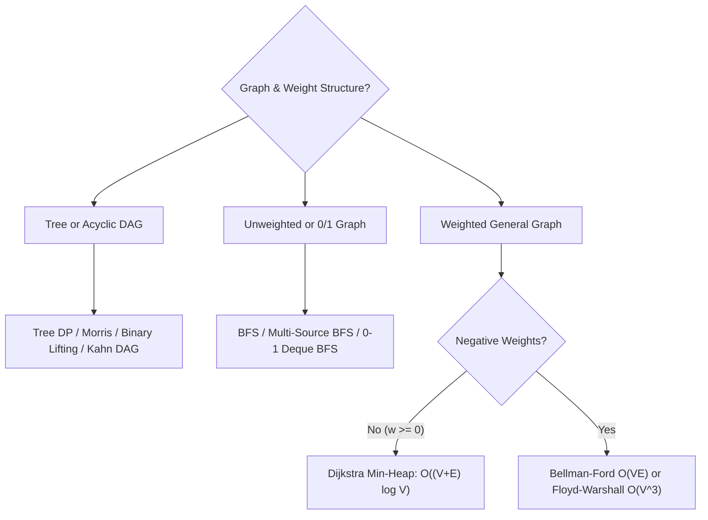
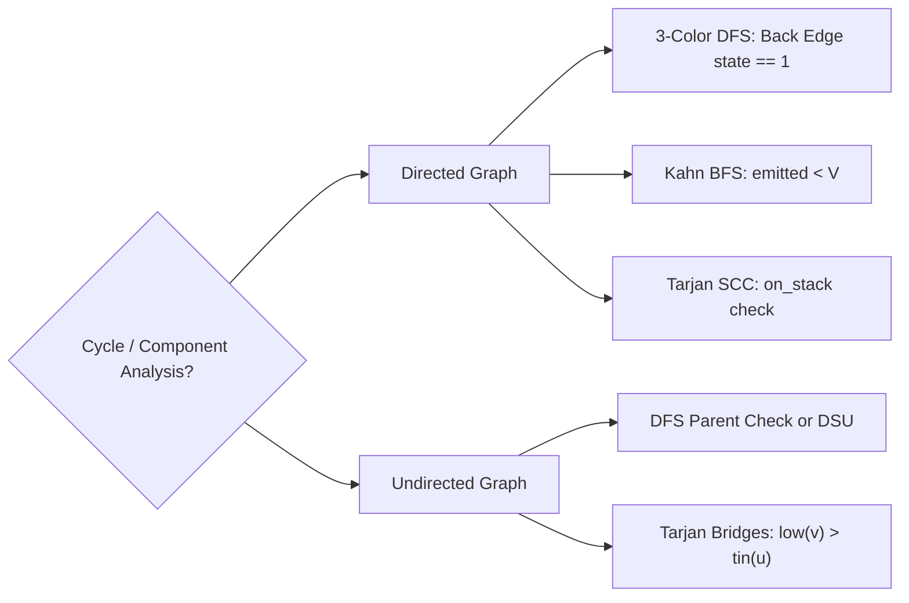

---
tags:
  - algorithm
  - trees
  - graphs
  - shortest-paths
  - dfs
  - bfs
created: 2026-11-13
updated: 2026-11-13
status: 🟢
level: mid-to-senior
---
# Trees, Graphs & Shortest Paths

> [!abstract] Navigation & Scope
> Roadmap: [[Programming/Algorithms/Algorithms & LeetCode Roadmap|Algorithms & LeetCode Roadmap]] | Hub: [[Programming/Programming Hub|Programming Hub]]
> Companion Guides: [[Programming/Algorithms/Two Pointers, Sliding Window & Hashing|Two Pointers, Sliding Window & Hashing]] | [[Programming/Algorithms/Heaps, Tries, Union-Find & Monotonic Stacks|Heaps, Tries, Union-Find & Monotonic Stacks]] | [[Programming/Algorithms/Dynamic Programming, Greedy & Backtracking|Dynamic Programming, Greedy & Backtracking]]
> Systems Mapping: [[Programming/Software Engineering/DevOps/Terraform|Terraform]] | [[Programming/Software Engineering/DevOps/Observability|Observability]] | [[Programming/Software Engineering/System Design/Load Balancing|Load Balancing]]

---

## 1. First-Principles Mechanics & Complete Architecture

Tree and graph algorithms convert structural connectivity, reachability, and path optimization problems into deterministic traversals whose time and memory guarantees depend strictly on maintaining discovery state, relaxation monotonicity, and stack-frame bounds. Selecting the wrong representation, deferring visited marking, or picking an incompatible shortest-path relaxation rule causes either exponential blowup or silent data corruption on cycles and negative weights.



### 1.1 Binary Trees, Balanced Search Trees & Traversal Mechanics

A rooted binary tree on $N$ nodes has exactly $N - 1$ edges and a unique simple path between any two vertices. Every subtree rooted at node `u` is itself an independent binary tree, enabling recursive postorder decomposition in $O(N)$ time.

#### Recursive DFS vs. Explicit Iterative Stack (Call-Stack Safety)

Recursive DFS binds frame state to the runtime call stack. In CPython (`sys.getrecursionlimit() == 1000` by default) or V8 Node.js (~10,000 frames), a skewed $10^5$-node chain raises `RecursionError` or `RangeError: Maximum call stack size exceeded`. Converting recursion into an explicit heap-allocated stack removes recursion depth crashes while exposing exact visitation timing:

1. **Iterative Preorder**: Push `[root]`; pop `node`, emit `node.val`, push `node.right`, then push `node.left` so LIFO pops `left` first.
2. **Iterative Inorder (Cursor Pattern)**: Maintain `curr = root` and `stack = []`. While `curr` or `stack`: descend left (`stack.append(curr); curr = curr.left`), pop `curr`, emit `curr.val`, and step `curr = curr.right`.
3. **Iterative Postorder (Single-Stack Ready Flag)**: Push `(node, False)`. When popping `(node, False)`, re-push `(node, True)`, then `(node.right, False)`, then `(node.left, False)`. When popping `(node, True)`, emit `node.val`. Every node enters the stack with `False` once and `True` once: strictly $O(N)$ time and $O(H)$ stack space without needing a second output-reversal stack.

#### Morris Inorder Traversal ($O(1)$ Auxiliary Space, $O(N)$ Amortized Time)

Morris traversal eliminates the $O(H)$ stack entirely by temporarily mutating the **null right pointer** of each node's inorder predecessor into a thread pointing back to `curr`:

- At `curr`:
  - If `curr.left is None`: emit `curr.val` and advance `curr = curr.right`.
  - Else find `pred`, the rightmost node in `curr.left` whose `right` is neither `None` nor `curr`:
    - **First visit (`pred.right is None`)**: create thread `pred.right = curr` and descend `curr = curr.left`.
    - **Second visit (`pred.right is curr`)**: the entire left subtree of `curr` has finished; restore tree integrity with `pred.right = None`, emit `curr.val`, and advance `curr = curr.right`.

**$O(N)$ Amortization Proof**: Every tree edge `(u, v)` is traversed at most 3 times total: once downward from `curr` during main traversal, once downward while locating `pred` on the first visit, and once downward while locating `pred` to remove the thread on the second visit. Total pointer hops are bounded by $3(N - 1) = O(N)$ with $O(1)$ extra space and zero permanent tree mutation.

#### Top-Down State Passing vs. Bottom-Up Subtree Tuple Aggregation

Tree algorithms divide into two orthogonal dataflows:
- **Top-Down State Passing**: Propagate path invariants downward from root to child (`depth`, `[lower, upper]` BST range bounds, running prefix sum).
- **Bottom-Up Subtree Aggregation (Tree DP)**: Return structured tuples from children to parent in a **single $O(N)$ postorder pass** rather than recomputing subtree heights top-down at every node (which degrades *Balanced Binary Tree* and *Diameter of Binary Tree* to $O(N^2)$ on skewed trees).
  - *Balanced + Diameter Single Pass*: Returning `(height, max_diameter, is_balanced)` computes `is_balanced = l_bal and r_bal and abs(l_h - r_h) <= 1` and `diam = max(l_diam, r_diam, l_h + r_h)` simultaneously in $\Theta(N)$ time.
  - *Single-Branch Return vs. Global Turning-Point Update* (*Binary Tree Maximum Path Sum*): Every non-empty simple path has a unique highest vertex (its LCA). At node `u`, compute `left = max(0, dfs(u.left))` and `right = max(0, dfs(u.right))`. Update the global answer treating `u` as the path's turning point (`best = max(best, u.val + left + right)`), **but return only the best single downward branch** `u.val + max(left, right)` to `u.parent`—returning a bent `left -> u -> right` path upward would create an invalid degree-3 fork. Clamping child gains against `0` (never `u.val`) guarantees all-negative trees report the single largest negative node rather than `0`.

#### BST Order Invariant & Balanced Search Tree Family (AVL, Red-Black, B+Tree)

Checking solely `node.left.val < node.val < node.right.val` is a **classic BST validation bug**: a subtree like `5 -> right: 10 -> left: 3` satisfies local parent-child checks while violating the global BST invariant (`3 < 5` placed in `5`'s right subtree). Maintain strict ancestor range constraints `lower < node.val < upper` top-down (passing `(lower, node.val)` left and `(node.val, upper)` right) OR assert strict monotonic increase (`prev_val < node.val`) during inorder traversal.

| Balanced Tree Variant | Balance Invariant | Max Height for $N$ Keys | Rebalance Cost per Insert/Delete | Primary Systems Role |
|-----------------------|-------------------|-------------------------|----------------------------------|----------------------|
| **AVL Tree** | $\lvert \text{height}(L) - \text{height}(R) \rvert \le 1$ at every node | $\le 1.44 \log_2(N + 2)$ | Up to 2 rotations (insert), $O(\log N)$ rotations (delete) | Read-heavy in-memory ordered indexes |
| **Red-Black Tree** | Root/leaves black; no two adjacent reds; equal black-height along all root-to-leaf paths | $\le 2 \log_2(N + 1)$ | At most 2 rotations (insert), 3 rotations (delete) | C++ `std::map`, Linux CFS scheduler, Java `TreeMap` |
| **B+Tree (Order $B$)** | All data records live in sorted linked leaves; internal nodes store $B/2 \dots B$ routing keys | $\le \lceil \log_{B/2} N \rceil$ | Node split/merge along single $O(\log_B N)$ disk path | PostgreSQL/InnoDB clustered indexes, NVMe range scans |

#### Lowest Common Ancestor (LCA): Postorder vs. Binary Lifting vs. Euler Tour

1. **Single-Query Postorder ($O(N)$ time, $O(H)$ stack)**: Return `root` when `root is None or root is p or root is q`; recurse `left` and `right`; if both are non-null, `root` is the LCA; else return `left or right`. **Critical Missing-Node Bug**: If `p` is present and `q` is absent from the tree, returning `p` immediately misidentifies `p` as the LCA. Always return `(lca_node, found_count)` when presence of both targets is unguaranteed.
2. **Parent Pointers + Two-Pointer Intersection ($O(H)$ time, $O(N)$ map or $O(1)$ space)**: Record `parent[child] = node` via BFS/DFS; either walk `p` ancestors into a `set` and walk `q` up until hitting it, or run two-pointer cyclic switching (`a = a.parent if a else q`, `b = b.parent if b else p`) matching equal depths in $O(H)$ time and $O(1)$ extra traversal space.
3. **Binary Lifting ($O(N \log N)$ build, $O(\log N)$ per query)**: Precompute `depth[u]` and sparse jump table `up[u][j]` representing the $2^j$-th ancestor of `u`:
   - Base: `up[u][0] = parent[u]` (with root pointing to itself or `-1`).
   - Transition: `up[u][j] = up[up[u][j - 1]][j - 1]` for $j = 1 \dots \lfloor \log_2 N \rfloor$.
   - Query `lca(u, v)`: equalize depths by lifting the deeper node `diff = depth[u] - depth[v]` bits; if `u == v`, return `u`; then jump `j` downward from `LOG - 1` to `0` whenever `up[u][j] != up[v][j]`, finally returning `up[u][0]`. Also resolves `kth_ancestor(u, k)` in $O(\log N)$.
4. **Euler Tour Subtree Flattening (`tin[u]`, `tout[u]`)**: Record entry timestamp `tin[u]` upon entering `u` and exit timestamp `tout[u]` after finishing `u`'s subtree. Vertex `u` is an ancestor of `v` **iff** `tin[u] <= tin[v] and tout[v] <= tout[u]` ($O(1)$ ancestor test!), and every subtree maps to a contiguous array slice `[tin[u] .. tout[u]]` suitable for Segment Tree / Fenwick Tree range queries.

---

### 1.2 Graph Representations & Traversal Mechanics

Choosing the right graph representation prevents memory exhaustion and cache misses on dense or sparse inputs of $V = 10^5$ vertices.

| Representation | Space Complexity | Iterate Neighbors of `u` | Check Edge `(u, v)` | Best Engineering Fit |
|----------------|------------------|--------------------------|---------------------|----------------------|
| **Adjacency List (`list[list]`)** | $O(V + E)$ | $O(\deg(u))$ | $O(\deg(u))$ | Standard sparse graphs (`E <= 10^6`) |
| **CSR (`head` / `next` / `to`)** | $O(V + E)$ contiguous | $O(\deg(u))$ contiguous cache | $O(\deg(u))$ | High-throughput C++/TS `Int32Array` engines (`0` GC overhead) |
| **Adjacency Matrix** | $O(V^2)$ | $O(V)$ | $O(1)$ | Dense graphs (`V <= 1000`), Floyd-Warshall |
| **Implicit Grid (`R x C`)** | $O(1)$ graph metadata | $O(1)$ (4 or 8 offsets) | $O(1)$ | Spatial routing, flood-fill, multi-source diffusion |

#### BFS Level-Order Shortest-Path Invariant & Mark-on-Enqueue Proof

In unweighted graphs ($w = 1$), a FIFO queue holds vertices partitioned into at most two adjacent distance layers $\{d, d + 1\}$, draining every layer-$d$ vertex before popping any layer-$(d + 1)$ vertex. By induction on $d$, the first discovery of vertex `v` guarantees the exact shortest hop distance from the source set.

> [!danger] Critical Bug: Deferring `visited` Until Queue Pop
> Marking `visited[v] = True` when `v` is **popped** instead of when `v` is **enqueued** creates exponential duplicate work on grids and cyclic meshes. On an $R \times C$ grid, cell `(r, c)` has two predecessors `(r - 1, c)` and `(r, c - 1)` at distance $d$; both see `(r, c)` unmarked and enqueue it. Cascading across $D$ diagonals inserts $\binom{r+c}{r}$ copies of `(r, c)` into the queue, blowing up $O(RC)$ memory and runtime to $O(2^{R+C})$ TLE/OOM. **Always set `visited[v] = True` (or assign `dist[v]`) immediately before `queue.append(v)`.**

#### Multi-Source BFS & Bidirectional BFS

- **Multi-Source BFS**: Given source set $S = \{s_1, \dots, s_k\}$, enqueue every $s_i \in S$ at `dist = 0` before entering the BFS loop. Mathematically equivalent to attaching a virtual super-source $S^*$ with zero-weight directed edges $S^* \to s_i$; complexity stays strictly $O(V + E)$.
- **Bidirectional BFS**: When searching from a single source `begin` to a single known target `end` in a graph with branching factor $b$ and shortest distance $d$, standard BFS visits $\Theta(b^d)$ states. Expanding two frontiers `front_a` and `front_b` simultaneously—and **always advancing the strictly smaller frontier** (`if len(front_a) > len(front_b): swap`)—bounds explored states to $\Theta(b^{d/2})$, reducing $26^{10}$ to $2 \times 26^5$ states in *Word Ladder*.

---

### 1.3 Cycle Detection, Topological Ordering, Bipartiteness & Tarjan Low-Link



#### Directed Cycle Detection: 3-Color DFS vs. 2-State Bug

A boolean `visited` set cannot distinguish an ancestor currently on the call stack from a finished node in another branch. In the DAG diamond `A -> B -> D` and `A -> C -> D`, exploring `C -> D` encounters already-visited `D` via a **cross edge**, falsely flagging a cycle under 2-state tracking.

Assign three states per vertex:
- `0 = UNVISITED`: never entered.
- `1 = VISITING`: currently active on the recursion/explicit call stack (ancestors of the current node).
- `2 = VISITED`: all reachable descendants finished exploring with zero cycles found.

A directed graph contains a cycle **iff** DFS traverses an edge `(u, v)` where `state[v] == 1` (**back edge** to a strict ancestor). Any edge to `state[v] == 2` is a harmless **forward edge** or **cross edge** in a DAG. Recording `parent[u]` allows exact cycle reconstruction upon hitting `state[v] == 1` by walking `parent` backward from `u` to `v`.

#### Topological Sort (Kahn's BFS & Reverse Postorder DFS)

- **Kahn's In-Degree BFS**: Compute `in_degree[v]` for all vertices, enqueue all `in_degree == 0` roots, and repeatedly pop `u`, append `u` to `order`, decrement `in_degree[v]` for each outgoing edge `u -> v`, and enqueue `v` once `in_degree[v] == 0`.
  - **Cycle Equivalence Proof**: Any vertex inside a cycle—or downstream of a cycle—retains `in_degree >= 1` permanently because its cyclic dependency never resolves. Thus a valid topological ordering exists **iff** `len(order) == V`.
  - **Lexicographically Smallest Topological Sort**: Replace the FIFO queue with a **Min-Heap** (`heapq` / `MinHeap<number>`) so the smallest unlocked vertex ID always pops next ($O((V + E)\log V)$).
- **3-Color DFS Reverse Postorder**: Append `u` to `post_order` right when `state[u]` transitions from `1` to `2` (all dependencies finished). Reversing `post_order[::-1]` yields a valid topological order whenever zero back edges occur.

#### Undirected Cycle Detection & Bipartite 2-Coloring

- **Undirected Cycle**: Track `(u, parent)`. An edge `(u, v)` proves a cycle iff `visited[v]` and `v != parent` (for multigraphs with parallel edges between `u` and `v`, pass the **incoming edge ID** `in_edge_id` instead of `parent` vertex ID so parallel edges correctly report a 2-edge cycle, and reject self-loops `u == v` immediately).
- **Bipartite Check**: Graph $G$ is bipartite $\iff$ $G$ contains no odd-length cycles $\iff$ $G$ is 2-colorable. Run BFS/DFS over each uncolored component setting `color[v] = color[u] ^ 1`; encountering `color[v] == color[u]` proves an odd cycle.

#### Tarjan's Bridges, Articulation Points & Strongly Connected Components (SCC)

During a single DFS pass, assign each node `u` two timestamps:
- `tin[u]` (discovery time when `u` first enters).
- `low[u]` (smallest `tin` reachable from `u`'s DFS subtree via tree edges plus at most one valid non-tree edge).

1. **Undirected Bridges & Articulation Points (Ignoring `in_edge_id == parent_edge`)**:
   - On back-edge to already-visited `v`: `low[u] = min(low[u], tin[v])` (note: update with `tin[v]`, **never** `low[v]`, so articulation points do not chain multiple back-edges illegally through an already-visited ancestor!).
   - On tree-edge `u -> v`: recurse `dfs(v, edge_id)`, set `low[u] = min(low[u], low[v])`:
     - **Bridge**: `low[v] > tin[u]` (no path from `v`'s subtree bypasses `(u, v)` to reach `u` or higher).
     - **Articulation Point**: non-root `u` with `low[v] >= tin[u]` for at least one child `v`; or DFS root `u` having `>= 2` independent DFS children.

2. **Directed Strongly Connected Components (SCC) & Mandatory `on_stack[v]` Check**:
   Push `u` onto an explicit component `scc_stack` and mark `on_stack[u] = True` on entry. For each outgoing edge `u -> v`:
   - If `tin[v] == -1`: recurse `dfs(v)` and set `low[u] = min(low[u], low[v])`.
   - Else **only if `on_stack[v]` is True**: set `low[u] = min(low[u], tin[v])`.
   - **Why `on_stack[v]` Is Mandatory**: In directed graphs, DFS can encounter a **cross edge** `u -> v` pointing into an already-completed, popped SCC (`tin[v] != -1` and `on_stack[v] == False`). Updating `low[u]` using a popped SCC's low `tin[v]` falsely prevents `u` from closing its own SCC root (`low[u] == tin[u]`), merging separate SCCs into a corrupt super-component!
   - When `low[u] == tin[u]`, `u` is the root of a complete SCC: pop nodes from `scc_stack` until `u` itself pops, clearing `on_stack[w] = False` for each popped `w`. Emitted SCCs naturally appear in **reverse topological order** of the SCC condensation DAG.

---

### 1.4 Shortest Paths Unified Spectrum & Minimum Spanning Trees

| Algorithm | Weight Constraint | Time Complexity | Space | Negative Cycle Check | Core Mechanism |
|-----------|-------------------|-----------------|-------|----------------------|----------------|
| **BFS / Multi-Source BFS** | Unit ($w = 1$) | $O(V + E)$ | $O(V)$ | No | FIFO queue distance wavefront |
| **0-1 BFS** | Binary ($w \in \{0, 1\}$) | $O(V + E)$ | $O(V)$ | No | `deque`: `0` $\to$ `appendleft`, `1` $\to$ `append` |
| **DAG Topological Relax** | Any real ($w \in \mathbb{R}$, acyclic) | $O(V + E)$ | $O(V)$ | Acyclic only | Relax outgoing edges in Kahn order |
| **Dijkstra (Lazy PQ)** | Non-negative ($w \ge 0$) | $O((V + E)\log V)$ | $O(V + E)$ | **Fails on negative edges** | Min-heap + stale skip `if d > dist[u]: continue` |
| **State-Space Dijkstra** | Non-negative + discrete state | $O(VS \log(VS) + ES \log(VS))$ | $O(VS)$ | Fails on negative edges | Graph lifted to `(node, state)` product nodes |
| **Bellman-Ford** | Any real ($w \in \mathbb{R}$) | $O(V \cdot E)$ | $O(V)$ | Yes ($V$-th pass) | $V - 1$ edge-list passes (+ `prev` snapshot for $K$ hops) |
| **SPFA** | Any real ($w \in \mathbb{R}$) | $O(E)$ avg / $O(VE)$ worst | $O(V)$ | Yes (`cnt[v] >= V`) | Queue-filtered relaxation of improved vertices |
| **Floyd-Warshall** | Any real ($w \in \mathbb{R}$, small $V$) | $O(V^3)$ | $O(V^2)$ | Yes (`dist[i][i] < 0`) | Dynamic programming over intermediate prefix `0..k` |

#### 0-1 BFS Deque Monotonicity Proof ($O(V + E)$)

When edge weights belong strictly to $\{0, 1\}$, pushing a `0`-weight relaxation to the **front** (`appendleft`) and a `1`-weight relaxation to the **back** (`append`) preserves the exact two-layer BFS invariant: all elements in `dq` hold tentative distances in $\{d, d + 1\}$ sorted non-decreasingly from front to back. Therefore, the first pop of `u` guarantees optimality (`if dist[u] + w < dist[v]`), avoiding the $\log V$ heap factor completely. Note that an unpopped vertex can still be relaxed multiple times before popping (so relax strictly on `<` and skip stale pops if `d > dist[u]` or let `<` naturally bound pushes to at most 2 per vertex on `{0, 1}` weights).

#### Dijkstra Greedy Finality & Negative-Weight Counterexample

Standard binary heaps lack $O(\log V)$ arbitrary `decrease-key`. Instead, push `(new_dist, v)` whenever `dist[u] + w < dist[v]` and skip outdated duplicates upon extraction using:

```python
if d > dist[u]:
    continue
```

**Why Greedy Finality Holds iff $w \ge 0$**: Let `u` be the first vertex settled whose popped label `dist[u]` were supposedly suboptimal. Any strictly shorter path $S \leadsto u$ must cross from the settled set $R$ to an unsettled vertex $x \notin R$ via some edge $(p, x)$ with $p \in R$, followed by a subpath $x \leadsto u$. Because `u` popped before `x`, $\text{dist}[x] \ge \text{dist}[u]$. Since every remaining edge on $x \leadsto u$ has weight $w \ge 0$, total path cost satisfies $\text{dist}[x] + w(x \leadsto u) \ge \text{dist}[x] \ge \text{dist}[u]$—contradiction!

**Negative-Weight Counterexample**: Let `S -> A (weight 5)`, `S -> B (weight 2)`, `A -> B (weight -10)`. Dijkstra pops `B` first (`dist[B] = 2`), locks `B` permanently, then pops `A` (`dist[A] = 5`) and discovers `5 + (-10) = -5 < 2` after `B`'s downstream edges were already relaxed with stale `2` (or ignored if `visited` locked `B`). Never apply Dijkstra when negative edges exist.

#### Bellman-Ford Negative-Cycle Propagation & $K$-Hop Snapshot Invariant

Running $V - 1$ passes over all $E$ edges propagates shortest paths up to length $V - 1$ edges. On pass $V$:
- Any edge `(u, v, w)` with `dist[u] != INF and dist[u] + w < dist[v]` proves a **negative-weight cycle** is reachable from `src`.
- To identify **every vertex** whose shortest path can decrease arbitrarily (even nodes strictly downstream of the cycle that do not trigger relaxation on pass $V$ alone!), run $V$ extra propagation passes setting `dist[v] = -INF` whenever `dist[u] == -INF` or `dist[u] + w < dist[v]`.
- For **$K$-hop constrained shortest paths** (*Cheapest Flights Within $K$ Stops*): copy `prev = dist[:]` at the start of each round (`0..k`) and relax `prev[u] + w < dist[v]`, preventing a single pass from chaining multiple edges in one hop round.

#### Floyd-Warshall Outermost-`k` Loop Invariant Proof ($O(V^3)$)

Define `dp[k][i][j]` as the shortest path from `i` to `j` using intermediate vertices restricted strictly to `{0, 1, ..., k}`. Recurrence:

$$\text{dp}[k][i][j] = \min\big(\text{dp}[k - 1][i][j],\; \text{dp}[k - 1][i][k] + \text{dp}[k - 1][k][j]\big)$$

Collapsing dimension `k` in-place works **exclusively because `k` sits on the outermost loop**: during iteration `k`, neither `dp[i][k]` nor `dp[k][j]` is mutated by row `i` / column `j` updates (provided `dist[k][k] >= 0`, i.e. no negative cycles containing `k`). Placing `k` inside `(i, j)` (`for i: for j: for k:`) fails silently because subpaths `i -> k` and `k -> j` may not yet have incorporated intermediate vertices `< k` when evaluated! After completion, any vertex `i` with `dist[i][i] < 0` lies on a negative cycle; pair `(i, j)` has arbitrarily small `-INF` distance iff there exists any `k` with `dist[i][k] < INF`, `dist[k][j] < INF`, and `dist[k][k] < 0`.

#### Minimum Spanning Trees: Kruskal ($O(E \log E)$) vs. Prim ($O((V+E)\log V)$)

By the **MST Cut Property**, for any partition $(S, V \setminus S)$ of an undirected weighted graph, the minimum-weight edge crossing the cut belongs to some valid MST.
- **Kruskal's Algorithm**: Sort edges ascending by weight ($O(E \log E)$) and merge endpoints using [[Programming/Algorithms/Heaps, Tries, Union-Find & Monotonic Stacks|Disjoint Set Union]] whenever `dsu.union(u, v)` returns `True`, stopping early once `edges_used == V - 1`. Optimal for **sparse graphs** or edge-list inputs.
- **Prim's Algorithm**: Grow a single tree from root `0` using a binary min-heap of `(edge_weight, v)` (with `in_mst[v]` stale-skip check), or a dense $O(V^2)$ min-distance scan without a heap when $E \approx V^2$ (e.g., *Min Cost to Connect All Points* where $V = 1000$ and $E = 5 \times 10^5$, where dense $O(V^2)$ Prim runs faster with zero $E \log E$ sorting memory!).

---

## 2. Production Use Cases & Algorithm Selection Decision Matrix

1. **DAG Build, Migration & Infrastructure Scheduling (Kahn's BFS + 3-Color Cycle Trace + Longest Path)**:
   Infrastructure orchestrators like [[Programming/Software Engineering/DevOps/Terraform|Terraform]], database migration runners, and build systems (Bazel, Turborepo) model resource/module graphs as DAGs. Kahn's level-order BFS partitions tasks into **maximum parallel execution waves** (`terraform apply -parallelism`), topological longest-path DP identifies the critical-path bottleneck duration, and 3-color DFS extracts the exact dependency cycle trace (`A -> B -> C -> A`) for immediate developer diagnostics rather than reporting an opaque failure.
2. **Multi-Source BFS Propagation & Geo-Proximity Routing**:
   Computing nearest healthy cache/CDN replica latency across datacenter grid meshes, multi-warehouse dispatch coverage, or blast-radius wave propagation runs simultaneously from all $K$ sources in a single $O(V + E)$ wavefront pass, eliminating $K$ redundant single-source traversals.
3. **Constrained Routing & Network Packet Forwarding (Dijkstra + State Space + 0-1 BFS)**:
   OSPF link-state routers maintain shortest non-negative paths using Dijkstra; autonomous transit routing with policy hop budgets or EV battery recharge stops lifts each physical node `u` into `(u, remaining_charge)` or `(u, stops_used)` state nodes; grid pathfinding with directional override costs (`0` free, `1` turn) drops the heap $\log V$ overhead via 0-1 BFS.
4. **Circular Package/Service Dependency & Deadlock Analysis (Tarjan SCC & Bridges)**:
   Monorepo linters run Tarjan's SCC on TypeScript/Python import graphs to isolate cyclic module clusters (`len(scc) > 1`) and condense them into an acyclic deployment DAG. Network topology analyzers run Tarjan's Bridges (`low[v] > tin[u]`) to pinpoint single-point-of-failure fiber trunks whose outage partitions the cluster, while relational engines run 3-color DFS on transaction `wait-for` lock graphs to break deadlocks instantaneously.
5. **Hierarchy LCA, Git Merge-Base & Subtree Aggregation (Binary Lifting & Euler Tour)**:
   Git computes common merge-bases over commit DAGs; hierarchical RBAC policy engines and AST compiler scopes answer ancestor inheritance and subtree-scoped updates in $O(\log N)$ via Binary Lifting and Euler Tour `[tin[u], tout[u]]` array intervals.

### Algorithm Selection Matrix

| Problem Signal | Chosen Algorithm | Why Alternatives Lose | Target Complexity |
|----------------|------------------|-----------------------|-------------------|
| Dependency resolution + parallel wave batching | **Kahn's BFS** | 3-color DFS gives valid order, not parallel levels | $O(V + E)$ |
| Directed cycle **exact path trace** (`A->B->C->A`) | **3-Color DFS + `parent`** | Kahn leaves downstream non-cycle nodes unvisited | $O(V + E)$ |
| Minimum hops from **any** of $K$ starting nodes | **Multi-Source BFS** | Running $K$ independent BFS passes costs $O(K(V+E))$ | $O(V + E)$ |
| Shortest path with edge weights strictly `0` or `1` | **0-1 Deque BFS** | Dijkstra wastes $\log V$ heap overhead per relaxation | $O(V + E)$ |
| Shortest path with non-negative weights ($w \ge 0$) | **Lazy Dijkstra** | Bellman-Ford wastes $O(VE)$ vs $O((V+E)\log V)$ | $O((V + E)\log V)$ |
| Shortest path with negative edges or $\le K$ stops | **Bellman-Ford** (or State Dijkstra if $w \ge 0$) | Standard Dijkstra locks suboptimal nodes permanently | $O(VE)$ / $O(kE)$ |
| Currency arbitrage / negative cycle across any pair | **Floyd-Warshall** or **Bellman-Ford** | Dijkstra fails completely on negative cycles | $O(V^3)$ / $O(VE)$ |
| Directed cyclic components / condensation DAG | **Tarjan's SCC (`on_stack`)** | Naive DFS mixes finished SCC cross-edges into `low` | $O(V + E)$ |
| Critical single-failure links / cut vertices | **Tarjan Bridges (`low > tin`)** | Testing edge removal via $E$ BFS passes costs $O(E(V+E))$ | $O(V + E)$ |
| Dense complete-graph MST ($V \le 2000$, $E \approx V^2$) | **Dense $O(V^2)$ Prim** | Kruskal sorts $V^2$ edges in $O(V^2 \log V)$ + $O(V^2)$ memory | $O(V^2)$ time / $O(V)$ space |

---

## 3. Step-by-Step Practical Application: Dual-Language Implementations & Test Suite

Every canonical primitive below is complete, zero-stub, and dual-implemented in **Python 3.12** and **TypeScript** (using cursor/ring queues instead of $O(N)$ `Array.shift()` and custom `MinHeap<T>` where priority queues are needed).

### 3.1 Reusable TypeScript Primitives (`MinHeap<T>` & `RingQueue<T>`)

```ts
// src/graph/primitives.ts
export type Cmp<T> = (a: T, b: T) => number;

export class MinHeap<T> {
  private readonly data: T[] = [];
  private readonly cmp: Cmp<T>;

  constructor(cmp: Cmp<T> = (a, b) => (a < b ? -1 : a > b ? 1 : 0)) {
    this.cmp = cmp;
  }

  get size(): number {
    return this.data.length;
  }

  push(val: T): void {
    this.data.push(val);
    let idx = this.data.length - 1;
    const target = this.data[idx];
    while (idx > 0) {
      const p = (idx - 1) >> 1;
      if (this.cmp(target, this.data[p]) >= 0) break;
      this.data[idx] = this.data[p];
      idx = p;
    }
    this.data[idx] = target;
  }

  pop(): T | undefined {
    const n = this.data.length;
    if (n === 0) return undefined;
    const top = this.data[0];
    const last = this.data.pop()!;
    if (n > 1) {
      let idx = 0;
      const half = (n - 1) >> 1;
      while (idx < half) {
        let child = (idx << 1) + 1;
        const right = child + 1;
        if (right < n - 1 && this.cmp(this.data[right], this.data[child]) < 0) {
          child = right;
        }
        if (this.cmp(last, this.data[child]) <= 0) break;
        this.data[idx] = this.data[child];
        idx = child;
      }
      this.data[idx] = last;
    }
    return top;
  }
}

export class Deque<T> {
  private buf: Array<T | undefined>;
  private head = 0;
  private tail = 0;
  private count = 0;

  constructor(initialCapacity = 16) {
    const cap = Math.max(4, initialCapacity);
    this.buf = new Array(cap);
  }

  get size(): number {
    return this.count;
  }

  pushBack(val: T): void {
    if (this.count === this.buf.length) this.grow();
    this.buf[this.tail] = val;
    this.tail = (this.tail + 1) % this.buf.length;
    this.count++;
  }

  pushFront(val: T): void {
    if (this.count === this.buf.length) this.grow();
    this.head = (this.head - 1 + this.buf.length) % this.buf.length;
    this.buf[this.head] = val;
    this.count++;
  }

  popFront(): T | undefined {
    if (this.count === 0) return undefined;
    const val = this.buf[this.head];
    this.buf[this.head] = undefined;
    this.head = (this.head + 1) % this.buf.length;
    this.count--;
    return val;
  }

  private grow(): void {
    const next = new Array<T | undefined>(this.buf.length * 2);
    for (let i = 0; i < this.count; i++) {
      next[i] = this.buf[(this.head + i) % this.buf.length];
    }
    this.buf = next;
    this.head = 0;
    this.tail = this.count;
  }
}
```

### 3.2 Trees: Iterative DFS, Morris $O(1)$ Inorder, Tree DP & Binary Lifting LCA

```python
from typing import Optional


class TreeNode:
    def __init__(
        self,
        val: int = 0,
        left: Optional["TreeNode"] = None,
        right: Optional["TreeNode"] = None,
    ) -> None:
        self.val = val
        self.left = left
        self.right = right


def postorder_iterative(root: Optional[TreeNode]) -> list[int]:
    if root is None:
        return []
    res: list[int] = []
    stack: list[tuple[Optional[TreeNode], bool]] = [(root, False)]
    while stack:
        node, ready = stack.pop()
        if node is None:
            continue
        if ready:
            res.append(node.val)
        else:
            stack.append((node, True))
            stack.append((node.right, False))
            stack.append((node.left, False))
    return res


def morris_inorder(root: Optional[TreeNode]) -> list[int]:
    res: list[int] = []
    curr = root
    while curr is not None:
        if curr.left is None:
            res.append(curr.val)
            curr = curr.right
        else:
            pred = curr.left
            while pred.right is not None and pred.right is not curr:
                pred = pred.right
            if pred.right is None:
                pred.right = curr  # Thread back to successor
                curr = curr.left
            else:
                pred.right = None  # Restore original null pointer
                res.append(curr.val)
                curr = curr.right
    return res


def is_valid_bst(root: Optional[TreeNode]) -> bool:
    stack: list[tuple[Optional[TreeNode], float, float]] = [(root, float("-inf"), float("inf"))]
    while stack:
        node, low, high = stack.pop()
        if node is None:
            continue
        if not (low < node.val < high):
            return False
        stack.append((node.right, node.val, high))
        stack.append((node.left, low, node.val))
    return True


def max_path_sum(root: Optional[TreeNode]) -> int:
    if root is None:
        return 0
    best = root.val

    def max_gain(node: Optional[TreeNode]) -> int:
        nonlocal best
        if node is None:
            return 0
        left = max(0, max_gain(node.left))
        right = max(0, max_gain(node.right))
        best = max(best, node.val + left + right)
        return node.val + max(left, right)

    max_gain(root)
    return best


class BinaryLiftingLCA:
    """Supports O(N log N) preprocessing and O(log N) LCA / K-th ancestor queries."""

    def __init__(self, n: int, edges: list[tuple[int, int]], root: int = 0) -> None:
        self.n = n
        self.log = max(1, n.bit_length())
        self.adj: list[list[int]] = [[] for _ in range(n)]
        for u, v in edges:
            self.adj[u].append(v)
            self.adj[v].append(u)

        self.depth = [0] * n
        self.tin = [0] * n
        self.tout = [0] * n
        self.up = [[-1] * self.log for _ in range(n)]

        # Iterative Euler-tour + parent setup avoids RecursionError at N=10^5
        timer = 0
        stack: list[tuple[int, int, int]] = [(root, -1, 0)]
        while stack:
            u, p, state = stack.pop()
            if state == 0:
                self.tin[u] = timer
                timer += 1
                self.up[u][0] = p
                stack.append((u, p, 1))
                for v in reversed(self.adj[u]):
                    if v != p:
                        self.depth[v] = self.depth[u] + 1
                        stack.append((v, u, 0))
            else:
                self.tout[u] = timer - 1

        for j in range(1, self.log):
            for u in range(n):
                mid = self.up[u][j - 1]
                self.up[u][j] = -1 if mid == -1 else self.up[mid][j - 1]

    def is_ancestor(self, anc: int, node: int) -> bool:
        return self.tin[anc] <= self.tin[node] and self.tout[node] <= self.tout[anc]

    def kth_ancestor(self, u: int, k: int) -> int:
        for j in range(self.log):
            if u == -1:
                break
            if (k >> j) & 1:
                u = self.up[u][j]
        return u

    def lca(self, u: int, v: int) -> int:
        if self.depth[u] < self.depth[v]:
            u, v = v, u
        u = self.kth_ancestor(u, self.depth[u] - self.depth[v])
        if u == v:
            return u
        for j in range(self.log - 1, -1, -1):
            if self.up[u][j] != self.up[v][j]:
                u = self.up[u][j]
                v = self.up[v][j]
        return self.up[u][0]
```

```ts
export class TreeNodeTS {
  val: number;
  left: TreeNodeTS | null;
  right: TreeNodeTS | null;
  constructor(val = 0, left: TreeNodeTS | null = null, right: TreeNodeTS | null = null) {
    this.val = val;
    this.left = left;
    this.right = right;
  }
}

export function postorderIterativeTS(root: TreeNodeTS | null): number[] {
  if (!root) return [];
  const res: number[] = [];
  const stack: Array<[TreeNodeTS | null, boolean]> = [[root, false]];
  while (stack.length > 0) {
    const [node, ready] = stack.pop()!;
    if (!node) continue;
    if (ready) {
      res.push(node.val);
    } else {
      stack.push([node, true]);
      stack.push([node.right, false]);
      stack.push([node.left, false]);
    }
  }
  return res;
}

export function morrisInorderTS(root: TreeNodeTS | null): number[] {
  const res: number[] = [];
  let curr = root;
  while (curr !== null) {
    if (curr.left === null) {
      res.push(curr.val);
      curr = curr.right;
    } else {
      let pred = curr.left;
      while (pred.right !== null && pred.right !== curr) {
        pred = pred.right;
      }
      if (pred.right === null) {
        pred.right = curr;
        curr = curr.left;
      } else {
        pred.right = null;
        res.push(curr.val);
        curr = curr.right;
      }
    }
  }
  return res;
}

export function isValidBSTTS(root: TreeNodeTS | null): boolean {
  const stack: Array<[TreeNodeTS | null, number, number]> = [[root, -Infinity, Infinity]];
  while (stack.length > 0) {
    const [node, low, high] = stack.pop()!;
    if (!node) continue;
    if (node.val <= low || node.val >= high) return false;
    stack.push([node.right, node.val, high]);
    stack.push([node.left, low, node.val]);
  }
  return true;
}

export function maxPathSumTS(root: TreeNodeTS | null): number {
  if (!root) return 0;
  let best = root.val;
  function maxGain(node: TreeNodeTS | null): number {
    if (!node) return 0;
    const left = Math.max(0, maxGain(node.left));
    const right = Math.max(0, maxGain(node.right));
    best = Math.max(best, node.val + left + right);
    return node.val + Math.max(left, right);
  }
  maxGain(root);
  return best;
}

export class BinaryLiftingLCATS {
  private readonly log: number;
  private readonly depth: Int32Array;
  private readonly tin: Int32Array;
  private readonly tout: Int32Array;
  private readonly up: Int32Array[];

  constructor(n: number, edges: Array<[number, number]>, root = 0) {
    this.log = Math.max(1, Math.ceil(Math.log2(n + 1)));
    const adj: number[][] = Array.from({ length: n }, () => []);
    for (const [u, v] of edges) {
      adj[u].push(v);
      adj[v].push(u);
    }
    this.depth = new Int32Array(n);
    this.tin = new Int32Array(n);
    this.tout = new Int32Array(n);
    this.up = Array.from({ length: n }, () => new Int32Array(this.log).fill(-1));

    let timer = 0;
    const stack: Array<[number, number, number]> = [[root, -1, 0]];
    while (stack.length > 0) {
      const [u, p, state] = stack.pop()!;
      if (state === 0) {
        this.tin[u] = timer++;
        this.up[u][0] = p;
        stack.push([u, p, 1]);
        for (let i = adj[u].length - 1; i >= 0; i--) {
          const v = adj[u][i];
          if (v !== p) {
            this.depth[v] = this.depth[u] + 1;
            stack.push([v, u, 0]);
          }
        }
      } else {
        this.tout[u] = timer - 1;
      }
    }

    for (let j = 1; j < this.log; j++) {
      for (let u = 0; u < n; u++) {
        const mid = this.up[u][j - 1];
        this.up[u][j] = mid === -1 ? -1 : this.up[mid][j - 1];
      }
    }
  }

  kthAncestor(u: number, k: number): number {
    for (let j = 0; j < this.log && u !== -1; j++) {
      if ((k >>> j) & 1) u = this.up[u][j];
    }
    return u;
  }

  lca(u: number, v: number): number {
    if (this.depth[u] < this.depth[v]) [u, v] = [v, u];
    u = this.kthAncestor(u, this.depth[u] - this.depth[v]);
    if (u === v) return u;
    for (let j = this.log - 1; j >= 0; j--) {
      if (this.up[u][j] !== this.up[v][j]) {
        u = this.up[u][j];
        v = this.up[v][j];
      }
    }
    return this.up[u][0];
  }
}
```

### 3.3 BFS Multi-Source, Shortest Path Reconstruction, Kahn's Sort & 3-Color Cycle Trace

Never store copied `path_list` arrays inside BFS queue elements (`queue.append((v, path + [v]))`), which turns $O(V + E)$ space into $O(V^2)$ `MemoryError` on dense paths. Always record `parent[v] = u` in $O(1)$ and reconstruct the single winning path backward at the end.

```python
from collections import deque


def bfs_shortest_path_and_multisource(
    n: int,
    adj: list[list[int]],
    sources: list[int],
    target: int | None = None,
) -> tuple[list[int], list[int]]:
    """Returns (dist_array, reconstructed_path_to_target). Unreachable nodes stay -1."""
    dist = [-1] * n
    parent = [-1] * n
    dq: deque[int] = deque()

    for s in sources:
        if 0 <= s < n and dist[s] == -1:
            dist[s] = 0  # Mark visited immediately at enqueue
            dq.append(s)

    while dq:
        u = dq.popleft()
        if target is not None and u == target:
            break
        for v in adj[u]:
            if dist[v] == -1:
                dist[v] = dist[u] + 1
                parent[v] = u
                dq.append(v)

    path: list[int] = []
    if target is not None and 0 <= target < n and dist[target] != -1:
        cur = target
        while cur != -1:
            path.append(cur)
            cur = parent[cur]
        path.reverse()
    return dist, path


def kahn_topological_sort(n: int, directed_edges: list[tuple[int, int]]) -> tuple[list[int], list[list[int]]]:
    """Returns (flat_order, parallel_execution_waves) or ([], []) if a cycle exists."""
    adj: list[list[int]] = [[] for _ in range(n)]
    in_degree = [0] * n
    for u, v in directed_edges:
        adj[u].append(v)
        in_degree[v] += 1

    dq = deque(i for i in range(n) if in_degree[i] == 0)
    order: list[int] = []
    waves: list[list[int]] = []

    while dq:
        wave: list[int] = []
        for _ in range(len(dq)):
            u = dq.popleft()
            order.append(u)
            wave.append(u)
            for v in adj[u]:
                in_degree[v] -= 1
                if in_degree[v] == 0:
                    dq.append(v)
        waves.append(wave)

    return (order, waves) if len(order) == n else ([], [])


def find_directed_cycle_iterative(n: int, directed_edges: list[tuple[int, int]]) -> list[int]:
    """3-color iterative DFS returning exact cycle vertices [v, ..., v] or [] if DAG."""
    adj: list[list[int]] = [[] for _ in range(n)]
    for u, v in directed_edges:
        adj[u].append(v)

    state = [0] * n  # 0=UNVISITED, 1=VISITING, 2=VISITED
    parent = [-1] * n
    edge_idx = [0] * n

    for start in range(n):
        if state[start] != 0:
            continue
        state[start] = 1
        stack = [start]
        while stack:
            u = stack[-1]
            if edge_idx[u] < len(adj[u]):
                v = adj[u][edge_idx[u]]
                edge_idx[u] += 1
                if state[v] == 1:
                    cycle = [v]
                    cur = u
                    while cur != v and cur != -1:
                        cycle.append(cur)
                        cur = parent[cur]
                    cycle.append(v)
                    cycle.reverse()
                    return cycle
                if state[v] == 0:
                    state[v] = 1
                    parent[v] = u
                    stack.append(v)
            else:
                state[u] = 2
                stack.pop()
    return []
```

```ts
import { Deque } from './primitives.ts';

export function bfsShortestPathTS(
  n: number,
  adj: number[][],
  sources: number[],
  target: number | null = null,
): { dist: Int32Array; path: number[] } {
  const dist = new Int32Array(n).fill(-1);
  const parent = new Int32Array(n).fill(-1);
  const q = new Deque<number>(n);

  for (const s of sources) {
    if (s >= 0 && s < n && dist[s] === -1) {
      dist[s] = 0;
      q.pushBack(s);
    }
  }

  while (q.size > 0) {
    const u = q.popFront()!;
    if (target !== null && u === target) break;
    for (const v of adj[u]) {
      if (dist[v] === -1) {
        dist[v] = dist[u] + 1;
        parent[v] = u;
        q.pushBack(v);
      }
    }
  }

  const path: number[] = [];
  if (target !== null && target >= 0 && target < n && dist[target] !== -1) {
    for (let cur = target; cur !== -1; cur = parent[cur]) {
      path.push(cur);
    }
    path.reverse();
  }
  return { dist, path };
}

export function kahnTopologicalSortTS(
  n: number,
  edges: Array<[number, number]>,
): { order: number[]; waves: number[][] } {
  const adj: number[][] = Array.from({ length: n }, () => []);
  const inDegree = new Int32Array(n);
  for (const [u, v] of edges) {
    adj[u].push(v);
    inDegree[v]++;
  }

  const q = new Deque<number>(n);
  for (let i = 0; i < n; i++) {
    if (inDegree[i] === 0) q.pushBack(i);
  }

  const order: number[] = [];
  const waves: number[][] = [];
  while (q.size > 0) {
    const levelSize = q.size;
    const wave: number[] = [];
    for (let k = 0; k < levelSize; k++) {
      const u = q.popFront()!;
      order.push(u);
      wave.push(u);
      for (const v of adj[u]) {
        if (--inDegree[v] === 0) q.pushBack(v);
      }
    }
    waves.push(wave);
  }
  return order.length === n ? { order, waves } : { order: [], waves: [] };
}

export function findDirectedCycleIterativeTS(n: number, edges: Array<[number, number]>): number[] {
  const adj: number[][] = Array.from({ length: n }, () => []);
  for (const [u, v] of edges) adj[u].push(v);

  const state = new Uint8Array(n);
  const parent = new Int32Array(n).fill(-1);
  const edgeIdx = new Int32Array(n);

  for (let start = 0; start < n; start++) {
    if (state[start] !== 0) continue;
    state[start] = 1;
    const stack = [start];
    while (stack.length > 0) {
      const u = stack[stack.length - 1];
      if (edgeIdx[u] < adj[u].length) {
        const v = adj[u][edgeIdx[u]++];
        if (state[v] === 1) {
          const cycle = [v];
          for (let cur = u; cur !== v && cur !== -1; cur = parent[cur]) {
            cycle.push(cur);
          }
          cycle.push(v);
          cycle.reverse();
          return cycle;
        }
        if (state[v] === 0) {
          state[v] = 1;
          parent[v] = u;
          stack.push(v);
        }
      } else {
        state[u] = 2;
        stack.pop();
      }
    }
  }
  return [];
}
```

### 3.4 Shortest Paths: 0-1 BFS, Lazy Dijkstra + Path, Bellman-Ford & Floyd-Warshall

```python
import heapq
from collections import deque


def zero_one_bfs(n: int, adj: list[list[tuple[int, int]]], src: int) -> list[int]:
    INF = 10**18
    dist = [INF] * n
    dist[src] = 0
    dq = deque([src])

    while dq:
        u = dq.popleft()
        for v, w in adj[u]:  # w must be strictly in {0, 1}
            cand = dist[u] + w
            if cand < dist[v]:
                dist[v] = cand
                if w == 0:
                    dq.appendleft(v)
                else:
                    dq.append(v)
    return dist


def dijkstra_with_path(
    n: int,
    adj: list[list[tuple[int, int]]],
    src: int,
    dst: int | None = None,
) -> tuple[list[int], list[int]]:
    INF = 10**18
    dist = [INF] * n
    parent = [-1] * n
    dist[src] = 0
    pq: list[tuple[int, int]] = [(0, src)]

    while pq:
        d, u = heapq.heappop(pq)
        if d > dist[u]:
            continue  # Mandatory stale-entry check
        if dst is not None and u == dst:
            break
        for v, w in adj[u]:
            nd = d + w
            if nd < dist[v]:
                dist[v] = nd
                parent[v] = u
                heapq.heappush(pq, (nd, v))

    path: list[int] = []
    if dst is not None and 0 <= dst < n and dist[dst] != INF:
        cur = dst
        while cur != -1:
            path.append(cur)
            cur = parent[cur]
        path.reverse()
    return dist, path


def bellman_ford_negative_cycles(
    n: int,
    edges: list[tuple[int, int, int]],
    src: int,
) -> tuple[bool, list[float]]:
    """Returns (has_reachable_neg_cycle, dist_array) marking neg-cycle affected nodes as -inf."""
    INF = float("inf")
    dist: list[float] = [INF] * n
    dist[src] = 0.0

    for _ in range(n - 1):
        changed = False
        for u, v, w in edges:
            if dist[u] != INF and dist[u] + w < dist[v]:
                dist[v] = dist[u] + w
                changed = True
        if not changed:
            break

    has_neg_cycle = False
    for _ in range(n):
        propagated = False
        for u, v, w in edges:
            if dist[u] == float("-inf"):
                if dist[v] != float("-inf"):
                    dist[v] = float("-inf")
                    propagated = True
            elif dist[u] != INF and dist[u] + w < dist[v]:
                dist[v] = float("-inf")
                has_neg_cycle = True
                propagated = True
        if not propagated:
            break
    return has_neg_cycle, dist


def floyd_warshall(n: int, edges: list[tuple[int, int, int]]) -> tuple[bool, list[list[float]]]:
    INF = float("inf")
    dist = [[INF] * n for _ in range(n)]
    for i in range(n):
        dist[i][i] = 0.0
    for u, v, w in edges:
        if w < dist[u][v]:  # Guard parallel edges and negative self-loops
            dist[u][v] = float(w)

    for k in range(n):  # k MUST sit outermost
        for i in range(n):
            if dist[i][k] == INF:
                continue
            for j in range(n):
                if dist[k][j] == INF:
                    continue
                cand = dist[i][k] + dist[k][j]
                if cand < dist[i][j]:
                    dist[i][j] = cand

    has_neg_cycle = any(dist[i][i] < 0 for i in range(n))
    return has_neg_cycle, dist
```

```ts
import { Deque, MinHeap } from './primitives.ts';

export function zeroOneBFSTS(n: number, adj: Array<Array<[number, number]>>, src: number): number[] {
  const dist = new Array<number>(n).fill(Infinity);
  dist[src] = 0;
  const dq = new Deque<number>(n);
  dq.pushBack(src);

  while (dq.size > 0) {
    const u = dq.popFront()!;
    for (const [v, w] of adj[u]) {
      const cand = dist[u] + w;
      if (cand < dist[v]) {
        dist[v] = cand;
        if (w === 0) dq.pushFront(v);
        else dq.pushBack(v);
      }
    }
  }
  return dist;
}

export function dijkstraWithPathTS(
  n: number,
  adj: Array<Array<[number, number]>>,
  src: number,
  dst: number | null = null,
): { dist: number[]; path: number[] } {
  const dist = new Array<number>(n).fill(Infinity);
  const parent = new Int32Array(n).fill(-1);
  dist[src] = 0;
  const pq = new MinHeap<[number, number]>((a, b) => a[0] - b[0]);
  pq.push([0, src]);

  while (pq.size > 0) {
    const [d, u] = pq.pop()!;
    if (d > dist[u]) continue;
    if (dst !== null && u === dst) break;
    for (const [v, w] of adj[u]) {
      const nd = d + w;
      if (nd < dist[v]) {
        dist[v] = nd;
        parent[v] = u;
        pq.push([nd, v]);
      }
    }
  }

  const path: number[] = [];
  if (dst !== null && dst >= 0 && dst < n && dist[dst] < Infinity) {
    for (let cur = dst; cur !== -1; cur = parent[cur]) {
      path.push(cur);
    }
    path.reverse();
  }
  return { dist, path };
}

export function bellmanFordNegativeCyclesTS(
  n: number,
  edges: Array<[number, number, number]>,
  src: number,
): { hasNegativeCycle: boolean; dist: number[] } {
  const dist = new Array<number>(n).fill(Infinity);
  dist[src] = 0;

  for (let i = 0; i < n - 1; i++) {
    let changed = false;
    for (const [u, v, w] of edges) {
      if (dist[u] !== Infinity && dist[u] + w < dist[v]) {
        dist[v] = dist[u] + w;
        changed = true;
      }
    }
    if (!changed) break;
  }

  let hasNegativeCycle = false;
  for (let i = 0; i < n; i++) {
    let propagated = false;
    for (const [u, v, w] of edges) {
      if (dist[u] === -Infinity) {
        if (dist[v] !== -Infinity) {
          dist[v] = -Infinity;
          propagated = true;
        }
      } else if (dist[u] !== Infinity && dist[u] + w < dist[v]) {
        dist[v] = -Infinity;
        hasNegativeCycle = true;
        propagated = true;
      }
    }
    if (!propagated) break;
  }
  return { hasNegativeCycle, dist };
}

export function floydWarshallTS(
  n: number,
  edges: Array<[number, number, number]>,
): { hasNegativeCycle: boolean; dist: number[][] } {
  const dist = Array.from({ length: n }, (_, i) =>
    Array.from({ length: n }, (__, j) => (i === j ? 0 : Infinity)),
  );
  for (const [u, v, w] of edges) {
    if (w < dist[u][v]) dist[u][v] = w;
  }
  for (let k = 0; k < n; k++) {
    for (let i = 0; i < n; i++) {
      if (dist[i][k] === Infinity) continue;
      for (let j = 0; j < n; j++) {
        if (dist[k][j] === Infinity) continue;
        const cand = dist[i][k] + dist[k][j];
        if (cand < dist[i][j]) dist[i][j] = cand;
      }
    }
  }
  let hasNegativeCycle = false;
  for (let i = 0; i < n; i++) {
    if (dist[i][i] < 0) hasNegativeCycle = true;
  }
  return { hasNegativeCycle, dist };
}
```

### 3.5 Tarjan Bridges, Articulation Points, SCC & Kruskal / Prim MST

Notice the multigraph-safe bridge implementation passing `in_edge_id` rather than `parent` vertex ID: if two parallel edges connect `(u, v)`, neither is a bridge, whereas `v == parent` checks would mistakenly ignore the second parallel edge!

```python
def tarjan_bridges_and_cuts(
    n: int,
    edges: list[tuple[int, int]],
) -> tuple[list[tuple[int, int]], list[int]]:
    adj: list[list[tuple[int, int]]] = [[] for _ in range(n)]
    for eid, (u, v) in enumerate(edges):
        adj[u].append((v, eid))
        adj[v].append((u, eid))

    tin = [-1] * n
    low = [-1] * n
    is_cut = [False] * n
    bridges: list[tuple[int, int]] = []
    timer = 0

    def dfs(u: int, in_eid: int) -> None:
        nonlocal timer
        tin[u] = low[u] = timer
        timer += 1
        children = 0
        for v, eid in adj[u]:
            if eid == in_eid:
                continue
            if tin[v] != -1:
                low[u] = min(low[u], tin[v])
            else:
                children += 1
                dfs(v, eid)
                low[u] = min(low[u], low[v])
                if low[v] > tin[u]:
                    bridges.append((min(u, v), max(u, v)))
                if in_eid != -1 and low[v] >= tin[u]:
                    is_cut[u] = True
        if in_eid == -1 and children >= 2:
            is_cut[u] = True

    for i in range(n):
        if tin[i] == -1:
            dfs(i, -1)
    cuts = [i for i, flag in enumerate(is_cut) if flag]
    return bridges, cuts


def tarjan_scc(n: int, directed_edges: list[tuple[int, int]]) -> list[list[int]]:
    adj: list[list[int]] = [[] for _ in range(n)]
    for u, v in directed_edges:
        adj[u].append(v)

    tin = [-1] * n
    low = [-1] * n
    on_stack = [False] * n
    scc_stack: list[int] = []
    sccs: list[list[int]] = []
    timer = 0

    def dfs(u: int) -> None:
        nonlocal timer
        tin[u] = low[u] = timer
        timer += 1
        scc_stack.append(u)
        on_stack[u] = True
        for v in adj[u]:
            if tin[v] == -1:
                dfs(v)
                low[u] = min(low[u], low[v])
            elif on_stack[v]:  # Mandatory: ignore cross-edges into finished SCCs
                low[u] = min(low[u], tin[v])

        if low[u] == tin[u]:
            comp: list[int] = []
            while True:
                w = scc_stack.pop()
                on_stack[w] = False
                comp.append(w)
                if w == u:
                    break
            sccs.append(comp)

    for i in range(n):
        if tin[i] == -1:
            dfs(i)
    return sccs


def kruskal_mst(n: int, edges: list[tuple[int, int, int]]) -> tuple[int, list[tuple[int, int, int]]]:
    """Returns (total_weight, mst_edges). Raises ValueError if graph is disconnected."""
    if n == 0:
        return 0, []
    parent = list(range(n))
    rank = [0] * n

    def find(x: int) -> int:
        while parent[x] != x:
            parent[x] = parent[parent[x]]
            x = parent[x]
        return x

    total_w = 0
    chosen: list[tuple[int, int, int]] = []
    for u, v, w in sorted(edges, key=lambda e: e[2]):
        ru, rv = find(u), find(v)
        if ru == rv:
            continue
        if rank[ru] < rank[rv]:
            ru, rv = rv, ru
        parent[rv] = ru
        if rank[ru] == rank[rv]:
            rank[ru] += 1
        total_w += w
        chosen.append((u, v, w))
        if len(chosen) == n - 1:
            break
    if len(chosen) != n - 1:
        raise ValueError("Graph is disconnected; spanning tree does not exist")
    return total_w, chosen
```

```ts
import { MinHeap } from './primitives.ts';

export function tarjanBridgesAndCutsTS(
  n: number,
  edges: Array<[number, number]>,
): { bridges: Array<[number, number]>; cuts: number[] } {
  const adj: Array<Array<[number, number]>> = Array.from({ length: n }, () => []);
  for (let eid = 0; eid < edges.length; eid++) {
    const [u, v] = edges[eid];
    adj[u].push([v, eid]);
    adj[v].push([u, eid]);
  }
  const tin = new Int32Array(n).fill(-1);
  const low = new Int32Array(n).fill(-1);
  const isCut = new Uint8Array(n);
  const bridges: Array<[number, number]> = [];
  let timer = 0;

  function dfs(u: number, inEid: number): void {
    tin[u] = low[u] = timer++;
    let children = 0;
    for (const [v, eid] of adj[u]) {
      if (eid === inEid) continue;
      if (tin[v] !== -1) {
        low[u] = Math.min(low[u], tin[v]);
      } else {
        children++;
        dfs(v, eid);
        low[u] = Math.min(low[u], low[v]);
        if (low[v] > tin[u]) bridges.push([Math.min(u, v), Math.max(u, v)]);
        if (inEid !== -1 && low[v] >= tin[u]) isCut[u] = 1;
      }
    }
    if (inEid === -1 && children >= 2) isCut[u] = 1;
  }

  for (let i = 0; i < n; i++) {
    if (tin[i] === -1) dfs(i, -1);
  }
  const cuts: number[] = [];
  for (let i = 0; i < n; i++) {
    if (isCut[i]) cuts.push(i);
  }
  return { bridges, cuts };
}

export function tarjanSCCTS(n: number, edges: Array<[number, number]>): number[][] {
  const adj: number[][] = Array.from({ length: n }, () => []);
  for (const [u, v] of edges) adj[u].push(v);

  const tin = new Int32Array(n).fill(-1);
  const low = new Int32Array(n).fill(-1);
  const onStack = new Uint8Array(n);
  const stack: number[] = [];
  const sccs: number[][] = [];
  let timer = 0;

  function dfs(u: number): void {
    tin[u] = low[u] = timer++;
    stack.push(u);
    onStack[u] = 1;
    for (const v of adj[u]) {
      if (tin[v] === -1) {
        dfs(v);
        low[u] = Math.min(low[u], low[v]);
      } else if (onStack[v]) {
        low[u] = Math.min(low[u], tin[v]);
      }
    }
    if (low[u] === tin[u]) {
      const comp: number[] = [];
      while (true) {
        const w = stack.pop()!;
        onStack[w] = 0;
        comp.push(w);
        if (w === u) break;
      }
      sccs.push(comp);
    }
  }

  for (let i = 0; i < n; i++) {
    if (tin[i] === -1) dfs(i);
  }
  return sccs;
}

export function primMSTTS(n: number, edges: Array<[number, number, number]>): number {
  if (n === 0) return 0;
  const adj: Array<Array<[number, number]>> = Array.from({ length: n }, () => []);
  for (const [u, v, w] of edges) {
    adj[u].push([v, w]);
    adj[v].push([u, w]);
  }
  const inMst = new Uint8Array(n);
  const pq = new MinHeap<[number, number]>((a, b) => a[0] - b[0]);
  pq.push([0, 0]);
  let total = 0;
  let picked = 0;

  while (pq.size > 0 && picked < n) {
    const [w, u] = pq.pop()!;
    if (inMst[u]) continue;
    inMst[u] = 1;
    total += w;
    picked++;
    for (const [v, ew] of adj[u]) {
      if (!inMst[v]) pq.push([ew, v]);
    }
  }
  if (picked !== n) throw new Error('Disconnected graph: MST impossible');
  return total;
}
```

### 3.6 Comprehensive Edge-Case Verification Suite (Python + TypeScript)

These assertions test all five mandatory adversarial boundary cases: disconnected graphs, directed/undirected cycles, negative weights and negative cycles, self-loops/parallel edges, and single-node trees.

```python
def run_graph_test_suite() -> None:
    # 1. Single-node tree (negative value & Morris / Postorder / BST / LCA)
    single = TreeNode(-42)
    assert postorder_iterative(single) == [-42]
    assert morris_inorder(single) == [-42]
    assert is_valid_bst(single) is True
    assert max_path_sum(single) == -42
    lca_single = BinaryLiftingLCA(1, [], root=0)
    assert lca_single.lca(0, 0) == 0

    # 2. Disconnected graph: BFS reachability, Kahn, Tarjan SCC, Kruskal error
    adj_disc: list[list[int]] = [[1], [0], [3], [2]]
    dist_d, path_d = bfs_shortest_path_and_multisource(4, adj_disc, [0], target=3)
    assert dist_d == [0, 1, -1, -1] and path_d == []
    try:
        kruskal_mst(4, [(0, 1, 5), (2, 3, 2)])
        raise AssertionError("Expected disconnected MST ValueError")
    except ValueError:
        pass

    # 3. Directed cycle + self-loop detection
    assert find_directed_cycle_iterative(3, [(0, 1), (1, 2), (2, 0)]) == [0, 1, 2, 0]
    assert find_directed_cycle_iterative(2, [(0, 0)]) == [0, 0]
    assert kahn_topological_sort(3, [(0, 1), (1, 2), (2, 0)]) == ([], [])

    # 4. Negative edges vs negative cycles (Bellman-Ford & Floyd-Warshall)
    has_nc1, d_bf1 = bellman_ford_negative_cycles(4, [(0, 1, 5), (0, 2, 2), (1, 2, -10), (2, 3, 4)], 0)
    assert has_nc1 is False and d_bf1 == [0.0, 5.0, -5.0, -1.0]
    has_nc2, d_bf2 = bellman_ford_negative_cycles(4, [(0, 1, 1), (1, 2, -2), (2, 1, -2), (2, 3, 5)], 0)
    assert has_nc2 is True and d_bf2[1] == float("-inf") and d_bf2[3] == float("-inf")
    has_nc_fw, d_fw = floyd_warshall(3, [(0, 1, 1), (1, 2, -3), (2, 0, 1)])
    assert has_nc_fw is True and d_fw[0][0] < 0

    # 5. Parallel edge immunity in Tarjan Bridges vs single bridge
    bridges, cuts = tarjan_bridges_and_cuts(4, [(0, 1), (0, 1), (1, 2), (2, 3), (3, 2)])
    assert bridges == [(1, 2)] and cuts == [1, 2]
```

```ts
// src/graph/graphs.test.ts (Executable via: node --experimental-strip-types --test src/graph/graphs.test.ts)
import test from 'node:test';
import assert from 'node:assert/strict';
import {
  TreeNodeTS,
  postorderIterativeTS,
  morrisInorderTS,
  isValidBSTTS,
  maxPathSumTS,
  BinaryLiftingLCATS,
} from './trees.ts';
import {
  bfsShortestPathTS,
  kahnTopologicalSortTS,
  findDirectedCycleIterativeTS,
  zeroOneBFSTS,
  dijkstraWithPathTS,
  bellmanFordNegativeCyclesTS,
  floydWarshallTS,
  tarjanBridgesAndCutsTS,
  tarjanSCCTS,
  primMSTTS,
} from './graphs.ts';

test('Single-node negative tree satisfies all traversal and DP invariants', () => {
  const single = new TreeNodeTS(-7);
  assert.deepEqual(postorderIterativeTS(single), [-7]);
  assert.deepEqual(morrisInorderTS(single), [-7]);
  assert.equal(isValidBSTTS(single), true);
  assert.equal(maxPathSumTS(single), -7);
  const lca = new BinaryLiftingLCATS(1, [], 0);
  assert.equal(lca.lca(0, 0), 0);
});

test('Disconnected graph handling across BFS, Dijkstra, Tarjan SCC, and Prim MST', () => {
  const { dist, path } = bfsShortestPathTS(4, [[1], [0], [3], [2]], [0], 3);
  assert.deepEqual(Array.from(dist), [0, 1, -1, -1]);
  assert.deepEqual(path, []);
  const sccs = tarjanSCCTS(3, [[0, 1], [1, 0]]);
  assert.equal(sccs.length, 2);
  assert.throws(() => primMSTTS(4, [[0, 1, 3], [2, 3, 4]]));
});

test('Cycles, self-loops, parallel edges, and negative-weight cycles', () => {
  assert.deepEqual(findDirectedCycleIterativeTS(3, [[0, 1], [1, 2], [2, 0]]), [0, 1, 2, 0]);
  assert.deepEqual(findDirectedCycleIterativeTS(2, [[1, 1]]), [1, 1]);
  assert.deepEqual(kahnTopologicalSortTS(2, [[0, 1], [1, 0]]), { order: [], waves: [] });

  const bf = bellmanFordNegativeCyclesTS(4, [[0, 1, 1], [1, 2, -2], [2, 1, -2], [2, 3, 7]], 0);
  assert.equal(bf.hasNegativeCycle, true);
  assert.equal(bf.dist[3], -Infinity);

  const fw = floydWarshallTS(2, [[0, 1, -2], [1, 0, -1]]);
  assert.equal(fw.hasNegativeCycle, true);

  const zo = zeroOneBFSTS(4, [[[1, 1], [2, 0]], [[3, 0]], [[3, 1]], []], 0);
  assert.deepEqual(zo, [0, 1, 0, 1]);

  const dijk = dijkstraWithPathTS(3, [[[1, 4], [2, 10]], [[2, 2]], []], 0, 2);
  assert.deepEqual(dijk.path, [0, 1, 2]);
  assert.equal(dijk.dist[2], 6);

  const { bridges, cuts } = tarjanBridgesAndCutsTS(3, [[0, 1], [0, 1], [1, 2]]);
  assert.deepEqual(bridges, [[1, 2]]);
  assert.deepEqual(cuts, [1]);
});
```

---

## 4. Full Invariant & Edge-Case Reference

1. **1-Indexed vs. 0-Indexed Graph Allocations**:
   Many problem inputs label vertices `1..n` while arrays allocate `0..n-1`. Allocate size `n + 1` (`adj = [[] for _ in range(n + 1)]`) or normalize (`u - 1, v - 1`) consistently at input ingestion. Forgetting `n + 1` in Kahn's `in_degree` or `BinaryLiftingLCA` causes `IndexError` on vertex `n`, while leaving vertex `0` unvisited inflates component counts by `1`!
2. **Directed vs. Undirected Edge Symmetrization & Parallel-Edge Traps**:
   Undirected edge lists require appending both `u -> v` and `v -> u` (doubling adjacency list size to $2E$, and skipping `in_eid == parent_eid`—not `v == parent`—in Tarjan Bridge DFS so parallel edges between `(u, v)` are not misclassified as bridges).
3. **Visited-on-Enqueue (BFS) vs. Stale-Skip on Pop (Dijkstra / 0-1 BFS)**:
   - **Unweighted BFS**: Mark `visited[v] = True` **immediately upon enqueuing** `v`. Marking on pop causes $\binom{r+c}{r}$ exponential queue replication.
   - **Dijkstra**: Do **NOT** lock `visited[v]` on push; a node `v` pushed with tentative distance `10` may later be relaxed to `4` before popping. Only lock settlement on **pop** (`if d > dist[u]: continue`), because non-negative weights ensure the earliest pop of `u` carries the global minimum distance.
   - **0-1 BFS & SPFA**: Relax strictly on `dist[u] + w < dist[v]` (strict `<`, never `<=`), otherwise zero-weight cycles loop infinitely!
4. **Python Recursion Limit & V8 Stack Overflow**:
   A simple line graph of $N = 10^5$ nodes crashes recursive Python DFS (`RecursionError` at depth ~1,000) and Node.js (`RangeError` at ~10,000 frames). Production graph services processing arbitrary user DAGs, ASTs, or dependency graphs must use iterative stacks (`stack = [(u, edge_cursor)]`) for DFS/Tarjan/LCA.
5. **Infinity Arithmetic Overflow in Bellman-Ford & Floyd-Warshall**:
   In languages with fixed-width 64-bit signed ints or finite sentinel `INF = 10**18`, evaluating `dist[u] + w < dist[v]` **without guarding `dist[u] != INF`** allows an unreachable `u` connected by a negative edge `w = -5` to produce `INF - 5 < INF`, propagating bogus finite distances (`999999999999999995`) into unreachable subgraphs! Always guard `dist[u] != INF`.

---

## 5. Production Debugging & Profiling Playbook

| Production Symptom | Underlying Root Cause | Exact Profiler / Diagnostic Evidence | Deterministic Fix |
|--------------------|-----------------------|--------------------------------------|-------------------|
| BFS service hits `TLE` or `OOM` (`MemoryError`) on sparse $500 \times 500$ open grids | `visited.add((nr, nc))` deferred until `popleft()`, pushing $\binom{r+c}{r}$ duplicate cells into queue | Inspect `max(len(queue))` exceeding $R \times C$; `tracemalloc` shows unbounded `deque` allocation | Set `grid[nr][nc] = VISITED` or `dist[nr][nc] = dist[r][c] + 1` **before** `queue.append((nr, nc))`. |
| Shortest-path service `OOM`s while computing paths over $10^5$-node DAGs | Queue stores full path slices `(node, path + [node])`, copying $O(V)$ arrays per neighbor ($O(V^2)$ RAM) | Heap profiler shows millions of short-lived arrays retained inside queue items | Store scalar `parent[v] = u` (`Int32Array(n)`) and reconstruct the single target path once after BFS/Dijkstra exits. |
| Dijkstra service degrades from 5 ms to 15 seconds CPU spike on dense routing meshes | Missing `if d > dist[u]: continue` stale-entry guard re-expands all outgoing edges of `u` on every stale pop | `py-spy` / `--cpu-prof` shows $O(E^2)$ heap pops and neighbor iterations | Insert `if d > dist[u]: continue` immediately after popping `(d, u)`. |
| Node.js BFS worker runs $20\times$ slower than Python on $10^5$-node graphs | `queue.shift()` shifts all remaining $Q$ elements in $O(Q)$ per pop, turning $O(V+E)$ into $O(V^2)$ | `--cpu-prof` reveals V8 `Array.prototype.shift` consuming >95% CPU time | Replace `Array.shift()` with a circular `Deque` ring buffer or `let head = 0` cursor array. |
| Zero-weight routing graph hangs indefinitely inside 0-1 BFS or SPFA | Relaxation used `<=` instead of strict `<`, repeatedly re-enqueuing zero-weight cycle vertices | Thread stuck at 100% CPU with constant queue size and zero distance changes | Enforce strict inequality `dist[u] + w < dist[v]` (and cap `relax_count[v] < n` in SPFA). |
| Monorepo circular-import analyzer groups acyclic downstream packages into cycles | Tarjan's SCC updated `low[u] = min(low[u], tin[v])` without checking `on_stack[v]` | Inspect cross-edge `u -> v` into an already-emitted leaf SCC lowering `low[u]` below `tin[u]` | Gate non-tree edge update strictly behind `elif on_stack[v]: low[u] = min(low[u], tin[v])`. |
| Deep AST/Terraform DAG parser crashes with `RecursionError` or `RangeError` | Recursive DFS over linear chain exceeding 1,000 Python frames or 10k V8 frames | Stack trace repeating `dfs()` 1,000+ times on linear dependency chain | Convert recursive DFS / Binary Lifting setup to explicit `edge_idx` frame stack. |

---

## 6. Worked Exercises

### Exercise 1: Course Schedule II, Exact Cycle Reconstruction & Lexicographical Order (Medium)

Given `numCourses` and directed prerequisite pairs `[course, prereq]` (`prereq -> course`), return a valid completion order or `[]` if a cycle prevents completion:
1. Trace Kahn's BFS on `numCourses = 4, prerequisites = [[1,0],[2,0],[3,1],[3,2]]` and contrast with cyclic `[[1,0],[0,1]]`.
2. Implement lexicographically smallest topological sort in Python (`heapq`), and explain how 3-color DFS reconstructs the exact cycle `[0, 1, 0]` when a cycle exists.

### Solution 1

1. **Kahn's Trace (`V = 4`, edges `0->1, 0->2, 1->3, 2->3`)**:
   - `in_degree = [0, 1, 1, 2]`. Queue starts with `[0]`.
   - Pop `0`: `order = [0]`. Decrement `in_degree[1] = 0` (push `1`), `in_degree[2] = 0` (push `2`). Queue: `[1, 2]`.
   - Pop `1`: `order = [0, 1]`. Decrement `in_degree[3] = 1`. Queue: `[2]`.
   - Pop `2`: `order = [0, 1, 2]`. Decrement `in_degree[3] = 0` (push `3`). Queue: `[3]`.
   - Pop `3`: `order = [0, 1, 2, 3]`. Since `len(order) == 4 == V`, valid DAG order found.
   - **Cyclic Trace (`[[1,0],[0,1]]`)**: `in_degree = [1, 1]`. Initial queue is `[]`; `len(order) = 0 < 2` proves a cycle exists.
2. **Lexicographical Order & Cycle Reconstruction**:
   Swapping the FIFO `deque` for a Min-Heap pops the lowest available course ID at each step in $O((V + E)\log V)$ time and $O(V + E)$ space. In 3-color DFS, whenever `u -> v` hits `state[v] == 1`, walking `parent` backward from `u` until reaching `v` isolates the exact minimal back-edge cycle (`find_directed_cycle_iterative` in Section 3.3).

```python
import heapq


def find_lex_smallest_order(num_courses: int, prerequisites: list[list[int]]) -> list[int]:
    adj: list[list[int]] = [[] for _ in range(num_courses)]
    in_degree = [0] * num_courses
    for course, prereq in prerequisites:
        adj[prereq].append(course)
        in_degree[course] += 1

    pq = [i for i in range(num_courses) if in_degree[i] == 0]
    heapq.heapify(pq)
    order: list[int] = []

    while pq:
        u = heapq.heappop(pq)
        order.append(u)
        for v in adj[u]:
            in_degree[v] -= 1
            if in_degree[v] == 0:
                heapq.heappush(pq, v)
    return order if len(order) == num_courses else []
```

---

### Exercise 2: Rotting Oranges Multi-Source BFS & Bidirectional BFS (Medium)

1. Trace Multi-Source BFS on `grid = [[2,1,1],[1,1,0],[0,1,1]]` (`0` empty, `1` fresh, `2` rotten), explicitly showing queue state per minute and guarding `fresh == 0`.
2. Prove why Bidirectional BFS shrinks Word Ladder search states from $O(b^d)$ to $O(b^{d/2})$ and write clean TypeScript for Bidirectional BFS.

### Solution 2

1. **Wavefront Trace (`[[2,1,1],[1,1,0],[0,1,1]]`)**:
   - Init: `queue = [(0,0)]`, `fresh = 6`, `minutes = 0`.
   - **Min 1**: Pop `(0,0)` $\to$ infect `(0,1), (1,0)` (marked `2` immediately upon enqueue!). `fresh = 4`, `queue = [(0,1), (1,0)]`.
   - **Min 2**: Pop `(0,1)` $\to$ infect `(0,2), (1,1)`; pop `(1,0)` $\to$ `(1,1)` already `2`. `fresh = 2`, `queue = [(0,2), (1,1)]`.
   - **Min 3**: Pop `(0,2)` $\to$ none; pop `(1,1)` $\to$ infect `(2,1)`. `fresh = 1`, `queue = [(2,1)]`.
   - **Min 4**: Pop `(2,1)` $\to$ infect `(2,2)`. `fresh = 0`, `queue = [(2,2)]`.
   - Guard `while dq and fresh > 0:` stops immediately once `fresh == 0` (also returning `0` immediately on zero-fresh inputs like `[[0]]`). Result: `4`. Complexity: $O(R \cdot C)$ time and space.
2. **Bidirectional BFS Proof**: With branching factor $b$ and shortest path length $d$, meeting in the middle explores two depth-$d/2$ balls totaling $2 \cdot \sum_{i=0}^{d/2} b^i = O(b^{d/2})$ nodes instead of $O(b^d)$. Always expanding the smaller set preserves this balanced midpoint invariant even when local branching differs asymmetrically.

```ts
export function ladderLengthBidirectionalTS(
  beginWord: string,
  endWord: string,
  wordList: string[],
): number {
  const dict = new Set(wordList);
  if (!dict.has(endWord)) return 0;

  let front = new Set<string>([beginWord]);
  let back = new Set<string>([endWord]);
  dict.delete(beginWord);
  dict.delete(endWord);
  let steps = 1;

  while (front.size > 0 && back.size > 0) {
    if (front.size > back.size) [front, back] = [back, front];
    const nextFront = new Set<string>();
    for (const word of front) {
      const chars = word.split('');
      for (let i = 0; i < chars.length; i++) {
        const orig = chars[i];
        for (let c = 97; c <= 122; c++) {
          const ch = String.fromCharCode(c);
          if (ch === orig) continue;
          chars[i] = ch;
          const nxt = chars.join('');
          if (back.has(nxt)) return steps + 1;
          if (dict.has(nxt)) {
            dict.delete(nxt); // Mark visited upon enqueue
            nextFront.add(nxt);
          }
        }
        chars[i] = orig;
      }
    }
    front = nextFront;
    steps++;
  }
  return 0;
}
```

---

### Exercise 3: Cheapest Flights Within $K$ Stops — Dijkstra Failure vs. State-Space & Bellman-Ford (Medium)

Given $n$ cities, directed weighted flights `(u, v, price)`, source `src`, destination `dst`, and max intermediate stops `k` ($\le k + 1$ edges):
1. Construct a minimal counterexample proving why standard Dijkstra (`if d > dist[u]: continue`) fails.
2. Trace both **Bellman-Ford ($k + 1$ snapshot rounds)** and **State-Expanded Dijkstra (`min_edges[node]`)** on the counterexample and compare Big-O bounds.

### Solution 3

1. **Counterexample (`n = 4, src = 0, dst = 3, k = 1`)**:
   Edges: `0 -> 1 ($1)`, `1 -> 2 ($1)`, `2 -> 3 ($1)`, `0 -> 2 ($5)`.
   - Path A `0 -> 1 -> 2` reaches `2` with cost `$2` using `2` edges (`1` stop). Extending to `3` takes `3` edges (`2` stops $> k = 1$), invalid!
   - Path B `0 -> 2` reaches `2` with cost `$5` using `1` edge (`0` stops). Extending `0 -> 2 -> 3` costs `$6` with `2` edges (`1` stop $\le k$), valid!
   - Standard Dijkstra pops `2` via Path A (`cost = 2`), locks `dist[2] = 2`, then skips Path B (`5 > 2`), missing `$6`.
2. **Comparison & Trace**:
   - **Bellman-Ford Snapshot ($O(k \cdot E)$ time, $O(V)$ space)**:
     - Round 0 (1 edge): `prev = [0, INF, INF, INF]` $\to$ `dist = [0, 1, 5, INF]`.
     - Round 1 (2 edges): `prev = [0, 1, 5, INF]` $\to$ `dist[2] = min(5, 1 + 1) = 2`, `dist[3] = min(INF, prev[2] + 1) = 6`. Stops after $k + 1 = 2$ rounds; outputs `6`.
   - **State-Expanded Dijkstra ($O(E k \log(V k))$ time, $O(V k)$ space)**:
     - Track `min_edges[u]`; because heap extracts strictly by ascending `cost`, any later pop of `u` has higher cost and can only remain viable if it arrived using **strictly fewer edges** (`edges < min_edges[u]`). Path A sets `min_edges[2] = 2`, so Path B (`cost = 5, edges = 1 < 2`) is NOT discarded and reaches `dst = 3` at `cost = 6`!

```python
import heapq


def find_cheapest_price_bellman(n: int, flights: list[list[int]], src: int, dst: int, k: int) -> int:
    INF = 10**18
    dist = [INF] * n
    dist[src] = 0
    for _ in range(k + 1):
        prev = dist[:]
        changed = False
        for u, v, w in flights:
            if prev[u] != INF and prev[u] + w < dist[v]:
                dist[v] = prev[u] + w
                changed = True
        if not changed:
            break
    return -1 if dist[dst] == INF else dist[dst]


def find_cheapest_price_state_dijkstra(n: int, flights: list[list[int]], src: int, dst: int, k: int) -> int:
    adj: list[list[tuple[int, int]]] = [[] for _ in range(n)]
    for u, v, w in flights:
        adj[u].append((v, w))

    INF = 10**18
    min_edges = [INF] * n
    pq: list[tuple[int, int, int]] = [(0, src, 0)]  # (cost, node, edges_used)

    while pq:
        cost, u, edges = heapq.heappop(pq)
        if u == dst:
            return cost
        if edges > k or edges >= min_edges[u]:
            continue
        min_edges[u] = edges
        for v, w in adj[u]:
            if edges + 1 <= k + 1 and edges + 1 < min_edges[v]:
                heapq.heappush(pq, (cost + w, v, edges + 1))
    return -1
```

---

### Exercise 4: Maximum Path Sum, Single-Pass Tree Tuple DP & Morris $O(1)$ Trace (Hard)

1. Trace `max_path_sum` on `[-10, 9, 20, null, null, 15, 7]` and `[-3, -2, -1]`.
2. Write a single-pass $O(N)$ Tree DP in TypeScript returning `(height, diameter, isBalanced)` in one traversal.
3. Trace Morris Inorder threading on `[4, 2, 5, 1, 3]`, showing exact thread creation and removal steps.

### Solution 4

1. **`max_path_sum` Trace**:
   - Tree `[-10, 9, 20, null, null, 15, 7]`: leaves return `9`, `15`, `7` (`best = 15`); node `20` updates `best = max(15, 20 + 15 + 7) = 42` and returns `20 + 15 = 35`; root `-10` checks `-10 + 9 + 35 = 34`, `best` stays `42`.
   - Tree `[-3, -2, -1]`: leaves update `best = -1`, return `-2` and `-1`; root `-3` clamps child gains `max(0, -2) = 0`, `max(0, -1) = 0`, checks `-3 + 0 + 0 = -3`, preserving `best = -1`. Complexity: $O(N)$ time, $O(H)$ stack.
2. **Single-Pass `(height, diameter, isBalanced)` Tuple DP ($O(N)$ time, $O(H)$ stack)**:

```ts
export function analyzeTreeSinglePassTS(root: TreeNodeTS | null): {
  height: number;
  diameter: number;
  isBalanced: boolean;
} {
  function dfs(node: TreeNodeTS | null): [number, number, boolean] {
    if (!node) return [0, 0, true];
    const [lh, ld, lBal] = dfs(node.left);
    const [rh, rd, rBal] = dfs(node.right);
    const height = 1 + Math.max(lh, rh);
    const diameter = Math.max(ld, rd, lh + rh);
    const isBalanced = lBal && rBal && Math.abs(lh - rh) <= 1;
    return [height, diameter, isBalanced];
  }
  const [height, diameter, isBalanced] = dfs(root);
  return { height, diameter, isBalanced };
}
```

3. **Morris Inorder Trace on `root = 4, left = 2 (1, 3), right = 5`**:
   - `curr = 4`: `pred` of `4.left` is `3`. Thread `3.right = 4`, move `curr = 2`.
   - `curr = 2`: `pred` of `2.left` is `1`. Thread `1.right = 2`, move `curr = 1`.
   - `curr = 1`: `1.left is None` $\to$ emit **`1`**, follow thread `curr = 1.right = 2`.
   - `curr = 2`: `pred` hits `1.right == 2` $\to$ clear `1.right = None`, emit **`2`**, move `curr = 3`.
   - `curr = 3`: `3.left is None` $\to$ emit **`3`**, follow thread `curr = 3.right = 4`.
   - `curr = 4`: `pred` hits `3.right == 4` $\to$ clear `3.right = None`, emit **`4`**, move `curr = 5`.
   - `curr = 5`: `5.left is None` $\to$ emit **`5`**, `curr = None` (done). Output: `[1, 2, 3, 4, 5]` with original tree completely restored and $O(1)$ auxiliary memory.

---

### Exercise 5: 0-1 BFS Grid Routing & Tarjan SCC `on_stack` Bug Diagnosis (Hard)

1. Solve **Minimum Cost to Make at Least One Valid Path in a Grid** (`grid[r][c]` in `1..4` indicating free direction `R, L, D, U`; stepping in any other direction costs `1`) using 0-1 BFS in $O(R \cdot C)$ time.
2. Given directed graph `V = 3` with edges `0 -> 1`, `1 -> 0`, `2 -> 0`, trace Tarjan's SCC starting at `0` (then `2`), showing `tin`, `low`, and `on_stack` to prove why omitting `on_stack[v]` corrupts vertex `2`.

### Solution 5

1. **0-1 BFS Grid Solver ($O(R \cdot C)$ time and space)**:
   Each cell `(r, c)` has 4 outgoing transitions: weight `0` if `(dr, dc)` matches `grid[r][c]`, else weight `1`. Pushing weight-`0` neighbors via `appendleft` and weight-`1` via `append` yields optimal cost without Dijkstra's $\log(RC)$ heap overhead:

```python
from collections import deque


def min_cost_valid_grid(grid: list[list[int]]) -> int:
    rows, cols = len(grid), len(grid[0])
    dirs = ((0, 1), (0, -1), (1, 0), (-1, 0))  # 1:R, 2:L, 3:D, 4:U
    INF = 10**9
    dist = [[INF] * cols for _ in range(rows)]
    dist[0][0] = 0
    dq: deque[tuple[int, int]] = deque([(0, 0)])

    while dq:
        r, c = dq.popleft()
        cur_d = dist[r][c]
        if r == rows - 1 and c == cols - 1:
            return cur_d
        for idx, (dr, dc) in enumerate(dirs, start=1):
            nr, nc = r + dr, c + dc
            if 0 <= nr < rows and 0 <= nc < cols:
                w = 0 if grid[r][c] == idx else 1
                if cur_d + w < dist[nr][nc]:
                    dist[nr][nc] = cur_d + w
                    if w == 0:
                        dq.appendleft((nr, nc))
                    else:
                        dq.append((nr, nc))
    return dist[rows - 1][cols - 1]
```

2. **Tarjan SCC `on_stack` Bug Diagnosis (`0 <-> 1`, `2 -> 0`)**:
   - Start at `0`: `tin[0] = low[0] = 0`, stack `[0]`, `on_stack[0] = True`.
   - Visit `1`: `tin[1] = low[1] = 1`, stack `[0, 1]`, `on_stack[1] = True`. Edge `1 -> 0`: `on_stack[0] == True` $\to$ `low[1] = min(1, tin[0]) = 0`.
   - Return to `0`: `low[0] = min(0, low[1]) = 0 == tin[0]` $\to$ pop SCC `[1, 0]`; `on_stack[0] = on_stack[1] = False`.
   - Next outer iteration starts at `2`: `tin[2] = low[2] = 2`, stack `[2]`, `on_stack[2] = True`.
   - Inspect cross-edge `2 -> 0`: `tin[0] == 0 != -1`, **AND `on_stack[0] == False`**.
   - **Correct behavior**: Ignore `2 -> 0` because `0` already belongs to a finalized SCC. Thus `low[2] == tin[2] == 2` and `2` emits cleanly as its own singleton SCC `[2]`.
   - **Bug without `on_stack` check**: `low[2]` updates to `min(2, tin[0]) = 0`, so `low[2] != tin[2]`, never popping `2` from `scc_stack` and corrupting SCC partitioning!

---

### Exercise 6: Floyd-Warshall Outermost-`k` Proof, Currency Arbitrage & Dense MST (Hard)

1. Given currency exchange matrix `rates[i][j]` (`i -> j` exchange multiplier), transform the problem into a shortest-path negative-cycle check using `-math.log(rates[i][j])`, prove why `k` must sit outermost in Floyd-Warshall, and explain why Bellman-Ford alone starting from vertex `0` could miss an arbitrage cycle in a disconnected component.
2. Implement **Dense $O(V^2)$ Prim's MST** for *Min Cost to Connect All Points* (Manhattan distance on $N \le 1000$ 2D points) in Python, proving why it outperforms Kruskal's $O(N^2 \log N)$ approach in both memory and speed.

### Solution 6

1. **Currency Arbitrage & Floyd-Warshall Invariant**:
   An arbitrage cycle $c_0 \to c_1 \to \dots \to c_m = c_0$ satisfies $\prod r_k > 1$. Taking $-\ln(\cdot)$ converts multiplication into addition: $\sum (-\ln r_k) < 0$, turning $>1$ product cycles into **negative-weight cycles**.
   - **Why Bellman-Ford from node `0` fails on disconnected components**: Initializing `dist[0] = 0, dist[other] = INF` only inspects components reachable from `0`. To catch any arbitrage cycle anywhere in Bellman-Ford, initialize **all** `dist[i] = 0.0` (virtual zero-weight super-source to every vertex).
   - **Why `k` must sit outermost in Floyd-Warshall**: By induction, outer iteration `k` transitions from `dp[k-1]` (shortest paths restricted to `{0..k-1}`) to `dp[k]` (allowing `k` as intermediate). Moving `k` inside `(i, j)` attempts to combine `dist[i][k]` and `dist[k][j]` before `dist[i][k]` itself has incorporated intermediate vertices `< k`, missing chained paths like `0 -> 3 -> 1 -> 2` when `i=0, j=2` executes before `i=0, j=1`.
   - Detecting any `dist[i][i] < -1e-9` (using floating-point epsilon tolerance to avoid precision false positives around `0.0`) proves an arbitrage loop exists in $O(V^3)$.

2. **Dense $O(V^2)$ Prim's MST vs. Kruskal ($O(V^2 \log V)$)**:
   On $N = 1000$ points, a complete graph has $\frac{N(N-1)}{2} \approx 5 \times 10^5$ edges. Kruskal materializes and sorts all $5 \times 10^5$ edge tuples in $O(N^2 \log N)$ time and $O(N^2)$ memory. Dense Prim tracks `min_dist[v]` (nearest distance from node `v` to the active MST) in a flat size-$N$ array, selecting the closest unvisited node in $O(N)$ per step across $N$ steps: **$O(N^2)$ time and strictly $O(N)$ memory** with zero edge allocations.

```python
def min_cost_connect_points_dense_prim(points: list[list[int]]) -> int:
    n = len(points)
    if n <= 1:
        return 0
    INF = 10**18
    min_dist = [INF] * n
    in_mst = [False] * n
    min_dist[0] = 0
    total_cost = 0

    for _ in range(n):
        u = -1
        best = INF
        for i in range(n):
            if not in_mst[i] and min_dist[i] < best:
                best = min_dist[i]
                u = i
        in_mst[u] = True
        total_cost += best
        ux, uy = points[u]
        for v in range(n):
            if not in_mst[v]:
                d = abs(ux - points[v][0]) + abs(uy - points[v][1])
                if d < min_dist[v]:
                    min_dist[v] = d
    return total_cost
```
