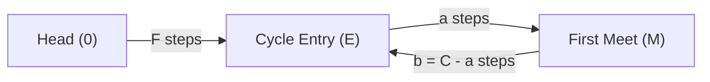
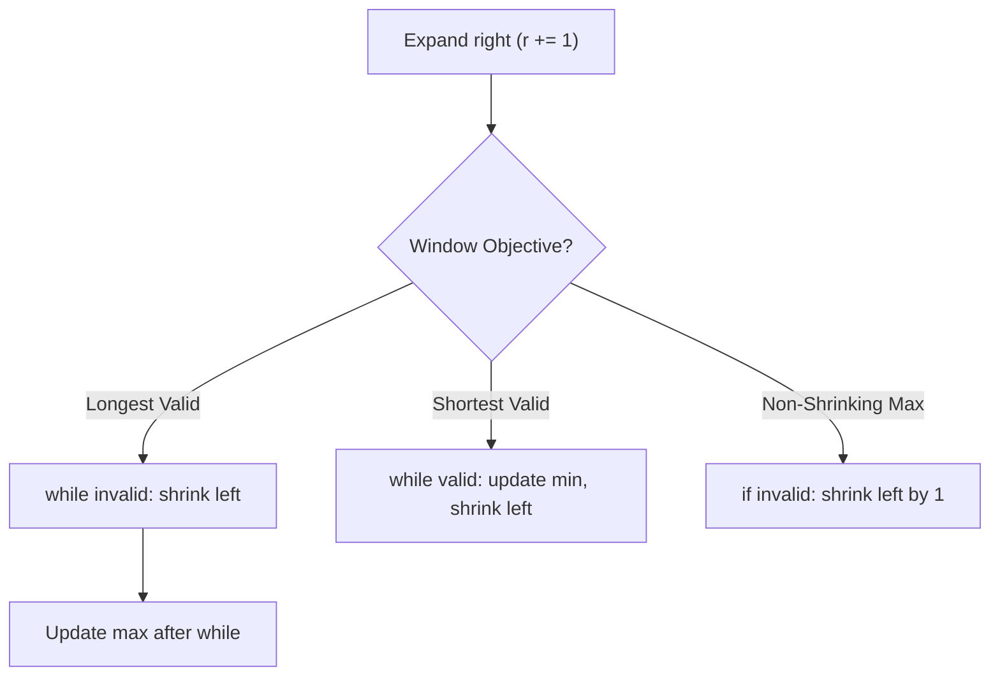
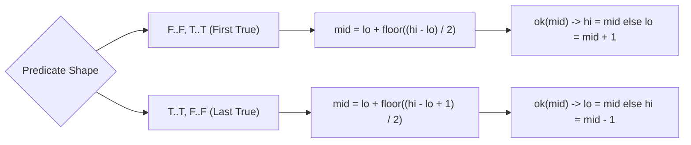

---
tags:
  - algorithm
created: 2026-11-13
updated: 2026-11-13
status: 🟢
level: mid-to-senior
---
# Two Pointers, Sliding Window & Hashing

> [!abstract] Navigation & Scope
> Roadmap: [[Programming/Algorithms/Algorithms & LeetCode Roadmap|Algorithms & LeetCode Roadmap]] | Hub: [[Programming/Programming Hub|Programming Hub]]
> Related Patterns: [[Programming/Algorithms/Heaps, Tries, Union-Find & Monotonic Stacks|Heaps, Tries, Union-Find & Monotonic Stacks]] | [[Programming/Algorithms/Dynamic Programming, Greedy & Backtracking|Dynamic Programming, Greedy & Backtracking]] | [[Programming/Software Engineering/System Design/Rate Limiting|Rate Limiting]]

---

## 1. First-Principles Mechanics & Formal Proofs

### 1.1 Why Brute Force Performs $O(n^2)$ Redundant Work
A contiguous array of length $n$ defines $\frac{n(n + 1)}{2}$ subarrays $[l..r]$ and $\frac{n(n - 1)}{2}$ unordered index pairs $(l, r)$. Naive nested loops inspect every candidate independently, re-aggregating overlapping spans from scratch or testing boundary combinations that violate structural dominance. Two-pointer, sliding-window, and associative-hashing algorithms collapse quadratic enumeration to $\Theta(n)$ by exploiting two distinct mathematical mechanisms:

1. **Predicate Monotonicity (Boundary Pruning)**: When extending $[l..r]$ to $[l..r + 1]$ shifts a target metric monotonically (e.g., sum over non-negative elements, distinct character count, container width), an invalid window cannot be repaired by further expansion, and an already-suboptimal boundary index can be permanently discarded without losing the global optimum.
2. **Associative Complement Indexing (Algebraic Inversion)**: When non-monotonic inputs (such as negative integers) destroy boundary monotonicity, transforming the query from range aggregation into a constant-time state lookup—most commonly $P[r + 1] - P[l] = k \iff P[l] = P[r + 1] - k$—reduces the inner search over all $l \le r$ to a single $O(1)$ amortized hash table probe.

### 1.2 Monotonic Pointers & Amortized $O(n)$ Potential Proof
Two-pointer and sliding-window algorithms guarantee $O(n)$ worst-case execution time even when an inner `while` loop sits inside an outer `for` loop, because neither index ever retreats.

Let left pointer $l$ and right pointer $r$ satisfy the structural bounds $0 \le l \le r \le n$ across execution. Define the remaining-work potential function:

$$\Phi(l, r) = 2n - l - r$$

1. **Initialization**: At loop entry, $l = 0$ and $r = 0$, so $\Phi(0, 0) = 2n$.
2. **Outer Advancement**: Each outer iteration increments $r \leftarrow r + 1$, decreasing $\Phi$ by exactly $1$.
3. **Inner Contraction**: Each inner `while` iteration increments $l \leftarrow l + 1$, decreasing $\Phi$ by exactly $1$.
4. **Non-Negativity**: Because $l \le r \le n$ holds inductively (`l` never advances past `r + 1` in empty-window states, or past `r` when checking `l <= r`), $\Phi(l, r) \ge 0$ at termination.

Because every iteration of either loop strictly reduces a non-negative integer bounded initially by $2n$, total loop iterations across the entire run cannot exceed $2n$. Provided `add(nums[r])` and `remove(nums[l])` execute in $O(1)$ amortized time, total runtime is $\Theta(n)$.

> [!warning] When Monotonicity Breaks (Negative Numbers)
> Sliding windows require **predicate monotonicity**: expanding `[l..r]` either preserves validity or moves strictly toward invalidity, while shrinking `[l..r]` moves strictly toward validity. When an array contains negative integers, expanding right can decrease a subarray sum and shrinking left can increase it. On `nums = [3, -2, 5, -1, 2], k = 5`, shrinking when sum hits `6` (`[3, -2, 5]`) evicts `3` and misses `[3, -2, 5, -1]` (sum `5`). Use Prefix Sums + HashMap (Section 1.6) or a Monotonic Deque over prefix sums (see [[Programming/Algorithms/Heaps, Tries, Union-Find & Monotonic Stacks|Heaps, Tries, Union-Find & Monotonic Stacks]]) whenever negatives appear.

### 1.3 Opposite-Ends Contraction, 3-Way Partitioning & Floyd's Cycle Theorem

#### Opposite-Ends Lossless Elimination (`l = 0`, `r = n - 1`)
Opposite-ends pointers solve pair and container optimization by proving that advancing the dominated boundary never discards the global optimum:

- **Sorted Two Sum**: Given sorted `nums` (`nums[0] <= ... <= nums[n-1]`), if `nums[l] + nums[r] > target`, then for every remaining $k \in [l, r - 1]$, `nums[k] + nums[r] >= nums[l] + nums[r] > target`. Thus index `r` cannot form a valid pair with any unexamined element; decrementing `r -= 1` is lossless. Symmetrically, if `nums[l] + nums[r] < target`, incrementing `l += 1` is lossless.
- **Container With Most Water**: Area is $A(l, r) = (r - l) \cdot \min(h[l], h[r])$. Suppose $h[l] \le h[r]$. Every pair $(l, r')$ with $l < r' < r$ has strictly smaller width $(r' - l) < (r - l)$ and height $\min(h[l], h[r']) \le h[l] = \min(h[l], h[r])$, so $A(l, r') < A(l, r)$. Index `l` already achieved its maximum possible area against `r`, making `l += 1` lossless.

#### Memory-Bounded 3-Way In-Place Partitioning (Dutch National Flag)
To partition an array into `< pivot`, `== pivot`, and `> pivot` in $O(n)$ time and $O(1)$ space, maintain three pointers `lo`, `mid`, `hi` enforcing four contiguous regions at the top of every iteration:

| Slice | Region Invariant | Pointer Movement |
|-------|------------------|------------------|
| `nums[0 .. lo - 1]` | Strictly `< pivot` | Grows when `nums[mid] < pivot` (`swap(lo, mid); lo += 1; mid += 1`) |
| `nums[lo .. mid - 1]` | Equal to `pivot` | Grows when `nums[mid] == pivot` (`mid += 1`) |
| `nums[mid .. hi]` | Unclassified frontier | Shrinks by 1 on every iteration |
| `nums[hi + 1 .. n - 1]` | Strictly `> pivot` | Grows when `nums[mid] > pivot` (`swap(mid, hi); hi -= 1`; `mid` stays!) |

Notice why `mid` does **not** increment when `nums[mid] > pivot`: the value swapped in from `nums[hi]` belonged to the unclassified region and has never been inspected. When `nums[mid] < pivot`, the value swapped in from `nums[lo]` belongs to `[lo .. mid - 1]` (`== pivot`, or `lo == mid`), which is already classified, so both `lo` and `mid` advance safely.

#### Fast-Slow Pointers & Floyd's Cycle Theorem



Let $F$ be the edge count from `head` to cycle entry $E$, $C$ the cycle length ($C \ge 1$), $a$ the edge count along the cycle from $E$ to the first collision $M$ ($0 \le a < C$), and $b = C - a$.

1. **Collision Guarantee**: `slow` advances $+1$ node per step; `fast` advances $+2$ nodes per step. Once `slow` enters the cycle, the forward distance from `fast` to `slow` around the cycle decreases by $(2 - 1) = 1 \pmod C$ per step, forcing a collision within at most $C$ steps.
2. **Entry Point Proof**: At first collision $M$, `slow` has traversed $F + a$ edges, whereas `fast` has traversed $F + a + kC$ edges for some integer $k \ge 1$. Because `fast` took twice as many steps:
   $$2(F + a) = F + a + kC \implies F + a = kC \implies F = (k - 1)C + (C - a) = (k - 1)C + b$$
   Resetting `p1 = head` while keeping `p2 = M` and advancing both by $+1$ per step moves `p1` across $F$ edges to $E$, while `p2` traverses $(k - 1)$ full cycles plus $b$ edges from $M$, arriving at $E$ simultaneously.
3. **Cycle Length Measurement**: Fixing `p1 = M` and stepping `p2` by $+1$ until `p2 is p1` measures exact cycle length $C$.

> [!tip] Functional Graph Isomorphism for Array Duplicate Detection
> Any array `nums` of length $n + 1$ with elements in $[1, n]$ induces a functional graph $i \to \text{nums}[i]$. Because $0 \notin [1, n]$, node `0` has in-degree $0$ and sits strictly outside any cycle ($F \ge 1$). By the Pigeonhole Principle, at least one value $v \in [1, n]$ appears at least twice, giving node $v$ in-degree $\ge 2$ at the cycle entry point $E$. Floyd's algorithm locates $v$ in $O(n)$ time and $O(1)$ space without mutating `nums`.

```python
from typing import Optional


class ListNode:
    def __init__(self, val: int = 0, next: Optional["ListNode"] = None) -> None:
        self.val = val
        self.next = next


def detect_cycle_entry_and_length(
    head: Optional[ListNode],
) -> tuple[Optional[ListNode], int]:
    slow = fast = head
    while fast is not None and fast.next is not None:
        assert slow is not None
        slow = slow.next
        fast = fast.next.next
        if slow is fast:
            entry = head
            while entry is not slow:
                assert entry is not None and slow is not None
                entry = entry.next
                slow = slow.next
            assert entry is not None
            cycle_len = 1
            probe = entry.next
            while probe is not entry:
                assert probe is not None
                probe = probe.next
                cycle_len += 1
            return entry, cycle_len
    return None, 0
```

```typescript
class ListNode {
  constructor(
    public val: number = 0,
    public next: ListNode | null = null,
  ) {}
}

function detectCycleEntryAndLength(
  head: ListNode | null,
): { entry: ListNode | null; length: number } {
  let slow: ListNode | null = head;
  let fast: ListNode | null = head;

  while (fast !== null && fast.next !== null) {
    slow = slow!.next;
    fast = fast.next.next;
    if (slow === fast) {
      let entry: ListNode | null = head;
      while (entry !== slow) {
        entry = entry!.next;
        slow = slow!.next;
      }
      let length = 1;
      let probe = entry!.next;
      while (probe !== entry) {
        probe = probe!.next;
        length += 1;
      }
      return { entry, length };
    }
  }
  return { entry: null, length: 0 };
}
```

### 1.4 Sliding Window Variants & Formal Invariants



| Variant | Contraction Condition | Result Update Site | Window Width Behavior | Loop Invariant After Step |
|---------|-----------------------|--------------------|-----------------------|---------------------------|
| **Fixed Window (`k`)** | `if r - l + 1 > k: l += 1` | When `r - l + 1 == k` | Constant `k` for `r >= k - 1` | `[l..r]` holds exact latest `min(k, r+1)` items |
| **Shrink-While-Invalid (Max)** | `while not is_valid(): l += 1` | **After** `while` loop | Expands and contracts freely | `[l..r]` is maximal valid suffix ending at `r` |
| **Shrink-While-Valid (Min)** | `while is_valid(): update; l += 1` | **Inside** `while` before `l += 1` | Tightens toward minimal valid span | `[l..r]` is strictly invalid after loop exits |
| **Non-Shrinking Max** | `if not is_valid(): l += 1` | At end: `n - l` | Monotonically non-decreasing | `r - l + 1` equals historical max valid width |

#### Non-Shrinking Max-Window Proof (*Longest Repeating Character Replacement*)
Given string `s` and replacement budget `k`, a substring `[l..r]` can become uniform in $\le k$ edits iff `(r - l + 1) - max_char_freq([l..r]) <= k`. Rather than shrinking via `while` and scanning $O(|\Sigma|)$ character frequencies to recompute the exact window maximum:

1. Update `max_freq = max(max_freq, counts[s[r]])` monotonically (never decrement `max_freq`).
2. If `(r - l + 1) - max_freq > k`, shift `l` right by **exactly one**: `counts[s[l]] -= 1; l += 1`.
3. Return `len(s) - l`.

**Correctness Proof**: Let $W^*$ be the maximum true valid window width observed up to step $r - 1$, achieved with true dominant character count $f^*$, so $W^* - f^* \le k$. Because `l` advances at most once per advancement of `r`, window width `r - l + 1` never drops below $W^*$. For any subsequent window of strictly larger width $W' > W^*$ to be genuinely valid, its true dominant character count $f'$ must satisfy:

$$f' \ge W' - k > W^* - k \ge f^*$$

Consequently, `max_freq` only ever needs to increase beyond its historical peak $f^*$ when a strictly better valid window actually forms; a stale `max_freq == f^*` causes `if (r - l + 1) - max_freq > k` to fire on every step where width reaches $W^* + 1$, sliding the window rigidly at frozen width $W^*$ without false growth.

### 1.5 Hash Table Internals, Cache Locality & Collision Physics
Selecting a hash structure without understanding physical memory layout degrades $O(n)$ algorithms into cache-bound bottlenecks or $O(n^2)$ adversarial failures:

| Architecture | Memory Layout | Cache Locality | Worst-Case Failure Mode | Production Runtime Examples |
|--------------|---------------|----------------|-------------------------|-----------------------------|
| **Separate Chaining** | Bucket pointer array + heap-allocated linked nodes | Poor (pointer chasing causes L1/L2 & TLB misses) | Hash flooding clusters $n$ keys into 1 bucket ($O(n)$ lookup) | Java `HashMap` (switches bucket to Red-Black Tree at $\ge 8$ nodes), C++ `std::unordered_map` |
| **Open Addressing (Linear / Perturbed Probing)** | Single contiguous array of `(hash, key, value)` slots | High (sequential probing hits same 64-byte cache line) | Primary clustering; tombstone accumulation raises probe length | Python `dict` (compact index array + perturbed probing `(5*j + 1 + perturb) & mask`) |
| **Robin Hood Hashing** | Open addressing tracking Probe Sequence Length (`PSL`) | Very high (`PSL` variance bounded tightly) | High resize pause if load factor exceeds `0.85–0.90` | Rust `hashbrown` predecessor designs, high-perf embedded maps |
| **SwissTable (SIMD Probing)** | Contiguous slots + 1-byte metadata control array (`H2` 7-bit tag) | Optimal (16 control tags checked in 1 SSE2/NEON instruction) | Requires full 16-byte SIMD register alignment | Abseil `flat_hash_map`, Rust `std::collections::HashMap` (`hashbrown`), Go 1.24+ SwissMap |

#### Load Factor & Tombstone Physics
For an open-addressed table at load factor $\alpha = n / m < 1$, uniform probing yields expected probe counts of $\approx \frac{1}{1 - \alpha}$ for misses and $\approx \frac{1}{\alpha} \ln \frac{1}{1 - \alpha}$ for hits. Deletions cannot simply clear a slot to `EMPTY`, because doing so severs the probe chain for keys inserted later via collisions; instead, deletions write a `TOMBSTONE` sentinel. High churn under steady load fills the table with tombstones, inflating effective miss probe counts toward $O(n)$ even when live $\alpha$ is low, requiring periodic rehash compaction.

> [!warning] Adversarial Hash Collisions & $O(n^2)$ Degeneration
> Deterministic integer hashes (such as identity `x -> x` mod $2^k$) allow crafted inputs spaced by table size $2^k$ to collide deterministically, degrading total runtime to $O(n^2)$. Python mitigates string collisions via randomized `SipHash-1-3` (`PYTHONHASHSEED`) and perturbs integer probes using higher hash bits. In C++ `unordered_map`, override integer hashing with `splitmix64` seeded by `steady_clock::now()`; whenever key/remainder domain $k$ is small ($k \le 10^5$), replace hash maps altogether with a flat contiguous array (`[0] * k` or `Int32Array(k)`) for strict worst-case $O(1)$ lookups with zero hashing overhead.

### 1.6 Prefix Sums, Modulo Normalization & Rabin-Karp Rolling Hash

#### 1D & 2D Prefix Identities
- **1D Prefix Array**: Define $P[0] = 0$ and $P[i + 1] = P[i] + A[i]$. Any contiguous subarray sum equals $\sum_{t=l}^{r} A[t] = P[r + 1] - P[l]$ in $O(1)$.
- **2D Prefix Matrix**: Define $P[0][*] = P[*][0] = 0$ and $P[r + 1][c + 1] = G[r][c] + P[r][c + 1] + P[r + 1][c] - P[r][c]$. By inclusion-exclusion, the submatrix sum over $[r_1..r_2] \times [c_1..c_2]$ is:
  $$S = P[r_2 + 1][c_2 + 1] - P[r_1][c_2 + 1] - P[r_2 + 1][c_1] + P[r_1][c_1]$$

#### Lookup-Before-Insert Invariant (`k = 0` Trap)
To count subarrays summing to $k$, at index $r$ we count prior indices $l \in [0..r]$ with $P[l] = P[r + 1] - k$:

1. Initialize `seen = {0: 1}` representing the empty prefix $P[0] = 0$ before index `0`.
2. At index `i`: update `prefix += nums[i]`.
3. **First** query `ans += seen.get(prefix - k, 0)`.
4. **Second** insert `seen[prefix] = seen.get(prefix, 0) + 1`.

Swapping steps 3 and 4 breaks `k = 0`: `prefix - 0 == prefix` matches the just-inserted `P[i + 1]` against itself, falsely counting empty `[i + 1 .. i]` subarrays.

#### Modulo Remainder Sign Pitfalls (Python vs. TypeScript/C++/Java)
Subarray $[l..r]$ is divisible by $k$ ($k > 0$) iff $(P[r + 1] - P[l]) \bmod k = 0 \iff P[r + 1] \equiv P[l] \pmod k$. Negative prefix sums diverge across language `%` definitions:

| Language Family | `%` Operator Semantics | `-1 % 5` | Canonical Remainder in `[0, k - 1]` |
|-----------------|----------------------|----------|-------------------------------------|
| **Python** | Floored division (takes sign of divisor $k$) | `4` | `prefix % k` (for $k > 0$) |
| **TypeScript / JS / C++ / Java / Go / Rust** | Truncated division (takes sign of dividend) | `-1` | `((prefix % k) + k) % k` |

In TypeScript, transitioning from `prefix = -1` to `prefix = 4` spans a subarray sum of `5`, yet `-1 % 5 === -1 !== 4 === 4 % 5`. Normalizing with `((prefix % k) + k) % k` collapses congruent negative and positive remainders into the same canonical residue class.

#### Rolling Hash (Rabin-Karp) Mechanics
To locate pattern $P$ of length $m$ inside text $T$ of length $n$ (or detect repeated $L$-length substrings) in $O(n + m)$ expected time, encode window $s[l..l + m - 1]$ as a polynomial over base $B$ modulo prime $M$:

$$H(l) = \left( \sum_{i=0}^{m - 1} c(s[l + i]) \cdot B^{m - 1 - i} \right) \bmod M$$

Sliding right by one character shifts off $s[l] \cdot B^{m - 1}$, multiplies the remaining terms by $B$, and adds $s[l + m]$:

$$H(l + 1) = \Big(\big(H(l) - c(s[l]) \cdot B^{m - 1}\big) \cdot B + c(s[l + m])\Big) \bmod M$$

Because a single 32-bit modulus ($M = 10^9 + 7$) encounters birthday-paradox collisions once $\sqrt{M} \approx 31{,}622$ substrings are hashed, production implementations either use **double hashing** with independent moduli $(M_1 = 10^9 + 7, M_2 = 10^9 + 9)$ (effective modulus $\approx 10^{18}$), a 61-bit Mersenne prime $2^{61} - 1$, or perform exact string equality verification upon hash match.

```python
def rabin_karp_search(text: str, pattern: str) -> list[int]:
    n, m = len(text), len(pattern)
    if m == 0:
        return list(range(n + 1))
    if m > n:
        return []

    B1, M1 = 911382323, 1_000_000_007
    B2, M2 = 972663749, 1_000_000_009

    pow1 = pow(B1, m - 1, M1)
    pow2 = pow(B2, m - 1, M2)

    pat_h1 = pat_h2 = 0
    win_h1 = win_h2 = 0
    for i in range(m):
        pc = ord(pattern[i])
        tc = ord(text[i])
        pat_h1 = (pat_h1 * B1 + pc) % M1
        pat_h2 = (pat_h2 * B2 + pc) % M2
        win_h1 = (win_h1 * B1 + tc) % M1
        win_h2 = (win_h2 * B2 + tc) % M2

    matches: list[int] = []
    if win_h1 == pat_h1 and win_h2 == pat_h2 and text[0:m] == pattern:
        matches.append(0)

    for i in range(m, n):
        out_c = ord(text[i - m])
        in_c = ord(text[i])
        win_h1 = ((win_h1 - out_c * pow1) * B1 + in_c) % M1
        win_h2 = ((win_h2 - out_c * pow2) * B2 + in_c) % M2
        start = i - m + 1
        if win_h1 == pat_h1 and win_h2 == pat_h2 and text[start : i + 1] == pattern:
            matches.append(start)

    return matches
```

```typescript
function rabinKarpSearch(text: string, pattern: string): number[] {
  const n = text.length;
  const m = pattern.length;
  if (m === 0) return Array.from({ length: n + 1 }, (_, idx) => idx);
  if (m > n) return [];

  // Use BigInt for intermediate products so B * M never exceeds 2^53 - 1
  const B1 = 911382323n;
  const M1 = 1000000007n;
  const B2 = 972663749n;
  const M2 = 1000000009n;

  let pow1 = 1n;
  let pow2 = 1n;
  for (let i = 0; i < m - 1; i++) {
    pow1 = (pow1 * B1) % M1;
    pow2 = (pow2 * B2) % M2;
  }

  let patH1 = 0n;
  let patH2 = 0n;
  let winH1 = 0n;
  let winH2 = 0n;

  for (let i = 0; i < m; i++) {
    const pc = BigInt(pattern.charCodeAt(i));
    const tc = BigInt(text.charCodeAt(i));
    patH1 = (patH1 * B1 + pc) % M1;
    patH2 = (patH2 * B2 + pc) % M2;
    winH1 = (winH1 * B1 + tc) % M1;
    winH2 = (winH2 * B2 + tc) % M2;
  }

  const matches: number[] = [];
  if (winH1 === patH1 && winH2 === patH2 && text.slice(0, m) === pattern) {
    matches.push(0);
  }

  for (let i = m; i < n; i++) {
    const outC = BigInt(text.charCodeAt(i - m));
    const inC = BigInt(text.charCodeAt(i));
    winH1 = (((winH1 - outC * pow1) % M1 + M1) * B1 + inC) % M1;
    winH2 = (((winH2 - outC * pow2) % M2 + M2) * B2 + inC) % M2;
    const start = i - m + 1;
    if (winH1 === patH1 && winH2 === patH2 && text.slice(start, i + 1) === pattern) {
      matches.push(start);
    }
  }
  return matches;
}
```

### 1.7 Binary Search on Monotonic Answer Space
When a problem seeks the **minimum feasible capacity** (`F, F, ..., F, T, T`) or **maximum feasible threshold** (`T, T, ..., T, F, F`) and checking feasibility `ok(x)` runs in $O(n)$, binary search shrinks the search interval `[lo, hi]` to $O(n \log(hi - lo))$.



- **`first_true` on `[lo, hi]`**: Floor midpoint `mid = lo + (hi - lo) // 2` satisfies `lo <= mid < hi` whenever `lo < hi`. Setting `hi = mid` strictly decreases `hi`; setting `lo = mid + 1` strictly increases `lo`. Guaranteed termination at `lo == hi`.
- **`last_true` on `[lo, hi]`**: When `hi == lo + 1` with `ok(lo) == True, ok(hi) == False`, floor midpoint picks `mid = lo`, so `lo = mid` enters an **infinite loop**. Ceiling midpoint `mid = lo + (hi - lo + 1) // 2` enforces `lo < mid <= hi`, guaranteeing strict interval contraction on both branches.

```python
from typing import Callable


def first_true(lo: int, hi: int, ok: Callable[[int], bool]) -> int:
    while lo < hi:
        mid = lo + (hi - lo) // 2
        if ok(mid):
            hi = mid
        else:
            lo = mid + 1
    return lo


def last_true(lo: int, hi: int, ok: Callable[[int], bool]) -> int:
    while lo < hi:
        mid = lo + (hi - lo + 1) // 2
        if ok(mid):
            lo = mid
        else:
            hi = mid - 1
    return lo
```

```typescript
function firstTrue(lo: number, hi: number, ok: (x: number) => boolean): number {
  while (lo < hi) {
    const mid = lo + Math.floor((hi - lo) / 2);
    if (ok(mid)) hi = mid;
    else lo = mid + 1;
  }
  return lo;
}

function lastTrue(lo: number, hi: number, ok: (x: number) => boolean): number {
  while (lo < hi) {
    const mid = lo + Math.floor((hi - lo + 1) / 2);
    if (ok(mid)) lo = mid;
    else hi = mid - 1;
  }
  return lo;
}
```

---

## 2. Decision Matrix & Production Engineering Use Cases

### 2.1 Pattern Selection Decision Matrix

| Problem Characteristics | Correct Pattern | Time / Space | Why Competing Approaches Fail |
|-------------------------|-----------------|--------------|-------------------------------|
| Pair sum / container / palindrome on sorted or symmetric array | **Converging Two Pointers** | $O(n)$ / $O(1)$ | HashMap wastes $O(n)$ heap memory when ordering already permits boundary elimination |
| Cycle detection, midpoint, in-place deduplication, functional graph duplicate | **Fast-Slow Pointers** | $O(n)$ / $O(1)$ | Visited `HashSet` breaks strict $O(1)$ auxiliary memory constraints |
| Fixed-width aggregation (`k` items or `W` ms) | **Fixed Sliding Window** | $O(n)$ / $O(1)$–$O(k)$ | Recomputing slice sums costs $O(nk)$ |
| Longest/shortest contiguous span under **monotonic** constraint (non-negative, counts, distinct $\le K$) | **Variable Sliding Window** | $O(n)$ / $O(|\Sigma|)$ | Prefix + HashMap cannot directly answer "at most $K$ distinct" or character replacement |
| Exact `K` distinct elements in contiguous subarray | **`atMost(K) - atMost(K - 1)`** | $O(n)$ / $O(K)$ | Single variable window loses monotonic shrink condition when aiming for exact `K` |
| Subarray sum $= k$ or $\equiv 0 \pmod k$ with **negative integers** | **Prefix Sum + HashMap** | $O(n)$ / $O(n)$ | Negative numbers destroy sliding-window monotonicity |
| Shortest subarray sum $\ge k$ with **negative integers** | **Prefix Sum + Monotonic Deque** | $O(n)$ / $O(n)$ | Exact HashMap lookup fails for inequality `>= k`; deque maintains monotonic prefix candidates |
| Multi-pattern or repeated substring matching / content chunking | **Rolling Hash (Rabin-Karp)** | $O(n + m)$ avg / $O(n)$ | Naive `text[i:i+m] == pat` takes $O(nm)$ on high-prefix-overlap inputs |

### 2.2 Five Concrete Production Engineering Applications

#### 1. Distributed API Rate Limiter (Sliding Window Log vs. Sliding Window Counter)
- **Fixed Window Counter** increments `count[bucket = floor(ts / W)]`. It takes $O(1)$ space per tenant, but allows $2 \times \text{limit}$ burst spikes straddling the boundary `[W - 1s .. W + 1s]`.
- **Sliding Window Log** stores sorted request timestamps in a queue or Redis Sorted Set (`ZREMRANGEBYSCORE key -inf (now - W)` followed by `ZCARD`). Exact accuracy, $O(R)$ memory per tenant where $R$ is limit.
- **Sliding Window Counter** approximates the log in $O(1)$ space by interpolating between the previous and current fixed windows using the overlap fraction:
  $$\text{est} = \text{prev\_count} \cdot \left(1 - \frac{\text{elapsed\_in\_curr}}{W}\right) + \text{curr\_count}$$
  See [[Programming/Software Engineering/System Design/Rate Limiting|Rate Limiting]] for Redis Lua atomic scripts enforcing this check-and-increment invariant across gateway nodes.

#### 2. TCP Sliding Window Flow Control & Congestion Control
TCP models an ordered byte stream using sliding window pointers `SND.UNA` (oldest unacknowledged byte), `SND.NXT` (next byte to send), and `SND.UNA + min(cwnd, rwnd)` (usable window ceiling). Advancing `SND.UNA` on incoming cumulative ACKs mirrors `left += 1` in a non-shrinking/shrinking byte ring buffer (`sk_buff` in Linux), bounding unacknowledged in-flight bytes in $O(1)$ state per socket.

#### 3. Streaming Log Deduplication & Sliding Anomaly Windows
Telemetry pipelines ingest time-ordered `(timestamp_ms, service_id, status)` records and alert when error ratio exceeds a threshold over the trailing 60-second window. A monotonic two-pointer / ring-deque evicts events satisfying `now - q[0].ts > 60_000` while maintaining running `error_count` and `total_count` in $O(1)$ per ingested record, bounding memory to peak 60s RPS instead of unbounded historical arrays.

#### 4. Content-Defined Chunking (Rabin-Karp Fingerprint / Backup Deduplication)
Storage engines (`rsync`, `restic`, `BorgBackup`) split byte streams into variable-sized deduplicated blocks without relying on brittle fixed offsets (where inserting 1 byte shifts every downstream block). A sliding 64-byte Rabin-Karp or Gear rolling hash checks `(hash & ((1 << 13) - 1)) == 0` at every byte in $O(1)$ per byte, inserting chunk boundaries deterministically based on local byte content (~8 KB average chunks).

#### 5. Zero-Allocation In-Place Stream Compaction
In high-throughput parsers, columnar engines (Apache Arrow bitmask compaction), and real-time audio/DSP buffers, fast-slow read/write pointers compact valid elements (`if predicate(buf[fast]): buf[slow] = buf[fast]; slow += 1`) over contiguous memory or `TypedArray` views without allocating secondary arrays or triggering garbage-collector pauses.

---

## 3. Step-by-Step Dry-Run Execution Traces

### 3.1 Minimum Window Substring (Including Empty / Insufficient Edge Cases)
Trace `s = "ADOBECODEBANC"`, `t = "ABC"` (`need = {'A': 1, 'B': 1, 'C': 1}`, `required = 3`):

| `right` | `s[right]` | `window` Counts (`A,B,C`) | `have` | Action / Contraction (`while have == required`) | `best` Recorded |
|:-------:|:----------:|:-------------------------:|:------:|-------------------------------------------------|-----------------|
| `0..4` | `A,D,O,B,E` | `A:1, B:1, C:0` | `2` | Expand (`have < 3`) | `""` |
| `5` | `C` | `A:1, B:1, C:1` | `3` | Record `"ADOBEC"` (6); shrink `l=0` (`'A'` drops to 0) $\to$ `l=1, have=2` | `"ADOBEC"` |
| `6..9` | `O,D,E,B` | `A:0, B:2, C:1` | `2` | `'B'` increments to `2` (`have` stays `2`, since `win['B'] != need['B']`) | `"ADOBEC"` |
| `10` | `A` | `A:1, B:2, C:1` | `3` | `l=1..5` shrinks `D,O,B,E,C`; at `l=5` window `"CODEBA"` (6), `'C'` drops $\to$ `l=6, have=2` | `"ADOBEC"` |
| `11` | `N` | `A:1, B:1, C:0` | `2` | Expand (`have < 3`) | `"ADOBEC"` |
| `12` | `C` | `A:1, B:1, C:1` | `3` | `l=6..9` shrinks `O,D,E,B`; at `l=9` window `"BANC"` (4), `'B'` drops $\to$ `l=10, have=2` | `"BANC"` |

- **Edge case `s = ""`, `t = "A"`**: `len(s) < len(t)` returns `""` immediately before allocating maps.
- **Edge case `s = "AA"`, `t = "AAA"`**: `len(s) < len(t)` returns `""` immediately.
- **Edge case `s = "A"`, `t = "A"`**: `right = 0`, `have = 1 == required`, records `"A"` (len 1), shrinks `l = 1`, exits and returns `"A"`.

### 3.2 Why Negative Numbers Break Sliding Window vs. Prefix Sum + HashMap Recovery
Input: `nums = [3, -2, 5, -1, 2]`, `k = 5`. Expected subarrays summing to `5`: `[5]` (`[2..2]`) and `[3, -2, 5, -1]` (`[0..3]`), count = `2`.

**Broken Sliding Window Trace (`while cur > k: cur -= nums[l]; l += 1`)**:

| `r` | `nums[r]` | `cur` Before Shrink | Shrink Action | `l` After | `cur` After | Missed Valid Window? |
|:---:|:---------:|:-------------------:|---------------|:---------:|:-----------:|----------------------|
| `0` | `3` | `3` | None (`3 <= 5`) | `0` | `3` | No |
| `1` | `-2` | `1` | None (`1 <= 5`) | `0` | `1` | No |
| `2` | `5` | `6` | `6 > 5` $\implies$ evict `nums[0]=3`, `l=1` | `1` | `3` | **Yes**: `l=0` evicted before seeing `nums[3]=-1` |
| `3` | `-1` | `2` | None (`2 <= 5`) | `1` | `2` | **`[0..3]` sum `5` permanently unreachable** |
| `4` | `2` | `4` | None (`4 <= 5`) | `1` | `4` | Also missed `[2..2] = [5]` because `r=2` never stripped `nums[1]=-2` |

**Exact Prefix Sum + HashMap Trace (`seen = {0: 1}`)**:

| `i` | `nums[i]` | `prefix` | `prefix - 5` | Hits in `seen` | `seen` After Step | Matches Found |
|:---:|:---------:|:--------:|:------------:|:--------------:|-------------------|---------------|
| `-` | `-` | `0` | `-` | `-` | `{0: 1}` | Empty prefix |
| `0` | `3` | `3` | `-2` | `0` | `{0: 1, 3: 1}` | None |
| `1` | `-2` | `1` | `-4` | `0` | `{0: 1, 3: 1, 1: 1}` | None |
| `2` | `5` | `6` | `1` | `1` (`ans=1`) | `{0: 1, 3: 1, 1: 1, 6: 1}` | `[2..2]` (`[5]`) |
| `3` | `-1` | `5` | `0` | `1` (`ans=2`) | `{0: 1, 3: 1, 1: 1, 6: 1, 5: 1}` | `[0..3]` (`[3,-2,5,-1]`) |
| `4` | `2` | `7` | `2` | `0` (`ans=2`) | `{0: 1, 3: 1, 1: 1, 6: 1, 5: 1, 7: 1}` | None |

### 3.3 Non-Shrinking Max Window (`characterReplacement`) Trace
Input: `s = "AABABBA"`, `k = 1`.

| `r` | `s[r]` | `counts` | `max_freq` | `width = r - l + 1` | `width - max_freq > 1`? | Action (`l` after) | Window `[l..r]` |
|:---:|:------:|:--------:|:----------:|:-------------------:|:-----------------------:|--------------------|-----------------|
| `0` | `A` | `{A:1}` | `1` | `1` | `0 > 1` (No) | Stay (`l=0`) | `"A"` (1) |
| `1` | `A` | `{A:2}` | `2` | `2` | `0 > 1` (No) | Stay (`l=0`) | `"AA"` (2) |
| `2` | `B` | `{A:2, B:1}` | `2` | `3` | `1 > 1` (No) | Stay (`l=0`) | `"AAB"` (3) |
| `3` | `A` | `{A:3, B:1}` | `3` | `4` | `1 > 1` (No) | Stay (`l=0`) | `"AABA"` (4) |
| `4` | `B` | `{A:3, B:2}` | `3` | `5` | `2 > 1` (**Yes**) | Drop `'A'`, `l=1` | `"ABAB"` (4) |
| `5` | `B` | `{A:2, B:3}` | `3` | `5` | `2 > 1` (**Yes**) | Drop `'A'`, `l=2` | `"BABB"` (4) |
| `6` | `A` | `{A:2, B:3}` | `3` | `5` | `2 > 1` (**Yes**) | Drop `'B'`, `l=3` | `"ABBA"` (4) |

Notice at `r = 6`, `"ABBA"` is actually invalid for `k = 1` (`max_freq` inside `"ABBA"` is `2`, needing `2` flips), yet `len(s) - l = 7 - 3 = 4` remains exact because width froze at `4` once `max_freq` peaked at `3`.

---

## 4. Eight Canonical Dual-Language Implementations & Unit Tests

### 4.1 Container With Most Water (Opposite-Ends Two Pointers)
- **Invariant**: Width shrinks on every move; advancing the shorter wall eliminates only pairs strictly bounded by that shorter height.
- **Complexity**: $O(n)$ time, $O(1)$ space.

```python
def max_area(height: list[int]) -> int:
    left, right = 0, len(height) - 1
    best = 0
    while left < right:
        h_left, h_right = height[left], height[right]
        width = right - left
        if h_left <= h_right:
            area = width * h_left
            if area > best:
                best = area
            left += 1
        else:
            area = width * h_right
            if area > best:
                best = area
            right -= 1
    return best
```

```typescript
function maxArea(height: number[]): number {
  let left = 0;
  let right = height.length - 1;
  let best = 0;

  while (left < right) {
    const hLeft = height[left];
    const hRight = height[right];
    const width = right - left;
    if (hLeft <= hRight) {
      const area = width * hLeft;
      if (area > best) best = area;
      left += 1;
    } else {
      const area = width * hRight;
      if (area > best) best = area;
      right -= 1;
    }
  }
  return best;
}
```

### 4.2 Trapping Rain Water (Two-Pointer $O(1)$ Space vs. Monotonic Stack)
Exact water trapped above bar `i` is $\min(\max_{j \le i} h[j], \max_{j \ge i} h[j]) - h[i]$.

- **Two-Pointer Inductive Proof**: Maintain `left_max = max(h[0..left])` and `right_max = max(h[right..n-1])`. When `left_max <= right_max`, the true suffix maximum from `left` satisfies $\text{true\_right\_max}[left] = \max_{j \ge left} h[j] \ge \max_{j \ge right} h[j] = right\_max \ge left\_max$. Hence $\min(left\_max, \text{true\_right\_max}[left]) = left\_max$ is exact regardless of any unseen taller bars strictly between `left` and `right`. Symmetrically, when `right_max < left_max`, `right_max` is the exact bottleneck at `right`.
- **Two-Pointer vs. Monotonic Stack**: Two-pointer sums water **vertically column-by-column** in $O(n)$ time and $O(1)$ space. A Monotonic Decreasing Stack sums water **horizontally layer-by-layer** in $O(n)$ time and $O(n)$ space, making the stack variant preferable only when elevations arrive as a single-pass online stream without random access to the right end.

```python
def trap_two_pointers(height: list[int]) -> int:
    if len(height) < 3:
        return 0
    left, right = 0, len(height) - 1
    left_max, right_max = height[left], height[right]
    water = 0

    while left < right:
        if left_max <= right_max:
            left += 1
            if height[left] > left_max:
                left_max = height[left]
            else:
                water += left_max - height[left]
        else:
            right -= 1
            if height[right] > right_max:
                right_max = height[right]
            else:
                water += right_max - height[right]
    return water


def trap_monotonic_stack(height: list[int]) -> int:
    stack: list[int] = []  # Stores indices with monotonically non-increasing heights
    water = 0
    for right, h in enumerate(height):
        while stack and height[stack[-1]] < h:
            mid = stack.pop()
            if not stack:
                break
            left = stack[-1]
            bounded_height = min(height[left], h) - height[mid]
            water += bounded_height * (right - left - 1)
        stack.append(right)
    return water
```

```typescript
function trapTwoPointers(height: number[]): number {
  if (height.length < 3) return 0;
  let left = 0;
  let right = height.length - 1;
  let leftMax = height[left];
  let rightMax = height[right];
  let water = 0;

  while (left < right) {
    if (leftMax <= rightMax) {
      left += 1;
      if (height[left] > leftMax) leftMax = height[left];
      else water += leftMax - height[left];
    } else {
      right -= 1;
      if (height[right] > rightMax) rightMax = height[right];
      else water += rightMax - height[right];
    }
  }
  return water;
}

function trapMonotonicStack(height: number[]): number {
  const stack: number[] = [];
  let water = 0;
  for (let right = 0; right < height.length; right++) {
    const h = height[right];
    while (stack.length > 0 && height[stack[stack.length - 1]] < h) {
      const mid = stack.pop()!;
      if (stack.length === 0) break;
      const left = stack[stack.length - 1];
      const boundedHeight = Math.min(height[left], h) - height[mid];
      water += boundedHeight * (right - left - 1);
    }
    stack.push(right);
  }
  return water;
}
```

### 4.3 Minimum Window Substring (Variable Shortest Window)
- **Invariant**: `have` tracks how many distinct characters in `need` currently satisfy `window[c] >= need[c]`. Updating `best` inside `while have == required` immediately prior to decrementing `left` guarantees inspecting every minimal valid endpoint.
- **Complexity**: $O(|s| + |t|)$ time, $O(|\Sigma|)$ space.

```python
from collections import Counter


def min_window(s: str, t: str) -> str:
    if not t or len(s) < len(t):
        return ""
    need = Counter(t)
    window: dict[str, int] = {}
    required = len(need)
    have = 0
    best_len = len(s) + 1
    best_start = 0
    left = 0

    for right, ch in enumerate(s):
        if ch in need:
            window[ch] = window.get(ch, 0) + 1
            if window[ch] == need[ch]:
                have += 1

        while have == required:
            cur_len = right - left + 1
            if cur_len < best_len:
                best_len = cur_len
                best_start = left

            out_ch = s[left]
            if out_ch in need:
                if window[out_ch] == need[out_ch]:
                    have -= 1
                window[out_ch] -= 1
            left += 1

    return "" if best_len > len(s) else s[best_start : best_start + best_len]
```

```typescript
function minWindow(s: string, t: string): string {
  if (t.length === 0 || s.length < t.length) return "";
  const need = new Map<string, number>();
  for (const ch of t) {
    need.set(ch, (need.get(ch) ?? 0) + 1);
  }

  const window = new Map<string, number>();
  const required = need.size;
  let have = 0;
  let bestLen = s.length + 1;
  let bestStart = 0;
  let left = 0;

  for (let right = 0; right < s.length; right++) {
    const ch = s[right];
    const needCount = need.get(ch);
    if (needCount !== undefined) {
      const nextCount = (window.get(ch) ?? 0) + 1;
      window.set(ch, nextCount);
      if (nextCount === needCount) have += 1;
    }

    while (have === required) {
      const curLen = right - left + 1;
      if (curLen < bestLen) {
        bestLen = curLen;
        bestStart = left;
      }
      const outCh = s[left];
      const outNeed = need.get(outCh);
      if (outNeed !== undefined) {
        const curOut = window.get(outCh)!;
        if (curOut === outNeed) have -= 1;
        window.set(outCh, curOut - 1);
      }
      left += 1;
    }
  }
  return bestLen > s.length ? "" : s.slice(bestStart, bestStart + bestLen);
}
```

### 4.4 Longest Substring Without Repeating Characters (Jump-Left Optimization)
- **Invariant**: Storing `last_seen[ch] = index` allows jumping `left = max(left, last_seen[ch] + 1)` directly in $O(1)$ without a shrink `while` loop. Using `max(left, ...)` prevents `left` from ever jumping backward when encountering a stale occurrence of `ch` strictly to the left of `left`.
- **Complexity**: $O(n)$ strict single-pass time, $O(\min(n, |\Sigma|))$ space.

```python
def length_of_longest_substring(s: str) -> int:
    last_seen: dict[str, int] = {}
    left = 0
    best = 0
    for right, ch in enumerate(s):
        if ch in last_seen and last_seen[ch] >= left:
            left = last_seen[ch] + 1
        last_seen[ch] = right
        cur_len = right - left + 1
        if cur_len > best:
            best = cur_len
    return best
```

```typescript
function lengthOfLongestSubstring(s: string): number {
  const lastSeen = new Map<string, number>();
  let left = 0;
  let best = 0;

  for (let right = 0; right < s.length; right++) {
    const ch = s[right];
    const prev = lastSeen.get(ch);
    if (prev !== undefined && prev >= left) {
      left = prev + 1;
    }
    lastSeen.set(ch, right);
    const curLen = right - left + 1;
    if (curLen > best) best = curLen;
  }
  return best;
}
```

### 4.5 Subarray Sum Equals K & Subarray Sums Divisible by K
- **Invariant**: Initialize `seen = {0: 1}` (empty prefix), query `seen[prefix - k]` (or canonical non-negative remainder) strictly **before** incrementing `seen[prefix]`.
- **Complexity**: $O(n)$ time; $O(n)$ space for exact sum, $O(\min(n, k))$ space for modulo $k$.

```python
def subarray_sum(nums: list[int], k: int) -> int:
    seen: dict[int, int] = {0: 1}
    prefix = 0
    ans = 0
    for x in nums:
        prefix += x
        ans += seen.get(prefix - k, 0)
        seen[prefix] = seen.get(prefix, 0) + 1
    return ans


def subarrays_div_by_k(nums: list[int], k: int) -> int:
    # Flat array beats dict when k <= 10^5: O(1) worst-case with zero hash collisions
    if k <= 100_000:
        counts = [0] * k
        counts[0] = 1
        rem = 0
        ans = 0
        for x in nums:
            rem = (rem + x) % k
            ans += counts[rem]
            counts[rem] += 1
        return ans

    seen: dict[int, int] = {0: 1}
    rem = 0
    ans = 0
    for x in nums:
        rem = (rem + x) % k
        cnt = seen.get(rem, 0)
        ans += cnt
        seen[rem] = cnt + 1
    return ans
```

```typescript
function subarraySum(nums: number[], k: number): number {
  const seen = new Map<number, number>([[0, 1]]);
  let prefix = 0;
  let ans = 0;
  for (const x of nums) {
    prefix += x;
    ans += seen.get(prefix - k) ?? 0;
    seen.set(prefix, (seen.get(prefix) ?? 0) + 1);
  }
  return ans;
}

function subarraysDivByK(nums: number[], k: number): number {
  const seen = new Map<number, number>([[0, 1]]);
  let rem = 0;
  let ans = 0;
  for (const x of nums) {
    rem = (((rem + x) % k) + k) % k;
    const cnt = seen.get(rem) ?? 0;
    ans += cnt;
    seen.set(rem, cnt + 1);
  }
  return ans;
}
```

### 4.6 Find the Duplicate Number (Floyd's Cycle Detection)
- **Invariant**: Functional graph `i -> nums[i]` starting at `0` guarantees $F \ge 1$ and cycle entry at the duplicated value without modifying `nums`.
- **Complexity**: $O(n)$ time, $O(1)$ auxiliary space.

```python
def find_duplicate(nums: list[int]) -> int:
    slow = nums[0]
    fast = nums[nums[0]]
    while slow != fast:
        slow = nums[slow]
        fast = nums[nums[fast]]

    entry = 0
    while entry != slow:
        entry = nums[entry]
        slow = nums[slow]
    return entry
```

```typescript
function findDuplicate(nums: number[]): number {
  let slow = nums[0];
  let fast = nums[nums[0]];
  while (slow !== fast) {
    slow = nums[slow];
    fast = nums[nums[fast]];
  }

  let entry = 0;
  while (entry !== slow) {
    entry = nums[entry];
    slow = nums[slow];
  }
  return entry;
}
```

### 4.7 Subarrays with K Different Integers & Minimum Operations to Reduce X to Zero
- **Exact K Distinct Proof**: For any integer array, the count of subarrays with **exactly** $K$ distinct elements equals `at_most(nums, K) - at_most(nums, K - 1)`. In `at_most(nums, K)`, every right endpoint `r` adds exactly `r - l + 1` valid subarrays `[l..r], [l+1..r], ..., [r..r]` because shrinking an already-valid window preserves validity (`<= K` distinct).
- **Reduce X to Zero Complement Proof**: Removing elements from left and right prefixes/suffixes summing to `x` leaves a contiguous middle subarray summing to `target = sum(nums) - x`. Minimizing removed elements equals maximizing middle subarray length over positive `nums`.
- **Complexity**: $O(n)$ time; $O(K)$ space for distinct counting, $O(1)$ space for positive-element `minOperations`.

```python
def subarrays_with_k_distinct(nums: list[int], k: int) -> int:
    def at_most(limit: int) -> int:
        if limit <= 0:
            return 0
        freq: dict[int, int] = {}
        distinct = 0
        left = 0
        total = 0
        for right, x in enumerate(nums):
            prev = freq.get(x, 0)
            if prev == 0:
                distinct += 1
            freq[x] = prev + 1
            while distinct > limit:
                out_x = nums[left]
                freq[out_x] -= 1
                if freq[out_x] == 0:
                    distinct -= 1
                left += 1
            total += right - left + 1
        return total

    return at_most(k) - at_most(k - 1)


def min_operations_to_reduce_x(nums: list[int], x: int) -> int:
    target = sum(nums) - x
    if target < 0:
        return -1
    if target == 0:
        return len(nums)

    left = 0
    cur_sum = 0
    best_mid = -1
    for right, val in enumerate(nums):
        cur_sum += val
        while cur_sum > target and left <= right:
            cur_sum -= nums[left]
            left += 1
        if cur_sum == target:
            mid_len = right - left + 1
            if mid_len > best_mid:
                best_mid = mid_len

    return -1 if best_mid == -1 else len(nums) - best_mid
```

```typescript
function subarraysWithKDistinct(nums: number[], k: number): number {
  const atMost = (limit: number): number => {
    if (limit <= 0) return 0;
    const freq = new Map<number, number>();
    let distinct = 0;
    let left = 0;
    let total = 0;

    for (let right = 0; right < nums.length; right++) {
      const x = nums[right];
      const prev = freq.get(x) ?? 0;
      if (prev === 0) distinct += 1;
      freq.set(x, prev + 1);

      while (distinct > limit) {
        const outX = nums[left];
        const nextCount = freq.get(outX)! - 1;
        freq.set(outX, nextCount);
        if (nextCount === 0) distinct -= 1;
        left += 1;
      }
      total += right - left + 1;
    }
    return total;
  };

  return atMost(k) - atMost(k - 1);
}

function minOperationsToReduceX(nums: number[], x: number): number {
  let totalSum = 0;
  for (const val of nums) totalSum += val;
  const target = totalSum - x;
  if (target < 0) return -1;
  if (target === 0) return nums.length;

  let left = 0;
  let curSum = 0;
  let bestMid = -1;
  for (let right = 0; right < nums.length; right++) {
    curSum += nums[right];
    while (curSum > target && left <= right) {
      curSum -= nums[left];
      left += 1;
    }
    if (curSum === target) {
      const midLen = right - left + 1;
      if (midLen > bestMid) bestMid = midLen;
    }
  }
  return bestMid === -1 ? -1 : nums.length - bestMid;
}
```

### 4.8 Longest Repeating Character Replacement (Non-Shrinking Window)
- **Invariant**: Monotonic `max_freq` freezes window width at historical peak $W^*$ until a character reaches count $> f^*$.
- **Complexity**: $O(n)$ time, $O(|\Sigma|)$ space ($26$ uppercase ASCII slots).

```python
def character_replacement(s: str, k: int) -> int:
    counts = [0] * 26
    left = 0
    max_freq = 0
    base = ord("A")
    for right, ch in enumerate(s):
        idx = ord(ch) - base
        counts[idx] += 1
        if counts[idx] > max_freq:
            max_freq = counts[idx]
        if (right - left + 1) - max_freq > k:
            counts[ord(s[left]) - base] -= 1
            left += 1
    return len(s) - left
```

```typescript
function characterReplacement(s: string, k: number): number {
  const counts = new Int32Array(26);
  let left = 0;
  let maxFreq = 0;
  const base = "A".charCodeAt(0);

  for (let right = 0; right < s.length; right++) {
    const idx = s.charCodeAt(right) - base;
    counts[idx] += 1;
    if (counts[idx] > maxFreq) maxFreq = counts[idx];
    if (right - left + 1 - maxFreq > k) {
      counts[s.charCodeAt(left) - base] -= 1;
      left += 1;
    }
  }
  return s.length - left;
}
```

### 4.9 Executable Verification Suites (Python `unittest` & TypeScript Assertions)

```python
import unittest


class TestTwoPointersWindowHashing(unittest.TestCase):
    def test_max_area(self) -> None:
        self.assertEqual(max_area([1, 8, 6, 2, 5, 4, 8, 3, 7]), 49)
        self.assertEqual(max_area([1, 1]), 1)
        self.assertEqual(max_area([]), 0)

    def test_trap_implementations_agree(self) -> None:
        cases = [
            ([], 0),
            ([5], 0),
            ([2, 1], 0),
            ([0, 1, 0, 2, 1, 0, 1, 3, 2, 1, 2, 1], 6),
            ([4, 2, 0, 3, 2, 5], 9),
        ]
        for heights, expected in cases:
            self.assertEqual(trap_two_pointers(heights), expected)
            self.assertEqual(trap_monotonic_stack(heights), expected)

    def test_min_window(self) -> None:
        self.assertEqual(min_window("ADOBECODEBANC", "ABC"), "BANC")
        self.assertEqual(min_window("a", "a"), "a")
        self.assertEqual(min_window("a", "aa"), "")
        self.assertEqual(min_window("", "a"), "")

    def test_longest_unique_substring(self) -> None:
        self.assertEqual(length_of_longest_substring(""), 0)
        self.assertEqual(length_of_longest_substring("bbbbb"), 1)
        self.assertEqual(length_of_longest_substring("abba"), 2)
        self.assertEqual(length_of_longest_substring("pwwkew"), 3)

    def test_prefix_sum_and_div_by_k(self) -> None:
        self.assertEqual(subarray_sum([1, -1, 0], 0), 3)
        self.assertEqual(subarray_sum([3, -2, 5, -1, 2], 5), 2)
        self.assertEqual(subarrays_div_by_k([4, 5, 0, -2, -3, 1], 5), 7)
        self.assertEqual(subarrays_div_by_k([-1, 2, 9], 2), 2)

    def test_find_duplicate(self) -> None:
        self.assertEqual(find_duplicate([1, 3, 4, 2, 2]), 2)
        self.assertEqual(find_duplicate([3, 1, 3, 4, 2]), 3)
        self.assertEqual(find_duplicate([2, 2, 2, 2, 2]), 2)

    def test_exact_k_distinct_and_reduce_x(self) -> None:
        self.assertEqual(subarrays_with_k_distinct([1, 2, 1, 2, 3], 2), 7)
        self.assertEqual(subarrays_with_k_distinct([1, 2, 1, 3, 4], 3), 3)
        self.assertEqual(min_operations_to_reduce_x([1, 1, 4, 2, 3], 5), 2)
        self.assertEqual(min_operations_to_reduce_x([5, 6, 7, 8, 9], 4), -1)
        self.assertEqual(min_operations_to_reduce_x([3, 2, 20, 1, 1, 3], 10), 5)

    def test_character_replacement(self) -> None:
        self.assertEqual(character_replacement("ABAB", 2), 4)
        self.assertEqual(character_replacement("AABABBA", 1), 4)
        self.assertEqual(character_replacement("", 2), 0)

    def test_rabin_karp(self) -> None:
        self.assertEqual(rabin_karp_search("abracadabra", "abra"), [0, 7])
        self.assertEqual(rabin_karp_search("aaaa", "aa"), [0, 1, 2])
        self.assertEqual(rabin_karp_search("abc", "abcd"), [])


if __name__ == "__main__":
    unittest.main()
```

```typescript
function assertEqual<T>(actual: T, expected: T, label: string): void {
  const actStr = JSON.stringify(actual);
  const expStr = JSON.stringify(expected);
  if (actStr !== expStr) {
    throw new Error(`FAIL [${label}]: expected ${expStr}, got ${actStr}`);
  }
}

function runAllTests(): void {
  assertEqual(maxArea([1, 8, 6, 2, 5, 4, 8, 3, 7]), 49, "maxArea normal");
  assertEqual(maxArea([]), 0, "maxArea empty");

  assertEqual(trapTwoPointers([0, 1, 0, 2, 1, 0, 1, 3, 2, 1, 2, 1]), 6, "trap 2p");
  assertEqual(trapMonotonicStack([0, 1, 0, 2, 1, 0, 1, 3, 2, 1, 2, 1]), 6, "trap stack");
  assertEqual(trapTwoPointers([4, 2, 0, 3, 2, 5]), 9, "trap valley");

  assertEqual(minWindow("ADOBECODEBANC", "ABC"), "BANC", "minWindow standard");
  assertEqual(minWindow("a", "aa"), "", "minWindow insufficient");

  assertEqual(lengthOfLongestSubstring("abba"), 2, "longestUnique abba");
  assertEqual(lengthOfLongestSubstring("pwwkew"), 3, "longestUnique pwwkew");

  assertEqual(subarraySum([1, -1, 0], 0), 3, "subarraySum k=0");
  assertEqual(subarraySum([3, -2, 5, -1, 2], 5), 2, "subarraySum negatives");
  assertEqual(subarraysDivByK([4, 5, 0, -2, -3, 1], 5), 7, "divByK standard");
  assertEqual(subarraysDivByK([-1, 2, 9], 2), 2, "divByK negative mod");

  assertEqual(findDuplicate([1, 3, 4, 2, 2]), 2, "findDuplicate 2");
  assertEqual(findDuplicate([3, 1, 3, 4, 2]), 3, "findDuplicate 3");

  assertEqual(subarraysWithKDistinct([1, 2, 1, 2, 3], 2), 7, "kDistinct k=2");
  assertEqual(minOperationsToReduceX([1, 1, 4, 2, 3], 5), 2, "reduceX valid");
  assertEqual(minOperationsToReduceX([5, 6, 7, 8, 9], 4), -1, "reduceX invalid");

  assertEqual(characterReplacement("AABABBA", 1), 4, "charReplacement");
  assertEqual(rabinKarpSearch("abracadabra", "abra"), [0, 7], "rabinKarp");
}

runAllTests();
```

---

## 5. Edge Cases & Production Debugging Playbook

### 5.1 Language & Runtime Traps

| Hazard | Affected Runtime | Mechanical Root Cause | Defensive Pattern |
|--------|------------------|-----------------------|-------------------|
| `Object` prototype keys (`"constructor"`, `"__proto__"`) | JS / TS `{}` maps | Prototype chain lookup collides with key `"toString"` or mutates prototype | Always use `new Map()` or `Object.create(null)` |
| JS `Number` precision loss above $2^{53} - 1$ | JS / TS rolling hash | Multiplying two 30-bit primes ($10^9 \times 10^9 = 10^{18} > 9 \times 10^{15}$) corrupts low bits | Use `BigInt` (`0n`) during modular multiplication in TS |
| UTF-16 surrogate pairs vs code points | JS / TS `.length` & `s[i]` | Emoji or supplementary Unicode occupies 2 UTF-16 code units | Iterate `[...s]` or `Intl.Segmenter` when graphemes matter |
| Python `Counter` retaining `0` entries | Python `collections.Counter` | `c[k] -= 1` leaves `k: 0` in `len(c)` unless deleted | Explicitly check `if c[k] == 0: del c[k]` or maintain `distinct` integer |
| `left` jumping backward in `last_seen` | All languages | Updating `left = last_seen[ch] + 1` without `>= left` guard | Always guard `if prev >= left: left = prev + 1` (e.g., `"abba"`) |

### 5.2 Symptom -> Root Cause -> Diagnostic -> Fix Playbook

1. **Symptom**: `subarraySum(nums, 0)` over-counts by `len(nums)` on `k = 0`.
   - **Root Cause**: `seen[prefix]` incremented before `seen.get(prefix - k)`.
   - **Diagnostic**: Trace `[1], k = 0`; `seen` becomes `{0: 1, 1: 1}` prior to querying `1 - 0 = 1`, returning `1` instead of `0`.
   - **Fix**: Guarantee read-before-write order (`ans += seen.get(prefix - k, 0)` then `seen[prefix] += 1`).
2. **Symptom**: Divisible-by-$k$ counter under-counts specifically when input contains negative integers.
   - **Root Cause**: Truncated `%` yields negative remainders (`-1 % 5 === -1`) distinct from congruent positive remainders (`4`).
   - **Diagnostic**: Log `(prefix, prefix % k)` on `[-1, 2, 9], k = 2`; observe keys `-1` and `1` splitting residue class `1`.
   - **Fix**: Normalize in TS/C++/Java/Go via `((prefix % k) + k) % k`.
3. **Symptom**: Sliding window passes all positive arrays, then silently misses valid windows on negative test inputs.
   - **Root Cause**: `while cur_sum > target: left += 1` assumes prefix sum increases monotonically with length.
   - **Diagnostic**: Run property-based fuzz check comparing sliding window against $O(n^2)$ brute force on 100 random arrays containing values in `[-10, 10]`.
   - **Fix**: Switch exact sum queries to Prefix Sum + HashMap and range inequality (`>= k`) queries to Prefix Sum + Monotonic Deque.
4. **Symptom**: Non-shrinking window template (`if invalid: left += 1`) returns wrong results on a **minimum** length problem.
   - **Root Cause**: Non-shrinking windows preserve peak width and never tighten around shorter valid suffixes.
   - **Diagnostic**: On `min_window("ADOBECODEBANC", "ABC")`, single-step shrink stops at width `6` instead of tightening `"CODEBANC"` down to `"BANC"` (width `4`).
   - **Fix**: Use `while is_valid(): update_min(); shrink_left()` for minimum-window objectives; reserve `if not is_valid(): left += 1` strictly for maximum-window objectives.
5. **Symptom**: Binary search hangs infinitely (`Timeout` / 100% CPU) on 2-element interval `[lo, lo + 1]`.
   - **Root Cause**: `last_true` (`lo = mid`) paired with floor division `lo + (hi - lo) // 2` stalls when `mid == lo`.
   - **Diagnostic**: Print `(lo, mid, hi)` when `hi - lo == 1`; confirm `mid == lo` repeats unchanged.
   - **Fix**: Use ceiling midpoint `lo + (hi - lo + 1) // 2` whenever the `if ok(mid)` branch assigns `lo = mid`.
6. **Symptom**: HashMap throughput degrades $100\times$ with elevated CPU cycles under crafted integer payloads.
   - **Root Cause**: Adversarial collisions in deterministic modulo-bucket maps or heavy tombstone buildup after repeated deletes.
   - **Diagnostic**: Profile CPU (`perf top` or `py-spy`); observe >70% time inside hash bucket traversal or probe loops.
   - **Fix**: Use randomized `splitmix64` / SipHash seeds, rebuild table when `(live + tombstones) > 0.7 * cap`, or switch to flat `counts[k]` arrays when key domain is bounded.
7. **Symptom**: `lengthOfLongestSubstring("abba")` returns `3` instead of `2`.
   - **Root Cause**: At `right = 3` (`'a'`), `last_seen['a']` is `0`, while `left` was already at `2` (`"b"` at index 2); assigning `left = 0 + 1 = 1` moves `left` backward and includes duplicate `'b'`.
   - **Diagnostic**: Assert `left >= prev_left` on every iteration inside unit tests.
   - **Fix**: Clamp `left = max(left, last_seen[ch] + 1)`.

---

## 6. Worked Exercises

### Exercise 1: Minimum Window Substring — Exact `have == required` Invariant (Hard)
Given strings `s` of length $m$ and `t` of length $n$, return the shortest substring of `s` containing every character of `t` (with multiplicity), or `""` if none exists, in $O(m + n)$ time.
1. Explain why tracking `have == required` eliminates an $O(|\Sigma|)$ map scan per pointer step.
2. Trace `s = "ADOBECODEBANC"`, `t = "ABC"` and `s = "AAABBC"`, `t = "AABC"`.
3. Identify what fails if `window[ch] >= need[ch]` triggers `have += 1` instead of `window[ch] == need[ch]`.

### Solution 1
1. **Invariant & Amortization**: Scanning `all(win[c] >= need[c] for c in need)` on every step costs $O(|\Sigma|)$ per movement, yielding $O(m |\Sigma|)$ total work. Tracking `required = len(need)` (count of distinct required characters) and incrementing `have` strictly at the **exact threshold crossing** `window[ch] == need[ch]` reduces validity checking to $O(1)$ integer comparison `have == required`. Similarly, `have` decrements strictly when `window[out_ch]` transitions from `need[out_ch]` down to `need[out_ch] - 1`.
2. **Trace on `s = "AAABBC"`, `t = "AABC"` (`need = {'A': 2, 'B': 1, 'C': 1}`, `required = 3`)**:

   | `right` | `s[right]` | `window` Counts | `have` | Contraction & Best |
   |:-------:|:----------:|-----------------|:------:|--------------------|
   | `0` | `A` | `A:1` | `0` | Expand (`A < 2`) |
   | `1` | `A` | `A:2` | `1` | `A` crossed `2` (`have=1`) |
   | `2` | `A` | `A:3` | `1` | `A` surplus (`3 != 2`, `have` unchanged) |
   | `3` | `B` | `A:3, B:1` | `2` | `B` crossed `1` (`have=2`) |
   | `4` | `B` | `A:3, B:2` | `2` | `B` surplus |
   | `5` | `C` | `A:3, B:2, C:1` | `3` | Record `"AAABBC"` (6); shrink `l=0` (`A->2`, valid!), record `"AABBC"` (5); shrink `l=1` (`A->1`, `have=2`), `l=2` |

   Returns `"AABBC"` (length `5`, indices `1..5`). Notice how surplus `'A'` at `l=0` was safely peeled while keeping `A:2 >= 2`.
3. **Crossing Bug (`>=` instead of `==`)**: If code checks `if window[ch] >= need[ch]: have += 1`, then on `s = "AAAB"`, `t = "AB"`, the second and third `'A'` both increment `have` to `3 >= 2`, falsely declaring validity before `'B'` is ever seen.

```python
from collections import Counter


def min_window_exercise(s: str, t: str) -> str:
    if not t or len(s) < len(t):
        return ""
    need = Counter(t)
    window: dict[str, int] = {}
    required = len(need)
    have = 0
    best_len = len(s) + 1
    best_start = 0
    left = 0

    for right, ch in enumerate(s):
        if ch in need:
            window[ch] = window.get(ch, 0) + 1
            if window[ch] == need[ch]:
                have += 1
        while have == required:
            cur_len = right - left + 1
            if cur_len < best_len:
                best_len = cur_len
                best_start = left
            out_ch = s[left]
            if out_ch in need:
                if window[out_ch] == need[out_ch]:
                    have -= 1
                window[out_ch] -= 1
            left += 1
    return "" if best_len > len(s) else s[best_start : best_start + best_len]
```

- **Complexity**: $O(m + n)$ time, $O(|\Sigma|)$ space.

---

### Exercise 2: Debugging Broken TypeScript Prefix-Sum Counters (`k = 0` & Negative Modulo) (Medium)
Inspect these two buggy TypeScript functions:

```ts
function countSubarraysSumKBuggy(nums: number[], k: number): number {
  const seen = new Map<number, number>([[0, 1]]);
  let prefix = 0;
  let ans = 0;
  for (const x of nums) {
    prefix += x;
    seen.set(prefix, (seen.get(prefix) ?? 0) + 1);
    ans += seen.get(prefix - k) ?? 0;
  }
  return ans;
}

function countSubarraysDivByKBuggy(nums: number[], k: number): number {
  const seen = new Map<number, number>([[0, 1]]);
  let prefix = 0;
  let ans = 0;
  for (const x of nums) {
    prefix += x;
    const rem = prefix % k;
    ans += seen.get(rem) ?? 0;
    seen.set(rem, (seen.get(rem) ?? 0) + 1);
  }
  return ans;
}
```

1. Diagnose the exact wrong return values on `nums = [1, -1, 0], k = 0` and `nums = [-1, 2, 9], k = 2`.
2. Provide fixed TypeScript implementations and trace `[4, 5, 0, -2, -3, 1], k = 5`.

### Solution 2
1. **Failure Diagnosis**:
   - **`countSubarraysSumKBuggy([1, -1, 0], 0)`**: Inserting `prefix` before querying `prefix - 0` causes every element to match its own newly inserted prefix (`+1` per element = `3` spurious empty subarrays). True valid subarrays are `[1, -1]`, `[0]`, and `[1, -1, 0]` (count `3`), while the buggy function returns `6`.
   - **`countSubarraysDivByKBuggy([-1, 2, 9], 2)`**: At `i = 0`, `prefix = -1`, `rem = -1 % 2 = -1`, `seen` becomes `{0: 1, -1: 1}`. At `i = 1`, `prefix = 1`, `rem = 1 % 2 = 1`; subarray `[2]` sums to `2`, yet `seen.get(1)` misses `-1` (`0` added). At `i = 2`, `prefix = 10`, `rem = 0`, matching `seen.get(0) = 1` (`[-1, 2, 9]`). Buggy code returns `1` instead of `2`.
2. **Corrected Trace on `[4, 5, 0, -2, -3, 1], k = 5`** (`seen = {0: 1}`):

   | `i` | `x` | `prefix` | `rem = ((prefix % 5) + 5) % 5` | Matches Added | Updated `seen` |
   |:---:|:---:|:--------:|:------------------------------:|:-------------:|----------------|
   | `-` | `-` | `0` | `0` | `0` | `{0: 1}` |
   | `0` | `4` | `4` | `4` | `0` (`ans=0`) | `{0: 1, 4: 1}` |
   | `1` | `5` | `9` | `4` | `1` (`ans=1`) | `{0: 1, 4: 2}` |
   | `2` | `0` | `9` | `4` | `2` (`ans=3`) | `{0: 1, 4: 3}` |
   | `3` | `-2` | `7` | `2` | `0` (`ans=3`) | `{0: 1, 4: 3, 2: 1}` |
   | `4` | `-3` | `4` | `4` | `3` (`ans=6`) | `{0: 1, 4: 4, 2: 1}` |
   | `5` | `1` | `5` | `0` | `1` (`ans=7`) | `{0: 2, 4: 4, 2: 1}` |

```ts
function countSubarraysSumKFixed(nums: number[], k: number): number {
  const seen = new Map<number, number>([[0, 1]]);
  let prefix = 0;
  let ans = 0;
  for (const x of nums) {
    prefix += x;
    ans += seen.get(prefix - k) ?? 0;
    seen.set(prefix, (seen.get(prefix) ?? 0) + 1);
  }
  return ans;
}

function countSubarraysDivByKFixed(nums: number[], k: number): number {
  const seen = new Map<number, number>([[0, 1]]);
  let prefix = 0;
  let ans = 0;
  for (const x of nums) {
    prefix += x;
    const rem = ((prefix % k) + k) % k;
    ans += seen.get(rem) ?? 0;
    seen.set(rem, (seen.get(rem) ?? 0) + 1);
  }
  return ans;
}
```

- **Complexity**: $O(n)$ time, $O(n)$ space (`SumK`) / $O(\min(n, k))$ space (`DivByK`).

---

### Exercise 3: Split Array Largest Sum — Binary Search on Monotonic Answer vs. DP Boundary (Hard)
Partition non-negative integer array `nums` into `k` contiguous non-empty subarrays ($1 \le k \le \text{len(nums)}$) to **minimize the largest subarray sum**.
1. Prove why greedy left-to-right packing yields a monotonic `F..F, T..T` feasibility predicate `feasible(cap)`.
2. Specify exact `[lo, hi]` bounds and trace Binary Search on `nums = [7, 2, 5, 10, 8], k = 2`.
3. Explain when Binary Search fails and $O(n^2 k)$ DP becomes mandatory.

### Solution 3
1. **Monotonicity & Greedy Exchange Proof**: For a fixed threshold `cap >= max(nums)`, packing elements greedily left to right until adding `nums[i]` exceeds `cap` minimizes total subarrays `groups(cap)` needed (splitting earlier can never reduce the remaining suffix sum, so by exchange induction greedy cuts cover a maximal prefix per group). If `cap1 < cap2`, every valid `cap1`-bounded partition is also valid under `cap2`, so `groups(cap2) <= groups(cap1)`—strict monotonicity (`F..F, T..T`). Furthermore, if greedy packing uses `groups <= k` subarrays, splitting any multi-element subarray produces exactly `k` non-empty subarrays without increasing the maximum sum.
2. **Bounds & Trace (`[7, 2, 5, 10, 8], k = 2`)**: `lo = max(nums) = 10`, `hi = sum(nums) = 32`.
   - `mid = 21`: `[7, 2, 5] (14), [10, 8] (18)` $\to$ `2 <= 2` (`True`) $\implies hi = 21$.
   - `mid = 15`: `[7, 2, 5] (14), [10] (10), [8] (8)` $\to$ `3 > 2` (`False`) $\implies lo = 16$.
   - `mid = 18`: `[7, 2, 5] (14), [10, 8] (18)` $\to$ `2 <= 2` (`True`) $\implies hi = 18$.
   - `mid = 17`: `[7, 2, 5] (14), [10] (10), [8] (8)` $\to$ `3 > 2` (`False`) $\implies lo = 18$.
   - Exits at `lo == hi == 18`.
3. **When DP Is Mandatory**: If `nums` contains **negative integers**, a prefix exceeding `cap` might decrease below `cap` after absorbing later negative numbers, destroying both greedy cut optimality and monotonic group counts. Negative inputs require $O(n^2 k)$ DP.

```python
def split_array(nums: list[int], k: int) -> int:
    def feasible(cap: int) -> bool:
        groups = 1
        cur = 0
        for x in nums:
            if cur + x > cap:
                groups += 1
                cur = x
                if groups > k:
                    return False
            else:
                cur += x
        return True

    lo, hi = max(nums), sum(nums)
    while lo < hi:
        mid = lo + (hi - lo) // 2
        if feasible(mid):
            hi = mid
        else:
            lo = mid + 1
    return lo
```

```typescript
function splitArray(nums: number[], k: number): number {
  const feasible = (cap: number): boolean => {
    let groups = 1;
    let cur = 0;
    for (const x of nums) {
      if (cur + x > cap) {
        groups += 1;
        cur = x;
        if (groups > k) return false;
      } else {
        cur += x;
      }
    }
    return true;
  };

  let lo = 0;
  let hi = 0;
  for (const x of nums) {
    if (x > lo) lo = x;
    hi += x;
  }

  while (lo < hi) {
    const mid = lo + Math.floor((hi - lo) / 2);
    if (feasible(mid)) hi = mid;
    else lo = mid + 1;
  }
  return lo;
}
```

- **Complexity**: $O(n \log(\sum \text{nums}))$ time, $O(1)$ space.

---

### Exercise 4: Trapping Rain Water — Inductive Proof & Monotonic Stack Comparison (Hard)
1. Prove mathematically why comparing `left_max <= right_max` determines exact water at `left` without knowing `max(height[left+1 .. right-1])`.
2. Also prove why comparing `height[left] <= height[right]` directly is equivalent by induction.
3. Trace `height = [0, 1, 0, 2, 1, 0, 1, 3, 2, 1, 2, 1]`.

### Solution 4
1. **Prefix/Suffix Bottleneck Proof**: At step `(left, right)`, define `left_max = max(height[0..left])` and `right_max = max(height[right..n-1])`. The exact water at index `i` is $\min(\text{true\_left\_max}[i], \text{true\_right\_max}[i]) - height[i]$. When `left_max <= right_max`, the unseen interior `[left+1..right-1]` can only raise `true_right_max[left]` above `right_max`:
   $$\text{true\_right\_max}[left] = \max_{j \ge left} height[j] \ge \max_{j \ge right} height[j] = right\_max \ge left\_max$$
   Therefore $\min(left\_max, \text{true\_right\_max}[left]) = left\_max$ holds unconditionally.
2. **Equivalence of `height[left] <= height[right]`**: Suppose `height[left] <= height[right]`. Could `left_max` strictly exceed `height[right]` due to an earlier peak `p < left`? No: advancing `left` past `p` only occurred when `right` stood at some index $r' \ge right$ with $height[r'] \ge height[p]$. Thus `right_max >= height[r'] >= left_max` holds by induction, guaranteeing `left_max <= true_right_max[left]` whenever `height[left] <= height[right]`.
3. **Trace on `[0, 1, 0, 2, 1, 0, 1, 3, 2, 1, 2, 1]`**:

   | Step | `left, right` | `l_max, r_max` | Advance | Water Added | Running Total |
   |:----:|:-------------:|:--------------:|:-------:|:-----------:|:-------------:|
   | Init | `0, 11` | `0, 1` | `left += 1` (`0 <= 1`) | `h[1]=1 >= 0 -> 0` | `0` |
   | 2 | `1, 11` | `1, 1` | `left += 1` (`1 <= 1`) | `1 - h[2](0) = 1` | `1` |
   | 3 | `2, 11` | `1, 1` | `left += 1` (`1 <= 1`) | `h[3]=2 >= 1 -> 0` | `1` |
   | 4 | `3, 11` | `2, 1` | `right -= 1` (`2 > 1`) | `h[10]=2 >= 1 -> 0` | `1` |
   | 5 | `3, 10` | `2, 2` | `left += 1` (`2 <= 2`) | `2 - h[4](1) = 1` | `2` |
   | 6 | `4, 10` | `2, 2` | `left += 1` (`2 <= 2`) | `2 - h[5](0) = 2` | `4` |
   | 7 | `5, 10` | `2, 2` | `left += 1` (`2 <= 2`) | `2 - h[6](1) = 1` | `5` |
   | 8 | `6, 10` | `2, 2` | `left += 1` (`2 <= 2`) | `h[7]=3 >= 2 -> 0` | `5` |
   | 9 | `7, 10` | `3, 2` | `right -= 1` (`3 > 2`) | `2 - h[9](1) = 1` | `6` |
   | 10 | `7, 9` | `3, 2` | `right -= 1` (`3 > 2`) | `2 - h[8](2) = 0` | `6` |
   | 11 | `7, 8` | `3, 2` | `right -= 1` (`3 > 2`) | `left == right`, stop | `6` |

- **Complexity**: $O(n)$ time, $O(1)$ space (refer to Section 4.2 for dual Python/TS implementations).

---

### Exercise 5: Exact K Distinct Counting & Bounded-Memory Sliding Window Rate Limiter (Medium/Hard)
1. Prove why `exact_k(nums, k) = at_most(nums, k) - at_most(nums, k - 1)` holds for `subarrays_with_k_distinct`, and trace `nums = [1, 2, 1, 2, 3], k = 2`.
2. Design a production-grade TypeScript `SlidingWindowCounterLimiter` enforcing at most `limit` requests per `windowMs` in $O(1)$ time and $O(1)$ memory per tenant key (avoiding storing $O(\text{limit})$ timestamps).

### Solution 5
1. **Set Partition Identity**: Let $S_{\le k}$ be the set of contiguous subarrays containing at most $k$ distinct values. Clearly $S_{\le k - 1} \subseteq S_{\le k}$, and their set difference $S_{\le k} \setminus S_{\le k - 1}$ is precisely $S_{= k}$. Therefore $|S_{=k}| = |S_{\le k}| - |S_{\le k - 1}|$. Because shrinking a valid window with $\le k$ distinct values never increases distinct count, `at_most(nums, limit)` enjoys full sliding-window monotonicity: at right index `r`, `[l..r]` is the maximal valid suffix, contributing exactly `r - l + 1` valid subarrays ending at `r`.
   - **Trace on `[1, 2, 1, 2, 3], k = 2`**:
     - `at_most(2)`: `r=0` (`+1`), `r=1` (`+2`), `r=2` (`+3`), `r=3` (`+4`), `r=4` (`3` forces shrink to `l=3` `[2, 3]`, `+2`) $\implies 1 + 2 + 3 + 4 + 2 = 12$.
     - `at_most(1)`: `r=0` (`+1`), `r=1` (`l=1`, `+1`), `r=2` (`l=2`, `+1`), `r=3` (`l=3`, `+1`), `r=4` (`l=4`, `+1`) $\implies 5$.
     - `exact_k(2) = 12 - 5 = 7`.
2. **O(1) Sliding Window Counter Rate Limiter**:

```ts
interface BucketState {
  windowStartMs: number;
  prevCount: number;
  currCount: number;
}

class SlidingWindowCounterLimiter {
  private readonly tenants = new Map<string, BucketState>();

  constructor(
    private readonly limit: number,
    private readonly windowMs: number,
  ) {
    if (limit <= 0 || windowMs <= 0) {
      throw new Error("limit and windowMs must be positive");
    }
  }

  allow(tenantId: string, nowMs: number): { allowed: boolean; remaining: number } {
    const curBucketStart = Math.floor(nowMs / this.windowMs) * this.windowMs;
    const prevBucketStart = curBucketStart - this.windowMs;

    let state = this.tenants.get(tenantId);
    if (!state) {
      state = { windowStartMs: curBucketStart, prevCount: 0, currCount: 0 };
      this.tenants.set(tenantId, state);
    } else if (state.windowStartMs < curBucketStart) {
      state.prevCount = state.windowStartMs === prevBucketStart ? state.currCount : 0;
      state.currCount = 0;
      state.windowStartMs = curBucketStart;
    }

    const elapsedInCurrent = nowMs - curBucketStart;
    const prevWeight = 1 - elapsedInCurrent / this.windowMs;
    const estimatedUsage = state.prevCount * prevWeight + state.currCount;

    if (estimatedUsage + 1 > this.limit) {
      return { allowed: false, remaining: 0 };
    }

    state.currCount += 1;
    const remaining = Math.max(0, Math.floor(this.limit - (estimatedUsage + 1)));
    return { allowed: true, remaining };
  }
}
```

- **Complexity**: `exact_k`: $O(n)$ time, $O(k)$ space. `SlidingWindowCounterLimiter`: $O(1)$ time and $O(1)$ state per tenant.

---

### Exercise 6: Repeated 10-Letter DNA Sequences — Rolling Bitmask & Collision-Free Hashing (Medium)
Given DNA string `s` over alphabet `{'A', 'C', 'G', 'T'}`, return all 10-letter substrings occurring more than once in $O(n)$ time and $O(1)$ per-step hashing without slicing `s[i:i+10]` at every index.
1. Encode each nucleotide in 2 bits and show why a 20-bit rolling mask has **zero** hash collisions (perfect bijective encoding).
2. Trace the 20-bit state update when sliding from `"AAAAACCCCC"` to `"AAAACCCCCA"`, and implement in Python and TypeScript.

### Solution 6
1. **Bijective 2-Bit Rolling Integer Encoding**: Because $|\Sigma| = 4 = 2^2$, map `'A' -> 0 (00)`, `'C' -> 1 (01)`, `'G' -> 2 (10)`, `'T' -> 3 (11)`. Any 10-character DNA sequence maps uniquely to an unsigned 20-bit integer in $[0, 2^{20} - 1]$ (`1,048,576` distinct states). Sliding right by 1 character performs:
   $$\text{code} = ((\text{code} \ll 2) \mid \text{val}(s[r])) \ \& \ ((1 \ll 20) - 1)$$
   Because every 10-char substring occupies a distinct 20-bit value, collision probability is strictly **zero**, eliminating substring slice allocations and string equality checks entirely.
2. **Sliding Step**: Dropping leftmost `'A'` (`00`) clears bits `20..21` via `& 0xFFFFF`, shifts the trailing 9 bases left by 2 bits, and ORs incoming `'A'` (`00`) into bits `0..1`.

```python
def find_repeated_dna_sequences(s: str) -> list[str]:
    if len(s) <= 10:
        return []
    encode = {"A": 0, "C": 1, "G": 2, "T": 3}
    mask = (1 << 20) - 1
    code = 0
    for i in range(9):
        code = (code << 2) | encode[s[i]]

    seen: set[int] = set()
    added: set[int] = set()
    result: list[str] = []

    for i in range(9, len(s)):
        code = ((code << 2) | encode[s[i]]) & mask
        if code in seen:
            if code not in added:
                added.add(code)
                result.append(s[i - 9 : i + 1])
        else:
            seen.add(code)
    return result
```

```typescript
function findRepeatedDnaSequences(s: string): string[] {
  if (s.length <= 10) return [];
  const encode: Record<string, number> = { A: 0, C: 1, G: 2, T: 3 };
  const mask = (1 << 20) - 1;
  let code = 0;
  for (let i = 0; i < 9; i++) {
    code = (code << 2) | encode[s[i]];
  }

  // Flat 2-bit state array (2^20 entries = 1 MiB) avoids hash map overhead completely
  const state = new Uint8Array(1 << 20);
  const result: string[] = [];

  for (let i = 9; i < s.length; i++) {
    code = ((code << 2) | encode[s[i]]) & mask;
    if (state[code] === 1) {
      result.push(s.slice(i - 9, i + 1));
      state[code] = 2;
    } else if (state[code] === 0) {
      state[code] = 1;
    }
  }
  return result;
}
```

- **Complexity**: $O(n)$ time with zero substring slicing until a confirmed repeat occurs; $O(n)$ space (or fixed `1 MiB` flat `Uint8Array` in TypeScript).
