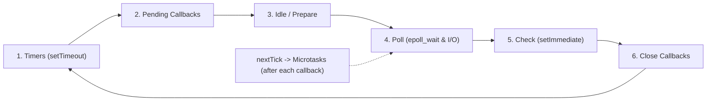
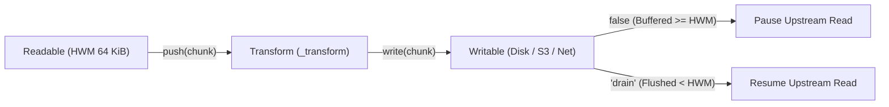
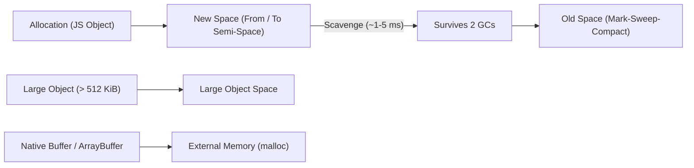
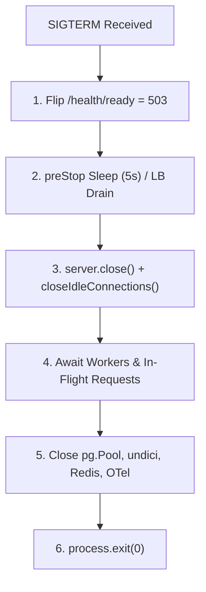
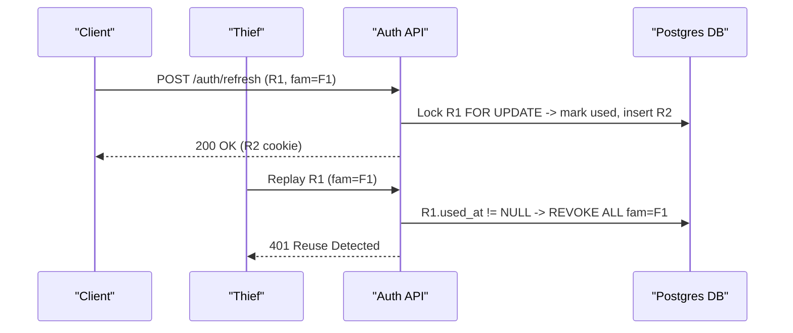

---
tags:
  - programming
  - backend
  - nodejs
  - event-loop
  - concurrency
  - security
  - auth
created: 2026-11-13
updated: 2026-11-13
status: 🟢
level: mid-to-senior
---
# Backend Core (Node, Event Loop, Auth & Concurrency)

> [!abstract] Core Invariant
> Node.js achieves high I/O concurrency on a single JavaScript execution thread by registering non-blocking socket descriptors with OS kernel multiplexers (`epoll` on Linux, `kqueue` on macOS, `IOCP` on Windows) and offloading blocking syscalls (`fs`, `dns.lookup`, CPU-bound `crypto`, `zlib`) to a fixed-size `libuv` C++ worker pool. Any synchronous computation, unbounded microtask recursion, ignored stream backpressure, or `libuv` pool saturation stalls every concurrent request on that process. Cross-references: [[Programming/Backend/Backend Roadmap & Technologies|Backend Roadmap & Technologies]], [[Programming/Backend/NestJS Complete Guide|NestJS Complete Guide]], [[Programming/Backend/NestJS Advanced Guide|NestJS Advanced Guide]].

---

## 1. First-Principles Mechanics: V8 & `libuv` Event Loop Internals

### 1.1 OS Kernel Multiplexing & Single-Thread Execution Model

Traditional threaded HTTP servers (pre-async Apache MPM, naive thread-per-connection servers) allocate one OS thread per active TCP connection. On Linux x86-64, each POSIX thread defaults to an **8 MiB virtual stack** (`ulimit -s`), incurs kernel `task_struct` scheduling overhead, and triggers costly TLB flushes and L1/L2 cache invalidations during context switches at ~10,000 concurrent sockets.

Node.js avoids per-connection thread allocation by pairing **V8** (single JS call stack + generational heap) with **`libuv`** (cross-platform C event loop library). On Linux, `libuv` creates an `epoll` instance (`epoll_create1`), registers non-blocking socket file descriptors (`O_NONBLOCK`) into the kernel red-black interest tree via `epoll_ctl`, and sleeps inside `epoll_wait` when idle. Only when the kernel NIC driver marks a socket readable or writable does `epoll_wait` return that specific subset of ready file descriptors in $O(k)$ time (where $k$ is ready descriptors, not total open connections $N$). Memory per idle Keep-Alive connection drops from megabytes of thread stack to ~2–4 KiB of V8 heap/socket state.

The trade-off is strict: **V8 executes JavaScript on exactly one thread per isolate**. While a synchronous loop, massive `JSON.parse()`, catastrophic RegExp backtracking, or synchronous `fs.readFileSync()` runs on the call stack, `libuv` cannot enter `epoll_wait` to accept new TCP SYNs, read inbound buffers, or respond to Kubernetes liveness probes.

### 1.2 The 6-Phase Event Loop & Microtask Interleaving

Inside C++ (`deps/uv/src/unix/core.c`), `uv_run()` advances through six deterministic phases on each tick. Starting in **Node 11+**, Node drains **both high-priority microtask queues between every single callback completion**—not merely at phase boundaries. This matches browser HTML event loop semantics and creates a critical starvation vector if misused.



Let us trace what happens at runtime in each phase and queue:

1. **Timers Phase (`uv__run_timers`)**: `libuv` maintains a **min-heap** of timers keyed by `loop->time + timeout`. Before entering Phase 1, `libuv` updates its cached monotonic clock (`uv_update_time`). It pops and invokes every timer callback whose expiration timestamp `<= now`. Notice two invariants: (a) `setTimeout(fn, 0)` is internally clamped to **1 ms** (`1 <= delay <= 2147483647`), and (b) `delay` specifies the *minimum* wait threshold, never a hard deadline—if a Poll callback blocks for 400 ms, a 10 ms timer executes after 400 ms.
2. **Pending Callbacks Phase (`uv__run_pending`)**: Executes deferred OS system callbacks from the previous loop iteration—primarily asynchronous TCP socket errors such as `ECONNREFUSED` or `EPIPE` that POSIX kernels report asynchronously after `connect()`/`write()`.
3. **Idle & Prepare Phases (`uv__run_idle`, `uv__run_prepare`)**: Internal `libuv` C++ hooks run immediately prior to blocking in Poll. User JS does not directly schedule `idle`/`prepare` handles (`setImmediate` uses Check, not Idle).
4. **Poll Phase (`uv__io_poll`)**:
   - First, `libuv` computes how long `epoll_wait` may safely block (`uv_backend_timeout`):
     - `0 ms` if the loop is closing, there are active `idle` handles, there are pending `pending_queue` entries, or **any `setImmediate()` callback is queued in the Check phase**.
     - Otherwise, `min(earliest_timer_expiration - now)` so scheduled timers never miss their wakeup.
     - Otherwise (no timers, no check handles, active I/O handles exist), wait indefinitely until kernel I/O readiness arrives.
   - Once sockets/pipe FDs become ready (e.g., incoming HTTP data, `libuv` thread pool `async` completion notification via `eventfd`), `libuv` drains the poll callback queue synchronously.
5. **Check Phase (`uv__run_check`)**: Executes callbacks registered via `setImmediate()`. Because Poll exits immediately to Check whenever `setImmediate` handles exist, calling `setImmediate()` and `setTimeout(..., 0)` *inside an I/O callback* guarantees `setImmediate()` always fires **first** (Poll -> Check -> Close -> next tick Timers). At top-level module execution outside an I/O cycle, their relative order is nondeterministic depending on whether the 1 ms minimum timer expires during process startup before Poll begins.
6. **Close Callbacks Phase (`uv__run_closing_handles`)**: Fires `'close'` events for handles destroyed abruptly via `socket.destroy()`, `fsStream.destroy()`, or `server.close()`.

#### High-Priority Queues: `process.nextTick()` vs Promise Microtasks

Neither `process.nextTick()` nor `Promise.then()` / `queueMicrotask()` is part of `libuv`—both live inside Node's JavaScript environment (`InternalCallbackScope` / `tickCallback` + V8 `MicrotaskQueue`). After every C++-to-JS callback returns (a timer callback, an HTTP `'request'` handler, an `fs` callback), Node runs:
1. **Drain `nextTick` queue completely** (FIFO). If callback A calls `process.nextTick(B)`, B runs in this exact same turn before returning control to `libuv`.
2. **Drain V8 Promise Microtask queue completely** (`Promise.resolve().then`, `async/await` continuations, `queueMicrotask`). If a Promise `.then()` calls `process.nextTick(C)`, Node loops back and drains `nextTick` again before checking if microtasks remain!

```typescript
// src/diagnostics/loop-order-demo.ts
import { readFile } from 'node:fs';

readFile(__filename, () => {
  setTimeout(() => console.log('6. setTimeout(0) -> Phase 1 (next tick)'), 0);
  setImmediate(() => console.log('5. setImmediate -> Phase 5 (Check)'));
  queueMicrotask(() => console.log('3. queueMicrotask -> V8 Microtask Queue'));
  Promise.resolve().then(() => console.log('4. Promise.then -> V8 Microtask Queue'));
  process.nextTick(() => {
    console.log('1. nextTick outer -> Node nextTick Queue');
    process.nextTick(() => console.log('2. nextTick inner -> Drained before Promise queue!'));
  });
});
// Deterministic Output: 1 -> 2 -> 3 -> 4 -> 5 -> 6
```

> [!danger] Starvation Hazard: `process.nextTick()` vs `setImmediate()`
> Never use recursive `process.nextTick()` or infinite synchronous-resolving `Promise.resolve().then(loop)` chains to break up batch jobs. Because both queues must drain completely *before* `libuv` re-enters Phase 4 (`Poll`), `epoll_wait` never runs—new TCP connections queue up until OS `somaxconn` overflows, and `/health/live` times out while OS CPU sits at 100% on one core. Cooperative yielding across ticks MUST use `setImmediate()`, which always allows at least one Poll I/O pass between steps.

### 1.3 `UV_THREADPOOL_SIZE` Contention & the `dns.lookup()` Blocking Trap

Because POSIX has no universal non-blocking filesystem or `getaddrinfo()` syscall across all platforms (Linux `io_uring` support remains gated/disabled by default in Node due to container seccomp restrictions), `libuv` maintains a **process-wide thread pool of 4 worker threads by default** (`UV_THREADPOOL_SIZE=4`, configurable up to `1024`).

**Critical initialization rule**: `libuv` initializes the thread pool lazily via `uv_once()` on the **very first thread-pool call** in the process. Setting `process.env.UV_THREADPOOL_SIZE = '16'` inside TypeScript *after* importing modules that touch `fs` or `crypto` has **zero effect**. Always export `UV_THREADPOOL_SIZE` in the container entrypoint, Kubernetes manifest `env`, or shell command before `node` boots.

| Operation / Node API | Uses `libuv` Pool? | Underlying Mechanism | Contention & Failure Mode |
|----------------------|--------------------|----------------------|---------------------------|
| **TCP / UDP / HTTP / TLS Sockets** | **No** | Kernel `epoll` / `kqueue` / `IOCP` | Scales to tens of thousands of open sockets with zero pool threads. |
| **`dns.resolve4()` / `dns.resolve()`** | **No** | `c-ares` async UDP/TCP resolver | Non-blocking DNS resolution directly through `libuv` UDP sockets. |
| **`dns.lookup()`** | **Yes** | Synchronous glibc `getaddrinfo()` | **Hidden trap**: `http`, `https`, `net.connect`, `pg`, `ioredis`, and `undici` call `dns.lookup()` by default! Slow CoreDNS stalls every `fs` and `crypto` call! |
| **`fs.*` / `fs.promises.*`** | **Yes** | `uv_fs_t` queued to pool | 4 slow NFS/EBS reads stall DNS lookups and password hashing across the entire app. |
| **`crypto.pbkdf2` / `scrypt` / `randomBytes`** | **Yes** | OpenSSL inside `uv_work_t` | 4 concurrent `scrypt` calls (~80 ms each) consume 100% of default pool capacity. |
| **`zlib.*` (`createGzip`, `brotliCompress`)** | **Yes** | `zlib` C work inside `uv_work_t` | Streaming compression of large payloads competes with disk I/O and DNS. |

**Why `dns.lookup()` Causes Ghost Outages**: Suppose your Kubernetes cluster's `coredns` experiences a 2-second UDP packet drop or `ndots:5` search-domain amplification. Four concurrent outbound HTTP requests inside your API invoke `dns.lookup()`, locking all 4 `libuv` worker threads inside synchronous `getaddrinfo()`. Even though OS CPU usage reads `2%` and your HTTP server uses `epoll`, every subsequent `fs.promises.readFile()`, `crypto.randomBytes()`, and outbound `pg` reconnect blocks in the `libuv` work queue for 2+ seconds.

**Production Fix**: Eliminate `dns.lookup()` from hot outbound HTTP paths using a `c-ares`-backed resolver or an in-memory TTL DNS cache (e.g., `dns.Resolver` + `undici` custom `lookup` hook), and size `UV_THREADPOOL_SIZE` appropriately (e.g., `16`–`32` for `fs`/DNS-heavy hosts, while offloading CPU-bound crypto/compression to bounded `worker_threads` rather than bloating the `libuv` pool indefinitely).

### 1.4 Real-Time Diagnostics: `monitorEventLoopDelay`, `eventLoopUtilization` & Prometheus Export

Relying solely on container CPU utilization (`process.cpuUsage()`) creates dangerous blind spots: a Node service starved on `libuv` thread pool contention or waiting on GC memory allocation may show **10% CPU** while dropping requests at **5,000 ms p99 event loop lag**. Combine three runtime metrics:

1. **Event Loop Lag Histogram (`monitorEventLoopDelay`)**: Schedules an internal `libuv` timer every `resolution` milliseconds (e.g., `20 ms`) and records `(actual_wake - expected_wake - resolution)` in nanoseconds using an HdrHistogram. `p99 > 50 ms` indicates synchronous blocking or heavy Major GC pauses.
2. **Event Loop Utilization (`performance.eventLoopUtilization()`)**: Measures the exact ratio `active / (active + idle)`—what percentage of wall-clock time `libuv` spent executing JavaScript/callbacks versus sleeping in `epoll_wait`. Unlike CPU %, ELU approaches `1.0` strictly when the JS loop itself is saturated (even on a multi-core machine where container CPU shows `12%` of 8 cores!).
3. **Active Handle / Async Resource Pressure**: Tracking `process.getActiveResourcesInfo()` exposes leaked sockets, timers, or `FSReqCallback` accumulation.

```typescript
// src/telemetry/event-loop-metrics.ts
import { monitorEventLoopDelay, performance, type EventLoopUtilization } from 'node:perf_hooks';
import { Gauge, Registry } from 'prom-client';

export interface LoopMonitorHandle {
  stop: () => void;
  getSnapshot: () => { p99LagMs: number; maxLagMs: number; utilization: number };
}

export function registerEventLoopMetrics(registry: Registry, sampleIntervalMs = 5_000): LoopMonitorHandle {
  const histogram = monitorEventLoopDelay({ resolution: 20 });
  histogram.enable();

  let prevElu: EventLoopUtilization = performance.eventLoopUtilization();

  const lagP50Gauge = new Gauge({
    name: 'nodejs_eventloop_lag_p50_seconds',
    help: '50th percentile event loop delay in seconds',
    registers: [registry],
  });
  const lagP99Gauge = new Gauge({
    name: 'nodejs_eventloop_lag_p99_seconds',
    help: '99th percentile event loop delay in seconds',
    registers: [registry],
  });
  const lagMaxGauge = new Gauge({
    name: 'nodejs_eventloop_lag_max_seconds',
    help: 'Max observed event loop delay in seconds',
    registers: [registry],
  });
  const eluGauge = new Gauge({
    name: 'nodejs_eventloop_utilization_ratio',
    help: 'Fraction of time the Node.js event loop spent active vs idle (0..1)',
    registers: [registry],
  });
  const activeResourcesGauge = new Gauge({
    name: 'nodejs_active_resources_count',
    help: 'Active libuv/Node resources grouped by type',
    labelNames: ['type'] as const,
    registers: [registry],
  });

  let latest = { p99LagMs: 0, maxLagMs: 0, utilization: 0 };

  const timer = setInterval(() => {
    const p50Sec = Number(histogram.percentile(50)) / 1e9;
    const p99Sec = Number(histogram.percentile(99)) / 1e9;
    const maxSec = Number(histogram.max) / 1e9;
    histogram.reset();

    const currentElu = performance.eventLoopUtilization(prevElu);
    prevElu = performance.eventLoopUtilization();

    lagP50Gauge.set(p50Sec);
    lagP99Gauge.set(p99Sec);
    lagMaxGauge.set(maxSec);
    eluGauge.set(currentElu.utilization);

    // Count active libuv handles by resource class (TCPSocketWrap, Timeout, FSReqCallback)
    const counts = new Map<string, number>();
    for (const resourceType of process.getActiveResourcesInfo()) {
      counts.set(resourceType, (counts.get(resourceType) ?? 0) + 1);
    }
    activeResourcesGauge.reset();
    for (const [type, count] of counts) {
      activeResourcesGauge.set({ type }, count);
    }

    latest = {
      p99LagMs: Number((p99Sec * 1000).toFixed(2)),
      maxLagMs: Number((maxSec * 1000).toFixed(2)),
      utilization: Number(currentElu.utilization.toFixed(4)),
    };

    if (latest.p99LagMs > 50 || latest.utilization > 0.85) {
      process.stderr.write(
        JSON.stringify({ level: 'warn', event: 'event_loop_saturation', ...latest }) + '\n',
      );
    }
  }, sampleIntervalMs);

  // Do not prevent graceful process exit if timer is the sole remaining handle
  timer.unref();

  return {
    stop: () => {
      clearInterval(timer);
      histogram.disable();
    },
    getSnapshot: () => latest,
  };
}
```

---

## 2. Streams, Backpressure & Memory-Bounded Pipelines

### 2.1 Stream Types, `highWaterMark` Internals & Backpressure Mechanics

Node.js provides four stream abstractions in `node:stream`—each backed by internal linked buffers bounded by `highWaterMark` (HWM):

1. **`Readable`**: Produces data from an underlying source (`fs.ReadStream`, `http.IncomingMessage`, `net.Socket`). Calls `this.push(chunk)` to enqueue data into `readableState.buffer`. When buffered bytes exceed `highWaterMark`, `this.push()` returns `false`, signaling the underlying `_read()` implementation to stop pulling from disk/network.
2. **`Writable`**: Consumes chunks via `_write(chunk, encoding, callback)` (or `_writev` for batch writes). Callers invoke `writable.write(chunk)`. If `writableLength >= highWaterMark`, `write()` returns `false`. When the underlying resource flushes queued chunks and drains below HWM, it emits `'drain'`.
3. **`Duplex`**: Independent `Readable` and `Writable` pipelines sharing one object (e.g., `net.Socket` where inbound TCP packets and outbound TCP writes have separate HWM buffers).
4. **`Transform`**: A `Duplex` stream where the output (`Readable` side) is causally computed from the input (`Writable` side) via `_transform(chunk, enc, cb)` and `_flush(cb)` (e.g., `zlib.createGzip()`, `crypto.createCipheriv()`, CSV parsers).

**Exact `highWaterMark` Defaults & Object Mode Traps**:
- **Byte streams (`objectMode: false`)**: Default `highWaterMark` increased from **16 KiB** (Node 18/20) to **64 KiB** (`65536` bytes) in Node 22+ to optimize syscall batching on modern NVMe/10GbE hardware.
- **Object streams (`objectMode: true`)**: Default `highWaterMark` is **16 objects**, regardless of byte size. **Hidden trap**: If each emitted JS object represents a parsed 5 MiB AST or 50,000-row JSON block, `highWaterMark: 16` silently permits `80+ MiB` of V8 heap retention per stage! Explicitly lower `highWaterMark: 2` or `4` in `objectMode` transforms handling large structures.



#### Two Classic Production Failures
1. **Ignored Backpressure**: Writing `readable.on('data', (c) => writable.write(c))` discards the boolean return value of `write()`. If a fast NVMe read (`2 GB/s`) feeds a throttled S3/client socket (`5 MB/s`), `writable` buffers gigabytes of un-flushed `Buffer` objects in **External Memory** until Linux OOM kills the container (`Exit 137`).
2. **Legacy `.pipe()` File Descriptor Leaks**: `src.pipe(transform).pipe(dest)` propagates `'drain'` backpressure automatically, **but does NOT destroy `src` or `transform` when `dest` emits `'error'` or closes prematurely** (such as a client dropping an HTTP upload). Over thousands of aborted requests, leaked open file descriptors exhaust `ulimit -n` and crash the app with `EMFILE: too many open files`.

Always compose streams with `stream/promises` `pipeline()`, which handles backpressure, calls `destroy()` across every stage in the chain on any error/premature close, and integrates cleanly with `AbortSignal`.

### 2.2 Real-World Decision Matrix: Streaming vs Buffering vs Web Streams

| Scenario | Recommended Mechanism | Why / Trade-Off | When NOT to Use |
|----------|-----------------------|-----------------|-------------------|
| **Multi-GB CSV / NDJSON upload or S3-to-S3 ETL** | `node:stream/promises` `pipeline()` + custom `Transform` | Constant $O(1)$ memory (< 50 MB RAM regardless of 500 MB vs 50 GB input); automatic error teardown. | When cross-row global sorting or random-access lookbacks across the entire dataset are mandatory before outputting row 1. |
| **Standard REST JSON payloads (< 1 MiB)** | Framework body parser (`Fastify` / `express.json` with `limit: '1mb'`) | Full-payload JSON schema validation (`Ajv`/`Zod`) and low per-request stream setup overhead. | Unbounded payloads (`limit` omitted) or large binary uploads. |
| **Bridging browser/Edge `fetch()` `ReadableStream` to Node disk/S3** | `Readable.fromWeb(res.body)` / `Readable.toWeb(nodeStream)` inside `pipeline()` | Zero-copy Web Streams (`WHATWG`) to Node Streams bridging while preserving end-to-end backpressure. | Never call `await res.arrayBuffer()` on large remote downloads—materializes entire payload in external memory. |
| **Zip/Tar archiving or Gzip compression of large exports** | `Transform` -> `zlib.createGzip()` -> HTTP `res` via `pipeline()` | Streams compressed chunks directly to client socket; aborts cleanly if client closes browser tab. | Compressing small (< 1 KiB) responses in JS—CPU/pool overhead exceeds bandwidth saved (delegate static/small gzip to Envoy/Nginx). |

### 2.3 Production Build: Memory-Bounded 5 GB Streaming CSV/NDJSON ETL Transformer (< 50 MB RAM)

The following complete, copy-pasteable TypeScript implementation streams arbitrarily large CSV inputs (tested to multi-GB scales while holding RSS growth under ~30–50 MB), safely handles UTF-8 multi-byte characters split across `64 KiB` `Buffer` chunk boundaries via `StringDecoder`, parses RFC-4180 quoted CSV fields without external regex dependencies, quarantines invalid records to a dead-letter stream, supports Web Streams (`ReadableStream`) interop, and cancels immediately via `AbortController`.

```text
etl-service/
  src/
    streams/
      csv-to-ndjson.transform.ts
      metrics-gate.transform.ts
      web-interop.ts
    etl-pipeline.service.ts
  test/
    etl-pipeline.test.ts
```

#### Step 1: UTF-8 Safe Chunk-Boundary CSV-to-NDJSON `Transform`

```typescript
// src/streams/csv-to-ndjson.transform.ts
import { Transform, type TransformCallback } from 'node:stream';
import { StringDecoder } from 'node:string_decoder';

export interface CsvTransformOptions {
  expectedHeaders: readonly string[];
  onMalformedRow?: (lineNumber: number, rawLine: string, reason: string) => void;
  highWaterMark?: number;
}

/**
 * Parses RFC-4180 CSV rows across arbitrary Buffer chunk boundaries using O(single_row) memory.
 * Rejects lines exceeding MAX_LINE_BYTES to prevent memory exhaustion from malformed single-line inputs.
 */
export class CsvToNdjsonTransform extends Transform {
  private static readonly MAX_LINE_BYTES = 1024 * 1024; // 1 MiB single-row safety guard
  private readonly decoder = new StringDecoder('utf8');
  private readonly expectedHeaders: readonly string[];
  private readonly onMalformedRow?: CsvTransformOptions['onMalformedRow'];

  private remainder = '';
  private headers: string[] | null = null;
  private lineNumber = 0;

  constructor(options: CsvTransformOptions) {
    super({
      readableObjectMode: false,
      writableObjectMode: false,
      highWaterMark: options.highWaterMark ?? 64 * 1024,
    });
    this.expectedHeaders = options.expectedHeaders;
    this.onMalformedRow = options.onMalformedRow;
  }

  override _transform(chunk: Buffer, _encoding: BufferEncoding, callback: TransformCallback): void {
    try {
      // StringDecoder retains incomplete multi-byte UTF-8 sequences until the next chunk arrives
      const text = this.remainder + this.decoder.write(chunk);
      if (text.length > CsvToNdjsonTransform.MAX_LINE_BYTES && !text.includes('\n')) {
        callback(new Error(`CSV single row exceeded ${CsvToNdjsonTransform.MAX_LINE_BYTES} chars`));
        return;
      }

      const outputChunks: string[] = [];
      let lineStart = 0;
      let inQuotes = false;

      for (let i = 0; i < text.length; i++) {
        const ch = text[i];
        if (ch === '"') {
          // Handle escaped double quotes ("") inside quoted fields
          if (inQuotes && text[i + 1] === '"') {
            i++;
          } else {
            inQuotes = !inQuotes;
          }
        } else if (ch === '\n' && !inQuotes) {
          const rawLine = text.slice(lineStart, i).replace(/\r$/, '');
          lineStart = i + 1;
          const ndjson = this.processCompleteLine(rawLine);
          if (ndjson !== null) outputChunks.push(ndjson);
        }
      }

      this.remainder = text.slice(lineStart);
      if (outputChunks.length > 0) {
        this.push(Buffer.from(outputChunks.join(''), 'utf8'));
      }
      callback();
    } catch (err) {
      callback(err instanceof Error ? err : new Error(String(err)));
    }
  }

  override _flush(callback: TransformCallback): void {
    try {
      const trailing = this.remainder + this.decoder.end();
      this.remainder = '';
      if (trailing.trim().length > 0) {
        const ndjson = this.processCompleteLine(trailing.replace(/\r$/, ''));
        if (ndjson !== null) {
          this.push(Buffer.from(ndjson, 'utf8'));
        }
      }
      callback();
    } catch (err) {
      callback(err instanceof Error ? err : new Error(String(err)));
    }
  }

  private processCompleteLine(rawLine: string): string | null {
    this.lineNumber++;
    if (rawLine.length === 0) return null;

    const fields = parseCsvRow(rawLine);
    if (this.headers === null) {
      for (const required of this.expectedHeaders) {
        if (!fields.includes(required)) {
          throw new Error(`Missing required CSV header column: ${required}`);
        }
      }
      this.headers = fields;
      return null;
    }

    if (fields.length !== this.headers.length) {
      this.onMalformedRow?.(
        this.lineNumber,
        rawLine.slice(0, 256),
        `Expected ${this.headers.length} columns, got ${fields.length}`,
      );
      return null;
    }

    const record: Record<string, string> = Object.create(null);
    for (let idx = 0; idx < this.headers.length; idx++) {
      const key = this.headers[idx]!;
      // Defend against prototype pollution keys from untrusted CSV header rows
      if (key === '__proto__' || key === 'constructor' || key === 'prototype') continue;
      record[key] = fields[idx]!;
    }
    return JSON.stringify(record) + '\n';
  }
}

function parseCsvRow(line: string): string[] {
  const fields: string[] = [];
  let current = '';
  let inQuotes = false;

  for (let i = 0; i < line.length; i++) {
    const ch = line[i]!;
    if (ch === '"') {
      if (inQuotes && line[i + 1] === '"') {
        current += '"';
        i++;
      } else {
        inQuotes = !inQuotes;
      }
    } else if (ch === ',' && !inQuotes) {
      fields.push(current);
      current = '';
    } else {
      current += ch;
    }
  }
  fields.push(current);
  return fields;
}
```

#### Step 2: Backpressure-Safe Progress Telemetry & Web Streams Interop

```typescript
// src/streams/metrics-gate.transform.ts
import { Transform, type TransformCallback } from 'node:stream';

export interface StreamProgressStats {
  bytesProcessed: number;
  linesProcessed: number;
  peakRssBytes: number;
}

export class MetricsGateTransform extends Transform {
  private bytesProcessed = 0;
  private linesProcessed = 0;
  private peakRssBytes = 0;
  private readonly maxBytesAllowed: number;

  constructor(maxBytesAllowed = 10 * 1024 * 1024 * 1024) {
    super({ highWaterMark: 64 * 1024 });
    this.maxBytesAllowed = maxBytesAllowed;
  }

  override _transform(chunk: Buffer, _encoding: BufferEncoding, callback: TransformCallback): void {
    this.bytesProcessed += chunk.byteLength;
    if (this.bytesProcessed > this.maxBytesAllowed) {
      callback(new Error(`Stream byte quota exceeded (${this.maxBytesAllowed} bytes)`));
      return;
    }

    for (let i = 0; i < chunk.byteLength; i++) {
      if (chunk[i] === 0x0a) this.linesProcessed++; // '\n'
    }

    if ((this.linesProcessed & 1023) === 0) {
      const rss = process.memoryUsage().rss;
      if (rss > this.peakRssBytes) this.peakRssBytes = rss;
    }

    callback(null, chunk);
  }

  getStats(): StreamProgressStats {
    const rss = process.memoryUsage().rss;
    return {
      bytesProcessed: this.bytesProcessed,
      linesProcessed: this.linesProcessed,
      peakRssBytes: Math.max(this.peakRssBytes, rss),
    };
  }
}
```

```typescript
// src/streams/web-interop.ts
import { Readable } from 'node:stream';
import type { ReadableStream as WebReadableStream } from 'node:stream/web';

/**
 * Converts a WHATWG fetch() Response body into a Node.js Readable stream without buffering.
 * Cancels the underlying Web stream automatically if the Node stream is destroyed early.
 */
export function fromFetchResponseBody(response: Response): Readable {
  if (!response.body) {
    throw new Error(`HTTP response ${response.status} has an empty body`);
  }
  return Readable.fromWeb(response.body as unknown as WebReadableStream<Uint8Array>);
}
```

#### Step 3: Full Pipeline Service & Automated Cancellation/Memory Test

```typescript
// src/etl-pipeline.service.ts
import { createReadStream, createWriteStream } from 'node:fs';
import { Readable } from 'node:stream';
import { pipeline } from 'node:stream/promises';
import { createGzip } from 'node:zlib';
import { CsvToNdjsonTransform } from './streams/csv-to-ndjson.transform.js';
import { MetricsGateTransform, type StreamProgressStats } from './streams/metrics-gate.transform.js';
import { fromFetchResponseBody } from './streams/web-interop.js';

export interface EtlResult extends StreamProgressStats {
  malformedRows: number;
  durationMs: number;
}

export async function runCsvToCompressedNdjsonPipeline(options: {
  source: string | Readable | Response;
  destPath: string;
  expectedHeaders: readonly string[];
  timeoutMs?: number;
  externalSignal?: AbortSignal;
}): Promise<EtlResult> {
  const startedAt = performance.now();
  const timeoutController = new AbortController();
  const timeoutMs = options.timeoutMs ?? 60_000;
  const timer = setTimeout(() => {
    timeoutController.abort(new Error(`ETL pipeline exceeded ${timeoutMs}ms timeout`));
  }, timeoutMs);
  timer.unref();

  const signal = options.externalSignal
    ? AbortSignal.any([options.externalSignal, timeoutController.signal])
    : timeoutController.signal;

  let malformedRows = 0;
  const csvTransform = new CsvToNdjsonTransform({
    expectedHeaders: options.expectedHeaders,
    onMalformedRow: (line, _raw, reason) => {
      malformedRows++;
      if (malformedRows <= 20) {
        process.stderr.write(JSON.stringify({ event: 'etl_malformed_row', line, reason }) + '\n');
      }
    },
  });
  const metricsGate = new MetricsGateTransform();

  let inputStream: Readable;
  if (typeof options.source === 'string') {
    inputStream = createReadStream(options.source, { highWaterMark: 64 * 1024 });
  } else if (options.source instanceof Readable) {
    inputStream = options.source;
  } else {
    inputStream = fromFetchResponseBody(options.source);
  }

  try {
    await pipeline(
      inputStream,
      csvTransform,
      metricsGate,
      createGzip({ level: 6 }),
      createWriteStream(options.destPath, { highWaterMark: 64 * 1024 }),
      { signal },
    );

    const stats = metricsGate.getStats();
    return {
      ...stats,
      malformedRows,
      durationMs: Math.round(performance.now() - startedAt),
    };
  } finally {
    clearTimeout(timer);
  }
}
```

```typescript
// test/etl-pipeline.test.ts
import test from 'node:test';
import assert from 'node:assert/strict';
import { mkdtemp, rm, readFile } from 'node:fs/promises';
import { tmpdir } from 'node:os';
import { join } from 'node:path';
import { Readable } from 'node:stream';
import { gunzipSync } from 'node:zlib';
import { runCsvToCompressedNdjsonPipeline } from '../src/etl-pipeline.service.js';

test('streams multi-megabyte CSV into gzipped NDJSON with bounded RSS and clean abort', async () => {
  const dir = await mkdtemp(join(tmpdir(), 'etl-test-'));
  try {
    const outPath = join(dir, 'events.ndjson.gz');
    const totalRows = 25_000;
    let emitted = 0;

    // Synthetic Readable yielding chunks with multi-byte UTF-8 emojis and quoted commas
    const source = new Readable({
      highWaterMark: 16 * 1024,
      read() {
        if (emitted === 0) {
          this.push(Buffer.from('id,tenant,note\n', 'utf8'));
        }
        let batch = '';
        for (let i = 0; i < 250 && emitted < totalRows; i++) {
          emitted++;
          batch += `${emitted},"acme,inc","row-${emitted}-✓"\n`;
        }
        if (batch.length > 0) this.push(Buffer.from(batch, 'utf8'));
        if (emitted >= totalRows) this.push(null);
      },
    });

    const baselineRss = process.memoryUsage().rss;
    const result = await runCsvToCompressedNdjsonPipeline({
      source,
      destPath: outPath,
      expectedHeaders: ['id', 'tenant', 'note'],
    });

    const rssGrowthMb = (result.peakRssBytes - baselineRss) / (1024 * 1024);
    assert.equal(result.linesProcessed, totalRows);
    assert.equal(result.malformedRows, 0);
    assert.ok(rssGrowthMb < 50, `Expected < 50 MB RSS delta, got ${rssGrowthMb.toFixed(2)} MB`);

    const decompressed = gunzipSync(await readFile(outPath)).toString('utf8').trim().split('\n');
    assert.equal(decompressed.length, totalRows);
    assert.deepEqual(JSON.parse(decompressed[0]!), { id: '1', tenant: 'acme,inc', note: 'row-1-✓' });

    // Verify immediate AbortSignal teardown destroys upstream readable
    let destroyed = false;
    const infiniteSource = new Readable({
      read() {
        this.push(Buffer.from('1,acme,ok\n'));
      },
      destroy(err, cb) {
        destroyed = true;
        cb(err);
      },
    });
    infiniteSource.unshift(Buffer.from('id,tenant,note\n'));

    const ac = new AbortController();
    setTimeout(() => ac.abort(new Error('Client disconnected')), 15);
    await assert.rejects(
      runCsvToCompressedNdjsonPipeline({
        source: infiniteSource,
        destPath: join(dir, 'aborted.ndjson.gz'),
        expectedHeaders: ['id', 'tenant', 'note'],
        externalSignal: ac.signal,
      }),
      /Client disconnected|AbortError/,
    );
    assert.equal(destroyed, true);
  } finally {
    await rm(dir, { recursive: true, force: true });
  }
});
```

---

## 3. V8 Memory Management, GC & Memory Leak Forensics

### 3.1 V8 Generational Heap Architecture

V8 implements the weak generational hypothesis—most allocated objects (`req`, `res`, DTOs, closure scopes, temporary strings) die within milliseconds. To avoid scanning hundreds of megabytes of long-lived singletons during every allocation sweep, V8 partitions managed memory into distinct spaces:



1. **New Space (Young Generation)**: Split into two contiguous semi-spaces (`From-Space` and `To-Space`, typically 16–64 MiB combined). New objects allocate via a single bump-pointer increment ($O(1)$). When `From-Space` fills, V8 pauses JS briefly (1–5 ms) for **Scavenge (Cheney's copying collector)**: live objects referenced from roots or remembered sets are copied contiguously into `To-Space`, dead objects are abandoned en masse without sweeping, and the spaces swap roles. Objects surviving two scavenges promote into Old Space.
2. **Old Space (Old Generation)**: Holds promoted long-lived objects, caches, closures, and singletons. Collected by **Major GC**: V8 runs **Concurrent Marking** on background helper threads while JS continues running, followed by brief stop-the-world **Mark-Sweep** (reclaiming dead pages) and **Compaction** (moving fragmented surviving objects into contiguous pages—causing the 50–300+ ms event loop pauses visible under heavy heap churn).
3. **Large Object Space**: Objects exceeding page thresholds (~512 KiB) allocate directly here so Scavenge never wastes CPU copying huge arrays.
4. **External Memory (`Buffer` / `ArrayBuffer`)**: Raw byte buffers created by `Buffer.alloc()`, `fs.readFile()`, and `zlib` live **outside the V8 JS heap** via C++ `ArrayBufferAllocator` (`malloc`/jemalloc), tracked via `process.memoryUsage().external` and `arrayBuffers`.

### 3.2 Container `--max-old-space-size` Math Inside Kubernetes cgroups

In containerized Linux environments (Docker / Kubernetes), Linux enforces hard memory limits via `cgroup v2` (`memory.max`). If process RSS (`V8 JS Heap + External Buffers + V8 Code/Stack + Native Addons + libuv Thread Stacks`) crosses `memory.max` by a single page, the Linux kernel OOM killer immediately sends uncatchable **`SIGKILL` (`Exit Code 137`)**.

**Why default V8 limits fail in containers**: V8 chooses a default old-space ceiling based on detected memory (often leaving inadequate headroom for native `Buffer`s, `Argon2id` 64 MiB hashes, and OpenSSL buffers) OR tries to defer Major GC until approaching the threshold. If a `2048 MiB` pod lets V8 Old Space grow to `1750 MiB` while `undici`/`fs` allocates `350 MiB` of `Buffer` External Memory, total RSS hits `2100 MiB` and triggers `OOMKilled (137)` *before* V8 ever runs an emergency Major GC!

**Production Heap Sizing Formula**:
$$\text{max-old-space-size (MB)} \le 0.70 \times \text{Container Memory Limit (MB)}$$

| Kubernetes `resources.limits.memory` | Recommended `--max-old-space-size` | Reserved Non-Heap Headroom (External Buffers, Stacks, C++ Addons) |
|--------------------------------------|--------------------------------------|-------------------------------------------------------------------|
| **512 MiB** | `350` MB | 162 MiB |
| **1 GiB (`1024 MiB`)** | `700` MB | 324 MiB |
| **2 GiB (`2048 MiB`)** | `1400` MB | 648 MiB |
| **4 GiB (`4096 MiB`)** | `2800` MB | 1296 MiB |

Pass this in the container environment (`NODE_OPTIONS="--max-old-space-size=1400"`). Never leave `limits.memory` matched blindly to V8 defaults, and monitor `v8.getHeapStatistics().heap_size_limit` at boot to assert the flag took effect.

### 3.3 Five Real Memory Leak Patterns & Exact Code Fixes

#### Pattern 1: Unbounded Module-Level `Map` / `Set` Caches
Storing per-user or per-request entries in a module-level `Map` creates permanent GC roots. Even after requests finish, values promote to Old Space and grow monotonically until OOM.
- **Fix**: Replace raw `Map` with a bounded LRU cache (`max` entries + `ttl`), or associate metadata directly with transient objects via `WeakMap` (which automatically releases entries when the key object becomes unreachable).

#### Pattern 2: Uncleaned `EventEmitter` Listeners Per Request
Attaching `eventBus.on('price-update', handler)` inside an HTTP/SSE request without removing the listener on disconnect retains the entire closure (`req`, `res`, `Buffer`s, socket handles) inside `EventEmitter._events` forever—emitting `MaxListenersExceededWarning` after 10 subscriptions.
- **Fix**: Bind listeners with `AbortSignal` (`{ signal: reqAbortController.signal }`) or remove explicitly in `try { ... } finally { bus.off(...) }`.

#### Pattern 3: Stale Closures Capturing Shared V8 `Context`
In V8, **all inner closures declared inside the same outer function share a single heap-allocated `Context` object**. If inner closure A captures a tiny timestamp variable `ts` and outlives the request, while another sibling variable `hugePayload` in that outer scope is ALSO referenced by *any* sibling inner closure B (even if B is never called!), `hugePayload` stays pinned in Old Space for the entire lifetime of closure A!

```typescript
// BAD: `unusedLeak` closure forces V8 to place `hugeBuffer` in the shared Context alongside `ts`.
function createBrokenHandler(raw: Buffer) {
  const hugeBuffer = Buffer.concat([raw, Buffer.alloc(10 * 1024 * 1024)]);
  const ts = Date.now();
  const unusedDebugFn = () => hugeBuffer.length; // Never called, yet pins hugeBuffer in shared Context!
  return function handleTick() {
    if (false) unusedDebugFn();
    return ts;
  };
}

// FIXED: Extract summary primitives into independent helper or explicitly nullify references.
function createCleanHandler(raw: Buffer) {
  let hugeBuffer: Buffer | null = Buffer.concat([raw, Buffer.alloc(10 * 1024 * 1024)]);
  const summaryBytes = hugeBuffer.byteLength;
  const ts = Date.now();
  hugeBuffer = null; // Immediately eligible for Scavenge regardless of shared Context slots
  return () => ({ ts, summaryBytes });
}
```

#### Pattern 4: Unconsumed `fetch()` / `undici` Response Bodies & Dangling `Promise`s
Calling `const res = await fetch(url)` and only inspecting `res.status` without draining or cancelling `res.body` keeps the underlying `undici` stream, `ReadableStream`, and TCP socket buffers alive in memory until idle socket timeout. Similarly, awaiting `Promise.race([externalCall(), neverResolvingTimeoutPromise])` leaks executor closures if the losing branch never settles or rejects.
- **Fix**: Always call `await res.body?.cancel()` (or `await res.arrayBuffer()` / `res.text()`) in a `finally` block when ignoring response payloads, and clear timer promises in `finally` using `AbortSignal.timeout(ms)`.

#### Pattern 5: Forgotten `setInterval` / `setTimeout` Handles on Dynamic Entities
Spawning `setInterval(() => cache.refresh(), 5000)` inside dynamically instantiated tenant controllers or test fixtures pins the `Timeout` handle inside `libuv`'s active timer min-heap, preventing the tenant object and its entire dependency subtree from ever being garbage collected.
- **Fix**: Register explicit `onDestroy()` / `close()` hooks clearing every interval (`clearInterval`), call `.unref()` on background housekeeping timers, and wire `AbortSignal` into periodic loops.

### 3.4 3-Heap-Snapshot Forensics Playbook

When RSS or `heapUsed` slopes upward continuously under steady RPS:

1. **Enable on-demand snapshots without restarting**: Launch Node in staging/canary with `NODE_OPTIONS="--heapsnapshot-signal=SIGUSR2 --max-old-space-size=1400"`. (Warning: writing a heap snapshot pauses the event loop for 1–5+ seconds and temporarily uses ~2x heap memory; never trigger on a live pod receiving production traffic—drain the pod from the LB via `/health/ready = 503` first).
2. **Capture the 3-Snapshot Sequence**:
   - Warm up the process (JIT compilation, connection pools, DI singletons) with 500 requests so baseline caches populate.
   - **Snapshot 1 (`S1`)**: `kill -USR2 <pid>` (Baseline).
   - Send 2,000 representative requests triggering the suspected endpoint.
   - **Snapshot 2 (`S2`)**: `kill -USR2 <pid>`.
   - Send another 2,000 requests.
   - **Snapshot 3 (`S3`)**: `kill -USR2 <pid>`.
3. **Analyze in Chrome DevTools (`Memory` -> `Load`)**:
   - Load `S1`, `S2`, and `S3`.
   - Select `S3` and switch the view dropdown from `Summary` to **`Objects allocated between S1 and S2`**. Because `S1` already warmed initial caches and anything transient from the first 2,000 requests should have been collected before `S3`, objects surviving across *both* intervals (`S1 -> S2 -> S3`) are true leaks.
   - Sort descending by **Retained Size** or **Size Delta**.
   - Click a leaked constructor (`Buffer`, `IncomingMessage`, `Closure`, `Promise`), open the **Retainers** bottom panel, and walk up the tree (`Distance` column ascending) until hitting the exact GC root (`(Global)`, `Context`, `EventEmitter._events`, `Array` cache).

---

## 4. Concurrency, `worker_threads`, Outbound HTTP Pooling & Graceful Drain

### 4.1 Execution Models: Event Loop vs `worker_threads` vs `cluster` vs Kubernetes Pods

| Execution Model | Memory & Isolate Topology | IPC Mechanism | Optimal Workload & Rule |
|-----------------|---------------------------|---------------|-------------------------|
| **Single Event Loop** | 1 V8 Isolate, shared heap | Direct JS calls | Network, Redis, Postgres, HTTP orchestration. Handles thousands of concurrent I/O requests per core. |
| **`worker_threads`** | Multiple V8 Isolates inside 1 OS process | `MessagePort` structured clone, zero-copy `Transferable` (`ArrayBuffer`), or lock-free `SharedArrayBuffer` + `Atomics` | **CPU-bound tasks** (PDF/image transforms, heavy CSV/AST parsing, `Argon2id` offloading, ML tensor preprocessing). Always pool workers; never `new Worker()` per request (~30–50 ms startup + 5–10 MiB RAM per isolate). |
| **`node:cluster`** | Multiple forked OS processes sharing listening socket | OS IPC pipe + round-robin socket FD handoff | Legacy bare-metal VM multi-core scaling. **Anti-pattern inside Kubernetes**: breaks per-pod Prometheus `/metrics` scraping, masks individual worker OOM kills, and fights Linux `cfs_quota_us` CPU throttling. |
| **Kubernetes Pods (`1 Pod = 1 Node Process`)** | Separate container cgroup per process | HTTP / gRPC / Redis / Kafka | **Production default**: clean cgroup memory/CPU boundaries, independent health probes, Horizontal Pod Autoscaler scaling. |

### 4.2 Complete Bounded `worker_threads` Pool & `SharedArrayBuffer` + `Atomics`

Spawning an unbounded queue in front of a worker pool simply converts CPU saturation into an Old Space memory leak. A production worker pool **must bound both thread concurrency (`maxWorkers`) and waiting queue depth (`maxQueueSize`)**, rejecting excess work immediately with `503 Service Unavailable` (load shedding).

```typescript
// src/workers/cpu-task.worker.ts
import { parentPort, workerData } from 'node:worker_threads';
import { pbkdf2Sync } from 'node:crypto';

export interface CpuTaskPayload {
  id: number;
  password: string;
  saltHex: string;
  iterations: number;
}

if (!parentPort) {
  throw new Error('Must run inside worker_threads');
}

// Optional SharedArrayBuffer telemetry counter mapped across all threads
const statsView = workerData?.sharedCounterBuffer
  ? new Int32Array(workerData.sharedCounterBuffer as SharedArrayBuffer)
  : null;

parentPort.on('message', (task: CpuTaskPayload) => {
  try {
    const derived = pbkdf2Sync(task.password, Buffer.from(task.saltHex, 'hex'), task.iterations, 32, 'sha512');
    if (statsView) {
      // Lock-free atomic increment of index 0 (completed task count) across workers
      Atomics.add(statsView, 0, 1);
    }
    // Transfer underlying ArrayBuffer ownership to main thread with zero memory copy
    const outBuffer = derived.buffer.slice(derived.byteOffset, derived.byteOffset + derived.byteLength);
    parentPort!.postMessage({ id: task.id, digestHex: Buffer.from(outBuffer).toString('hex') }, [outBuffer]);
  } catch (err) {
    parentPort!.postMessage({
      id: task.id,
      error: err instanceof Error ? err.message : String(err),
    });
  }
});
```

```typescript
// src/workers/bounded-worker-pool.ts
import { Worker } from 'node:worker_threads';
import { cpus } from 'node:os';

interface QueuedTask<TInput, TOutput> {
  id: number;
  payload: TInput;
  resolve: (value: TOutput) => void;
  reject: (reason: Error) => void;
  timeoutHandle: NodeJS.Timeout;
  abortCleanup?: () => void;
}

interface WorkerSlot {
  worker: Worker;
  busy: boolean;
  currentTaskId: number | null;
}

export class PoolOverloadedError extends Error {
  constructor(maxQueue: number) {
    super(`Worker pool queue full (maxQueue=${maxQueue})`);
    this.name = 'PoolOverloadedError';
  }
}

export class BoundedWorkerPool<TInput extends object, TOutput> {
  private readonly slots: WorkerSlot[] = [];
  private readonly queue: QueuedTask<TInput, TOutput>[] = [];
  private readonly inflight = new Map<number, QueuedTask<TInput, TOutput>>();
  private readonly sharedBuffer = new SharedArrayBuffer(Int32Array.BYTES_PER_ELEMENT * 2);
  private readonly sharedCounters = new Int32Array(this.sharedBuffer);
  private nextTaskId = 1;
  private closed = false;

  constructor(
    private readonly workerScriptPath: string,
    private readonly options: {
      poolSize?: number;
      maxQueueSize?: number;
      taskTimeoutMs?: number;
    } = {},
  ) {
    const poolSize = options.poolSize ?? Math.max(1, Math.min(4, cpus().length - 1));
    for (let i = 0; i < poolSize; i++) {
      this.slots.push(this.spawnSlot());
    }
  }

  get completedCount(): number {
    return Atomics.load(this.sharedCounters, 0);
  }

  get queueDepth(): number {
    return this.queue.length;
  }

  exec(payload: TInput, signal?: AbortSignal): Promise<TOutput> {
    if (this.closed) return Promise.reject(new Error('Worker pool is closed'));
    if (signal?.aborted) return Promise.reject(new Error('Task aborted prior to enqueue'));

    const maxQueue = this.options.maxQueueSize ?? 128;
    if (this.queue.length >= maxQueue) {
      return Promise.reject(new PoolOverloadedError(maxQueue));
    }

    return new Promise<TOutput>((resolve, reject) => {
      const id = this.nextTaskId++;
      const timeoutMs = this.options.taskTimeoutMs ?? 5_000;

      const task: QueuedTask<TInput, TOutput> = {
        id,
        payload,
        resolve,
        reject,
        timeoutHandle: setTimeout(() => {
          this.cancelTask(id, new Error(`Worker task ${id} timed out after ${timeoutMs}ms`));
        }, timeoutMs),
      };
      task.timeoutHandle.unref();

      if (signal) {
        const onAbort = () => this.cancelTask(id, new Error(`Worker task ${id} aborted by caller`));
        signal.addEventListener('abort', onAbort, { once: true });
        task.abortCleanup = () => signal.removeEventListener('abort', onAbort);
      }

      const idleSlot = this.slots.find((s) => !s.busy);
      if (idleSlot) {
        this.dispatch(idleSlot, task);
      } else {
        this.queue.push(task);
      }
    });
  }

  async destroy(): Promise<void> {
    this.closed = true;
    while (this.queue.length > 0) {
      const task = this.queue.shift()!;
      this.cleanupTask(task);
      task.reject(new Error('Worker pool shutting down'));
    }
    await Promise.all(this.slots.map((s) => s.worker.terminate()));
  }

  private spawnSlot(): WorkerSlot {
    const worker = new Worker(this.workerScriptPath, {
      workerData: { sharedCounterBuffer: this.sharedBuffer },
    });
    const slot: WorkerSlot = { worker, busy: false, currentTaskId: null };

    worker.on('message', (msg: { id: number; error?: string } & TOutput) => {
      const task = this.inflight.get(msg.id);
      if (task) {
        this.inflight.delete(msg.id);
        this.cleanupTask(task);
        if (msg.error) task.reject(new Error(msg.error));
        else task.resolve(msg);
      }
      slot.busy = false;
      slot.currentTaskId = null;
      this.drainNext(slot);
    });

    worker.on('error', (err) => {
      if (slot.currentTaskId !== null) {
        const task = this.inflight.get(slot.currentTaskId);
        if (task) {
          this.inflight.delete(slot.currentTaskId);
          this.cleanupTask(task);
          task.reject(err);
        }
      }
    });

    worker.on('exit', (code) => {
      if (!this.closed && code !== 0) {
        const idx = this.slots.indexOf(slot);
        if (idx !== -1) {
          const replacement = this.spawnSlot();
          this.slots[idx] = replacement;
          this.drainNext(replacement);
        }
      }
    });

    return slot;
  }

  private dispatch(slot: WorkerSlot, task: QueuedTask<TInput, TOutput>): void {
    slot.busy = true;
    slot.currentTaskId = task.id;
    this.inflight.set(task.id, task);
    slot.worker.postMessage({ ...task.payload, id: task.id });
  }

  private drainNext(slot: WorkerSlot): void {
    if (this.closed || slot.busy || this.queue.length === 0) return;
    const next = this.queue.shift()!;
    this.dispatch(slot, next);
  }

  private cancelTask(id: number, err: Error): void {
    const qIdx = this.queue.findIndex((t) => t.id === id);
    if (qIdx !== -1) {
      const [task] = this.queue.splice(qIdx, 1);
      this.cleanupTask(task!);
      task!.reject(err);
      return;
    }
    const inflightTask = this.inflight.get(id);
    if (inflightTask) {
      this.inflight.delete(id);
      this.cleanupTask(inflightTask);
      inflightTask.reject(err);
    }
  }

  private cleanupTask(task: QueuedTask<TInput, TOutput>): void {
    clearTimeout(task.timeoutHandle);
    task.abortCleanup?.();
  }
}
```

> [!tip] `MessageChannel` Direct Pipes & `piscina` in Production
> When two worker isolates must stream large chunks directly (or an HTTP handler needs a dedicated bidirectional control channel with one worker without routing messages through the main thread's default `parentPort`), instantiate `const { port1, port2 } = new MessageChannel()` and transfer `port2` inside `postMessage({ port: port2 }, [port2])`. For general CPU pool scheduling, prefer `piscina` configured explicitly with `minThreads`, `maxThreads`, `idleTimeout: 30_000`, and `maxQueue: 128` (because `piscina` defaults to an unbounded queue).

```typescript
// Dedicated MessageChannel sub-port pattern between main thread and worker
import { MessageChannel, Worker, type MessagePort } from 'node:worker_threads';

export function openDedicatedWorkerStream(worker: Worker): MessagePort {
  const { port1, port2 } = new MessageChannel();
  worker.postMessage({ type: 'attach-channel', port: port2 }, [port2]);
  return port1;
}
```

### 4.3 Tuning `undici` Outbound HTTP Agents, Keep-Alive & Strict Timeouts

Outbound HTTP misconfiguration causes two catastrophic outages in Node microservices:
1. **TCP `TIME_WAIT` Ephemeral Port Exhaustion**: Opening a new TCP+TLS handshake per request without HTTP Keep-Alive pins closed sockets in kernel `TIME_WAIT` state for **60 seconds** (`tcp_fin_timeout`). Above ~450 RPS to one upstream, a container exhausts its ~28,000 ephemeral ports (`ip_local_port_range`) and fails with `EADDRNOTAVAIL`.
2. **Keep-Alive `ECONNRESET` Race**: If your `undici` client caches idle Keep-Alive sockets for `60s` while the upstream Nginx/ALB closes idle sockets at `5s` (or `59s`), `undici` sends a request down a half-closed socket right as the upstream transmits a TCP `FIN`, throwing `UND_ERR_SOCKET` / `ECONNRESET`. **Rule**: Set `keepAliveTimeout` on your Node HTTP client strictly **shorter** than the upstream server/LB idle timeout (e.g., `4_000 ms` client vs `60_000 ms` ALB, or `4_000 ms` vs `5_000 ms` Node `server.keepAliveTimeout`), and keep `keepAliveMaxTimeout` capped (`30_000 ms`).

```typescript
// src/http/outbound-client.ts
import { Agent, Pool, interceptors } from 'undici';

/**
 * Production undici Agent with bounded per-origin pools, strict socket timeouts,
 * Keep-Alive shorter than upstream LB timeout (avoiding ECONNRESET), and idempotent retries.
 */
export const outboundHttpAgent = new Agent({
  connections: 64, // Max concurrent sockets per origin (prevents upstream fd exhaustion)
  pipelining: 1,   // Strictly 1 (no HTTP/1.1 pipelining across untrusted proxies)
  keepAliveTimeout: 4_000,    // Must be < upstream idle timeout (Node default server is 5_000 ms)
  keepAliveMaxTimeout: 30_000,
  headersTimeout: 5_000,      // Max wait for response headers after sending request
  bodyTimeout: 10_000,        // Max idle gap between response body chunks
  connect: {
    timeout: 2_500,           // Fast fail on unreachable/blackholed TCP SYN
  },
}).compose(
  interceptors.retry({
    maxRetries: 2,
    minTimeout: 100,
    maxTimeout: 1_000,
    methods: ['GET', 'HEAD', 'PUT', 'DELETE', 'OPTIONS'], // Never auto-retry non-idempotent POST!
    statusCodes: [429, 502, 503, 504],
  }),
);

// Dedicated high-throughput Pool for a known internal service
export const billingServicePool = new Pool('https://billing.internal:8443', {
  connections: 32,
  keepAliveTimeout: 15_000,
  headersTimeout: 3_000,
  bodyTimeout: 5_000,
  connect: { timeout: 1_500 },
});

export async function callBillingJson<T>(path: string, body: unknown, idempotencyKey: string): Promise<T> {
  const res = await billingServicePool.request({
    path,
    method: 'POST',
    headers: {
      'content-type': 'application/json',
      'idempotency-key': idempotencyKey,
    },
    body: JSON.stringify(body),
    signal: AbortSignal.timeout(4_000),
  });

  if (res.statusCode < 200 || res.statusCode >= 300) {
    const errText = await res.body.text(); // Always consume/dump body to release socket back to pool!
    throw new Error(`Billing upstream returned ${res.statusCode}: ${errText.slice(0, 200)}`);
  }
  return (await res.body.json()) as T;
}
```

### 4.4 PostgreSQL `pg.Pool` Sizing Formula & Graceful `SIGTERM` Drain

A classic scaling failure occurs when 20 Kubernetes API pods each default to `pg.Pool({ max: 20 })` = **400 active backend processes** against a PostgreSQL instance with 8 vCPUs (`max_connections = 100`). Over-provisioned pools starve Postgres shared buffers and cause extreme lock-wait context switching.

**Connection Pool Sizing Formula**:
- Optimal concurrent active queries on PostgreSQL ≈ `(2 × DB_CPU_Cores) + effective_spindle_count` (typically **16–32 total** across direct connections, or routed via `PgBouncer` in transaction mode).
- Per API pod without `PgBouncer`:
$$\text{podPoolMax} = \max\left(2,\; \left\lfloor \frac{\text{DB\_Connection\_Budget} \times 0.8}{\text{Max\_Autoscaled\_Pods}} \right\rfloor \right)$$
For example, if DB budget is `120` and HPA scales up to `12` pods, set `max: 8` per pod (`96` total, leaving `24` connections for migrations/workers/admin). Always configure `connectionTimeoutMillis: 2_500` (fail fast rather than queueing requests until HTTP load balancer timeout), `idleTimeoutMillis: 30_000`, and `statement_timeout: 5_000` (prevent runaway sequential scans from holding connections).

#### Zero-Downtime Graceful `SIGTERM` Drain Sequence

When Kubernetes triggers a rolling deployment or scale-down, it sends `SIGTERM` to PID 1 **in parallel** with asynchronously updating `kube-proxy` iptables/IPVS rules across nodes. Shutting down `http.Server` on millisecond 0 causes nodes still forwarding traffic for 1–3 seconds to hit `ECONNREFUSED` (`502 Bad Gateway`). Closing `pg.Pool` before HTTP requests finish aborts active DB queries mid-transaction.



```typescript
// src/lifecycle/graceful-shutdown.ts
import type { Server } from 'node:http';
import type { Pool as PgPool } from 'pg';
import type { Dispatcher } from 'undici';

export interface ShutdownDependencies {
  httpServer: Server;
  markNotReady: () => void;
  drainWorkers: () => Promise<void>;
  pgPool: PgPool;
  httpAgent: Dispatcher;
  flushTelemetry: () => Promise<void>;
}

export function installGracefulShutdown(deps: ShutdownDependencies, hardTimeoutMs = 25_000): void {
  let inProgress = false;

  // Set server Keep-Alive > ALB/Envoy idle or ensure LB < Node server (default Node is 5_000 ms)
  deps.httpServer.keepAliveTimeout = 65_000;
  deps.httpServer.headersTimeout = 66_000; // Must exceed keepAliveTimeout to prevent 408 race

  const shutdown = async (signal: NodeJS.Signals): Promise<void> => {
    if (inProgress) return;
    inProgress = true;
    deps.markNotReady();

    const forceTimer = setTimeout(() => {
      process.stderr.write(JSON.stringify({ level: 'error', event: 'forced_shutdown_timeout', signal }) + '\n');
      process.exit(1);
    }, hardTimeoutMs);
    forceTimer.unref();

    try {
      // Stop accepting new TCP connections and tear down idle keep-alive sockets immediately
      const serverClosed = new Promise<void>((resolve, reject) => {
        deps.httpServer.close((err) => (err ? reject(err) : resolve()));
      });
      deps.httpServer.closeIdleConnections();

      await Promise.all([serverClosed, deps.drainWorkers()]);
      await Promise.allSettled([
        deps.pgPool.end(),
        deps.httpAgent.close(),
        deps.flushTelemetry(),
      ]);

      clearTimeout(forceTimer);
      process.exit(0);
    } catch (err) {
      process.stderr.write(
        JSON.stringify({ level: 'error', event: 'shutdown_failed', err: String(err) }) + '\n',
      );
      process.exit(1);
    }
  };

  process.on('SIGTERM', () => void shutdown('SIGTERM'));
  process.on('SIGINT', () => void shutdown('SIGINT'));
}
```

Pair this code with a matching Kubernetes Pod lifecycle (`terminationGracePeriodSeconds` > `preStop` + `hardTimeoutMs`):

```yaml
spec:
  terminationGracePeriodSeconds: 35
  containers:
    - name: api
      readinessProbe:
        httpGet:
          path: /health/ready
          port: 3000
        periodSeconds: 5
        failureThreshold: 2
      livenessProbe:
        httpGet:
          path: /health/live
          port: 3000
        periodSeconds: 10
        failureThreshold: 3
      lifecycle:
        preStop:
          exec:
            command: ["/bin/sh", "-c", "sleep 5"]
```

---

## 5. Authentication, Cryptography & Backend Security Implementation

### 5.1 OAuth 2.1 + PKCE (`S256`) & OIDC Token Boundaries

OAuth 2.1 deprecates the **Implicit flow** (where access tokens leaked in URL `#fragments`, browser history, and proxy logs) and the **Resource Owner Password Credentials (ROPC)** flow, and **requires PKCE (`S256`)** on every Authorization Code grant—including confidential backend clients (BFFs)—to defeat authorization code interception attacks.

| OIDC / OAuth Token | Intended Consumer | Format & Validation | Security Boundary |
|--------------------|-------------------|---------------------|-------------------|
| **`id_token`** | Client App / BFF | Signed JWT (`sub`, `iss`, `aud = client_id`, `nonce`, `exp`). | Authentication artifact only. **NEVER forward `id_token` to downstream Resource APIs as a Bearer token.** |
| **`access_token`** | Resource Server (Backend API) | Short-lived (5–15 min) signed JWT (`EdDSA`/`RS256`) or opaque token (`aud = api_identifier`, `scope`, `sub`). | API verifies `iss`, `aud`, `exp`, `nbf`, and `scope` before authorizing operations. |
| **`refresh_token`** | Auth Server (`/oauth/token`) | 256-bit CSPRNG opaque token stored **SHA-256 hashed** in PostgreSQL/Redis. | Never readable by browser JS (`HttpOnly; Secure; SameSite=Lax`); rotated atomically on every exchange. |

```typescript
// src/auth/oauth-pkce.routes.ts
import type { FastifyInstance } from 'fastify';
import { createHash, randomBytes } from 'node:crypto';
import { createRemoteJWKSet, jwtVerify } from 'jose';

interface PkceAuthSession {
  codeVerifier: string;
  nonce: string;
  createdAt: number;
}

const ISSUER = process.env.OIDC_ISSUER!;
const CLIENT_ID = process.env.OIDC_CLIENT_ID!;
const CLIENT_SECRET = process.env.OIDC_CLIENT_SECRET!;
const REDIRECT_URI = process.env.OIDC_REDIRECT_URI!;
const JWKS = createRemoteJWKSet(new URL(`${ISSUER}/.well-known/jwks.json`));

function toBase64Url(buf: Buffer): string {
  return buf.toString('base64url');
}

export async function registerOAuthPkceRoutes(
  app: FastifyInstance,
  sessionStore: {
    setPkceState: (state: string, val: PkceAuthSession, ttlSec: number) => Promise<void>;
    consumePkceState: (state: string) => Promise<PkceAuthSession | null>;
    createAppSession: (userSub: string) => Promise<{ accessJwt: string; refreshRaw: string }>;
  },
): Promise<void> {
  app.get('/auth/login', async (_req, reply) => {
    const state = toBase64Url(randomBytes(32));
    const nonce = toBase64Url(randomBytes(24));
    const codeVerifier = toBase64Url(randomBytes(48)); // 64 base64url chars (43..128 required)
    const codeChallenge = toBase64Url(createHash('sha256').update(codeVerifier).digest());

    await sessionStore.setPkceState(state, { codeVerifier, nonce, createdAt: Date.now() }, 300);

    const authUrl = new URL(`${ISSUER}/authorize`);
    authUrl.searchParams.set('response_type', 'code');
    authUrl.searchParams.set('client_id', CLIENT_ID);
    authUrl.searchParams.set('redirect_uri', REDIRECT_URI);
    authUrl.searchParams.set('scope', 'openid profile email');
    authUrl.searchParams.set('state', state);
    authUrl.searchParams.set('nonce', nonce);
    authUrl.searchParams.set('code_challenge', codeChallenge);
    authUrl.searchParams.set('code_challenge_method', 'S256');

    return reply.redirect(authUrl.toString());
  });

  app.get<{ Querystring: { code?: string; state?: string } }>('/auth/callback', async (req, reply) => {
    const { code, state } = req.query;
    if (!code || !state) return reply.code(400).send({ error: 'missing_code_or_state' });

    // Single-use state consumption blocks CSRF login injection and code replay
    const pkceSession = await sessionStore.consumePkceState(state);
    if (!pkceSession) return reply.code(403).send({ error: 'invalid_or_expired_state' });

    const tokenRes = await fetch(`${ISSUER}/oauth/token`, {
      method: 'POST',
      headers: { 'content-type': 'application/x-www-form-urlencoded' },
      body: new URLSearchParams({
        grant_type: 'authorization_code',
        code,
        redirect_uri: REDIRECT_URI,
        client_id: CLIENT_ID,
        client_secret: CLIENT_SECRET,
        code_verifier: pkceSession.codeVerifier,
      }),
      signal: AbortSignal.timeout(5_000),
    });

    if (!tokenRes.ok) {
      await tokenRes.body?.cancel();
      return reply.code(401).send({ error: 'token_exchange_failed' });
    }

    const tokens = (await tokenRes.json()) as { id_token?: string };
    if (!tokens.id_token) return reply.code(401).send({ error: 'missing_id_token' });

    // Strictly verify id_token signature, aud === client_id, and bound OIDC nonce
    const { payload } = await jwtVerify(tokens.id_token, JWKS, {
      algorithms: ['EdDSA', 'RS256'],
      issuer: ISSUER,
      audience: CLIENT_ID,
      clockTolerance: 5,
    });
    if (payload.nonce !== pkceSession.nonce || typeof payload.sub !== 'string') {
      return reply.code(401).send({ error: 'invalid_id_token_claims' });
    }

    const appTokens = await sessionStore.createAppSession(payload.sub);
    reply.header(
      'set-cookie',
      `refresh_token=${appTokens.refreshRaw}; HttpOnly; Secure; SameSite=Lax; Path=/auth/refresh; Max-Age=1209600`,
    );
    return reply.send({ accessToken: appTokens.accessJwt });
  });
}
```

#### Browser Token Storage, CORS (`Vary: Origin`) & CSRF Defenses

Never store `access_token` or `refresh_token` in `localStorage` or `sessionStorage`—any XSS payload or compromised third-party script reads them immediately. Keep refresh tokens inside **`HttpOnly; Secure; SameSite=Lax; Path=/auth/refresh`** cookies (or keep all tokens server-side inside a BFF session), enforce an exact origin allowlist with **`Vary: Origin`** (preventing CDN caches from serving `Access-Control-Allow-Origin` headers across origins), and validate `Origin`/`Sec-Fetch-Site` on cookie-authenticated mutations:

```typescript
// src/security/cors-csrf.hook.ts
import type { FastifyInstance } from 'fastify';

const ALLOWED_ORIGINS = new Set(['https://app.example.com', 'https://admin.example.com']);
const MUTATING_METHODS = new Set(['POST', 'PUT', 'PATCH', 'DELETE']);

export function registerCorsAndCsrfHooks(app: FastifyInstance): void {
  app.addHook('onRequest', async (req, reply) => {
    const origin = req.headers.origin;
    reply.header('vary', 'Origin');

    if (origin && ALLOWED_ORIGINS.has(origin)) {
      reply.header('access-control-allow-origin', origin);
      reply.header('access-control-allow-credentials', 'true');
      reply.header('access-control-allow-methods', 'GET,POST,PUT,PATCH,DELETE,OPTIONS');
      reply.header('access-control-allow-headers', 'content-type,authorization,x-csrf-token,idempotency-key');
    }

    if (req.method === 'OPTIONS') {
      return reply.code(204).send();
    }

    // Defense-in-depth CSRF check on cookie-bearing state transitions
    if (MUTATING_METHODS.has(req.method) && req.headers.cookie) {
      const fetchSite = req.headers['sec-fetch-site'];
      if (fetchSite && fetchSite !== 'same-origin' && fetchSite !== 'same-site') {
        return reply.code(403).send({ error: 'cross_site_mutation_blocked' });
      }
      if (!origin || !ALLOWED_ORIGINS.has(origin)) {
        return reply.code(403).send({ error: 'untrusted_origin' });
      }
    }
  });
}
```

### 5.2 JWT Verification & Cryptographic Traps

| Algorithm | Key Topology | Performance & Blast Radius | Required Guardrails |
|-----------|--------------|----------------------------|---------------------|
| **`EdDSA` (Ed25519)** | Asymmetric Edwards-curve | **Modern default**: 64-byte signature, ultra-fast verification, immune to RSA padding/oracle pitfalls. | Explicit `algorithms: ['EdDSA']`, enforce `iss`, `aud`, `exp`, `nbf`, rotate keys via `kid`. |
| **`RS256`** | Asymmetric RSA (>= 2048-bit) | Slower signing & larger signatures; compatible with legacy enterprise IdPs. | Explicit `algorithms: ['RS256']`; never mix `HS256` into the same `algorithms` array! |
| **`HS256`** | Shared symmetric secret | **Poor microservice blast radius**: every verifier holds the signing secret and can forge tokens. | Single internal service only; >= 256-bit random secret; explicit `algorithms: ['HS256']`. |

> [!danger] Critical JWT Verification Vulnerabilities
> 1. **`alg: none` Forgery**: Vulnerable libraries trusting the untrusted header accept `{"alg":"none"}` with an empty signature segment.
> 2. **Algorithm Confusion (`RS256` -> `HS256`)**: Calling `jwt.verify(token, rsaPublicKeyPem)` without pinning `algorithms: ['RS256']` permits an attacker to forge a payload signed using **`HS256`** with the publicly downloadable RSA public key PEM string as the HMAC secret.
> 3. **`kid` / `jku` Header Injection**: Never construct filesystem paths (`fs.readFileSync('/keys/' + header.kid)`) or fetch arbitrary `header.jku` URLs from an unverified JWT header—both trigger path traversal (`../../../etc/passwd`) or SSRF. Always look up `kid` inside a pinned JWKS endpoint or static `Map`.

```typescript
// src/auth/jwt-verifier.ts
import { createRemoteJWKSet, jwtVerify, type JWTPayload } from 'jose';

const API_JWKS = createRemoteJWKSet(new URL('https://auth.internal/.well-known/jwks.json'), {
  cacheMaxAge: 600_000,
  cooldownDuration: 30_000,
});

export interface VerifiedPrincipal extends JWTPayload {
  sub: string;
  scope: string;
}

export async function verifyResourceAccessToken(bearerToken: string): Promise<VerifiedPrincipal> {
  const { payload } = await jwtVerify(bearerToken, API_JWKS, {
    algorithms: ['EdDSA'], // Rejects alg:none, HS256 confusion, and weak RSA curves
    issuer: 'https://auth.internal',
    audience: 'https://api.internal',
    clockTolerance: 5,
    requiredClaims: ['sub', 'exp', 'iat'],
  });

  if (typeof payload.sub !== 'string' || typeof payload.scope !== 'string') {
    throw new Error('Missing mandatory sub or scope claims');
  }
  return payload as VerifiedPrincipal;
}
```

### 5.3 Refresh Token Rotation with `familyId` Theft Detection (PostgreSQL)

Stateless JWT refresh tokens cannot be revoked immediately upon device theft. Production systems store **SHA-256 hashed opaque refresh tokens** in PostgreSQL grouped by a `family_id`. Every refresh marks the presented token `used_at = NOW()` inside a row-locked transaction and issues a successor sharing the same `family_id`.



**Multi-Tab Concurrent Grace Window**: If two browser tabs simultaneously refresh `R1` within milliseconds when an access token expires, strict single-millisecond invalidation falsely revokes `F1` and logs out the legitimate user. Handle this securely by checking a tight **5-second grace window** *only* when the incoming request's `clientFingerprint` (e.g., hashed User-Agent) matches and a successor `R2` was issued within `< 5s`—or better yet, pair with client-side Web Locks (`navigator.locks.request`) while retaining full PostgreSQL family revocation for any replay outside 5s or against older ancestors (`R0`).

```sql
CREATE TABLE refresh_tokens (
  id UUID PRIMARY KEY DEFAULT gen_random_uuid(),
  user_id UUID NOT NULL,
  family_id UUID NOT NULL,
  token_hash CHAR(64) NOT NULL UNIQUE,
  replaced_by_token_id UUID NULL,
  client_fingerprint CHAR(64) NOT NULL,
  used_at TIMESTAMPTZ NULL,
  revoked_at TIMESTAMPTZ NULL,
  expires_at TIMESTAMPTZ NOT NULL,
  created_at TIMESTAMPTZ NOT NULL DEFAULT NOW()
);

CREATE INDEX idx_refresh_tokens_family ON refresh_tokens (family_id) WHERE revoked_at IS NULL;
```

```typescript
// src/auth/refresh-rotation.service.ts
import { createHash, randomBytes, randomUUID } from 'node:crypto';
import type { Pool, PoolClient } from 'pg';

export interface RotationResult {
  userId: string;
  familyId: string;
  refreshToken: string;
}

export class TokenReuseDetectedError extends Error {
  constructor(public readonly familyId: string) {
    super(`Refresh token reuse detected for family ${familyId}`);
    this.name = 'TokenReuseDetectedError';
  }
}

export function sha256Hex(value: string): string {
  return createHash('sha256').update(value).digest('hex');
}

export class RefreshRotationService {
  constructor(private readonly pgPool: Pool) {}

  async issueInitialFamily(userId: string, userAgent: string): Promise<RotationResult> {
    const familyId = randomUUID();
    const rawToken = randomBytes(32).toString('base64url');
    await this.pgPool.query(
      `INSERT INTO refresh_tokens (user_id, family_id, token_hash, client_fingerprint, expires_at)
       VALUES ($1, $2, $3, $4, NOW() + INTERVAL '14 days')`,
      [userId, familyId, sha256Hex(rawToken), sha256Hex(userAgent)],
    );
    return { userId, familyId, refreshToken: rawToken };
  }

  async rotate(rawToken: string, userAgent: string): Promise<RotationResult> {
    const tokenHash = sha256Hex(rawToken);
    const fingerprint = sha256Hex(userAgent);
    const client = await this.pgPool.connect();

    try {
      await client.query('BEGIN');

      // Row-level lock serializes concurrent tab refresh races cleanly
      const { rows } = await client.query<{
        id: string;
        user_id: string;
        family_id: string;
        client_fingerprint: string;
        used_at: Date | null;
        revoked_at: Date | null;
        expires_at: Date;
      }>(
        `SELECT id, user_id, family_id, client_fingerprint, used_at, revoked_at, expires_at
         FROM refresh_tokens
         WHERE token_hash = $1
         FOR UPDATE`,
        [tokenHash],
      );

      const record = rows[0];
      if (!record || record.revoked_at !== null || record.expires_at.getTime() <= Date.now()) {
        await client.query('ROLLBACK');
        throw new Error('Invalid or expired refresh token');
      }

      if (record.used_at !== null) {
        const msSinceUsed = Date.now() - record.used_at.getTime();
        const sameClient = record.client_fingerprint === fingerprint;

        // Replay outside 5s multi-tab race grace window or from mismatched UA -> theft!
        if (!sameClient || msSinceUsed > 5_000) {
          await client.query(
            `UPDATE refresh_tokens SET revoked_at = NOW() WHERE family_id = $1 AND revoked_at IS NULL`,
            [record.family_id],
          );
          await client.query('COMMIT');
          throw new TokenReuseDetectedError(record.family_id);
        }

        // Inside 5s benign tab race: return conflict without revoking family so client retries with new cookie
        await client.query('ROLLBACK');
        throw new Error('Concurrent refresh already in progress');
      }

      const nextId = randomUUID();
      const nextRawToken = randomBytes(32).toString('base64url');

      await client.query(
        `INSERT INTO refresh_tokens (id, user_id, family_id, token_hash, client_fingerprint, expires_at)
         VALUES ($1, $2, $3, $4, $5, NOW() + INTERVAL '14 days')`,
        [nextId, record.user_id, record.family_id, sha256Hex(nextRawToken), fingerprint],
      );

      await client.query(
        `UPDATE refresh_tokens SET used_at = NOW(), replaced_by_token_id = $2 WHERE id = $1`,
        [record.id, nextId],
      );

      await client.query('COMMIT');
      return { userId: record.user_id, familyId: record.family_id, refreshToken: nextRawToken };
    } catch (err) {
      await safeRollback(client);
      throw err;
    } finally {
      client.release();
    }
  }
}

async function safeRollback(client: PoolClient): Promise<void> {
  try {
    await client.query('ROLLBACK');
  } catch {
    // Connection may already be closed
  }
}
```

### 5.4 `Argon2id` Password Hashing, Timing-Safe Webhook HMAC & Envelope Encryption (`AES-256-GCM`)

- **`Argon2id` vs `bcrypt`**: `bcrypt` truncates passwords silently at **72 bytes** and fixes RAM cost at 4 KiB, making GPU/ASIC clusters thousands of times faster at brute-forcing stolen hashes. **`Argon2id`** enforces memory hardness (**64 MiB** `memoryCost: 65536`, `timeCost: 3`, `parallelism: 1` per OWASP 2025/2026 baseline). Because each call temporarily allocates 64 MiB RAM off-heap, **bound concurrent password hashes via a semaphore** (e.g., max 4–8 concurrent hashes per pod) so login floods never OOM the container.
- **Webhook Signature Verification**: String equality (`===`) short-circuits on the first mismatched byte, creating a timing side-channel. Always compute HMAC-SHA256 over `${timestamp}.${rawBodyBytes}`, reject timestamps older than **300 seconds** (replay protection), check `sigBuf.length === expectedBuf.length` (preventing `RangeError` crash), and compare via `crypto.timingSafeEqual`.
- **Envelope Encryption (`AES-256-GCM`)**: Never encrypt millions of database rows directly with a single static key, and never reuse a 96-bit GCM nonce/IV with the same key (reusing `(key, iv)` leaks the XOR of plaintexts and breaks GHASH authentication key integrity). Instead, generate a **unique 256-bit Data Encryption Key (DEK)** per row, encrypt the payload with `AES-256-GCM` + Additional Authenticated Data (`AAD = tenantId:recordId`, preventing cross-tenant ciphertext swapping), and wrap the DEK using your Key Encryption Key (KEK / AWS KMS).

```typescript
// src/security/crypto-primitives.ts
import argon2 from 'argon2';
import {
  createCipheriv,
  createDecipheriv,
  createHmac,
  randomBytes,
  timingSafeEqual,
} from 'node:crypto';

// 1. Concurrency-bounded Argon2id Password Hashing
let activeHashes = 0;
const MAX_CONCURRENT_HASHES = 4;

export async function hashPassword(plain: string): Promise<string> {
  if (activeHashes >= MAX_CONCURRENT_HASHES) {
    throw new Error('Auth hashing capacity saturated; retry shortly');
  }
  activeHashes++;
  try {
    return await argon2.hash(plain, {
      type: argon2.argon2id,
      memoryCost: 65536, // 64 MiB
      timeCost: 3,
      parallelism: 1,
    });
  } finally {
    activeHashes--;
  }
}

export async function verifyPassword(hash: string, plain: string): Promise<boolean> {
  if (activeHashes >= MAX_CONCURRENT_HASHES) {
    throw new Error('Auth verification capacity saturated');
  }
  activeHashes++;
  try {
    return await argon2.verify(hash, plain);
  } finally {
    activeHashes--;
  }
}

// 2. Timing-Safe Webhook HMAC-SHA256 Verification
export function verifyWebhookSignature(options: {
  rawBody: Buffer;
  timestampHeader: string;
  signatureHex: string;
  webhookSecret: string;
  maxAgeSec?: number;
}): boolean {
  const ts = Number(options.timestampHeader);
  const maxAgeSec = options.maxAgeSec ?? 300;
  const nowSec = Math.floor(Date.now() / 1000);
  if (!Number.isFinite(ts) || Math.abs(nowSec - ts) > maxAgeSec) {
    return false;
  }

  const expectedHex = createHmac('sha256', options.webhookSecret)
    .update(`${ts}.`)
    .update(options.rawBody)
    .digest('hex');

  const expectedBuf = Buffer.from(expectedHex, 'utf8');
  const providedBuf = Buffer.from(options.signatureHex, 'utf8');
  if (expectedBuf.length !== providedBuf.length) {
    return false;
  }
  return timingSafeEqual(expectedBuf, providedBuf);
}

// 3. AES-256-GCM Envelope Encryption (DEK per record + KEK wrapping + AAD binding)
export interface EncryptedEnvelope {
  v: number;
  kekId: string;
  wrappedDek: string; // base64(iv(12) || tag(16) || encryptedDek(32))
  iv: string;         // base64(12)
  tag: string;        // base64(16)
  ciphertext: string; // base64
}

export function encryptEnvelope(
  plaintext: string,
  aadContext: string,
  kekId: string,
  kek32Bytes: Buffer,
): EncryptedEnvelope {
  const dek = randomBytes(32); // Fresh random DEK guarantees zero IV reuse risk per key
  const dataIv = randomBytes(12);

  const dataCipher = createCipheriv('aes-256-gcm', dek, dataIv);
  dataCipher.setAAD(Buffer.from(aadContext, 'utf8'));
  const ciphertextBuf = Buffer.concat([dataCipher.update(plaintext, 'utf8'), dataCipher.final()]);
  const dataTag = dataCipher.getAuthTag();

  // Wrap DEK with KEK (in production, delegate this step to KMS.Encrypt)
  const wrapIv = randomBytes(12);
  const wrapCipher = createCipheriv('aes-256-gcm', kek32Bytes, wrapIv);
  wrapCipher.setAAD(Buffer.from(`kek:${kekId}`, 'utf8'));
  const wrappedKeyBytes = Buffer.concat([wrapCipher.update(dek), wrapCipher.final()]);
  const wrapTag = wrapCipher.getAuthTag();
  dek.fill(0); // Zero sensitive plaintext key bytes immediately

  return {
    v: 1,
    kekId,
    wrappedDek: Buffer.concat([wrapIv, wrapTag, wrappedKeyBytes]).toString('base64'),
    iv: dataIv.toString('base64'),
    tag: dataTag.toString('base64'),
    ciphertext: ciphertextBuf.toString('base64'),
  };
}

export function decryptEnvelope(
  env: EncryptedEnvelope,
  aadContext: string,
  resolveKek: (kekId: string) => Buffer,
): string {
  const kek = resolveKek(env.kekId);
  const packed = Buffer.from(env.wrappedDek, 'base64');
  const wrapIv = packed.subarray(0, 12);
  const wrapTag = packed.subarray(12, 28);
  const wrappedDekBytes = packed.subarray(28);

  const unwrap = createDecipheriv('aes-256-gcm', kek, wrapIv);
  unwrap.setAAD(Buffer.from(`kek:${env.kekId}`, 'utf8'));
  unwrap.setAuthTag(wrapTag);
  const dek = Buffer.concat([unwrap.update(wrappedDekBytes), unwrap.final()]);

  try {
    const decipher = createDecipheriv('aes-256-gcm', dek, Buffer.from(env.iv, 'base64'));
    decipher.setAAD(Buffer.from(aadContext, 'utf8'));
    decipher.setAuthTag(Buffer.from(env.tag, 'base64'));
    return Buffer.concat([
      decipher.update(Buffer.from(env.ciphertext, 'base64')),
      decipher.final(),
    ]).toString('utf8');
  } finally {
    dek.fill(0);
  }
}
```

### 5.5 SSRF Egress Blocking (DNS Rebinding Defense) & Injection Hardening

When your backend fetches user-supplied URLs (outbound webhooks, OpenGraph previews, avatar imports), naive checks like `url.hostname !== 'localhost'` are bypassed trivially via `http://127.1`, `http://0.0.0.0`, decimal IPs (`http://2130706433`), IPv4-mapped IPv6 (`http://[::ffff:169.254.169.254]/latest/meta-data/`), HTTP `302` redirects to `10.0.0.5`, or **DNS rebinding** (where `evil.com` returns `93.184.216.34` on your validation check, then `169.254.169.254` 2 ms later when `fetch()` dials!).

**The Only Sound Node.js Mitigation**: Inject a custom `lookup` inside `undici`'s `Agent` `connect` options so validation runs on the **exact IP address passed directly to the TCP `connect()` syscall**, disable redirects (`maxRedirections: 0`), and restrict schemes to `https:`/`http:` (and allowed ports `80`/`443`).

```typescript
// src/security/ssrf-guard.ts
import { Resolver } from 'node:dns/promises';
import { isIP } from 'node:net';
import { Agent } from 'undici';

const resolver = new Resolver();

export function isPrivateOrReservedIp(ip: string): boolean {
  // Normalize IPv4-mapped IPv6 (e.g., ::ffff:127.0.0.1 -> 127.0.0.1)
  const lower = ip.toLowerCase();
  if (lower.startsWith('::ffff:')) {
    return isPrivateOrReservedIp(lower.slice(7));
  }

  const version = isIP(lower);
  if (version === 4) {
    const parts = lower.split('.').map(Number);
    if (parts.length !== 4 || parts.some((n) => Number.isNaN(n) || n < 0 || n > 255)) return true;
    const [a, b] = parts as [number, number, number, number];
    if (a === 0) return true;                          // 0.0.0.0/8 (this network)
    if (a === 10) return true;                         // 10.0.0.0/8 (RFC 1918)
    if (a === 100 && b >= 64 && b <= 127) return true; // 100.64.0.0/10 (CGNAT)
    if (a === 127) return true;                        // 127.0.0.0/8 (Loopback)
    if (a === 169 && b === 254) return true;           // 169.254.0.0/16 (AWS/GCP Metadata!)
    if (a === 172 && b >= 16 && b <= 31) return true;  // 172.16.0.0/12 (RFC 1918)
    if (a === 192 && b === 168) return true;           // 192.168.0.0/16 (RFC 1918)
    if (a >= 224) return true;                         // Multicast / reserved
    return false;
  }

  if (version === 6) {
    if (lower === '::' || lower === '::1') return true;
    if (lower.startsWith('fe80:') || lower.startsWith('fc') || lower.startsWith('fd')) return true;
    return false;
  }
  return true;
}

export const ssrfSafeAgent = new Agent({
  connections: 32,
  connect: {
    timeout: 3_000,
    // Executed at TCP dial time: binds socket strictly to verified IP (zero DNS rebinding window)
    lookup(hostname, _opts, callback) {
      if (isIP(hostname) !== 0) {
        if (isPrivateOrReservedIp(hostname)) {
          callback(new Error(`SSRF blocked literal IP: ${hostname}`), '', 4);
          return;
        }
        callback(null, hostname, isIP(hostname) as 4 | 6);
        return;
      }

      resolver
        .resolve4(hostname)
        .then((addrs) => {
          const valid = addrs.find((ip) => !isPrivateOrReservedIp(ip));
          if (!valid) {
            callback(new Error(`SSRF blocked private DNS answer for ${hostname}`), '', 4);
            return;
          }
          callback(null, valid, 4);
        })
        .catch((err) => callback(err instanceof Error ? err : new Error(String(err)), '', 4));
    },
  },
});

export async function safeWebhookPost(rawUrl: string, body: string, signature: string): Promise<number> {
  const parsed = new URL(rawUrl);
  if (parsed.protocol !== 'https:') {
    throw new Error('Only HTTPS webhook endpoints are permitted');
  }
  if (parsed.port && parsed.port !== '443') {
    throw new Error('Non-standard webhook port rejected');
  }

  const res = await ssrfSafeAgent.request({
    origin: parsed.origin,
    path: parsed.pathname + parsed.search,
    method: 'POST',
    maxRedirections: 0, // Block 302 redirects to internal 169.254.169.254
    headers: {
      'content-type': 'application/json',
      'x-webhook-signature': signature,
    },
    body,
    signal: AbortSignal.timeout(4_000),
  });
  await res.body.dump();
  return res.statusCode;
}
```

#### SQLi, NoSQLi & Prototype Pollution Defenses
- **SQL Injection**: Always pass bind parameters (`$1`, `$2` in `pg`, `Prisma.sql` tagged templates) rather than template interpolation—even for `ORDER BY` clauses (map user input `sort=price` through an explicit allowlist `Record<string, string>` rather than interpolating column identifiers).
- **NoSQL Injection**: Express/Fastify query parsers turn `?filter[$ne]=null` into `{ filter: { $ne: null } }`. Reject raw objects where strings are expected using strict schema validators (`z.string()` in Zod or `@IsString()` in `class-validator`) before touching MongoDB/Mongoose queries.
- **Prototype Pollution**: Deep-merge helpers copying user JSON keys onto `{}` can mutate `Object.prototype` if `key === '__proto__'` or `constructor`. Strip dangerous keys (`'__proto__'`, `'constructor'`, `'prototype'`) explicitly, parse untrusted dictionaries into `Object.create(null)` or `Map`, and run Node with `--disable-proto=throw` where legacy libraries remain in your dependency graph.

---

## 6. Production Debugging, Profiling & Operations Playbook

| Production Symptom | Underlying Mechanism / Root Cause | Exact Diagnostic Commands | Production Remediation |
|--------------------|-----------------------------------|---------------------------|------------------------|
| **P99 latency spikes > 2s, OS CPU < 20%** | `libuv` thread pool (`4` threads) saturated by `dns.lookup()`, `fs`, or `scrypt`/`pbkdf2`. | Inspect `nodejs_eventloop_lag_p99_seconds` + `process.getActiveResourcesInfo()` (`FSReqCallback`, `GetAddrInfoReqWrap`). | Switch HTTP clients to cached `c-ares` lookup, offload CPU crypto to bounded `worker_threads`, set `UV_THREADPOOL_SIZE=16` in env before boot. |
| **Event loop lag > 500 ms AND CPU = 100% on 1 core** | Synchronous JS execution (`JSON.parse` on 50 MB string, ReDoS regex, infinite `nextTick`). | Capture CPU profile (`node --cpu-prof` or `kill -USR1` inspector -> `Profiler.start`), inspect top self-time frames via `0x` or Chrome DevTools. | Replace ReDoS with linear regex (`re2`), yield batch loops via `setImmediate()`, move heavy parsing to streams or `worker_threads`. |
| **Linear RSS rise -> Container `Exit 137` (`OOMKilled`)** | Missing `--max-old-space-size`, ignored stream backpressure, or retained closures/caches. | Check `kubectl describe pod` (`Last State: OOMKilled`), log `process.memoryUsage()` (`heapUsed` vs `external`), run 3-snapshot diff (`--heapsnapshot-signal=SIGUSR2`). | Set `NODE_OPTIONS="--max-old-space-size=1400"` on 2 GiB pod, enforce `pipeline()`, bound caches with LRU `max`. |
| **`EADDRNOTAVAIL` / Spike in outbound `ECONNRESET`** | Disabled HTTP Keep-Alive (`TIME_WAIT` exhaustion) OR client `keepAliveTimeout` > server idle timeout. | Run `ss -tan state time-wait \| wc -l` and `ss -tan state close-wait \| wc -l` inside container/node. | Reuse a shared `undici.Agent`/`Pool`, tune client `keepAliveTimeout` < upstream timeout, always `dump()`/`cancel()` bodies. |
| **502 Bad Gateway during Kubernetes rolling updates** | `kube-proxy` iptables propagation lag (~2–5s) + premature `pg.Pool` teardown + hung idle keep-alive sockets. | Check Ingress 502 timestamps vs Pod termination events (`kubectl get events --sort-by=.lastTimestamp`). | Add `preStop: sleep 5`, flip `/health/ready` to `503`, `server.closeIdleConnections()`, await active work before `pgPool.end()`. |
| **`EMFILE: too many open files`** | Legacy `.pipe()` leaving upstream `fs.ReadStream` open when HTTP response errors/aborts. | Inspect `lsof -p <pid> \| wc -l` and `ulimit -n` inside container. | Migrate every stream chain to `stream/promises` `pipeline()` + `AbortController`. |

See [[Programming/Software Engineering/DevOps/Observability|Observability]] and [[Programming/Software Engineering/DevOps/Kubernetes|Kubernetes]] for cluster-wide tracing and pod sizing architecture.

---

## 7. Worked Exercises

### Exercise 1: Event Loop Starvation, `UV_THREADPOOL_SIZE` & `dns.lookup()` Contention
A Node 22 payment service runs on a 4-vCPU Kubernetes pod with default environment variables. It validates API keys using `crypto.scrypt` (`N=16384`), writes audit payloads via `fs.promises.appendFile()`, dispatches webhooks via `https.request()`, and drains an internal retry queue using:
```typescript
function drainRetries() {
  const item = retryQueue.shift();
  if (item) processRetry(item);
  if (retryQueue.length > 0) process.nextTick(drainRetries);
}
```
During traffic bursts, `/health/live` times out after 5 seconds while OS CPU usage sits at only **18%**, and audit log writes stall behind webhook DNS queries. Diagnose every root cause and implement the complete non-blocking production fix.

### Solution 1
1. **Root Cause A (`process.nextTick` I/O Starvation)**: Whenever `retryQueue` contains hundreds of items, `process.nextTick(drainRetries)` executes recursively inside the `nextTick` microtask drain **before `libuv` re-enters Phase 4 (`Poll`)**. Incoming TCP accepts for `/health/live` never execute until the entire queue empties.
2. **Root Cause B (`UV_THREADPOOL_SIZE=4` Contention via `scrypt`, `fs`, and `dns.lookup`)**: `https.request()` internally calls blocking POSIX `getaddrinfo()` via `dns.lookup()`, sharing the same 4 `libuv` worker threads as `crypto.scrypt()` (~60 ms CPU/thread) and `fs.promises.appendFile()`. Four concurrent API key checks lock all 4 pool threads, blocking outbound webhook DNS and disk writes while using < 25% of 4 vCPUs.
3. **Production Fix**:
   - Replace `process.nextTick(drainRetries)` with `setImmediate()` (yielding to `Poll` every item or small bounded batch) and rate-limit concurrency.
   - Replace `https.request` with `undici.Agent` configured with non-blocking `c-ares` DNS lookup (`dns.Resolver`) + short TTL caching.
   - Offload `scrypt` / `Argon2id` verification to a `BoundedWorkerPool` (`worker_threads`) or cache verified API key HMAC digests in memory (bounded LRU) while setting `UV_THREADPOOL_SIZE=16` in Kubernetes deployment environment before boot.

```typescript
// Fixed non-starving cooperative retry scheduler + cached c-ares DNS lookup
import { Resolver } from 'node:dns/promises';
import { Agent } from 'undici';

const caresResolver = new Resolver();
const dnsCache = new Map<string, { ip: string; expiresAt: number }>();

export const nonBlockingAgent = new Agent({
  connections: 64,
  keepAliveTimeout: 4_000,
  connect: {
    timeout: 2_000,
    lookup(hostname, _opts, cb) {
      const hit = dnsCache.get(hostname);
      if (hit && hit.expiresAt > Date.now()) {
        cb(null, hit.ip, 4);
        return;
      }
      caresResolver
        .resolve4(hostname)
        .then((addrs) => {
          const ip = addrs[0];
          if (!ip) return cb(new Error(`No A record for ${hostname}`), '', 4);
          dnsCache.set(hostname, { ip, expiresAt: Date.now() + 15_000 });
          cb(null, ip, 4);
        })
        .catch((err) => cb(err instanceof Error ? err : new Error(String(err)), '', 4));
    },
  },
});

export function scheduleRetryDrain(
  retryQueue: unknown[],
  processRetry: (item: unknown) => Promise<void>,
  signal: AbortSignal,
): void {
  const step = () => {
    if (signal.aborted || retryQueue.length === 0) return;
    const item = retryQueue.shift();
    if (!item) return;
    void processRetry(item).finally(() => {
      if (!signal.aborted && retryQueue.length > 0) {
        setImmediate(step); // Yields to libuv Phase 4 Poll between items
      }
    });
  };
  setImmediate(step);
}
```

---

### Exercise 2: OOM Crash (`Allocation failed`) & `EMFILE` During 5 GB Upload Pipeline
A legacy file-ingestion endpoint consumes a `fetch()` `Response` containing a 5 GB CSV export, converts every row to NDJSON, compresses with gzip, and streams to disk:
```typescript
const text = await upstreamRes.text(); // 1
const gz = zlib.createGzip();
const ws = fs.createWriteStream(outPath);
Readable.from([toNdjson(text)]).pipe(gz).pipe(ws); // 2
```
At 600 MB uploads, the container dies with `Exit 137`; under concurrent aborted client requests on smaller files, the process throws `EMFILE: too many open files`. Identify all three bugs and build the memory-bounded streaming fix.

### Solution 2
1. **Bug 1 (Full Materialization in V8 String / Buffer)**: `await upstreamRes.text()` attempts to buffer the entire 5 GB payload in memory (crashing V8's ~512 MiB string limit or exceeding cgroup memory).
2. **Bug 2 (Ignored Backpressure & Chunk Boundary Corruption)**: Converting arbitrary chunks synchronously with `.toString()` corrupts multi-byte UTF-8 glyphs split across TCP packet boundaries and splits rows mid-line.
3. **Bug 3 (`.pipe()` FD Leak)**: `.pipe(gz).pipe(ws)` does not propagate errors or destroy `ws`/`gz` upstream when any stage aborts, leaving open file descriptors until `EMFILE`.
4. **Fix**: Stream `upstreamRes.body` directly via `Readable.fromWeb()`, parse with `CsvToNdjsonTransform` (`StringDecoder` + `highWaterMark: 64 * 1024`), compress with `createGzip()`, and bind all stages inside `stream/promises` `pipeline()` with an `AbortController` (implemented completely in `src/etl-pipeline.service.ts` in Section 2.3).

---

### Exercise 3: Forensics & Remediation of a Stale Closure + Uncancelled `fetch()` Memory Leak
An API gateway proxy function shows linear `External` and `Old Space` memory growth of +40 MB/minute under 200 RPS. Three heap snapshots (`S1 -> S2 -> S3`) show thousands of retained `Buffer` instances (`128 KiB` each) and `ReadableStream` objects. Here is the suspected handler:
```typescript
const metricsRegistry = new Map<string, () => number>();

export async function proxyWithAudit(reqId: string, url: string, payloadBuf: Buffer) {
  const upstreamRes = await fetch(url, { method: 'HEAD' });
  const payloadCopy = Buffer.from(payloadBuf); // 128 KiB copy
  const debugSummary = () => payloadCopy.byteLength;

  if (upstreamRes.status >= 500) {
    metricsRegistry.set(reqId, () => {
      if (process.env.NEVER_TRUE === '1') return debugSummary();
      return upstreamRes.status;
    });
    return false;
  }
  return true;
}
```
Explain the **three** distinct memory leaks causing both `External` and `Old Space` retention and write the leak-free production version.

### Solution 3
1. **Leak 1 (Unbounded `metricsRegistry` `Map`)**: Every `>= 500` failure permanently inserts `reqId` into a global `Map`, retaining the callback closure in Old Space forever.
2. **Leak 2 (V8 Shared Closure `Context` Retention)**: Even though `process.env.NEVER_TRUE === '1'` is false, referencing `debugSummary` inside the stored closure forces V8 to keep `payloadCopy` (`128 KiB` External `Buffer`) and `upstreamRes` in the shared lexical `Context` of `proxyWithAudit` for the lifetime of the `Map` entry!
3. **Leak 3 (Unconsumed `fetch()` Response Body + Missing Timeout)**: Even when `status < 500`, `upstreamRes.body` is never consumed or cancelled (`await upstreamRes.body?.cancel()`), pinning `undici` socket buffers, and no `AbortSignal.timeout` bounds hung upstream TCP sockets.
4. **Leak-Free Fix**:

```typescript
// Bounded Prometheus-style counter instead of per-request Map closures + body cancel + no Buffer capture
const failureCounters = new Map<string, number>();
const MAX_TRACKED_URLS = 500;

export async function proxyWithAuditFixed(url: string, payloadBytes: number): Promise<boolean> {
  const upstreamRes = await fetch(url, {
    method: 'HEAD',
    signal: AbortSignal.timeout(3_000),
  });

  try {
    if (upstreamRes.status >= 500) {
      if (failureCounters.size >= MAX_TRACKED_URLS) {
        const oldestKey = failureCounters.keys().next().value;
        if (oldestKey !== undefined) failureCounters.delete(oldestKey);
      }
      const bucketKey = `${new URL(url).hostname}:${upstreamRes.status}`;
      failureCounters.set(bucketKey, (failureCounters.get(bucketKey) ?? 0) + 1);
      // Record primitive `payloadBytes` only; zero Buffer reference retained in Old Space
      process.stderr.write(JSON.stringify({ event: 'upstream_5xx', bucketKey, payloadBytes }) + '\n');
      return false;
    }
    return true;
  } finally {
    await upstreamRes.body?.cancel();
  }
}
```

---

### Exercise 4: Multi-Vulnerability Security Hardening (JWT, Refresh Rotation, Webhook SSRF)
An internal security review flags three critical defects in an authorization and webhook microservice:
1. Access tokens are verified via `jwt.verify(token, publicPem)` without pinned algorithms or `iss`/`aud` claims.
2. Refresh tokens are stored plaintext in Redis (`SET refresh:<token> <userId>`) and reused indefinitely across refreshes.
3. Users register custom webhook URLs (`https://hooks.customer.example/events`), and the worker dispatches payloads using `fetch(userUrl)` after checking `if (new URL(userUrl).hostname === 'localhost') throw new Error('Blocked')`.

Explain how an attacker exploits all three vulnerabilities and provide the hardened production code for each.

### Solution 4
1. **Exploit 1 (`RS256 -> HS256` Key Confusion & `alg: none`)**: An attacker downloads `publicPem` from `/.well-known/jwks.json`, constructs an admin JWT with `{"alg":"HS256"}`, and signs it with `publicPem` as the symmetric HMAC secret—passing `jwt.verify(token, publicPem)`. **Fix**: Pin `algorithms: ['EdDSA']` (or `['RS256']`) + strict `issuer` + `audience` via `jose` `jwtVerify` (see `verifyResourceAccessToken` in Section 5.2).
2. **Exploit 2 (No Refresh Rotation or Hashing)**: Leaking Redis exposes plaintext tokens directly, and stolen tokens mint new access tokens undetected until expiry. **Fix**: Store SHA-256 hashes in PostgreSQL grouped by `family_id`, lock with `FOR UPDATE`, rotate atomically, and revoke the entire `family_id` on replay outside the 5s same-UA race grace window (see `RefreshRotationService` in Section 5.3).
3. **Exploit 3 (SSRF Bypass via Cloud Metadata IP, Redirects & DNS Rebinding)**: Checking `hostname === 'localhost'` allows `http://169.254.169.254/latest/meta-data/`, `http://[::ffff:127.0.0.1]/`, `302` redirects to `10.0.0.5`, and DNS rebinding attacks that resolve `1.2.3.4` during validation and `169.254.169.254` at `connect()` time. **Fix**: Use `ssrfSafeAgent` (`safeWebhookPost` in Section 5.5) validating resolved IPv4/IPv6 addresses **inside the TCP `connect.lookup` hook** and setting `maxRedirections: 0` + HTTPS-only port `443`.

---

### Exercise 5: Resolving Rolling-Deploy `502` Errors, `TIME_WAIT` Exhaustion & Pool Saturation
During a 10x flash-sale spike + rolling deploy on a 10-pod Kubernetes cluster (`2 GiB RAM` per pod, `PostgreSQL max_connections = 150`), operators observe:
- 3% `502 Bad Gateway` responses during deployments accompanied by `Connection terminated unexpectedly` from `pg`.
- Pods randomly restarting with `Exit Code 137` (`OOMKilled`) even though Node reports `heapUsed = 1.6 GB`.
- Outbound billing API calls failing with `EADDRNOTAVAIL` when running `fetch()` without a persistent agent.

Diagnose all four root causes and specify exact configuration fixes across Node.js flags, `pg.Pool`, `undici`, and Kubernetes YAML.

### Solution 5
1. **Deploy `502` + `Connection terminated unexpectedly`**: Node called `server.close()` immediately on `SIGTERM` before `kube-proxy` removed the pod from cluster iptables (~2–3s delay), and closed `pgPool.end()` concurrently with in-flight HTTP requests. Also idle keep-alive sockets kept `server.close()` hanging past `terminationGracePeriodSeconds`.
   - **Fix**: Add `lifecycle.preStop: sleep 5`, `terminationGracePeriodSeconds: 35`, mark `/health/ready = 503` on `SIGTERM`, call `server.closeIdleConnections()`, `await` `server.close()` + workers, and ONLY THEN call `pgPool.end()`.
2. **`Exit 137` (`OOMKilled`) at 1.6 GB `heapUsed`**: Default V8 heap limit allowed Old Space to reach 1.6+ GB inside a 2 GiB (`2048 MiB`) cgroup, leaving insufficient headroom for native `Buffer`s (`external`), `Argon2id` 64 MiB allocations, and thread stacks.
   - **Fix**: Set `NODE_OPTIONS="--max-old-space-size=1400"` (`<= 70%` of `2048 MiB`).
3. **`pg` Connection Exhaustion**: 10 pods with default `pg.Pool({ max: 20 })` request up to `200` connections against a `150`-connection Postgres server.
   - **Fix**: Size `pgPool` using `(150 * 0.8) / 10 = 12` (set `max: 10` per pod, `connectionTimeoutMillis: 2_500`, `statement_timeout: 5_000`).
4. **`EADDRNOTAVAIL` (`TIME_WAIT` Socket Exhaustion)**: Creating non-reused connections leaves closed sockets lingering in kernel `TIME_WAIT` for 60s, exhausting ephemeral ports.
   - **Fix**: Route outbound billing traffic through a pooled `undici.Pool` (`connections: 32`, `keepAliveTimeout: 15_000`, `bodyTimeout: 5_000`) and always consume/cancel response bodies.

```typescript
// Production bootstrap combining exact heap assertion, pg.Pool sizing, undici, and graceful drain
import { createServer } from 'node:http';
import { getHeapStatistics } from 'node:v8';
import { Pool as PgPool } from 'pg';
import { outboundHttpAgent } from './http/outbound-client.js';
import { installGracefulShutdown } from './lifecycle/graceful-shutdown.js';

const heapLimitMb = Math.round(getHeapStatistics().heap_size_limit / (1024 * 1024));
if (heapLimitMb > 1536) {
  process.stderr.write(`WARN: heap_size_limit=${heapLimitMb}MB unsafe for 2GiB pod; pass --max-old-space-size=1400\n`);
}

let ready = true;
const pgPool = new PgPool({
  connectionString: process.env.DATABASE_URL,
  max: 10, // 10 pods * 10 = 100 connections (< 150 Postgres limit)
  idleTimeoutMillis: 30_000,
  connectionTimeoutMillis: 2_500,
  statement_timeout: 5_000,
});

const server = createServer((req, res) => {
  if (req.url === '/health/live') {
    res.writeHead(200).end('ok');
    return;
  }
  if (req.url === '/health/ready') {
    res.writeHead(ready ? 200 : 503).end(ready ? 'ready' : 'draining');
    return;
  }
  res.writeHead(200, { 'content-type': 'application/json' }).end('{"status":"ok"}');
});

installGracefulShutdown({
  httpServer: server,
  markNotReady: () => { ready = false; },
  drainWorkers: async () => Promise.resolve(),
  pgPool,
  httpAgent: outboundHttpAgent,
  flushTelemetry: async () => Promise.resolve(),
});

server.listen(3000, '0.0.0.0');
```
