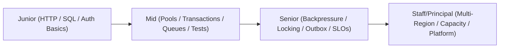
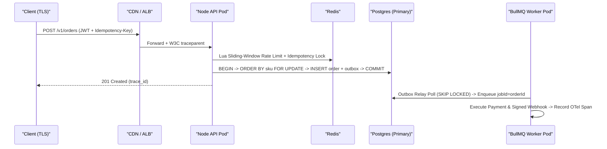

---
tags:
  - programming
  - backend
  - nodejs
  - nestjs
  - architecture
  - roadmap
created: 2026-11-03
updated: 2026-11-13
status: 🟢
level: mid-to-senior
---
# Backend Roadmap & Technologies

> [!abstract] Scope & Vault Architecture
> Complete engineering manual covering career progression (Junior to Senior), runtime/framework/ORM trade-offs, protocol contracts (REST, GraphQL, gRPC, SSE, WebSockets, Webhooks), 12-factor modular monolith operations, end-to-end distributed request tracing, and system troubleshooting. Parent hub: [[Programming/Programming Hub|Programming Hub]].

---

## Core Guides & Vault Map

| Guide | Primary Coverage | Target Depth |
|-------|------------------|--------------|
| [[Programming/Backend/Backend Core (Node, Event Loop, Auth & Concurrency)\|Backend Core (Node, Event Loop, Auth & Concurrency)]] | 6-phase Event Loop, `nextTick` vs microtasks, `UV_THREADPOOL_SIZE`, `stream.pipeline`, V8 heap leaks, `worker_threads`, `undici` pooling, `SIGTERM` drain, OAuth 2.1 + PKCE, JWT traps, Refresh Token Rotation, `Argon2id`, Envelope Encryption, SSRF | Runtime, Security & Systems |
| [[Programming/Backend/NestJS Complete Guide\|NestJS Complete Guide]] | IoC container, custom providers, `ConfigurableModuleBuilder`, cycle elimination, `Scope.REQUEST` bubbling vs `nestjs-cls`, 8-stage Request Lifecycle, DTO boundary validation & serialization, `Reflector` decorators | Framework Internals & DI |
| [[Programming/Backend/NestJS Advanced Guide\|NestJS Advanced Guide]] | N+1 elimination, CLS transaction propagation, pessimistic/optimistic locking, Transactional Outbox, CASL ABAC, Redis rate limiting, BullMQ, cache stampede defense, Socket.IO Redis Adapter, Pino/OTel, Testcontainers | Distributed Data & Production |

### Cross-Domain Dependencies

- **Contracts & Gateway**: [[Programming/Software Engineering/System Design/API Design|API Design]] · [[Programming/Software Engineering/System Design/Rate Limiting|Rate Limiting]]
- **Storage & Locking**: [[Programming/Software Engineering/Database Design/Transactions|Transactions]] · [[Programming/Software Engineering/Database Design/Indexing|Indexing]]
- **Async & Caching**: [[Programming/Software Engineering/System Design/Caching|Caching]] · [[Programming/Software Engineering/System Design/Message Queues|Message Queues]]
- **Operations & Testing**: [[Programming/Software Engineering/DevOps/Observability|Observability]] · [[Programming/Software Engineering/DevOps/Kubernetes|Kubernetes]] · [[Programming/Software Engineering/DevOps/Docker|Docker]] · [[Programming/Software Engineering/DevOps/Logging|Logging]] · [[Programming/Software Engineering/Testing/Integration Testing|Integration Testing]]

---

## 1. Role Progression & Complete Engineering Roadmap

Backend mastery progresses from writing correct single-request CRUD handlers (Junior), to designing bounded, observable, concurrency-safe services (Mid), to governing distributed state invariants, pool budgets, failure isolation, and zero-downtime evolutions across multi-service topologies (Senior).



### Competency Progression Across 7 Core Engineering Domains

| Domain | Junior Deliverable | Mid-Level Deliverable | Senior Ownership & Invariants |
|--------|-------------------|-----------------------|-------------------------------|
| **1. Runtime & Concurrency** | Understands `async/await`, non-blocking I/O, basic error handling, and avoiding `*Sync` file calls in HTTP handlers. | Tunes `pg.Pool` and HTTP Keep-Alive clients; avoids `Scope.REQUEST` anti-patterns; uses `stream/promises` `pipeline()` for file uploads. | Diagnoses `nextTick` starvation, `UV_THREADPOOL_SIZE` / `dns.lookup()` stalls, V8 heap leaks (3-snapshot diffs), cgroup `--max-old-space-size`, and `worker_threads` pools. |
| **2. Persistence & Transactions** | Writes normalized schemas, foreign keys, basic CRUD queries, and parameterized SQL (`$1`) to block SQL injection. | Eliminates N+1 query loops, designs composite B-tree indexes (`EXPLAIN ANALYZE`), and runs multi-step mutations inside ACID transactions. | Propagates transactions via `AsyncLocalStorage`, prevents deadlocks with sorted `FOR UPDATE` locks, handles optimistic `version` retries, and enforces Expand-and-Contract zero-downtime migrations. |
| **3. APIs & Integration** | Builds RESTful JSON routes with HTTP status codes (`200/201/400/404`) and request body schema validation. | Implements cursor pagination, `RFC 9457` Problem Details, `Idempotency-Key` endpoints, and OpenAPI/Protobuf contracts. | Selects REST vs GraphQL vs gRPC vs SSE based on payload/fanout physics; enforces `DataLoader` batching, deadline propagation, and backward-compatible schema versioning. |
| **4. AuthN, AuthZ & Security** | Implements password hashing (`Argon2id`/`bcrypt`), JWT middleware checks, and role checks (`ADMIN` vs `USER`). | Enforces `EdDSA`/`RS256` algorithm allowlists, `HttpOnly; SameSite=Lax` cookies, strict CORS (`Vary: Origin`), and RBAC/ABAC policies. | Architects OAuth 2.1 + PKCE (`S256`), Refresh Token Rotation with `familyId` theft revocation, Envelope Encryption (`AES-256-GCM` DEK/KEK), and DNS-rebinding-proof SSRF egress proxies. |
| **5. Async Queues & Caching** | Uses Redis TTL caching (`GET`/`SETEX`) and pushes background emails to a job queue. | Enforces bounded job retention, exponential backoff + jitter, and cache invalidation on writes. | Eliminates dual-write drift via **Transactional Outbox** (`FOR UPDATE SKIP LOCKED`), assigns deterministic `jobId` deduplication, and prevents cache stampedes via singleflight/XFetch. |
| **6. Observability & Testing** | Writes unit tests with mocks and logs readable error strings with `console.error`. | Outputs structured Pino JSON logs with secret redaction, Prometheus metrics, and `Supertest` integration suites. | Propagates W3C `traceparent` spans across HTTP -> SQL -> BullMQ, separates `/health/live` vs `/health/ready`, writes `Testcontainers` lock/deadlock tests, and defines SLO burn-rate alerts. |
| **7. Deployment & Ops** | Writes basic `Dockerfile` and deploys single container behind reverse proxy. | Configures multi-stage Docker builds, non-root users, env schema validation (`zod`), and CI pipelines. | Orchestrates zero-downtime `SIGTERM` drains (`preStop` + `server.closeIdleConnections()`), HPA scaling math aligned with DB connection budgets, and incident runbooks. |

---

## 2. Modern Backend Stack Architecture & Practical Trade-Offs

### 2.1 Runtime Selection Matrix

Selecting a runtime optimizes **team velocity, tail latency predictability, CPU vs I/O workload profile, and ecosystem leverage**—not benchmark synthetic RPS in isolation.

| Runtime | Concurrency & Memory Model | Strengths & Ideal Fit | Critical Trade-Offs & When NOT to Choose |
|---------|----------------------------|-----------------------|------------------------------------------|
| **Node.js 22 LTS (TypeScript)** | Single JS thread (`V8`) + `libuv` `epoll`/`kqueue` + optional `worker_threads` Isolates. | Unmatched TypeScript end-to-end schema sharing (`zod`/`OpenAPI`/`tRPC`), rich web/SaaS ecosystem, sub-50ms container cold start, fast JSON I/O orchestration. | **Avoid for sustained heavy CPU compute** (video transcoding, linear algebra, heavy ML inference) unless isolated to `worker_threads` or dedicated Rust/Go/Python workers. |
| **Go (`1.23+`)** | M:N green-thread scheduler (`goroutines` starting at 2 KiB stack) + low-pause concurrent tri-color GC. | Predictable sub-millisecond tail latency under high concurrency, static single-binary containers (~15–30 MB), native multi-core CPU + network proxies, Kubernetes/infra tooling. | Slower CRUD business-domain iteration due to verbose error handling and weaker generic type transformations compared to TypeScript. |
| **Python (`FastAPI` + `asyncio`)** | `asyncio` event loop (`uvloop`) per worker process; **GIL** limits parallel CPU inside 1 process (requires `gunicorn` multi-worker pods). | Dominant ecosystem for ML/LLM orchestration (`PyTorch`, `vLLM`, `NumPy`, `Polars`), rapid data APIs. | **Avoid for ultra-high-concurrency pure I/O microservices** if low-RAM per-pod efficiency matters: multiple `uvicorn` worker processes multiply RAM footprint and suffer GIL stalls if sync blocking leaks into `async def` routes. |
| **Java 21+ (`Spring Boot 3`)** | OS threads OR **Virtual Threads** (Project Loom M:N scheduling) + mature G1/ZGC garbage collectors. | Enterprise banking/ledger systems, massive multi-team strict typing, mature Kafka/JVM observability tooling, peak JIT steady-state throughput. | Higher baseline container RAM (250–600 MiB minimum) and slower cold start (unless GraalVM native-image) compared to Go/Node. |

### 2.2 Node.js Web Framework Selection Matrix

| Framework | Architecture & Routing | Validation & Serialization | Optimal Use Case & Anti-Pattern |
|-----------|------------------------|----------------------------|---------------------------------|
| **NestJS 11** (`FastifyAdapter` or `ExpressAdapter`) | Modular IoC DI container (`@Module`, `@Injectable`), 8-stage pipeline (Middleware -> Guard -> Interceptor -> Pipe -> Handler -> Filter). | `class-validator` + `class-transformer` (or `nestjs-zod`). Swap to `FastifyAdapter` when routing/serialization exceeds 5k RPS/pod. | **Use** for medium-to-large B2B/enterprise teams needing enforced module boundaries, OpenAPI generation, and uniform auth/telemetry decorators. **Avoid** for tiny serverless edge functions (~200ms DI boot overhead). |
| **Fastify 5** (Standalone) | Encapsulated plugin tree (`fastify-plugin`), radix-tree router (`find-my-way`), zero-allocation JSON Schema `fast-json-stringify`. | Native **Ajv** JSON Schema + **TypeBox** / Zod (`fastify-type-provider-zod`) compiling schemas into V8-optimized functions. | **Use** for high-throughput API gateways, BFFs, streaming proxies, and lightweight microservices demanding maximum RPS per vCPU without NestJS DI complexity. |
| **Express 5** | Minimalist flat middleware chain (`app.use`), linear route matching. | Manual (`zod`/`joi` middleware) and standard `JSON.stringify`. | **Use** only when maintaining existing legacy Express apps. New greenfield TypeScript services benefit from Fastify's schema speed, native async error safety, and built-in Pino logger. |
| **Hono** | Ultra-lightweight Web Standards (`Request`/`Response`) router (`RegExpRouter`), zero Node-specific globals. | `@hono/zod-validator` + typed RPC client (`hc`). | **Use** for Edge runtimes (Cloudflare Workers, Bun, Deno) or tiny multi-runtime APIs sharing strict RPC types with Next.js frontends. |

### 2.3 ORM & Query Layer Selection Matrix

| Layer | Type Generation & Runtime Footprint | Join / N+1 Behavior | Migration & Raw SQL Ergonomics | Production Trade-Off |
|-------|-------------------------------------|---------------------|--------------------------------|----------------------|
| **Drizzle ORM** | Pure TypeScript SQL-like schema (`pgTable`); **zero binary engine**, tiny ~35 KB bundle. | Explicit relational queries (`with`) compile into lateral joins or batched queries; SQL joins remain transparent. | `drizzle-kit generate` outputs deterministic inspectable `.sql` files; seamless raw `sql` tagged templates. | **Best 2025/2026 default** for new Node/TS microservices needing zero cold-start overhead and complete visibility into PostgreSQL `EXPLAIN` plans. |
| **Prisma 6** | Declarative `schema.prisma` codegen (`@prisma/client`). Rust query engine (`query-engine` or Driver Adapters/WASM). | Default `include` issues batched `WHERE id IN (...)` queries (or `relationLoadStrategy: 'join'` in PostgreSQL). | Declarative `prisma migrate dev/deploy`; requires `$queryRaw` for `FOR UPDATE SKIP LOCKED` or complex CTEs. | Rapid CRUD DX and schema visualization; watch Rust engine memory overhead (~30–60 MiB) and transaction timeouts (`timeout: 5000`). |
| **Kysely** | Pure TypeScript query builder; zero runtime magic or hidden object hydration. | Explicit `.innerJoin()` / `.leftJoin()` exactly matching SQL executed. | Zero hidden migrations (pair with `node-pg-migrate` / `dbmate` / `Atlas`); first-class CTEs, window functions, and `FOR UPDATE`. | Ideal when teams treat SQL as a first-class asset and only want compile-time column/table typo checking. |
| **TypeORM 0.3+** | Decorator-based Active Record / Data Mapper (`@Entity`, `@Column`). | `relations: []` can accidentally trigger Cartesian explosions or N+1 lazy loads if misconfigured. | Migration generator can drift on complex indexes/partials; **never enable `synchronize: true` outside local disposable dev**. | Retain only in existing enterprise NestJS codebases; avoid for greenfield builds over Drizzle/Prisma/Kysely. |

#### Concrete Side-by-Side Comparison: Atomic Order + Outbox Transaction

Below is the identical PostgreSQL ACID transaction—locking inventory rows deterministically (`ORDER BY sku_id FOR UPDATE`), inserting an order, and persisting an outbox event—written in **Drizzle ORM** versus **Prisma 6**:

```typescript
// 1. Drizzle ORM (explicit SQL control, zero external engine binary)
import { drizzle } from 'drizzle-orm/node-postgres';
import { asc, eq, inArray, sql } from 'drizzle-orm';
import { pgTable, uuid, integer, text, jsonb, timestamp } from 'drizzle-orm/pg-core';

export const inventory = pgTable('inventory', {
  skuId: text('sku_id').primaryKey(),
  availableQty: integer('available_qty').notNull(),
});

export const orders = pgTable('orders', {
  id: uuid('id').defaultRandom().primaryKey(),
  userId: uuid('user_id').notNull(),
  totalCents: integer('total_cents').notNull(),
  createdAt: timestamp('created_at', { withTimezone: true }).defaultNow().notNull(),
});

export const outboxEvents = pgTable('outbox_events', {
  id: uuid('id').defaultRandom().primaryKey(),
  eventType: text('event_type').notNull(),
  payload: jsonb('payload').notNull(),
  publishedAt: timestamp('published_at', { withTimezone: true }),
});

export async function placeOrderDrizzle(
  db: ReturnType<typeof drizzle>,
  userId: string,
  items: Array<{ skuId: string; qty: number; unitCents: number }>,
) {
  const sortedSkus = [...items].sort((a, b) => a.skuId.localeCompare(b.skuId));
  return db.transaction(async (tx) => {
    // Deterministic row-lock order prevents SQLSTATE 40P01 deadlocks
    const lockedRows = await tx
      .select()
      .from(inventory)
      .where(inArray(inventory.skuId, sortedSkus.map((i) => i.skuId)))
      .orderBy(asc(inventory.skuId))
      .for('update');

    const stockMap = new Map(lockedRows.map((r) => [r.skuId, r.availableQty]));
    let totalCents = 0;

    for (const item of sortedSkus) {
      const available = stockMap.get(item.skuId) ?? 0;
      if (available < item.qty) {
        throw new Error(`Insufficient stock for SKU ${item.skuId}`);
      }
      totalCents += item.qty * item.unitCents;
      await tx
        .update(inventory)
        .set({ availableQty: sql`${inventory.availableQty} - ${item.qty}` })
        .where(eq(inventory.skuId, item.skuId));
    }

    const [order] = await tx.insert(orders).values({ userId, totalCents }).returning();
    await tx.insert(outboxEvents).values({
      eventType: 'order.created',
      payload: { orderId: order!.id, userId, totalCents },
    });
    return order!;
  });
}
```

```typescript
// 2. Prisma 6 (interactive $transaction + $queryRaw for deterministic FOR UPDATE)
import { Prisma, PrismaClient } from '@prisma/client';

export async function placeOrderPrisma(
  prisma: PrismaClient,
  userId: string,
  items: Array<{ skuId: string; qty: number; unitCents: number }>,
) {
  const sortedSkus = [...items].sort((a, b) => a.skuId.localeCompare(b.skuId));
  const skuIds = sortedSkus.map((i) => i.skuId);

  return prisma.$transaction(
    async (tx) => {
      // Prisma lacks fluent .forUpdate(), so raw SQL inside the interactive tx enforces row locking
      const locked = await tx.$queryRaw<Array<{ sku_id: string; available_qty: number }>>`
        SELECT sku_id, available_qty
        FROM inventory
        WHERE sku_id = ANY(${skuIds}::text[])
        ORDER BY sku_id ASC
        FOR UPDATE
      `;

      const stockMap = new Map(locked.map((r) => [r.sku_id, r.available_qty]));
      let totalCents = 0;

      for (const item of sortedSkus) {
        if ((stockMap.get(item.skuId) ?? 0) < item.qty) {
          throw new Error(`Insufficient stock for SKU ${item.skuId}`);
        }
        totalCents += item.qty * item.unitCents;
        await tx.inventory.update({
          where: { skuId: item.skuId },
          data: { availableQty: { decrement: item.qty } },
        });
      }

      const order = await tx.order.create({ data: { userId, totalCents } });
      await tx.outboxEvent.create({
        data: { eventType: 'order.created', payload: { orderId: order.id, userId, totalCents } },
      });
      return order;
    },
    { isolationLevel: Prisma.TransactionIsolationLevel.ReadCommitted, timeout: 5_000 },
  );
}
```

---

## 3. Protocol & Integration Selection Guide

Choosing between REST, GraphQL, gRPC, SSE, WebSockets, and Webhooks is a systems contract decision governed by **client heterogeneity, caching boundaries, bidirectional framing, and payload efficiency**. See [[Programming/Software Engineering/System Design/API Design|API Design]] for gateway versioning patterns.

| Protocol | Wire Format & Framing | Caching & Browser Support | Streaming Direction | Optimal Fit & Critical Trap |
|----------|-----------------------|---------------------------|---------------------|-----------------------------|
| **REST (OpenAPI 3.1)** | HTTP/1.1 or HTTP/2 + JSON | Native HTTP `ETag`, `Cache-Control`, CDN edge caching; universal client support. | Request/Response | **Default public/B2B API**. Trap: under/over-fetching across nested aggregates unless shaped purposefully; enforce `Idempotency-Key` on writes. |
| **GraphQL** | HTTP `POST` + JSON AST query | Poor HTTP GET CDN caching unless using Automatic Persisted Queries (APQ). | Request/Response + Subscriptions | **BFF aggregating diverse client views** (web/iOS/admin). Trap: **N+1 resolver waterfalls** and deeply nested DoS queries without `DataLoader` + query depth/cost limits. |
| **gRPC** | HTTP/2 binary multiplexing + **Protobuf** (`proto3`) | No direct browser support without `grpc-web` / Envoy proxy; binary schema not human-readable in `curl`. | Unary, Server, Client, & Bi-directional Streaming | **Internal microservice-to-microservice RPC** requiring strict contracts, codegen, ~5–10x smaller wire frames, and **HTTP/2 deadline propagation**. |
| **Server-Sent Events (SSE)** | HTTP/1.1 or HTTP/2 `text/event-stream` | Standard HTTP/TLS, zero custom LB upgrade; native browser `EventSource` auto-reconnect (`Last-Event-ID`). | **Server -> Client** unidirectional | **AI LLM token streaming, live order/build progress, notifications**. Trap: HTTP/1.1 browsers cap 6 concurrent SSE streams per domain (mitigated via HTTP/2). |
| **WebSockets** | Upgraded TCP frame (`ws://` / `wss://`) | Stateful long-lived TCP connections; bypasses HTTP caching; requires sticky sessions or Redis Pub/Sub adapter. | Full-duplex bidirectional | **Low-latency multiplayer, collaborative canvases, live chat**. Trap: broadcasting fails across multiple pods without `@socket.io/redis-adapter`. |
| **Signed Webhooks** | Outbound `POST` JSON + HMAC signature | Asynchronous fire-and-verify delivery; decoupled from client connectivity. | **Server -> External Customer Server** | **Partner event notifications** (`invoice.paid`, `shipment.updated`). Trap: requires exponential retry queues, timestamp replay checks, and SSRF IP blocking. |

### 3.1 REST Contract: `RFC 9457` Problem Details + `Idempotency-Key`

Production REST APIs return machine-parseable `application/problem+json` errors (`RFC 9457`, superseding `RFC 7807`) and enforce `Idempotency-Key` headers on payment/order creation so mobile retries never execute duplicate charges:

```typescript
// src/protocols/rest-idempotency.ts
import type { FastifyReply, FastifyRequest } from 'fastify';
import { createHash } from 'node:crypto';

export interface ProblemDetails {
  type: string;
  title: string;
  status: number;
  detail: string;
  instance: string;
  traceId?: string;
}

export function sendProblem(reply: FastifyReply, problem: ProblemDetails): FastifyReply {
  return reply
    .code(problem.status)
    .header('content-type', 'application/problem+json')
    .send(problem);
}

export async function withIdempotency<T>(
  req: FastifyRequest,
  reply: FastifyReply,
  redis: {
    get: (k: string) => Promise<string | null>;
    set: (k: string, v: string, mode: 'EX', sec: number, nx: 'NX') => Promise<'OK' | null>;
    setEx: (k: string, sec: number, v: string) => Promise<void>;
  },
  handler: () => Promise<{ status: number; body: T }>,
): Promise<FastifyReply> {
  const key = req.headers['idempotency-key'];
  if (typeof key !== 'string' || key.length < 16 || key.length > 128) {
    return sendProblem(reply, {
      type: 'https://api.example.com/errors/missing-idempotency-key',
      title: 'Idempotency-Key Header Required',
      status: 400,
      detail: 'Provide a unique 16-128 character Idempotency-Key header on mutating requests.',
      instance: req.url,
    });
  }

  const bodyDigest = createHash('sha256').update(JSON.stringify(req.body ?? {})).digest('hex');
  const cacheKey = `idem:${req.routerPath}:${key}`;

  const existing = await redis.get(cacheKey);
  if (existing) {
    const parsed = JSON.parse(existing) as { state: string; digest: string; status?: number; body?: T };
    if (parsed.digest !== bodyDigest) {
      return sendProblem(reply, {
        type: 'https://api.example.com/errors/idempotency-payload-mismatch',
        title: 'Idempotency Key Reused With Different Payload',
        status: 422,
        detail: 'An Idempotency-Key cannot be reused with a modified request body.',
        instance: req.url,
      });
    }
    if (parsed.state === 'inflight') {
      return sendProblem(reply, {
        type: 'https://api.example.com/errors/concurrent-idempotent-request',
        title: 'Request In Progress',
        status: 409,
        detail: 'A request with this Idempotency-Key is currently executing.',
        instance: req.url,
      });
    }
    return reply.code(parsed.status!).header('x-idempotent-replayed', 'true').send(parsed.body);
  }

  const locked = await redis.set(cacheKey, JSON.stringify({ state: 'inflight', digest: bodyDigest }), 'EX', 60, 'NX');
  if (locked !== 'OK') {
    return reply.code(409).send({ error: 'concurrent_request' });
  }

  const result = await handler();
  await redis.setEx(
    cacheKey,
    86_400,
    JSON.stringify({ state: 'completed', digest: bodyDigest, status: result.status, body: result.body }),
  );
  return reply.code(result.status).send(result.body);
}
```

### 3.2 GraphQL Contract: Request-Scoped `DataLoader` Batching

Without request-scoped batching, resolving `orders { customer { email } }` over 100 orders executes `1 + 100 = 101` SQL queries. Instantiate a fresh `DataLoader` **per incoming GraphQL HTTP request** inside `context` (never globally—a singleton `DataLoader` leaks stale or cross-tenant records across requests!). Pair with an Automatic Persisted Queries (APQ) hash allowlist and depth limit (`<= 7`) in production:

```typescript
// src/protocols/graphql-dataloaders.ts
import DataLoader from 'dataloader';

export interface CustomerRecord {
  id: string;
  email: string;
  tier: string;
}

export function createGraphQLContext(customerRepo: {
  findManyByIds: (ids: readonly string[]) => Promise<CustomerRecord[]>;
}) {
  // Created fresh per HTTP request -> zero cross-request cache pollution
  const customerByIdLoader = new DataLoader<string, CustomerRecord | null>(
    async (ids) => {
      const rows = await customerRepo.findManyByIds(ids);
      const map = new Map(rows.map((r) => [r.id, r]));
      // DataLoader invariant: output array length & order MUST match input `ids` exactly
      return ids.map((id) => map.get(id) ?? null);
    },
    { maxBatchSize: 250 },
  );

  return { loaders: { customerById: customerByIdLoader } };
}
```

### 3.3 gRPC Contract: Protobuf Schema & HTTP/2 Deadline Propagation

In multi-hop microservice trees (`Gateway -> Orders -> Billing -> Ledger`), omitting gRPC deadlines lets downstream stalled threads accumulate work for clients whose browser/LB already disconnected 20 seconds ago. Always propagate remaining deadline budgets:

```protobuf
// proto/billing/v1/billing.proto
syntax = "proto3";
package billing.v1;

service BillingService {
  rpc ChargeOrder (ChargeOrderRequest) returns (ChargeOrderResponse);
}

message ChargeOrderRequest {
  string order_id = 1;
  string customer_id = 2;
  int64 amount_cents = 3;
  string currency = 4;
  string idempotency_key = 5;
}

message ChargeOrderResponse {
  string charge_id = 1;
  string status = 2; // "SUCCEEDED" | "FAILED"
}
```

```typescript
// src/protocols/grpc-deadline-client.ts
import type { Metadata } from '@grpc/grpc-js';

/**
 * Computes a bounded child RPC deadline so cascading microservice hops
 * abort synchronously if the parent HTTP request budget has already elapsed.
 */
export function buildChildRpcCallOptions(parentDeadlineMs: number, hopBudgetMs = 2_000): {
  deadline: Date;
  metadata?: Metadata;
} {
  const remainingMs = parentDeadlineMs - Date.now();
  if (remainingMs <= 50) {
    throw new Error('Upstream request deadline already exhausted; aborting downstream RPC');
  }
  const effectiveTimeoutMs = Math.min(remainingMs - 25, hopBudgetMs);
  return { deadline: new Date(Date.now() + effectiveTimeoutMs) };
}
```

### 3.4 SSE Streaming vs WebSockets vs Signed Webhooks

For unidirectional feeds (AI token streaming, CI logs, order state transitions), **Server-Sent Events (`text/event-stream`)** eliminate WebSocket sticky-session complexity, run over standard HTTP/2 multiplexing, and support automatic client reconnection with **`Last-Event-ID`** replay:

```typescript
// src/protocols/sse-stream.route.ts
import type { FastifyInstance } from 'fastify';
import { on } from 'node:events';

export interface OrderStatusEvent {
  seqId: string;
  status: string;
  updatedAt: string;
}

export function registerOrderSseRoute(
  app: FastifyInstance,
  eventBus: NodeJS.EventEmitter,
  fetchMissedEventsSince: (orderId: string, lastEventId: string) => Promise<OrderStatusEvent[]>,
): void {
  app.get<{ Params: { orderId: string } }>('/v1/orders/:orderId/events', async (req, reply) => {
    const { orderId } = req.params;
    const lastEventId = req.headers['last-event-id'];

    reply.raw.writeHead(200, {
      'content-type': 'text/event-stream; charset=utf-8',
      'cache-control': 'no-cache, no-transform',
      'connection': 'keep-alive',
      'x-accel-buffering': 'no', // Disable Nginx/Envoy proxy response buffering!
    });

    const ac = new AbortController();
    req.raw.on('close', () => ac.abort());

    // Heartbeat comment prevents idle proxy/ALB disconnects every 15s
    const heartbeat = setInterval(() => {
      if (!reply.raw.writableEnded) reply.raw.write(': keep-alive\n\n');
    }, 15_000);
    heartbeat.unref();

    try {
      if (typeof lastEventId === 'string' && lastEventId.length > 0) {
        const missed = await fetchMissedEventsSince(orderId, lastEventId);
        for (const ev of missed) {
          reply.raw.write(`id: ${ev.seqId}\nevent: order_status\ndata: ${JSON.stringify(ev)}\n\n`);
        }
      }

      // Async iterator with AbortSignal cleans up EventEmitter listener automatically on disconnect
      for await (const [ev] of on(eventBus, `order:${orderId}`, { signal: ac.signal })) {
        const typed = ev as OrderStatusEvent;
        const ok = reply.raw.write(`id: ${typed.seqId}\nevent: order_status\ndata: ${JSON.stringify(typed)}\n\n`);
        if (!ok) {
          await new Promise<void>((res) => reply.raw.once('drain', res));
        }
      }
    } catch (err) {
      if ((err as Error).name !== 'AbortError') throw err;
    } finally {
      clearInterval(heartbeat);
      if (!reply.raw.writableEnded) reply.raw.end();
    }
  });
}
```

---

## 4. Production Modular Monolith Layout & 12-Factor Operational Baseline

### 4.1 Modular Monolith Folder Structure & Boundary Rules

Before splitting a system into distributed microservices (which introduces network serialization latency, distributed transactions, and split deployments), organize services as a **Modular Monolith**: domain modules run in one deployable runtime while enforcing strict compile-time encapsulation. **Rule**: `OrdersModule` may import `BillingFacade` (the public API port of `BillingModule`) or subscribe to outbox domain events—it may **never** import `BillingRepository` or join `billing_*` tables directly.

```text
backend-api/
  src/
    config/
      env.ts                   # Fail-fast Zod validation of process.env at boot
    modules/
      auth/                    # OAuth 2.1, JWT JWKS, Refresh Token Rotation
      orders/
        orders.controller.ts   # HTTP validation & Problem Details mapping
        orders.service.ts      # Business invariants & transaction orchestration
        orders.repository.ts   # SQL / Drizzle queries (module-private!)
        orders.facade.ts       # Public cross-module contract
      billing/
    shared/
      db/                      # pg.Pool, AsyncLocalStorage TxContext, Outbox relay
      http/                    # undici Pools, SSRF-safe webhook client, Rate Limiter
      telemetry/               # Pino logger, OTel tracer, Prometheus loop metrics
    workers/
      bullmq-consumer.ts       # Separate entrypoint for isolated Worker Pods
      outbox-relay.worker.ts
    app.ts                     # Route/DI wiring
    main.ts                    # Boot validation, port bind, SIGTERM drain
  db/migrations/               # Forward-only SQL migrations
  test/
    unit/                      # Pure domain invariant specs
    integration/               # Supertest + Testcontainers (Postgres + Redis)
  Dockerfile                   # Multi-stage non-root runtime image
  package.json
```

### 4.2 12-Factor Operational Configs (Env Validation, Structured Logging & Container Spec)

#### 1. Fail-Fast Boot Environment Validation (`src/config/env.ts`)

Never allow missing secrets or malformed pool sizes to surface as runtime `TypeError`s 3 hours after deployment. Parse and freeze configuration before opening database pools or binding HTTP ports:

```typescript
// src/config/env.ts
import { z } from 'zod';

const EnvSchema = z.object({
  NODE_ENV: z.enum(['development', 'test', 'production']),
  PORT: z.coerce.number().int().min(1).max(65535).default(3000),
  DATABASE_URL: z.string().url(),
  DB_POOL_MAX: z.coerce.number().int().min(2).max(50).default(10),
  REDIS_URL: z.string().url(),
  OIDC_ISSUER: z.string().url(),
  OIDC_AUDIENCE: z.string().min(1),
  LOG_LEVEL: z.enum(['debug', 'info', 'warn', 'error']).default('info'),
});

export type AppEnv = Readonly<z.infer<typeof EnvSchema>>;

export function loadValidatedEnv(source: NodeJS.ProcessEnv = process.env): AppEnv {
  const parsed = EnvSchema.safeParse(source);
  if (!parsed.success) {
    const details = parsed.error.issues.map((i) => `${i.path.join('.')}: ${i.message}`).join('; ');
    throw new Error(`Invalid startup environment configuration: ${details}`);
  }
  return Object.freeze(parsed.data);
}
```

#### 2. Non-Blocking Structured JSON Logging (`pino` + OTel Trace Correlation + Redaction)

```typescript
// src/shared/telemetry/logger.ts
import pino from 'pino';
import { trace } from '@opentelemetry/api';

export function createAppLogger(level: string) {
  return pino({
    level,
    base: { service: 'orders-api', env: process.env.NODE_ENV },
    redact: {
      paths: [
        'req.headers.authorization',
        'req.headers.cookie',
        '*.password',
        '*.refreshToken',
        '*.clientSecret',
      ],
      censor: '[REDACTED]',
    },
    mixin() {
      const span = trace.getActiveSpan();
      if (!span) return {};
      const ctx = span.spanContext();
      return { trace_id: ctx.traceId, span_id: ctx.spanId };
    },
  });
}
```

#### 3. Hardened Multi-Stage Non-Root `Dockerfile`

```dockerfile
FROM node:22-alpine AS builder
WORKDIR /app
COPY package*.json ./
RUN npm ci
COPY tsconfig.json ./
COPY src ./src
RUN npm run build && npm prune --omit=dev

FROM node:22-alpine AS runner
WORKDIR /app
ENV NODE_ENV=production
# 70% of 2 GiB Kubernetes pod limit + non-blocking DNS/threadpool headroom
ENV NODE_OPTIONS="--max-old-space-size=1400"
ENV UV_THREADPOOL_SIZE=16

RUN addgroup -S appgroup && adduser -S appuser -G appgroup
COPY --from=builder --chown=appuser:appgroup /app/node_modules ./node_modules
COPY --from=builder --chown=appuser:appgroup /app/dist ./dist
USER appuser

EXPOSE 3000
CMD ["node", "dist/main.js"]
```

#### 4. Health Probes, Connection Budgets & SLO Error Budgets
- **Probe Separation**: `/health/live` verifies **only** that the Node process event loop is responsive (`200 OK` unconditionally unless shut down—**never** query Postgres/Redis here, otherwise a 2s DB failover restarts every API pod simultaneously in a crash loop!). `/health/ready` checks `SELECT 1`, Redis `PING`, and shutdown state (`503` immediately on `SIGTERM`).
- **SLO & Error Budget Baseline**: Define availability (`99.9%` monthly = `43.2 min` budget) and latency (`p99 < 250 ms` on core checkout routes). Alert on **multi-window burn rates** (e.g., consuming > 2% of monthly error budget within 1 hour) rather than noisy single-request spikes.

---

## 5. End-to-End Production Request Flow Trace (`POST /v1/orders`)

Tracing a real checkout request across network, runtime, persistence, async worker, and observability planes clarifies how every architectural mechanism interlocks:



1. **Edge & Transport (`0–8 ms`)**: Client sends `POST /v1/orders` with `Authorization: Bearer <EdDSA JWT>` and `Idempotency-Key: <uuid>`. CDN/ALB terminates TLS 1.3, injects `X-Forwarded-For` and W3C `traceparent` (`00-<traceId>-<parentSpanId>-01`), and forwards over persistent HTTP/1.1 or HTTP/2 Keep-Alive to an API pod passing `/health/ready`.
2. **Rate Limiting & Edge Auth (`8–12 ms`)**: Fastify/NestJS Guard executes an atomic **Redis Lua sliding-window script** keyed on `userId` (`429 Retry-After` if exceeded), validates the JWT offline via cached `JWKS` public key (`algorithms: ['EdDSA']`, `iss`, `aud`), and validates the JSON body strictly via `Zod`/`Ajv` (`400 Problem Details` on invalid input).
3. **Idempotency Gate (`12–14 ms`)**: Server checks Redis `idem:/v1/orders:<key>`. Duplicate retry payloads return cached `201`; mismatched payload digests fail with `422`.
4. **ACID Persistence & Outbox (`14–28 ms`)**: Inside a single PostgreSQL transaction propagated via `AsyncLocalStorage`, the service locks inventory rows sorted lexicographically (`ORDER BY sku_id ASC FOR UPDATE`), decrements stock, inserts the `orders` row, and inserts an `outbox_events` row (`event_type = 'order.created'`). `COMMIT` returns durable state immediately—**zero Stripe/SendGrid HTTP calls ever hold DB locks open!**
5. **Async Offloading & Idempotent Worker (`28–250 ms`, async)**: A separate Outbox Relay claims unpublished rows using `FOR UPDATE SKIP LOCKED`, enqueues a BullMQ job with deterministic `jobId: order.id`, and an isolated **Worker Pod** charges the payment provider passing `Idempotency-Key: order.id`, then dispatches partner webhooks via `ssrfSafeAgent`.
6. **Observability Correlation**: OpenTelemetry stitches child spans (`http.server` -> `redis.eval` -> `pg.transaction` -> `bullmq.send` -> `worker.process`) under the single `traceId`; Pino logs JSON lines carrying `{ trace_id, orderId }`; Prometheus collects HTTP duration histograms (`http_request_duration_seconds`) and `nodejs_eventloop_lag_p99_seconds`.

---

## 6. Mid-to-Senior Readiness Checklist & Worked Exercises

### Readiness Verification Checklist
- [ ] Trace exact execution priority across `libuv` 6 phases, `process.nextTick()`, Promise microtasks, and `setImmediate()`.
- [ ] Size container `--max-old-space-size` (`<= 70%` cgroup limit), `UV_THREADPOOL_SIZE`, and `pg.Pool` `max` relative to HPA max replicas.
- [ ] Compose memory-bounded streaming ETL via `stream/promises` `pipeline()` + `AbortController` + Web Streams interop.
- [ ] Enforce `EdDSA`/`RS256` JWKS pinning, OAuth 2.1 + PKCE (`S256`), Refresh Token Rotation (`familyId`), `Argon2id`, `AES-256-GCM` envelopes, and DNS-rebinding-proof SSRF egress blocking.
- [ ] Select REST vs GraphQL vs gRPC vs SSE vs WebSockets vs Webhooks using payload/fanout/caching physics rather than hype.
- [ ] Eliminate dual-write drift via Transactional Outbox (`FOR UPDATE SKIP LOCKED`) + deterministic `jobId` + `Idempotency-Key`.

---

### Exercise 1: Stack & Protocol Selection Under Hard Constraints
A logistics platform is designing three distinct backend services:
1. **Service A (Customer Order & Billing ERP)**: Managed by a 16-developer TypeScript team sharing strict validation schemas with a Next.js dashboard; requires rich domain permissions, multi-step ACID transactions, and partner webhooks.
2. **Service B (GPS Telemetry Ingestor)**: Receives 85,000 small binary pings/second from IoT truck modems with sub-5ms `p99` tail-latency budget and strict container memory limits.
3. **Service C (Live Delivery Tracker Feed)**: Streams real-time shipment status updates from backend to 40,000 open browser tabs; updates flow strictly server-to-client, and mobile browsers regularly drop/reconnect across cell towers.

For each service, choose the **Runtime, Web Framework, ORM/Persistence layer, and Protocol**, justifying why alternatives are rejected.

### Solution 1
1. **Service A (Customer Order & Billing ERP)**:
   - **Choice**: **Node.js 22 (TypeScript) + NestJS 11 (`FastifyAdapter`) + Drizzle ORM (or Prisma 6) + REST (OpenAPI 3.1 + Problem Details) + Signed Webhooks**.
   - **Rationale**: 16 engineers benefit from NestJS's enforced module encapsulation, DI lifecycle, and shared TS/Zod contracts with Next.js. Drizzle/Prisma give strong transaction + SQL migration rigor without excessive boilerplate. REST leverages HTTP caching and standard partner webhook integrations. Go or raw Express would force unnecessary boilerplate or weak boundary enforcement across 16 developers.
2. **Service B (GPS Telemetry Ingestor)**:
   - **Choice**: **Go (`1.23+`) `net/http` + gRPC/Protobuf (or raw binary UDP/TCP) + batched `pgx` COPY / Kafka producer**.
   - **Rationale**: At 85,000 RPS with `< 5 ms p99` tail latency and tight RAM, Go's M:N goroutine scheduler across all cores, zero-allocation Protobuf unmarshaling, and non-stop-the-world GC outperform single-threaded Node.js/V8 Major GC compaction pauses and Python's multi-process memory overhead.
3. **Service C (Live Delivery Tracker Feed)**:
   - **Choice**: **Node.js 22 + Fastify 5 + Redis Pub/Sub + Server-Sent Events (SSE over HTTP/2)**.
   - **Rationale**: Data flows strictly server-to-client. SSE avoids WebSocket upgrade/sticky-session overhead, multiplexes cleanly over HTTP/2, and provides native browser `EventSource` automatic reconnection carrying `Last-Event-ID`—allowing exact missed-event replay on flaky cellular connections without custom client retry state machines.

---

### Exercise 2: Multi-Symptom Production Degradation Triage
A NestJS API pod running on Node 22 (`2 vCPUs`, `2 GiB RAM`) exhibits three failures under peak load:
1. Event loop lag spikes from 2 ms to **4,200 ms** whenever 20 users simultaneously upload 15 MB CSVs and trigger password resets (`crypto.scrypt`).
2. Pod RSS grows linearly until Kubernetes kills the container with **`Exit 137` (`OOMKilled`)**.
3. `GET /health/live` latency exceeds the 2-second probe timeout (because it runs `SELECT 1`), triggering a cluster-wide pod restart cascade.

Diagnose all four underlying defects and provide the exact configuration + architectural remediation.

### Solution 2
1. **Defect 1 (`libuv` Thread Pool Exhaustion)**: Concurrent `crypto.scrypt` password resets (~80 ms each), `fs` operations, and default `dns.lookup()` compete for the **4-thread `libuv` pool**, blocking disk/DNS across the app at low OS CPU %. **Fix**: Move `Argon2id`/`scrypt` to a bounded `worker_threads` pool (`piscina` or `BoundedWorkerPool` with `maxQueue`), rate-limit auth endpoints, and switch outbound HTTP to cached `c-ares` DNS resolution.
2. **Defect 2 (Unbounded Memory Buffering / Ignored Backpressure)**: Materializing 15 MB CSVs into strings/arrays instead of streaming via `stream/promises` `pipeline()` retains massive buffers in External/Old Space. **Fix**: Stream CSV parsing row-by-row via `Transform` (`highWaterMark: 64 * 1024`) inside `pipeline()`.
3. **Defect 3 (Missing Cgroup V8 Heap Ceiling)**: Without `--max-old-space-size`, V8 tries to expand Old Space too close to the `2048 MiB` cgroup limit, leaving zero headroom for native `Buffer`s and `scrypt`/`Argon2id` allocations -> Linux `SIGKILL (137)`. **Fix**: Set `NODE_OPTIONS="--max-old-space-size=1400"` (~70% of 2 GiB).
4. **Defect 4 (Liveness Probe Anti-Pattern)**: Running `SELECT 1` inside `/health/live` restarts healthy pods during transient DB spikes or event loop blips, piling traffic onto surviving pods in a domino collapse. **Fix**: Make `/health/live` dependency-free (`200 OK` immediately) and move DB/Redis readiness checks exclusively to `/health/ready`.

---

### Exercise 3: Dual-Write Divergence & Duplicate Billing Side Effects
A `CheckoutService` saves an `Order` in PostgreSQL, then immediately calls `bullmqQueue.add('charge-card', { orderId, amount })`. Mobile client retries occasionally charge customers twice, and during a 30-second Redis blip, 18 committed PostgreSQL orders never triggered billing jobs. Engineer the exact atomic persistence, outbox relay, and consumer idempotency implementation.

### Solution 3
1. **Remove Direct Broker Writes From Request Path**: Persist both `orders` and `outbox_events` inside one PostgreSQL ACID transaction so commits and rollbacks are strictly atomic.
2. **Concurrent-Safe Outbox Relay (`SKIP LOCKED`)**: Multiple relay replicas claim unpublished batches with `FOR UPDATE SKIP LOCKED`, enqueuing BullMQ jobs keyed with deterministic `jobId: \`charge:\${orderId}\`` (Redis deduplicates duplicate `jobId`s atomically).
3. **End-to-End Payment Idempotency**: Consumer workers record a unique payment-attempt constraint on `order_id` in PostgreSQL AND pass `Idempotency-Key: orderId` to the external payment gateway so crash-recovery retries never double-charge.

```typescript
// Outbox relay worker + idempotent BullMQ billing consumer
import type { Pool } from 'pg';
import type { Queue, Job } from 'bullmq';

export async function relayOutboxBatch(pgPool: Pool, billingQueue: Queue): Promise<number> {
  const client = await pgPool.connect();
  try {
    await client.query('BEGIN');
    const { rows } = await client.query<{
      id: string;
      event_type: string;
      payload: { orderId: string; userId: string; totalCents: number };
    }>(`
      WITH claimed AS (
        SELECT id FROM outbox_events
        WHERE published_at IS NULL
        ORDER BY created_at ASC
        LIMIT 100
        FOR UPDATE SKIP LOCKED
      )
      UPDATE outbox_events o
      SET published_at = NOW()
      FROM claimed c
      WHERE o.id = c.id
      RETURNING o.id, o.event_type, o.payload
    `);

    if (rows.length > 0) {
      await billingQueue.addBulk(
        rows.map((r) => ({
          name: r.event_type,
          data: r.payload,
          opts: {
            jobId: `charge:${r.payload.orderId}`, // Deterministic Redis deduplication
            attempts: 5,
            backoff: { type: 'exponential', delay: 1_000 },
            removeOnComplete: { count: 1000 },
          },
        })),
      );
    }
    await client.query('COMMIT');
    return rows.length;
  } catch (err) {
    await client.query('ROLLBACK');
    throw err;
  } finally {
    client.release();
  }
}

export async function processChargeJob(
  job: Job<{ orderId: string; totalCents: number }>,
  chargeGateway: (req: { orderId: string; amountCents: number; idempotencyKey: string }) => Promise<void>,
): Promise<void> {
  await chargeGateway({
    orderId: job.data.orderId,
    amountCents: job.data.totalCents,
    idempotencyKey: `order-charge-${job.data.orderId}`,
  });
}
```

---

### Exercise 4: Protocol Refactoring — Eliminating a GraphQL N+1 Waterfall & Polling Storm
A SaaS dashboard exhibits two performance failures:
1. A GraphQL query fetching 50 invoices with `{ invoices { id customer { name } lineItems { sku } } }` triggers **101 PostgreSQL queries** per request, stalling API threads at 150 RPS.
2. Meanwhile, 12,000 open browser clients poll `GET /v1/jobs/:id` every `1,000 ms` (`12,000 RPS` baseline waste) waiting for report exports that take 10–40 seconds to finish.

Refactor both defects using `DataLoader` request-scoped batching and reconnectable HTTP/2 Server-Sent Events (`Last-Event-ID`).

### Solution 4
1. **Fix 1 (GraphQL N+1 Elimination)**: Replace per-invoice resolver calls (`customerRepo.findById(invoice.customerId)`) with request-scoped `DataLoader`s constructed fresh inside the GraphQL `context` factory (as demonstrated in `createGraphQLContext` in Section 3.2), collapsing 50 customer queries + 50 line-item queries into **2** batched SQL queries (`WHERE customer_id = ANY($1)` and `WHERE invoice_id = ANY($1)`).
2. **Fix 2 (Replace Aggressive 1s Polling with Reconnectable SSE)**: Expose `GET /v1/jobs/:jobId/events` returning `Content-Type: text/event-stream`, streaming completion events from Redis Pub/Sub (`on(bus, ...)` with `AbortSignal`), sending `: keep-alive\n\n` heartbeats every 15s, and replaying missed state transitions when clients reconnect with `Last-Event-ID`. Because 12,000 idle SSE connections consume only ~30–40 MiB of socket state across Node `epoll` loops instead of 12,000 JSON auth/DB polling cycles per second, database and CPU load drop by > 95%.

```typescript
// Batched DataLoader for 1-to-many lineItems + SSE status endpoint integration
import DataLoader from 'dataloader';

export interface LineItemRow {
  id: string;
  invoiceId: string;
  sku: string;
  qty: number;
}

export function createLineItemsByInvoiceLoader(
  fetchByInvoiceIds: (invoiceIds: readonly string[]) => Promise<LineItemRow[]>,
): DataLoader<string, LineItemRow[]> {
  return new DataLoader<string, LineItemRow[]>(async (invoiceIds) => {
    const allItems = await fetchByInvoiceIds(invoiceIds);
    const grouped = new Map<string, LineItemRow[]>();
    for (const item of allItems) {
      const bucket = grouped.get(item.invoiceId);
      if (bucket) bucket.push(item);
      else grouped.set(item.invoiceId, [item]);
    }
    // Preserve exact input array length/order required by DataLoader contract
    return invoiceIds.map((id) => grouped.get(id) ?? []);
  });
}
```
