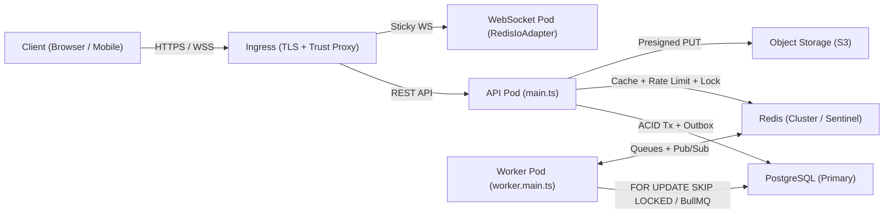
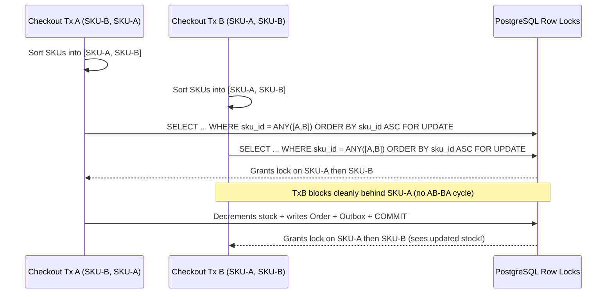
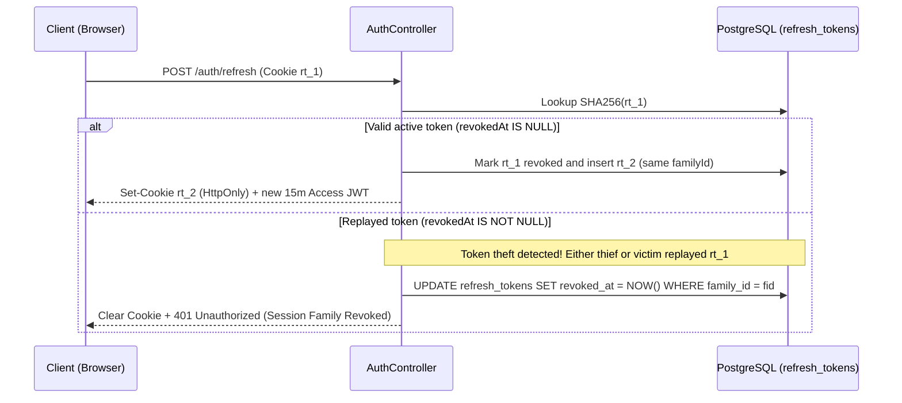
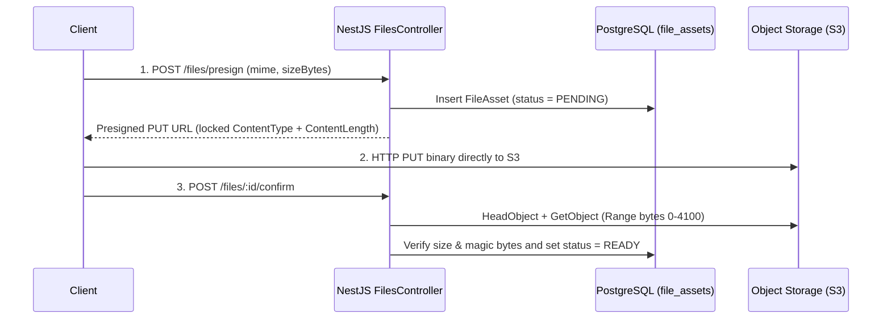
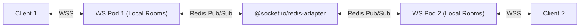
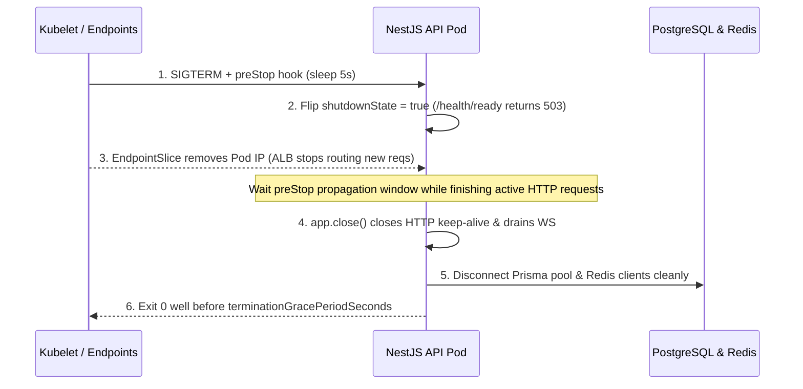

---
tags:
  - programming
  - backend
  - nestjs
  - postgresql
  - redis
  - bullmq
  - observability
  - testing
created: 2026-01-04
updated: 2026-11-13
status: 🟢
level: mid-to-senior
---
# NestJS Advanced Guide

> [!abstract] Handbook Scope
> This handbook covers production NestJS distributed systems engineering end-to-end: multi-tenant PostgreSQL persistence with both Prisma and TypeORM, zero-downtime migrations, keyset cursor pagination, `AsyncLocalStorage` transaction propagation, optimistic and deterministic pessimistic concurrency, the Transactional Outbox pattern, Argon2id + asymmetric JWT + rotating refresh token reuse detection, attribute-based access control via CASL, Redis-backed rate limiting, magic-byte-verified and direct-to-S3 uploads, standalone BullMQ workers, stampede-resistant multi-tier caching, multi-pod Socket.IO scaling, OpenTelemetry and Pino observability, Kubernetes health probes and `SIGTERM` draining, and real-container `Testcontainers` + `Supertest` E2E verification. Foundational IoC container mechanics, custom providers, and the 8-stage execution pipeline are covered in [[Programming/Backend/NestJS Complete Guide|NestJS Complete Guide]] and [[Programming/Backend/Backend Core (Node, Event Loop, Auth & Concurrency)|Backend Core (Node, Event Loop, Auth & Concurrency)]].

---

## 1. Production Architecture & Decision Matrix

### Process Separation & Execution Topology

A NestJS codebase scales operationally by separating **transport concerns** from **asynchronous compute** at the process entrypoint level while sharing domain modules, repositories, and configuration contracts inside a single repository. Running HTTP API handlers, WebSocket connection fans, and CPU- or I/O-heavy BullMQ job processors inside one container creates three immediate failure modes:

1. **Event-Loop Contention**: Synchronous PDF generation, image decoding, or large JSON serialization inside a queue worker stalls `libuv` callback polling on the same V8 isolate, inflating HTTP `p99` latency for unrelated API routes.
2. **Incompatible Autoscaling Signals**: Horizontal Pod Autoscalers (HPA) scale HTTP pods on CPU or requests-per-second, whereas worker pods need to scale on queue depth (KEDA BullMQ lag) and require longer Kubernetes `terminationGracePeriodSeconds` to drain active jobs cleanly.
3. **Connection Pool Exhaustion**: Combining HTTP concurrency and worker concurrency inside every replica multiplies active PostgreSQL and Redis blocking connections against `max_connections` limits.



Under this layout, `src/main.ts` bootstraps `AppModule` with `NestFactory.create(...)` for HTTP traffic, while `src/worker.main.ts` bootstraps `WorkerAppModule` with `NestFactory.createApplicationContext(...)` without binding an HTTP socket (except an optional lightweight `/health/live` probe port if running on Kubernetes without exec probes). Both entrypoints enable `app.enableShutdownHooks()` so `SIGTERM` triggers deterministic teardown across pools and workers.

```text
prisma/
  schema.prisma
  migrations/
    202611130001_init/migration.sql
src/
  otel.ts                         # Loaded first via --import or top import
  main.ts                         # HTTP + WebSocket pod entrypoint
  worker.main.ts                  # Standalone BullMQ + Outbox worker entrypoint
  app.module.ts                   # HTTP API root module (APP_GUARD, controllers, queues producer)
  worker-app.module.ts            # Worker root module (OutboxRelayService, @Processor workers)
  prisma/
    prisma.module.ts
    prisma.service.ts             # Slow-query logging + $extends soft-delete filter
    tx-context.service.ts         # AsyncLocalStorage transaction propagation
  auth/
    auth.module.ts
    auth.controller.ts
    auth.service.ts               # Argon2id + RS256 access + SHA-256 opaque rotating refresh
    strategies/jwt.strategy.ts
    guards/jwt-auth.guard.ts
    decorators/{public,current-user}.decorator.ts
  casl/
    casl-ability.factory.ts
    policies.guard.ts
    check-policies.decorator.ts
  orders/
    orders.controller.ts
    orders.service.ts
    orders.read-repository.ts
  invoices/
    invoices.controller.ts
    invoices.repository.ts
  files/
    files.controller.ts
    presigned-files.service.ts
    streaming-upload.service.ts
  queues/
    queues.module.ts
    domain-events.producer.ts
    domain-events.processor.ts
  outbox/
    outbox-relay.service.ts
  cache/
    distributed-cache.service.ts
  realtime/
    redis-io.adapter.ts
    events.gateway.ts
    ws-validation.filter.ts
  health/
    health.controller.ts
  observability/
    logging.module.ts
test/
  unit/{casl-ability.factory,orders.service}.spec.ts
  e2e/production-flows.e2e-spec.ts
```

### Real-World Use Cases & Architectural Decision Matrix

Selecting the wrong primitive in NestJS rarely breaks development tests; it fails under multi-pod concurrency, network partitions, or database load spikes. Evaluate the following six architectural boundaries before writing module wiring.

| Decision Axis | Primary Production Option | Alternative Option | Adopt Primary When | Avoid Primary / Choose Alternative When | Concrete Trade-Off |
|---|---|---|---|---|---|
| **ORM / Data Layer** | **Prisma** (Schema-first, generated types, `$extends`) | **TypeORM** (`DataSource`, entities, `QueryBuilder`) | Rapid schema iteration, strict compile-time projection types, teams comfortable dropping to `$queryRaw` for `FOR UPDATE` and keyset SQL | Complex polymorphic entity graphs, dynamic runtime query construction, or legacy codebase already anchored on active-record/repository decorators | Prisma eliminates runtime reflection overhead on queries, but complex SQL locks and partial updates require explicit `$queryRaw` calls; TypeORM exposes `QueryBuilder` natively, yet entity hydration and decorator coupling invite N+1 and schema drift traps if misused. |
| **Transaction Propagation** | **`AsyncLocalStorage` (`TxContext` / `@nestjs-cls/transactional`)** | Explicit `tx` / `EntityManager` parameter threading | Deep service-to-service orchestration (`OrdersService` -> `InventoryRepo` -> `OutboxRepo`) where every caller must enlist in one ACID boundary cleanly | Single-method transactions or teams requiring explicit compile-time visibility of transactional boundaries on every repository signature | ALS avoids polluting domain interfaces and prevents silent connection leaks from forgotten `tx` arguments, at the cost of ensuring all async hooks preserve context across `EventEmitter` or custom promise queues. |
| **Concurrency Control** | **Optimistic Locking (`version` column)** | **Deterministic Pessimistic Locking (`ORDER BY ... FOR UPDATE`)** | Low-to-moderate write contention, multi-step UI edits, idempotent state transitions | High-contention hot rows (flash-sale inventory SKUs, ledger balances) where retries under conflict saturate CPU and DB I/O | Optimistic locking holds zero row locks across reads and scales reads linearly, but high contention causes 409 retry storms; pessimistic locking serializes writers cleanly via MVCC row locks provided keys are locked in strict ascending order to prevent `40P01` deadlocks. |
| **Reliable Event Dispatch** | **Transactional Outbox (`FOR UPDATE SKIP LOCKED` / CDC)** | Dual-write (`await repo.save()` then `await queue.add()`) or in-process `EventEmitter2` | Any state change that must reliably trigger billing, emails, search indexing, or cross-service workflows | Ephemeral side effects acceptable to lose on pod crash (in-memory metrics counters, non-critical trace flush) | Dual-writes break atomicity when Redis blips after Postgres commits; Transactional Outbox guarantees at-least-once delivery at the expense of an extra `outbox_events` table and polling/CDC relay latency (typically 50-500 ms). |
| **Binary File Ingestion** | **Direct-to-S3 Presigned PUT + Server Verification** | API Multipart Streaming (`busboy` -> S3 `Upload`) | User uploads > 5 MB, high concurrent uploads (video, PDFs, bulk CSVs), Kubernetes pods with tight memory limits | Strict synchronous antivirus/OCR inspection required *before* bytes may touch object storage, or private VPCs unreachable from client browsers | Presigned PUT removes 100% of binary bandwidth and V8 memory pressure from NestJS pods, requiring a two-step intent/confirm flow and post-upload `HeadObject` + magic-byte validation. |
| **Real-Time Transport** | **Socket.IO + `@socket.io/redis-adapter`** | Server-Sent Events (SSE `@Sse()`) or raw `ws` | Bi-directional low-latency messaging (chat, collaborative state, presence) across multiple Kubernetes replicas | Server-to-client-only notification streams, dashboards, or LLM token streaming where HTTP/2 multiplexing suffices | Socket.IO manages rooms, acknowledgments, and reconnection natively but requires sticky sessions during HTTP polling upgrades and Redis pub/sub fan-out; SSE works over standard HTTP without sticky sessions or pub/sub adapters for read-only streams. |

---

## 2. Persistence Deep Dive: Prisma and TypeORM in Production

### Multi-Tenant Production Schema Design (Prisma + PostgreSQL)

A production multi-tenant schema must model ownership boundaries, concurrency version counters, soft-delete semantics without breaking uniqueness, keyset pagination composite indexes, and reliable event outboxes from day one. Notice how financial quantities are stored as integer minor units (`totalCents`, `unitPriceCents`) rather than IEEE-754 floating-point numbers, preventing rounding drift across aggregations.

```prisma
// prisma/schema.prisma
generator client {
  provider = "prisma-client-js"
}

datasource db {
  provider = "postgresql"
  url      = env("DATABASE_URL")
}

enum UserRole {
  OWNER
  ADMIN
  MEMBER
}

enum OrderStatus {
  PENDING
  CONFIRMED
  CANCELLED
}

enum InvoiceStatus {
  DRAFT
  ISSUED
  PAID
  VOID
}

model Organization {
  id        String    @id @default(uuid()) @db.Uuid
  slug      String    @unique
  name      String
  createdAt DateTime  @default(now()) @map("created_at") @db.Timestamptz(6)
  updatedAt DateTime  @updatedAt @map("updated_at") @db.Timestamptz(6)

  users     User[]
  orders    Order[]
  invoices  Invoice[]
  skus      Inventory[]
  files     FileAsset[]

  @@map("organizations")
}

model User {
  id             String       @id @default(uuid()) @db.Uuid
  organizationId String       @map("organization_id") @db.Uuid
  organization   Organization @relation(fields: [organizationId], references: [id], onDelete: Restrict)
  email          String
  passwordHash   String       @map("password_hash")
  role           UserRole     @default(MEMBER)
  isActive       Boolean      @default(true) @map("is_active")
  deletedAt      DateTime?    @map("deleted_at") @db.Timestamptz(6)
  createdAt      DateTime     @default(now()) @map("created_at") @db.Timestamptz(6)
  updatedAt      DateTime     @updatedAt @map("updated_at") @db.Timestamptz(6)

  refreshTokens  RefreshToken[]
  invoices       Invoice[]

  @@index([organizationId, createdAt(sort: Desc), id(sort: Desc)])
  @@map("users")
}

model RefreshToken {
  id           String    @id @default(uuid()) @db.Uuid
  userId       String    @map("user_id") @db.Uuid
  user         User      @relation(fields: [userId], references: [id], onDelete: Cascade)
  familyId     String    @map("family_id") @db.Uuid
  tokenHash    String    @unique @map("token_hash")
  replacedById String?   @map("replaced_by_id") @db.Uuid
  expiresAt    DateTime  @map("expires_at") @db.Timestamptz(6)
  revokedAt    DateTime? @map("revoked_at") @db.Timestamptz(6)
  createdAt    DateTime  @default(now()) @map("created_at") @db.Timestamptz(6)

  @@index([userId])
  @@index([familyId])
  @@map("refresh_tokens")
}

model Inventory {
  skuId          String       @id @map("sku_id")
  organizationId String       @map("organization_id") @db.Uuid
  organization   Organization @relation(fields: [organizationId], references: [id], onDelete: Cascade)
  stock          Int
  priceCents     Int          @map("price_cents")
  version        Int          @default(1)
  updatedAt      DateTime     @updatedAt @map("updated_at") @db.Timestamptz(6)

  @@index([organizationId])
  @@map("inventory")
}

model Order {
  id             String       @id @default(uuid()) @db.Uuid
  organizationId String       @map("organization_id") @db.Uuid
  organization   Organization @relation(fields: [organizationId], references: [id], onDelete: Restrict)
  userId         String       @map("user_id") @db.Uuid
  idempotencyKey String       @map("idempotency_key")
  status         OrderStatus  @default(PENDING)
  totalCents     Int          @map("total_cents")
  version        Int          @default(1)
  createdAt      DateTime     @default(now()) @map("created_at") @db.Timestamptz(6)
  updatedAt      DateTime     @updatedAt @map("updated_at") @db.Timestamptz(6)

  items          OrderItem[]

  @@unique([organizationId, idempotencyKey])
  @@index([organizationId, createdAt(sort: Desc), id(sort: Desc)])
  @@map("orders")
}

model OrderItem {
  id             String @id @default(uuid()) @db.Uuid
  orderId        String @map("order_id") @db.Uuid
  order          Order  @relation(fields: [orderId], references: [id], onDelete: Cascade)
  skuId          String @map("sku_id")
  quantity       Int
  unitPriceCents Int    @map("unit_price_cents")

  @@index([orderId])
  @@map("order_items")
}

model Invoice {
  id             String        @id @default(uuid()) @db.Uuid
  organizationId String        @map("organization_id") @db.Uuid
  organization   Organization  @relation(fields: [organizationId], references: [id], onDelete: Restrict)
  authorId       String        @map("author_id") @db.Uuid
  author         User          @relation(fields: [authorId], references: [id], onDelete: Restrict)
  status         InvoiceStatus @default(DRAFT)
  amountCents    Int           @map("amount_cents")
  version        Int           @default(1)
  createdAt      DateTime      @default(now()) @map("created_at") @db.Timestamptz(6)
  updatedAt      DateTime      @updatedAt @map("updated_at") @db.Timestamptz(6)

  @@index([organizationId, createdAt(sort: Desc), id(sort: Desc)])
  @@map("invoices")
}

model FileAsset {
  id             String       @id @default(uuid()) @db.Uuid
  organizationId String       @map("organization_id") @db.Uuid
  organization   Organization @relation(fields: [organizationId], references: [id], onDelete: Cascade)
  objectKey      String       @unique @map("object_key")
  expectedMime   String       @map("expected_mime")
  declaredSize   Int          @map("declared_size")
  status         String       @default("PENDING")
  createdAt      DateTime     @default(now()) @map("created_at") @db.Timestamptz(6)

  @@index([organizationId, createdAt(sort: Desc)])
  @@map("file_assets")
}

model OutboxEvent {
  id            String    @id @default(uuid()) @db.Uuid
  aggregateType String    @map("aggregate_type")
  aggregateId   String    @map("aggregate_id")
  eventType     String    @map("event_type")
  payload       Json
  traceparent   String?
  publishedAt   DateTime? @map("published_at") @db.Timestamptz(6)
  createdAt     DateTime  @default(now()) @map("created_at") @db.Timestamptz(6)

  @@index([createdAt], map: "idx_outbox_pending")
  @@map("outbox_events")
}
```

> [!warning] Soft Deletes and Unique Constraint Collisions
> Placing `@unique` directly on `User.email` in Prisma or `@Column({ unique: true })` in TypeORM creates a full-table unique index (`CREATE UNIQUE INDEX users_email_key ON users(email)`). Once a user soft-deletes (`deleted_at = NOW()`), attempting to re-register that same email fails with `23505` (`P2002`). Always omit the column-level unique constraint on soft-deletable keys and declare a PostgreSQL partial unique index inside a forward SQL migration: `CREATE UNIQUE INDEX uq_users_active_email ON users (LOWER(email)) WHERE deleted_at IS NULL;`.

### Production TypeORM Configuration, Entities, and Query Logging

When a service standardizes on TypeORM instead of Prisma, two configuration mistakes cause recurring production outages: enabling `synchronize: true` outside local throwaway scripts (which executes destructive `ALTER TABLE ... DROP COLUMN` automatically at boot) and setting `ssl: { rejectUnauthorized: false }` (which silently disables TLS server certificate verification against Man-in-the-Middle attacks). Always disable `synchronize`, mount the managed PostgreSQL CA certificate bundle, bound the `pg` connection pool explicitly, and instrument slow SQL logging.

```typescript
// src/database/typeorm-config.factory.ts
import * as fs from 'node:fs';
import { Injectable, Logger } from '@nestjs/common';
import { ConfigService } from '@nestjs/config';
import { TypeOrmModuleOptions, TypeOrmOptionsFactory } from '@nestjs/typeorm';
import { Logger as TypeOrmLogger, QueryRunner } from 'typeorm';

export class SlowQueryTypeOrmLogger implements TypeOrmLogger {
  private readonly logger = new Logger('TypeORM');
  constructor(private readonly slowThresholdMs: number) {}

  logQuery(query: string, parameters?: unknown[]): void {
    if (process.env.LOG_ALL_SQL === 'true') {
      this.logger.debug({ msg: 'SQL executed', query, paramCount: parameters?.length ?? 0 });
    }
  }

  logQueryError(error: string | Error, query: string): void {
    this.logger.error({ msg: 'SQL error', error: error instanceof Error ? error.message : error, query });
  }

  logQuerySlow(time: number, query: string): void {
    if (time >= this.slowThresholdMs) {
      this.logger.warn({ msg: 'Slow SQL query detected', durationMs: time, query });
    }
  }

  logSchemaBuild(message: string): void {
    this.logger.log(message);
  }

  logMigration(message: string): void {
    this.logger.log(message);
  }

  log(level: 'log' | 'info' | 'warn', message: unknown, _queryRunner?: QueryRunner): void {
    if (level === 'warn') this.logger.warn(String(message));
    else this.logger.log(String(message));
  }
}

@Injectable()
export class TypeOrmConfigService implements TypeOrmOptionsFactory {
  constructor(private readonly config: ConfigService) {}

  createTypeOrmOptions(): TypeOrmModuleOptions {
    const caPath = this.config.get<string>('DB_SSL_CA_PATH');
    return {
      type: 'postgres',
      url: this.config.getOrThrow<string>('DATABASE_URL'),
      autoLoadEntities: true,
      synchronize: false, // NEVER enable in staging or production
      migrationsRun: false, // Execute migrations via dedicated release job before rollout
      maxQueryExecutionTime: 100, // Triggers logQuerySlow >= 100 ms
      logger: new SlowQueryTypeOrmLogger(100),
      ssl: caPath
        ? { rejectUnauthorized: true, ca: fs.readFileSync(caPath, 'utf8') }
        : false,
      extra: {
        max: this.config.get<number>('DB_POOL_MAX', 20),
        idleTimeoutMillis: 30_000,
        connectionTimeoutMillis: 3_000,
        statement_timeout: 10_000, // Prevent runaway queries from holding PgBouncer slots
      },
    };
  }
}
```

Notice the `statement_timeout: 10_000` connection parameter alongside `connectionTimeoutMillis: 3_000`. Without `statement_timeout`, an unindexed search query triggered by user input holds a pool slot for minutes until PostgreSQL or an upstream gateway kills the TCP socket, exhausting connection capacity for healthy requests.

```typescript
// src/database/data-source.ts (CLI entrypoint for TypeORM migrations)
import 'dotenv/config';
import * as fs from 'node:fs';
import { DataSource } from 'typeorm';

const caPath = process.env.DB_SSL_CA_PATH;

export const AppDataSource = new DataSource({
  type: 'postgres',
  url: process.env.DATABASE_URL,
  entities: [__dirname + '/../**/*.entity{.ts,.js}'],
  migrations: [__dirname + '/migrations/*{.ts,.js}'],
  synchronize: false,
  ssl: caPath ? { rejectUnauthorized: true, ca: fs.readFileSync(caPath, 'utf8') } : false,
});
```

Production TypeORM entities use `@VersionColumn()` for optimistic locking, `@DeleteDateColumn({ name: 'deleted_at', type: 'timestamptz' })` for soft deletion, and `@Exclude()` from `class-transformer` paired with `ClassSerializerInterceptor` (or explicit response DTO mappers) so internal fields such as `passwordHash` are never serialized on HTTP responses:

```typescript
// src/orders/entities/order.entity.ts
import {
  Column,
  CreateDateColumn,
  Entity,
  Index,
  OneToMany,
  PrimaryGeneratedColumn,
  UpdateDateColumn,
  VersionColumn,
} from 'typeorm';
import { OrderItemEntity } from './order-item.entity';

export enum OrderStatus {
  PENDING = 'PENDING',
  CONFIRMED = 'CONFIRMED',
  CANCELLED = 'CANCELLED',
}

@Entity('orders')
@Index(['organizationId', 'idempotencyKey'], { unique: true })
@Index(['organizationId', 'createdAt', 'id'])
export class OrderEntity {
  @PrimaryGeneratedColumn('uuid')
  id!: string;

  @Column({ name: 'organization_id', type: 'uuid' })
  organizationId!: string;

  @Column({ name: 'user_id', type: 'uuid' })
  userId!: string;

  @Column({ name: 'idempotency_key', type: 'varchar', length: 128 })
  idempotencyKey!: string;

  @Column({ type: 'enum', enum: OrderStatus, default: OrderStatus.PENDING })
  status!: OrderStatus;

  @Column({ name: 'total_cents', type: 'int' })
  totalCents!: number;

  @VersionColumn()
  version!: number;

  @CreateDateColumn({ name: 'created_at', type: 'timestamptz' })
  createdAt!: Date;

  @UpdateDateColumn({ name: 'updated_at', type: 'timestamptz' })
  updatedAt!: Date;

  @OneToMany(() => OrderItemEntity, (item) => item.order, { cascade: ['insert'] })
  items!: OrderItemEntity[];
}
```

### Prisma Service with Slow-Query Telemetry & `$extends` Soft-Delete Filtering

In modern Prisma (v5/v6+), `$use` middleware has been superseded by **Prisma Client Extensions (`$extends`)**, which preserve exact TypeScript return inference and avoid mutating shared middleware arrays. Note how `PrismaService` exposes the extended client alongside lifecycle hooks (`$connect` on init, `$disconnect` on shutdown) and subscribes to `query` events to emit structured warnings when SQL execution exceeds `100 ms`:

```typescript
// src/prisma/prisma.service.ts
import { Injectable, Logger, OnModuleDestroy, OnModuleInit } from '@nestjs/common';
import { Prisma, PrismaClient } from '@prisma/client';

@Injectable()
export class PrismaService
  extends PrismaClient<Prisma.PrismaClientOptions, 'query' | 'error' | 'warn'>
  implements OnModuleInit, OnModuleDestroy
{
  private readonly logger = new Logger(PrismaService.name);

  constructor() {
    super({
      log: [
        { emit: 'event', level: 'query' },
        { emit: 'event', level: 'warn' },
        { emit: 'event', level: 'error' },
      ],
    });
  }

  async onModuleInit(): Promise<void> {
    this.$on('query', (event) => {
      if (event.duration >= 100) {
        this.logger.warn({
          msg: 'Slow Prisma query',
          durationMs: event.duration,
          target: event.target,
          query: event.query,
        });
      }
    });

    this.$on('error', (event) => {
      this.logger.error({ msg: 'Prisma engine error', message: event.message, target: event.target });
    });

    await this.$connect();
  }

  async onModuleDestroy(): Promise<void> {
    await this.$disconnect();
  }

  /**
   * Returns a read-filtered client extension excluding soft-deleted users.
   * For explicit admin recovery queries, use `this` directly with `{ deletedAt: { not: null } }`.
   */
  get active() {
    return this.$extends({
      query: {
        user: {
          async findMany({ args, query }) {
            args.where = { deletedAt: null, ...args.where };
            return query(args);
          },
          async findFirst({ args, query }) {
            args.where = { deletedAt: null, ...args.where };
            return query(args);
          },
          async count({ args, query }) {
            args.where = { deletedAt: null, ...args.where };
            return query(args);
          },
        },
      },
    });
  }
}
```

### Zero-Downtime Migrations Workflow (`Expand-and-Contract`)

Running database schema migrations inside application startup (`app.init()`) creates race conditions during multi-pod rolling deployments: Pod 1 starts executing `ALTER TABLE` while Pod 2 serves requests against old column assumptions, or multiple pods acquire migration advisory locks simultaneously. Instead, execute forward-only migrations as a dedicated pre-deployment Kubernetes `Job` (or CI/CD release step) **before** new pods receive traffic, and ensure every schema change remains backward-compatible with currently running old pods during the rollout window.

| Tooling Command | Purpose & Environment | Production Rule |
|---|---|---|
| `npx prisma migrate dev --name add_outbox_traceparent` | Local development only: diffs `schema.prisma` against shadow DB, generates SQL, resets on drift. | **NEVER run in CI or production** (interactive prompts + destructive reset capability). |
| `npx prisma migrate deploy` | CI/CD release job / InitContainer: applies unapplied migrations inside `_prisma_migrations` transactionally. | **Mandatory production path.** Fails fast on drift instead of dropping data. |
| `npm run typeorm migration:generate src/database/migrations/AddPartialEmailIdx -d dist/database/data-source.js` | Local development: diffs entity metadata against live dev DB to scaffold `up()` / `down()`. | Always inspect generated SQL; TypeORM cannot infer PostgreSQL partial indexes or `CONCURRENTLY` flags automatically. |
| `npm run typeorm migration:run -d dist/database/data-source.js` | Release job: applies pending compiled `.js` migrations sequentially. | Run with `lock_timeout = '3s'` so an `ACCESS EXCLUSIVE` lock cannot queue behind long-running analytics queries and stall all API traffic. |

```sql
-- Example custom migration: partial unique index on active emails + partial index on outbox queue
-- Note: CREATE INDEX CONCURRENTLY cannot run inside a transaction block; mark TypeORM migration
-- `transaction = false` or pass `--disable-transactions` only for CONCURRENTLY index steps.
SET lock_timeout = '3s';

CREATE UNIQUE INDEX uq_users_active_email
  ON users (LOWER(email))
  WHERE deleted_at IS NULL;

CREATE INDEX idx_outbox_unpublished_fifo
  ON outbox_events (created_at ASC)
  WHERE published_at IS NULL;
```

Notice the second index: `WHERE published_at IS NULL` creates a **partial B-tree index** over only unpublished outbox events. Even if `outbox_events` accumulates 50 million historical published rows before archival partitioning, the relay poller scans a tiny index containing only dozens of pending rows in sub-millisecond time.

To rename a column or split a table without downtime, follow the four-step **Expand-and-Contract** sequence across two releases:
1. **Expand**: Add nullable `full_name_v2` alongside `name` (`ALTER TABLE` without `NOT NULL` constraint or default rewrite penalty), deploy v2 code writing **both** columns and reading `COALESCE(full_name_v2, name)`.
2. **Backfill**: Run a throttled batch job updating rows in chunks of `1000` (`WHERE id > $cursor LIMIT 1000`) with brief pauses to avoid WAL bloat and vacuum starvation.
3. **Validate & Enforce**: Add `NOT NULL` using `CHECK (full_name_v2 IS NOT NULL) NOT VALID` followed by `ALTER TABLE ... VALIDATE CONSTRAINT` (which takes only `SHARE UPDATE EXCLUSIVE`, allowing concurrent reads and writes).
4. **Contract**: After v1 pods are terminated, deploy v3 removing writes to `name` and drop the legacy column in a subsequent migration.

### Keyset Cursor Pagination & N+1 Elimination

Traditional `OFFSET` pagination (`SKIP 100000 TAKE 20`) forces PostgreSQL to walk and discard `100,020` index/heap tuples on every page request, degrading linearly (`O(N)`) as offset grows. Worse, if a new order inserts at the top of the table between page 1 and page 2, row #20 shifts into position #21 and appears duplicated on page 2.

Keyset (seek) pagination exploits the composite B-tree index `(organization_id, created_at DESC, id DESC)` to jump directly to the exact boundary tuple `(createdAt, id)` in `O(log N)` time, regardless of whether the user is on page 1 or page 10,000.

```typescript
// src/common/pagination/keyset-cursor.ts
import { BadRequestException } from '@nestjs/common';

export interface KeysetCursorPayload {
  createdAt: string; // ISO-8601 timestamp
  id: string;        // UUID tie-breaker guarantees total ordering
}

export function encodeKeysetCursor(createdAt: Date, id: string): string {
  const json = JSON.stringify({ createdAt: createdAt.toISOString(), id });
  return Buffer.from(json, 'utf8').toString('base64url');
}

export function decodeKeysetCursor(cursor: string): { createdAt: Date; id: string } {
  try {
    const raw = Buffer.from(cursor, 'base64url').toString('utf8');
    const parsed = JSON.parse(raw) as Partial<KeysetCursorPayload>;
    if (!parsed.createdAt || !parsed.id) {
      throw new Error('Missing fields');
    }
    const date = new Date(parsed.createdAt);
    if (Number.isNaN(date.getTime())) {
      throw new Error('Invalid date');
    }
    return { createdAt: date, id: parsed.id };
  } catch {
    throw new BadRequestException('Invalid pagination cursor');
  }
}
```

Both Prisma and TypeORM implement tuple seek predicates using `(created_at, id) < ($createdAt, $id)` (or expanded `(created_at < $c) OR (created_at = $c AND id < $id)`), fetching `limit + 1` rows to compute `hasNextPage` without running an expensive `SELECT COUNT(*)`:

```typescript
// src/orders/orders.read-repository.ts
import { Injectable } from '@nestjs/common';
import { PrismaService } from '../prisma/prisma.service';
import { decodeKeysetCursor, encodeKeysetCursor } from '../common/pagination/keyset-cursor';

export interface OrderSummaryDto {
  id: string;
  status: string;
  totalCents: number;
  createdAt: Date;
  items: Array<{ skuId: string; quantity: number; unitPriceCents: number }>;
}

@Injectable()
export class OrdersReadRepository {
  constructor(private readonly prisma: PrismaService) {}

  async listByOrganizationKeyset(params: {
    organizationId: string;
    cursor?: string;
    limit: number;
  }): Promise<{ data: OrderSummaryDto[]; nextCursor: string | null }> {
    const take = Math.min(Math.max(params.limit, 1), 100);
    const seek = params.cursor ? decodeKeysetCursor(params.cursor) : null;

    // Fetch take + 1 rows using OR-tiebreaker equivalent to tuple comparison (created_at, id) < (seek.createdAt, seek.id)
    const rows = await this.prisma.order.findMany({
      where: {
        organizationId: params.organizationId,
        ...(seek
          ? {
              OR: [
                { createdAt: { lt: seek.createdAt } },
                { createdAt: seek.createdAt, id: { lt: seek.id } },
              ],
            }
          : {}),
      },
      orderBy: [{ createdAt: 'desc' }, { id: 'desc' }],
      take: take + 1,
      select: {
        id: true,
        status: true,
        totalCents: true,
        createdAt: true,
        // Single batched IN query issued by Prisma engine—zero N+1 loop queries
        items: {
          select: { skuId: true, quantity: true, unitPriceCents: true },
        },
      },
    });

    const hasMore = rows.length > take;
    const data = hasMore ? rows.slice(0, take) : rows;
    const last = data.at(-1);

    return {
      data,
      nextCursor: hasMore && last ? encodeKeysetCursor(last.createdAt, last.id) : null,
    };
  }
}
```

In TypeORM, use PostgreSQL row-value comparison `(order.created_at, order.id) < (:createdAt, :id)` inside `QueryBuilder` so the query planner performs a single `Index Scan Backward using idx_orders_org_created_id`, then batch-load items via `leftJoinAndSelect` or a separate `In(orderIds)` lookup:

```typescript
// TypeORM equivalent keyset query using row-value tuple comparison
const qb = this.orderRepo
  .createQueryBuilder('o')
  .select(['o.id', 'o.status', 'o.totalCents', 'o.createdAt'])
  .where('o.organizationId = :orgId', { orgId })
  .orderBy('o.createdAt', 'DESC')
  .addOrderBy('o.id', 'DESC')
  .take(take + 1);

if (seek) {
  qb.andWhere('(o.created_at, o.id) < (:createdAt, :id)', {
    createdAt: seek.createdAt,
    id: seek.id,
  });
}
```

### `AsyncLocalStorage` Transaction Propagation Across Services

Passing a Prisma `TransactionClient` (`tx`) or TypeORM `EntityManager` explicitly as the final parameter of every service and repository method violates domain boundaries and creates a silent data-integrity bug: if any developer omits `tx` on one nested call inside `Promise.all([this.inventoryRepo.decrement(items), this.ledgerRepo.debit(userId)])`, that call checks out a **second** connection from the PostgreSQL pool outside the transaction. If the outer transaction holds a `FOR UPDATE` row lock that the inner query tries to read or update, the single request **self-deadlocks indefinitely** until `statement_timeout` kills it; if the inner query succeeds and the outer transaction later rolls back, the inner write **persists as a partial commit**.

Node's `AsyncLocalStorage` (built into `node:async_hooks`, or wrapped cleanly via `@nestjs-cls/core` and `@nestjs-cls/transactional`) binds the active transaction client to the asynchronous continuation chain of the current call stack without turning singleton services into `Scope.REQUEST` objects.

```typescript
// src/prisma/tx-context.service.ts
import { AsyncLocalStorage } from 'node:async_hooks';
import { Injectable } from '@nestjs/common';
import { Prisma } from '@prisma/client';
import { PrismaService } from './prisma.service';

export type PrismaTxClient = Prisma.TransactionClient;

@Injectable()
export class TxContextService {
  private readonly storage = new AsyncLocalStorage<PrismaTxClient>();

  constructor(private readonly prisma: PrismaService) {}

  /**
   * Repositories read `this.txContext.db` rather than injecting PrismaService directly.
   * Outside a transaction, this returns the root PrismaService pool client.
   * Inside `runInTx()`, it returns the pinned transactional connection.
   */
  get db(): PrismaTxClient | PrismaService {
    return this.storage.getStore() ?? this.prisma;
  }

  async runInTx<T>(
    fn: () => Promise<T>,
    options?: { isolationLevel?: Prisma.TransactionIsolationLevel; timeoutMs?: number },
  ): Promise<T> {
    // Re-use ambient transaction seamlessly instead of opening a nested pool connection
    if (this.storage.getStore()) {
      return fn();
    }

    return this.prisma.$transaction(
      async (tx) => this.storage.run(tx, fn),
      {
        isolationLevel: options?.isolationLevel ?? Prisma.TransactionIsolationLevel.ReadCommitted,
        maxWait: 2_000,
        timeout: options?.timeoutMs ?? 5_000,
      },
    );
  }
}
```

When using `@nestjs-cls/transactional` with TypeORM or Prisma in enterprise apps, annotate domain orchestrators directly with `@Transactional()` while injecting `TransactionHost<TransactionalAdapterPrisma>` or `TransactionHost<TransactionalAdapterTypeOrm>` inside repositories. The critical operational rule remains identical across both approaches:

> [!warning] Never Span External Network I/O Inside a Database Transaction
> Never call Stripe, SendGrid, S3 `PutObject`, or external REST APIs inside `txContext.runInTx(...)` or `@Transactional()`. Holding a database connection and MVCC row locks across a 1.5-second external HTTP stall saturates the `20`-connection pool under only 14 concurrent requests per second. Persist local domain mutations plus an outbox event first, commit in under `15 ms`, and execute external HTTP calls asynchronously in a BullMQ worker or after commit.

### Optimistic vs Deterministic Pessimistic Concurrency Control

When multiple API pods mutate shared balances, inventory counts, or document revisions concurrently, choose between optimistic version checks and deterministic row locking based on contention density (see [[Programming/Software Engineering/Database Design/Transactions|Transactions]] for MVCC snapshot visibility and `READ COMMITTED` vs `SERIALIZABLE` semantics).

#### Pattern A: Optimistic Concurrency (`version` Column + Atomic Conditional Update)

Never read `entity.version`, check it in JavaScript, and issue an unconditional `UPDATE ... WHERE id = $1`. Two concurrent pods both reading `version = 3` will overwrite each other (**lost update anomaly**). Execute the version predicate **atomically inside the SQL `WHERE` clause** and verify `affected === 1`:

```typescript
// src/invoices/invoices.repository.ts
import { ConflictException, Injectable, NotFoundException } from '@nestjs/common';
import { InvoiceStatus } from '@prisma/client';
import { TxContextService } from '../prisma/tx-context.service';

@Injectable()
export class InvoicesRepository {
  constructor(private readonly tx: TxContextService) {}

  async transitionStatusOptimistic(params: {
    invoiceId: string;
    organizationId: string;
    expectedVersion: number;
    nextStatus: InvoiceStatus;
  }): Promise<void> {
    const result = await this.tx.db.invoice.updateMany({
      where: {
        id: params.invoiceId,
        organizationId: params.organizationId,
        version: params.expectedVersion,
      },
      data: {
        status: params.nextStatus,
        version: { increment: 1 },
      },
    });

    if (result.count === 0) {
      const exists = await this.tx.db.invoice.findFirst({
        where: { id: params.invoiceId, organizationId: params.organizationId },
        select: { id: true },
      });
      if (!exists) {
        throw new NotFoundException(`Invoice ${params.invoiceId} not found`);
      }
      throw new ConflictException(
        `Invoice ${params.invoiceId} was modified concurrently (stale version ${params.expectedVersion})`,
      );
    }
  }
}
```

#### Pattern B: Deterministic Pessimistic Locking (Preventing `40P01` Deadlocks)

Suppose Checkout A purchases `[SKU-B, SKU-A]` while Checkout B simultaneously purchases `[SKU-A, SKU-B]`. If both lock rows in client-supplied array order, Transaction A holds `SKU-B` waiting for `SKU-A` while Transaction B holds `SKU-A` waiting for `SKU-B`. PostgreSQL's deadlock detector wakes up after `deadlock_timeout` (default `1s`), aborts one transaction with SQLSTATE `40P01`, and burns a full second of pool latency.

Sorting SKU identifiers ascending **before** issuing a single batched `SELECT ... ORDER BY sku_id ASC FOR UPDATE` imposes a strict total order on lock acquisition across all transactions, making circular wait states mathematically impossible:



### Complete Transactional Outbox Implementation (`FOR UPDATE SKIP LOCKED`)

Dual-writing `await prisma.order.create(...)` followed by `await ordersQueue.add(...)` fails non-atomically whenever Redis experiences a network blip after PostgreSQL commits (permanent lost event) or when PostgreSQL rolls back after a speculative queue push (phantom order confirmation). The **Transactional Outbox Pattern** records the domain mutation and an `outbox_events` row in the **same PostgreSQL ACID transaction**, then relies on an asynchronous Outbox Relay (or Debezium CDC reading the WAL via `pgoutput`) to enqueue events into BullMQ idempotently (see [[Programming/Software Engineering/System Design/Message Queues|Message Queues]]).

```typescript
// src/orders/orders.service.ts
import { ConflictException, Injectable } from '@nestjs/common';
import { OrderStatus, Prisma } from '@prisma/client';
import { trace } from '@opentelemetry/api';
import { TxContextService } from '../prisma/tx-context.service';

export interface PlaceOrderInput {
  organizationId: string;
  userId: string;
  idempotencyKey: string;
  items: Array<{ skuId: string; quantity: number }>;
}

@Injectable()
export class OrdersService {
  constructor(private readonly txContext: TxContextService) {}

  async placeOrder(input: PlaceOrderInput): Promise<{ orderId: string; totalCents: number }> {
    // 1. Merge duplicate SKUs and sort deterministically to prevent 40P01 AB-BA deadlocks
    const mergedMap = new Map<string, number>();
    for (const item of input.items) {
      mergedMap.set(item.skuId, (mergedMap.get(item.skuId) ?? 0) + item.quantity);
    }
    const sortedItems = [...mergedMap.entries()]
      .sort(([skuA], [skuB]) => skuA.localeCompare(skuB))
      .map(([skuId, quantity]) => ({ skuId, quantity }));

    const skuIds = sortedItems.map((i) => i.skuId);

    // Extract active W3C traceparent so downstream Outbox Relay / BullMQ worker links spans
    const spanCtx = trace.getActiveSpan()?.spanContext();
    const traceparent = spanCtx
      ? `00-${spanCtx.traceId}-${spanCtx.spanId}-0${spanCtx.traceFlags}`
      : null;

    return this.txContext.runInTx(async () => {
      // 2. Acquire deterministic row locks across all requested SKUs in 1 SQL round-trip
      const lockedRows = await this.txContext.db.$queryRaw<
        Array<{ sku_id: string; stock: number; price_cents: number }>
      >(Prisma.sql`
        SELECT sku_id, stock, price_cents
        FROM inventory
        WHERE organization_id = ${input.organizationId}::uuid
          AND sku_id = ANY(${skuIds}::text[])
        ORDER BY sku_id ASC
        FOR UPDATE
      `);

      const inventoryBySku = new Map(lockedRows.map((row) => [row.sku_id, row]));
      let totalCents = 0;

      for (const reqItem of sortedItems) {
        const inv = inventoryBySku.get(reqItem.skuId);
        if (!inv || inv.stock < reqItem.quantity) {
          throw new ConflictException(`Insufficient stock for SKU ${reqItem.skuId}`);
        }
        totalCents += inv.price_cents * reqItem.quantity;
      }

      // 3. Decrement inventory cleanly within the active transaction
      for (const reqItem of sortedItems) {
        await this.txContext.db.inventory.update({
          where: { skuId: reqItem.skuId },
          data: {
            stock: { decrement: reqItem.quantity },
            version: { increment: 1 },
          },
        });
      }

      // 4. Create Order + OrderItems (unique [organizationId, idempotencyKey] guards duplicate submits)
      const order = await this.txContext.db.order.create({
        data: {
          organizationId: input.organizationId,
          userId: input.userId,
          idempotencyKey: input.idempotencyKey,
          status: OrderStatus.CONFIRMED,
          totalCents,
          items: {
            create: sortedItems.map((reqItem) => ({
              skuId: reqItem.skuId,
              quantity: reqItem.quantity,
              unitPriceCents: inventoryBySku.get(reqItem.skuId)!.price_cents,
            })),
          },
        },
        select: { id: true, totalCents: true },
      });

      // 5. Append OutboxEvent in the EXACT SAME ACID transaction
      await this.txContext.db.outboxEvent.create({
        data: {
          aggregateType: 'Order',
          aggregateId: order.id,
          eventType: 'order.placed',
          traceparent,
          payload: {
            orderId: order.id,
            organizationId: input.organizationId,
            userId: input.userId,
            totalCents: order.totalCents,
            items: sortedItems,
          },
        },
      });

      return { orderId: order.id, totalCents: order.totalCents };
    });
  }
}
```

Now look closely at how multiple Outbox Relay worker replicas claim batches concurrently without duplicate dispatch or lock blocking using PostgreSQL's `FOR UPDATE SKIP LOCKED` combined with deterministic BullMQ `jobId` deduplication:

```typescript
// src/outbox/outbox-relay.service.ts
import { Injectable, Logger, OnModuleDestroy, OnModuleInit } from '@nestjs/common';
import { InjectQueue } from '@nestjs/bullmq';
import { Queue } from 'bullmq';
import { PrismaService } from '../prisma/prisma.service';

interface ClaimedOutboxRow {
  id: string;
  event_type: string;
  aggregate_id: string;
  payload: Record<string, unknown>;
  traceparent: string | null;
}

@Injectable()
export class OutboxRelayService implements OnModuleInit, OnModuleDestroy {
  private readonly logger = new Logger(OutboxRelayService.name);
  private timer: NodeJS.Timeout | null = null;
  private isRunning = false;
  private isStopping = false;

  constructor(
    private readonly prisma: PrismaService,
    @InjectQueue('domain-events') private readonly eventsQueue: Queue,
  ) {}

  onModuleInit(): void {
    // Poll every 250ms in worker deployment; Debezium CDC replaces polling at very high write TPS
    this.timer = setInterval(() => void this.flushBatch(), 250);
  }

  async onModuleDestroy(): Promise<void> {
    this.isStopping = true;
    if (this.timer) {
      clearInterval(this.timer);
      this.timer = null;
    }
    while (this.isRunning) {
      await new Promise((r) => setTimeout(r, 25));
    }
  }

  async flushBatch(): Promise<number> {
    if (this.isRunning || this.isStopping) return 0;
    this.isRunning = true;

    try {
      return await this.prisma.$transaction(async (tx) => {
        // Lock up to 100 unpublished rows while skipping rows already locked by peer relay pods
        const claimed = await tx.$queryRaw<ClaimedOutboxRow[]>`
          WITH batch AS (
            SELECT id
            FROM outbox_events
            WHERE published_at IS NULL
            ORDER BY created_at ASC
            LIMIT 100
            FOR UPDATE SKIP LOCKED
          )
          UPDATE outbox_events o
          SET published_at = NOW()
          FROM batch b
          WHERE o.id = b.id
          RETURNING o.id, o.event_type, o.aggregate_id, o.payload, o.traceparent
        `;

        if (claimed.length === 0) return 0;

        // Enqueue in a single Redis pipeline (`addBulk`) with deterministic jobId = outbox.id.
        // If `eventsQueue.addBulk` throws before TX commit, Postgres rolls back `published_at`.
        // If pod crashes AFTER Redis enqueue and BEFORE Postgres commit, deterministic `jobId` deduplicates retries!
        await this.eventsQueue.addBulk(
          claimed.map((row) => ({
            name: row.event_type,
            data: {
              outboxId: row.id,
              aggregateId: row.aggregate_id,
              payload: row.payload,
              traceparent: row.traceparent,
            },
            opts: {
              jobId: `outbox:${row.id}`,
              attempts: 6,
              backoff: { type: 'exponential', delay: 2_000 },
              removeOnComplete: { count: 2_000, age: 3_600 },
              removeOnFail: { count: 10_000 },
            },
          })),
        );

        return claimed.length;
      });
    } catch (error) {
      this.logger.error({
        msg: 'Outbox relay batch failed; Postgres rolled back published_at cleanly',
        error: error instanceof Error ? error.message : String(error),
      });
      return 0;
    } finally {
      this.isRunning = false;
    }
  }
}
```

When write volume surpasses several thousand events per second and 250 ms polling intervals waste database IOPS, swap `OutboxRelayService` for **Debezium PostgreSQL Connector (CDC)** streaming changes directly out of PostgreSQL's Write-Ahead Log (`pgoutput` logical replication slot) into Kafka—requiring **zero** `SELECT` queries against `outbox_events` and zero changes to `OrdersService`!

```typescript
// src/orders/orders.controller.ts
import { Body, Controller, Get, Post, Query } from '@nestjs/common';
import { Type } from 'class-transformer';
import { ArrayMinSize, IsArray, IsInt, IsOptional, IsString, Max, Min, ValidateNested } from 'class-validator';
import { AuthenticatedUser, CurrentUser } from '../auth/decorators/current-user.decorator';
import { OrdersReadRepository } from './orders.read-repository';
import { OrdersService } from './orders.service';

class OrderLineDto {
  @IsString()
  skuId!: string;

  @Type(() => Number)
  @IsInt()
  @Min(1)
  @Max(1_000)
  quantity!: number;
}

class CreateOrderDto {
  @IsString()
  idempotencyKey!: string;

  @IsArray()
  @ArrayMinSize(1)
  @ValidateNested({ each: true })
  @Type(() => OrderLineDto)
  items!: OrderLineDto[];
}

class ListOrdersQueryDto {
  @IsOptional()
  @IsString()
  cursor?: string;

  @IsOptional()
  @Type(() => Number)
  @IsInt()
  @Min(1)
  @Max(100)
  limit?: number;
}

@Controller('orders')
export class OrdersController {
  constructor(
    private readonly ordersService: OrdersService,
    private readonly ordersReadRepo: OrdersReadRepository,
  ) {}

  @Post()
  create(@Body() dto: CreateOrderDto, @CurrentUser() user: AuthenticatedUser) {
    return this.ordersService.placeOrder({
      organizationId: user.organizationId,
      userId: user.userId,
      idempotencyKey: dto.idempotencyKey,
      items: dto.items,
    });
  }

  @Get()
  list(@Query() query: ListOrdersQueryDto, @CurrentUser() user: AuthenticatedUser) {
    return this.ordersReadRepo.listByOrganizationKeyset({
      organizationId: user.organizationId,
      cursor: query.cursor,
      limit: query.limit ?? 20,
    });
  }
}
```

### Translating PostgreSQL & Prisma Errors Cleanly (`DatabaseExceptionFilter`)

Never let raw database driver errors bubble into HTTP `500 Internal Server Error` responses (which leak table/constraint names and trigger misleading pager alerts on normal client duplicates). Register a global exception filter translating PostgreSQL SQLSTATE codes (`23505`, `23503`, `40P01`) and Prisma error codes (`P2002`, `P2003`, `P2025`, `P2034`) into structured RFC-9457 / HTTP status codes:

```typescript
// src/common/filters/database-exception.filter.ts
import { ArgumentsHost, Catch, ExceptionFilter, HttpStatus, Logger } from '@nestjs/common';
import { Prisma } from '@prisma/client';
import { Request, Response } from 'express';
import { QueryFailedError } from 'typeorm';

@Catch(Prisma.PrismaClientKnownRequestError, QueryFailedError)
export class DatabaseExceptionFilter implements ExceptionFilter {
  private readonly logger = new Logger(DatabaseExceptionFilter.name);

  catch(
    exception: Prisma.PrismaClientKnownRequestError | QueryFailedError,
    host: ArgumentsHost,
  ): void {
    const ctx = host.switchToHttp();
    const res = ctx.getResponse<Response>();
    const req = ctx.getRequest<Request>();

    let status = HttpStatus.INTERNAL_SERVER_ERROR;
    let code = 'DATABASE_ERROR';
    let message = 'Unexpected database failure';

    if (exception instanceof Prisma.PrismaClientKnownRequestError) {
      switch (exception.code) {
        case 'P2002':
          status = HttpStatus.CONFLICT;
          code = 'UNIQUE_VIOLATION';
          message = 'Resource already exists or conflicts with an active unique constraint';
          break;
        case 'P2003':
          status = HttpStatus.BAD_REQUEST;
          code = 'FOREIGN_KEY_VIOLATION';
          message = 'Referenced parent resource does not exist';
          break;
        case 'P2025':
          status = HttpStatus.NOT_FOUND;
          code = 'RECORD_NOT_FOUND';
          message = 'Target record was not found';
          break;
        case 'P2034':
          status = HttpStatus.CONFLICT;
          code = 'SERIALIZATION_CONFLICT';
          message = 'Concurrent transaction conflict; please retry safely';
          break;
      }
    } else if (exception instanceof QueryFailedError) {
      const pgCode = (exception.driverError as { code?: string } | undefined)?.code;
      if (pgCode === '23505') {
        status = HttpStatus.CONFLICT;
        code = 'UNIQUE_VIOLATION';
        message = 'Resource already exists or conflicts with an active unique constraint';
      } else if (pgCode === '23503') {
        status = HttpStatus.BAD_REQUEST;
        code = 'FOREIGN_KEY_VIOLATION';
        message = 'Referenced parent resource does not exist';
      } else if (pgCode === '40P01' || pgCode === '40001') {
        status = HttpStatus.CONFLICT;
        code = 'TRANSACTION_CONFLICT';
        message = 'Concurrent transaction conflict; please retry safely';
      }
    }

    if (status >= 500) {
      this.logger.error({ msg: 'Unhandled database exception', path: req.url, error: exception.message });
    }

    res.status(status).json({
      statusCode: status,
      error: code,
      message,
      path: req.url,
      timestamp: new Date().toISOString(),
    });
  }
}
```

---

## 3. Complete Authentication & Fine-Grained ABAC Authorization

### Asymmetric JWTs, Argon2id & Rotating Refresh Token Reuse Detection

Production authentication relies on three orthogonal defenses rather than a single JWT secret:

1. **Memory-Hard Password Hashing (`Argon2id`)**: `bcrypt` truncates passwords silently at 72 bytes and relies primarily on CPU rounds, making GPU/ASIC cracking economical. `Argon2id` (`argon2.argon2id`, `memoryCost: 65536` KiB, `timeCost: 3`, `parallelism: 1`) binds cracking throughput directly to RAM bandwidth.
2. **Short-Lived Asymmetric Access Tokens (`EdDSA` / `RS256`, `15m`)**: Sign access tokens with a private key stored only in the auth boundary (or KMS) and verify across API/WebSocket microservices using the public key, **explicitly pinning `algorithms: ['RS256']`** (or `['EdDSA']`) inside `PassportStrategy` and `jwtService.verifyAsync`. Never omit `algorithms`, or attackers can exploit `alg: none` or sign forged tokens using HMAC-SHA256 (`HS256`) with your publicly distributed PEM key!
3. **Opaque Rotating Refresh Tokens with `familyId` Theft Detection**: Never store long-lived refresh tokens in browser `localStorage` (accessible to XSS) and never validate refresh tokens solely as stateless JWTs (impossible to revoke instantly without a shared revocation table). Issue a 256-bit cryptographically random opaque token (`crypto.randomBytes(32).toString('base64url')`), deliver it inside an `HttpOnly; Secure; SameSite=Lax; Path=/auth` cookie, and store only its **SHA-256 hex digest** in `refresh_tokens` linked to a `familyId`.



Why is `SHA-256` safe for opaque 256-bit random tokens instead of `Argon2id`? Because `256` bits of CSPRNG entropy cannot be brute-forced offline, whereas `Argon2id` takes ~60 ms per verification and enables indexed O(1) lookup by `token_hash` only when using a deterministic digest (`SHA-256`).

> [!note] Concurrent Tab Refresh Races
> If a SPA opens three tabs simultaneously when an access token expires, all three fire `POST /auth/refresh` with `rt_1` within 20 ms. Without coordination, Tab 1 rotates `rt_1 -> rt_2`, and Tab 2's request arriving 10 ms later triggers false-positive theft detection and kills the user's session. Mitigate this cleanly on the server by holding a short Redis per-token mutex (`SET lock:rt:{hash} 1 NX PX 3000`) and permitting a tiny `5s` grace window (`revokedAt > NOW() - 5s` returning the already-issued child token or `409` retry signal only when `replacedById` was just minted—or even simpler, serialize client refreshes in a single browser BroadcastChannel/in-memory promise queue).

Let's implement the complete multi-file Auth stack with default-deny global `JwtAuthGuard`, `@Public()`, `@CurrentUser()`, `JwtStrategy`, `AuthService`, and `AuthController`:

```typescript
// src/auth/decorators/public.decorator.ts
import { SetMetadata } from '@nestjs/common';

export const IS_PUBLIC_KEY = 'isPublic';
export const Public = () => SetMetadata(IS_PUBLIC_KEY, true);
```

```typescript
// src/auth/decorators/current-user.decorator.ts
import { createParamDecorator, ExecutionContext } from '@nestjs/common';
import { UserRole } from '@prisma/client';

export interface AuthenticatedUser {
  userId: string;
  organizationId: string;
  email: string;
  role: UserRole;
}

export const CurrentUser = createParamDecorator(
  (field: keyof AuthenticatedUser | undefined, ctx: ExecutionContext) => {
    const req = ctx.switchToHttp().getRequest<{ user?: AuthenticatedUser }>();
    const user = req.user;
    return field ? user?.[field] : user;
  },
);
```

```typescript
// src/auth/dto/auth.dto.ts
import { IsEmail, IsString, MaxLength, MinLength } from 'class-validator';

export class RegisterDto {
  @IsEmail()
  @MaxLength(254)
  email!: string;

  @IsString()
  @MinLength(12)
  @MaxLength(128)
  password!: string;

  @IsString()
  @MinLength(2)
  @MaxLength(100)
  organizationName!: string;
}

export class LoginDto {
  @IsEmail()
  @MaxLength(254)
  email!: string;

  @IsString()
  @MinLength(1)
  @MaxLength(128)
  password!: string;
}
```

```typescript
// src/auth/strategies/jwt.strategy.ts
import { Injectable, UnauthorizedException } from '@nestjs/common';
import { ConfigService } from '@nestjs/config';
import { PassportStrategy } from '@nestjs/passport';
import { UserRole } from '@prisma/client';
import { ExtractJwt, Strategy } from 'passport-jwt';
import { PrismaService } from '../../prisma/prisma.service';
import { AuthenticatedUser } from '../decorators/current-user.decorator';

export interface AccessTokenClaims {
  sub: string;
  orgId: string;
  email: string;
  role: UserRole;
}

@Injectable()
export class JwtStrategy extends PassportStrategy(Strategy, 'jwt') {
  constructor(
    config: ConfigService,
    private readonly prisma: PrismaService,
  ) {
    super({
      jwtFromRequest: ExtractJwt.fromAuthHeaderAsBearerToken(),
      ignoreExpiration: false,
      algorithms: ['RS256'], // Strictly pinned: blocks alg=none and HS256 key-confusion
      secretOrKey: config.getOrThrow<string>('JWT_PUBLIC_KEY').replace(/\\n/g, '\n'),
    });
  }

  async validate(claims: AccessTokenClaims): Promise<AuthenticatedUser> {
    // Lightweight active-user check (cacheable for 30s in Redis at very high RPS)
    const user = await this.prisma.active.user.findFirst({
      where: { id: claims.sub, isActive: true },
      select: { id: true, organizationId: true, email: true, role: true },
    });

    if (!user) {
      throw new UnauthorizedException('User account inactive or revoked');
    }

    return {
      userId: user.id,
      organizationId: user.organizationId,
      email: user.email,
      role: user.role,
    };
  }
}
```

```typescript
// src/auth/guards/jwt-auth.guard.ts
import { ExecutionContext, Injectable } from '@nestjs/common';
import { Reflector } from '@nestjs/core';
import { AuthGuard } from '@nestjs/passport';
import { IS_PUBLIC_KEY } from '../decorators/public.decorator';

@Injectable()
export class JwtAuthGuard extends AuthGuard('jwt') {
  constructor(private readonly reflector: Reflector) {
    super();
  }

  override canActivate(context: ExecutionContext) {
    const isPublic = this.reflector.getAllAndOverride<boolean>(IS_PUBLIC_KEY, [
      context.getHandler(),
      context.getClass(),
    ]);
    if (isPublic) {
      return true;
    }
    return super.canActivate(context);
  }
}
```

```typescript
// src/auth/guards/refresh-token.guard.ts
import { CanActivate, ExecutionContext, Injectable, UnauthorizedException } from '@nestjs/common';
import { Request } from 'express';

export const REFRESH_COOKIE_NAME = 'refresh_token';

@Injectable()
export class RefreshTokenGuard implements CanActivate {
  canActivate(context: ExecutionContext): boolean {
    const req = context.switchToHttp().getRequest<Request & { refreshToken?: string }>();
    const rawCookie = req.cookies?.[REFRESH_COOKIE_NAME] as unknown;

    // 32 random bytes base64url-encoded = 43 ASCII characters
    if (typeof rawCookie !== 'string' || rawCookie.length < 32 || rawCookie.length > 128) {
      throw new UnauthorizedException('Missing or malformed refresh cookie');
    }

    req.refreshToken = rawCookie;
    return true;
  }
}
```

```typescript
// src/auth/auth.service.ts
import * as crypto from 'node:crypto';
import { ConflictException, Injectable, Logger, UnauthorizedException } from '@nestjs/common';
import { ConfigService } from '@nestjs/config';
import { JwtService } from '@nestjs/jwt';
import { UserRole } from '@prisma/client';
import * as argon2 from 'argon2';
import { PrismaService } from '../prisma/prisma.service';
import { TxContextService } from '../prisma/tx-context.service';
import { LoginDto, RegisterDto } from './dto/auth.dto';
import { AccessTokenClaims } from './strategies/jwt.strategy';

export interface AuthTokenPair {
  accessToken: string;
  refreshToken: string;
  expiresInSeconds: number;
}

@Injectable()
export class AuthService {
  private readonly logger = new Logger(AuthService.name);
  private readonly refreshTtlMs = 14 * 24 * 60 * 60 * 1000; // 14 days

  constructor(
    private readonly prisma: PrismaService,
    private readonly txContext: TxContextService,
    private readonly jwtService: JwtService,
    private readonly config: ConfigService,
  ) {}

  private hashToken(rawToken: string): string {
    return crypto.createHash('sha256').update(rawToken).digest('hex');
  }

  private generateOpaqueRefreshToken(): string {
    return crypto.randomBytes(32).toString('base64url');
  }

  private async signAccessToken(claims: AccessTokenClaims): Promise<string> {
    return this.jwtService.signAsync(claims, {
      algorithm: 'RS256',
      privateKey: this.config.getOrThrow<string>('JWT_PRIVATE_KEY').replace(/\\n/g, '\n'),
      expiresIn: '15m',
    });
  }

  async register(dto: RegisterDto): Promise<AuthTokenPair> {
    const normalizedEmail = dto.email.trim().toLowerCase();
    const existing = await this.prisma.active.user.findFirst({
      where: { email: normalizedEmail },
      select: { id: true },
    });
    if (existing) {
      throw new ConflictException('Email is already registered');
    }

    const passwordHash = await argon2.hash(dto.password, {
      type: argon2.argon2id,
      memoryCost: 65_536, // 64 MiB per hash
      timeCost: 3,
      parallelism: 1,
    });

    const user = await this.txContext.runInTx(async () => {
      const slug = `${dto.organizationName.toLowerCase().replace(/[^a-z0-9]+/g, '-')}-${crypto.randomBytes(3).toString('hex')}`;
      const org = await this.txContext.db.organization.create({
        data: { name: dto.organizationName.trim(), slug },
        select: { id: true },
      });

      return this.txContext.db.user.create({
        data: {
          organizationId: org.id,
          email: normalizedEmail,
          passwordHash,
          role: UserRole.OWNER,
        },
        select: { id: true, organizationId: true, email: true, role: true },
      });
    });

    return this.issueSessionTokens(user);
  }

  async login(dto: LoginDto): Promise<AuthTokenPair> {
    const normalizedEmail = dto.email.trim().toLowerCase();
    const user = await this.prisma.active.user.findFirst({
      where: { email: normalizedEmail, isActive: true },
      select: { id: true, organizationId: true, email: true, role: true, passwordHash: true },
    });

    // Constant-shape fallback prevents user enumeration via argon2 execution timing delta
    const dummyHash =
      '$argon2id$v=19$m=65536,t=3,p=1$AAAAAAAAAAAAAAAAAAAAAA$AAAAAAAAAAAAAAAAAAAAAAAAAAAAAAAAAAAAAAAAAAA';
    const isValid = await argon2.verify(user?.passwordHash ?? dummyHash, dto.password);

    if (!user || !isValid) {
      throw new UnauthorizedException('Invalid credentials');
    }

    return this.issueSessionTokens(user);
  }

  private async issueSessionTokens(
    user: { id: string; organizationId: string; email: string; role: UserRole },
    existingFamilyId?: string,
  ): Promise<AuthTokenPair> {
    const rawRefresh = this.generateOpaqueRefreshToken();
    const tokenHash = this.hashToken(rawRefresh);
    const familyId = existingFamilyId ?? crypto.randomUUID();
    const expiresAt = new Date(Date.now() + this.refreshTtlMs);

    await this.txContext.db.refreshToken.create({
      data: {
        userId: user.id,
        familyId,
        tokenHash,
        expiresAt,
      },
    });

    const accessToken = await this.signAccessToken({
      sub: user.id,
      orgId: user.organizationId,
      email: user.email,
      role: user.role,
    });

    return { accessToken, refreshToken: rawRefresh, expiresInSeconds: 900 };
  }

  async refresh(rawRefreshToken: string): Promise<AuthTokenPair> {
    const tokenHash = this.hashToken(rawRefreshToken);

    const existing = await this.prisma.refreshToken.findUnique({
      where: { tokenHash },
      include: {
        user: {
          select: { id: true, organizationId: true, email: true, role: true, isActive: true, deletedAt: true },
        },
      },
    });

    if (!existing || !existing.user.isActive || existing.user.deletedAt) {
      throw new UnauthorizedException('Invalid refresh session');
    }

    // REUSE THEFT DETECTION: A previously rotated/revoked token was presented again!
    if (existing.revokedAt !== null) {
      this.logger.warn({
        msg: 'Refresh token reuse detected; revoking entire token family',
        userId: existing.userId,
        familyId: existing.familyId,
      });
      await this.prisma.refreshToken.updateMany({
        where: { familyId: existing.familyId, revokedAt: null },
        data: { revokedAt: new Date() },
      });
      throw new UnauthorizedException('Refresh token reuse detected; please sign in again');
    }

    if (existing.expiresAt <= new Date()) {
      throw new UnauthorizedException('Refresh token expired');
    }

    // Rotate atomically: conditional update checks `revokedAt: null` to beat concurrent races
    return this.txContext.runInTx(async () => {
      const nextRawRefresh = this.generateOpaqueRefreshToken();
      const nextHash = this.hashToken(nextRawRefresh);

      const nextRecord = await this.txContext.db.refreshToken.create({
        data: {
          userId: existing.userId,
          familyId: existing.familyId,
          tokenHash: nextHash,
          expiresAt: new Date(Date.now() + this.refreshTtlMs),
        },
        select: { id: true },
      });

      const updated = await this.txContext.db.refreshToken.updateMany({
        where: { id: existing.id, revokedAt: null },
        data: { revokedAt: new Date(), replacedById: nextRecord.id },
      });

      if (updated.count !== 1) {
        // Concurrent race lost; abort tx so orphan child token is rolled back and revoke family
        throw new UnauthorizedException('Refresh token already rotated');
      }

      const accessToken = await this.signAccessToken({
        sub: existing.user.id,
        orgId: existing.user.organizationId,
        email: existing.user.email,
        role: existing.user.role,
      });

      return { accessToken, refreshToken: nextRawRefresh, expiresInSeconds: 900 };
    });
  }

  async logoutCurrentSession(rawRefreshToken: string): Promise<void> {
    const tokenHash = this.hashToken(rawRefreshToken);
    const token = await this.prisma.refreshToken.findUnique({
      where: { tokenHash },
      select: { familyId: true },
    });
    if (!token) return;
    await this.prisma.refreshToken.updateMany({
      where: { familyId: token.familyId, revokedAt: null },
      data: { revokedAt: new Date() },
    });
  }

  async revokeAllSessions(userId: string): Promise<void> {
    await this.prisma.refreshToken.updateMany({
      where: { userId, revokedAt: null },
      data: { revokedAt: new Date() },
    });
  }
}
```

Notice how `AuthController` isolates the refresh token inside an `HttpOnly` cookie scoped strictly to `path: '/auth'` so unrelated static or API paths never transmit the refresh credential over the wire:

```typescript
// src/auth/auth.controller.ts
import {
  Body,
  Controller,
  HttpCode,
  HttpStatus,
  Post,
  Req,
  Res,
  UnauthorizedException,
} from '@nestjs/common';
import { Request, Response } from 'express';
import { AuthService } from './auth.service';
import { AuthenticatedUser, CurrentUser } from './decorators/current-user.decorator';
import { Public } from './decorators/public.decorator';
import { LoginDto, RegisterDto } from './dto/auth.dto';
import { REFRESH_COOKIE_NAME, RefreshTokenGuard } from './guards/refresh-token.guard';

@Controller('auth')
export class AuthController {
  constructor(private readonly authService: AuthService) {}

  private setRefreshCookie(res: Response, refreshToken: string): void {
    res.cookie(REFRESH_COOKIE_NAME, refreshToken, {
      httpOnly: true,
      secure: process.env.NODE_ENV === 'production',
      sameSite: 'lax',
      path: '/auth',
      maxAge: 14 * 24 * 60 * 60 * 1000,
    });
  }

  private clearRefreshCookie(res: Response): void {
    res.clearCookie(REFRESH_COOKIE_NAME, { path: '/auth' });
  }

  @Public()
  @Post('register')
  async register(@Body() dto: RegisterDto, @Res({ passthrough: true }) res: Response) {
    const tokens = await this.authService.register(dto);
    this.setRefreshCookie(res, tokens.refreshToken);
    return { accessToken: tokens.accessToken, expiresInSeconds: tokens.expiresInSeconds };
  }

  @Public()
  @Post('login')
  @HttpCode(HttpStatus.OK)
  async login(@Body() dto: LoginDto, @Res({ passthrough: true }) res: Response) {
    const tokens = await this.authService.login(dto);
    this.setRefreshCookie(res, tokens.refreshToken);
    return { accessToken: tokens.accessToken, expiresInSeconds: tokens.expiresInSeconds };
  }

  @Public() // Skips access-token JwtAuthGuard; RefreshTokenGuard enforces HttpOnly refresh cookie
  @UseGuards(RefreshTokenGuard)
  @Post('refresh')
  @HttpCode(HttpStatus.OK)
  async refresh(
    @Req() req: Request & { refreshToken: string },
    @Res({ passthrough: true }) res: Response,
  ) {
    try {
      const tokens = await this.authService.refresh(req.refreshToken);
      this.setRefreshCookie(res, tokens.refreshToken);
      return { accessToken: tokens.accessToken, expiresInSeconds: tokens.expiresInSeconds };
    } catch (err) {
      this.clearRefreshCookie(res);
      throw err;
    }
  }

  @Post('logout')
  @HttpCode(HttpStatus.NO_CONTENT)
  async logout(@Req() req: Request, @Res({ passthrough: true }) res: Response): Promise<void> {
    const rawCookie = req.cookies?.[REFRESH_COOKIE_NAME] as string | undefined;
    if (rawCookie) {
      await this.authService.logoutCurrentSession(rawCookie);
    }
    this.clearRefreshCookie(res);
  }

  @Post('logout-all')
  @HttpCode(HttpStatus.NO_CONTENT)
  async logoutAll(
    @CurrentUser() user: AuthenticatedUser,
    @Res({ passthrough: true }) res: Response,
  ): Promise<void> {
    await this.authService.revokeAllSessions(user.userId);
    this.clearRefreshCookie(res);
  }
}
```

```typescript
// src/auth/auth.module.ts
import { Module } from '@nestjs/common';
import { JwtModule } from '@nestjs/jwt';
import { PassportModule } from '@nestjs/passport';
import { AuthController } from './auth.controller';
import { AuthService } from './auth.service';
import { JwtStrategy } from './strategies/jwt.strategy';

@Module({
  imports: [
    PassportModule.register({ defaultStrategy: 'jwt' }),
    JwtModule.register({}), // Keys and pinned RS256 algorithms are passed explicitly per operation
  ],
  controllers: [AuthController],
  providers: [AuthService, JwtStrategy],
  exports: [JwtModule, AuthService],
})
export class AuthModule {}
```

Register `JwtAuthGuard` globally via `{ provide: APP_GUARD, useClass: JwtAuthGuard }` in `AppModule` so **every new endpoint is authenticated by default** and requires an explicit `@Public()` opt-in.

### Fine-Grained ABAC Authorization with `@casl/ability`

Coarse role checks (`@Roles('ADMIN', 'MEMBER')`) cannot enforce multi-tenant isolation or state-dependent business rules such as: *"A `MEMBER` may edit an `Invoice` only if `invoice.organizationId === user.organizationId`, `invoice.authorId === user.userId`, AND `invoice.status === 'DRAFT'`."*

CASL (`@casl/ability`) compiles both capability checks (`ability.can(Action.Update, 'Invoice')` inside a NestJS `PoliciesGuard`) and instance-level attribute checks (`ability.can(Action.Update, subject('Invoice', invoiceRow))` after loading the row from PostgreSQL). Notice the crucial **`subject('Invoice', row)` helper**: because Prisma queries and plain DTOs return plain JavaScript objects (`Object.prototype`) rather than TypeORM class instances, `subject('Invoice', row)` tags the plain object with its CASL subject type so attribute conditions (`{ organizationId: user.organizationId, status: 'DRAFT' }`) evaluate accurately without instantiating dummy classes.

```typescript
// src/casl/casl-ability.factory.ts
import { Injectable } from '@nestjs/common';
import {
  AbilityBuilder,
  createMongoAbility,
  MongoAbility,
  subject,
} from '@casl/ability';
import { InvoiceStatus, UserRole } from '@prisma/client';
import { AuthenticatedUser } from '../auth/decorators/current-user.decorator';

export enum Action {
  Manage = 'manage',
  Create = 'create',
  Read = 'read',
  Update = 'update',
  Delete = 'delete',
}

export interface InvoiceSubject {
  id: string;
  organizationId: string;
  authorId: string;
  status: InvoiceStatus;
}

export interface OrderSubject {
  id: string;
  organizationId: string;
  userId: string;
}

export type AppSubjects =
  | 'all'
  | 'Invoice'
  | 'Order'
  | 'FileAsset'
  | InvoiceSubject
  | OrderSubject;

export type AppAbility = MongoAbility<[Action, AppSubjects]>;

@Injectable()
export class CaslAbilityFactory {
  createForUser(user: AuthenticatedUser): AppAbility {
    const { can, cannot, build } = new AbilityBuilder<AppAbility>(createMongoAbility);

    if (user.role === UserRole.OWNER || user.role === UserRole.ADMIN) {
      // Strictly tenant-scoped admin: admins STILL cannot cross organizationId boundaries!
      can(Action.Manage, 'Invoice', { organizationId: user.organizationId });
      can(Action.Manage, 'Order', { organizationId: user.organizationId });
      can(Action.Manage, 'FileAsset', { organizationId: user.organizationId });
    } else {
      can(Action.Read, 'Invoice', { organizationId: user.organizationId });
      can(Action.Create, 'Invoice', { organizationId: user.organizationId });
      can(Action.Update, 'Invoice', {
        organizationId: user.organizationId,
        authorId: user.userId,
        status: InvoiceStatus.DRAFT,
      });
      cannot(Action.Delete, 'Invoice');

      can(Action.Read, 'Order', { organizationId: user.organizationId, userId: user.userId });
      can(Action.Create, 'Order', { organizationId: user.organizationId });
    }

    return build();
  }

  asInvoice(invoice: InvoiceSubject) {
    return subject('Invoice', invoice);
  }
}
```

Pair `CaslAbilityFactory` with `@CheckPolicies()` and `PoliciesGuard` for pre-handler capability enforcement, then verify the fetched database instance before mutating:

```typescript
// src/casl/check-policies.decorator.ts
import { SetMetadata } from '@nestjs/common';
import { AppAbility } from './casl-ability.factory';

export const CHECK_POLICIES_KEY = 'check_policies';
export type PolicyCallback = (ability: AppAbility) => boolean;

export const CheckPolicies = (...handlers: PolicyCallback[]) =>
  SetMetadata(CHECK_POLICIES_KEY, handlers);
```

```typescript
// src/casl/policies.guard.ts
import { CanActivate, ExecutionContext, ForbiddenException, Injectable } from '@nestjs/common';
import { Reflector } from '@nestjs/core';
import { AuthenticatedUser } from '../auth/decorators/current-user.decorator';
import { CaslAbilityFactory } from './casl-ability.factory';
import { CHECK_POLICIES_KEY, PolicyCallback } from './check-policies.decorator';

@Injectable()
export class PoliciesGuard implements CanActivate {
  constructor(
    private readonly reflector: Reflector,
    private readonly caslAbilityFactory: CaslAbilityFactory,
  ) {}

  canActivate(context: ExecutionContext): boolean {
    const handlers =
      this.reflector.getAllAndOverride<PolicyCallback[]>(CHECK_POLICIES_KEY, [
        context.getHandler(),
        context.getClass(),
      ]) ?? [];

    if (handlers.length === 0) {
      return true;
    }

    const req = context.switchToHttp().getRequest<{ user?: AuthenticatedUser }>();
    if (!req.user) {
      return false;
    }

    const ability = this.caslAbilityFactory.createForUser(req.user);
    const allowed = handlers.every((fn) => fn(ability));
    if (!allowed) {
      throw new ForbiddenException('Insufficient permissions for this action');
    }
    return true;
  }
}
```

```typescript
// src/invoices/invoices.controller.ts
import { Body, Controller, ForbiddenException, NotFoundException, Param, ParseUUIDPipe, Patch, UseGuards } from '@nestjs/common';
import { InvoiceStatus } from '@prisma/client';
import { AuthenticatedUser, CurrentUser } from '../auth/decorators/current-user.decorator';
import { Action, CaslAbilityFactory } from '../casl/casl-ability.factory';
import { CheckPolicies } from '../casl/check-policies.decorator';
import { PoliciesGuard } from '../casl/policies.guard';
import { PrismaService } from '../prisma/prisma.service';
import { InvoicesRepository } from './invoices.repository';

class UpdateInvoiceDto {
  status!: InvoiceStatus;
  version!: number;
}

@Controller('invoices')
@UseGuards(PoliciesGuard)
export class InvoicesController {
  constructor(
    private readonly prisma: PrismaService,
    private readonly caslFactory: CaslAbilityFactory,
    private readonly invoicesRepo: InvoicesRepository,
  ) {}

  @Patch(':id')
  @CheckPolicies((ability) => ability.can(Action.Update, 'Invoice'))
  async update(
    @Param('id', ParseUUIDPipe) id: string,
    @Body() dto: UpdateInvoiceDto,
    @CurrentUser() user: AuthenticatedUser,
  ) {
    // Tenant filter in query prevents cross-tenant ID enumeration via 403 vs 404 oracle
    const invoice = await this.prisma.invoice.findFirst({
      where: { id, organizationId: user.organizationId },
      select: { id: true, organizationId: true, authorId: true, status: true },
    });

    if (!invoice) {
      throw new NotFoundException(`Invoice ${id} not found`);
    }

    const ability = this.caslFactory.createForUser(user);
    if (!ability.can(Action.Update, this.caslFactory.asInvoice(invoice))) {
      throw new ForbiddenException('Only draft invoices owned by you may be updated');
    }

    await this.invoicesRepo.transitionStatusOptimistic({
      invoiceId: invoice.id,
      organizationId: user.organizationId,
      expectedVersion: dto.version,
      nextStatus: dto.status,
    });

    return { updated: true };
  }
}
```

Notice the subtle multi-tenant security invariant inside `findFirst`: querying `where: { id, organizationId: user.organizationId }` returns `404 Not Found` for records belonging to another tenant instead of `403 Forbidden`, preventing attackers from probing UUID existence across organizations.

---

## 4. API Hardening, Distributed Rate Limiting & File Uploads

### Production `main.ts` Security Perimeter & Redis Throttling

Every HTTP pod exposed behind Kubernetes Ingress, Envoy, or AWS ALB needs four perimeter invariants configured explicitly in `src/main.ts`:

1. **`trust proxy` Hop Count**: Without `app.set('trust proxy', 1)`, `req.ip` resolves to the load balancer's private VPC IP, causing `@nestjs/throttler` to rate-limit the entire load balancer and knock every customer offline. Conversely, setting `app.set('trust proxy', true)` trusts arbitrary spoofed `X-Forwarded-For` headers sent by clients! Set the exact integer hop count (`1` for single ALB/Nginx Ingress, `2` if Cloudflare sits in front of ALB).
2. **Strict CORS Origin Allowlist**: Never pass `origin: true` with `credentials: true` in production—that reflects any attacker origin dynamically and allows credentialed cross-origin requests.
3. **JSON/URL-Encoded Payload Caps**: Cap request bodies (`100kb`) before `JSON.parse` runs on the V8 thread so malicious multi-megabyte JSON payloads cannot stall event loop ticks or OOM pods.
4. **Strict `ValidationPipe`**: Reject unknown properties (`forbidNonWhitelisted: true`) and disallow implicit type coercion (`enableImplicitConversion: false`) so `class-transformer` only coerces fields explicitly annotated with `@Type(() => Number)`.

```typescript
// src/common/throttler/redis-throttler.storage.ts
import { Injectable } from '@nestjs/common';
import { ThrottlerStorage } from '@nestjs/throttler';
import { ThrottlerStorageRecord } from '@nestjs/throttler/dist/throttler-storage-record.interface';
import Redis from 'ioredis';

// Atomic fixed-window counter with block-duration support executed on Redis in 1 RTT
const THROTTLE_LUA = `
local hitKey = KEYS[1]
local blockKey = KEYS[2]
local ttlMs = tonumber(ARGV[1])
local limit = tonumber(ARGV[2])
local blockMs = tonumber(ARGV[3])

local blockedTtl = redis.call('PTTL', blockKey)
if blockedTtl > 0 then
  local current = tonumber(redis.call('GET', hitKey) or limit)
  return { current, 0, 1, blockedTtl }
end

local hits = redis.call('INCR', hitKey)
if hits == 1 then
  redis.call('PEXPIRE', hitKey, ttlMs)
end

local remainingTtl = redis.call('PTTL', hitKey)
if hits > limit and blockMs > 0 then
  redis.call('SET', blockKey, '1', 'PX', blockMs)
  return { hits, remainingTtl, 1, blockMs }
end

return { hits, remainingTtl, 0, 0 }
`;

@Injectable()
export class RedisThrottlerStorage implements ThrottlerStorage {
  constructor(private readonly redis: Redis) {}

  async increment(
    key: string,
    ttl: number,
    limit: number,
    blockDuration: number,
    throttlerName: string,
  ): Promise<ThrottlerStorageRecord> {
    const hitKey = `throttle:${throttlerName}:${key}:hits`;
    const blockKey = `throttle:${throttlerName}:${key}:block`;

    const [totalHits, timeToExpire, isBlockedFlag, timeToBlockExpire] = (await this.redis.eval(
      THROTTLE_LUA,
      2,
      hitKey,
      blockKey,
      ttl,
      limit,
      blockDuration,
    )) as [number, number, number, number];

    return {
      totalHits,
      timeToExpire: Math.max(0, Math.ceil(timeToExpire / 1000)),
      isBlocked: isBlockedFlag === 1,
      timeToBlockExpire: Math.max(0, Math.ceil(timeToBlockExpire / 1000)),
    };
  }
}
```

Pair `RedisThrottlerStorage` with a custom `TenantThrottlerGuard` that keys authenticated requests by `org:${user.organizationId}:user:${user.userId}` and falls back to normalized `req.ip` on `@Public()` endpoints (such as `/auth/login`, where per-endpoint `@Throttle({ strict: { ttl: 60_000, limit: 10 } })` curbs credential stuffing):

```typescript
// src/common/throttler/tenant-throttler.guard.ts
import { Injectable } from '@nestjs/common';
import { ThrottlerGuard } from '@nestjs/throttler';
import { Request } from 'express';
import { AuthenticatedUser } from '../../auth/decorators/current-user.decorator';

@Injectable()
export class TenantThrottlerGuard extends ThrottlerGuard {
  protected override async getTracker(req: Record<string, unknown>): Promise<string> {
    const expressReq = req as unknown as Request & { user?: AuthenticatedUser };
    if (expressReq.user) {
      return `org:${expressReq.user.organizationId}:user:${expressReq.user.userId}`;
    }
    return expressReq.ip ?? 'unknown-ip';
  }
}
```

### File Uploads: Magic Bytes, Streaming & Direct-to-S3 Presigned PUT

Default NestJS Multer configurations create two severe production vulnerabilities:

1. **MIME Spoofing**: Both Multer's `file.mimetype` and NestJS's built-in `FileTypeValidator` inspect the HTTP multipart `Content-Type` header or filename extension supplied by the client. An attacker renaming `payload.html` or an executable binary to `avatar.png` with `Content-Type: image/png` bypasses both checks trivially. Always inspect actual **binary magic bytes** (first 4-4100 bytes of the file signature) using `file-type`.
2. **Heap Exhaustion (OOMKills)**: Default `MulterModule.register()` uses `memoryStorage()`, buffering every multipart file completely into `file.buffer` inside Node's memory before your controller runs. Just 20 concurrent 50 MB uploads allocate 1 GiB of native/heap buffers simultaneously, triggering Linux OOMKiller on standard API containers.

#### Pattern A: API Streaming Proxy (`file-type` Magic-Byte Peek + `@aws-sdk/lib-storage`)

When your backend must transform or synchronously scan small-to-medium uploads before they reach S3, avoid `memoryStorage()` completely. Pipe the raw multipart request stream via `busboy` through an inspectable `PassThrough` stream that reads only the first `4100` bytes for `fileTypeFromBuffer`, aborts immediately on mismatch, and streams remaining chunks directly into S3 multipart `Upload`:

```typescript
// src/files/streaming-upload.service.ts
import * as crypto from 'node:crypto';
import { PassThrough, Readable } from 'node:stream';
import { BadRequestException, Injectable } from '@nestjs/common';
import { ConfigService } from '@nestjs/config';
import { S3Client } from '@aws-sdk/client-s3';
import { Upload } from '@aws-sdk/lib-storage';
import { fileTypeFromBuffer } from 'file-type';

const ALLOWED_MIMES = new Set(['image/png', 'image/jpeg', 'image/webp', 'application/pdf']);

@Injectable()
export class StreamingUploadService {
  private readonly s3: S3Client;
  private readonly bucket: string;

  constructor(config: ConfigService) {
    this.bucket = config.getOrThrow<string>('S3_BUCKET');
    this.s3 = new S3Client({ region: config.getOrThrow<string>('AWS_REGION') });
  }

  async streamVerifiedToS3(params: {
    organizationId: string;
    fileStream: Readable;
    maxBytes: number;
  }): Promise<{ key: string; detectedMime: string; bytesWritten: number }> {
    const headerChunks: Buffer[] = [];
    let headerBytes = 0;
    let totalBytes = 0;
    let detectedMime: string | null = null;
    let uploadPromise: Promise<unknown> | null = null;

    const s3Stream = new PassThrough();
    const key = `uploads/${params.organizationId}/${crypto.randomUUID()}`;

    const startS3Upload = (contentType: string) => {
      const uploader = new Upload({
        client: this.s3,
        params: {
          Bucket: this.bucket,
          Key: key,
          Body: s3Stream,
          ContentType: contentType,
          ServerSideEncryption: 'AES256', // Private bucket by default; NEVER public-read ACL
        },
        queueSize: 4,
        partSize: 5 * 1024 * 1024,
      });
      uploadPromise = uploader.done();
    };

    try {
      for await (const rawChunk of params.fileStream) {
        const chunk = Buffer.isBuffer(rawChunk) ? rawChunk : Buffer.from(rawChunk);
        totalBytes += chunk.length;
        if (totalBytes > params.maxBytes) {
          throw new BadRequestException(`Upload exceeds maximum ${params.maxBytes} bytes`);
        }

        if (!detectedMime) {
          headerChunks.push(chunk);
          headerBytes += chunk.length;
          if (headerBytes >= 4100) {
            const headBuf = Buffer.concat(headerChunks);
            const sig = await fileTypeFromBuffer(headBuf);
            if (!sig || !ALLOWED_MIMES.has(sig.mime)) {
              throw new BadRequestException('Invalid or disallowed file magic signature');
            }
            detectedMime = sig.mime;
            startS3Upload(detectedMime);
            s3Stream.write(headBuf);
            headerChunks.length = 0;
          }
        } else {
          if (!s3Stream.write(chunk)) {
            await new Promise<void>((resolve) => s3Stream.once('drain', resolve));
          }
        }
      }

      // Handle tiny valid files < 4100 bytes
      if (!detectedMime && headerChunks.length > 0) {
        const headBuf = Buffer.concat(headerChunks);
        const sig = await fileTypeFromBuffer(headBuf);
        if (!sig || !ALLOWED_MIMES.has(sig.mime)) {
          throw new BadRequestException('Invalid or disallowed file magic signature');
        }
        detectedMime = sig.mime;
        startS3Upload(detectedMime);
        s3Stream.write(headBuf);
      }

      if (!detectedMime || !uploadPromise) {
        throw new BadRequestException('Empty upload stream');
      }

      s3Stream.end();
      await uploadPromise;
      return { key, detectedMime, bytesWritten: totalBytes };
    } catch (err) {
      s3Stream.destroy(err instanceof Error ? err : new Error(String(err)));
      throw err;
    }
  }
}
```

#### Pattern B: Direct-to-S3 Presigned PUT Workflow (Recommended at Scale)

For large uploads (> 5 MB) or high-concurrency media ingestion, remove NestJS pods from the binary data plane completely using a three-phase **Direct-to-S3 Presigned PUT** workflow:



```typescript
// src/files/presigned-files.service.ts
import * as crypto from 'node:crypto';
import { BadRequestException, Injectable, NotFoundException } from '@nestjs/common';
import { ConfigService } from '@nestjs/config';
import {
  DeleteObjectCommand,
  GetObjectCommand,
  HeadObjectCommand,
  PutObjectCommand,
  S3Client,
} from '@aws-sdk/client-s3';
import { getSignedUrl } from '@aws-sdk/s3-request-presigner';
import { fileTypeFromBuffer } from 'file-type';
import { PrismaService } from '../prisma/prisma.service';

const ALLOWED_UPLOAD_MIMES = new Set(['image/png', 'image/jpeg', 'image/webp', 'application/pdf']);
const MAX_UPLOAD_BYTES = 25 * 1024 * 1024; // 25 MiB

@Injectable()
export class PresignedFilesService {
  private readonly s3: S3Client;
  private readonly bucket: string;

  constructor(
    config: ConfigService,
    private readonly prisma: PrismaService,
  ) {
    this.bucket = config.getOrThrow<string>('S3_BUCKET');
    this.s3 = new S3Client({ region: config.getOrThrow<string>('AWS_REGION') });
  }

  async createUploadIntent(params: {
    organizationId: string;
    expectedMime: string;
    sizeBytes: number;
  }) {
    if (!ALLOWED_UPLOAD_MIMES.has(params.expectedMime)) {
      throw new BadRequestException(`Unsupported MIME type: ${params.expectedMime}`);
    }
    if (params.sizeBytes <= 0 || params.sizeBytes > MAX_UPLOAD_BYTES) {
      throw new BadRequestException(`File size must be between 1 and ${MAX_UPLOAD_BYTES} bytes`);
    }

    const assetId = crypto.randomUUID();
    const objectKey = `orgs/${params.organizationId}/assets/${assetId}`;

    await this.prisma.fileAsset.create({
      data: {
        id: assetId,
        organizationId: params.organizationId,
        objectKey,
        expectedMime: params.expectedMime,
        declaredSize: params.sizeBytes,
        status: 'PENDING',
      },
    });

    // Lock signature to exact ContentType & ContentLength so clients cannot swap payloads
    const putCommand = new PutObjectCommand({
      Bucket: this.bucket,
      Key: objectKey,
      ContentType: params.expectedMime,
      ContentLength: params.sizeBytes,
    });

    const uploadUrl = await getSignedUrl(this.s3, putCommand, { expiresIn: 300 });
    return { assetId, objectKey, uploadUrl, expiresInSeconds: 300 };
  }

  async confirmUpload(params: { organizationId: string; assetId: string }) {
    const asset = await this.prisma.fileAsset.findFirst({
      where: { id: params.assetId, organizationId: params.organizationId },
    });
    if (!asset) {
      throw new NotFoundException('Upload asset not found');
    }

    const head = await this.s3.send(
      new HeadObjectCommand({ Bucket: this.bucket, Key: asset.objectKey }),
    );
    if (!head.ContentLength || head.ContentLength !== asset.declaredSize) {
      await this.s3.send(new DeleteObjectCommand({ Bucket: this.bucket, Key: asset.objectKey }));
      throw new BadRequestException('Uploaded object size does not match declared size');
    }

    // Fetch ONLY the first 4100 bytes to inspect magic numbers without loading the file into RAM
    const rangeRes = await this.s3.send(
      new GetObjectCommand({
        Bucket: this.bucket,
        Key: asset.objectKey,
        Range: 'bytes=0-4100',
      }),
    );
    const bytes = await rangeRes.Body?.transformToByteArray();
    const detected = bytes ? await fileTypeFromBuffer(bytes) : undefined;

    if (!detected || detected.mime !== asset.expectedMime) {
      await this.s3.send(new DeleteObjectCommand({ Bucket: this.bucket, Key: asset.objectKey }));
      throw new BadRequestException('Magic bytes mismatch declared Content-Type; object purged');
    }

    await this.prisma.fileAsset.update({
      where: { id: asset.id },
      data: { status: 'READY' },
    });

    return { assetId: asset.id, status: 'READY', verifiedMime: detected.mime };
  }

  async getPrivateDownloadUrl(organizationId: string, assetId: string): Promise<string> {
    const asset = await this.prisma.fileAsset.findFirst({
      where: { id: assetId, organizationId, status: 'READY' },
    });
    if (!asset) {
      throw new NotFoundException('File asset not ready or not found');
    }

    return getSignedUrl(
      this.s3,
      new GetObjectCommand({
        Bucket: this.bucket,
        Key: asset.objectKey,
        ResponseContentDisposition: 'attachment', // Prevents inline browser XSS on served files
      }),
      { expiresIn: 120 },
    );
  }
}
```

```typescript
// src/files/files.controller.ts
import { Body, Controller, Get, Param, ParseUUIDPipe, Post, UseGuards } from '@nestjs/common';
import { Type } from 'class-transformer';
import { IsInt, IsString, Max, Min } from 'class-validator';
import { AuthenticatedUser, CurrentUser } from '../auth/decorators/current-user.decorator';
import { Action } from '../casl/casl-ability.factory';
import { CheckPolicies } from '../casl/check-policies.decorator';
import { PoliciesGuard } from '../casl/policies.guard';
import { PresignedFilesService } from './presigned-files.service';

class CreateUploadIntentDto {
  @IsString()
  expectedMime!: string;

  @Type(() => Number)
  @IsInt()
  @Min(1)
  @Max(25 * 1024 * 1024)
  sizeBytes!: number;
}

@Controller('files')
@UseGuards(PoliciesGuard)
export class FilesController {
  constructor(private readonly presignedFiles: PresignedFilesService) {}

  @Post('presign')
  @CheckPolicies((ability) => ability.can(Action.Create, 'FileAsset') || ability.can(Action.Manage, 'FileAsset'))
  createIntent(@Body() dto: CreateUploadIntentDto, @CurrentUser() user: AuthenticatedUser) {
    return this.presignedFiles.createUploadIntent({
      organizationId: user.organizationId,
      expectedMime: dto.expectedMime,
      sizeBytes: dto.sizeBytes,
    });
  }

  @Post(':id/confirm')
  confirm(@Param('id', ParseUUIDPipe) id: string, @CurrentUser() user: AuthenticatedUser) {
    return this.presignedFiles.confirmUpload({ organizationId: user.organizationId, assetId: id });
  }

  @Get(':id/download')
  async download(@Param('id', ParseUUIDPipe) id: string, @CurrentUser() user: AuthenticatedUser) {
    const url = await this.presignedFiles.getPrivateDownloadUrl(user.organizationId, id);
    return { downloadUrl: url, expiresInSeconds: 120 };
  }
}
```

Note also S3 lifecycle rules: attach an S3 bucket expiration rule purging incomplete multipart uploads and orphaned `PENDING` prefixes after 24 hours if a client abandons step 2 before calling `/confirm`.

---

## 5. Background Jobs (`BullMQ`) & Multi-Tier Distributed Caching

### Production `BullMQ` (`@nestjs/bullmq`) Architecture

Legacy `bull` (`@nestjs/bull`) relied on polling timers and older Redis list primitives. `@nestjs/bullmq` wraps `bullmq`, executing atomic Lua transitions across Redis Streams and Hashes, native `WorkerHost` lifecycle hooks, parent-child `FlowProducer` DAGs, and deterministic `jobId` deduplication.

#### Root Configuration & Redis Blocking Connection Rule

BullMQ workers issue long-lived `BZPOPMIN` / `XREAD BLOCK` Redis commands. Setting standard `ioredis` defaults (`maxRetriesPerRequest: 20`) throws `MaxRetriesPerRequestError` during transient failover pauses, crashing worker loops. Configure `maxRetriesPerRequest: null` and `enableReadyCheck: false` on BullMQ's root Redis connection:

```typescript
// src/queues/queues.module.ts
import { Module } from '@nestjs/common';
import { ConfigModule, ConfigService } from '@nestjs/config';
import { BullModule } from '@nestjs/bullmq';
import { BullBoardModule } from '@bull-board/nestjs';
import { ExpressAdapter } from '@bull-board/express';
import { BullMQAdapter } from '@bull-board/api/bullMQAdapter';

@Module({
  imports: [
    BullModule.forRootAsync({
      imports: [ConfigModule],
      inject: [ConfigService],
      useFactory: (config: ConfigService) => ({
        connection: {
          host: config.getOrThrow<string>('REDIS_HOST'),
          port: config.get<number>('REDIS_PORT', 6379),
          password: config.get<string>('REDIS_PASSWORD'),
          maxRetriesPerRequest: null, // Mandatory for BullMQ blocking worker connections
          enableReadyCheck: false,
        },
      }),
    }),
    BullModule.registerQueue({
      name: 'domain-events',
      defaultJobOptions: {
        attempts: 5,
        backoff: { type: 'exponential', delay: 2_000 },
        removeOnComplete: { count: 1_000, age: 3_600 }, // Prevent unbounded Redis RAM bloat
        removeOnFail: { count: 5_000 },                 // Preserve DLQ diagnostics boundedly
      },
    }),
    // Expose Bull Board UI strictly behind internal VPN / admin guard middleware
    BullBoardModule.forRoot({
      route: '/internal/queues',
      adapter: ExpressAdapter,
    }),
    BullBoardModule.forFeature({
      name: 'domain-events',
      adapter: BullMQAdapter,
    }),
  ],
  exports: [BullModule],
})
export class QueuesModule {}
```

Notice why `removeOnComplete` and `removeOnFail` are mandatory: by default, BullMQ retains completed and failed job hashes in Redis indefinitely. At 200 jobs/sec, Redis memory balloons by gigabytes per week AND future jobs carrying the same deterministic `jobId` silently no-op because BullMQ considers the old retained `jobId` still present! Setting `{ count: 1_000, age: 3_600 }` trims historical keys while letting idempotent retries coalesce cleanly during active processing windows.

#### Producer Deduplication & Worker Retry vs `UnrecoverableError`

```typescript
// src/queues/domain-events.producer.ts
import { Injectable } from '@nestjs/common';
import { InjectQueue } from '@nestjs/bullmq';
import { Queue } from 'bullmq';

@Injectable()
export class DomainEventsProducer {
  constructor(@InjectQueue('domain-events') private readonly queue: Queue) {}

  async enqueueInvoicePdf(params: { invoiceId: string; version: number; organizationId: string }) {
    // Deterministic jobId guarantees identical retries coalesce without duplicate PDF renders
    return this.queue.add(
      'invoice.render-pdf',
      params,
      {
        jobId: `invoice-pdf:${params.invoiceId}:v${params.version}`,
        priority: 2,
      },
    );
  }
}
```

```typescript
// src/queues/domain-events.processor.ts
import { PutObjectCommand, S3Client } from '@aws-sdk/client-s3';
import { Logger } from '@nestjs/common';
import { ConfigService } from '@nestjs/config';
import { OnWorkerEvent, Processor, WorkerHost } from '@nestjs/bullmq';
import { Job, UnrecoverableError } from 'bullmq';
import { PrismaService } from '../prisma/prisma.service';

@Processor('domain-events', {
  concurrency: 5,       // Parallel async I/O jobs per worker pod
  lockDuration: 30_000, // Lease time before stalled-job detector considers worker dead
})
export class DomainEventsProcessor extends WorkerHost {
  private readonly logger = new Logger(DomainEventsProcessor.name);
  private readonly s3: S3Client;
  private readonly pdfBucket: string;

  constructor(
    private readonly prisma: PrismaService,
    config: ConfigService,
  ) {
    super();
    this.pdfBucket = config.getOrThrow<string>('S3_BUCKET');
    this.s3 = new S3Client({ region: config.getOrThrow<string>('AWS_REGION') });
  }

  async process(job: Job<Record<string, unknown>>): Promise<void> {
    switch (job.name) {
      case 'order.placed':
        await this.handleOrderPlaced(job);
        return;
      case 'invoice.render-pdf':
        await this.handleInvoicePdf(job);
        return;
      default:
        // Unknown job schema will never succeed on retry -> push straight to Failed/DLQ
        throw new UnrecoverableError(`Unsupported job name: ${job.name}`);
    }
  }

  private async handleOrderPlaced(job: Job<Record<string, unknown>>): Promise<void> {
    const orderId = job.data.aggregateId as string | undefined;
    if (!orderId) {
      throw new UnrecoverableError('Missing aggregateId in order.placed job');
    }

    const order = await this.prisma.order.findUnique({
      where: { id: orderId },
      select: { id: true, status: true },
    });
    if (!order) {
      // Permanent domain disappearance; retrying 5 times wastes queue capacity
      throw new UnrecoverableError(`Order ${orderId} does not exist`);
    }

    // Transient upstream SMTP/webhook errors throw regular Errors -> BullMQ retries with backoff
    await this.dispatchOrderConfirmationWebhook(order.id);
  }

  private async handleInvoicePdf(job: Job<Record<string, unknown>>): Promise<void> {
    const invoiceId = job.data.invoiceId as string | undefined;
    const organizationId = job.data.organizationId as string | undefined;
    const version = Number(job.data.version ?? 1);
    if (!invoiceId || !organizationId) {
      throw new UnrecoverableError('Missing invoiceId or organizationId in invoice.render-pdf job');
    }

    const invoice = await this.prisma.invoice.findFirst({
      where: { id: invoiceId, organizationId },
      select: { id: true, status: true, amountCents: true, updatedAt: true },
    });
    if (!invoice) {
      throw new UnrecoverableError(`Invoice ${invoiceId} deleted before PDF render`);
    }

    const pdfBytes = Buffer.from(
      `%PDF-1.4\n% Invoice ${invoice.id} | Status ${invoice.status} | Amount ${invoice.amountCents}\n`,
      'utf8',
    );
    await this.s3.send(
      new PutObjectCommand({
        Bucket: this.pdfBucket,
        Key: `invoices/${organizationId}/${invoiceId}/v${version}.pdf`,
        Body: pdfBytes,
        ContentType: 'application/pdf',
        ServerSideEncryption: 'AES256',
      }),
    );
    this.logger.log({ msg: 'Rendered and uploaded invoice PDF idempotently', jobId: job.id, invoiceId, version });
  }

  private async dispatchOrderConfirmationWebhook(orderId: string): Promise<void> {
    const webhookUrl = process.env.ORDER_WEBHOOK_URL;
    if (!webhookUrl) return;

    const response = await fetch(webhookUrl, {
      method: 'POST',
      headers: {
        'Content-Type': 'application/json',
        'Idempotency-Key': `order-placed:${orderId}`,
      },
      body: JSON.stringify({ event: 'order.placed', orderId }),
      signal: AbortSignal.timeout(5_000), // Prevent hung TCP sockets from exhausting worker concurrency
    });

    if (response.status >= 400 && response.status < 500 && response.status !== 408 && response.status !== 429) {
      throw new UnrecoverableError(`Webhook rejected payload permanently (${response.status})`);
    }
    if (!response.ok) {
      throw new Error(`Transient webhook failure (${response.status}); scheduling exponential backoff`);
    }
  }

  @OnWorkerEvent('failed')
  onFailed(job: Job | undefined, error: Error): void {
    const isTerminal = !job || job.attemptsMade >= (job.opts.attempts ?? 1);
    this.logger.error({
      msg: isTerminal ? 'BullMQ job exhausted retries (DLQ state)' : 'BullMQ job transient failure',
      jobId: job?.id,
      name: job?.name,
      attemptsMade: job?.attemptsMade,
      error: error.message,
    });
  }

  @OnWorkerEvent('stalled')
  onStalled(jobId: string): void {
    this.logger.warn({ msg: 'BullMQ job lock expired (worker crashed or blocked event loop)', jobId });
  }
}
```

#### Separate Worker Entrypoint (`worker.main.ts`) & Graceful `SIGTERM` Drain

Never import `DomainEventsProcessor` inside the HTTP API's `AppModule`. Register producers (`BullModule.registerQueue`) in `AppModule` and register processors **exclusively** inside `WorkerAppModule`, launched from a standalone `src/worker.main.ts` entrypoint using `NestFactory.createApplicationContext`:

```typescript
// src/worker.main.ts
import './otel'; // Must load BEFORE NestJS imports to instrument ioredis, pg, and bullmq
import { Logger } from '@nestjs/common';
import { NestFactory } from '@nestjs/core';
import { Logger as PinoLogger } from 'nestjs-pino';
import { WorkerAppModule } from './worker-app.module';

async function bootstrapWorker(): Promise<void> {
  // No HTTP server socket bound; pure NestJS IoC + BullMQ workers + Outbox Relay
  const app = await NestFactory.createApplicationContext(WorkerAppModule, {
    bufferLogs: true,
  });

  app.useLogger(app.get(PinoLogger));
  app.enableShutdownHooks();

  const logger = new Logger('WorkerBootstrap');
  logger.log('Standalone NestJS worker context initialized');

  // When Kubernetes sends SIGTERM, NestJS invokes WorkerHost.onModuleDestroy(),
  // which executes `await this.worker.close()`—stopping new job fetches and waiting
  // until all in-flight jobs complete cleanly before process exit.
  const handleSignal = async (signal: string) => {
    logger.warn(`Received ${signal}; draining active BullMQ jobs and outbox batches...`);
    await app.close();
    process.exit(0);
  };

  process.once('SIGTERM', () => void handleSignal('SIGTERM'));
  process.once('SIGINT', () => void handleSignal('SIGINT'));
}

void bootstrapWorker();
```

### Multi-Tier Distributed Redis Caching (Beyond `@nestjs/cache-manager`)

`@nestjs/cache-manager`'s automatic `@UseInterceptors(CacheInterceptor)` solves simple single-key route memoization, yet fails in high-concurrency distributed production under four scenarios:

1. **Cache Stampede (Thundering Herd)**: When a hot catalog key expires at high QPS, 50 concurrent requests miss Redis simultaneously and hammer PostgreSQL with identical expensive aggregations.
2. **Cache Penetration**: Attackers requesting random non-existent UUIDs miss Redis on every call and saturate database index lookups.
3. **Unsafe Multi-Pod Invalidation**: `KEYS *` or wildcard scans block Redis's single-threaded command loop (`O(N)`).
4. **Redis Cluster `CROSSSLOT` Errors**: Multi-key Lua scripts or `MGET` fail across sharded Redis Cluster slots unless all keys share a **hash tag** (`{tenant:orgId}:...`), pinning them onto the same CRC16 slot (`0..16383`).

Implement a dedicated `DistributedCacheService` directly over `ioredis` combining **Singleflight Mutex Locking**, **Probabilistic Early Expiration (`XFetch`)**, **Negative Caching (`__NULL__`)**, and **Versioned Tenant Prefix Invalidation**:

```typescript
// src/cache/distributed-cache.service.ts
import * as crypto from 'node:crypto';
import { Injectable, Logger } from '@nestjs/common';
import Redis from 'ioredis';

const RELEASE_LOCK_LUA = `
if redis.call("GET", KEYS[1]) == ARGV[1] then
  return redis.call("DEL", KEYS[1])
end
return 0
`;

const NULL_SENTINEL = '__CACHE_NULL__';

interface CachedEnvelope<T> {
  value: T | typeof NULL_SENTINEL;
  computedAtMs: number;
  computeDurationMs: number;
  logicalExpiresAtMs: number;
}

@Injectable()
export class DistributedCacheService {
  private readonly logger = new Logger(DistributedCacheService.name);

  constructor(private readonly redis: Redis) {}

  /**
   * Builds a Redis-Cluster-safe key using `{org:...}` hash tags so multi-key
   * operations for a tenant map deterministically to the same Redis shard.
   */
  tenantKey(organizationId: string, namespace: string, key: string, version = 1): string {
    return `{org:${organizationId}}:${namespace}:v${version}:${key}`;
  }

  /**
   * Cache-Aside with:
   * - Probabilistic Early Expiration (XFetch) to refresh hot keys asynchronously before TTL hits 0
   * - Singleflight distributed mutex (`SET NX PX`) preventing DB stampedes on cold misses
   * - Explicit negative caching (`__CACHE_NULL__`) for missing entities
   */
  async getOrLoad<T>(params: {
    key: string;
    ttlSeconds: number;
    negativeTtlSeconds?: number;
    xfetchBeta?: number;
    loader: () => Promise<T | null>;
  }): Promise<T | null> {
    const raw = await this.redis.get(params.key);
    const now = Date.now();

    if (raw !== null) {
      const envelope = JSON.parse(raw) as CachedEnvelope<T>;
      const timeRemainingMs = envelope.logicalExpiresAtMs - now;
      const beta = params.xfetchBeta ?? 1.0;

      // Probabilistic early refresh (XFetch): before hard expiry, one lucky reader refreshes asynchronously
      if (
        envelope.value !== NULL_SENTINEL &&
        timeRemainingMs > 0 &&
        timeRemainingMs < -envelope.computeDurationMs * beta * Math.log(Math.random())
      ) {
        void this.refreshUnderSingleflight(params).catch((err) =>
          this.logger.warn({ msg: 'Background XFetch refresh failed', key: params.key, err }),
        );
      }

      return envelope.value === NULL_SENTINEL ? null : envelope.value;
    }

    return this.refreshUnderSingleflight(params);
  }

  private async refreshUnderSingleflight<T>(params: {
    key: string;
    ttlSeconds: number;
    negativeTtlSeconds?: number;
    loader: () => Promise<T | null>;
  }): Promise<T | null> {
    const lockKey = `${params.key}:lock`;
    const lockToken = crypto.randomUUID();

    // Try acquiring singleflight mutex (3s lease)
    const acquired = await this.redis.set(lockKey, lockToken, 'PX', 3_000, 'NX');
    if (acquired === 'OK') {
      try {
        const start = performance.now();
        const loaded = await params.loader();
        const computeDurationMs = Math.max(1, Math.round(performance.now() - start));

        if (loaded === null) {
          const negTtl = params.negativeTtlSeconds ?? 30;
          const negEnvelope: CachedEnvelope<T> = {
            value: NULL_SENTINEL,
            computedAtMs: Date.now(),
            computeDurationMs,
            logicalExpiresAtMs: Date.now() + negTtl * 1000,
          };
          await this.redis.set(params.key, JSON.stringify(negEnvelope), 'EX', negTtl);
          return null;
        }

        // Physical Redis TTL gets 20% headroom above logical expiry so XFetch can serve stale-while-refresh
        const logicalTtlMs = params.ttlSeconds * 1000;
        const physicalTtlSec = Math.ceil(params.ttlSeconds * 1.2);
        const envelope: CachedEnvelope<T> = {
          value: loaded,
          computedAtMs: Date.now(),
          computeDurationMs,
          logicalExpiresAtMs: Date.now() + logicalTtlMs,
        };
        await this.redis.set(params.key, JSON.stringify(envelope), 'EX', physicalTtlSec);
        return loaded;
      } finally {
        await this.redis.eval(RELEASE_LOCK_LUA, 1, lockKey, lockToken);
      }
    }

    // Peer request lost lock race: wait briefly with jitter and re-read populated cache
    for (let attempt = 0; attempt < 5; attempt++) {
      await new Promise((r) => setTimeout(r, 35 + Math.floor(Math.random() * 35)));
      const populated = await this.redis.get(params.key);
      if (populated !== null) {
        const envelope = JSON.parse(populated) as CachedEnvelope<T>;
        return envelope.value === NULL_SENTINEL ? null : envelope.value;
      }
    }

    // Fallback load only if lock holder crashed without writing
    return params.loader();
  }

  async invalidate(key: string): Promise<void> {
    await this.redis.del(key);
  }
}
```

---

## 6. Real-Time WebSockets at Scale (`Socket.IO` + Redis Adapter)

### Multi-Pod Broadcasting & Sticky-Session Mechanics

Socket.IO tracks room memberships (`socket.join('org:123')`) inside each pod's local Node.js memory. Without a shared pub/sub backplane, calling `this.server.to('org:123').emit('order.updated', evt)` on Pod 1 delivers messages exclusively to clients whose TCP socket terminates on Pod 1—silently dropping clients connected to Pod 2 or Pod 3.



When deploying behind Kubernetes Ingress or an Application Load Balancer:
1. **Wire `@socket.io/redis-adapter`**: Configure a custom `IoAdapter` subclass duplicating `ioredis` pub/sub connections and attaching `error` listeners to both clients (an unhandled `ioredis` `'error'` event crashes the entire Node process).
2. **Enforce Sticky Sessions or WebSocket-Only Transport**: Socket.IO's default client starts with two HTTP long-polling requests (`GET /socket.io/?EIO=4&transport=polling` followed by `POST` sid allocation) before upgrading to WebSocket (`101 Switching Protocols`). If the load balancer routes the second polling request to a different pod without sticky cookies/IP hashing, the handshake fails with `400 Session ID unknown`. Either configure sticky sessions on the Ingress (`nginx.ingress.kubernetes.io/affinity: cookie`) OR force clients to connect directly with `transports: ['websocket']`.

```typescript
// src/realtime/redis-io.adapter.ts
import { INestApplicationContext, Logger } from '@nestjs/common';
import { IoAdapter } from '@nestjs/platform-socket.io';
import { createAdapter } from '@socket.io/redis-adapter';
import Redis from 'ioredis';
import { Server, ServerOptions } from 'socket.io';

export class RedisIoAdapter extends IoAdapter {
  private readonly logger = new Logger(RedisIoAdapter.name);
  private adapterConstructor!: ReturnType<typeof createAdapter>;
  private pubClient!: Redis;
  private subClient!: Redis;

  constructor(app: INestApplicationContext) {
    super(app);
  }

  async connectToRedis(redisUrl: string): Promise<void> {
    this.pubClient = new Redis(redisUrl, { lazyConnect: true });
    this.subClient = this.pubClient.duplicate({ lazyConnect: true });

    this.pubClient.on('error', (err) => this.logger.error({ msg: 'Redis WS pub error', err: err.message }));
    this.subClient.on('error', (err) => this.logger.error({ msg: 'Redis WS sub error', err: err.message }));

    await Promise.all([this.pubClient.connect(), this.subClient.connect()]);
    this.adapterConstructor = createAdapter(this.pubClient, this.subClient);
  }

  override createIOServer(port: number, options?: ServerOptions): Server {
    const server = super.createIOServer(port, options) as Server;
    server.adapter(this.adapterConstructor);
    return server;
  }

  async close(): Promise<void> {
    await Promise.allSettled([this.pubClient?.quit(), this.subClient?.quit()]);
  }
}
```

### Handshake Authentication, Validation & Tenant Room Isolation

Two security bugs recur constantly in NestJS WebSocket gateways:

1. **`@UseGuards(WsJwtGuard)` on `@SubscribeMessage()` Leaves Unauthenticated Sockets Connected**: NestJS guards placed on message handlers execute **only when a client emits that specific event**. Unauthenticated attackers can connect, bypass `handleConnection`, and hold thousands of idle TCP sockets open—or invoke unguarded `@SubscribeMessage` handlers directly. Verify the JWT inside **`server.use(...)` registered in `afterInit(server)`** so invalid handshakes reject *before* socket registration!
2. **Query-String Token Leaks (`?token=eyJ...`)**: URL query strings are logged in plaintext across Nginx Ingress access logs, AWS ALB logs, CDN edges, and browser histories. Transmit the access token inside Socket.IO's **`handshake.auth.token`** payload (or read the signed `HttpOnly` session cookie during handshake).

```typescript
// src/realtime/ws-validation.filter.ts
import { ArgumentsHost, BadRequestException, Catch } from '@nestjs/common';
import { BaseWsExceptionFilter, WsException } from '@nestjs/websockets';
import { Socket } from 'socket.io';

@Catch(WsException, BadRequestException)
export class WsValidationFilter extends BaseWsExceptionFilter {
  override catch(exception: WsException | BadRequestException, host: ArgumentsHost): void {
    const client = host.switchToWs().getClient<Socket>();
    const payload =
      exception instanceof BadRequestException
        ? exception.getResponse()
        : exception.getError();

    client.emit('ws.error', {
      status: 'error',
      detail: typeof payload === 'string' ? { message: payload } : payload,
    });
  }
}
```

```typescript
// src/realtime/events.gateway.ts
import { Logger, UseFilters, UsePipes, ValidationPipe } from '@nestjs/common';
import { ConfigService } from '@nestjs/config';
import { JwtService } from '@nestjs/jwt';
import {
  ConnectedSocket,
  MessageBody,
  OnGatewayConnection,
  OnGatewayDisconnect,
  OnGatewayInit,
  SubscribeMessage,
  WebSocketGateway,
  WebSocketServer,
  WsException,
} from '@nestjs/websockets';
import { IsUUID } from 'class-validator';
import { Server, Socket } from 'socket.io';
import { AccessTokenClaims } from '../auth/strategies/jwt.strategy';

interface AuthenticatedSocketData {
  userId: string;
  organizationId: string;
  role: string;
}

class JoinOrderRoomDto {
  @IsUUID()
  orderId!: string;
}

@WebSocketGateway({
  namespace: '/events',
  cors: {
    origin: (process.env.CORS_ALLOWED_ORIGINS ?? '').split(',').filter(Boolean),
    credentials: true,
  },
})
@UseFilters(WsValidationFilter)
@UsePipes(new ValidationPipe({ whitelist: true, forbidNonWhitelisted: true, transform: true }))
export class EventsGateway implements OnGatewayInit, OnGatewayConnection, OnGatewayDisconnect {
  @WebSocketServer()
  server!: Server;

  private readonly logger = new Logger(EventsGateway.name);

  constructor(
    private readonly jwtService: JwtService,
    private readonly config: ConfigService,
  ) {}

  afterInit(server: Server): void {
    const publicKey = this.config.getOrThrow<string>('JWT_PUBLIC_KEY').replace(/\\n/g, '\n');

    // Runs BEFORE socket finishes connection handshake; rejects unauthenticated peers cleanly
    server.use(async (socket, next) => {
      try {
        const token = socket.handshake.auth?.token as string | undefined;
        if (!token) {
          return next(new Error('UNAUTHORIZED: missing auth token'));
        }
        const claims = await this.jwtService.verifyAsync<AccessTokenClaims>(token, {
          algorithms: ['RS256'], // Enforces asymmetric verification strictly
          publicKey,
        });
        (socket.data as { user: AuthenticatedSocketData }).user = {
          userId: claims.sub,
          organizationId: claims.orgId,
          role: claims.role,
        };
        next();
      } catch {
        next(new Error('UNAUTHORIZED: invalid or expired token'));
      }
    });
  }

  async handleConnection(client: Socket): Promise<void> {
    const user = (client.data as { user?: AuthenticatedSocketData }).user;
    if (!user) {
      client.disconnect(true);
      return;
    }

    // Bind authenticated tenant & personal rooms automatically at connect time
    await client.join([`org:${user.organizationId}`, `user:${user.userId}`]);
    this.logger.debug({ msg: 'WS client connected', socketId: client.id, userId: user.userId });
  }

  handleDisconnect(client: Socket): void {
    const user = (client.data as { user?: AuthenticatedSocketData }).user;
    this.logger.debug({ msg: 'WS client disconnected', socketId: client.id, userId: user?.userId });
  }

  @SubscribeMessage('orders.subscribe')
  async handleSubscribeOrder(
    @ConnectedSocket() client: Socket,
    @MessageBody() dto: JoinOrderRoomDto,
  ) {
    const user = (client.data as { user: AuthenticatedSocketData }).user;
    // Namespace room by server-verified organizationId so clients cannot sniff foreign tenant events
    const room = `org:${user.organizationId}:order:${dto.orderId}`;
    await client.join(room);
    return { subscribed: room };
  }

  emitOrderUpdated(organizationId: string, orderId: string, status: string): void {
    if (!organizationId) {
      throw new WsException('Missing organizationId');
    }
    this.server.to(`org:${organizationId}:order:${orderId}`).emit('order.updated', {
      orderId,
      status,
      emittedAt: new Date().toISOString(),
    });
  }
}
```

---

## 7. Observability, Health Checks & Cloud-Native Graceful Shutdown

### Pre-Bootstrap OpenTelemetry (`otel.ts`) & Redacted `nestjs-pino`

OpenTelemetry (`@opentelemetry/sdk-node`) instruments libraries such as `http`, `pg`, `ioredis`, and `bullmq` by monkey-patching module exports at import time. If `main.ts` imports `@nestjs/core` or `ioredis` before initializing `NodeSDK`, the target packages cache unpatched references in Node's module registry, silently dropping SQL spans and HTTP trace propagation (`traceparent`). Always import `./otel` as the **very first statement** (or load via `node --import ./dist/otel.js dist/main.js`).

```typescript
// src/otel.ts
import { diag, DiagConsoleLogger, DiagLogLevel } from '@opentelemetry/api';
import { getNodeAutoInstrumentations } from '@opentelemetry/auto-instrumentations-node';
import { OTLPTraceExporter } from '@opentelemetry/exporter-trace-otlp-http';
import { Resource } from '@opentelemetry/resources';
import { NodeSDK } from '@opentelemetry/sdk-node';
import { ATTR_SERVICE_NAME, ATTR_SERVICE_VERSION } from '@opentelemetry/semantic-conventions';

if (process.env.OTEL_DEBUG === 'true') {
  diag.setLogger(new DiagConsoleLogger(), DiagLogLevel.INFO);
}

export const otelSdk = new NodeSDK({
  resource: new Resource({
    [ATTR_SERVICE_NAME]: process.env.SERVICE_NAME ?? 'orders-api',
    [ATTR_SERVICE_VERSION]: process.env.APP_VERSION ?? '1.0.0',
  }),
  traceExporter: new OTLPTraceExporter({
    url: process.env.OTEL_EXPORTER_OTLP_TRACES_ENDPOINT ?? 'http://otel-collector:4318/v1/traces',
  }),
  instrumentations: [
    getNodeAutoInstrumentations({
      // Disable noisy fs spans that drown HTTP/SQL traces in production
      '@opentelemetry/instrumentation-fs': { enabled: false },
      '@opentelemetry/instrumentation-http': {
        ignoreIncomingRequestHook: (req) =>
          req.url === '/health/live' || req.url === '/health/ready',
      },
    }),
  ],
});

if (process.env.OTEL_ENABLED !== 'false') {
  otelSdk.start();
}
```

Combine OpenTelemetry spans with `nestjs-pino`, which serializes structured JSON asynchronously off the critical request thread, binds the incoming `x-request-id` header (or generates a UUIDv4), injects active `trace_id` and `span_id` fields into every log line for direct Loki/Datadog trace correlation, and **strictly redacts credentials** (`Authorization`, `Cookie`, passwords, and `Set-Cookie` headers; see [[Programming/Software Engineering/DevOps/Observability|Observability]]):

```typescript
// src/observability/logging.module.ts
import * as crypto from 'node:crypto';
import { Module } from '@nestjs/common';
import { trace } from '@opentelemetry/api';
import { LoggerModule } from 'nestjs-pino';

@Module({
  imports: [
    LoggerModule.forRoot({
      pinoHttp: {
        level: process.env.LOG_LEVEL ?? 'info',
        genReqId: (req, res) => {
          const existing = req.headers['x-request-id'];
          const id = typeof existing === 'string' && existing.length > 0 ? existing : crypto.randomUUID();
          res.setHeader('x-request-id', id);
          return id;
        },
        redact: {
          paths: [
            'req.headers.authorization',
            'req.headers.cookie',
            'req.body.password',
            'req.body.refreshToken',
            'res.headers["set-cookie"]',
          ],
          censor: '[REDACTED]',
        },
        mixin() {
          const span = trace.getActiveSpan()?.spanContext();
          return span ? { trace_id: span.traceId, span_id: span.spanId } : {};
        },
        autoLogging: {
          ignore: (req) => req.url === '/health/live' || req.url === '/health/ready',
        },
      },
    }),
  ],
})
export class ObservabilityLoggingModule {}
```

### Kubernetes Liveness vs Readiness & `SIGTERM` Shutdown Sequence

Mixing database checks into Kubernetes' **liveness** probe causes cascading cluster-wide restarts: during a 5-second RDS primary failover, every pod's `/health/live` fails, causing kubelet to `SIGKILL` all API pods simultaneously—triggering cold-start storms right when the database recovers.

| Probe Endpoint | Checks Executed | Kubernetes Effect on Failure | Shutdown Behavior |
|---|---|---|---|
| `GET /health/live` | Process event-loop responsiveness + heap check (**zero external DB/Redis calls**) | Kubelet restarts the container (`CrashLoopBackOff` if repeated) | Remains `200 OK` during graceful drain until container exits |
| `GET /health/ready` | `!shutdownState.isShuttingDown` + `PrismaHealthIndicator` (`SELECT 1`) + `RedisHealthIndicator` (`PING`) | Removes Pod IP from Service `EndpointSlice` (stops new traffic without killing pod) | Flips to `503 Service Unavailable` **immediately** on `SIGTERM` |



```typescript
// src/health/health.controller.ts
import { Controller, Get, Injectable, OnApplicationShutdown, ServiceUnavailableException } from '@nestjs/common';
import { HealthCheck, HealthCheckService, HealthIndicator, HealthIndicatorResult, PrismaHealthIndicator } from '@nestjs/terminus';
import Redis from 'ioredis';
import { Public } from '../auth/decorators/public.decorator';
import { PrismaService } from '../prisma/prisma.service';

@Injectable()
export class ShutdownStateService {
  private shuttingDown = false;

  markShuttingDown(): void {
    this.shuttingDown = true;
  }

  get isShuttingDown(): boolean {
    return this.shuttingDown;
  }
}

@Injectable()
export class RedisHealthIndicator extends HealthIndicator {
  constructor(private readonly redis: Redis) {
    super();
  }

  async isHealthy(key: string): Promise<HealthIndicatorResult> {
    const pong = await Promise.race([
      this.redis.ping(),
      new Promise<string>((_, reject) => setTimeout(() => reject(new Error('Redis ping timeout')), 1_000)),
    ]);
    const ok = pong === 'PONG';
    return this.getStatus(key, ok);
  }
}

@Public()
@Controller('health')
export class HealthController implements OnApplicationShutdown {
  constructor(
    private readonly health: HealthCheckService,
    private readonly prismaHealth: PrismaHealthIndicator,
    private readonly prisma: PrismaService,
    private readonly redisHealth: RedisHealthIndicator,
    private readonly shutdownState: ShutdownStateService,
  ) {}

  onApplicationShutdown(): void {
    this.shutdownState.markShuttingDown();
  }

  @Get('live')
  liveness() {
    // Never probe Postgres/Redis here—DB glitches must never trigger pod crash loops
    return { status: 'ok', uptimeSeconds: Math.floor(process.uptime()) };
  }

  @Get('ready')
  @HealthCheck()
  readiness() {
    if (this.shutdownState.isShuttingDown) {
      throw new ServiceUnavailableException('Pod is draining for shutdown');
    }
    return this.health.check([
      () => this.prismaHealth.pingCheck('postgres', this.prisma),
      () => this.redisHealth.isHealthy('redis'),
    ]);
  }
}
```

Unite every perimeter control inside `src/main.ts`:

```typescript
// src/main.ts
import './otel'; // Mandatory: first import before Express/Nest/Prisma/Redis
import { Logger, ValidationPipe } from '@nestjs/common';
import { ConfigService } from '@nestjs/config';
import { NestFactory } from '@nestjs/core';
import { NestExpressApplication } from '@nestjs/platform-express';
import * as cookieParser from 'cookie-parser';
import * as express from 'express';
import helmet from 'helmet';
import { Logger as PinoLogger } from 'nestjs-pino';
import { AppModule } from './app.module';
import { DatabaseExceptionFilter } from './common/filters/database-exception.filter';
import { ShutdownStateService } from './health/health.controller';
import { otelSdk } from './otel';
import { RedisIoAdapter } from './realtime/redis-io.adapter';

async function bootstrap(): Promise<void> {
  const app = await NestFactory.create<NestExpressApplication>(AppModule, {
    bufferLogs: true,
  });

  const logger = app.get(PinoLogger);
  app.useLogger(logger);

  const config = app.get(ConfigService);
  const bootstrapLog = new Logger('Bootstrap');

  // 1. Exact reverse-proxy hop count so req.ip extracts true client IP without spoofing
  app.set('trust proxy', config.get<number>('TRUST_PROXY_HOPS', 1));

  // 2. Security headers, strict body size cap & cookie parser
  app.use(helmet());
  app.use(express.json({ limit: '100kb' }));
  app.use(express.urlencoded({ extended: false, limit: '100kb' }));
  app.use(cookieParser());

  // 3. Strict CORS allowlist (never reflect arbitrary Origin with credentials: true)
  const allowedOrigins = (config.get<string>('CORS_ALLOWED_ORIGINS') ?? '')
    .split(',')
    .map((s) => s.trim())
    .filter(Boolean);

  app.enableCors({
    origin: allowedOrigins,
    credentials: true,
    methods: ['GET', 'POST', 'PATCH', 'PUT', 'DELETE', 'OPTIONS'],
  });

  // 4. Global DTO validation & DB error translation
  app.useGlobalPipes(
    new ValidationPipe({
      whitelist: true,
      forbidNonWhitelisted: true,
      transform: true,
      transformOptions: { enableImplicitConversion: false },
    }),
  );
  app.useGlobalFilters(new DatabaseExceptionFilter());

  // 5. Multi-pod WebSocket Redis Adapter
  const redisIoAdapter = new RedisIoAdapter(app);
  await redisIoAdapter.connectToRedis(config.getOrThrow<string>('REDIS_URL'));
  app.useWebSocketAdapter(redisIoAdapter);

  // 6. Graceful shutdown sequence (drain readiness probe before stopping HTTP server)
  app.enableShutdownHooks();
  const shutdownState = app.get(ShutdownStateService);

  const gracefulShutdown = async (signal: string) => {
    bootstrapLog.warn(`Received ${signal}; marking /health/ready 503 and draining traffic`);
    shutdownState.markShuttingDown();

    // Allow kube-proxy / ALB 5s to remove pod from endpoints while inflight requests finish
    const drainDelayMs = config.get<number>('SHUTDOWN_DRAIN_DELAY_MS', 5_000);
    await new Promise((r) => setTimeout(r, drainDelayMs));

    await app.close();
    await redisIoAdapter.close();
    await otelSdk.shutdown().catch(() => undefined);
    process.exit(0);
  };

  process.once('SIGTERM', () => void gracefulShutdown('SIGTERM'));
  process.once('SIGINT', () => void gracefulShutdown('SIGINT'));

  const port = config.get<number>('PORT', 3000);
  await app.listen(port);
  bootstrapLog.log(`API server listening on port ${port}`);
}

void bootstrap();
```

### Custom OpenTelemetry Business Spans & Module Entrypoint Split (`AppModule` vs `WorkerAppModule`)

Auto-instrumentation captures generic HTTP routes and SQL queries, whereas **custom business spans** attach tenant identifiers, SKU counts, and business error reasons onto active traces so engineers filter slow checkouts by `organization.id` or `order.sku_count` in Jaeger/Tempo:

```typescript
// src/observability/tracing.helper.ts
import { SpanStatusCode, trace } from '@opentelemetry/api';

const tracer = trace.getTracer('orders-domain');

export async function withBusinessSpan<T>(
  spanName: string,
  attributes: Record<string, string | number | boolean>,
  fn: () => Promise<T>,
): Promise<T> {
  return tracer.startActiveSpan(spanName, { attributes }, async (span) => {
    try {
      const result = await fn();
      span.setStatus({ code: SpanStatusCode.OK });
      return result;
    } catch (err) {
      span.recordException(err instanceof Error ? err : new Error(String(err)));
      span.setStatus({
        code: SpanStatusCode.ERROR,
        message: err instanceof Error ? err.message : String(err),
      });
      throw err;
    } finally {
      span.end();
    }
  });
}
```

Separating HTTP API modules from Worker modules ensures HTTP pods never execute background consumers while sharing database, auth, and queue configuration cleanly:

```typescript
// src/app.module.ts (HTTP + WebSocket API Pods)
import { Module } from '@nestjs/common';
import { ConfigModule, ConfigService } from '@nestjs/config';
import { APP_GUARD } from '@nestjs/core';
import { TerminusModule } from '@nestjs/terminus';
import { ThrottlerModule } from '@nestjs/throttler';
import Redis from 'ioredis';
import { AuthModule } from './auth/auth.module';
import { JwtAuthGuard } from './auth/guards/jwt-auth.guard';
import { DistributedCacheService } from './cache/distributed-cache.service';
import { CaslAbilityFactory } from './casl/casl-ability.factory';
import { PoliciesGuard } from './casl/policies.guard';
import { RedisThrottlerStorage } from './common/throttler/redis-throttler.storage';
import { TenantThrottlerGuard } from './common/throttler/tenant-throttler.guard';
import { FilesController } from './files/files.controller';
import { PresignedFilesService } from './files/presigned-files.service';
import { HealthController, RedisHealthIndicator, ShutdownStateService } from './health/health.controller';
import { InvoicesController } from './invoices/invoices.controller';
import { InvoicesRepository } from './invoices/invoices.repository';
import { ObservabilityLoggingModule } from './observability/logging.module';
import { OrdersController } from './orders/orders.controller';
import { OrdersReadRepository } from './orders/orders.read-repository';
import { OrdersService } from './orders/orders.service';
import { PrismaModule } from './prisma/prisma.module';
import { DomainEventsProducer } from './queues/domain-events.producer';
import { QueuesModule } from './queues/queues.module';
import { EventsGateway } from './realtime/events.gateway';

@Module({
  imports: [
    ConfigModule.forRoot({ isGlobal: true }),
    ObservabilityLoggingModule,
    PrismaModule,
    AuthModule,
    QueuesModule,
    TerminusModule,
    ThrottlerModule.forRootAsync({
      inject: [Redis],
      useFactory: (redis: Redis) => ({
        throttlers: [{ name: 'default', ttl: 60_000, limit: 120 }],
        storage: new RedisThrottlerStorage(redis),
      }),
    }),
  ],
  controllers: [OrdersController, InvoicesController, FilesController, HealthController],
  providers: [
    {
      provide: Redis,
      inject: [ConfigService],
      useFactory: (config: ConfigService) => new Redis(config.getOrThrow<string>('REDIS_URL')),
    },
    { provide: APP_GUARD, useClass: JwtAuthGuard },
    { provide: APP_GUARD, useClass: TenantThrottlerGuard },
    CaslAbilityFactory,
    PoliciesGuard,
    OrdersService,
    OrdersReadRepository,
    InvoicesRepository,
    PresignedFilesService,
    DistributedCacheService,
    DomainEventsProducer,
    EventsGateway,
    RedisHealthIndicator,
    ShutdownStateService,
  ],
})
export class AppModule {}
```

```typescript
// src/worker-app.module.ts (Standalone Worker Pods via worker.main.ts)
import { Module } from '@nestjs/common';
import { ConfigModule } from '@nestjs/config';
import { ObservabilityLoggingModule } from './observability/logging.module';
import { OutboxRelayService } from './outbox/outbox-relay.service';
import { PrismaModule } from './prisma/prisma.module';
import { DomainEventsProcessor } from './queues/domain-events.processor';
import { QueuesModule } from './queues/queues.module';

@Module({
  imports: [ConfigModule.forRoot({ isGlobal: true }), ObservabilityLoggingModule, PrismaModule, QueuesModule],
  providers: [OutboxRelayService, DomainEventsProcessor],
})
export class WorkerAppModule {}
```

---

## 8. Complete Production Testing Strategy (`@nestjs/testing`, `Supertest` & `Testcontainers`)

### Testing Pyramid Boundaries

Mocking `PrismaService` or TypeORM's `Repository` inside integration tests creates false confidence: mocks never reject invalid `UUID` casts, never raise PostgreSQL `23505` unique constraint errors, never trigger `40P01` deadlocks, and never expose missing `AsyncLocalStorage` transaction enlistments. Split your test suite into two strictly bounded layers (see [[Programming/Software Engineering/Testing/Integration Testing|Integration Testing]]):

1. **Unit Tests (`*.spec.ts`)**: Verify pure domain calculations, CASL `CaslAbilityFactory` matrices, cursor encoding/decoding, and optimistic locking error mapping using strict typed fakes/ports without starting databases (<5 ms per test).
2. **Real-Container HTTP + Worker E2E Tests (`*.e2e-spec.ts`)**: Boot real `PostgreSqlContainer` and `RedisContainer` via `Testcontainers`, execute real `prisma migrate deploy` migrations, compile the real `AppModule` via `Test.createTestingModule`, override **exclusively external third-party HTTP gateways** (e.g., `StripeClient` or `S3Client`), and verify real HTTP status codes, cookies, SQL state, Redis keys, and BullMQ jobs via `Supertest`.

### Fast Unit Tests (`CaslAbilityFactory` & `OrdersService`)

```typescript
// test/unit/casl-ability.factory.spec.ts
import { InvoiceStatus, UserRole } from '@prisma/client';
import { Action, CaslAbilityFactory } from '../../src/casl/casl-ability.factory';

describe('CaslAbilityFactory', () => {
  const factory = new CaslAbilityFactory();

  const memberUser = {
    userId: 'user-1',
    organizationId: 'org-a',
    email: 'member@orga.test',
    role: UserRole.MEMBER,
  };

  it('allows MEMBER to update own DRAFT invoice inside same organization', () => {
    const ability = factory.createForUser(memberUser);
    const ownDraft = factory.asInvoice({
      id: 'inv-1',
      organizationId: 'org-a',
      authorId: 'user-1',
      status: InvoiceStatus.DRAFT,
    });
    expect(ability.can(Action.Update, ownDraft)).toBe(true);
  });

  it('denies MEMBER updating ISSUED invoice or invoice belonging to another org', () => {
    const ability = factory.createForUser(memberUser);

    expect(
      ability.can(
        Action.Update,
        factory.asInvoice({
          id: 'inv-2',
          organizationId: 'org-a',
          authorId: 'user-1',
          status: InvoiceStatus.ISSUED,
        }),
      ),
    ).toBe(false);

    expect(
      ability.can(
        Action.Update,
        factory.asInvoice({
          id: 'inv-3',
          organizationId: 'org-b',
          authorId: 'user-1',
          status: InvoiceStatus.DRAFT,
        }),
      ),
    ).toBe(false);
  });

  it('prevents even OWNER from managing resources outside their organizationId', () => {
    const ownerAbility = factory.createForUser({ ...memberUser, role: UserRole.OWNER });
    const crossTenantInvoice = factory.asInvoice({
      id: 'inv-9',
      organizationId: 'org-b',
      authorId: 'user-9',
      status: InvoiceStatus.DRAFT,
    });
    expect(ownerAbility.can(Action.Manage, crossTenantInvoice)).toBe(false);
  });
});
```

```typescript
// test/unit/orders.service.spec.ts
import { ConflictException } from '@nestjs/common';
import { Test } from '@nestjs/testing';
import { OrdersService } from '../../src/orders/orders.service';
import { TxContextService } from '../../src/prisma/tx-context.service';

describe('OrdersService (Unit)', () => {
  it('merges duplicate SKUs, sorts locks ascending, and throws ConflictException on low stock', async () => {
    const queryRaw = jest.fn().mockResolvedValue([
      { sku_id: 'SKU-A', stock: 2, price_cents: 1_000 },
      { sku_id: 'SKU-B', stock: 5, price_cents: 500 },
    ]);

    const fakeTx = {
      db: {
        $queryRaw: queryRaw,
        inventory: { update: jest.fn() },
        order: { create: jest.fn() },
        outboxEvent: { create: jest.fn() },
      },
      runInTx: <T>(fn: () => Promise<T>) => fn(),
    };

    const moduleRef = await Test.createTestingModule({
      providers: [OrdersService, { provide: TxContextService, useValue: fakeTx }],
    }).compile();

    const service = moduleRef.get(OrdersService);

    await expect(
      service.placeOrder({
        organizationId: '00000000-0000-0000-0000-000000000001',
        userId: '00000000-0000-0000-0000-000000000002',
        idempotencyKey: 'idem-unit-1',
        items: [
          { skuId: 'SKU-B', quantity: 1 },
          { skuId: 'SKU-A', quantity: 2 },
          { skuId: 'SKU-A', quantity: 1 }, // Combined qty = 3 > stock 2
        ],
      }),
    ).rejects.toThrow(ConflictException);

    expect(fakeTx.db.order.create).not.toHaveBeenCalled();
  });
});
```

### Real-Container E2E Suite (`Supertest` + `Testcontainers` Postgres & Redis)

Notice how this E2E suite verifies real cryptographic refresh token rotation & reuse theft detection, real SQL `23505`/`P2002` idempotency conflicts, concurrent stock overselling (`Promise.all`), CASL tenant boundaries, and real BullMQ queue execution against authentic containers:

```typescript
// test/e2e/production-flows.e2e-spec.ts
import { execSync } from 'node:child_process';
import * as crypto from 'node:crypto';
import { INestApplication, ValidationPipe } from '@nestjs/common';
import { Test } from '@nestjs/testing';
import { PostgreSqlContainer, StartedPostgreSqlContainer } from '@testcontainers/postgresql';
import { RedisContainer, StartedRedisContainer } from '@testcontainers/redis';
import * as cookieParser from 'cookie-parser';
import * as request from 'supertest';
import { AppModule } from '../../src/app.module';
import { DatabaseExceptionFilter } from '../../src/common/filters/database-exception.filter';
import { OutboxRelayService } from '../../src/outbox/outbox-relay.service';
import { PrismaService } from '../../src/prisma/prisma.service';

describe('Production Flows E2E (PostgreSQL + Redis Testcontainers)', () => {
  let pg: StartedPostgreSqlContainer;
  let redis: StartedRedisContainer;
  let app: INestApplication;
  let prisma: PrismaService;
  let outboxRelay: OutboxRelayService;

  beforeAll(async () => {
    // 1. Generate ephemeral RSA keypair for RS256 signing in test environment
    const { privateKey, publicKey } = crypto.generateKeyPairSync('rsa', {
      modulusLength: 2048,
      publicKeyEncoding: { type: 'spki', format: 'pem' },
      privateKeyEncoding: { type: 'pkcs8', format: 'pem' },
    });

    [pg, redis] = await Promise.all([
      new PostgreSqlContainer('postgres:16-alpine').start(),
      new RedisContainer('redis:7-alpine').start(),
    ]);

    process.env.DATABASE_URL = pg.getConnectionUri();
    process.env.REDIS_HOST = redis.getHost();
    process.env.REDIS_PORT = String(redis.getMappedPort(6379));
    process.env.REDIS_URL = `redis://${redis.getHost()}:${redis.getMappedPort(6379)}`;
    process.env.JWT_PRIVATE_KEY = privateKey;
    process.env.JWT_PUBLIC_KEY = publicKey;
    process.env.OTEL_ENABLED = 'false';

    // 2. Apply real production migrations cleanly (never synchronize: true!)
    execSync('npx prisma migrate deploy', { stdio: 'inherit', env: process.env });

    // 3. Compile full AppModule; override ONLY external third-party HTTP adapters if present
    const moduleRef = await Test.createTestingModule({
      imports: [AppModule],
    }).compile();

    app = moduleRef.createNestApplication();
    app.use(cookieParser());
    app.useGlobalPipes(
      new ValidationPipe({
        whitelist: true,
        forbidNonWhitelisted: true,
        transform: true,
        transformOptions: { enableImplicitConversion: false },
      }),
    );
    app.useGlobalFilters(new DatabaseExceptionFilter());
    await app.init();

    prisma = app.get(PrismaService);
    outboxRelay = app.get(OutboxRelayService);
  }, 120_000);

  afterAll(async () => {
    await app?.close();
    await Promise.allSettled([pg?.stop(), redis?.stop()]);
  });

  it('enforces Argon2id auth, refresh rotation, and revokes entire familyId on token replay', async () => {
    const agent = request.agent(app.getHttpServer());

    const regRes = await agent
      .post('/auth/register')
      .send({
        email: 'alice@acme.test',
        password: 'SuperSecurePassword123!',
        organizationName: 'Acme Corp',
      })
      .expect(201);

    expect(regRes.body.accessToken).toBeDefined();
    const initialCookies = regRes.headers['set-cookie'] as string[];
    const initialRefreshCookie = initialCookies.find((c) => c.startsWith('refresh_token='))!;
    expect(initialRefreshCookie).toContain('HttpOnly');

    // Legitimate rotation issues a brand new refresh token rt_2 and revokes rt_1
    const refresh1 = await agent
      .post('/auth/refresh')
      .set('Cookie', [initialRefreshCookie])
      .expect(200);
    expect(refresh1.body.accessToken).toBeDefined();

    const rotatedCookies = refresh1.headers['set-cookie'] as string[];
    const rotatedRefreshCookie = rotatedCookies.find((c) => c.startsWith('refresh_token='))!;

    // Replay attack using stolen rt_1 -> triggers family revocation (401)
    await request(app.getHttpServer())
      .post('/auth/refresh')
      .set('Cookie', [initialRefreshCookie])
      .expect(401);

    // Even legitimate holder presenting rt_2 is now blocked because the whole familyId was revoked!
    await request(app.getHttpServer())
      .post('/auth/refresh')
      .set('Cookie', [rotatedRefreshCookie])
      .expect(401);
  });

  it('prevents concurrent overselling, maps P2002 to 409, and relays outbox events to BullMQ', async () => {
    const reg = await request(app.getHttpServer())
      .post('/auth/register')
      .send({
        email: 'buyer@shop.test',
        password: 'StrongPassword987!',
        organizationName: 'Shop Co',
      })
      .expect(201);

    const token = reg.body.accessToken as string;
    const user = await prisma.user.findFirstOrThrow({ where: { email: 'buyer@shop.test' } });

    await prisma.inventory.create({
      data: {
        skuId: 'SKU-LIMITED',
        organizationId: user.organizationId,
        stock: 1,
        priceCents: 2_500,
      },
    });

    // Duplicate idempotencyKey triggers Postgres unique violation -> 409 Conflict
    await request(app.getHttpServer())
      .post('/orders')
      .set('Authorization', `Bearer ${token}`)
      .send({ idempotencyKey: 'idem-same', items: [{ skuId: 'SKU-LIMITED', quantity: 1 }] })
      .expect(201);

    await request(app.getHttpServer())
      .post('/orders')
      .set('Authorization', `Bearer ${token}`)
      .send({ idempotencyKey: 'idem-same', items: [{ skuId: 'SKU-LIMITED', quantity: 1 }] })
      .expect(409);

    // Reset stock to 1 and race two distinct checkouts concurrently
    await prisma.inventory.update({ where: { skuId: 'SKU-LIMITED' }, data: { stock: 1 } });

    const [resA, resB] = await Promise.all([
      request(app.getHttpServer())
        .post('/orders')
        .set('Authorization', `Bearer ${token}`)
        .send({ idempotencyKey: 'race-1', items: [{ skuId: 'SKU-LIMITED', quantity: 1 }] }),
      request(app.getHttpServer())
        .post('/orders')
        .set('Authorization', `Bearer ${token}`)
        .send({ idempotencyKey: 'race-2', items: [{ skuId: 'SKU-LIMITED', quantity: 1 }] }),
    ]);

    const statuses = [resA.status, resB.status].sort();
    expect(statuses).toEqual([201, 409]);

    const finalInv = await prisma.inventory.findUniqueOrThrow({ where: { skuId: 'SKU-LIMITED' } });
    expect(finalInv.stock).toBe(0);

    // Verify OutboxRelay flushes pending outbox events cleanly
    const flushedCount = await outboxRelay.flushBatch();
    expect(flushedCount).toBeGreaterThanOrEqual(2);
    const remaining = await prisma.outboxEvent.count({ where: { publishedAt: null } });
    expect(remaining).toBe(0);
  });
});
```

---

## 9. Production Debugging, Profiling & Operations Playbook

Use the following diagnostic table during live incidents to move systematically from symptom to verifiable telemetry evidence to root-cause remediation.

| Incident Symptom | Primary Root Cause | Exact Diagnostic Command / Query | Production Fix |
|---|---|---|---|
| **PostgreSQL `40P01 deadlock detected` bursts during checkout** | Concurrent transactions lock multi-row SKUs in unsorted client input order (`[B, A]` vs `[A, B]`), or forget `TxContext` and acquire locks across two pool connections | Query `pg_stat_activity` / Postgres logs for `DETAIL: Process X waits for ShareLock on transaction Y; blocked by Process Z`; verify `txContext.db` usage | Merge duplicate SKUs, sort keys ascending (`localeCompare`), issue single batched `ORDER BY sku_id ASC FOR UPDATE`, and route every repo through `AsyncLocalStorage` `txContext.db`. |
| **`PrismaClientKnownRequestError P2024` / Pool Exhaustion** | External HTTP call (`Stripe`, `S3`, `SMTP`) running inside an open `$transaction`, or runaway unindexed query lacking `statement_timeout` | Run `SELECT state, wait_event, query, now() - query_start AS age FROM pg_stat_activity WHERE state != 'idle' ORDER BY age DESC;` | Move all external HTTP calls out of DB transactions into Transactional Outbox + BullMQ workers; enforce `statement_timeout = 10000` and composite indexes. |
| **Redis Memory Climbing Steadily Until `OOM` (`maxmemory`)** | BullMQ missing `removeOnComplete` / `removeOnFail` retention caps, or unbounded dynamic cache keys without `EX` TTL | Execute `redis-cli --bigkeys` and `redis-cli MEMORY USAGE bull:domain-events:completed` | Set `{ count: 1000, age: 3600 }` on `removeOnComplete`, `{ count: 5000 }` on `removeOnFail`, and enforce explicit TTLs on every `redis.set` call. |
| **HTTP `p99` Latency Spikes with Low CPU Utilization** | Accidental `Scope.REQUEST` bubbling reinstantiating DI graphs, large `JSON.parse` payloads, or heavy BullMQ jobs sharing HTTP event loop | Attach `clinic flame -- node dist/main.js` or inspect `perf_hooks.monitorEventLoopDelay({ resolution: 20 })` metric spikes | Remove `Scope.REQUEST` in favor of `AsyncLocalStorage`, enforce `express.json({ limit: '100kb' })`, and move BullMQ `@Processor` workers to standalone `worker.main.ts` pods. |
| **`502/503` Errors During Kubernetes Rolling Deploy** | Pod receives `SIGTERM` and closes HTTP port before Ingress/kube-proxy updates `EndpointSlice`, or `/health/live` checks PostgreSQL | Inspect `kubectl describe pod` Events (`Killing`, `Unhealthy Liveness probe`) and Ingress upstream reset logs | Separate `/health/live` (zero external checks) from `/health/ready`, flip readiness to `503` immediately on `SIGTERM`, and wait `5s` (`preStop` + drain delay) before `app.close()`. |
| **Socket.IO Events Missing on Scaled Pods / Query Token Leaks** | Missing `@socket.io/redis-adapter` pub/sub backplane, missing sticky sessions for HTTP polling, or `?token=` query string auth | Inspect Redis `PUBSUB CHANNELS socket.io*` and Ingress HTTP access logs for `/socket.io/?token=` | Attach `RedisIoAdapter`, configure client `transports: ['websocket']` (or Ingress cookie affinity), verify `handshake.auth.token` inside `afterInit` `server.use()`. |

### Event-Loop Lag Telemetry & SQL Plan Verification

When CPU looks healthy (<40%) yet `p99` API latency degrades, measure Node's actual `libuv` event-loop stall distribution inside an `OnModuleInit` monitor and verify keyset query plans directly in `psql`:

```typescript
// src/observability/event-loop-monitor.service.ts
import { monitorEventLoopDelay } from 'node:perf_hooks';
import { Injectable, Logger, OnModuleDestroy, OnModuleInit } from '@nestjs/common';

@Injectable()
export class EventLoopMonitorService implements OnModuleInit, OnModuleDestroy {
  private readonly logger = new Logger(EventLoopMonitorService.name);
  private readonly histogram = monitorEventLoopDelay({ resolution: 20 });
  private timer: NodeJS.Timeout | null = null;

  onModuleInit(): void {
    this.histogram.enable();
    this.timer = setInterval(() => {
      const p99Ms = Number((this.histogram.percentile(99) / 1e6).toFixed(2));
      if (p99Ms > 50) {
        this.logger.warn({ msg: 'High Node event loop lag detected', p99LagMs: p99Ms });
      }
      this.histogram.reset();
    }, 10_000);
    this.timer.unref();
  }

  onModuleDestroy(): void {
    if (this.timer) clearInterval(this.timer);
    this.histogram.disable();
  }
}
```

```sql
-- Verify keyset seek uses Backward Index Scan with zero sort/offset discard overhead:
EXPLAIN (ANALYZE, BUFFERS)
SELECT id, status, total_cents, created_at
FROM orders
WHERE organization_id = '11111111-1111-1111-1111-111111111111'
  AND (created_at, id) < ('2026-11-13T10:00:00Z'::timestamptz, '99999999-9999-9999-9999-999999999999'::uuid)
ORDER BY created_at DESC, id DESC
LIMIT 21;
```

---

## 10. Worked Production Exercises & Complete Solutions

### Exercise 1: Fixing N+1 Queries, Partial Rollbacks & `40P01` Deadlocks in `CheckoutService`

An e-commerce NestJS monolith implements `placeOrder(orgId, userId, items)` inside `OrdersService` as follows:
1. Loops `for (const item of items)` calling `await this.prisma.inventory.findUnique({ where: { skuId: item.skuId } })` (N+1 queries).
2. Calls `await this.inventoryRepo.decrement(item)` inside the loop followed by `await this.ordersRepo.createOrder(...)` without a shared transaction—so a duplicate `idempotencyKey` constraint error leaves inventory permanently decremented.
3. Under concurrent checkouts for `[SKU_B, SKU_A]` and `[SKU_A, SKU_B]`, PostgreSQL logs `deadlock detected (40P01)`.
4. Emits an email confirmation via `await this.emailQueue.add(...)` after `createOrder`, losing emails whenever Redis experiences a brief failover.

Refactor `CheckoutService` completely using `TxContextService` (`AsyncLocalStorage`), batched deterministic pessimistic locking (`ORDER BY sku_id ASC FOR UPDATE`), and the Transactional Outbox pattern.

### Solution 1

1. **Eliminate N+1 + Deadlocks**: Deduplicate and sort `items` ascending by `skuId` before locking all target rows in a single batched `SELECT ... WHERE sku_id = ANY(...) ORDER BY sku_id ASC FOR UPDATE`. Every concurrent transaction acquires row locks in identical alphabetical order, eliminating `AB-BA` wait cycles.
2. **Eliminate Partial Rollbacks + Dual-Write Loss**: Wrap inventory decrements, order creation, and `outbox_events` insertion inside one `txContext.runInTx(...)` ACID boundary; let `OutboxRelayService` push to BullMQ asynchronously via `FOR UPDATE SKIP LOCKED`.

```typescript
// Fixed CheckoutService.placeOrder
async placeOrder(
  organizationId: string,
  userId: string,
  idempotencyKey: string,
  items: Array<{ skuId: string; quantity: number }>,
) {
  const qtyBySku = new Map<string, number>();
  for (const item of items) {
    qtyBySku.set(item.skuId, (qtyBySku.get(item.skuId) ?? 0) + item.quantity);
  }
  const sorted = [...qtyBySku.entries()]
    .sort(([a], [b]) => a.localeCompare(b))
    .map(([skuId, quantity]) => ({ skuId, quantity }));
  const skuIds = sorted.map((i) => i.skuId);

  return this.txContext.runInTx(async () => {
    const locked = await this.txContext.db.$queryRaw<
      Array<{ sku_id: string; stock: number; price_cents: number }>
    >(Prisma.sql`
      SELECT sku_id, stock, price_cents
      FROM inventory
      WHERE organization_id = ${organizationId}::uuid
        AND sku_id = ANY(${skuIds}::text[])
      ORDER BY sku_id ASC
      FOR UPDATE
    `);

    const bySku = new Map(locked.map((r) => [r.sku_id, r]));
    let totalCents = 0;

    for (const item of sorted) {
      const row = bySku.get(item.skuId);
      if (!row || row.stock < item.quantity) {
        throw new ConflictException(`Insufficient stock for ${item.skuId}`);
      }
      totalCents += row.price_cents * item.quantity;
    }

    // Repos automatically read `this.txContext.db` (pinned to the active transaction)
    await this.inventoryRepo.decrementBatch(sorted);
    const order = await this.ordersRepo.createConfirmedOrder({
      organizationId,
      userId,
      idempotencyKey,
      totalCents,
      items: sorted.map((s) => ({ ...s, unitPriceCents: bySku.get(s.skuId)!.price_cents })),
    });
    await this.outboxRepo.append({
      aggregateType: 'Order',
      aggregateId: order.id,
      eventType: 'order.placed',
      payload: { orderId: order.id, organizationId, totalCents },
    });
    return order;
  });
}
```

---

### Exercise 2: Hardening Broken JWT Refresh Tokens & Preventing Concurrent-Tab False Revocation

A legacy `AuthService` stores a single `bcrypt.hash(refreshToken)` column directly on `users`, returns the refresh token in the JSON response body (which the React frontend saves in `localStorage`), uses `JwtStrategy` without an explicit `algorithms` array, and suffers session wipeouts whenever two browser tabs call `POST /auth/refresh` simultaneously.

Design and implement the complete remediation covering XSS protection, `RS256` pinning, `familyId` theft detection, and concurrent refresh race safety.

### Solution 2

1. **Fix Algorithm Confusion**: Pin `algorithms: ['RS256']` inside `JwtStrategy` and `jwtService.verifyAsync` options so attackers cannot forge tokens via `alg: none` or `HS256` using the public key.
2. **Eliminate XSS Token Exposure**: Stop returning `refreshToken` in JSON bodies; deliver an opaque 256-bit random token exclusively inside an `HttpOnly; Secure; SameSite=Lax; Path=/auth` cookie, and hash user passwords with `Argon2id`.
3. **Track Sessions via `refresh_tokens` (`familyId`) + Atomic Redis Mutex**: Store `SHA-256(refreshToken)` rows keyed by `familyId`. Protect `/auth/refresh` with a short Redis per-token mutex (`SET lock:rt:{hash} 1 NX PX 3000`) plus a brief grace window (`5s` after rotation where the already-minted child or retryable `409` avoids false-positive family revocation on simultaneous browser tabs), while revoking the entire `familyId` immediately if an older revoked token is replayed past the grace window.

```typescript
// Concurrent-tab-safe refresh lock helper wrapping AuthService.refresh()
async refreshWithConcurrencyLock(rawRefreshToken: string): Promise<AuthTokenPair> {
  const tokenHash = crypto.createHash('sha256').update(rawRefreshToken).digest('hex');
  const lockKey = `lock:rt:${tokenHash}`;
  const lockToken = crypto.randomUUID();

  // Serialize concurrent tabs racing the exact same refresh token for up to 3s
  const acquired = await this.redis.set(lockKey, lockToken, 'PX', 3_000, 'NX');
  if (acquired !== 'OK') {
    throw new ConflictException('Refresh already in progress across sibling tab; retry shortly');
  }

  try {
    return await this.authService.refresh(rawRefreshToken);
  } finally {
    await this.redis.eval(
      'if redis.call("GET", KEYS[1]) == ARGV[1] then return redis.call("DEL", KEYS[1]) end return 0',
      1,
      lockKey,
      lockToken,
    );
  }
}
```

---

### Exercise 3: Eliminating Multer Memory OOMKills & MIME-Spoofing Uploads

An API endpoint accepts `POST /documents/upload` using default `@UseInterceptors(FileInterceptor('file'))` (`memoryStorage`), validates files via NestJS's `FileTypeValidator({ fileType: /(pdf|png)$/ })`, and uploads `file.buffer` with `ACL: 'public-read'` to S3. Under 15 concurrent 40 MB PDF uploads, Kubernetes restarts pods with exit code `137 (OOMKilled)`, and penetration testers successfully upload an HTML script renamed `exploit.pdf` with `Content-Type: application/pdf`.

Explain both vulnerabilities and implement the production Direct-to-S3 Presigned PUT replacement.

### Solution 3

1. **Why Both Bugs Happen**: Default `memoryStorage()` buffers entire uploads on V8/Node heap (`15 * 40 MB = 600 MB+` instantaneous spike -> OOMKilled `137`). `FileTypeValidator` inspects only the client-supplied `Content-Type` HTTP header (`file.mimetype`), completely ignoring file bytes, while `ACL: 'public-read'` exposes uploaded HTML payloads directly to stored XSS on S3 domains.
2. **Production Fix**: Eliminate NestJS binary buffering via Direct-to-S3 Presigned PUT (`PutObjectCommand` locked to `ContentLength` + `ContentType`, private bucket with zero public ACL), then inspect actual **magic bytes** in `/files/:id/confirm` using `GetObjectCommand` (`Range: 'bytes=0-4100'`) + `fileTypeFromBuffer`, deleting mismatched objects immediately and serving approved files strictly through short-lived `GetObjectCommand` URLs with `ResponseContentDisposition: 'attachment'`.

```typescript
// Verifies actual uploaded S3 object size and magic bytes in 4 KiB without buffering whole files
async verifyUploadedObject(bucket: string, objectKey: string, expectedSize: number, expectedMime: string) {
  const head = await this.s3.send(new HeadObjectCommand({ Bucket: bucket, Key: objectKey }));
  if (head.ContentLength !== expectedSize) {
    await this.s3.send(new DeleteObjectCommand({ Bucket: bucket, Key: objectKey }));
    throw new BadRequestException('Uploaded byte length mismatch');
  }

  const range = await this.s3.send(
    new GetObjectCommand({ Bucket: bucket, Key: objectKey, Range: 'bytes=0-4100' }),
  );
  const firstBytes = await range.Body?.transformToByteArray();
  const sig = firstBytes ? await fileTypeFromBuffer(firstBytes) : undefined;

  if (!sig || sig.mime !== expectedMime) {
    await this.s3.send(new DeleteObjectCommand({ Bucket: bucket, Key: objectKey }));
    throw new BadRequestException('Binary magic signature failed verification');
  }
  return sig.mime;
}
```

---

### Exercise 4: Taming BullMQ Redis Bloat, Duplicate Jobs & Rolling-Deploy Zombie Stalls

A notification worker suffers three failures:
1. Upstream retries enqueue duplicate `'send-receipt'` jobs, emailing customers three times.
2. Redis memory grows 4 GiB/week despite only ~150 active jobs at any moment.
3. During Kubernetes rolling deployments, 20-second PDF rendering jobs are killed mid-flight (`SIGKILL`), leaving jobs stalled for `30s` until lock expiration while malformed recipient payloads waste 5 exponential retries over 10 minutes.

Implement the complete BullMQ queue config, producer, worker, and standalone entrypoint fix.

### Solution 4

1. **Deduplication + Retention**: Pass deterministic `{ jobId: \`receipt:\${orderId}\` }` at `queue.add(...)` and configure bounded retention `{ removeOnComplete: { count: 1000, age: 3600 }, removeOnFail: { count: 5000 } }` in `BullModule.registerQueue`.
2. **Skip Non-Transient Retries**: Throw `new UnrecoverableError(...)` on invalid emails/deleted orders so BullMQ bypasses backoff retries and routes directly to `failed` inspection.
3. **Standalone Worker + Graceful Drain**: Isolate `@Processor` into `WorkerAppModule` booted via `NestFactory.createApplicationContext(WorkerAppModule)` with `app.enableShutdownHooks()` and `terminationGracePeriodSeconds: 45` in Kubernetes so `SIGTERM` triggers `WorkerHost.onModuleDestroy()` (`worker.close()`), draining active 20-second jobs cleanly without stalled lock timeouts.

```typescript
// Producer + Worker remediation snippet
await this.queue.add(
  'send-receipt',
  { orderId, recipientEmail },
  {
    jobId: `receipt:${orderId}`, // Coalesces retries idempotently
    attempts: 5,
    backoff: { type: 'exponential', delay: 2_000 },
    removeOnComplete: { count: 1_000, age: 3_600 },
    removeOnFail: { count: 5_000 },
  },
);

@Processor('notifications', { concurrency: 5, lockDuration: 30_000 })
export class NotificationsProcessor extends WorkerHost {
  async process(job: Job<{ orderId: string; recipientEmail: string }>): Promise<void> {
    if (!job.data.recipientEmail.includes('@')) {
      throw new UnrecoverableError(`Malformed recipient email for ${job.data.orderId}`);
    }
    await this.mailer.sendReceipt(job.data.orderId, job.data.recipientEmail);
  }
}
```

---

### Exercise 5: Scaling Multi-Pod WebSockets, Fixing Handshake Security & Eliminating Test Mocks

After scaling a NestJS real-time service from 1 to 4 replicas:
1. `this.server.to(\`org:\${orgId}\`).emit(...)` on Pod 1 never reaches users connected to Pod 3.
2. Unauthenticated sockets hold connections open indefinitely because `@UseGuards(WsJwtGuard)` sits only on `@SubscribeMessage('join')`.
3. Client JWTs appear in plaintext inside Nginx Ingress access logs (`GET /socket.io/?token=eyJ...`).
4. Integration tests pass despite a broken `23505` unique violation handler because `OrdersRepository` was mocked via `jest.fn()`.

Implement the exact fixes across the WebSocket gateway/adapter and the `Testcontainers` verification test.

### Solution 5

1. **Adapter + Ingress Transport**: Attach `@socket.io/redis-adapter` via `RedisIoAdapter` before `app.init()`, duplicate `ioredis` pub/sub clients with error listeners, and enforce Ingress sticky sessions or client `transports: ['websocket']`.
2. **Handshake Auth + Zero URL Leaks**: Remove `?token=` query strings completely; read `socket.handshake.auth.token` inside `afterInit(server)` `server.use(...)` verifying `algorithms: ['RS256']` before connection upgrade, and immediately join `org:${claims.orgId}` in `handleConnection`.
3. **Real PostgreSQL Container Verification**: Replace repository mocks with `Testcontainers` (`PostgreSqlContainer`), execute `prisma migrate deploy`, compile `AppModule` with `DatabaseExceptionFilter`, and fire real duplicate `Supertest` requests asserting `409 Conflict`.

```typescript
// Testcontainers assertion catching real PostgreSQL unique constraint 23505 -> 409 Conflict
it('maps real Postgres 23505 / P2002 unique violations to 409 Conflict', async () => {
  const payload = { idempotencyKey: 'key-unique-1', items: [{ skuId: 'SKU-1', quantity: 1 }] };
  await request(app.getHttpServer())
    .post('/orders')
    .set('Authorization', `Bearer ${accessToken}`)
    .send(payload)
    .expect(201);

  await request(app.getHttpServer())
    .post('/orders')
    .set('Authorization', `Bearer ${accessToken}`)
    .send(payload)
    .expect(409);
});
```

---

## Related Notes

- [[Programming/Backend/NestJS Complete Guide|NestJS Complete Guide]]
- [[Programming/Backend/Backend Core (Node, Event Loop, Auth & Concurrency)|Backend Core (Node, Event Loop, Auth & Concurrency)]]
- [[Programming/Backend/Backend Roadmap & Technologies|Backend Roadmap & Technologies]]
- [[Programming/Software Engineering/Database Design/Transactions|Database Transactions & Isolation Levels]]
- [[Programming/Software Engineering/System Design/Message Queues|Message Queues & Outbox Delivery]]
- [[Programming/Software Engineering/DevOps/Observability|Observability (Logs, Metrics & Traces)]]
- [[Programming/Software Engineering/Testing/Integration Testing|Integration Testing with Testcontainers]]
- [[Programming/Programming Hub|Programming Hub]]
