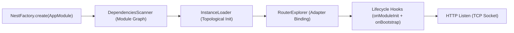
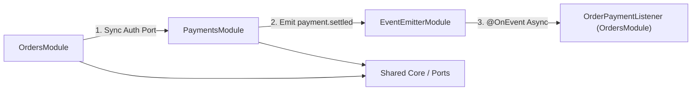
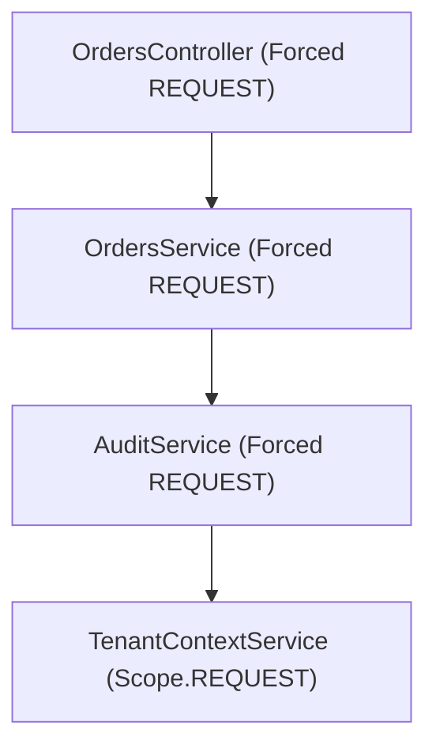
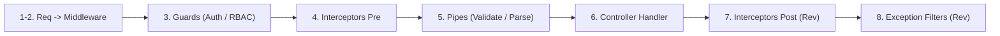

---
tags:
  - programming
  - backend
  - nestjs
  - typescript
  - dependency-injection
  - rest-api
  - validation
  - security
  - testing
created: 2026-01-04
updated: 2026-11-13
status: 🟢
level: mid-to-senior
---
# NestJS Complete Guide

> [!abstract] Scope & Architectural Core
> NestJS compiles TypeScript decorator metadata (`emitDecoratorMetadata` -> `design:paramtypes`) into an Inversion of Control (IoC) dependency graph at bootstrap, binding HTTP routes onto Express or Fastify and executing every request through a deterministic 8-stage pipeline. Node.js runtime mechanics live in [[Programming/Backend/Backend Core (Node, Event Loop, Auth & Concurrency)|Backend Core (Node, Event Loop, Auth & Concurrency)]]; distributed ACID transactions, Outbox relays, BullMQ workers, and OpenTelemetry continue in [[Programming/Backend/NestJS Advanced Guide|NestJS Advanced Guide]]. Ecosystem context is mapped in [[Programming/Backend/Backend Roadmap & Technologies|Backend Roadmap & Technologies]] and [[Programming/Programming Hub|Programming Hub]].

---

## 1. First-Principles Mechanics, Adapter Architecture & Production Bootstrap

### 1.1 Decorator Metadata & IoC Graph Compilation

TypeScript structural types (`interface`, `type` aliases, generic parameters) exist solely for static type checking and are stripped completely during JavaScript emission. At runtime, an IoC container inspecting `class OrdersService` cannot natively deduce constructor parameter types from standard ES class bytecode.

NestJS solves type erasure using `reflect-metadata` paired with two `tsconfig.json` compiler flags: `experimentalDecorators: true` and `emitDecoratorMetadata: true`. When `tsc` (or SWC configured with `decoratorMetadata: true`) compiles a decorated class, it wraps the class in `__decorate([...], OrdersService)` and attaches three runtime metadata keys via `Reflect.metadata(...)`:

- **`design:type`**: Runtime constructor of a decorated property.
- **`design:paramtypes`**: Ordered JavaScript array of constructor argument runtime references (e.g., `[OrdersRepository, EventEmitter2]`).
- **`design:returntype`**: Return value constructor of a decorated method.

Consider what TypeScript emits into JavaScript for a decorated service:

```javascript
// Compiled JavaScript output emitted by tsc with emitDecoratorMetadata: true
__decorate([
  Injectable(),
  __metadata("design:paramtypes", [OrdersRepository, EventEmitter2])
], OrdersService);
```

Because TypeScript interfaces compile away into `Object` inside `design:paramtypes`, injecting an interface parameter (`private readonly repo: IOrdersRepository`) without an explicit `@Inject(TOKEN)` decorator fails at boot with `Nest can't resolve dependencies of OrdersService (?, ...)`. Whenever you decouple behind an abstraction, inject either an **abstract class** (abstract classes emit JavaScript constructor functions that survive in `design:paramtypes`) or an explicit **`Symbol` / string token** via `@Inject(ORDERS_REPOSITORY)`.



During `NestFactory.create(AppModule)`, the framework completes four synchronous/async initialization stages before opening the TCP listening socket:

1. **Module Scanning (`DependenciesScanner`)**: Recursively traverses `AppModule.imports`, building an internal `ModulesContainer` registry mapping every module's `controllers`, `providers`, `exports`, and dynamic module metadata.
2. **Topological Instantiation (`InstanceLoader`)**: Resolves every provider's dependency list by merging `design:paramtypes` with parameter-level `@Inject()` overrides (`SELF_DECLARED_DEPS_METADATA`), enforces module visibility boundaries, constructs `Scope.DEFAULT` singletons bottom-up, and `await`s every asynchronous `useFactory` provider.
3. **Route Compilation (`RouterExplorer`)**: Extracts `PATH_METADATA`, `METHOD_METADATA`, `ROUTE_ARGS_METADATA`, and attached guard/interceptor/pipe/filter metadata from every controller, wrapping each endpoint handler inside an ordered Nest execution proxy bound onto the underlying HTTP adapter.
4. **Bootstrap Lifecycle Hooks**: Executes `onModuleInit()` across modules in dependency depth order, followed by `onApplicationBootstrap()`. Only once every promise resolves does `await app.listen(port)` bind the server socket.

### 1.2 Express vs Fastify HTTP Adapter Choice

NestJS abstracts the HTTP engine behind `AbstractHttpAdapter`. By default, `@nestjs/platform-express` ships installed; switching to `@nestjs/platform-fastify` preserves controllers, DTOs, guards, pipes, and filters while fundamentally changing routing, middleware execution, and JSON serialization.

| Dimension | `@nestjs/platform-express` (Default) | `@nestjs/platform-fastify` | Engineering Trade-Off |
|---|---|---|---|
| **Routing Engine** | Linear middleware/regex scan (`path-to-regexp` v8 in Express v5) | Pre-compiled radix tree (`find-my-way`) | Fastify maintains O(path length) routing at 300+ endpoints. |
| **JSON Serialization** | Native `JSON.stringify()` | Optional compiled JSON Schema (`fast-json-stringify`) | Fastify delivers 2x–3x raw JSON throughput and lower GC pressure. |
| **Middleware Ecosystem** | Full Express `(req, res, next)` middleware (`passport`, `multer`) | `middie` compatibility shim; native Fastify uses `@fastify/*` plugins | Passport strategies and legacy Express libs break or require wrappers on Fastify. |
| **Wildcard Syntax (Nest 11)** | Express v5 rejects bare `*`; requires `{*splat}` | Fastify v5 supports `*` / `(.*)` per plugin | Always test middleware `.forRoutes()` patterns against Express v5. |
| **Raw Body Capture** | `rawBody: true` in `NestFactory.create()` | Identical `rawBody: true` support via `RawBodyRequest` | Portable webhook signature verification across both adapters. |

**Decision Rule**: Default to **Express** for typical CRUD/SaaS APIs (<2,000 RPS per pod) where PostgreSQL I/O latency (5–30ms) dwarfs HTTP serialization (<0.4ms) and Express Passport/Multer packages accelerate delivery. Choose **Fastify** for high-throughput API gateways, telemetry/webhook ingestion edges (>5,000 RPS per pod), or teams standardizing on native JWT guards without Express middleware dependencies.

```typescript
// src/main.fastify.ts — Production Fastify adapter configuration
import 'reflect-metadata';
import { NestFactory } from '@nestjs/core';
import { FastifyAdapter, NestFastifyApplication } from '@nestjs/platform-fastify';
import helmet from '@fastify/helmet';
import compress from '@fastify/compress';
import { AppModule } from './app.module';

async function bootstrapFastify(): Promise<void> {
  const adapter = new FastifyAdapter({
    trustProxy: true,
    bodyLimit: 1_048_576, // 1 MiB payload ceiling
    requestTimeout: 30_000,
  });
  const app = await NestFactory.create<NestFastifyApplication>(AppModule, adapter, {
    bufferLogs: true,
    rawBody: true,
  });
  // Fastify plugins MUST be awaited via app.register(), never app.use()
  await app.register(helmet, { contentSecurityPolicy: false });
  await app.register(compress, { encodings: ['gzip', 'deflate'] });
  // Explicitly pass '0.0.0.0' because Fastify binds to 127.0.0.1 by default
  await app.listen(Number(process.env.PORT ?? 3000), '0.0.0.0');
}
void bootstrapFastify();
```

> [!warning] Fastify Container Binding Trap
> Unlike Express (which listens on all interfaces by default), `FastifyAdapter` binds strictly to `127.0.0.1` when given only a port. Inside Docker containers or Kubernetes pods, omitting `'0.0.0.0'` in `await app.listen(port, '0.0.0.0')` causes load balancer health checks to fail with `ECONNREFUSED`.

### 1.3 CLI Workflow, SWC Acceleration & Production Folder Structure

Standardize scaffolding and compilation through `@nestjs/cli` paired with SWC (`@swc/core`) for fast local rebuilds and CI runs:

```bash
npm install -g @nestjs/cli
nest new orders-api --package-manager pnpm --strict

# Domain scaffolding inside modules/
nest g module modules/orders
nest g controller modules/orders/controllers/orders --flat --no-spec
nest g service modules/orders/services/orders --flat --no-spec

# 10x faster build via SWC (always keep --type-check because SWC skips TS type analysis)
npm install -D @swc/cli @swc/core
nest start -b swc --type-check --watch
nest build -b swc --type-check
```

Two compiler settings prevent frequent production surprises in `nest-cli.json` and `tsconfig.json`:
1. **SWC + Type Checking**: SWC strips TypeScript syntax without running type validation; setting `"typeCheck": true` spawns `tsc --noEmit` asynchronously alongside SWC, while running `tsc --noEmit` in CI guarantees broken types fail builds.
2. **DTO Strict Property Initialization**: Under `"strict": true`, `class-validator` DTO fields populated dynamically by `class-transformer` require definite assignment assertions (`readonly sku!: string;`) so strict mode stays enabled without triggering false TS2564 errors.

```json
// nest-cli.json
{
  "$schema": "https://json.schemastore.org/nest-cli",
  "collection": "@nestjs/schematics",
  "sourceRoot": "src",
  "compilerOptions": {
    "builder": "swc",
    "typeCheck": true,
    "deleteOutDir": true,
    "plugins": [{ "name": "@nestjs/swagger", "options": { "classValidatorShim": true } }]
  }
}
```

```json
// tsconfig.json
{
  "compilerOptions": {
    "module": "commonjs",
    "target": "ES2023",
    "moduleResolution": "node",
    "declaration": true,
    "removeComments": true,
    "emitDecoratorMetadata": true,
    "experimentalDecorators": true,
    "allowSyntheticDefaultImports": true,
    "sourceMap": true,
    "outDir": "./dist",
    "baseUrl": "./",
    "incremental": true,
    "strict": true,
    "noUncheckedIndexedAccess": true,
    "skipLibCheck": true
  }
}
```

#### Scalable Modular Domain Folder Structure

Organize code vertically by **domain boundary** (`src/modules/orders/*`) rather than horizontally by framework role (`src/controllers`, `src/services`). Horizontal grouping scatters every feature edit across top-level directories and masks inter-domain coupling; vertical feature slices localize domain entities, DTOs, repositories, controllers, and events behind one explicit `@Module` boundary.

```text
orders-api/
├── nest-cli.json
├── tsconfig.json
├── src/
│   ├── main.ts
│   ├── app.module.ts
│   ├── config/
│   │   ├── env.schema.ts
│   │   ├── database.config.ts
│   │   └── auth.config.ts
│   ├── core/
│   │   ├── database/
│   │   └── health/
│   ├── common/
│   │   ├── context/
│   │   ├── decorators/
│   │   ├── dto/
│   │   ├── exceptions/
│   │   ├── filters/
│   │   ├── guards/
│   │   ├── interceptors/
│   │   ├── middleware/
│   │   └── pipes/
│   └── modules/
│       └── orders/
│           ├── controllers/orders.controller.ts
│           ├── domain/order.entity.ts
│           ├── dto/{create-order,update-order,query-orders,order-response}.dto.ts
│           ├── events/order-created.event.ts
│           ├── repositories/orders.repository.ts
│           ├── services/{orders.service,orders.service.spec}.ts
│           └── orders.module.ts
└── test/
    └── orders.e2e-spec.ts
```

### 1.4 Production `main.ts` Bootstrap

A production entrypoint configures log buffering (preventing unstructured `console.log` bursts before `nestjs-pino` mounts), raw body buffering for webhook HMAC checks, proxy trust, Helmet security headers, strict CORS allowlists, URI versioning while excluding Kubernetes health probes, payload size caps, global serialization boundaries, conditional Swagger mounting, and OS shutdown hooks.

```typescript
// src/main.ts
import 'reflect-metadata';
import { ClassSerializerInterceptor, Logger as NestLogger, VersioningType } from '@nestjs/common';
import { ConfigService } from '@nestjs/config';
import { NestFactory, Reflector } from '@nestjs/core';
import { NestExpressApplication } from '@nestjs/platform-express';
import { DocumentBuilder, SwaggerModule } from '@nestjs/swagger';
import * as express from 'express';
import helmet from 'helmet';
import { Logger } from 'nestjs-pino';
import { AppModule } from './app.module';

async function bootstrap(): Promise<void> {
  const app = await NestFactory.create<NestExpressApplication>(AppModule, {
    bufferLogs: true, // Queue startup logs until structured logger attaches
    rawBody: true,    // Retain exact Buffer in req.rawBody for webhook HMAC validation
  });

  app.useLogger(app.get(Logger));
  const bootLogger = new NestLogger('Bootstrap');

  const config = app.get(ConfigService);
  const port = config.getOrThrow<number>('PORT');
  const nodeEnv = config.getOrThrow<string>('NODE_ENV');
  const corsOrigins = config.getOrThrow<string[]>('CORS_ORIGINS');

  // Trust first reverse-proxy hop (ALB/Nginx) for accurate req.ip & req.protocol
  app.set('trust proxy', 1);
  app.disable('x-powered-by');

  app.use(helmet());
  app.use(express.json({ limit: '1mb' }));
  app.use(express.urlencoded({ extended: true, limit: '1mb' }));

  app.enableCors({
    origin: corsOrigins,
    credentials: true,
    methods: ['GET', 'POST', 'PUT', 'PATCH', 'DELETE', 'OPTIONS'],
    allowedHeaders: ['Content-Type', 'Authorization', 'X-Request-Id', 'Idempotency-Key'],
    maxAge: 3600,
  });

  app.setGlobalPrefix('api', { exclude: ['health/live', 'health/ready', 'metrics'] });
  app.enableVersioning({ type: VersioningType.URI, defaultVersion: '1' });

  // Enforce strict @Expose() opt-in serialization globally across all routes
  app.useGlobalInterceptors(
    new ClassSerializerInterceptor(app.get(Reflector), {
      excludeExtraneousValues: true,
      enableImplicitConversion: false,
    }),
  );

  if (nodeEnv !== 'production') {
    const swaggerCfg = new DocumentBuilder()
      .setTitle('Commerce Orders API')
      .setDescription('Production REST API for order orchestration')
      .setVersion('1.0.0')
      .addBearerAuth({ type: 'http', scheme: 'bearer', bearerFormat: 'JWT' }, 'access-token')
      .build();
    SwaggerModule.setup('docs', app, SwaggerModule.createDocument(app, swaggerCfg), {
      swaggerOptions: { persistAuthorization: true },
    });
  }

  // Trigger OnModuleDestroy -> BeforeApplicationShutdown -> OnApplicationShutdown on SIGTERM
  app.enableShutdownHooks();
  await app.listen(port, '0.0.0.0');
  bootLogger.log(`Orders API listening on port ${port} (${nodeEnv})`);
}
void bootstrap();
```

Notice why `ValidationPipe`, `JwtAuthGuard`, `RolesGuard`, `LoggingInterceptor`, and `AllExceptionsFilter` should be bound via **`APP_PIPE` / `APP_GUARD` / `APP_INTERCEPTOR` / `APP_FILTER`** inside `AppModule` rather than `app.useGlobal*()` in `main.ts`: `app.useGlobal*()` instances exist outside Nest's DI container (unable to inject `ConfigService`, `ClsService`, or `HttpAdapterHost` automatically) and are skipped completely when `Test.createTestingModule()` boots integration specs.

---

## 2. Real-World Use Cases & Architectural Decision Matrix

NestJS trades minimal boot speed and decorator ceremony for uniform conventions across teams. Adopting it blindly on tiny edge functions adds dead weight; skipping it in multi-squad monoliths often produces ad-hoc, inconsistently validated Express codebases.

### Five Engineering Scenarios

1. **Multi-Team B2B Modular Monolith (15+ Domain Modules) — ADOPT**: Multiple engineering squads share one PostgreSQL cluster, RBAC/ABAC authorization, standardized RFC 9457 error contracts, and OpenAPI client generation. NestJS enforces module encapsulation (`exports: [...]`) so teams cannot reach across domain repositories arbitrarily.
2. **Unified API Gateway + Background Worker + WebSocket Hub — ADOPT**: One TypeScript codebase serves REST endpoints, WebSocket channels (`@WebSocketGateway`), and BullMQ workers (`@Processor`), reusing identical domain services and DI bindings across HTTP servers and standalone worker processes (`NestFactory.createApplicationContext()`).
3. **Cold-Start-Sensitive Serverless Edge / Small Lambda (`< 100ms` Budget) — DO NOT USE FULL HTTP NESTJS**: Scanning 30+ modules with `reflect-metadata` adds 300–900ms cold-start latency. Use Hono or plain Fastify handlers for single-purpose functions; only use NestJS `createApplicationContext` in serverless when Provisioned Concurrency offsets DI startup cost.
4. **CPU-Intensive Media Transcoding, PDF Rasterization, or ML Inference — DO NOT RUN INLINE**: NestJS shares Node's single JavaScript thread. Running heavy synchronous compute inside a Nest controller stalls `libuv`'s Poll phase and starves health checks. Keep NestJS as the authenticated control plane and offload CPU workloads to Worker Threads or Python/Rust/Go workers (see [[Programming/Backend/Backend Core (Node, Event Loop, Auth & Concurrency)|Backend Core (Node, Event Loop, Auth & Concurrency)]]).
5. **2-Endpoint Prototype or Next.js-Only Internal Admin — AVOID**: When an app serves only a collocated Next.js frontend with trivial CRUD, Next.js Server Actions or a single Fastify server avoid duplicating build pipelines and DTO layers until external API consumers or domain complexity emerge.

### Framework Comparison Matrix

| Criterion | NestJS (Express / Fastify) | Standalone Fastify | Hono / tRPC | Spring Boot / Go Fiber |
|---|---|---|---|---|
| **Architectural Model** | Modular IoC container + AOP pipeline | Unopinionated plugin hierarchy | Lightweight router / TS RPC | Enterprise DI (JVM) / explicit structs (Go) |
| **Team Standardization** | High (standardized Pipes, Guards, Filters) | Team-defined structure | High inside TypeScript monorepos | High (JVM) / idiomatic stdlib (Go) |
| **Cold Start / Memory** | ~150–400ms / ~60–120 MB RSS | ~40ms / ~35 MB RSS | <10ms edge / ~20 MB | Slow (JVM) / ~15 MB (Go) |
| **Contract & Docs** | Native `@nestjs/swagger` OpenAPI | `@fastify/swagger` JSON Schema | Compile-time TS inference (tRPC) | `springdoc-openapi` / `swag` |
| **Optimal Niche** | Long-lived Node/TS SaaS & modular monoliths | Max-RPS Node HTTP microservices | Edge workers & full-stack TS apps | Heavy CPU concurrency or JVM orgs |

---

## 3. Typed Configuration & Environment Validation

### 3.1 Fail-Fast Startup Schema (Eliminating Raw `process.env`)

Reading `process.env` directly inside application code creates four deterministic failure modes:
- **String Coercion Traps**: Every `process.env` key is `string | undefined`; `Boolean("false") === true`, and missing numeric variables yield `NaN` inside connection pools.
- **Late Production Failures**: An omitted `WEBHOOK_SIGNING_SECRET` allows `/health/ready` to pass deployment and crashes only hours later when the first payment callback arrives.
- **Untestable Global Coupling**: Modules touching `process.env` directly cannot run isolated parallel tests without mutating shared process state.
- **Silent Key Typos**: Calling `configService.get('DATABSE_URL')` compiles without errors and silently returns `undefined`.

Validate all environment variables synchronously inside `ConfigModule.forRoot({ validate })` with **Zod** (or Joi for legacy projects) so missing or malformed secrets crash boot immediately with an exact error report before the pod accepts traffic.

```typescript
// src/config/env.schema.ts
import { z } from 'zod';

const originsSchema = z
  .string()
  .min(1)
  .transform((raw) => raw.split(',').map((s) => s.trim()).filter(Boolean))
  .refine((list) => list.length > 0, { message: 'CORS_ORIGINS requires at least one origin' });

const boolString = z.enum(['true', 'false']).transform((v) => v === 'true');

export const envSchema = z.object({
  NODE_ENV: z.enum(['development', 'test', 'staging', 'production']).default('development'),
  PORT: z.coerce.number().int().min(1).max(65535).default(3000),
  DATABASE_URL: z.string().url().startsWith('postgres'),
  DB_POOL_MAX: z.coerce.number().int().min(2).max(100).default(20),
  DB_SSL_ENABLED: boolString.default('true'),
  REDIS_URL: z.string().url(),
  JWT_ALGORITHM: z.enum(['RS256', 'EdDSA']).default('RS256'),
  JWT_PUBLIC_KEY: z.string().min(64),
  JWT_ISSUER: z.string().min(1),
  JWT_AUDIENCE: z.string().min(1),
  CORS_ORIGINS: originsSchema,
  WEBHOOK_SIGNING_SECRET: z.string().min(32),
  REQUEST_TIMEOUT_MS: z.coerce.number().int().min(500).max(60_000).default(10_000),
});

export type ValidatedEnv = z.infer<typeof envSchema>;

export function validateEnv(rawEnv: Record<string, unknown>): ValidatedEnv {
  const parsed = envSchema.safeParse(rawEnv);
  if (!parsed.success) {
    const details = parsed.error.issues
      .map((i) => `  - ${i.path.join('.') || '<root>'}: ${i.message}`)
      .join('\n');
    throw new Error(`Invalid environment configuration:\n${details}`);
  }
  return parsed.data;
}
```

### 3.2 Namespaced Typed Configuration (`registerAs`)

Notice a subtle `@nestjs/config` invariant: `validateEnv` validates and returns transformed values onto `ConfigService`'s internal cache, whereas `registerAs` factories read from `process.env` unless you extract values carefully or parse explicitly inside the factory. Returning typed structures from `registerAs(namespace, factory)` lets services inject `@Inject(databaseConfig.KEY)` with strict TypeScript property checking and zero magic strings.

```typescript
// src/config/database.config.ts
import { ConfigType, registerAs } from '@nestjs/config';

export const databaseConfig = registerAs('database', () => ({
  url: process.env.DATABASE_URL!,
  poolMax: Number(process.env.DB_POOL_MAX ?? 20),
  sslEnabled: process.env.DB_SSL_ENABLED !== 'false',
}));
export type DatabaseConfig = ConfigType<typeof databaseConfig>;
```

```typescript
// src/config/auth.config.ts
import { ConfigType, registerAs } from '@nestjs/config';

export const authConfig = registerAs('auth', () => ({
  algorithm: (process.env.JWT_ALGORITHM ?? 'RS256') as 'RS256' | 'EdDSA',
  // Normalize literal '\n' sequences injected by Docker/K8s single-line PEM secrets
  publicKey: process.env.JWT_PUBLIC_KEY!.replace(/\\n/g, '\n'),
  issuer: process.env.JWT_ISSUER!,
  audience: process.env.JWT_AUDIENCE!,
}));
export type AuthConfig = ConfigType<typeof authConfig>;
```

Consuming strongly typed configuration inside any singleton service or `forRootAsync` factory eliminates string keys completely:

```typescript
@Injectable()
export class PoolSettingsReader {
  constructor(
    @Inject(databaseConfig.KEY) private readonly dbCfg: DatabaseConfig,
  ) {}

  getPoolCeiling(): number {
    return this.dbCfg.poolMax; // Strictly typed `number`
  }
}
```

---

## 4. Modules, IoC Container, Custom Providers & Circular Dependency Elimination

### 4.1 Module Encapsulation & Visibility Boundaries

By default, every provider registered inside a module is **private** to that module. Importing `PaymentsModule` into `OrdersModule` grants `OrdersModule` access **only** to tokens listed explicitly inside `PaymentsModule.exports`. Re-exporting an imported module (`exports: [SharedCryptoModule]`) forwards its public tokens transparently.

Apply `@Global()` strictly to foundational cross-cutting utilities (`ConfigModule`, `ClsModule`, `LoggerModule`). Applying `@Global()` to domain modules (`OrdersModule`, `UsersModule`) hides architectural dependencies during code review and turns refactoring into guesswork.

### 4.2 Custom Providers (`useClass`, `useValue`, `useFactory`, `useExisting`)

NestJS supports five provider registration mechanisms depending on whether the dependency is a concrete class, polymorphic interface port, immutable constant, asynchronous network client, or an alias to an existing singleton.

| Strategy | Declaration | Lifecycle & Instantiation Rule | Primary Use Case |
|---|---|---|---|
| **Class** | `providers: [OrdersService]` | Single instance per module scope | Default concrete application services. |
| **`useClass`** | `{ provide: StoragePort, useClass: S3Adapter }` | Instantiates a **dedicated** instance of `S3Adapter` under `StoragePort` | Swapping concrete adapters (`S3Adapter` vs `LocalDiskAdapter`) behind an abstract port. |
| **`useValue`** | `{ provide: LIMITS, useValue: Object.freeze(...) }` | Binds pre-built literal, constant, or mock object directly | Frozen config structs, external SDK objects, unit test doubles. |
| **`useFactory`** | `{ provide: KMS_KEY, inject: [...], useFactory: async (...) => ... }` | Runs sync/async factory; **Nest awaits Promises before booting dependents** | Retrying DB/Vault/JWKS initialization with backoff during startup. |
| **`useExisting`** | `{ provide: AuditPort, useExisting: PinoAuditService }` | **Aliases an already-registered provider** without creating a second instance | Exposing one stateful singleton (pool, buffer, metrics) under multiple port tokens. |

> [!danger] The `useClass` Double-Instantiation Trap
> Declaring `providers: [PinoAuditService, { provide: AuditPort, useClass: PinoAuditService }]` constructs **two separate instances** of `PinoAuditService` on the heap! Any internal cache, socket pool, or queue inside `PinoAuditService` diverges silently between consumers. Always use **`useExisting: PinoAuditService`** when aliasing an existing provider.

Below is an async `useFactory` provider demonstrating startup resilience: verifying an external secret/JWKS endpoint with exponential backoff retries before allowing the HTTP server to accept live requests:

```typescript
// src/modules/payments/payments.module.ts
import { Inject, Injectable, Logger, Module, Optional } from '@nestjs/common';
import { ConfigService } from '@nestjs/config';

export const SIGNING_KEY_TOKEN = Symbol('SIGNING_KEY_TOKEN');
export abstract class PaymentGatewayPort {
  abstract authorize(amountCents: number, idempotencyKey: string): Promise<{ authId: string }>;
}

async function fetchSecretWithRetry(path: string, attempts = 3): Promise<string> {
  for (let i = 1; i <= attempts; i++) {
    try {
      if (!path) throw new Error('Empty secret path');
      return `verified_key_${path}`; // Replace with Vault/KMS SDK call in infra adapter
    } catch (err) {
      if (i === attempts) throw err;
      await new Promise((r) => setTimeout(r, 150 * 2 ** (i - 1)));
    }
  }
  throw new Error('Unreachable retry state');
}

@Injectable()
export class StripePaymentAdapter extends PaymentGatewayPort {
  constructor(
    @Inject(SIGNING_KEY_TOKEN) private readonly signingKey: string,
    @Optional() @Inject('PAYMENT_TIMEOUT_MS') private readonly timeoutMs = 4000,
  ) {
    super();
  }

  async authorize(amountCents: number, idempotencyKey: string): Promise<{ authId: string }> {
    return { authId: `ch_${amountCents}_${idempotencyKey.slice(0, 8)}` };
  }
}

@Module({
  providers: [
    {
      provide: SIGNING_KEY_TOKEN,
      inject: [ConfigService],
      useFactory: async (config: ConfigService): Promise<string> => {
        const logger = new Logger('PaymentsBootstrap');
        const secretPath = config.getOrThrow<string>('WEBHOOK_SIGNING_SECRET');
        const verified = await fetchSecretWithRetry(secretPath);
        logger.log('Payment signing material verified prior to HTTP bind');
        return verified;
      },
    },
    { provide: PaymentGatewayPort, useClass: StripePaymentAdapter },
  ],
  exports: [PaymentGatewayPort],
})
export class PaymentsModule {}
```

### 4.3 Dynamic Modules (`forRoot`, `forRootAsync`, `forFeature`) & `ConfigurableModuleBuilder`

Infrastructure modules split configuration across two patterns:
- **`forRoot` / `forRootAsync`**: Registered once in `AppModule` to initialize shared clients (connection pools, Redis clients, SDK options).
- **`forFeature`**: Registered inside domain modules to bind feature-specific models, queues, or repositories (`TypeOrmModule.forFeature([Order])`, `BullModule.registerQueue({ name: 'orders' })`) without cloning root connections.

Use `ConfigurableModuleBuilder` to eliminate manual `DynamicModule` union-type boilerplate while exposing typed `forRoot`, `forRootAsync`, and `MODULE_OPTIONS_TOKEN`:

```typescript
// src/core/rate-limiter/rate-limiter.module-definition.ts
import { ConfigurableModuleBuilder } from '@nestjs/common';

export interface RateLimiterOptions {
  redisUrl: string;
  windowMs: number;
  maxRequests: number;
  keyPrefix?: string;
}

export const { ConfigurableModuleClass, MODULE_OPTIONS_TOKEN } =
  new ConfigurableModuleBuilder<RateLimiterOptions>()
    .setClassMethodName('forRoot')
    .setExtras<{ isGlobal?: boolean }>({ isGlobal: true }, (definition, extras) => ({
      ...definition,
      global: Boolean(extras.isGlobal),
    }))
    .build();
```

```typescript
// src/core/rate-limiter/rate-limiter.module.ts
import { DynamicModule, Inject, Injectable, Module, OnModuleDestroy } from '@nestjs/common';
import {
  ConfigurableModuleClass,
  MODULE_OPTIONS_TOKEN,
  RateLimiterOptions,
} from './rate-limiter.module-definition';

export const RATE_LIMIT_SCOPE_PREFIX = Symbol('RATE_LIMIT_SCOPE_PREFIX');

@Injectable()
export class RateLimiterService implements OnModuleDestroy {
  private readonly buckets = new Map<string, { count: number; resetAt: number }>();

  constructor(@Inject(MODULE_OPTIONS_TOKEN) private readonly options: RateLimiterOptions) {}

  consume(key: string): { allowed: boolean; remaining: number } {
    const namespaced = `${this.options.keyPrefix ?? 'rl'}:${key}`;
    const now = Date.now();
    const entry = this.buckets.get(namespaced);
    if (!entry || entry.resetAt <= now) {
      this.buckets.set(namespaced, { count: 1, resetAt: now + this.options.windowMs });
      return { allowed: true, remaining: this.options.maxRequests - 1 };
    }
    entry.count += 1;
    return {
      allowed: entry.count <= this.options.maxRequests,
      remaining: Math.max(0, this.options.maxRequests - entry.count),
    };
  }

  onModuleDestroy(): void {
    this.buckets.clear();
  }
}

@Module({
  providers: [RateLimiterService],
  exports: [RateLimiterService],
})
export class RateLimiterModule extends ConfigurableModuleClass {
  // Optional forFeature companion registering domain-scoped prefix tokens
  static forFeature(scopeName: string): DynamicModule {
    return {
      module: RateLimiterModule,
      providers: [{ provide: RATE_LIMIT_SCOPE_PREFIX, useValue: scopeName }],
      exports: [RATE_LIMIT_SCOPE_PREFIX],
    };
  }
}
```

### 4.4 Eliminating Circular Dependencies (`forwardRef` Anti-Pattern)

Mutual imports (`OrdersModule <-> PaymentsModule`) trigger CommonJS circular reference resolution where one module/class evaluates to `undefined` when `@Module()` or `design:paramtypes` executes (`Nest cannot create the OrdersModule instance (undefined at index [0])`). Applying `forwardRef(() => ...)` only patches initialization timing via lazy proxies while retaining tight coupling that complicates testing and breaks static dependency graphs.



Convert every cycle into a strict Directed Acyclic Graph (DAG) via one of three clean refactors:

1. **Shared Core Extraction**: Move the mutually shared service (`LedgerService`) into a lower-level `LedgerModule` imported unidirectionally by both `OrdersModule` and `BillingModule`.
2. **In-Process Domain Events (`@nestjs/event-emitter`)**: Keep `OrdersModule -> PaymentsModule` unidirectional for synchronous calls. When `PaymentsWebhookService` receives an async settlement callback, emit a typed `PaymentSettledEvent`; `OrderPaymentListener` inside `OrdersModule` reacts via `@OnEvent(...)`. (For crash-safe persistence across DB + queue boundaries, pair with the Transactional Outbox pattern in [[Programming/Backend/NestJS Advanced Guide|NestJS Advanced Guide]].)
3. **Port / Adapter Token Inversion**: Define an abstract port (`OrderStatusPort`) in a shared `contracts/` directory with zero module imports; `PaymentsModule` injects the port token while `AppModule` binds `OrdersModule`'s concrete adapter.

```typescript
// Pattern #2: Breaking OrdersModule <-> PaymentsModule via typed domain events
export class PaymentSettledEvent {
  static readonly eventName = 'payment.settled';
  constructor(
    public readonly tenantId: string,
    public readonly orderId: string,
    public readonly paymentIntentId: string,
  ) {}
}

@Injectable()
export class PaymentsWebhookService {
  constructor(private readonly events: EventEmitter2) {}

  async handleSettlement(tenantId: string, orderId: string, intentId: string): Promise<void> {
    await this.events.emitAsync(
      PaymentSettledEvent.eventName,
      new PaymentSettledEvent(tenantId, orderId, intentId),
    );
  }
}

@Injectable()
export class OrderPaymentListener {
  constructor(private readonly ordersService: OrdersService) {}

  @OnEvent(PaymentSettledEvent.eventName, { async: true })
  async onPaymentSettled(event: PaymentSettledEvent): Promise<void> {
    await this.ordersService.markConfirmed(event.tenantId, event.orderId, event.paymentIntentId);
  }
}
```

### 4.5 Application Lifecycle Hooks & Graceful Shutdown Order

When `app.enableShutdownHooks()` is enabled, NestJS coordinates startup and Kubernetes `SIGTERM` termination cleanly across five ordered hooks:
1. `onModuleInit()` (per module, bottom-up across dependency graph)
2. `onApplicationBootstrap()` (once all modules initialize, prior to `app.listen()`)
3. `onModuleDestroy()` (on `SIGTERM`/`SIGINT`/`app.close()`)
4. `beforeApplicationShutdown(signal)` (ideal for flipping `/health/ready` to `503`)
5. `onApplicationShutdown(signal)` (after active HTTP requests drain—close DB connection pools here!)

```typescript
// src/core/database/prisma-lifecycle.service.ts
import { Injectable, Logger, OnApplicationShutdown, OnModuleInit } from '@nestjs/common';
import { PrismaClient } from '@prisma/client';

@Injectable()
export class PrismaService extends PrismaClient implements OnModuleInit, OnApplicationShutdown {
  private readonly logger = new Logger(PrismaService.name);

  async onModuleInit(): Promise<void> {
    await this.$connect();
    this.logger.log('PostgreSQL pool connected');
  }

  async onApplicationShutdown(signal?: string): Promise<void> {
    this.logger.log(`Drained HTTP connections; closing DB pool (${signal ?? 'manual'})`);
    await this.$disconnect();
  }
}
```

---

## 5. Provider Scopes, `Scope.REQUEST` Traps & `nestjs-cls` Request Context

### 5.1 Scope Modes & Runtime Cost

| Scope | Lifetime | Instantiation Frequency | Concurrency & Throughput Trade-Off |
|---|---|---|---|
| **`Scope.DEFAULT`** | Process lifetime | **Once** at bootstrap | Zero per-request DI cost; requires stateless design (or `AsyncLocalStorage`). |
| **`Scope.REQUEST`** | Single HTTP/RPC lifecycle | **Every request** (+ GC sweep) | Isolated instance per request, **severe CPU & GC latency collapse** under concurrency. |
| **`Scope.TRANSIENT`** | Dedicated to injecting consumer | Once per injection point (unless consumer is `REQUEST`) | Useful for private stateful helpers (e.g., per-service contextual logger). |

### 5.2 Upward `Scope.REQUEST` Contagion

Because a singleton constructed once at boot cannot retain a reference to an instance that exists only for one request, marking **any** leaf provider (`TenantContextService`) with `@Injectable({ scope: Scope.REQUEST })` forces NestJS to bubble `Scope.REQUEST` upward through every service and controller that injects it—directly or transitively.



Under 400+ RPS, bubbling turns cheap singleton dispatches into repeated DI subtree graph traversals, thousands of per-second heap allocations, invalidated service-level caches, and frequent V8 Scavenge/Major GC pauses—frequently multiplying p99 latency by 3x–8x. (While `durable: true` with `ContextIdFactory` caches tenant subtrees for rare multi-DB connection isolation, it still adds DI overhead unneeded for request context.)

### 5.3 Zero-Overhead Request Context with `nestjs-cls`

Node's `AsyncLocalStorage` binds an immutable execution store to the active Promise chain with O(1) lookup cost across `await` and `Promise.all`, keeping **100% of controllers, services, and repositories as `Scope.DEFAULT` singletons**.

```typescript
// src/common/context/app-cls.store.ts & request-context.service.ts
import { Injectable } from '@nestjs/common';
import { ClsService, ClsStore } from 'nestjs-cls';

export interface AppClsStore extends ClsStore {
  requestId: string;
  tenantId?: string;
  userId?: string;
  ipAddress?: string;
}

@Injectable() // Scope.DEFAULT Singleton!
export class RequestContextService {
  constructor(private readonly cls: ClsService<AppClsStore>) {}

  getRequestId(): string {
    return this.cls.get('requestId') ?? 'system';
  }

  getTenantIdOrThrow(): string {
    const tenantId = this.cls.get('tenantId');
    if (!tenantId) {
      throw new Error('Tenant context missing outside authenticated boundary');
    }
    return tenantId;
  }

  getUserId(): string | undefined {
    return this.cls.get('userId');
  }
}
```

> [!warning] Async Context Loss Across Detached Timers & Background Queues
> `AsyncLocalStorage` propagates across normal `await` boundaries, **but** detached event emitters (`setTimeout`, external callback APIs created at boot, or BullMQ queue workers running in separate processes) lose or race against the HTTP request store. Always pass `requestId` and `tenantId` explicitly inside domain events and queue job payloads, or wrap manual async scopes with `cls.run(...)`.

---

## 6. Controllers, Routing, DTOs, Serialization & OpenAPI (Swagger)

### 6.1 Routing Semantics, Parameter Extractors & Response Pitfalls

Controllers handle HTTP verb dispatch, path parameter extraction, status codes, and response DTO boundaries while delegating domain rules strictly to services.

```typescript
// Demonstrating full HTTP verbs, parameter extractors, versioning & passthrough rules
import {
  Body,
  Controller,
  Delete,
  Get,
  Header,
  Headers,
  HttpCode,
  HttpStatus,
  Ip,
  Param,
  ParseDatePipe,
  ParseUUIDPipe,
  Patch,
  Post,
  Put,
  Query,
  Res,
  Version,
} from '@nestjs/common';
import { Response } from 'express';

@Controller({ path: 'invoices', version: '1' })
export class InvoicesRoutingReferenceController {
  // Static routes MUST precede ':id' parameterized routes so 'summary' is not captured as ':id'
  @Get('summary')
  getSummary(@Query('since', new ParseDatePipe({ optional: true })) since?: Date) {
    return { since: since?.toISOString() ?? null };
  }

  @Version('2')
  @Get('summary')
  getSummaryV2() {
    return { version: 2, totals: [] };
  }

  @Get(':id')
  findOne(
    @Param('id', new ParseUUIDPipe({ version: '4' })) id: string,
    @Headers('accept-language') lang = 'en-US',
    @Ip() ip: string,
  ) {
    return { id, lang, ip };
  }

  @Put(':id')
  replace(@Param('id', ParseUUIDPipe) id: string, @Body() payload: Record<string, unknown>) {
    return { id, replaced: true, keys: Object.keys(payload) };
  }

  @Patch(':id')
  patch(@Param('id', ParseUUIDPipe) id: string, @Body() payload: Record<string, unknown>) {
    return { id, patched: true, keys: Object.keys(payload) };
  }

  @Delete(':id')
  @HttpCode(HttpStatus.NO_CONTENT)
  remove(@Param('id', ParseUUIDPipe) _id: string): void {}

  // Always pass { passthrough: true } when injecting @Res() so Nest interceptors & JSON serialization still execute!
  @Post('export')
  @HttpCode(HttpStatus.ACCEPTED)
  @Header('Cache-Control', 'no-store')
  triggerExport(@Res({ passthrough: true }) res: Response) {
    res.setHeader('X-Export-Job', 'queued');
    return { accepted: true };
  }
}
```

Key routing invariants:
1. **Route Declaration Precedence**: Declare literal paths (`@Get('summary')`) above parameterized paths (`@Get(':id')`).
2. **Avoid Bare `@Res()`**: Injecting `@Res() res` without `{ passthrough: true }` switches NestJS into library-specific mode, silently disabling `ClassSerializerInterceptor`, `ResponseEnvelopeInterceptor`, and automatic JSON serialization—causing the request to hang unless `res.send()` is invoked manually.
3. **NestJS 11+ Native `ParseDatePipe` & Express v5 Wildcards**: Use `ParseDatePipe` for query/param ISO date parsing, and write named braced wildcards (`@Get('assets/*splat')`) instead of bare `*`.

### 6.2 Input Validation DTOs & Mapped Types

Use ES **classes** (not TypeScript interfaces) for DTOs so `class-validator` and `@nestjs/swagger` metadata survive transpilation. Import `PartialType`, `OmitType`, `PickType`, and `IntersectionType` from **`@nestjs/swagger`** (not `@nestjs/mapped-types`) so OpenAPI `@ApiProperty` metadata propagates cleanly to update DTOs.

### 6.3 Pagination, Filtering & Whitelisted Sorting Query DTOs

HTTP query strings always arrive as strings (`?page=2&limit=20&sortBy=createdAt`). Validate `sortBy` strictly against an `@IsIn(...)` allowlist—never interpolate client-supplied `sortBy` strings into SQL `ORDER BY` or Prisma `orderBy`. For multi-million-row tables where deep `OFFSET` scans slow linearly, transition to composite keyset cursors (`WHERE (created_at, id) < ($1, $2)`—see [[Programming/Software Engineering/Database Design/Relational Databases|Relational Databases]] and [[Programming/Software Engineering/System Design/API Design|API Design]]).

```typescript
// src/common/dto/pagination-query.dto.ts
import { ApiPropertyOptional } from '@nestjs/swagger';
import { Type } from 'class-transformer';
import { IsIn, IsInt, IsOptional, Max, Min } from 'class-validator';

export class PaginationQueryDto {
  @ApiPropertyOptional({ minimum: 1, default: 1 })
  @IsOptional()
  @Type(() => Number)
  @IsInt()
  @Min(1)
  readonly page: number = 1;

  @ApiPropertyOptional({ minimum: 1, maximum: 100, default: 20 })
  @IsOptional()
  @Type(() => Number)
  @IsInt()
  @Min(1)
  @Max(100)
  readonly limit: number = 20;

  @ApiPropertyOptional({ enum: ['asc', 'desc'], default: 'desc' })
  @IsOptional()
  @IsIn(['asc', 'desc'])
  readonly sortDir: 'asc' | 'desc' = 'desc';

  get offset(): number {
    return (this.page - 1) * this.limit;
  }
}
```

```typescript
// src/common/dto/paginated-response.dto.ts
import { ApiProperty } from '@nestjs/swagger';
import { Expose } from 'class-transformer';

@Expose()
export class PaginationMetaDto {
  @ApiProperty() @Expose() readonly total!: number;
  @ApiProperty() @Expose() readonly page!: number;
  @ApiProperty() @Expose() readonly limit!: number;
  @ApiProperty() @Expose() readonly totalPages!: number;
}

export class PaginatedResponseDto<T> {
  readonly items: T[];
  readonly meta: PaginationMetaDto;

  constructor(items: T[], total: number, page: number, limit: number) {
    this.items = items;
    this.meta = { total, page, limit, totalPages: Math.max(1, Math.ceil(total / limit)) };
  }
}
```

### 6.4 Response DTO Boundary (`@Exclude()` / `@Expose()`)

**Strict Invariant**: Never return TypeORM entities, Prisma models, or raw SQL rows directly from controllers. Direct entity serialization couples database schema migrations directly to public API contracts—adding a column like `passwordHash`, `mfaBackupSecret`, or `internalFraudScore` immediately leaks sensitive fields across HTTP responses.

Mark every Response DTO class with `@Exclude()` at the class level and opt in public properties explicitly via `@Expose()`. Combined with global `ClassSerializerInterceptor(..., { excludeExtraneousValues: true })` and explicit domain-to-DTO factory methods (`OrderResponseDto.fromDomain(order)`), unexposed internal properties are stripped deterministically.

### 6.5 OpenAPI / Swagger Generic Schema Registration

To render typed OpenAPI schemas for `PaginatedResponseDto<OrderResponseDto>` cleanly, define a reusable `@ApiPaginatedResponse()` decorator using `@ApiExtraModels` and `getSchemaPath`:

```typescript
// src/common/decorators/api-paginated-response.decorator.ts
import { applyDecorators, Type } from '@nestjs/common';
import { ApiExtraModels, ApiOkResponse, getSchemaPath } from '@nestjs/swagger';
import { PaginationMetaDto } from '../dto/paginated-response.dto';

export const ApiPaginatedResponse = <TModel extends Type<unknown>>(model: TModel) =>
  applyDecorators(
    ApiExtraModels(PaginationMetaDto, model),
    ApiOkResponse({
      schema: {
        type: 'object',
        required: ['items', 'meta'],
        properties: {
          items: { type: 'array', items: { $ref: getSchemaPath(model) } },
          meta: { $ref: getSchemaPath(PaginationMetaDto) },
        },
      },
    }),
  );
```

---

## 7. Complete 8-Stage Request Lifecycle & Every Primitive Implemented End-to-End

### 7.1 Execution Order, Reversal Rules & Selection Matrix

Every HTTP request progresses top-down (**Global -> Controller -> Route**) through Middleware, Guards, Pre-Interceptors, and Pipes, executes the Route Handler, and then unwinds bottom-up (**Route -> Controller -> Global**) through Post-Interceptors and Exception Filters.



| Primitive | `ExecutionContext` & `Reflector`? | Mutates Args / Output? | Short-Circuits? | Canonical Production Usage |
|---|---|---|---|---|
| **Middleware** | No (raw `req, res, next`) | Headers / raw stream | Yes | Request ID + CLS init, Helmet, HTTP access log, raw webhook checks |
| **Guard** | **Yes** (`getHandler()`, `getClass()`) | No (sets `req.user`) | **Yes** (`403` / `401`) | JWT verification, `@Roles()` RBAC, CASL ABAC, `@nestjs/throttler` |
| **Interceptor** | **Yes** | **Yes** (RxJS `Observable`) | Yes (`of(cached)`) | Timing/metrics, response envelope, timeouts, `ClassSerializerInterceptor` |
| **Pipe** | Param `ArgumentMetadata` | **Yes** (transforms & validates) | Yes (`400` / `422`) | Global `ValidationPipe`, `ParseUUIDPipe`, `ParseDatePipe`, `ZodValidationPipe` |
| **Exception Filter** | **Yes** (`ArgumentsHost`) | Formats error body | Terminal handler | RFC 9457 Problem Details, DB code mapping (`P2002`/`23505` -> `409`), redaction |

> [!warning] Three Classic Lifecycle Traps
> 1. **Guards Run BEFORE Pipes**: Inside `canActivate()`, `req.body` and `req.query` are raw unparsed JSON/strings—`ValidationPipe` `whitelist` stripping, `@Transform()` cleaners, and DTO property defaults have **not** run yet. Authorize strictly against `req.user`, route params, or headers.
> 2. **Middleware Exceptions Bypass Interceptors**: Errors thrown inside Middleware skip `LoggingInterceptor` and `TimeoutInterceptor` entirely and jump straight to Exception Filters.
> 3. **Global `APP_*` DI Tokens**: Providers bound via `APP_PIPE`, `APP_GUARD`, `APP_INTERCEPTOR`, and `APP_FILTER` inside `AppModule` run inside Nest's IoC container, gain full dependency injection, and execute automatically inside `Test.createTestingModule()` integration specs.

### 7.2 Middleware (Functional, Class-Based & Raw Webhook Body)

Functional middleware functions execute with minimal overhead when no DI providers are required; class-based middleware (`implements NestMiddleware`) enables injecting `ClsService` or `ConfigService`. Notice that under NestJS 11 / Express v5 (`path-to-regexp` v8), wildcard middleware bindings must use `'{*splat}'` rather than legacy `'*'`.

```typescript
// src/common/middleware/http-logger.middleware.ts
import { Injectable, Logger, NestMiddleware } from '@nestjs/common';
import { NextFunction, Request, Response } from 'express';
import { ClsService } from 'nestjs-cls';
import { AppClsStore } from '../context/app-cls.store';

@Injectable()
export class HttpLoggerMiddleware implements NestMiddleware {
  private readonly logger = new Logger('HTTP');
  constructor(private readonly cls: ClsService<AppClsStore>) {}

  use(req: Request, res: Response, next: NextFunction): void {
    const startNs = process.hrtime.bigint();
    const { method, originalUrl } = req;
    res.on('finish', () => {
      const durationMs = Number(process.hrtime.bigint() - startNs) / 1e6;
      this.logger.log(
        JSON.stringify({
          requestId: this.cls.get('requestId') ?? '-',
          method,
          path: originalUrl,
          statusCode: res.statusCode,
          durationMs: Number(durationMs.toFixed(2)),
        }),
      );
    });
    next();
  }
}

export function responseRequestIdMiddleware(req: Request, res: Response, next: NextFunction): void {
  const headerId = req.headers['x-request-id'];
  if (typeof headerId === 'string' && headerId.length > 0) {
    res.setHeader('X-Request-Id', headerId);
  }
  next();
}
```

#### Preserving `req.rawBody` for Webhook HMAC Verification

Computing HMAC-SHA256 signatures over `JSON.stringify(req.body)` breaks in production whenever key ordering or whitespace differs from the sender's raw payload. Setting `rawBody: true` inside `NestFactory.create()` retains the untouched wire `Buffer` on `RawBodyRequest<Request>.rawBody` before `express.json()` parses the body:

```typescript
// src/modules/webhooks/stripe-webhook.controller.ts
import {
  BadRequestException,
  Controller,
  Headers,
  HttpCode,
  HttpStatus,
  Post,
  RawBodyRequest,
  Req,
  UnauthorizedException,
} from '@nestjs/common';
import { ConfigService } from '@nestjs/config';
import { createHmac, timingSafeEqual } from 'node:crypto';
import { Request } from 'express';
import { Public } from '../../common/decorators/auth.decorators';

@Controller('webhooks')
export class StripeWebhookController {
  constructor(private readonly config: ConfigService) {}

  @Public()
  @Post('payments')
  @HttpCode(HttpStatus.OK)
  handleWebhook(
    @Req() req: RawBodyRequest<Request>,
    @Headers('x-webhook-signature') signatureHex: string,
  ): { received: true } {
    if (!req.rawBody) throw new BadRequestException('Raw request body unavailable');
    if (!signatureHex) throw new UnauthorizedException('Missing webhook signature');

    const secret = this.config.getOrThrow<string>('WEBHOOK_SIGNING_SECRET');
    const expected = createHmac('sha256', secret).update(req.rawBody).digest();
    const provided = Buffer.from(signatureHex, 'hex');
    if (provided.length !== expected.length || !timingSafeEqual(provided, expected)) {
      throw new UnauthorizedException('Invalid webhook signature');
    }
    return { received: true };
  }
}
```

### 7.3 Pipes (Global `ValidationPipe`, Implicit Coercion Trap & Custom Pipes)

Pipes normalize and validate inbound parameters before handlers execute. Configure the global `ValidationPipe` via `APP_PIPE` to strip undeclared properties (`whitelist: true`, preventing mass-assignment attacks), reject unexpected payload keys (`forbidNonWhitelisted: true`), instantiate typed DTO classes (`transform: true`), and format nested validation constraints cleanly.

```typescript
// src/common/pipes/global-validation.pipe.ts
import { BadRequestException, ValidationError, ValidationPipe } from '@nestjs/common';

export interface FieldValidationError {
  field: string;
  messages: string[];
}

function flattenErrors(errors: ValidationError[], parentPath = ''): FieldValidationError[] {
  const out: FieldValidationError[] = [];
  for (const err of errors) {
    const field = parentPath ? `${parentPath}.${err.property}` : err.property;
    if (err.constraints) out.push({ field, messages: Object.values(err.constraints) });
    if (err.children?.length) out.push(...flattenErrors(err.children, field));
  }
  return out;
}

export function createGlobalValidationPipe(): ValidationPipe {
  return new ValidationPipe({
    whitelist: true,
    forbidNonWhitelisted: true,
    transform: true,
    transformOptions: { enableImplicitConversion: false }, // NEVER true in production!
    exceptionFactory: (errors: ValidationError[]) =>
      new BadRequestException({ message: 'Request validation failed', errors: flattenErrors(errors) }),
  });
}
```

> [!danger] The `enableImplicitConversion: true` Boolean `"false" -> true` Bug
> When `enableImplicitConversion: true` is active, `class-transformer` coerces query parameters typed as `boolean` via JavaScript's `Boolean(value)`. Because `Boolean("false") === true`, calling `GET /api/v1/orders?includeCancelled=false` silently sets `includeCancelled` to **`true`**! Keep `enableImplicitConversion: false` globally and declare explicit `@Type(() => Number)` and strict `@Transform()` decorators:

```typescript
// src/common/decorators/transform.decorators.ts
import { Transform } from 'class-transformer';

export function ToStrictBoolean(): PropertyDecorator {
  return Transform(({ value }) => {
    if (value === true || value === 'true') return true;
    if (value === false || value === 'false') return false;
    return value; // Invalid strings like "maybe" fall through so @IsBoolean() returns 400
  });
}

export function TrimString(): PropertyDecorator {
  return Transform(({ value }) => (typeof value === 'string' ? value.trim() : value));
}
```

#### Custom `ParsePositiveIntPipe` and Generic `ZodValidationPipe`

```typescript
// src/common/pipes/parse-positive-int.pipe.ts
import { ArgumentMetadata, BadRequestException, Injectable, PipeTransform } from '@nestjs/common';

@Injectable()
export class ParsePositiveIntPipe implements PipeTransform<string, number> {
  transform(value: string, metadata: ArgumentMetadata): number {
    const parsed = Number(value);
    if (!Number.isInteger(parsed) || parsed <= 0) {
      throw new BadRequestException(`Parameter "${metadata.data ?? 'value'}" must be a positive integer`);
    }
    return parsed;
  }
}
```

```typescript
// src/common/pipes/zod-validation.pipe.ts
import { ArgumentMetadata, BadRequestException, Injectable, PipeTransform } from '@nestjs/common';
import { ZodSchema } from 'zod';

@Injectable()
export class ZodValidationPipe<TOutput> implements PipeTransform<unknown, TOutput> {
  constructor(private readonly schema: ZodSchema<TOutput>) {}

  transform(value: unknown, _metadata: ArgumentMetadata): TOutput {
    const result = this.schema.safeParse(value);
    if (!result.success) {
      const errors = result.error.issues.map((issue) => ({
        field: issue.path.join('.') || '<root>',
        messages: [issue.message],
      }));
      throw new BadRequestException({ message: 'Schema validation failed', errors });
    }
    return result.data;
  }
}
```

### 7.4 Guards (`CanActivate`, `Reflector`, JWT Auth, RBAC & `@CurrentUser()`)

Guards enforce authentication and coarse RBAC authorization. Compose `@Roles()`, `@ApiBearerAuth()`, and OpenAPI failure decorators inside a reusable `@Auth()` decorator, and extract authenticated principals cleanly via `createParamDecorator`.

```typescript
// src/common/decorators/auth.decorators.ts
import { applyDecorators, createParamDecorator, ExecutionContext, SetMetadata } from '@nestjs/common';
import { ApiBearerAuth, ApiForbiddenResponse, ApiUnauthorizedResponse } from '@nestjs/swagger';

export enum Role {
  CUSTOMER = 'customer',
  OPERATOR = 'operator',
  ADMIN = 'admin',
}

export interface AuthUser {
  userId: string;
  tenantId: string;
  email: string;
  roles: Role[];
}

export const IS_PUBLIC_KEY = 'isPublic';
export const ROLES_KEY = 'roles';

export const Public = () => SetMetadata(IS_PUBLIC_KEY, true);
export const Roles = (...roles: Role[]) => SetMetadata(ROLES_KEY, roles);

export const Auth = (...roles: Role[]) =>
  applyDecorators(
    Roles(...roles),
    ApiBearerAuth('access-token'),
    ApiUnauthorizedResponse({ description: 'Missing, expired, or invalid JWT access token' }),
    ApiForbiddenResponse({ description: 'Authenticated principal lacks required role' }),
  );

export const CurrentUser = createParamDecorator(
  (field: keyof AuthUser | undefined, ctx: ExecutionContext): AuthUser | AuthUser[keyof AuthUser] => {
    const req = ctx.switchToHttp().getRequest<{ user?: AuthUser }>();
    if (!req.user) throw new Error('CurrentUser accessed outside authenticated guard context');
    return field ? req.user[field] : req.user;
  },
);
```

Always check `[context.getHandler(), context.getClass()]` with **`reflector.getAllAndOverride()`** (not `get()` or `getAllAndMerge()`): handler-first ordering ensures a route-level `@Roles(Role.OPERATOR)` cleanly overrides controller-level `@Roles(Role.ADMIN)`, and `@Public()` on a health probe cleanly bypasses global `JwtAuthGuard`. Notice also explicit `algorithms: [this.authCfg.algorithm]` pinning inside `JwtAuthGuard` to prevent `alg: none` and asymmetric/HMAC key confusion attacks (or wrap `AuthGuard('jwt')` similarly when using `@nestjs/passport` strategies).

```typescript
// src/common/guards/jwt-auth.guard.ts
import {
  CanActivate,
  ExecutionContext,
  Inject,
  Injectable,
  UnauthorizedException,
} from '@nestjs/common';
import { Reflector } from '@nestjs/core';
import { JwtService } from '@nestjs/jwt';
import { Request } from 'express';
import { ClsService } from 'nestjs-cls';
import { authConfig, AuthConfig } from '../../config/auth.config';
import { AppClsStore } from '../context/app-cls.store';
import { AuthUser, IS_PUBLIC_KEY, Role } from '../decorators/auth.decorators';

interface JwtPayload {
  sub: string;
  tenant_id: string;
  email: string;
  roles: Role[];
}

@Injectable()
export class JwtAuthGuard implements CanActivate {
  constructor(
    private readonly reflector: Reflector,
    private readonly jwtService: JwtService,
    private readonly cls: ClsService<AppClsStore>,
    @Inject(authConfig.KEY) private readonly authCfg: AuthConfig,
  ) {}

  async canActivate(context: ExecutionContext): Promise<boolean> {
    const isPublic = this.reflector.getAllAndOverride<boolean>(IS_PUBLIC_KEY, [
      context.getHandler(),
      context.getClass(),
    ]);
    if (isPublic) return true;

    const req = context.switchToHttp().getRequest<Request & { user?: AuthUser }>();
    const [scheme, token] = (req.headers.authorization ?? '').split(' ');
    if (scheme !== 'Bearer' || !token) {
      throw new UnauthorizedException('Bearer token required');
    }

    try {
      const payload = await this.jwtService.verifyAsync<JwtPayload>(token, {
        publicKey: this.authCfg.publicKey,
        algorithms: [this.authCfg.algorithm],
        issuer: this.authCfg.issuer,
        audience: this.authCfg.audience,
      });

      const user: AuthUser = {
        userId: payload.sub,
        tenantId: payload.tenant_id,
        email: payload.email,
        roles: Array.isArray(payload.roles) ? payload.roles : [],
      };
      req.user = user;
      this.cls.set('userId', user.userId);
      this.cls.set('tenantId', user.tenantId);
      return true;
    } catch {
      throw new UnauthorizedException('Invalid or expired access token');
    }
  }
}
```

```typescript
// src/common/guards/roles.guard.ts
import { CanActivate, ExecutionContext, Injectable } from '@nestjs/common';
import { Reflector } from '@nestjs/core';
import { AuthUser, IS_PUBLIC_KEY, Role, ROLES_KEY } from '../decorators/auth.decorators';

@Injectable()
export class RolesGuard implements CanActivate {
  constructor(private readonly reflector: Reflector) {}

  canActivate(context: ExecutionContext): boolean {
    const isPublic = this.reflector.getAllAndOverride<boolean>(IS_PUBLIC_KEY, [
      context.getHandler(),
      context.getClass(),
    ]);
    if (isPublic) return true;

    const requiredRoles = this.reflector.getAllAndOverride<Role[]>(ROLES_KEY, [
      context.getHandler(),
      context.getClass(),
    ]);
    // Empty @Auth() with no role args requires authentication only
    if (!requiredRoles || requiredRoles.length === 0) return true;

    const { user } = context.switchToHttp().getRequest<{ user?: AuthUser }>();
    return Boolean(user && requiredRoles.some((role) => user.roles.includes(role)));
  }
}
```

### 7.5 Interceptors (RxJS Lifecycle Wrapping)

Calling `next.handle()` yields a cold RxJS `Observable` representing the route execution stream. Code before `next.handle()` executes Pre-Controller; operators inside `.pipe(...)` execute Post-Controller in reverse registration order; returning `of(cached)` skips handler execution completely.

```typescript
// src/common/interceptors/logging.interceptor.ts
import { CallHandler, ExecutionContext, Injectable, Logger, NestInterceptor } from '@nestjs/common';
import { Request, Response } from 'express';
import { ClsService } from 'nestjs-cls';
import { Observable, tap } from 'rxjs';
import { AppClsStore } from '../context/app-cls.store';

@Injectable()
export class LoggingInterceptor implements NestInterceptor {
  private readonly logger = new Logger(LoggingInterceptor.name);
  constructor(private readonly cls: ClsService<AppClsStore>) {}

  intercept(context: ExecutionContext, next: CallHandler): Observable<unknown> {
    if (context.getType() !== 'http') return next.handle();

    const req = context.switchToHttp().getRequest<Request>();
    const res = context.switchToHttp().getResponse<Response>();
    const startNs = process.hrtime.bigint();

    return next.handle().pipe(
      tap({
        next: () => {
          const latencyMs = Number(process.hrtime.bigint() - startNs) / 1e6;
          this.logger.log(
            JSON.stringify({
              event: 'http_request_completed',
              requestId: this.cls.get('requestId') ?? '-',
              tenantId: this.cls.get('tenantId'),
              method: req.method,
              path: req.route?.path ?? req.url,
              statusCode: res.statusCode,
              latencyMs: Number(latencyMs.toFixed(2)),
            }),
          );
        },
        error: (err: unknown) => {
          const latencyMs = Number(process.hrtime.bigint() - startNs) / 1e6;
          this.logger.warn(
            JSON.stringify({
              event: 'http_request_failed',
              requestId: this.cls.get('requestId') ?? '-',
              method: req.method,
              path: req.url,
              latencyMs: Number(latencyMs.toFixed(2)),
              error: err instanceof Error ? err.message : 'Unknown error',
            }),
          );
        },
      }),
    );
  }
}
```

```typescript
// src/common/interceptors/response-envelope.interceptor.ts
import {
  CallHandler,
  ExecutionContext,
  Injectable,
  NestInterceptor,
  SetMetadata,
  StreamableFile,
} from '@nestjs/common';
import { Reflector } from '@nestjs/core';
import { ClsService } from 'nestjs-cls';
import { map, Observable } from 'rxjs';
import { AppClsStore } from '../context/app-cls.store';

export const SKIP_ENVELOPE_KEY = 'skipEnvelope';
export const SkipEnvelope = () => SetMetadata(SKIP_ENVELOPE_KEY, true);

export interface ApiEnvelope<T> {
  data: T;
  meta: { requestId: string; timestamp: string };
}

@Injectable()
export class ResponseEnvelopeInterceptor<T> implements NestInterceptor<T, T | ApiEnvelope<T>> {
  constructor(
    private readonly reflector: Reflector,
    private readonly cls: ClsService<AppClsStore>,
  ) {}

  intercept(context: ExecutionContext, next: CallHandler<T>): Observable<T | ApiEnvelope<T>> {
    const skip = this.reflector.getAllAndOverride<boolean>(SKIP_ENVELOPE_KEY, [
      context.getHandler(),
      context.getClass(),
    ]);
    if (skip) return next.handle();

    return next.handle().pipe(
      map((payload) => {
        if (payload instanceof StreamableFile || payload === undefined) return payload;
        return {
          data: payload,
          meta: {
            requestId: this.cls.get('requestId') ?? 'unknown',
            timestamp: new Date().toISOString(),
          },
        };
      }),
    );
  }
}
```

```typescript
// src/common/interceptors/timeout.interceptor.ts
import {
  CallHandler,
  ExecutionContext,
  Injectable,
  NestInterceptor,
  RequestTimeoutException,
} from '@nestjs/common';
import { ConfigService } from '@nestjs/config';
import { catchError, Observable, throwError, timeout, TimeoutError } from 'rxjs';

@Injectable()
export class TimeoutInterceptor implements NestInterceptor {
  private readonly timeoutMs: number;

  constructor(config: ConfigService) {
    this.timeoutMs = config.get<number>('REQUEST_TIMEOUT_MS') ?? 10_000;
  }

  intercept(_context: ExecutionContext, next: CallHandler): Observable<unknown> {
    return next.handle().pipe(
      timeout(this.timeoutMs),
      catchError((err: unknown) =>
        err instanceof TimeoutError
          ? throwError(() => new RequestTimeoutException(`Request exceeded ${this.timeoutMs}ms deadline`))
          : throwError(() => err),
      ),
    );
  }
}
```

> [!warning] RxJS `timeout()` Does Not Abort Underlying Database Promises
> RxJS `timeout()` immediately unsubscribes the HTTP pipeline and returns `408 Request Timeout`, **but** an already-dispatched PostgreSQL query or external `fetch()` call keeps running on the database or network until it resolves unless bounded separately by PostgreSQL `statement_timeout` and `AbortSignal.timeout(ms)`.

### 7.6 Exception Filters (`DomainException` Hierarchy + RFC 9457 `AllExceptionsFilter`)

Services throw framework-agnostic `DomainException` subclasses expressing business invariants cleanly. In NestJS 11+, extend `IntrinsicException` for internal control-flow breaks that should bypass Nest's automatic exception stack logging.

```typescript
// src/common/exceptions/domain.exception.ts
import { HttpStatus } from '@nestjs/common';

export abstract class DomainException extends Error {
  abstract readonly code: string;
  abstract readonly status: HttpStatus;

  protected constructor(message: string, public readonly details?: Record<string, unknown>) {
    super(message);
    this.name = new.target.name;
  }
}

export class OrderNotFoundException extends DomainException {
  readonly code = 'ORDER_NOT_FOUND';
  readonly status = HttpStatus.NOT_FOUND;
  constructor(orderId: string) {
    super(`Order "${orderId}" was not found`, { orderId });
  }
}

export class InvalidOrderTransitionException extends DomainException {
  readonly code = 'INVALID_ORDER_TRANSITION';
  readonly status = HttpStatus.UNPROCESSABLE_ENTITY;
  constructor(currentStatus: string, targetStatus: string) {
    super(`Cannot transition order from ${currentStatus} to ${targetStatus}`, {
      currentStatus,
      targetStatus,
    });
  }
}

export class IdempotencyConflictException extends DomainException {
  readonly code = 'IDEMPOTENCY_CONFLICT';
  readonly status = HttpStatus.CONFLICT;
  constructor(idempotencyKey: string) {
    super(`Order with idempotency key "${idempotencyKey}" already exists`, { idempotencyKey });
  }
}
```

Inject `HttpAdapterHost` inside `AllExceptionsFilter` so error responses execute identically across both Express and Fastify, emit standard **RFC 9457 `application/problem+json`**, translate PostgreSQL (`23505`, `23503`, `40P01`) and Prisma (`P2002`, `P2025`, `P2003`) error codes into clean 4xx/503 responses, and strip stack traces/internal SQL messages in `production`.

```typescript
// src/common/filters/all-exceptions.filter.ts
import {
  ArgumentsHost,
  Catch,
  ExceptionFilter,
  HttpException,
  HttpStatus,
  Logger,
} from '@nestjs/common';
import { ConfigService } from '@nestjs/config';
import { HttpAdapterHost } from '@nestjs/core';
import { Request, Response } from 'express';
import { ClsService } from 'nestjs-cls';
import { AppClsStore } from '../context/app-cls.store';
import { DomainException } from '../exceptions/domain.exception';

interface DatabaseDriverError {
  code?: string;
  driverError?: { code?: string };
}

@Catch()
export class AllExceptionsFilter implements ExceptionFilter {
  private readonly logger = new Logger(AllExceptionsFilter.name);

  constructor(
    private readonly httpAdapterHost: HttpAdapterHost,
    private readonly cls: ClsService<AppClsStore>,
    private readonly config: ConfigService,
  ) {}

  catch(exception: unknown, host: ArgumentsHost): void {
    const { httpAdapter } = this.httpAdapterHost;
    const ctx = host.switchToHttp();
    const request = ctx.getRequest<Request>();
    const response = ctx.getResponse<Response>();

    const traceId = this.cls.get('requestId') ?? 'unknown';
    const isProd = this.config.get<string>('NODE_ENV') === 'production';
    const instance = httpAdapter.getRequestUrl(request) as string;

    let status = HttpStatus.INTERNAL_SERVER_ERROR;
    let title = 'Internal Server Error';
    let detail = 'An unexpected error occurred';
    let code = 'INTERNAL_ERROR';
    let errors: unknown[] | undefined;

    if (exception instanceof DomainException) {
      status = exception.status;
      title = exception.name;
      detail = exception.message;
      code = exception.code;
    } else if (exception instanceof HttpException) {
      status = exception.getStatus();
      title = HttpStatus[status] ?? 'HTTP Error';
      code = `HTTP_${status}`;
      const body = exception.getResponse();

      if (typeof body === 'string') {
        detail = body;
      } else if (typeof body === 'object' && body !== null) {
        const record = body as Record<string, unknown>;
        if (Array.isArray(record.errors)) {
          errors = record.errors;
          detail = typeof record.message === 'string' ? record.message : 'Validation failed';
          code = 'VALIDATION_FAILED';
        } else if (Array.isArray(record.message)) {
          errors = record.message;
          detail = 'Validation failed';
          code = 'VALIDATION_FAILED';
        } else if (typeof record.message === 'string') {
          detail = record.message;
        }
      }
    } else {
      const mapped = this.mapDatabaseError(exception);
      if (mapped) {
        ({ status, title, detail, code } = mapped);
      } else if (!isProd && exception instanceof Error) {
        detail = exception.message;
      }
    }

    const logLine = JSON.stringify({ traceId, status, code, path: instance, detail });
    if (status >= 500) {
      this.logger.error(logLine, exception instanceof Error ? exception.stack : undefined);
    } else {
      this.logger.warn(logLine);
    }

    httpAdapter.setHeader(response, 'Content-Type', 'application/problem+json');
    httpAdapter.reply(
      response,
      {
        type: `https://api.orders.internal/problems/${code.toLowerCase()}`,
        title,
        status,
        detail,
        instance,
        code,
        traceId,
        timestamp: new Date().toISOString(),
        ...(errors ? { errors } : {}),
      },
      status,
    );
  }

  private mapDatabaseError(
    exception: unknown,
  ): { status: number; title: string; detail: string; code: string } | null {
    if (typeof exception !== 'object' || exception === null) return null;
    const err = exception as DatabaseDriverError;
    const code = err.code ?? err.driverError?.code;

    if (code === 'P2002' || code === '23505') {
      return {
        status: HttpStatus.CONFLICT,
        title: 'Resource Conflict',
        detail: 'A record with the provided unique identifier already exists',
        code: 'UNIQUE_CONSTRAINT_VIOLATION',
      };
    }
    if (code === 'P2025') {
      return {
        status: HttpStatus.NOT_FOUND,
        title: 'Resource Not Found',
        detail: 'Target record does not exist',
        code: 'RECORD_NOT_FOUND',
      };
    }
    if (code === 'P2003' || code === '23503') {
      return {
        status: HttpStatus.UNPROCESSABLE_ENTITY,
        title: 'Referential Integrity Error',
        detail: 'Referenced entity does not exist',
        code: 'FOREIGN_KEY_VIOLATION',
      };
    }
    if (code === '40P01') {
      return {
        status: HttpStatus.SERVICE_UNAVAILABLE,
        title: 'Concurrent Transaction Conflict',
        detail: 'Transient deadlock conflict occurred; retry request',
        code: 'DATABASE_DEADLOCK',
      };
    }
    return null;
  }
}
```

---

## 8. Complete Working End-to-End Feature Module + Unit & Integration Tests

Every file in `OrdersModule` connects end-to-end: DTO validation (`CreateOrderDto`, `UpdateOrderDto`, `QueryOrdersDto`), response allowlisting (`OrderResponseDto`), tenant-scoped persistence (`OrdersRepository` port + `PrismaOrdersRepository`), domain invariants (`OrdersService`), full CRUD + state-transition endpoints (`OrdersController`), unit tests, and Supertest HTTP integration tests.

### 8.1 Domain Entity, Input DTOs & Response DTO Boundary

```typescript
// src/modules/orders/domain/order.entity.ts
export enum OrderStatus {
  PENDING = 'PENDING',
  CONFIRMED = 'CONFIRMED',
  CANCELLED = 'CANCELLED',
}

export interface OrderLineItem {
  readonly sku: string;
  readonly quantity: number;
  readonly unitPriceCents: number;
}

export interface OrderRecord {
  readonly id: string;
  readonly tenantId: string;
  readonly customerId: string;
  readonly idempotencyKey: string;
  readonly status: OrderStatus;
  readonly totalCents: number;
  readonly currency: 'USD' | 'EUR';
  readonly items: readonly OrderLineItem[];
  readonly internalFraudScore: number; // Sensitive internal column; must NEVER serialize
  readonly paymentIntentId: string | null;
  readonly createdAt: Date;
  readonly updatedAt: Date;
}
```

```typescript
// src/modules/orders/dto/create-order.dto.ts
import { ApiProperty } from '@nestjs/swagger';
import { Transform, Type } from 'class-transformer';
import {
  ArrayMaxSize,
  ArrayMinSize,
  IsArray,
  IsIn,
  IsInt,
  IsNotEmpty,
  IsString,
  Max,
  MaxLength,
  Min,
  ValidateNested,
} from 'class-validator';

export class CreateOrderItemDto {
  @ApiProperty({ example: 'SKU-PRO-KEYBOARD' })
  @IsString()
  @IsNotEmpty()
  @MaxLength(64)
  @Transform(({ value }) => (typeof value === 'string' ? value.trim().toUpperCase() : value))
  readonly sku!: string;

  @ApiProperty({ minimum: 1, maximum: 500, example: 2 })
  @IsInt()
  @Min(1)
  @Max(500)
  readonly quantity!: number;
}

export class CreateOrderDto {
  @ApiProperty({ enum: ['USD', 'EUR'], example: 'USD' })
  @IsIn(['USD', 'EUR'])
  readonly currency!: 'USD' | 'EUR';

  @ApiProperty({ example: 'idem-9f8e7d6c-1234' })
  @IsString()
  @IsNotEmpty()
  @MaxLength(128)
  readonly idempotencyKey!: string;

  @ApiProperty({ type: [CreateOrderItemDto] })
  @IsArray()
  @ArrayMinSize(1)
  @ArrayMaxSize(50)
  @ValidateNested({ each: true })
  @Type(() => CreateOrderItemDto)
  readonly items!: CreateOrderItemDto[];
}
```

```typescript
// src/modules/orders/dto/update-order.dto.ts
import { PartialType, PickType } from '@nestjs/swagger';
import { CreateOrderDto } from './create-order.dto';

// Allows updating line items on PENDING orders while forbidding idempotencyKey or currency mutation
export class UpdateOrderDto extends PartialType(PickType(CreateOrderDto, ['items'] as const)) {}
```

```typescript
// src/modules/orders/dto/query-orders.dto.ts
import { ApiPropertyOptional } from '@nestjs/swagger';
import { IsBoolean, IsEnum, IsIn, IsOptional } from 'class-validator';
import { ToStrictBoolean } from '../../../common/decorators/transform.decorators';
import { PaginationQueryDto } from '../../../common/dto/pagination-query.dto';
import { OrderStatus } from '../domain/order.entity';

export const ALLOWED_ORDER_SORT_FIELDS = ['createdAt', 'totalCents', 'status'] as const;
export type OrderSortField = (typeof ALLOWED_ORDER_SORT_FIELDS)[number];

export class QueryOrdersDto extends PaginationQueryDto {
  @ApiPropertyOptional({ enum: OrderStatus })
  @IsOptional()
  @IsEnum(OrderStatus)
  readonly status?: OrderStatus;

  @ApiPropertyOptional({ default: false })
  @IsOptional()
  @ToStrictBoolean()
  @IsBoolean()
  readonly includeCancelled: boolean = false;

  @ApiPropertyOptional({ enum: ALLOWED_ORDER_SORT_FIELDS, default: 'createdAt' })
  @IsOptional()
  @IsIn(ALLOWED_ORDER_SORT_FIELDS)
  readonly sortBy: OrderSortField = 'createdAt';
}
```

```typescript
// src/modules/orders/dto/order-response.dto.ts
import { ApiProperty } from '@nestjs/swagger';
import { Exclude, Expose, Type } from 'class-transformer';
import { OrderLineItem, OrderRecord, OrderStatus } from '../domain/order.entity';

@Exclude()
export class OrderItemResponseDto {
  @ApiProperty() @Expose() readonly sku!: string;
  @ApiProperty() @Expose() readonly quantity!: number;
  @ApiProperty() @Expose() readonly unitPriceCents!: number;

  static fromDomain(item: OrderLineItem): OrderItemResponseDto {
    const dto = new OrderItemResponseDto();
    Object.assign(dto, { sku: item.sku, quantity: item.quantity, unitPriceCents: item.unitPriceCents });
    return dto;
  }
}

@Exclude()
export class OrderResponseDto {
  @ApiProperty() @Expose() readonly id!: string;
  @ApiProperty() @Expose() readonly customerId!: string;
  @ApiProperty({ enum: OrderStatus }) @Expose() readonly status!: OrderStatus;
  @ApiProperty() @Expose() readonly totalCents!: number;
  @ApiProperty() @Expose() readonly currency!: 'USD' | 'EUR';
  @ApiProperty({ type: [OrderItemResponseDto] })
  @Expose()
  @Type(() => OrderItemResponseDto)
  readonly items!: OrderItemResponseDto[];
  @ApiProperty() @Expose() readonly createdAt!: Date;

  static fromDomain(order: OrderRecord): OrderResponseDto {
    const dto = new OrderResponseDto();
    Object.assign(dto, {
      id: order.id,
      customerId: order.customerId,
      status: order.status,
      totalCents: order.totalCents,
      currency: order.currency,
      items: order.items.map(OrderItemResponseDto.fromDomain),
      createdAt: order.createdAt,
    });
    return dto;
  }
}
```

### 8.2 Repository Port, Domain Events & Service

```typescript
// src/modules/orders/events/order-created.event.ts
export class OrderCreatedEvent {
  static readonly eventName = 'order.created';
  constructor(
    public readonly orderId: string,
    public readonly tenantId: string,
    public readonly customerId: string,
    public readonly totalCents: number,
    public readonly requestId: string,
  ) {}
}
```

```typescript
// src/modules/orders/repositories/orders.repository.ts
import { Injectable } from '@nestjs/common';
import { PrismaService } from '../../../core/database/prisma-lifecycle.service';
import { OrderLineItem, OrderRecord, OrderStatus } from '../domain/order.entity';
import { OrderSortField } from '../dto/query-orders.dto';

export interface CreateOrderInput {
  tenantId: string;
  customerId: string;
  idempotencyKey: string;
  currency: 'USD' | 'EUR';
  totalCents: number;
  items: OrderLineItem[];
}

export interface FindOrdersFilter {
  tenantId: string;
  status?: OrderStatus;
  includeCancelled: boolean;
  offset: number;
  limit: number;
  sortBy: OrderSortField;
  sortDir: 'asc' | 'desc';
}

export abstract class OrdersRepository {
  abstract create(input: CreateOrderInput): Promise<OrderRecord>;
  abstract findById(tenantId: string, id: string): Promise<OrderRecord | null>;
  abstract findByIdempotencyKey(tenantId: string, key: string): Promise<OrderRecord | null>;
  abstract findPaginated(filter: FindOrdersFilter): Promise<{ items: OrderRecord[]; total: number }>;
  abstract replacePendingItems(
    tenantId: string,
    id: string,
    items: OrderLineItem[],
    totalCents: number,
  ): Promise<OrderRecord | null>;
  abstract updateStatus(
    tenantId: string,
    id: string,
    expectedStatus: OrderStatus,
    nextStatus: OrderStatus,
    paymentIntentId?: string,
  ): Promise<OrderRecord | null>;
  abstract deletePending(tenantId: string, id: string): Promise<boolean>;
}

@Injectable()
export class PrismaOrdersRepository extends OrdersRepository {
  constructor(private readonly prisma: PrismaService) {
    super();
  }

  async create(input: CreateOrderInput): Promise<OrderRecord> {
    const row = await this.prisma.order.create({
      data: {
        tenantId: input.tenantId,
        customerId: input.customerId,
        idempotencyKey: input.idempotencyKey,
        currency: input.currency,
        totalCents: input.totalCents,
        status: OrderStatus.PENDING,
        internalFraudScore: 0,
        items: { create: input.items.map((i) => ({ ...i })) },
      },
      include: { items: true },
    });
    return this.toDomain(row);
  }

  async findById(tenantId: string, id: string): Promise<OrderRecord | null> {
    const row = await this.prisma.order.findFirst({ where: { id, tenantId }, include: { items: true } });
    return row ? this.toDomain(row) : null;
  }

  async findByIdempotencyKey(tenantId: string, key: string): Promise<OrderRecord | null> {
    const row = await this.prisma.order.findUnique({
      where: { tenantId_idempotencyKey: { tenantId, idempotencyKey: key } },
      include: { items: true },
    });
    return row ? this.toDomain(row) : null;
  }

  async findPaginated(filter: FindOrdersFilter): Promise<{ items: OrderRecord[]; total: number }> {
    const where = {
      tenantId: filter.tenantId,
      ...(filter.status
        ? { status: filter.status }
        : filter.includeCancelled
          ? {}
          : { status: { not: OrderStatus.CANCELLED } }),
    };

    const [rows, total] = await Promise.all([
      this.prisma.order.findMany({
        where,
        skip: filter.offset,
        take: filter.limit,
        orderBy: { [filter.sortBy]: filter.sortDir },
        include: { items: true },
      }),
      this.prisma.order.count({ where }),
    ]);
    return { items: rows.map((r) => this.toDomain(r)), total };
  }

  async replacePendingItems(
    tenantId: string,
    id: string,
    items: OrderLineItem[],
    totalCents: number,
  ): Promise<OrderRecord | null> {
    return this.prisma.$transaction(async (tx) => {
      const updated = await tx.order.updateMany({
        where: { id, tenantId, status: OrderStatus.PENDING },
        data: { totalCents },
      });
      if (updated.count === 0) return null;
      await tx.orderItem.deleteMany({ where: { orderId: id } });
      await tx.orderItem.createMany({ data: items.map((i) => ({ ...i, orderId: id })) });
      const row = await tx.order.findFirst({ where: { id, tenantId }, include: { items: true } });
      return row ? this.toDomain(row) : null;
    });
  }

  async updateStatus(
    tenantId: string,
    id: string,
    expectedStatus: OrderStatus,
    nextStatus: OrderStatus,
    paymentIntentId?: string,
  ): Promise<OrderRecord | null> {
    // Compare-and-swap prevents race conditions between concurrent transitions
    const res = await this.prisma.order.updateMany({
      where: { id, tenantId, status: expectedStatus },
      data: { status: nextStatus, ...(paymentIntentId ? { paymentIntentId } : {}) },
    });
    return res.count === 0 ? null : this.findById(tenantId, id);
  }

  async deletePending(tenantId: string, id: string): Promise<boolean> {
    const res = await this.prisma.order.deleteMany({
      where: { id, tenantId, status: OrderStatus.PENDING },
    });
    return res.count > 0;
  }

  private toDomain(row: {
    id: string;
    tenantId: string;
    customerId: string;
    idempotencyKey: string;
    status: string;
    totalCents: number;
    currency: string;
    internalFraudScore: number;
    paymentIntentId: string | null;
    createdAt: Date;
    updatedAt: Date;
    items: Array<{ sku: string; quantity: number; unitPriceCents: number }>;
  }): OrderRecord {
    return {
      ...row,
      status: row.status as OrderStatus,
      currency: row.currency as 'USD' | 'EUR',
      items: row.items.map((i) => ({ sku: i.sku, quantity: i.quantity, unitPriceCents: i.unitPriceCents })),
    };
  }
}
```

```typescript
// src/modules/orders/services/orders.service.ts
import { Injectable } from '@nestjs/common';
import { EventEmitter2 } from '@nestjs/event-emitter';
import { RequestContextService } from '../../../common/context/request-context.service';
import { PaginatedResponseDto } from '../../../common/dto/paginated-response.dto';
import {
  IdempotencyConflictException,
  InvalidOrderTransitionException,
  OrderNotFoundException,
} from '../../../common/exceptions/domain.exception';
import { OrderLineItem, OrderRecord, OrderStatus } from '../domain/order.entity';
import { CreateOrderDto, CreateOrderItemDto } from '../dto/create-order.dto';
import { OrderResponseDto } from '../dto/order-response.dto';
import { QueryOrdersDto } from '../dto/query-orders.dto';
import { UpdateOrderDto } from '../dto/update-order.dto';
import { OrderCreatedEvent } from '../events/order-created.event';
import { OrdersRepository } from '../repositories/orders.repository';

export abstract class CatalogPricingPort {
  abstract resolveUnitPricesCents(skus: string[], currency: 'USD' | 'EUR'): Promise<Map<string, number>>;
}

@Injectable()
export class OrdersService {
  constructor(
    private readonly ordersRepo: OrdersRepository,
    private readonly catalogPricing: CatalogPricingPort,
    private readonly events: EventEmitter2,
    private readonly requestContext: RequestContextService,
  ) {}

  async createOrder(tenantId: string, customerId: string, dto: CreateOrderDto): Promise<OrderResponseDto> {
    const existing = await this.ordersRepo.findByIdempotencyKey(tenantId, dto.idempotencyKey);
    if (existing) throw new IdempotencyConflictException(dto.idempotencyKey);

    const { lineItems, totalCents } = await this.priceLineItems(dto.items, dto.currency);
    const created = await this.ordersRepo.create({
      tenantId,
      customerId,
      idempotencyKey: dto.idempotencyKey,
      currency: dto.currency,
      totalCents,
      items: lineItems,
    });

    this.events.emit(
      OrderCreatedEvent.eventName,
      new OrderCreatedEvent(created.id, tenantId, customerId, totalCents, this.requestContext.getRequestId()),
    );
    return OrderResponseDto.fromDomain(created);
  }

  async findPaginated(
    tenantId: string,
    query: QueryOrdersDto,
  ): Promise<PaginatedResponseDto<OrderResponseDto>> {
    const { items, total } = await this.ordersRepo.findPaginated({
      tenantId,
      status: query.status,
      includeCancelled: query.includeCancelled,
      offset: query.offset,
      limit: query.limit,
      sortBy: query.sortBy,
      sortDir: query.sortDir,
    });
    return new PaginatedResponseDto(items.map(OrderResponseDto.fromDomain), total, query.page, query.limit);
  }

  async findById(tenantId: string, orderId: string): Promise<OrderResponseDto> {
    const order = await this.ordersRepo.findById(tenantId, orderId);
    if (!order) throw new OrderNotFoundException(orderId);
    return OrderResponseDto.fromDomain(order);
  }

  async updatePendingOrder(tenantId: string, orderId: string, dto: UpdateOrderDto): Promise<OrderResponseDto> {
    const existing = await this.ordersRepo.findById(tenantId, orderId);
    if (!existing) throw new OrderNotFoundException(orderId);
    if (existing.status !== OrderStatus.PENDING) {
      throw new InvalidOrderTransitionException(existing.status, OrderStatus.PENDING);
    }
    if (!dto.items?.length) return OrderResponseDto.fromDomain(existing);

    const { lineItems, totalCents } = await this.priceLineItems(dto.items, existing.currency);
    const updated = await this.ordersRepo.replacePendingItems(tenantId, orderId, lineItems, totalCents);
    if (!updated) throw new InvalidOrderTransitionException(existing.status, OrderStatus.PENDING);
    return OrderResponseDto.fromDomain(updated);
  }

  async markConfirmed(tenantId: string, orderId: string, paymentIntentId: string): Promise<OrderRecord> {
    const existing = await this.ordersRepo.findById(tenantId, orderId);
    if (!existing) throw new OrderNotFoundException(orderId);
    if (existing.status !== OrderStatus.PENDING) {
      throw new InvalidOrderTransitionException(existing.status, OrderStatus.CONFIRMED);
    }
    const updated = await this.ordersRepo.updateStatus(
      tenantId,
      orderId,
      OrderStatus.PENDING,
      OrderStatus.CONFIRMED,
      paymentIntentId,
    );
    if (!updated) throw new InvalidOrderTransitionException(existing.status, OrderStatus.CONFIRMED);
    return updated;
  }

  async cancelOrder(tenantId: string, orderId: string): Promise<OrderResponseDto> {
    const existing = await this.ordersRepo.findById(tenantId, orderId);
    if (!existing) throw new OrderNotFoundException(orderId);
    if (existing.status !== OrderStatus.PENDING) {
      throw new InvalidOrderTransitionException(existing.status, OrderStatus.CANCELLED);
    }
    const updated = await this.ordersRepo.updateStatus(
      tenantId,
      orderId,
      OrderStatus.PENDING,
      OrderStatus.CANCELLED,
    );
    if (!updated) throw new InvalidOrderTransitionException(existing.status, OrderStatus.CANCELLED);
    return OrderResponseDto.fromDomain(updated);
  }

  async removePendingOrder(tenantId: string, orderId: string): Promise<void> {
    const existing = await this.ordersRepo.findById(tenantId, orderId);
    if (!existing) throw new OrderNotFoundException(orderId);
    if (existing.status !== OrderStatus.PENDING) {
      throw new InvalidOrderTransitionException(existing.status, 'DELETED');
    }
    const deleted = await this.ordersRepo.deletePending(tenantId, orderId);
    if (!deleted) throw new InvalidOrderTransitionException(existing.status, 'DELETED');
  }

  private async priceLineItems(
    items: CreateOrderItemDto[],
    currency: 'USD' | 'EUR',
  ): Promise<{ lineItems: OrderLineItem[]; totalCents: number }> {
    const priceMap = await this.catalogPricing.resolveUnitPricesCents(items.map((i) => i.sku), currency);
    const lineItems = items.map((item) => {
      const unitPriceCents = priceMap.get(item.sku);
      if (unitPriceCents === undefined) throw new OrderNotFoundException(`SKU:${item.sku}`);
      return { sku: item.sku, quantity: item.quantity, unitPriceCents };
    });
    const totalCents = lineItems.reduce((sum, i) => sum + i.unitPriceCents * i.quantity, 0);
    return { lineItems, totalCents };
  }
}
```

### 8.3 Controller, `OrdersModule` & Root `AppModule` Wiring

```typescript
// src/modules/orders/controllers/orders.controller.ts
import {
  Body,
  Controller,
  Delete,
  Get,
  HttpCode,
  HttpStatus,
  Param,
  ParseUUIDPipe,
  Patch,
  Post,
  Query,
} from '@nestjs/common';
import {
  ApiConflictResponse,
  ApiCreatedResponse,
  ApiNoContentResponse,
  ApiNotFoundResponse,
  ApiOkResponse,
  ApiOperation,
  ApiTags,
} from '@nestjs/swagger';
import { ApiPaginatedResponse } from '../../../common/decorators/api-paginated-response.decorator';
import { Auth, AuthUser, CurrentUser, Role } from '../../../common/decorators/auth.decorators';
import { PaginatedResponseDto } from '../../../common/dto/paginated-response.dto';
import { CreateOrderDto } from '../dto/create-order.dto';
import { OrderResponseDto } from '../dto/order-response.dto';
import { QueryOrdersDto } from '../dto/query-orders.dto';
import { UpdateOrderDto } from '../dto/update-order.dto';
import { OrdersService } from '../services/orders.service';

@ApiTags('Orders')
@Controller({ path: 'orders', version: '1' })
export class OrdersController {
  constructor(private readonly ordersService: OrdersService) {}

  @Post()
  @Auth(Role.CUSTOMER, Role.OPERATOR, Role.ADMIN)
  @HttpCode(HttpStatus.CREATED)
  @ApiOperation({ summary: 'Create a new tenant-scoped order' })
  @ApiCreatedResponse({ type: OrderResponseDto })
  @ApiConflictResponse({ description: 'Duplicate idempotencyKey detected' })
  create(@CurrentUser() user: AuthUser, @Body() dto: CreateOrderDto): Promise<OrderResponseDto> {
    return this.ordersService.createOrder(user.tenantId, user.userId, dto);
  }

  @Get()
  @Auth(Role.CUSTOMER, Role.OPERATOR, Role.ADMIN)
  @ApiOperation({ summary: 'List paginated orders for authenticated tenant' })
  @ApiPaginatedResponse(OrderResponseDto)
  findAll(
    @CurrentUser('tenantId') tenantId: string,
    @Query() query: QueryOrdersDto,
  ): Promise<PaginatedResponseDto<OrderResponseDto>> {
    return this.ordersService.findPaginated(tenantId, query);
  }

  @Get(':id')
  @Auth(Role.CUSTOMER, Role.OPERATOR, Role.ADMIN)
  @ApiOperation({ summary: 'Fetch single order by UUID' })
  @ApiOkResponse({ type: OrderResponseDto })
  @ApiNotFoundResponse({ description: 'Order not found within tenant' })
  findOne(
    @CurrentUser('tenantId') tenantId: string,
    @Param('id', new ParseUUIDPipe({ version: '4' })) id: string,
  ): Promise<OrderResponseDto> {
    return this.ordersService.findById(tenantId, id);
  }

  @Patch(':id')
  @Auth(Role.CUSTOMER, Role.OPERATOR, Role.ADMIN)
  @ApiOperation({ summary: 'Replace line items on a PENDING order' })
  @ApiOkResponse({ type: OrderResponseDto })
  update(
    @CurrentUser('tenantId') tenantId: string,
    @Param('id', new ParseUUIDPipe({ version: '4' })) id: string,
    @Body() dto: UpdateOrderDto,
  ): Promise<OrderResponseDto> {
    return this.ordersService.updatePendingOrder(tenantId, id, dto);
  }

  @Post(':id/cancel')
  @Auth(Role.OPERATOR, Role.ADMIN)
  @HttpCode(HttpStatus.OK)
  @ApiOperation({ summary: 'Cancel an unconfirmed PENDING order' })
  @ApiOkResponse({ type: OrderResponseDto })
  cancel(
    @CurrentUser('tenantId') tenantId: string,
    @Param('id', new ParseUUIDPipe({ version: '4' })) id: string,
  ): Promise<OrderResponseDto> {
    return this.ordersService.cancelOrder(tenantId, id);
  }

  @Delete(':id')
  @Auth(Role.ADMIN)
  @HttpCode(HttpStatus.NO_CONTENT)
  @ApiOperation({ summary: 'Delete an unconfirmed PENDING order' })
  @ApiNoContentResponse({ description: 'Order removed' })
  remove(
    @CurrentUser('tenantId') tenantId: string,
    @Param('id', new ParseUUIDPipe({ version: '4' })) id: string,
  ): Promise<void> {
    return this.ordersService.removePendingOrder(tenantId, id);
  }
}
```

```typescript
// src/modules/orders/orders.module.ts
import { Module } from '@nestjs/common';
import { OrdersController } from './controllers/orders.controller';
import { OrdersRepository, PrismaOrdersRepository } from './repositories/orders.repository';
import { CatalogPricingPort, OrdersService } from './services/orders.service';

@Module({
  controllers: [OrdersController],
  providers: [
    OrdersService,
    { provide: OrdersRepository, useClass: PrismaOrdersRepository },
    {
      provide: CatalogPricingPort,
      useValue: {
        async resolveUnitPricesCents(skus: string[]) {
          return new Map(skus.map((sku) => [sku, 4900]));
        },
      },
    },
  ],
  exports: [OrdersService],
})
export class OrdersModule {}
```

```typescript
// src/app.module.ts
import { MiddlewareConsumer, Module, NestModule } from '@nestjs/common';
import { ConfigModule } from '@nestjs/config';
import { APP_FILTER, APP_GUARD, APP_INTERCEPTOR, APP_PIPE } from '@nestjs/core';
import { EventEmitterModule } from '@nestjs/event-emitter';
import { JwtModule } from '@nestjs/jwt';
import { Request } from 'express';
import { ClsModule } from 'nestjs-cls';
import { LoggerModule } from 'nestjs-pino';
import { RequestContextService } from './common/context/request-context.service';
import { AllExceptionsFilter } from './common/filters/all-exceptions.filter';
import { JwtAuthGuard } from './common/guards/jwt-auth.guard';
import { RolesGuard } from './common/guards/roles.guard';
import { LoggingInterceptor } from './common/interceptors/logging.interceptor';
import { ResponseEnvelopeInterceptor } from './common/interceptors/response-envelope.interceptor';
import { TimeoutInterceptor } from './common/interceptors/timeout.interceptor';
import { HttpLoggerMiddleware, responseRequestIdMiddleware } from './common/middleware/http-logger.middleware';
import { createGlobalValidationPipe } from './common/pipes/global-validation.pipe';
import { authConfig } from './config/auth.config';
import { databaseConfig } from './config/database.config';
import { validateEnv } from './config/env.schema';
import { PrismaService } from './core/database/prisma-lifecycle.service';
import { OrdersModule } from './modules/orders/orders.module';

@Module({
  imports: [
    ConfigModule.forRoot({
      isGlobal: true,
      cache: true,
      expandVariables: true,
      validate: validateEnv,
      load: [databaseConfig, authConfig],
    }),
    ClsModule.forRoot({
      global: true,
      middleware: {
        mount: true,
        generateId: true,
        idGenerator: (req: Request) =>
          (typeof req.headers['x-request-id'] === 'string' && req.headers['x-request-id']) ||
          crypto.randomUUID(),
        setup: (cls, req: Request) => {
          cls.set('requestId', cls.getId());
          cls.set('ipAddress', req.ip);
        },
      },
    }),
    LoggerModule.forRoot({ pinoHttp: { autoLogging: false } }),
    EventEmitterModule.forRoot({ wildcard: false, delimiter: '.' }),
    JwtModule.register({}),
    OrdersModule,
  ],
  providers: [
    PrismaService,
    RequestContextService,
    { provide: APP_PIPE, useFactory: createGlobalValidationPipe },
    { provide: APP_GUARD, useClass: JwtAuthGuard },
    { provide: APP_GUARD, useClass: RolesGuard },
    { provide: APP_INTERCEPTOR, useClass: LoggingInterceptor },
    { provide: APP_INTERCEPTOR, useClass: TimeoutInterceptor },
    { provide: APP_INTERCEPTOR, useClass: ResponseEnvelopeInterceptor },
    { provide: APP_FILTER, useClass: AllExceptionsFilter },
  ],
  exports: [PrismaService, RequestContextService],
})
export class AppModule implements NestModule {
  configure(consumer: MiddlewareConsumer): void {
    consumer
      .apply(responseRequestIdMiddleware, HttpLoggerMiddleware)
      .exclude('health/live', 'health/ready')
      .forRoutes('{*splat}');
  }
}
```

### 8.4 Unit Spec (`orders.service.spec.ts`) & Supertest HTTP Pipeline Spec (`orders.e2e-spec.ts`)

Testing cleanly distinguishes isolated service logic (`Test.createTestingModule` with strict mock repositories—see [[Programming/Software Engineering/Testing/Unit Testing|Unit Testing]]) from full HTTP pipeline verification (`supertest` hitting `ValidationPipe`, `RolesGuard`, `ResponseEnvelopeInterceptor`, and `AllExceptionsFilter`).

```typescript
// src/modules/orders/services/orders.service.spec.ts
import { EventEmitter2 } from '@nestjs/event-emitter';
import { Test } from '@nestjs/testing';
import { RequestContextService } from '../../../common/context/request-context.service';
import {
  IdempotencyConflictException,
  InvalidOrderTransitionException,
  OrderNotFoundException,
} from '../../../common/exceptions/domain.exception';
import { OrderRecord, OrderStatus } from '../domain/order.entity';
import { OrderCreatedEvent } from '../events/order-created.event';
import { OrdersRepository } from '../repositories/orders.repository';
import { CatalogPricingPort, OrdersService } from './orders.service';

describe('OrdersService', () => {
  let service: OrdersService;
  let ordersRepo: jest.Mocked<OrdersRepository>;
  let catalogPricing: jest.Mocked<CatalogPricingPort>;
  let eventEmitter: jest.Mocked<Pick<EventEmitter2, 'emit'>>;

  const baseOrder: OrderRecord = {
    id: 'a0a0a0a0-0000-4000-8000-000000000001',
    tenantId: 'tenant-1',
    customerId: 'user-1',
    idempotencyKey: 'idem-abc',
    status: OrderStatus.PENDING,
    totalCents: 9800,
    currency: 'USD',
    items: [{ sku: 'SKU-1', quantity: 2, unitPriceCents: 4900 }],
    internalFraudScore: 87,
    paymentIntentId: null,
    createdAt: new Date('2026-11-13T12:00:00Z'),
    updatedAt: new Date('2026-11-13T12:00:00Z'),
  };

  beforeEach(async () => {
    ordersRepo = {
      create: jest.fn(),
      findById: jest.fn(),
      findByIdempotencyKey: jest.fn(),
      findPaginated: jest.fn(),
      replacePendingItems: jest.fn(),
      updateStatus: jest.fn(),
      deletePending: jest.fn(),
    };
    catalogPricing = { resolveUnitPricesCents: jest.fn() };
    eventEmitter = { emit: jest.fn() };

    const moduleRef = await Test.createTestingModule({
      providers: [
        OrdersService,
        { provide: OrdersRepository, useValue: ordersRepo },
        { provide: CatalogPricingPort, useValue: catalogPricing },
        { provide: EventEmitter2, useValue: eventEmitter },
        { provide: RequestContextService, useValue: { getRequestId: () => 'req-test-123' } },
      ],
    }).compile();

    service = moduleRef.get(OrdersService);
  });

  it('calculates authoritative totals and strips internalFraudScore', async () => {
    ordersRepo.findByIdempotencyKey.mockResolvedValue(null);
    catalogPricing.resolveUnitPricesCents.mockResolvedValue(new Map([['SKU-1', 4900]]));
    ordersRepo.create.mockResolvedValue(baseOrder);

    const response = await service.createOrder('tenant-1', 'user-1', {
      currency: 'USD',
      idempotencyKey: 'idem-abc',
      items: [{ sku: 'SKU-1', quantity: 2 }],
    });

    expect(ordersRepo.create).toHaveBeenCalledWith(expect.objectContaining({ totalCents: 9800 }));
    expect(eventEmitter.emit).toHaveBeenCalledWith(
      OrderCreatedEvent.eventName,
      expect.objectContaining({ orderId: baseOrder.id, requestId: 'req-test-123' }),
    );
    expect('internalFraudScore' in response).toBe(false);
  });

  it('throws IdempotencyConflictException on duplicate idempotencyKey', async () => {
    ordersRepo.findByIdempotencyKey.mockResolvedValue(baseOrder);
    await expect(
      service.createOrder('tenant-1', 'user-1', {
        currency: 'USD',
        idempotencyKey: 'idem-abc',
        items: [{ sku: 'SKU-1', quantity: 1 }],
      }),
    ).rejects.toThrow(IdempotencyConflictException);
    expect(ordersRepo.create).not.toHaveBeenCalled();
  });

  it('rejects cancelling a CONFIRMED order and enforces tenant isolation', async () => {
    ordersRepo.findById.mockResolvedValue({ ...baseOrder, status: OrderStatus.CONFIRMED });
    await expect(service.cancelOrder('tenant-1', baseOrder.id)).rejects.toThrow(
      InvalidOrderTransitionException,
    );

    ordersRepo.findById.mockResolvedValue(null);
    await expect(service.findById('other-tenant', baseOrder.id)).rejects.toThrow(OrderNotFoundException);
  });
});
```

```typescript
// test/orders.e2e-spec.ts
import 'reflect-metadata';
import {
  CanActivate,
  ClassSerializerInterceptor,
  ExecutionContext,
  INestApplication,
  VersioningType,
} from '@nestjs/common';
import { ConfigService } from '@nestjs/config';
import { APP_FILTER, APP_GUARD, APP_INTERCEPTOR, APP_PIPE, Reflector } from '@nestjs/core';
import { EventEmitterModule } from '@nestjs/event-emitter';
import { Test } from '@nestjs/testing';
import { ClsModule } from 'nestjs-cls';
import * as request from 'supertest';
import { RequestContextService } from '../src/common/context/request-context.service';
import { AuthUser, Role } from '../src/common/decorators/auth.decorators';
import { AllExceptionsFilter } from '../src/common/filters/all-exceptions.filter';
import { RolesGuard } from '../src/common/guards/roles.guard';
import { ResponseEnvelopeInterceptor } from '../src/common/interceptors/response-envelope.interceptor';
import { createGlobalValidationPipe } from '../src/common/pipes/global-validation.pipe';
import { OrdersController } from '../src/modules/orders/controllers/orders.controller';
import { OrderRecord, OrderStatus } from '../src/modules/orders/domain/order.entity';
import { OrdersRepository } from '../src/modules/orders/repositories/orders.repository';
import { CatalogPricingPort, OrdersService } from '../src/modules/orders/services/orders.service';

describe('Orders HTTP Pipeline (Integration)', () => {
  let app: INestApplication;
  let activeUser: AuthUser = {
    userId: 'user-1',
    tenantId: 'tenant-1',
    email: 'buyer@acme.test',
    roles: [Role.CUSTOMER],
  };

  const mockAuthGuard: CanActivate = {
    canActivate(ctx: ExecutionContext): boolean {
      ctx.switchToHttp().getRequest<{ user?: AuthUser }>().user = activeUser;
      return true;
    },
  };

  const storedOrder: OrderRecord = {
    id: '2f29500a-64d0-4396-a092-111111111111',
    tenantId: 'tenant-1',
    customerId: 'user-1',
    idempotencyKey: 'idem-unique-1',
    status: OrderStatus.PENDING,
    totalCents: 5000,
    currency: 'USD',
    items: [{ sku: 'SKU-A', quantity: 1, unitPriceCents: 5000 }],
    internalFraudScore: 99,
    paymentIntentId: null,
    createdAt: new Date('2026-11-13T12:00:00Z'),
    updatedAt: new Date('2026-11-13T12:00:00Z'),
  };

  const inMemoryRepo: Partial<OrdersRepository> = {
    findByIdempotencyKey: jest.fn().mockResolvedValue(null),
    create: jest.fn().mockResolvedValue(storedOrder),
    findById: jest.fn().mockResolvedValue(storedOrder),
    findPaginated: jest.fn().mockResolvedValue({ items: [storedOrder], total: 1 }),
    updateStatus: jest.fn().mockResolvedValue({ ...storedOrder, status: OrderStatus.CANCELLED }),
  };

  beforeAll(async () => {
    const moduleRef = await Test.createTestingModule({
      imports: [
        ClsModule.forRoot({ global: true, middleware: { mount: true, generateId: true } }),
        EventEmitterModule.forRoot(),
      ],
      controllers: [OrdersController],
      providers: [
        OrdersService,
        RequestContextService,
        { provide: OrdersRepository, useValue: inMemoryRepo },
        {
          provide: CatalogPricingPort,
          useValue: { resolveUnitPricesCents: async () => new Map([['SKU-A', 5000]]) },
        },
        { provide: ConfigService, useValue: { get: () => 'test' } },
        { provide: APP_PIPE, useFactory: createGlobalValidationPipe },
        { provide: APP_GUARD, useValue: mockAuthGuard },
        { provide: APP_GUARD, useClass: RolesGuard },
        { provide: APP_INTERCEPTOR, useClass: ResponseEnvelopeInterceptor },
        { provide: APP_FILTER, useClass: AllExceptionsFilter },
      ],
    }).compile();

    app = moduleRef.createNestApplication();
    app.setGlobalPrefix('api');
    app.enableVersioning({ type: VersioningType.URI, defaultVersion: '1' });
    app.useGlobalInterceptors(
      new ClassSerializerInterceptor(app.get(Reflector), { excludeExtraneousValues: true }),
    );
    await app.init();
  });

  afterAll(async () => app.close());

  it('rejects mass-assignment fields (forbidNonWhitelisted) with RFC 9457 400 problem+json', async () => {
    const res = await request(app.getHttpServer())
      .post('/api/v1/orders')
      .send({
        currency: 'USD',
        idempotencyKey: 'idem-1',
        totalCents: 1,
        items: [{ sku: 'SKU-A', quantity: 1 }],
      })
      .expect(400);

    expect(res.headers['content-type']).toContain('application/problem+json');
    expect(res.body.code).toBe('VALIDATION_FAILED');
  });

  it('enforces RolesGuard 403 when CUSTOMER attempts operator cancellation', async () => {
    activeUser = { ...activeUser, roles: [Role.CUSTOMER] };
    await request(app.getHttpServer()).post(`/api/v1/orders/${storedOrder.id}/cancel`).expect(403);
  });

  it('returns 201 envelope without leaking internalFraudScore', async () => {
    const res = await request(app.getHttpServer())
      .post('/api/v1/orders')
      .send({ currency: 'USD', idempotencyKey: 'idem-unique-1', items: [{ sku: 'SKU-A', quantity: 1 }] })
      .expect(201);

    expect(res.body.data.id).toBe(storedOrder.id);
    expect(res.body.data.internalFraudScore).toBeUndefined();
    expect(res.body.meta.requestId).toBeDefined();
  });

  it('rejects invalid boolean query ?includeCancelled=maybe with 400', async () => {
    await request(app.getHttpServer()).get('/api/v1/orders?includeCancelled=maybe').expect(400);
  });
});
```

---

## 9. Production Debugging, Profiling & Operations Playbook

### 9.1 Symptom-to-Root-Cause Playbook

| Symptom | Root Cause | Diagnostic Command | Production Fix |
|---|---|---|---|
| `Nest can't resolve dependencies (?, BarService)` | Missing module `exports`, circular barrel import (`index.ts`), or Jest/SWC missing `decoratorMetadata` | `NEST_DEBUG=1 node dist/main.js` and `npx madge --circular --extensions ts src/` | Export token cleanly, remove module barrels, break cycle into DAG, enable `decoratorMetadata: true` in `.swcrc` |
| 50–80% throughput drop & GC stalls at 400 RPS | `Scope.REQUEST` leaf provider bubbled up DI tree to controllers | `grep -rn "Scope\.REQUEST" src/` and `node --trace-gc dist/main.js` | Replace `Scope.REQUEST` with `Scope.DEFAULT` + `ClsService` (`nestjs-cls`) |
| `?includeCancelled=false` returns cancelled rows | `enableImplicitConversion: true` coerces `"false"` via `Boolean("false") === true` | `curl -s "http://localhost:3000/api/v1/orders?includeCancelled=false"` | Set `enableImplicitConversion: false` and use explicit `@ToStrictBoolean()` |
| Duplicate key crashes return `500` or fail on Fastify | Express-coupled filter (`res.status`) or unhandled `P2002`/`23505` code | Inspect `AllExceptionsFilter` logs + response `content-type` header | Register `APP_FILTER` with `HttpAdapterHost` and map `P2002`/`23505` -> `409` |
| Webhook HMAC signature returns `401` | `express.json()` parsed body altering key order/whitespace; `rawBody` missing | Check `req.rawBody instanceof Buffer` inside webhook controller | Enable `rawBody: true` in `NestFactory.create()` and verify HMAC over `req.rawBody` |
| `502 Bad Gateway` during Kubernetes rolling updates | Missing `enableShutdownHooks()`, premature pod kill during ALB deregistration | Check `kubectl logs` for abrupt socket close vs `OnApplicationShutdown` log | Call `app.enableShutdownHooks()`, add `preStop: sleep 5`, keep `keepAliveTimeout > ALB idle` |
| Swagger renders `{}` DTO schemas under SWC | SWC skips TS AST transformer plugin unless metadata pre-generated | Compare `curl /docs-json` schemas built by `tsc` vs `swc` | Annotate DTO properties with explicit `@ApiProperty()` or load SWC `PluginMetadataGenerator` |

### 9.2 Kubernetes Health Probes (`@nestjs/terminus`)

Separate liveness (`/health/live` — is the Node event loop healthy?) from readiness (`/health/ready` — can this pod serve database queries?). Never fail `/health/live` on temporary PostgreSQL outages, or Kubernetes triggers cascading pod restarts across the entire fleet.

```typescript
// src/core/health/health.controller.ts
import { Controller, Get } from '@nestjs/common';
import { HealthCheck, HealthCheckService, MemoryHealthIndicator } from '@nestjs/terminus';
import { Public } from '../../common/decorators/auth.decorators';
import { PrismaService } from '../database/prisma-lifecycle.service';

@Controller('health')
export class HealthController {
  constructor(
    private readonly health: HealthCheckService,
    private readonly memory: MemoryHealthIndicator,
    private readonly prisma: PrismaService,
  ) {}

  @Public()
  @Get('live')
  @HealthCheck()
  checkLiveness() {
    return this.health.check([() => this.memory.checkHeap('memory_heap', 1024 * 1024 * 1024)]);
  }

  @Public()
  @Get('ready')
  @HealthCheck()
  checkReadiness() {
    return this.health.check([
      async () => {
        await this.prisma.$queryRaw`SELECT 1`;
        return { postgres: { status: 'up' } };
      },
    ]);
  }
}
```

---

## 10. Comprehensive Worked Exercises & Solutions

### Exercise 1: Password Hash Leak & `Scope.REQUEST` Latency Cliff

`GET /api/v1/users/:id` returns `return this.usersRepo.findOneBy({ id })` directly (`UserEntity` includes `passwordHash` and `refreshTokenHash`). Additionally, marking `TenantContextService` with `@Injectable({ scope: Scope.REQUEST })` (injected by `AuditService` -> `UsersService` -> `UsersController`) spiked p99 latency from 11 ms to 88 ms at 400 RPS. Diagnose both defects and write the complete fix.

### Solution 1

1. **Data Leak**: Returning raw ORM entities leaks internal columns whenever new sensitive fields are migrated into the table. Enforce an `@Exclude()` response DTO boundary with explicit `@Expose()` fields and `plainToInstance(..., { excludeExtraneousValues: true })`.
2. **Latency Cliff**: `Scope.REQUEST` on `TenantContextService` forced `AuditService`, `UsersService`, and `UsersController` to bubble up to `Scope.REQUEST`, re-constructing the entire subgraph per HTTP request. Convert `TenantContextService` back to `Scope.DEFAULT` reading `tenantId` from `ClsService`.

```typescript
import { Controller, Get, Injectable, Param, ParseUUIDPipe } from '@nestjs/common';
import { Exclude, Expose, plainToInstance } from 'class-transformer';
import { ClsService } from 'nestjs-cls';

@Injectable()
export class TenantContextService {
  constructor(private readonly cls: ClsService) {}
  getTenantIdOrThrow(): string {
    const id = this.cls.get<string>('tenantId');
    if (!id) throw new Error('Missing tenantId in CLS context');
    return id;
  }
}

@Exclude()
export class UserResponseDto {
  @Expose() readonly id!: string;
  @Expose() readonly email!: string;
  @Expose() readonly role!: string;
}

@Controller({ path: 'users', version: '1' })
export class UsersController {
  constructor(private readonly usersService: { findByIdOrFail(id: string): Promise<unknown> }) {}

  @Get(':id')
  async findOne(@Param('id', ParseUUIDPipe) id: string): Promise<UserResponseDto> {
    const entity = await this.usersService.findByIdOrFail(id);
    return plainToInstance(UserResponseDto, entity, { excludeExtraneousValues: true });
  }
}
```

---

### Exercise 2: Guard vs Pipe Ordering Failure & Boolean Query Coercion

Two production bugs occur together:
1. `OrgBudgetGuard` runs `const dto = req.body as CreateExpenseDto; return dto.currency === 'USD';`, relying on `CreateExpenseDto`'s default `currency = 'USD'` and `ValidationPipe` `whitelist: true`. Requests omitting `currency` fail authorization and attacker-supplied fields leak into the guard.
2. `GET /api/v1/expenses?reimbursed=false` returns reimbursed records because `FilterExpensesDto` uses `@IsBoolean() reimbursed?: boolean` with `enableImplicitConversion: true`.

Explain why both fail and write the corrected guard and DTO.

### Solution 2

1. **Stage Ordering**: **Guards run at Stage 3 while Pipes run at Stage 5**. Inside `OrgBudgetGuard`, `req.body` is unvalidated raw JSON—`CreateExpenseDto` class defaults (`currency = 'USD'`) and `whitelist` stripping have not run yet. Authorize inside Guards strictly against verified `req.user` claims or route params (`req.params.orgId`).
2. **Coercion Trap**: `class-transformer` coerces `"false"` via `Boolean("false") === true`. Disable `enableImplicitConversion` globally and apply explicit `@Transform`.

```typescript
@Injectable()
export class OrgMembershipGuard implements CanActivate {
  canActivate(context: ExecutionContext): boolean {
    const req = context.switchToHttp().getRequest<{
      user?: { orgIds: string[] };
      params: { orgId?: string };
    }>();
    return Boolean(req.user && req.params.orgId && req.user.orgIds.includes(req.params.orgId));
  }
}

export class FilterExpensesDto {
  @IsOptional()
  @Transform(({ value }) => {
    if (value === true || value === 'true') return true;
    if (value === false || value === 'false') return false;
    return value;
  })
  @IsBoolean()
  reimbursed?: boolean;
}
```

---

### Exercise 3: Global `JwtAuthGuard` + `RolesGuard` Precedence & `@Public()` Bypass

`AdminReportsController` is decorated with `@Roles('admin')`, while `@Get('summary') @Roles('operator')` should permit `'operator'` users. Meanwhile, `@Get('health/live') @Public()` fails with `401 Unauthorized` under global `APP_GUARD`. Currently `'operator'` receives `403 Forbidden` on `/summary`. Diagnose and fix both guards.

### Solution 3

`JwtAuthGuard` skipped checking `IS_PUBLIC_KEY` before verifying tokens, and `RolesGuard` either read class metadata first or merged class + handler roles via `getAllAndMerge()`. Passing `[context.getHandler(), context.getClass()]` into **`reflector.getAllAndOverride()`** gives route-level decorators precedence over controller-level defaults.

```typescript
@Injectable()
export class FixedJwtAuthGuard extends AuthGuard('jwt') {
  constructor(private readonly reflector: Reflector) {
    super();
  }

  override canActivate(context: ExecutionContext) {
    const isPublic = this.reflector.getAllAndOverride<boolean>(IS_PUBLIC_KEY, [
      context.getHandler(),
      context.getClass(),
    ]);
    return isPublic ? true : super.canActivate(context);
  }
}

@Injectable()
export class FixedRolesGuard implements CanActivate {
  constructor(private readonly reflector: Reflector) {}

  canActivate(context: ExecutionContext): boolean {
    const isPublic = this.reflector.getAllAndOverride<boolean>(IS_PUBLIC_KEY, [
      context.getHandler(),
      context.getClass(),
    ]);
    if (isPublic) return true;

    const requiredRoles = this.reflector.getAllAndOverride<string[]>(ROLES_KEY, [
      context.getHandler(),
      context.getClass(),
    ]);
    if (!requiredRoles?.length) return true;

    const { user } = context.switchToHttp().getRequest<{ user?: { roles: string[] } }>();
    return Boolean(user && requiredRoles.some((r) => user.roles.includes(r)));
  }
}
```

---

### Exercise 4: Eliminating a Runtime `forwardRef()` Module Cycle

`OrdersModule` uses `forwardRef(() => PaymentsModule)` and `PaymentsModule` uses `forwardRef(() => OrdersModule)` so webhook handlers can call `ordersService.markConfirmed()`. Adding a third provider throws `Nest cannot create the OrdersModule instance (undefined at index [1])`. Refactor the module graph into a strict DAG with zero `forwardRef()` calls.

### Solution 4

Keep `OrdersModule -> PaymentsModule` unidirectional for synchronous payment authorization, remove `OrdersModule` from `PaymentsModule.imports`, and invert webhook completion using `@nestjs/event-emitter` typed domain events.

```typescript
export class PaymentSettledEvent {
  constructor(
    public readonly tenantId: string,
    public readonly orderId: string,
    public readonly paymentIntentId: string,
  ) {}
}

@Injectable()
export class PaymentsWebhookService {
  constructor(private readonly events: EventEmitter2) {}

  async handleSettlement(tenantId: string, orderId: string, paymentIntentId: string): Promise<void> {
    await this.events.emitAsync('payment.settled', new PaymentSettledEvent(tenantId, orderId, paymentIntentId));
  }
}

@Injectable()
export class OrderPaymentListener {
  constructor(private readonly ordersService: OrdersService) {}

  @OnEvent('payment.settled', { async: true })
  async onPaymentSettled(event: PaymentSettledEvent): Promise<void> {
    await this.ordersService.markConfirmed(event.tenantId, event.orderId, event.paymentIntentId);
  }
}
```

---

### Exercise 5: Dynamic Module via `ConfigurableModuleBuilder` with Boot Zod Validation

Build a reusable `WebhookSignerModule` supporting `.register()` and `.registerAsync()`, optional `isGlobal: true` toggle, Zod boot-time secret length validation (>=32 characters), and constant-time HMAC signature + replay timestamp verification.

### Solution 5

```typescript
import {
  ConfigurableModuleBuilder,
  Inject,
  Injectable,
  Module,
  UnauthorizedException,
} from '@nestjs/common';
import { createHmac, timingSafeEqual } from 'node:crypto';
import { z } from 'zod';

export interface WebhookSignerOptions {
  secret: string;
  toleranceSeconds: number;
}

export const { ConfigurableModuleClass, MODULE_OPTIONS_TOKEN } =
  new ConfigurableModuleBuilder<WebhookSignerOptions>()
    .setClassMethodName('register')
    .setExtras<{ isGlobal?: boolean }>({ isGlobal: false }, (def, extras) => ({
      ...def,
      global: Boolean(extras.isGlobal),
    }))
    .build();

const signerSchema = z.object({
  secret: z.string().min(32, 'Webhook secret must be at least 32 characters'),
  toleranceSeconds: z.number().int().min(30).max(3600),
});

@Injectable()
export class WebhookSignerService {
  private readonly options: WebhookSignerOptions;

  constructor(@Inject(MODULE_OPTIONS_TOKEN) rawOptions: WebhookSignerOptions) {
    this.options = signerSchema.parse(rawOptions);
  }

  verifyOrThrow(rawPayload: Buffer, signatureHex: string, timestampEpochSec: number): void {
    const age = Math.abs(Math.floor(Date.now() / 1000) - timestampEpochSec);
    if (age > this.options.toleranceSeconds) {
      throw new UnauthorizedException('Webhook timestamp expired');
    }
    const expected = createHmac('sha256', this.options.secret)
      .update(`${timestampEpochSec}.${rawPayload.toString('utf8')}`)
      .digest();
    const provided = Buffer.from(signatureHex, 'hex');
    if (provided.length !== expected.length || !timingSafeEqual(provided, expected)) {
      throw new UnauthorizedException('Webhook signature invalid');
    }
  }
}

@Module({ providers: [WebhookSignerService], exports: [WebhookSignerService] })
export class WebhookSignerModule extends ConfigurableModuleClass {}
```

---

### Exercise 6: Adapter-Agnostic RFC 9457 Filter Mapping `P2002`/`23505` + Supertest Spec

Unhandled Prisma `P2002` errors leak raw SQL constraints inside `500` responses. Write a minimal adapter-agnostic `ProblemDetailsFilter` using `HttpAdapterHost` mapping `P2002`/`23505` -> `409 Conflict`, sanitizing unknown 5xx errors, and verify both behaviors via Supertest.

### Solution 6

```typescript
import { ArgumentsHost, Catch, Controller, ExceptionFilter, Get, HttpException, HttpStatus, INestApplication } from '@nestjs/common';
import { APP_FILTER, HttpAdapterHost } from '@nestjs/core';
import { Test } from '@nestjs/testing';
import * as request from 'supertest';

@Catch()
export class ProblemDetailsFilter implements ExceptionFilter {
  constructor(private readonly httpAdapterHost: HttpAdapterHost) {}

  catch(exception: unknown, host: ArgumentsHost): void {
    const { httpAdapter } = this.httpAdapterHost;
    const ctx = host.switchToHttp();
    const req = ctx.getRequest();
    const res = ctx.getResponse();

    let status = HttpStatus.INTERNAL_SERVER_ERROR;
    let code = 'INTERNAL_ERROR';
    let detail = 'Internal server error';

    const driverCode = typeof exception === 'object' && exception !== null ? (exception as { code?: string }).code : undefined;
    if (driverCode === 'P2002' || driverCode === '23505') {
      status = HttpStatus.CONFLICT;
      code = 'UNIQUE_CONSTRAINT_VIOLATION';
      detail = 'Duplicate resource conflict';
    } else if (exception instanceof HttpException) {
      status = exception.getStatus();
      code = `HTTP_${status}`;
      detail = exception.message;
    }

    httpAdapter.setHeader(res, 'Content-Type', 'application/problem+json');
    httpAdapter.reply(
      res,
      { type: `https://api.example.com/problems/${code.toLowerCase()}`, status, code, detail, instance: httpAdapter.getRequestUrl(req) },
      status,
    );
  }
}

@Controller('accounts')
class AccountsTestController {
  @Get('duplicate')
  duplicate(): never {
    throw Object.assign(new Error('Unique constraint failed on email'), { code: 'P2002' });
  }
  @Get('crash')
  crash(): never {
    throw new Error('SELECT password_hash FROM users failed');
  }
}

describe('ProblemDetailsFilter', () => {
  let app: INestApplication;
  beforeAll(async () => {
    const mod = await Test.createTestingModule({
      controllers: [AccountsTestController],
      providers: [{ provide: APP_FILTER, useClass: ProblemDetailsFilter }],
    }).compile();
    app = mod.createNestApplication();
    await app.init();
  });
  afterAll(async () => app.close());

  it('maps P2002 to 409 application/problem+json and sanitizes 500 errors', async () => {
    const conflict = await request(app.getHttpServer()).get('/accounts/duplicate').expect(409);
    expect(conflict.headers['content-type']).toContain('application/problem+json');
    expect(conflict.body.code).toBe('UNIQUE_CONSTRAINT_VIOLATION');

    const crash = await request(app.getHttpServer()).get('/accounts/crash').expect(500);
    expect(crash.body.detail).toBe('Internal server error');
    expect(JSON.stringify(crash.body)).not.toContain('password_hash');
  });
});
```

---

## See Also

- [[Programming/Backend/NestJS Advanced Guide|NestJS Advanced Guide]] — ACID transactions via `AsyncLocalStorage`, Transactional Outbox relays, CASL ABAC, Redis rate limiting, BullMQ workers, multi-pod WebSockets, and OpenTelemetry tracing
- [[Programming/Backend/Backend Core (Node, Event Loop, Auth & Concurrency)|Backend Core (Node, Event Loop, Auth & Concurrency)]] — `libuv` phases, stream backpressure, V8 heap sizing, Worker Threads, and JWT/OAuth security internals
- [[Programming/Backend/Backend Roadmap & Technologies|Backend Roadmap & Technologies]] — Backend architecture roadmap and technology selection criteria
- [[Programming/Software Engineering/Database Design/Relational Databases|Relational Databases]] — Indexing, B-tree query plans, and isolation levels
- [[Programming/Software Engineering/System Design/API Design|API Design]] — REST versioning, idempotency keys, and pagination design
- [[Programming/Software Engineering/Testing/Unit Testing|Unit Testing]] — Test doubles, isolation strategies, and assertion design
- [[Programming/Programming Hub|Programming Hub]] — Master programming navigation hub
