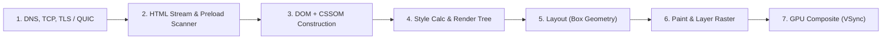
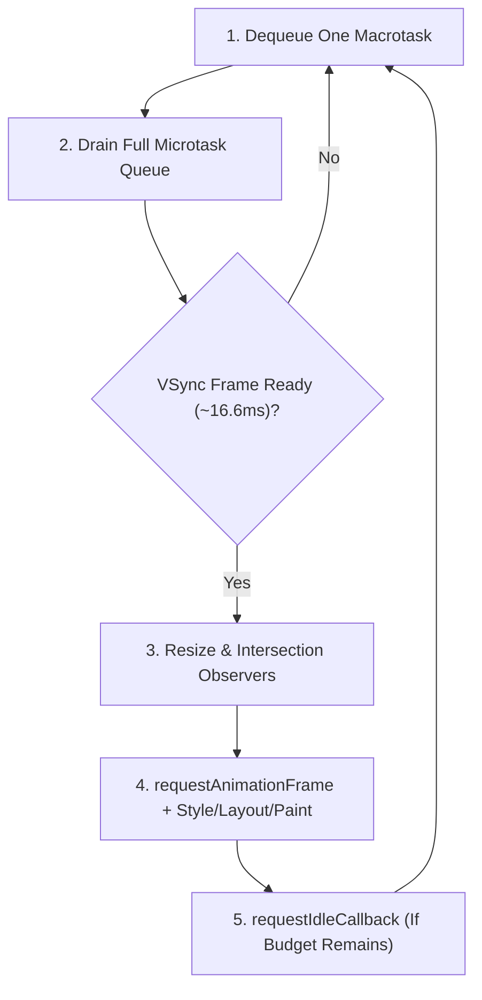

---
tags:
  - programming
  - frontend
  - web-platform
  - browser-internals
  - css
  - web-performance
  - security
  - roadmap
created: 2025-12-29
updated: 2026-11-13
status: 🟢
level: mid-to-senior
---
# Frontend Engineering Roadmap & Web Platform Handbook

> [!abstract] Core Invariant
> Frontend engineering is deterministic state synchronization and pixel delivery across a single-threaded browser runtime constrained by network round-trip latency, main-thread frame budgets (`16.6ms` at 60Hz, `8.3ms` at 120Hz), DOM/CSS layout invalidation rules, and untrusted execution boundaries.

---

## 1. First-Principles Mechanics & Complete Architecture

Mastering modern frameworks without understanding browser internals produces fragile applications that fail Core Web Vitals audits, leak memory across navigations, and break under XSS or CSRF probes. Every framework—React, Next.js, Vue, Svelte, or Solid—ultimately compiles down to **network requests, DOM mutations, CSSOM calculations, and scheduled tasks on the browser main thread**.

### 1.1 End-to-End Learning Roadmap & Role Competency Matrix

Build expertise bottom-up from the browser platform into concurrent UI engines and distributed delivery topologies:


| Competency Domain | Junior Frontend Engineer | Mid-Level Frontend Engineer | Senior / Staff Frontend Engineer |
|---|---|---|---|
| **Browser & Performance** | Understands HTML/CSS/DOM basics and avoids obvious unoptimized images | Audits Network waterfalls, fixes forced reflows, optimizes LCP/CLS using preloads and responsive images | Profiles Long Animation Frames (LoAF), chunks heavy JS via `scheduler.yield()`, manages GPU layer memory and bfcache preservation |
| **JavaScript & Runtime** | Writes `async/await`, closures, and array transforms cleanly | Understands microtask vs macrotask ordering, `AbortController` race cancellation, and memory leak prevention | Designs worker offloading, cooperative main-thread schedulers, and deterministic cross-tab state synchronization |
| **CSS & Layout Systems** | Uses Flexbox and basic Grid utilities | Builds responsive systems via Grid, Flexbox, CSS variables, and avoids `z-index` guesswork | Architects `subgrid`, `@container` queries, `:has()`, `isolation: isolate`, and zero-runtime Tailwind v4 / CSS Module token architectures |
| **Frameworks & Architecture** | Builds feature views with Hooks and component libraries | Applies Split-Context Compound Components, Control Props, virtualization, and React Query caching (`[[Programming/Frontend/React Patterns Guide\|React Patterns Guide]]`) | Designs FSD boundaries, Fiber lane responsiveness (`[[Programming/Frontend/React Complete Guide\|React Complete Guide]]`), RSC/Client splits (`[[Programming/Frontend/Next.js Complete Guide\|Next.js Complete Guide]]`), and `[[Programming/Software Engineering/Architectural Patterns/Microfrontends\|Microfrontends]]` |
| **Security & Delivery** | Escapes inputs and avoids `dangerouslySetInnerHTML` | Configures CORS, `SameSite` cookies, and environment variable boundaries | Implements nonce + `'strict-dynamic'` CSP, Trusted Types, SRI, CSRF Origin verification, and CDN PoP caching (`[[Programming/Software Engineering/System Design/CDN\|CDN]]`) |
| **Tooling & Testing** | Writes basic component unit tests | Configures Vitest, MSW API mocks (`[[Programming/Software Engineering/Testing/Unit Testing\|Unit Testing]]`), and Playwright E2E flows (`[[Programming/Software Engineering/Testing/E2E Testing\|E2E Testing]]`) | Debugs Rollup/ESBuild tree-shaking failures (`sideEffects`), tunes split-chunk budgets, and wires Real-User Monitoring (RUM) telemetry |

---

### 1.2 Browser Critical Rendering Path (Step-by-Step: Wire to Pixels)

Every navigation transforms raw TCP/QUIC packets into composited GPU textures through a strict multi-stage pipeline. Slow First Contentful Paint (FCP) or Largest Contentful Paint (LCP) occurs whenever a resource or script stalls one of these sequential gates.



#### Step 1: Network Connection & TCP Slow Start
1. **DNS Resolution**: Resolves hostname to an IP address (bypassed if cached in OS/browser DNS cache or pre-warmed via `<link rel="preconnect">`).
2. **TCP + TLS 1.3 (or HTTP/3 QUIC)**: Standard HTTPS requires 1 RTT for TCP SYN/ACK plus 1 RTT for TLS 1.3 (`2 RTTs` total before sending `GET /`), whereas HTTP/3 QUIC over UDP combines transport + TLS handshake into `1 RTT` (`0 RTT` on session resumption).
3. **First-Packet Window (`initcwnd` ~14KB)**: TCP slow start limits the initial server burst to ~10 TCP segments (`~14.6KB` compressed). Keeping critical `<head>` tags, inline above-the-fold CSS, and the LCP image URL inside the first `14KB` of HTML allows the browser to discover and paint critical content a full round-trip earlier.

#### Step 2: Streaming HTML Parser & Speculative Preload Scanner
As compressed HTML bytes arrive, the browser tokenizes characters into tags and constructs the **DOM tree incrementally**—it does not wait for `</html>` before discovering resources. When a classic parser-blocking `<script>` pauses main DOM construction, the **Speculative HTML Preload Scanner** runs ahead on a background parser thread scanning raw markup for ``, `<link rel="stylesheet">`, and `<script src>` URLs so network fetches begin immediately in parallel.

> [!warning] Preload Scanner Blindness
> Images or stylesheets injected dynamically via JavaScript (`createElement('img')`, `useEffect` data fetches, or CSS `background-image: url(...)` inside unparsed external stylesheets) are **invisible to the HTML Preload Scanner**. Delaying hero media discovery behind JS hydration adds a full JS download + parse + API waterfall straight onto LCP.

#### Step 3: Script & Resource Hint Execution Semantics

| HTML Tag / Hint | HTML Parser Impact | Render-Blocking? | Execution & Fetch Priority Mechanics |
|---|---|---|---|
| `<script src="app.js">` | **Blocks parser immediately** | Indirectly (pauses DOM) | Waits for any pending `<link rel="stylesheet">` CSSOM to download/parse first, then executes synchronously before resuming HTML parsing |
| `<script defer src="app.js">` | Non-blocking (parallel fetch) | No | Executes **in document order** after HTML parsing completes, immediately before `DOMContentLoaded` |
| `<script async src="app.js">` | Non-blocking (parallel fetch) | No | Executes **immediately upon download completion** (pauses HTML parser if still parsing); non-deterministic order |
| `<script type="module" src="app.js">` | Non-blocking (auto-deferred) | No | Resolves ESM dependency graph recursively; top-level `await` blocks execution of importing modules and delays hydration |
| `<link rel="stylesheet">` | Non-blocking for HTML tokens | **Yes** (blocks Paint & classic inline `<script>`) | Split non-matching viewports (`media="print"`, `media="(min-width: 1024px)"`) so browsers fetch them at low priority without blocking first paint |
| `<link rel="preconnect" crossorigin>` | None | No | Opens DNS + TCP + TLS sockets early for critical third-party CDN/font origins; cap to `2–4` critical origins to avoid socket contention |
| `<link rel="preload" as="image" fetchpriority="high">` | None | No | Forces immediate high-priority fetch on current navigation (must actually be used within `3s` or Chrome logs an unused preload penalty) |
| `<link rel="prefetch" as="script">` | None | No | Low-priority idle fetch stored in HTTP cache for **next** likely route navigation |
| `<link rel="modulepreload">` | None | No | Fetches AND parses/compiles an ES module graph ahead of execution, avoiding staggered ESM waterfall discovery |

#### Step 4: CSSOM, Style Calculation & Render Tree
The browser parses CSS rules into the **CSSOM** (right-to-left selector matching against DOM nodes) and combines `DOM + CSSOM` into the **Render Tree**, containing ONLY visible nodes (`display: none` nodes and `<head>` metadata are omitted entirely; `visibility: hidden` nodes remain in the Render Tree because they occupy layout box space). Because CSS rules cascade, the browser blocks First Paint until all render-blocking CSSOM completes—preventing Flash of Unstyled Content (FOUC)—and blocks classic `<script>` execution while pending CSSOM downloads because JavaScript may synchronously query computed CSS styles.

#### Step 5: Layout (Reflow) & Synchronous Layout Thrashing
**Layout** traverses the Render Tree from `<html>` downward, resolving percentage widths, flex/grid tracks, line-wrapping heights, and viewport coordinates into exact pixel bounding boxes.

Normally, Blink/Gecko batch style mutations lazily until the end of the frame before paint. However, reading geometric layout metrics immediately after mutating styles forces the engine to flush pending Style + Layout synchronously inside JavaScript—known as **Forced Synchronous Layout (Layout Thrashing)**:

```typescript
// Layout reads that force synchronous Layout when dirtied by prior DOM writes:
// element.offsetTop / offsetLeft / offsetWidth / offsetHeight
// element.clientWidth / clientHeight / scrollWidth / scrollHeight / scrollTop
// element.getBoundingClientRect() / getClientRects()
// window.getComputedStyle(element) (when reading layout-dependent properties like width/height)
```

Interleaving `write -> read -> write -> read` inside a `400`-item loop forces `400` full-tree layout passes in a single task (`~1ms * 400 = 400ms`), exhausting frame budgets and stalling INP. Batching all reads before all writes (or deferring writes into `requestAnimationFrame`) reduces `400` reflows to `1`.

#### Step 6 & 7: Paint, Layer Promotion & GPU Composite
**Paint** converts Render Tree boxes into display-list draw commands (`drawRect`, `drawText`, `drawShadow`) rasterized into bitmap tiles. The **Compositor** splits promoted DOM layers onto separate GPU textures and shifts/blends those textures at `60–120Hz` on the compositor thread—completely bypassing the main thread.

| Animated CSS Property | Pipeline Stages Triggered | Main-Thread Cost | Production Guidance |
|---|---|---|---|
| `width`, `height`, `top`, `left`, `margin`, `padding` | **Layout -> Paint -> Composite** | Severe (CPU reflow + re-raster every frame) | Never animate inside `requestAnimationFrame` or CSS transitions on large trees |
| `background-color`, `box-shadow`, `border-color` | **Paint -> Composite** | Moderate (CPU tile re-rasterization) | Acceptable on tiny elements; expensive on full-screen surfaces |
| `transform` (`translate3d`, `scale`, `rotate`), `opacity` | **Composite only** (GPU thread) | Zero main-thread work per frame | Standard target for drawers, virtualizer rows, tooltips, and skeletons |

> [!warning] GPU Layer Explosion (`will-change: transform`)
> Applying `will-change: transform` promotes an element onto its own dedicated GPU texture unconditionally. Applying it globally (`* { will-change: transform; }` or on 500 virtualized cards) allocates hundreds of megabytes of VRAM bitmap memory, causing mobile tab crashes. Apply `will-change` selectively only on actively animating elements or remove it once transitions finish.

---

### 1.3 Browser Event Loop & Cooperative Task Scheduling Deep Dive

JavaScript executes on a **single main thread** shared with DOM layout, style recalculation, Paint, and user input dispatch. A task running longer than `50ms` blocks every pointer click and keyboard event behind it.



1. **Macrotask Execution**: Each turn picks **one** task from prioritized task queues (browsers prioritize user-input tasks ahead of `setTimeout` timers or background network tasks).
2. **Microtask Checkpoint (Unbounded Drain)**: Immediately after the macrotask stack clears, the engine drains the **entire microtask queue** (`Promise.then`, `await` continuations, `queueMicrotask`, `MutationObserver`)—including any new microtasks queued *while* draining. Recursive `queueMicrotask` starves the rendering phase indefinitely, freezing CSS animations and user clicks.
3. **Render Opportunity (At VSync Cadence, e.g., `16.6ms` or `8.3ms`)**:
   - Processes `ResizeObserver` and `IntersectionObserver` callbacks.
   - Invokes `requestAnimationFrame` (`rAF`) callbacks so visual mutations apply before the upcoming frame commits.
   - Executes **Style -> Layout -> Paint -> Composite** (which `useLayoutEffect` in React runs synchronously right around DOM commit before Paint).
4. **Idle Window**: Executes `requestIdleCallback` callbacks with an `IdleDeadline` (`timeRemaining()`) only if time remains before the next VSync tick.

#### Long Tasks (`> 50ms`), Long Animation Frames (LoAF) & `scheduler.yield()`

Chrome classifies any continuous JavaScript task exceeding `50ms` as a **Long Task**, and ships the **Long Animation Frames (LoAF) API** (`long-animation-frame` performance entries) to attribute exact script URLs, function names, and layout/style durations causing poor Interaction to Next Paint (INP).

Historically, engineers chunked heavy loops using `await new Promise(r => setTimeout(r, 0))`. However, `setTimeout(0)` appends the continuation to the **back** of the macrotask queue behind unrelated third-party analytics/ad scripts and suffers a `>= 4ms` browser clamp after nesting depth `5`.

Modern browsers provide the Prioritized Task Scheduling API:
- **`scheduler.postTask(fn, { priority, signal })`**: Schedules discrete work across `'user-blocking'` (highest), `'user-visible'` (default), and `'background'` (lowest) lanes with cancellable `TaskController` abort semantics.
- **`await scheduler.yield()`**: Yields control cleanly to pending browser paints and urgent user input events while placing the remaining continuation into a **prioritized continuation queue** ahead of unrelated background tasks.

---

## 2. Real-World Use Cases & Decision Matrix

### 2.1 Rendering Topology Selection Matrix

Never default blindly to SSR or SPA; align rendering architecture with crawlability, TTFB budget, data freshness, and interactive churn:

| Topology | Primary Strengths | Primary Weaknesses | Optimal Use Case |
|---|---|---|---|
| **Static SSG / Edge CDN** | Sub-50ms global TTFB; zero origin compute per request | Slow rebuilds on `>10k` pages without incremental invalidation | Marketing sites, docs, changelogs (`[[Programming/Software Engineering/System Design/CDN\|CDN]]`) |
| **Streaming SSR + PPR (Next.js 15)** | Instant static shell + parallel personalized streaming holes; zero RSC bundle JS | Requires Node/Edge compute runtime; strict Server/Client module split | E-commerce catalogs, SaaS landing + authenticated header (`[[Programming/Frontend/Next.js Complete Guide\|Next.js Complete Guide]]`) |
| **CSR SPA (Vite + React 19 + TanStack Router)** | `$0` SSR server scaling; instant client transitions; clean binary/WS telemetry handling | Initial blank/spinner shell until JS downloads; no search-engine HTML pre-hydration | Authenticated B2B consoles, Kubernetes dashboards, IDE/canvas apps |
| **Microfrontends** | Independent team deploys across large orgs (`>50` engineers) | Shared dependency duplication, cross-app routing/auth friction, CSS leakage | Multi-domain enterprise suites with distinct release cadences (`[[Programming/Software Engineering/Architectural Patterns/Microfrontends\|Microfrontends]]`) |

### 2.2 CSS Architecture & Styling Strategy Matrix

| Approach | Runtime JS Overhead | RSC Compatible? | Dynamic Theming | Bundle & Specificity Behavior |
|---|---|---|---|---|
| **Tailwind CSS v4 (`@theme`)** | `0 B` | **Yes** | CSS Custom Properties (`oklch` tokens) | Single deduplicated CSS stylesheet via `@layer`; zero specificity wars via Lightning CSS |
| **CSS Modules + Lightning CSS** | `0 B` | **Yes** | CSS Custom Properties (`var(--...)`) | Locally scoped hashed class names; exact native CSS cascade control |
| **Zero-Runtime CSS-in-JS** (Vanilla Extract / Panda CSS) | `0 B` | **Yes** | Typed CSS vars extracted at build time | Type-safe TS token ergonomics compiled to static CSS files |
| **Runtime CSS-in-JS** (Styled Components / Emotion) | `~12–20 KB` + `useInsertionEffect` style recalc | **No** (breaks Server Components) | JS context props | Inserts `<style>` rules on render; hurts INP under high-frequency table/list renders |

### 2.3 Module Bundlers & Build Pipeline Matrix

Modern frontend builds rely on **static ES Module (`import`/`export`) AST graphs** rather than CommonJS (`require()`). CommonJS binds properties dynamically at runtime, making dead-code elimination (`tree-shaking`) impossible for bundlers when modules execute side effects or re-export dynamically.

| Bundler / Tool | Dev Server Architecture | Production Chunk Engine | Key Production Differentiator |
|---|---|---|---|
| **Vite (ESBuild + Rollup / Rolldown)** | Unbundled native browser ESM + ESBuild pre-bundling of `node_modules` | Rollup (migrating to Rust Rolldown) `manualChunks` + scope hoisting | Sub-second cold start & instant HMR independent of total app size |
| **Next.js Turbopack** | Incremental function-level Rust graph computation | Turbopack / Webpack split chunks | Unified RSC Server + Client module graph boundaries |
| **Rspack / Webpack 5** | In-memory bundle or lazy compilation | Deterministic Module Federation + splitChunks | Required primarily for legacy Module Federation microfrontends |

**Tree-Shaking Invariant**: Bundlers eliminate unused exports ONLY when (1) code uses ESM static `import`/`export`, (2) the package `package.json` declares `"sideEffects": false` (or `["*.css"]` so stylesheets are preserved!), and (3) pure top-level calls are annotated `/*#__PURE__*/` where necessary.

---

## 3. Step-by-Step Practical Application ("How to Build With It in Production")

### 3.1 Modern CSS Architecture: `subgrid`, `@container`, `:has()`, Stacking & Tailwind v4

Modern CSS eliminates JavaScript `ResizeObserver` layout hacks and brittle global `z-index: 9999` escalation.

#### 1. Tailwind v4 CSS-First Design Tokens (`src/app/styles/globals.css`)

Tailwind v4 replaces `tailwind.config.js` with native CSS `@theme` blocks compiled directly by Lightning CSS, generating runtime CSS custom properties automatically:

```css
@import "tailwindcss";

@theme {
  --color-surface-primary: oklch(0.99 0.005 250);
  --color-surface-elevated: oklch(1 0 0);
  --color-brand-600: oklch(0.55 0.22 260);
  --font-sans: "Inter Variable", system-ui, -apple-system, sans-serif;
  --radius-card: 0.75rem;
}

/* Enforce isolated stacking contexts on overlay-bearing shells cleanly */
@utility isolate-stack {
  isolation: isolate;
}
```

#### 2. `subgrid`, `@container`, `:has()`, and Stacking/Containing Block Mastery (`src/shared/styles/layouts.css`)

Look closely at the four critical layout patterns combined below:
1. **CSS Grid `subgrid`**: Aligns card titles, variable-length descriptions, and bottom action bars horizontally across all cards in a row without fixing rigid pixel heights.
2. **Container Queries (`@container`)**: Adapts a metric widget based on its **parent column width** (`container-type: inline-size`) rather than the global viewport `@media` width—making widgets portable between a `280px` sidebar and a `900px` main canvas.
3. **Relational `:has()`**: Styles parent forms or rows strictly in CSS when a descendant input enters `:invalid` or `:checked` state without React state re-renders.
4. **`isolation: isolate` & Containing Block Safety**: Creates a localized stacking context on `.card-shell` so internal badges (`z-index: 10`) never bleed over external portals/tooltips (`z-index: 50`), while keeping `transform`/`filter` **off** ancestors that wrap `position: fixed` drawers (since applying `transform: translateX(0)` or `filter` converts an ancestor into a containing block that traps `position: fixed` inside that box instead of the viewport).

```css
.dashboard-grid {
  display: grid;
  grid-template-columns: repeat(auto-fit, minmax(280px, 1fr));
  gap: 1.25rem;
}

/* Each card spans 3 implicit subgrid tracks: header, body, footer */
.dashboard-card {
  display: grid;
  grid-template-rows: subgrid;
  grid-row: span 3;
  isolation: isolate; /* Prevents internal z-index children from leaking above page modals */
  container-type: inline-size;
  container-name: metric-card;
  background: var(--color-surface-elevated);
  border-radius: var(--radius-card);
  border: 1px solid oklch(0.9 0.01 250);
  padding: 1rem;
  gap: 0.75rem;
}

.card-kpi-row {
  display: flex;
  flex-direction: column;
  gap: 0.5rem;
}

/* Adapts cleanly inside narrow sidebars OR wide dashboard slots */
@container metric-card (min-width: 360px) {
  .card-kpi-row {
    flex-direction: row;
    align-items: baseline;
    justify-content: space-between;
  }
}

/* Pure CSS validation feedback without JS state churn */
.checkout-form:has(input:user-invalid) .submit-cta {
  opacity: 0.55;
  cursor: not-allowed;
}

/* Offscreen section skipping layout/paint until scrolled near viewport */
.below-fold-section {
  content-visibility: auto;
  contain-intrinsic-size: auto 480px;
}

/* Safe mobile full-height layout avoiding Safari address-bar jump */
.app-viewport {
  min-height: 100dvh;
}
```

---

### 3.2 Cooperative Main-Thread Scheduling & Long Animation Frame (LoAF) Telemetry

When client code must process `20,000` telemetry rows, parse large JSON/CSV payloads, or serialize export buffers on the main thread, break execution every `~16ms` using `scheduler.yield()` so browser input events and frame paints preempt cleanly (`INP <= 200ms`).

```typescript
// src/shared/lib/mainThreadScheduler.ts

interface SchedulerWithYield {
  yield?: () => Promise<void>;
  postTask?: <T>(
    callback: () => T,
    options?: { priority?: 'user-blocking' | 'user-visible' | 'background'; signal?: AbortSignal }
  ) => Promise<T>;
}

export async function yieldToMainThread(signal?: AbortSignal): Promise<void> {
  if (signal?.aborted) {
    throw new DOMException('Task aborted', 'AbortError');
  }

  const schedulerApi = (globalThis as { scheduler?: SchedulerWithYield }).scheduler;
  if (typeof schedulerApi?.yield === 'function') {
    await schedulerApi.yield();
  } else {
    // Fallback yields a macrotask turn so pending paints and pointer events run first
    await new Promise<void>((resolve) => setTimeout(resolve, 0));
  }

  if (signal?.aborted) {
    throw new DOMException('Task aborted', 'AbortError');
  }
}

export async function processRecordsInChunks<TInput, TOutput>(
  records: ReadonlyArray<TInput>,
  transform: (item: TInput, index: number) => TOutput,
  options: { frameBudgetMs?: number; signal?: AbortSignal } = {}
): Promise<TOutput[]> {
  const { frameBudgetMs = 12, signal } = options;
  const output: TOutput[] = new Array(records.length);
  let sliceStart = performance.now();

  for (let i = 0; i < records.length; i++) {
    const record = records[i];
    if (record !== undefined) {
      output[i] = transform(record, i);
    }

    // Check deadline periodically instead of calling performance.now() on every tiny item
    if ((i & 63) === 63 && performance.now() - sliceStart >= frameBudgetMs) {
      await yieldToMainThread(signal);
      sliceStart = performance.now();
    }
  }

  return output;
}

// Long Animation Frame (LoAF) RUM Observer attributing slow INP frames to exact script origins
export function observeLongAnimationFrames(
  report: (payload: { durationMs: number; blockingMs: number; culpritScript: string }) => void
): () => void {
  if (
    typeof PerformanceObserver === 'undefined' ||
    !PerformanceObserver.supportedEntryTypes?.includes('long-animation-frame')
  ) {
    return () => {};
  }

  const observer = new PerformanceObserver((list) => {
    for (const entry of list.getEntries()) {
      const loaf = entry as PerformanceEntry & {
        blockingDuration?: number;
        scripts?: Array<{ sourceURL?: string; invoker?: string; duration?: number }>;
      };
      const slowestScript = loaf.scripts?.reduce((prev, curr) =>
        (curr.duration ?? 0) > (prev.duration ?? 0) ? curr : prev
      );
      report({
        durationMs: Math.round(loaf.duration),
        blockingMs: Math.round(loaf.blockingDuration ?? 0),
        culpritScript: slowestScript?.sourceURL || slowestScript?.invoker || 'unknown',
      });
    }
  });

  observer.observe({ type: 'long-animation-frame', buffered: true });
  return () => observer.disconnect();
}
```

---

### 3.3 Core Web Vitals Production HTML/Head & `bfcache` Blueprint

Guarantee `< 2.5s` LCP, `<= 0.1` CLS, and instant Back/Forward Cache (`bfcache`) instant restores by ordering critical `<head>` hints explicitly and reserving layout box dimensions:

```html
<!doctype html>
<html lang="en">
  <head>
    <meta charset="UTF-8" />
    <meta name="viewport" content="width=device-width, initial-scale=1.0" />
    <title>Enterprise Console</title>

    <!-- 1. Pre-warm TLS socket to critical CDN media origin (limit to top 2-4 origins) -->
    <link rel="preconnect" href="https://cdn.example.com" crossorigin />

    <!-- 2. Inline critical layout CSS (< 14KB) or single render-blocking stylesheet -->
    <link rel="stylesheet" href="/assets/critical.css" />

    <!-- 3. Preload LCP hero asset & font explicitly with fetchpriority="high" -->
    <link
      rel="preload"
      as="image"
      href="https://cdn.example.com/hero-800.avif"
      imagesrcset="https://cdn.example.com/hero-800.avif 800w, https://cdn.example.com/hero-1600.avif 1600w"
      imagesizes="(max-width: 768px) 100vw, 1200px"
      fetchpriority="high"
    />
    <link
      rel="preload"
      as="font"
      type="font/woff2"
      href="/fonts/inter-var.woff2"
      crossorigin
    />

    <!-- 4. Modulepreload entry script graph without blocking HTML parsing -->
    <link rel="modulepreload" href="/assets/entry.js" />
    <script type="module" src="/assets/entry.js"></script>
  </head>
  <body>
    <main>
      <!-- Never apply loading="lazy" to above-the-fold LCP media; explicit width/height locks CLS = 0 -->
      <picture>
        <source
          type="image/avif"
          srcset="https://cdn.example.com/hero-800.avif 800w, https://cdn.example.com/hero-1600.avif 1600w"
          sizes="(max-width: 768px) 100vw, 1200px"
        />
        
      </picture>
    </main>
  </body>
</html>
```

**Font & `bfcache` Preservations**:
1. Declare `font-display: swap` paired with metric-matched fallback descriptors (`size-adjust`, `ascent-override`, `descent-override` — generated automatically by `next/font`) so fallback text renders immediately without layout jump when the webfont swaps in.
2. **Preserve `bfcache` (instant browser Back/Forward)**: NEVER attach `window.addEventListener('unload', ...)` (always use `pagehide` instead), NEVER serve user-navigable HTML with `Cache-Control: no-store` unless holding sensitive PII/banking views (`no-cache, private` allows `bfcache` while still revalidating with origin on fresh clicks), and close open `WebSocket` / `BroadcastChannel` / `IndexedDB` locks inside `pagehide`, reopening them on `pageshow` (`event.persisted`).

---

### 3.4 Frontend Security (OWASP Browser Defenses)

Modern frontend apps face Stored/Reflected/DOM XSS, CSRF state mutations, misconfigured CORS credential leaks, and compromised third-party supply-chain scripts. Defend strictly at HTTP header, runtime sink, and origin validation layers.

#### 1. Nonce-Based CSP (`'strict-dynamic'`) + Security Headers Middleware

Avoid brittle domain allowlists (`script-src https://*.googleapis.com`) and never ship `'unsafe-inline'` or `'unsafe-eval'` in production. Generate a fresh cryptographic `128-bit` base64 nonce per HTML response so only server-authorized scripts (and scripts dynamically loaded by those authorized scripts via `'strict-dynamic'`) can execute:

```typescript
// src/server/securityHeaders.ts (Edge / Node Response Middleware)
export function createSecurityHeaders(nonce: string): Record<string, string> {
  const cspDirectives = [
    "default-src 'self'",
    // 'strict-dynamic' delegates trust from nonce-verified root scripts to dynamic chunks;
    // 'unsafe-inline' is ignored by modern browsers when a nonce is present (kept only as old fallback).
    `script-src 'nonce-${nonce}' 'strict-dynamic' https: 'unsafe-inline'`,
    "style-src 'self' 'unsafe-inline'",
    "img-src 'self' data: https://cdn.example.com",
    "font-src 'self' https://fonts.gstatic.com",
    "connect-src 'self' https://api.example.com wss://realtime.example.com",
    "object-src 'none'",
    "base-uri 'none'",
    "frame-ancestors 'none'",
    "require-trusted-types-for 'script'",
    "trusted-types dompurify-sanitizer default",
  ];

  return {
    'Content-Security-Policy': cspDirectives.join('; '),
    'Strict-Transport-Security': 'max-age=63072000; includeSubDomains; preload',
    'X-Content-Type-Options': 'nosniff',
    'Referrer-Policy': 'strict-origin-when-cross-origin',
    'Permissions-Policy': 'camera=(), microphone=(), geolocation=()',
  };
}
```

#### 2. Trusted Types DOM XSS Defense + Subresource Integrity (SRI)

Enforcing `require-trusted-types-for 'script'` causes Chromium to throw a `TypeError` if any developer or third-party dependency assigns raw strings directly to dangerous DOM XSS sinks (`element.innerHTML`, `document.write`, `eval`, `script.src`). Route every required HTML sanitization strictly through a single audited Trusted Types policy:

```typescript
// src/shared/lib/sanitizeHtml.ts
import DOMPurify from 'dompurify';

interface TrustedTypesApi {
  createPolicy: (
    name: string,
    rules: { createHTML: (dirty: string) => string }
  ) => { createHTML: (dirty: string) => unknown };
}

const sanitizerPolicy = (() => {
  if (typeof window === 'undefined') return null;
  const tt = (window as unknown as { trustedTypes?: TrustedTypesApi }).trustedTypes;
  return tt
    ? tt.createPolicy('dompurify-sanitizer', {
        createHTML: (dirty: string) =>
          DOMPurify.sanitize(dirty, { USE_PROFILES: { html: true } }),
      })
    : null;
})();

export function setSafeInnerHtml(target: HTMLElement, untrustedHtml: string): void {
  if (sanitizerPolicy) {
    // Satisfies Chromium TrustedHTML enforcement directly
    target.innerHTML = sanitizerPolicy.createHTML(untrustedHtml) as string;
  } else {
    target.innerHTML = DOMPurify.sanitize(untrustedHtml, { USE_PROFILES: { html: true } });
  }
}
```

Whenever loading external third-party scripts (payment SDKs, CAPTCHA, CDN libraries), lock byte-level integrity using **Subresource Integrity (SRI)**:

```html
<script
  src="https://cdn.thirdparty.com/sdk/v4.2.0/checkout.min.js"
  integrity="sha384-oqVuAfXRKap7fdgcCY5uykM6+R9GqQ8K/uxy9rx7HNQlGYl1kPzQho1wx4JwY8w"
  crossorigin="anonymous"
  defer
></script>
```

#### 3. CSRF Protection & Strict CORS Preflight Validation

- **Session Cookie Invariants**: Issue auth cookies with `HttpOnly; Secure; SameSite=Lax; Path=/` (`HttpOnly` blocks JS `document.cookie` theft during XSS; `SameSite=Lax` withholds cookies on cross-site `POST` form/fetch CSRF attacks while preserving top-level `GET` navigation links).
- **Mutating Origin Guard**: Verify `Origin` (or `Sec-Fetch-Site === 'same-origin'`) on every `POST`/`PUT`/`PATCH`/`DELETE` handler.
- **CORS Rule**: **NEVER** return `Access-Control-Allow-Origin: *` alongside `Access-Control-Allow-Credentials: true` (browsers reject it outright, and reflecting an arbitrary request `Origin` header blindly allows credentialed cross-site data exfiltration from any malicious domain!). Validate against an exact allowlist set (`ALLOWED_ORIGINS.has(origin)`) and return `Vary: Origin` plus `Access-Control-Max-Age: 86400` to cache preflight `OPTIONS` round-trips.

---

### 3.5 Module Bundler Config (`vite.config.ts`), MSW v2 & Testing Pyramid

Configure Rollup chunking to isolate long-lived vendor code from volatile app routes while verifying contracts via Vitest + MSW v2 (`[[Programming/Software Engineering/Testing/Unit Testing|Unit Testing]]`) and Playwright (`[[Programming/Software Engineering/Testing/E2E Testing|E2E Testing]]`):

```typescript
// vite.config.ts
import { defineConfig } from 'vite';
import react from '@vitejs/plugin-react';
import tailwindcss from '@tailwindcss/vite';

export default defineConfig({
  plugins: [react(), tailwindcss()],
  build: {
    target: 'es2022',
    sourcemap: 'hidden', // Upload to Sentry/Datadog without exposing source URLs publicly
    chunkSizeWarningLimit: 350,
    rollupOptions: {
      output: {
        // Long-term CDN caching: vendor hash stays stable across daily feature deploys
        manualChunks(id) {
          if (id.includes('node_modules/react/') || id.includes('node_modules/react-dom/')) {
            return 'vendor-react';
          }
          if (id.includes('node_modules/@tanstack/')) {
            return 'vendor-tanstack';
          }
          if (id.includes('node_modules/zod')) {
            return 'vendor-validation';
          }
          return undefined;
        },
      },
    },
  },
});
```

Inside `package.json` of any internal UI library package, explicitly preserve CSS files during tree-shaking so bundlers eliminate unused JS components without stripping imported stylesheets:

```json
{
  "name": "@acme/design-system",
  "sideEffects": ["**/*.css"]
}
```

#### MSW v2 + Vitest Integration & Playwright E2E Hydration Gate

```typescript
// tests/integration/auditFeed.test.tsx
import { afterAll, afterEach, beforeAll, describe, expect, it } from 'vitest';
import { http, HttpResponse } from 'msw';
import { setupServer } from 'msw/node';
import { render, screen } from '@testing-library/react';
import { QueryClient, QueryClientProvider } from '@tanstack/react-query';
import { AuditVirtualTable } from '../../src/widgets/audit-table/ui/AuditVirtualTable';

const server = setupServer(
  http.get('/api/audit-events', () =>
    HttpResponse.json({
      items: [
        {
          id: 'evt-1',
          dateLabel: '2026-11-13',
          timestamp: '14:22:01Z',
          actor: 'deploy-bot',
          detail: 'Promoted release v4.18.0',
        },
      ],
      nextCursor: null,
    })
  )
);

beforeAll(() => server.listen({ onUnhandledRequest: 'error' }));
afterEach(() => server.resetHandlers());
afterAll(() => server.close());

describe('AuditVirtualTable network integration', () => {
  it('renders fetched audit entries cleanly', async () => {
    const queryClient = new QueryClient({ defaultOptions: { queries: { retry: false } } });
    render(
      <QueryClientProvider client={queryClient}>
        <AuditVirtualTable />
      </QueryClientProvider>
    );

    expect(await screen.findByText('deploy-bot')).toBeInTheDocument();
  });
});
```

```typescript
// tests/e2e/checkout.spec.ts (Playwright)
import { expect, test } from '@playwright/test';

test('applies promo code cleanly post-hydration with zero console errors and low CLS', async ({ page }) => {
  const consoleErrors: string[] = [];
  page.on('console', (msg) => {
    if (msg.type() === 'error') consoleErrors.push(msg.text());
  });

  await page.goto('/checkout');

  // Auto-wait on deterministic interactive state instead of brittle waitForTimeout()
  const applyBtn = page.getByRole('button', { name: 'Apply Promo' });
  await expect(applyBtn).toBeEnabled();

  await page.getByLabel('Promo Code').fill('SAVE20');
  await applyBtn.click();
  await expect(page.getByTestId('discount-line')).toHaveText('-$20.00');

  const clsScore = await page.evaluate(() => {
    return performance
      .getEntriesByType('layout-shift')
      .filter((e) => !(e as PerformanceEntry & { hadRecentInput?: boolean }).hadRecentInput)
      .reduce((sum, e) => sum + ((e as PerformanceEntry & { value?: number }).value ?? 0), 0);
  });

  expect(clsScore).toBeLessThan(0.1);
  expect(consoleErrors).toEqual([]);
});
```

---

## 4. Complete Reference Matrix, OWASP Threats & Browser Edge Cases

### 4.1 Core Web Vitals Engineering Reference (p75 Field Targets)

Google Search and Chrome UX Report (CrUX) evaluate real-user telemetry at the **75th percentile (p75)** across mobile and desktop origin cohorts over rolling 28-day windows:

| Vital | Good (p75) | Poor (p75) | Sub-Phase Breakdown | Deterministic Engineering Mitigations |
|---|---|---|---|---|
| **LCP** (Largest Contentful Paint) | `<= 2.5s` | `> 4.0s` | `TTFB + Resource Load Delay + Resource Load Duration + Element Render Delay` | Serve HTML via `[[Programming/Software Engineering/System Design/CDN\|CDN]]` PoPs; emit LCP `` URL in initial HTML (zero JS/fetch waterfall); drop `loading="lazy"`; set `fetchpriority="high"`; serve AVIF/WebP `srcset` |
| **INP** (Interaction to Next Paint) | `<= 200ms` | `> 500ms` | `Input Delay + Event Handler Duration + Presentation Delay` (worst ~p98 interaction) | Break tasks `> 50ms` via `scheduler.yield()`; wrap non-urgent React transitions in `startTransition`; virtualize long tables; apply `content-visibility: auto` off-screen |
| **CLS** (Cumulative Layout Shift) | `<= 0.1` | `> 0.25` | `Impact Fraction * Distance Fraction` per `5s` session window (`500ms` grace after click/key) | Reserve explicit `width`/`height` or `aspect-ratio` on images/embeds/ads/skeletons; match fallback font metrics (`size-adjust`); animate exclusively via `transform` |
| **TTFB** (Time to First Byte) | `<= 800ms` | `> 1.8s` | `Redirect + DNS + TCP + TLS + Origin Processing` | Enable HTTP/3 QUIC, 0-RTT TLS resumption, `[[Programming/Software Engineering/System Design/CDN\|CDN]]` `s-maxage` + `stale-while-revalidate`, and Streaming SSR / PPR |

---

### 4.2 OWASP Frontend Threat & Mitigation Matrix

| Threat Vector | Injection / Abuse Mechanism | High-Risk Browser Sinks & Headers | Required Engineering Defense |
|---|---|---|---|
| **Stored / Reflected XSS** | Attacker-persisted profile/comment string rendered unescaped in HTML template | Server string concatenation, `res.send(rawHtml)` | Auto-escaping templates (React JSX / server escape), strict `Content-Security-Policy` with per-request nonces + `'strict-dynamic'` |
| **DOM-Based XSS** | URL hash, query param, or `postMessage` payload written into executable DOM APIs | `element.innerHTML`, `outerHTML`, `document.write`, `eval`, `new Function`, `href="javascript:..."` | Enforce `require-trusted-types-for 'script'`, route sanitized markup through a single DOMPurify Trusted Types policy, validate `URL.protocol` (`https:`/`http:`) |
| **Prototype Pollution** | Unsanitized JSON keys (`__proto__`, `constructor.prototype`) merged recursively into JS objects | Deep merge utilities (`merge(target, untrustedInput)`), query string parsers | Use `Object.create(null)` for lookup maps, guard keys (`key === '__proto__' \|\| key === 'constructor'`), validate schemas strictly with Zod |
| **CSRF (Cross-Site Request Forgery)** | Third-party page triggers hidden `<form>` POST or `fetch` carrying victim's ambient browser cookies | Cookie-authenticated endpoints without `SameSite` or origin enforcement | Set `SameSite=Lax; HttpOnly; Secure`; verify `Origin` / `Sec-Fetch-Site` on all state-mutating endpoints |
| **Credentialed CORS Leak** | API echoes arbitrary `Origin` header alongside `Access-Control-Allow-Credentials: true` | `res.setHeader('Access-Control-Allow-Origin', req.headers.origin)` | Validate `Origin` against an explicit static `Set<string>` allowlist; return `Vary: Origin`; never pair `*` with credentials |
| **Third-Party Supply-Chain Skimming** | Compromised CDN script or analytics tag reads credit card inputs or monkey-patches `window.fetch` | External `<script src="https://...">` without cryptographic pinning | Pin exact versions + `integrity="sha384-..." crossorigin="anonymous"` (SRI); isolate untrusted widgets inside sandboxed `<iframe>` without `allow-same-origin` |

---

### 4.3 Subtle Browser, CSS & Bundler Edge Cases

1. **`bfcache` (Back/Forward Cache) Invalidation Traps**: Modern Chromium, Firefox, and Safari snapshot the full JS heap and DOM layout into memory for instant `0ms` Back/Forward navigation *unless* invalidated by:
   - Attaching any `window.addEventListener('unload', ...)` handler (always replace `unload` with `pagehide` / `visibilitychange`).
   - Serving HTML pages with `Cache-Control: no-store` (for static or public/semi-dynamic pages, prefer `no-cache` so bfcache stays eligible while fresh loads still revalidate).
   - Leaving open `IndexedDB` transactions, `WebSocket`, or `BroadcastChannel` locks alive on `pagehide` (close connections in `pagehide` and restore them in `pageshow` when `event.persisted === true`).
2. **Containing Block Capture (`transform` Breaking `position: fixed`)**: Applying `transform`, `filter`, `perspective`, `backdrop-filter`, or `contain: layout|paint` on *any* ancestor turns that ancestor into the **containing block** for `position: fixed` descendants—causing drawers or modals inside animated page containers to scroll away or clip instead of pinning to the browser viewport. Always portal fixed overlays to `document.body` or ensure transformed page wrappers wrap *only* static content.
3. **Nested Timer Clamping vs `scheduler.yield()`**: Per the HTML Living Standard, nested `setTimeout(fn, 0)` calls beyond nesting depth `5` are artificially clamped by browsers to `>= 4ms` per iteration, inflating chunked loops by `4ms * N`. Furthermore, `setTimeout` places work behind third-party timers. Use `scheduler.yield()` where supported to yield strictly to paint/input while keeping higher continuation priority.
4. **Barrel File (`export *`) Tree-Shaking Failure**: Importing `import { CalendarIcon } from '@acme/icons'` when `@acme/icons/index.ts` re-exports `1,500` icons via `export *` forces Vite dev server and unconfigured Rollup builds to parse all `1,500` modules if `"sideEffects": false` is missing or if modules contain top-level side effects (`Object.defineProperty`, polyfills). Always declare `"sideEffects"` accurately in `package.json` and check production bundle maps.
5. **Mobile Viewport `100vh` Jump**: On mobile Safari and Chrome Android, `100vh` equals the **largest** viewport height with the browser URL bar collapsed, clipping bottom sticky action bars on initial load. Use `min-height: 100dvh` (dynamic) or `100svh` (small, guaranteed visible without resize jitter).

---

## 5. Production Debugging, Profiling & Chrome DevTools Playbook

| Symptom | Root Cause | Chrome DevTools / CLI Diagnostic Protocol | Fix |
|---|---|---|---|
| **p75 LCP `> 3.5s` on Fast Origin (`TTFB = 120ms`)** | Client-side data/JS waterfall hiding LCP ``, `loading="lazy"` on hero, or oversized `3MB` PNG | 1. Open **DevTools Network** -> throttle to *Fast 4G*, sort by Waterfall Start Time. 2. Open **Performance** -> inspect **LCP** marker & sub-phase breakdown (*Resource Load Delay* vs *Load Duration*). 3. Check `<head>` for `preconnect` / `preload` | Emit hero `` directly in SSR HTML; drop `loading="lazy"`; add `fetchpriority="high"` + `<link rel="preload">` + responsive AVIF `srcset` |
| **Input Clicks Freeze `300–600ms` (INP `> 200ms`)** | Long Tasks (`> 50ms`), forced synchronous reflow inside loops, or huge synchronous DOM commits | 1. Open **Performance** -> record click interaction -> inspect **Interactions** track (*Input Delay*, *Processing Duration*, *Presentation Delay*). 2. Expand red-cornered **Long Tasks** / **LoAF** entries to identify exact JS call frame | Separate DOM reads from writes (batch before `rAF`); break heavy loops with `yieldToMain()`; wrap secondary React updates in `startTransition`; virtualize `> 1,500` rows |
| **Page Elements Jump After Load (`CLS > 0.15`)** | Unsized images/ads, late-injected top banners, or webfont swap metrics mismatch | 1. Enable **Rendering -> Layout Shift Regions** in DevTools. 2. Record page load in **Performance** -> click pink **Layout Shift** diamonds to view exact shifted elements & `Previous/Current Rect` | Add explicit `width`/`height` or `aspect-ratio` placeholders; reserve banner skeleton height; pair `font-display: swap` with metric-matched fallback font (`next/font`) |
| **SPA Tab Memory Climbs From `120MB` to `1.4GB` Over 20 Minutes** | Uncleaned `window`/`document` listeners, leaked `ResizeObserver` callbacks, or unbounded in-memory caches | 1. Open **Memory -> Heap Snapshot**. 2. Navigate between two heavy routes 5 times, force GC (trash icon), take Snapshot #2. 3. Filter *Class Filter* by **`Detached`** (`Detached HTMLDivElement`) and inspect Retainer paths | Return cleanup callbacks from every `useEffect` / React 19 callback ref (`observer.disconnect()`, `removeEventListener`); bound Ring Buffers / TanStack Query `gcTime` |
| **Main Production JS Chunk Exceeds `800KB` Gzipped** | Missing route `React.lazy()`, barrel re-exports pulling entire icon/date libraries, or missing `"sideEffects"` | Run `npx vite-bundle-visualizer` or inspect `esbuild --metafile=meta.json` via bundle analyzer to view module byte treemap | Split heavy routes/modals with `lazyWithRetry`; replace `moment` / full `lodash` with tree-shakeable ESM (`date-fns`, `lodash-es` or native `Intl`); isolate vendor chunks |

---

## 6. Worked Exercises

### Exercise 1: Diagnosing `480ms` INP & Layout Thrashing in a Dashboard Grid

A reporting console contains `400` metric cards. Clicking `"Compact View"` runs `compactCards()` synchronously followed by a heavy CSV serialization loop (`buildAuditCsv(rows)` across `30,000` records), causing a `480ms` INP freeze and frame drop:

```typescript
function compactCardsAndExport(cards: HTMLElement[], rows: AuditRow[]): string {
  for (const card of cards) {
    const contentHeight = card.scrollHeight; // DOM read
    card.style.height = `${Math.min(contentHeight, 180)}px`; // DOM write
    card.dataset.compacted = 'true';
  }
  return rows.map((r) => `${r.id},${r.actor},${r.ts}`).join('\n');
}
```

**Tasks**:
1. Explain mechanically why `compactCardsAndExport` triggers `400` synchronous layout reflows AND pushes `Presentation Delay` past `200ms`.
2. Refactor into a batched read-then-write DOM update + cooperative `yieldToMainThread` chunked CSV serializer supporting `AbortSignal` cancellation.

### Solution 1

1. **Mechanical Diagnosis**:
   - Writing `card.style.height` invalidates Blink's layout dirty bit for the document tree. Reading `card.scrollHeight` on the next loop iteration forces Blink to flush Style Calculation + Layout **synchronously inside JavaScript** `400` times instead of deferring once before Paint.
   - Even after layout finishes, running a synchronous `30,000`-row CSV transformation inside the same click macrotask blocks the main thread from advancing to the **Render / Paint** step (`Presentation Delay`), blowing the `200ms` INP threshold.

2. **Refactored Implementation**:

```typescript
import { yieldToMainThread } from '../shared/lib/mainThreadScheduler';

interface AuditRow {
  id: string;
  actor: string;
  ts: string;
}

export async function compactCardsAndExport(
  cards: HTMLElement[],
  rows: ReadonlyArray<AuditRow>,
  signal?: AbortSignal
): Promise<string> {
  // Phase 1: Batch ALL DOM geometry reads against the clean pre-mutation layout (at most 1 layout)
  const targetHeights = cards.map((card) => Math.min(card.scrollHeight, 180));

  // Phase 2: Apply ALL DOM writes together cleanly inside requestAnimationFrame before Paint
  await new Promise<void>((resolve) => {
    requestAnimationFrame(() => {
      for (let i = 0; i < cards.length; i++) {
        const card = cards[i];
        const nextHeight = targetHeights[i];
        if (!card || nextHeight === undefined) continue;
        card.style.height = `${nextHeight}px`;
        card.dataset.compacted = 'true';
      }
      resolve();
    });
  });

  // Yield immediately after the visual frame commits so INP Presentation Delay completes < 50ms
  await yieldToMainThread(signal);

  // Phase 3: Chunk heavy CSV serialization within 12ms main-thread slices
  const lines: string[] = new Array(rows.length);
  let sliceStart = performance.now();

  for (let i = 0; i < rows.length; i++) {
    const row = rows[i];
    if (row) {
      lines[i] = `${row.id},${row.actor},${row.ts}`;
    }
    if ((i & 255) === 255 && performance.now() - sliceStart >= 12) {
      await yieldToMainThread(signal);
      sliceStart = performance.now();
    }
  }

  return lines.join('\n');
}
```

Batching reads before writes cuts `400` reflows down to `1`, letting the browser commit the `"Compact View"` paint frame immediately (`INP < 50ms`), while `yieldToMainThread` keeps subsequent CSV work interruptible by user clicks or abort signals.

---

### Exercise 2: Auditing & Remediating a `4.2s` Mobile LCP & `0.31` CLS Regression

A Next.js product page reports p75 mobile **LCP = `4.2s`** and **CLS = `0.31`** (`TTFB = 320ms`, `HTML = 28KB`). Chrome DevTools trace reveals:
- The hero `` (`2.4MB`, `3840x2160`, no `width`/`height`) renders only inside a client-side `useEffect` after `fetch('/api/product/42')` (`410ms`).
- `cdn.example.com` lacks `<link rel="preconnect">`, adding `180ms` DNS + TCP + TLS overhead *after* JS executes.
- A custom display font uses default `font-display: auto` (`900ms` invisible FOIT) and swaps into a wider glyph set without size overrides, shifting the product price block downward (`CLS = 0.14`) alongside the unsized hero image expansion (`CLS = 0.17`).

**Tasks**:
1. Break down the `4.2s` LCP timeline into its 4 official sub-phases and identify why `loading="lazy"` directly worsens LCP.
2. Specify the exact HTML/CSS/SSR/CDN remediation bringing LCP `< 1.4s` and CLS `<= 0.02`.

### Solution 2

1. **LCP 4-Phase Attribution**:
   - **TTFB (`320ms`)**: Origin SSR latency without edge caching.
   - **Resource Load Delay (`~1,950ms`)**: The browser's **Speculative HTML Preload Scanner** cannot discover the hero image URL because `` is absent from initial SSR HTML—delayed behind JS bundle download/parse/hydration (`~1.54s`) + `/api/product/42` waterfall (`410ms`). `loading="lazy"` adds further delay by refusing to fetch until layout proves viewport intersection.
   - **Resource Load Duration (`~1,700ms`)**: Establishing a cold TLS connection to `cdn.example.com` (`180ms`) plus downloading an unoptimized `2.4MB` PNG on 4G mobile.
   - **Element Render Delay (`~230ms`)**: Main-thread JPEG/PNG decoding of `3840x2160` pixels and waiting on FOIT text/layout settlement.

2. **Concrete Remediation Blueprint**:
   - **Move Product Fetch to SSR / Server Component**: Emit the hero `<picture>` / `` element directly inside the initial HTML stream so the preload scanner starts downloading immediately alongside JS/CSS.
   - **Fix Priority, Format & Sizing (`CLS -> 0`)**: Remove `loading="lazy"`, add `fetchpriority="high"` and `decoding="sync"`, provide responsive `srcset`/`sizes` serving AVIF/WebP (`~55KB` at `800w` on mobile instead of `2.4MB`), and lock intrinsic dimensions (`width="800" height="450"` + `aspect-video`).
   - **Preconnect & Font Fallback Metrics**: Add `<link rel="preconnect" href="https://cdn.example.com" crossorigin>` + `<link rel="preload" as="image" ... fetchpriority="high">` in `<head>`, and switch `@font-face` to `font-display: swap` paired with metric overrides (`size-adjust` / `next/font`).
   - **Edge CDN Caching**: Serve product HTML through `[[Programming/Software Engineering/System Design/CDN|CDN]]` (`Cache-Control: public, s-maxage=300, stale-while-revalidate=86400`), reducing TTFB from `320ms` to `< 50ms`.

---

### Exercise 3: Fixing Trapped `z-index` Popovers, Hijacked `position: fixed` Drawers & Misaligned Cards

A SaaS dashboard exhibits three CSS bugs simultaneously:
1. A badge (`z-index: 20`) inside Card #2 overlaps the dropdown menu (`z-index: 15`) of Card #1, and raising Card #1's dropdown to `z-index: 9999` still fails to escape behind a sibling header.
2. When adding a subtle entrance transition (`transform: translateY(0)`) onto `<main class="page-shell">`, a slide-out `<aside class="fixed right-0 top-0 h-screen">` drawer stops pinning to the viewport and scrolls away inside `<main>`.
3. Cards in a 3-column grid have mismatched title/body lengths, causing `"Upgrade"` CTA buttons to sit at jagged vertical offsets.

**Tasks**:
Explain the CSS engine mechanics behind each bug and write the clean, modern CSS fix using `isolation: isolate`, proper containing-block scoping, and CSS Grid `subgrid` + `@container`.

### Solution 3

1. **Root Causes**:
   - **Stacking Context Leakage**: Card #1 and Card #2 did not establish independent stacking contexts (`isolation: isolate`), or Card #1 sat inside an ancestor with `opacity < 1` / `transform` creating a capped local stacking context (`z-index: 9999` cannot escape a parent stacking context painted earlier than Card #2!).
   - **Containing Block Hijack**: Per the CSS Transforms specification, any element with `transform !== none` (even `transform: translateY(0)` or `translateZ(0)`) creates a new **containing block** for `position: fixed` descendants, converting fixed viewport pinning into container-relative positioning.
   - **Independent Card Row Tracks**: Standard CSS Grid rows align outer card edges, not nested child elements across sibling cards.

2. **Modern CSS Fix**:

```css
/* Remove transform/filter from .page-shell so position: fixed drawers attach to the viewport */
.page-shell {
  min-height: 100dvh;
}

.drawer-fixed {
  position: fixed;
  inset-block: 0;
  inset-inline-end: 0;
  width: min(420px, 100vw);
  z-index: 50;
}

.pricing-grid {
  display: grid;
  grid-template-columns: repeat(3, minmax(0, 1fr));
  gap: 1.5rem;
}

.pricing-card {
  display: grid;
  grid-template-rows: subgrid; /* Aligns header, feature body, and footer CTA across columns */
  grid-row: span 3;
  isolation: isolate; /* Traps internal badge z-index: 20 strictly inside each card */
  container-type: inline-size;
  padding: 1.25rem;
  border: 1px solid #e2e8f0;
  border-radius: 0.75rem;
}

.pricing-card-badge {
  position: relative;
  z-index: 20; /* Cannot leak outside .pricing-card due to isolation: isolate */
}
```

And render global portals/drawers directly under `document.body` outside `.page-shell` animations so `transform` transitions on page content never hijack `position: fixed`.

---

### Exercise 4: Hardening Rich-Text & Third-Party Scripts Against XSS, CSRF & Supply-Chain Injection

A security audit flags four vulnerabilities in an internal operations portal:
1. A markdown preview component executes `previewEl.innerHTML = marked.parse(userMarkdown)` directly, allowing `` stored XSS.
2. Static CSP allows `script-src 'self' 'unsafe-inline' https://cdn.jsdelivr.net`, allowing attackers to bypass CSP via public JSONP/Angular endpoints hosted on `cdn.jsdelivr.net`.
3. A third-party support chat widget loads from `https://vendor.example/widget.js` without cryptographic verification.
4. `POST /api/api-keys/revoke` relies exclusively on a session cookie without `SameSite` or `Origin` validation, and the API echoes `Access-Control-Allow-Origin: ${req.headers.origin}` with `Access-Control-Allow-Credentials: true`.

**Tasks**:
Write the production HTTP security header middleware, Trusted Types sanitizer wrapper, SRI script tag, and CSRF/CORS request validator fixing all four vulnerabilities.

### Solution 4

```typescript
// 1. Strict Nonce + 'strict-dynamic' + Trusted Types CSP Headers
export function buildHardenedHeaders(nonce: string): Record<string, string> {
  return {
    'Content-Security-Policy': [
      "default-src 'self'",
      `script-src 'nonce-${nonce}' 'strict-dynamic'`,
      "style-src 'self' 'unsafe-inline'",
      "object-src 'none'",
      "base-uri 'none'",
      "frame-ancestors 'none'",
      "require-trusted-types-for 'script'",
      "trusted-types markdown-sanitizer default",
    ].join('; '),
    'X-Content-Type-Options': 'nosniff',
    'Referrer-Policy': 'strict-origin-when-cross-origin',
  };
}

// 2. Trusted Types DOMPurify Markdown Wrapper
import DOMPurify from 'dompurify';

const markdownPolicy =
  typeof window !== 'undefined' && 'trustedTypes' in window
    ? (
        window as unknown as {
          trustedTypes: {
            createPolicy: (
              n: string,
              r: { createHTML: (s: string) => string }
            ) => { createHTML: (s: string) => unknown };
          };
        }
      ).trustedTypes.createPolicy('markdown-sanitizer', {
        createHTML: (rawHtml: string) =>
          DOMPurify.sanitize(rawHtml, { USE_PROFILES: { html: true } }),
      })
    : null;

export function renderSafeMarkdownHtml(container: HTMLElement, renderedHtml: string): void {
  container.innerHTML = markdownPolicy
    ? (markdownPolicy.createHTML(renderedHtml) as string)
    : DOMPurify.sanitize(renderedHtml, { USE_PROFILES: { html: true } });
}

// 3. Strict CSRF Origin + CORS Allowlist Guard (Never blind-reflect req.headers.origin)
const ALLOWED_ORIGINS = new Set(['https://ops.example.com', 'https://admin.example.com']);

export function validateCorsAndCsrf(req: Request): { allowedOrigin: string | null; csrfOk: boolean } {
  const origin = req.headers.get('origin');
  const secFetchSite = req.headers.get('sec-fetch-site');

  const allowedOrigin = origin && ALLOWED_ORIGINS.has(origin) ? origin : null;
  const isMutating = !['GET', 'HEAD', 'OPTIONS'].includes(req.method.toUpperCase());

  // Mutating requests must originate from an allowlisted origin (plus session cookie must use SameSite=Lax; HttpOnly; Secure)
  const csrfOk = !isMutating || Boolean(allowedOrigin && secFetchSite !== 'cross-site');

  return { allowedOrigin, csrfOk };
}
```

And lock the third-party widget via **Subresource Integrity (SRI)** + explicit nonce:

```html
<script
  nonce="REQUEST_NONCE_HERE"
  src="https://vendor.example/widget.v2.4.1.js"
  integrity="sha384-PLACEHOLDER_SHA384_DIGEST_GENERATED_AT_BUILD"
  crossorigin="anonymous"
  defer
></script>
```

---

### Exercise 5: Resolving a `1.4MB` Tree-Shaking Failure & Flaky Hydration E2E Race

A Vite + React 19 SPA ships a `1.4MB` initial JS chunk after adding a tiny status badge importing `{ CheckCircle } from '@company/ui-kit'`, and its Playwright E2E suite fails intermittently (`18%` flake rate) on an SSR checkout route because clicks fired right after initial HTML paint get swallowed before hydration attaches listeners.

**Tasks**:
1. Diagnose why importing a single icon from `@company/ui-kit` pulled `1.4MB` of unused components into the entry chunk and list the exact fixes.
2. Fix both the React checkout form pre-hydration race AND the brittle Playwright test (`[[Programming/Software Engineering/Testing/E2E Testing|E2E Testing]]`) using deterministic readiness + MSW/route mocking.

### Solution 5

1. **Tree-Shaking Root Cause & Fix**:
   - **Cause**: `@company/ui-kit`'s `package.json` omitted `"sideEffects": false` (or `["**/*.css"]`) AND/OR shipped CommonJS (`require`/`module.exports`) or top-level side-effectful registrations (e.g., `Chart.register(...)` at module evaluation time inside a barrel `index.ts`). Rollup refuses to drop modules whose import might execute global side effects.
   - **Fix**:
     1. Emit pure ESM (`"module": "./dist/index.mjs"`, `"exports": { ".": { "import": "./dist/index.mjs" } }`) in `@company/ui-kit/package.json`.
     2. Add `"sideEffects": ["**/*.css"]` so Rollup eliminates every unused exported component while preserving imported styles.
     3. Split heavy chart/editor modules out of the top-level barrel into subpath exports (`@company/ui-kit/charts`) loaded lazily via `React.lazy()`.

2. **Hydration Race Fix (App + Playwright)**:
   - On the React checkout button, disable or guard interactive controls until hydration completes (or pair `<form action={serverAction}>` for native progressive HTTP POST before JS hydrates):

```tsx
export function PromoApplyForm({ onApply }: { onApply: (code: string) => Promise<void> }) {
  const [hydrated, setHydrated] = useState(false);
  const [code, setCode] = useState('');

  useEffect(() => {
    setHydrated(true);
  }, []);

  return (
    <form
      onSubmit={(e) => {
        e.preventDefault();
        void onApply(code);
      }}
    >
      <label htmlFor="promo-input">Promo Code</label>
      <input
        id="promo-input"
        value={code}
        onChange={(e) => setCode(e.target.value)}
        disabled={!hydrated}
      />
      <button type="submit" disabled={!hydrated}>
        Apply Promo
      </button>
    </form>
  );
}
```

   - In Playwright, remove `waitForTimeout` hacks and wait deterministically on `toBeEnabled()` + deterministic route interception:

```typescript
import { expect, test } from '@playwright/test';

test('applies promo deterministically after hydration', async ({ page }) => {
  await page.route('**/api/promo', async (route) => {
    await route.fulfill({
      status: 200,
      contentType: 'application/json',
      body: JSON.stringify({ discountCents: 2000 }),
    });
  });

  await page.goto('/checkout');

  const input = page.getByLabel('Promo Code');
  const submit = page.getByRole('button', { name: 'Apply Promo' });

  // Auto-retries cleanly until React's post-hydration useEffect enables controls
  await expect(input).toBeEnabled();
  await input.fill('SAVE20');
  await submit.click();

  await expect(page.getByTestId('discount-line')).toHaveText('-$20.00');
});
```

---

## Related

- [[Programming/Programming Hub|Programming Hub]] — Cross-domain engineering map across Frontend, Backend, Algorithms, and ML
- [[Programming/Frontend/React Complete Guide|React Complete Guide]] — Fiber double buffering, priority lanes, reconciliation, and Suspense
- [[Programming/Frontend/React Hooks Guide|React Hooks Guide]] — Hook linked-list internals, effect timing around Paint, and React 19 hooks
- [[Programming/Frontend/React Patterns Guide|React Patterns Guide]] — Slot bailouts, Split Context, Headless Prop Getters, State Reducers, and Virtualization
- [[Programming/Frontend/Next.js Complete Guide|Next.js Complete Guide]] — Streaming SSR, PPR, RSC serialization boundary, and Server Action security
- [[Programming/Software Engineering/System Design/CDN|CDN]] — Edge PoP caching, `Cache-Control` invariants, and asset retention
- [[Programming/Software Engineering/Architectural Patterns/Microfrontends|Microfrontends]] — Multi-team frontend federation trade-offs and isolation
- [[Programming/Software Engineering/Testing/Unit Testing|Unit Testing]] — Vitest + MSW deterministic contract verification
- [[Programming/Software Engineering/Testing/E2E Testing|E2E Testing]] — Playwright browser automation, trace debugging, and zero-flake assertions
