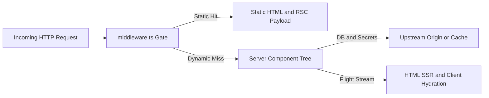
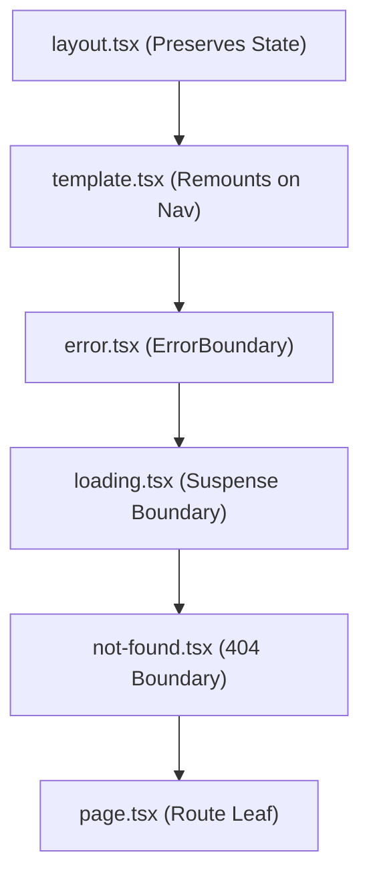
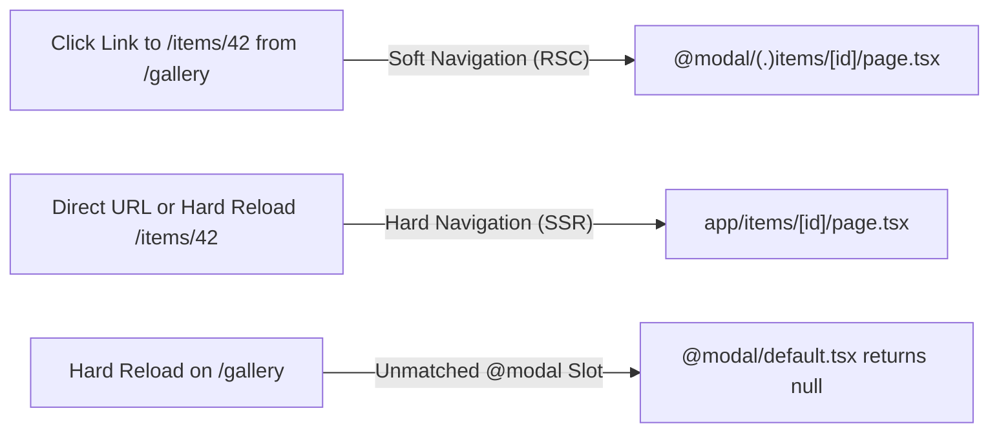
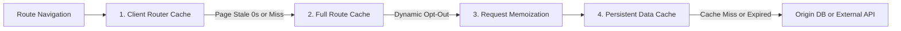
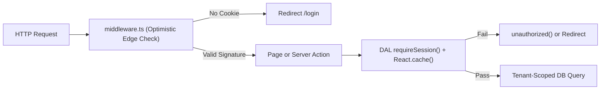

---
tags:
  - programming
  - frontend
  - nextjs
  - rsc
  - app-router
  - caching
  - security
  - web-performance
  - fullstack
  - typescript
created: 2025-12-29
updated: 2026-11-13
status: 🟢
level: mid-to-senior
---
# Next.js 15 Complete Guide (App Router & Full-Stack Internals)

> [!abstract] Core Invariant
> Next.js App Router compiles a single TypeScript codebase into two coordinated execution graphs separated by a **network serialization boundary**: zero-bundle **React Server Components (RSC)** execute exclusively on the server and stream a line-delimited **RSC Wire Payload** directly from databases and secrets, while `'use client'` modules define the **client module boundary** for interactive browser islands (which still pre-render to initial HTML on the server before browser hydration).

---

## 1. First-Principles Mechanics, Setup & File Conventions

### How the Next.js 15 Compiler & Runtime Execute a Request

Unlike traditional client-side SPAs where a single webpack/Vite bundle renders inside the browser, Next.js runs a dual-target compiler (Turbopack in `next dev --turbopack`, or Webpack/SWC for production `next build`) that partitions your module graph into three distinct runtime outputs:

1. **Server Component Graph (RSC Environment)**: Runs under the `react-server` export condition. React primitives like `useState` and `useEffect` are intentionally omitted from this module resolution target so invalid client hooks fail at compile time. Output is never emitted into `/_next/static/chunks/`.
2. **Client Component Graph (SSR + Browser Environment)**: Modules reachable through `'use client'` entry points. They are compiled **twice**: once into server-side Node/Edge bundles (to generate initial HTML during SSR and static builds) and once into browser ES module chunks (for hydration and interactive event handling).
3. **Edge / Node Network Dispatch Layer**: Handles `middleware.ts` before route resolution, serves static files and pre-built Full Route Cache HTML/RSC artifacts, and invokes dynamic Node.js/Edge renderers or Route Handlers on cache misses.



When a user types a URL directly (a **hard navigation**), Next.js executes the RSC graph, feeds the resulting RSC Flight data into React's SSR HTML renderer (`react-dom/server`), and returns a complete HTML document containing both semantic markup and embedded `__next_f.push([...])` Flight chunks so the browser paints immediately and hydrates interactively without re-fetching data. When a user clicks `<Link>` inside the running app (a **soft navigation**), Next.js sends an HTTP `GET` with the `RSC: 1` header, skipping HTML generation entirely and streaming only the delta RSC Flight payload for the changed route segments.

### Project Setup & Production Directory Architecture

Initialize a Next.js 15 TypeScript project with ESLint, Tailwind CSS, `src/` isolation, App Router, and Turbopack dev support:

```bash
npx create-next-app@15 acme-platform \
  --typescript \
  --tailwind \
  --eslint \
  --app \
  --src-dir \
  --turbopack \
  --import-alias "@/*"
```

Understanding the exact layout choices keeps server code isolated from browser code as teams scale past 50+ routes. Two structural conventions dominate production teams:

- **`src/` Root Separation**: Prevents config files (`next.config.ts`, `tsconfig.json`, `playwright.config.ts`, `Dockerfile`) from cluttering application source directories, and pairs cleanly with `@/*` path aliases in `tsconfig.json`.
- **Route Colocation + Private Folders (`_components`)**: App Router only treats directories containing a `page.tsx` or `route.ts` as publicly routable URLs. Co-locating page-specific schemas, client components, and tests inside `_components/` or directly beside `page.tsx` keeps domain code close to its route while shared cross-domain modules live in `src/features/` and `src/lib/`.

```text
acme-platform/
├── next.config.ts
├── tsconfig.json
├── instrumentation.ts              # OpenTelemetry / Sentry boot hook
├── middleware.ts                   # Edge or Node pre-routing gate
├── playwright.config.ts
├── vitest.config.ts
├── Dockerfile
├── public/                         # Unhashed static assets (/robots fallback, icons)
└── src/
    ├── app/
    │   ├── layout.tsx              # Root <html> and <body> shell
    │   ├── global-error.tsx        # Root error boundary (renders its own <html>)
    │   ├── not-found.tsx           # Root 404 fallback
    │   ├── sitemap.ts              # Dynamic XML sitemap generator
    │   ├── robots.ts               # Dynamic robots.txt generator
    │   ├── (marketing)/            # Route group: public pages, CDN-cached
    │   │   ├── layout.tsx
    │   │   ├── page.tsx            # Maps to /
    │   │   └── pricing/page.tsx    # Maps to /pricing
    │   ├── (app)/                  # Route group: authenticated workspace
    │   │   ├── layout.tsx
    │   │   ├── loading.tsx
    │   │   ├── error.tsx
    │   │   ├── forbidden.tsx       # 403 UI for forbidden()
    │   │   ├── unauthorized.tsx    # 401 UI for unauthorized()
    │   │   └── invoices/
    │   │       ├── page.tsx        # Maps to /invoices
    │   │       ├── _components/    # Private folder (ignored by URL router)
    │   │       └── [id]/page.tsx   # Maps to /invoices/:id
    │   ├── gallery/
    │   │   ├── layout.tsx          # Injects {children} + {modal} slot
    │   │   ├── page.tsx
    │   │   └── @modal/
    │   │       ├── default.tsx     # Mandatory null fallback on hard refresh
    │   │       └── (.)items/[id]/page.tsx
    │   ├── items/[id]/page.tsx     # Full standalone page on hard reload
    │   └── api/
    │       ├── health/route.ts
    │       └── webhooks/stripe/route.ts
    ├── features/                   # Feature-sliced domain modules
    │   └── invoices/
    │       ├── actions.ts          # 'use server' mutations
    │       ├── dal.ts              # 'server-only' DB access + auth checks
    │       └── schemas.ts          # Pure shared Zod schemas
    ├── components/                 # Reusable UI primitives
    └── lib/                        # Singletons (db.server.ts, auth.server.ts, env.ts)
```

Verify `tsconfig.json` includes the Next.js TypeScript plugin (which validates invalid Server/Client prop boundaries and route exports directly inside your IDE) and strict path resolution:

```json
{
  "compilerOptions": {
    "target": "ES2022",
    "lib": ["dom", "dom.iterable", "esnext"],
    "allowJs": false,
    "skipLibCheck": true,
    "strict": true,
    "noUncheckedIndexedAccess": true,
    "noEmit": true,
    "esModuleInterop": true,
    "module": "esnext",
    "moduleResolution": "bundler",
    "resolveJsonModule": true,
    "isolatedModules": true,
    "jsx": "preserve",
    "incremental": true,
    "plugins": [{ "name": "next" }],
    "paths": {
      "@/*": ["./src/*"]
    }
  },
  "include": ["next-env.d.ts", "**/*.ts", "**/*.tsx", ".next/types/**/*.ts"],
  "exclude": ["node_modules"]
}
```

### Complete App Router Special File Reference & Nesting Order

Every special filename inside an `app/` route folder maps deterministically into React's component hierarchy. Knowing the exact wrapper order explains why `error.tsx` catches errors inside `page.tsx` and `loading.tsx`, yet **never catches errors thrown inside its sibling `layout.tsx`**:



| File Convention | Required Runtime | Rendered React / HTTP Semantics | Critical Production Rules |
|---|---|---|---|
| `layout.tsx` | Server (default) | Wraps `children` and parallel `@slots`; **persists across child navigations** | Root `app/layout.tsx` is mandatory and must render `<html>` and `<body>`. Layouts do **not** receive `searchParams` (to stay cacheable across query strings). |
| `template.tsx` | Server or Client | Identical wrapper position to `layout.tsx`, wrapped inside `layout.tsx` | Assigns a fresh React key on every child segment change: **re-mounts DOM, resets `useState`, re-runs `useEffect`** (ideal for page-view analytics or CSS entry animations). |
| `page.tsx` | Server (default) | Exposes the folder as a publicly addressable URL segment | Receives `params: Promise<...>` and `searchParams: Promise<...>` in Next.js 15. Cannot coexist with `route.ts` in the same folder. |
| `loading.tsx` | Server (default) | Automatically wraps `page.tsx` and nested child layouts in `<Suspense>` | Enables instant navigation shell feedback during dynamic DB reads without manually declaring `<Suspense>` in the parent layout. |
| `error.tsx` | **Must be `'use client'`** | Wraps `page.tsx` and child segments in a React Error Boundary | Receives `{ error, reset }`. `error.digest` contains a safe hash for server errors while stripping sensitive server stack traces from the client. Does not catch sibling `layout.tsx` errors. |
| `global-error.tsx` | **Must be `'use client'`** | Root fallback catching uncaught errors inside root `app/layout.tsx` | Only runs in `next start` / production builds (dev overlay intercepts first). **Must define its own `<html>` and `<body>` tags** because it replaces the root layout. |
| `not-found.tsx` | Server (default) | Renders when `notFound()` from `'next/navigation'` is invoked (HTTP `404`) | Root `app/not-found.tsx` also handles all unmatched URLs across the entire application. |
| `forbidden.tsx` / `unauthorized.tsx` | Server (default) | Renders HTTP `403` / `401` when `forbidden()` or `unauthorized()` throws | Requires `experimental: { authInterrupts: true }` in `next.config.ts` (Next.js 15.1+). |
| `default.tsx` | Server (default) | Fallback UI rendered for unmatched Parallel Route `@slots` | Mandatory for modal/parallel slots so hard reloads on a URL that lacks a matching slot path do not trigger a `404`. |
| `route.ts` | Server (Node/Edge) | HTTP endpoint exporting `GET`, `POST`, `PUT`, `PATCH`, `DELETE`, `HEAD`, `OPTIONS` | Cannot live in the same directory as `page.tsx`. Receives `(request: NextRequest, context: { params: Promise<...> })`. |

#### `layout.tsx` vs `template.tsx` vs `error.tsx` & `global-error.tsx` Implementation

Notice how `template.tsx` forces a clean remount while the parent `layout.tsx` keeps navigation drawers, scroll positions, and WebSocket connections intact:

```tsx
// src/app/(app)/layout.tsx — State preserved across /invoices, /settings, /analytics
import type { ReactNode } from 'react';
import { AppSidebar } from '@/components/AppSidebar';

export default function WorkspaceLayout({ children }: { children: ReactNode }) {
  return (
    <div className="flex min-h-screen bg-slate-950 text-slate-100">
      <AppSidebar />
      <main className="flex-1 p-6">{children}</main>
    </div>
  );
}

// src/app/(app)/template.tsx — Remounts on every route transition under (app)
'use client';

import { useEffect, type ReactNode } from 'react';
import { usePathname } from 'next/navigation';

export default function WorkspaceTemplate({ children }: { children: ReactNode }) {
  const pathname = usePathname();

  useEffect(() => {
    // Fires reliably on every soft navigation within (app) without tearing down AppSidebar
    navigator.sendBeacon?.('/api/telemetry/pageview', JSON.stringify({ pathname }));
  }, [pathname]);

  return <div className="animate-fade-in">{children}</div>;
}
```

And here is the exact pair of error boundaries (`error.tsx` for segment recovery using `router.refresh()` + `reset()`, and `global-error.tsx` as the production root backstop):

```tsx
// src/app/(app)/error.tsx — Recovers segment without reloading root HTML
'use client';

import { useEffect } from 'react';
import { useRouter } from 'next/navigation';

export default function WorkspaceError({
  error,
  reset,
}: {
  error: Error & { digest?: string };
  reset: () => void;
}) {
  const router = useRouter();

  useEffect(() => {
    // Log digest to client monitoring; full stack trace is logged via instrumentation.ts onRequestError
    console.error('Segment boundary caught error:', error.digest ?? error.message);
  }, [error]);

  return (
    <section role="alert" className="rounded-lg border border-red-800 bg-red-950/40 p-6">
      <h2 className="text-lg font-semibold text-red-200">Workspace data failed to load</h2>
      <p className="mt-1 text-sm text-red-300">
        Reference ID: <code>{error.digest ?? 'client-exception'}</code>
      </p>
      <button
        type="button"
        onClick={() => {
          // Calling reset() alone only retries client render; router.refresh() re-executes failed Server Components
          router.refresh();
          reset();
        }}
        className="mt-4 rounded bg-red-600 px-4 py-2 text-sm font-medium text-white"
      >
        Retry Server Request
      </button>
    </section>
  );
}

// src/app/global-error.tsx — Catches root layout crashes; MUST render <html> and <body>
'use client';

export default function GlobalError({
  error,
  reset,
}: {
  error: Error & { digest?: string };
  reset: () => void;
}) {
  return (
    <html lang="en">
      <body className="flex min-h-screen items-center justify-center bg-slate-950 text-slate-100">
        <div role="alert" className="max-w-md rounded-lg border border-slate-800 p-8">
          <h1 className="text-xl font-bold">Application Fault</h1>
          <p className="mt-2 text-sm text-slate-400">Digest: {error.digest ?? 'unknown'}</p>
          <button
            type="button"
            onClick={() => reset()}
            className="mt-4 rounded bg-blue-600 px-4 py-2 text-sm font-semibold text-white"
          >
            Reload Application
          </button>
        </div>
      </body>
    </html>
  );
}
```

---

## 2. Rendering Topologies & Real-World Decision Matrix

App Router selects rendering mode **per route segment and `<Suspense>` boundary**, enabling static marketing shells, ISR catalogs, dynamic authenticated workspaces, and hybrid Partial Prerendering pages inside a single deployment.

### Rendering Execution Matrix

| Topology | Execution Time & Location | TTFB & [[Programming/Software Engineering/System Design/CDN\|CDN]] Cacheability | Hydration Cost | Failure Mode / Stale Risk |
|---|---|---|---|---|
| **CSR** | Browser after JS download & mount | Slowest FCP/LCP (empty shell until JS + API fetch complete) | Full application JS bundle | Poor crawler indexing; waterfalls on slow mobile CPUs |
| **SSG** | Build time (`next build`) | Fastest (`< 50ms` globally via CDN PoP) | Client islands only | Build times explode at `>10k` pages unless paired with `dynamicParams = true` |
| **ISR** | Build time + background origin regeneration | CDN PoP speed (`s-maxage`, `stale-while-revalidate`) | Client islands only | Brief stale window until `revalidate` timer or `revalidateTag()` fires |
| **SSR (Dynamic)** | Per-request on Node.js or Edge server | Bound by slowest uncached DB/API query | Client islands only | Origin CPU/DB pool saturation under traffic spikes without connection pooling |
| **Streaming SSR** | Per-request; flushes static/fast HTML immediately, streams `<Suspense>` holes | Fast shell TTFB; upstream queries execute concurrently | Progressive selective hydration | Slow network proxies buffering chunks (`X-Accel-Buffering: no` needed behind Nginx) |
| **PPR (Partial Prerendering)** | Static HTML shell pre-built at build time + dynamic `<Suspense>` streamed per request | CDN-level TTFB for shell + zero stale auth holes | Client islands only | Requires disciplined `<Suspense>` placement around `cookies()` / `headers()` / uncached queries |

### Concrete Adoption Decision Scenarios (When to Adopt vs Reject)

| Engineering Scenario | Recommended Choice | Rationale & Trade-Off |
|---|---|---|
| **1. Multi-Tenant SaaS Product (Public Docs + Authenticated Dashboard)** | **Next.js App Router (SSG + Dynamic Streaming)** | Serve `/`, `/pricing`, and `/docs` as static CDN HTML while isolating `(app)/` routes behind DAL session validation and `<Suspense>` streaming—all sharing one design system and deployment. |
| **2. High-Traffic E-Commerce Storefront (`100k+` SKUs, Live Inventory)** | **Next.js App Router (ISR + PPR)** | Prebuild top `500` SKUs via `generateStaticParams`, generate long-tail SKUs on demand with `dynamicParams = true` + `revalidateTag('sku-123')`, and stream personalized cart/inventory badges inside `<Suspense>`. |
| **3. SEO-Critical Content & Lead-Gen Platform with Complex Forms** | **Next.js App Router (Server Actions + `generateMetadata`)** | `generateMetadata` + dynamic `opengraph-image.tsx` maximize search/social indexing, while progressive Server Actions handle multi-field submissions securely without maintaining separate REST controllers. |
| **4. Pure Internal Admin Console / Real-Time WebGL CAD Editor (Zero SEO)** | **Do NOT default to Next.js SSR; consider Vite SPA + Dedicated API** | If 100% of views sit behind auth, rely heavily on browser Canvas/WebSockets/IndexedDB, and derive zero value from SSR HTML or edge caching, Next.js RSC serialization adds server CPU overhead with minimal benefit. |
| **5. High-Throughput Streaming Media / Long-Lived Multiplayer Game Server** | **Dedicated Backend (NestJS, Go, Rust) + Thin Web Frontend** | Next.js Node processes and serverless functions optimize short HTTP request/response streams. Stateful room memory, WebSockets at scale, or heavy transcoding workers belong on dedicated persistent backend services. |

---

## 3. Complete Routing Topologies & Practical Navigation

### Dynamic, Catch-All & Optional Catch-All Segments

In Next.js 15, **`params` and `searchParams` are asynchronous `Promise` objects**. Reading `params.slug` synchronously fails type checking and triggers runtime deprecation/errors in Next.js 15+. Always `await` them inside `page.tsx`, `layout.tsx`, `generateMetadata`, and `route.ts`.

| Folder Path | Matched URLs | `await params` Shape | Typical Production Use |
|---|---|---|---|
| `app/blog/[slug]/page.tsx` | `/blog/rsc-internals` | `{ slug: string }` | Blog articles, product SKUs, single resource views |
| `app/docs/[...slug]/page.tsx` | `/docs/v2`, `/docs/v2/auth/jwt` (NOT `/docs`) | `{ slug: string[] }` | Nested documentation trees, hierarchical category facets |
| `app/docs/[[...slug]]/page.tsx` | `/docs`, `/docs/v2`, `/docs/v2/auth/jwt` | `{ slug?: string[] }` | Root-inclusive docs portals, CMS catch-all page builders |

```tsx
// src/app/docs/[[...slug]]/page.tsx
import { notFound } from 'next/navigation';
import { getDocByPath } from '@/lib/docs.server';

interface DocsPageProps {
  params: Promise<{ slug?: string[] }>;
  searchParams: Promise<{ version?: string; q?: string }>;
}

export default async function DocsPage({ params, searchParams }: DocsPageProps) {
  const [{ slug = [] }, query] = await Promise.all([params, searchParams]);
  const docPath = slug.length === 0 ? 'index' : slug.join('/');
  const doc = await getDocByPath(docPath, query.version ?? 'latest');

  if (!doc) {
    notFound();
  }

  return (
    <article className="prose prose-invert max-w-3xl">
      <h1>{doc.title}</h1>
      <p className="text-xs text-slate-400">Path: /{docPath} | Version: {doc.version}</p>
      <div>{doc.body}</div>
    </article>
  );
}
```

### Route Groups & Multiple Root Layouts

Wrapping folder names in parentheses—such as `(marketing)` and `(checkout)`—organizes routes and applies distinct layouts **without adding segments to the URL**:

- `src/app/(marketing)/pricing/page.tsx` resolves to `/pricing`.
- `src/app/(app)/settings/page.tsx` resolves to `/settings`.

> [!warning] Full Reload Across Multiple Root Layouts
> You can delete `src/app/layout.tsx` and place separate root `layout.tsx` files (each defining its own `<html>` and `<body>`) inside `(marketing)/layout.tsx` and `(app)/layout.tsx`. However, navigating with `<Link>` between two routes that use **different root layouts** forces the browser to perform a **full document reload** instead of an SPA soft transition because the root `<html>` document tree changes.

### Parallel Routes (`@slot`) & Intercepting Routes (`(.)`)

**Parallel Routes** allow a single `layout.tsx` to render multiple independent pages simultaneously (`@analytics`, `@team`, `@modal`), each with its own `loading.tsx`, `error.tsx`, and sub-navigation history.

**Intercepting Routes** let you mask an external URL inside the current layout during soft `<Link>` navigation (such as opening `/items/42` inside a modal over `/gallery`), while preserving the standalone full-page route (`/items/42`) when a user refreshes the browser or shares the URL!

Interception relative markers match **route segments** (ignoring `@slots` and `(routeGroups)`):
- `(.)segment`: Intercepts a sibling route at the **same level** inside the parent segment.
- `(..)segment`: Intercepts one route segment level **up**.
- `(..)(..)segment`: Intercepts two route segment levels **up**.
- `(...)segment`: Intercepts from the root `app/` directory.



Below is a complete, production-ready multi-file implementation of an **Intercepted Modal Overlay** with independent full-page SEO fallback, `default.tsx` refresh safety, and accessible `router.back()` closing:

```tsx
// 1. src/app/gallery/layout.tsx — Renders feed + parallel @modal slot
import type { ReactNode } from 'react';

export default function GalleryLayout({
  children,
  modal,
}: {
  children: ReactNode;
  modal: ReactNode;
}) {
  return (
    <section className="mx-auto max-w-6xl px-6 py-8">
      {children}
      {modal}
    </section>
  );
}

// 2. src/app/gallery/@modal/default.tsx — Mandatory so /gallery does not 404 on hard refresh
export default function ModalDefault() {
  return null;
}

// 3. src/components/ModalDialog.tsx — Client boundary managing browser dialog & Escape/backdrop close
'use client';

import { useEffect, useRef, type ReactNode } from 'react';
import { useRouter } from 'next/navigation';

export function ModalDialog({ title, children }: { title: string; children: ReactNode }) {
  const router = useRouter();
  const dialogRef = useRef<HTMLDialogElement>(null);

  useEffect(() => {
    const dialog = dialogRef.current;
    if (dialog && !dialog.open) {
      dialog.showModal();
    }
  }, []);

  const handleClose = () => {
    router.back();
  };

  return (
    <dialog
      ref={dialogRef}
      aria-label={title}
      onCancel={(e) => {
        e.preventDefault();
        handleClose();
      }}
      onClick={(e) => {
        // Close only when user clicks backdrop outside modal surface
        if (e.target === dialogRef.current) {
          handleClose();
        }
      }}
      className="m-auto w-full max-w-2xl rounded-xl border border-slate-700 bg-slate-900 p-0 text-slate-100 shadow-2xl backdrop:bg-black/75"
    >
      <div className="flex items-center justify-between border-b border-slate-800 px-6 py-4">
        <h2 className="text-lg font-semibold">{title}</h2>
        <button
          type="button"
          onClick={handleClose}
          aria-label="Close modal"
          className="rounded px-2 py-1 text-sm text-slate-400 hover:bg-slate-800 hover:text-white"
        >
          Close
        </button>
      </div>
      <div className="p-6">{children}</div>
    </dialog>
  );
}

// 4. src/app/gallery/@modal/(..)items/[id]/page.tsx — Intercepts /items/[id] when clicked inside /gallery
import { notFound } from 'next/navigation';
import { ModalDialog } from '@/components/ModalDialog';
import { getCatalogItem } from '@/lib/catalog.server';

export default async function ItemModalPage({
  params,
}: {
  params: Promise<{ id: string }>;
}) {
  const { id } = await params;
  const item = await getCatalogItem(id);
  if (!item) notFound();

  return (
    <ModalDialog title={item.name}>
      <p className="text-sm text-slate-300">{item.description}</p>
      <p className="mt-4 font-mono text-lg text-emerald-400">${(item.priceCents / 100).toFixed(2)}</p>
    </ModalDialog>
  );
}

// 5. src/app/items/[id]/page.tsx — Standalone canonical page for shared links and F5 hard reloads
import Link from 'next/link';
import { notFound } from 'next/navigation';
import { getCatalogItem } from '@/lib/catalog.server';

export default async function ItemDetailPage({
  params,
}: {
  params: Promise<{ id: string }>;
}) {
  const { id } = await params;
  const item = await getCatalogItem(id);
  if (!item) notFound();

  return (
    <main className="mx-auto max-w-3xl px-6 py-12">
      <Link href="/gallery" className="text-sm text-blue-400 hover:underline">
        Back to gallery
      </Link>
      <h1 className="mt-4 text-3xl font-bold">{item.name}</h1>
      <p className="mt-3 text-slate-300">{item.description}</p>
      <p className="mt-6 font-mono text-2xl text-emerald-400">${(item.priceCents / 100).toFixed(2)}</p>
    </main>
  );
}
```

Notice why `(..)items/[id]` uses `(..)` instead of `(.)`: inside `app/gallery/@modal/`, the `@modal` slot is ignored in route segment hierarchy, so the interceptor lives at `/gallery` and needs to step up one level (`..`) to intercept `/items/[id]` at the app root!

### `<Link>`, `next/form`, & Client URL State Synchronization

Navigating efficiently requires selecting the right navigation primitive and avoiding common build/prefetch pitfalls:

- **`<Link href="..." prefetch={true | false | null}>`**: Automatically prefetches linked routes entering the viewport (in production builds). For static routes, the full RSC payload is prefetched; for dynamic routes without `loading.tsx`, prefetching fetches up to the first `loading.tsx` boundary (or skips). Set `prefetch={false}` on dense data tables with hundreds of links to prevent flooding the server with speculative RSC requests.
- **`next/form` (`<Form action="/search">`)**: Introduced in Next.js 15, `<Form>` intercepts native `GET` submissions, preloads the target route's `loading.tsx` and layout chunks, and executes a smooth client-side transition to `/search?q=...` without a full-page browser refresh—while still working natively if JavaScript has not hydrated yet.
- **Synchronizing Filters with `useSearchParams` + `useRouter` + `usePathname`**: Always wrap any Client Component calling `useSearchParams()` inside a `<Suspense>` boundary if its parent route can be statically built (`● Static`); otherwise `next build` aborts with a prerender error because query strings are unavailable at build time.

```tsx
// src/components/CatalogSearchControls.tsx
'use client';

import { usePathname, useRouter, useSearchParams } from 'next/navigation';
import { useTransition } from 'react';

export function CatalogSearchControls() {
  const router = useRouter();
  const pathname = usePathname();
  const searchParams = useSearchParams();
  const [isPending, startTransition] = useTransition();

  const currentQuery = searchParams.get('q') ?? '';
  const currentSort = searchParams.get('sort') ?? 'newest';

  const updateUrlParam = (key: string, value: string) => {
    const nextParams = new URLSearchParams(searchParams.toString());
    if (value.trim()) {
      nextParams.set(key, value.trim());
    } else {
      nextParams.delete(key);
    }
    nextParams.delete('page'); // Always reset pagination when filter criteria change

    startTransition(() => {
      router.replace(`${pathname}?${nextParams.toString()}`, { scroll: false });
    });
  };

  return (
    <div className="flex flex-wrap items-center gap-3" aria-busy={isPending}>
      <input
        type="search"
        defaultValue={currentQuery}
        placeholder="Filter catalog..."
        aria-label="Filter catalog"
        onChange={(e) => updateUrlParam('q', e.target.value)}
        className="rounded border border-slate-700 bg-slate-900 px-3 py-2 text-sm"
      />
      <select
        value={currentSort}
        aria-label="Sort order"
        onChange={(e) => updateUrlParam('sort', e.target.value)}
        className="rounded border border-slate-700 bg-slate-900 px-3 py-2 text-sm"
      >
        <option value="newest">Newest</option>
        <option value="price_asc">Price: Low to High</option>
        <option value="price_desc">Price: High to Low</option>
      </select>
    </div>
  );
}
```

---

## 4. React Server Components (RSC) Internals & Module Boundaries

### Inside the RSC Wire Payload (React Flight Protocol)

When a Server Component renders, React does **not** initially generate an HTML string—it produces a serialized **React Flight stream** containing tree descriptors, resolved server data, and lazy references to Client Component JS chunks. On an initial hard load, Next.js runs a second pass that consumes this Flight stream alongside the compiled Client Components to produce initial SSR HTML, while embedding the raw Flight stream into `<script>self.__next_f.push(...)</script>` tags so React can hydrate Client Components without re-querying the server.

A simplified slice of an actual RSC Wire Payload looks like this:

```text
1:I["./src/components/LikeButton.tsx",["chunks/app/like-btn-9a2f.js"],"LikeButton"]
2:D{"time":14.2}
0:["$","article",null,{"children":[["$","h1",null,{"children":"Distributed Caching"}],["$","$L1",null,{"postId":"post-42","initialCount":128}]]}]
```

- Row `1:I[...]`: Declares a client module reference pointing to the hashed browser chunk `like-btn-9a2f.js` and its exported symbol `LikeButton`.
- Row `0:[...]`: Serializes the host React element tree (`article`, `h1`, text string) and plugs in `$L1` where `<LikeButton>` mounts—passing only its serializable JSON props `{ postId, initialCount }`. Notice that `marked`, `prisma`, and raw SQL never appear anywhere in the Flight stream or static JS chunks.

### The `'use client'` Boundary & `import 'server-only'` Guard

Placing `'use client'` at line 1 of a file does **not** mean "skip server rendering." Client Components still execute on the server during SSR to output initial HTML. Instead, `'use client'` marks the **bundler boundary** separating the server graph from the client graph:

1. Any module imported by a `'use client'` file—and **every transitive dependency inside that import tree**—is bundled into browser JavaScript chunks.
2. Any environment variable not prefixed with `NEXT_PUBLIC_` evaluates to `undefined` inside browser bundles, while `NEXT_PUBLIC_*` variables are statically inlined as plaintext string literals into compiled `.js` chunks at build time.
3. Importing a shared barrel file (`@/lib/index.ts`) that re-exports both a pure string formatter and a PostgreSQL client from a `'use client'` file pulls database drivers into the client build and fails compilation or leaks internal schemas.

Protect every module holding secrets, database connections, or internal business logic by placing `import 'server-only'` at line 1 (install `npm install server-only` and `client-only`):

```typescript
// src/lib/db.server.ts
import 'server-only';
import { Pool } from 'pg';

const globalForPg = globalThis as unknown as { pgPool: Pool | undefined };

export const pgPool =
  globalForPg.pgPool ??
  new Pool({
    connectionString: process.env.DATABASE_URL,
    max: 10,
    idleTimeoutMillis: 30_000,
  });

if (process.env.NODE_ENV !== 'production') {
  globalForPg.pgPool = pgPool;
}
```

If any `'use client'` component accidentally imports `@/lib/db.server`, Next.js fails the build immediately with an explicit module-graph error before code ever reaches production.

### Inverting Composition: Passing Server Components Inside Client Wrappers

A Client Component **cannot** directly `import` a Server Component (`import { ServerChart } from './ServerChart'` pulls `ServerChart` into the client bundle and strips its async server capability). Instead, keep Client Components at the interactive shell edges (`Modal`, `Tabs`, `SidebarDrawer`) and pass rendered Server Components into them via `children` or named `ReactNode` slot props from a parent Server Component:

```tsx
// src/components/SidebarShell.tsx — Client boundary ONLY owns open/close state
'use client';

import { useState, type ReactNode } from 'react';

interface SidebarShellProps {
  orgSwitcher: ReactNode; // Pre-rendered RSC slot
  children: ReactNode;    // Pre-rendered RSC page content
}

export function SidebarShell({ orgSwitcher, children }: SidebarShellProps) {
  const [collapsed, setCollapsed] = useState(false);

  return (
    <div className="flex min-h-screen">
      <aside className={collapsed ? 'w-16 border-r border-slate-800 p-2' : 'w-64 border-r border-slate-800 p-4'}>
        <button
          type="button"
          onClick={() => setCollapsed((prev) => !prev)}
          className="mb-4 rounded border border-slate-700 px-2 py-1 text-xs"
        >
          {collapsed ? 'Expand' : 'Collapse'}
        </button>
        {!collapsed && orgSwitcher}
      </aside>
      <main className="flex-1 p-6">{children}</main>
    </div>
  );
}

// src/app/(app)/layout.tsx — Server Component composes server slot into client shell
import { SidebarShell } from '@/components/SidebarShell';
import { OrganizationSwitcherServer } from '@/features/orgs/OrganizationSwitcherServer';

export default function AppLayout({ children }: { children: React.ReactNode }) {
  return (
    <SidebarShell orgSwitcher={<OrganizationSwitcherServer />}>
      {children}
    </SidebarShell>
  );
}
```

When the parent Server Component renders `<OrganizationSwitcherServer />`, React resolves all DB queries on the server and inserts the finished Flight nodes directly into the `orgSwitcher` prop placeholder inside `SidebarShell`. Toggling `collapsed` in the browser re-renders `SidebarShell` without re-executing `OrganizationSwitcherServer`.

### Server-to-Client Serialization Matrix

Every prop crossing from a Server Component to a `'use client'` component must be serializable over React's Flight protocol:

| Data Type | Allowed Across Boundary? | Wire Behavior / Production Caveat |
|---|---|---|
| Primitives (`string`, `number`, `boolean`, `null`, `undefined`, `bigint`) | **Yes** | Serialized directly in Flight JSON stream (`BigInt` serialized natively via `$n` tag). |
| Plain Objects & Arrays (`{ id: 1, tags: ['a'] }`) | **Yes** | Must not contain circular references or non-serializable fields. |
| `Date`, `Map`, `Set`, `RegExp`, `Uint8Array` / `TypedArray` | **Yes** | React Flight preserves `Date`, `Map`, `Set`, and typed binary buffers across serialization. |
| `Promise<Serializable>` | **Yes** | Streamed lazily (`$@` chunk) and unwrapped on the client via React 19 `use(promise)` inside `<Suspense>`. |
| Server Action (`'use server'` function) | **Yes** | Serialized as an opaque `$F` action ID reference invoking an HTTP `POST` RPC endpoint. |
| Rendered JSX (`ReactNode`) | **Yes** | Pre-rendered on the server into host/client Flight nodes (`children` / named slot pattern). |
| Plain Functions / Event Callbacks (`onClick={() => ...}`) | **No (Runtime Error)** | Cannot serialize closures or AST bytecode across HTTP. Define callbacks inside `'use client'` or pass a `'use server'` action. |
| Class Instances (`new UserEntity()`, `Decimal`, Mongoose/ORM Models) | **No (Runtime Error)** | Prototypes and methods cannot cross the boundary; map ORM models to plain DTOs first. |
| `Symbol`, `WeakMap`, `WeakSet`, DOM Nodes | **No (Runtime Error)** | Non-transferable runtime references; omit from returned Server Component props. |

> [!tip] Streaming Promises to Client Islands with React 19 `use()`
> Instead of `await`-ing a slow query at the top of `page.tsx`, initiate `const metricsPromise = getMetrics(orgId);` **without** `await`, pass `metricsPromise` as a prop to a `'use client'` chart component wrapped in `<Suspense>`, and call `const metrics = use(metricsPromise);` inside the client component (see [[Programming/Frontend/React Hooks Guide|React Hooks Guide]]). Next.js streams the resolved Promise directly over the open HTTP response without writing a single REST API endpoint!

---

## 5. Data Fetching, Streaming SSR & Next.js 15 Caching Architecture

### Critical Next.js 14 to Next.js 15 Caching Shifts

Next.js 13/14 cached `fetch()` requests, `GET` Route Handlers, and client page navigations implicitly, causing frequent stale-data surprises in production. Next.js 15 inverted these defaults to **uncached unless explicitly opted in**:

| Surface | Next.js 14 Default | **Next.js 15 Default** | Explicit Opt-In / Override Control |
|---|---|---|---|
| `fetch(url)` | Implicit `force-cache` | **Uncached (`no-store` semantics)** | Pass `{ cache: 'force-cache' }` or `{ next: { revalidate: 3600, tags: ['catalog'] } }` |
| `GET` `route.ts` Handlers | Cached statically at build | **Uncached (Dynamic per-request)** | Export `export const dynamic = 'force-static'` and optional `export const revalidate = 60` |
| Client Router Cache (`page.tsx`) | `30s` dynamic / `5min` static | **`staleTime: 0` for pages** | Shared layouts & browser back/forward remain cached; override via `experimental.staleTimes` |
| Request Context APIs | Synchronous reads | **Asynchronous Promises** | Must `await cookies()`, `await headers()`, `await draftMode()`, `await params`, `await searchParams` |

### Eliminating Waterfalls: `Promise.all`, Preloading & Streaming `<Suspense>`

When an `async` Server Component awaits multiple independent queries sequentially, total latency equals the **sum** of every upstream query, blocking initial HTML TTFB until the final byte resolves. Eliminating waterfalls follows three escalating patterns:

```tsx
// ANTI-PATTERN: 40ms + 1800ms + 1200ms = 3,040ms TTFB before a single HTML byte flushes
export default async function SlowOverviewPage() {
  const user = await getUser();
  const revenue = await getRevenue(user.orgId);
  const audits = await getAuditLogs(user.orgId);
  return <Dashboard user={user} revenue={revenue} audits={audits} />;
}
```

1. **Concurrent `Promise.all` / `Promise.allSettled`**: Reduces upstream latency to `max(1800, 1200) = 1,800ms`, though the browser still waits `1,840ms` before receiving the page shell. Use `Promise.allSettled` whenever secondary panels can degrade gracefully without failing the entire route.
2. **Preloading (`void queryFn(id)`)**: Triggers a cached query immediately before running intermediate synchronous/async guards so network I/O overlaps with CPU/auth checks.
3. **Granular Streaming SSR (`<Suspense>`)**: Awaits only critical shell data (`getUser()`, `40ms`), flushes HTML immediately (`~40ms` TTFB), and streams independent `async` child Server Components in parallel over the open chunked HTTP response.

```tsx
// src/lib/analytics.server.ts
import 'server-only';
import { cache } from 'react';
import { pgPool } from '@/lib/db.server';

// React.cache deduplicates identical calls within a single server render pass (e.g. generateMetadata + page.tsx)
export const getOrgSummary = cache(async (orgId: string) => {
  const { rows } = await pgPool.query(
    'SELECT id, name, plan_tier FROM organizations WHERE id = $1',
    [orgId]
  );
  return rows[0] ?? null;
});

export const preloadOrgSummary = (orgId: string) => {
  void getOrgSummary(orgId);
};
```

```tsx
// src/app/(app)/overview/page.tsx — Streaming SSR (~40ms TTFB, parallel child streams)
import { Suspense } from 'react';
import { requireSession } from '@/lib/dal';
import { preloadOrgSummary, getOrgSummary } from '@/lib/analytics.server';
import { RevenueChartPanel, AuditLogsPanel } from './_components/Panels';

export default async function OverviewPage() {
  const session = await requireSession(); // ~15-40ms
  preloadOrgSummary(session.orgId);

  const org = await getOrgSummary(session.orgId);

  return (
    <main className="space-y-6">
      <header className="border-b border-slate-800 pb-4">
        <h1 className="text-2xl font-bold">{org?.name ?? 'Workspace'} Overview</h1>
      </header>

      <div className="grid gap-6 lg:grid-cols-2">
        <Suspense fallback={<div className="h-64 animate-pulse rounded-lg bg-slate-900" aria-busy="true" />}>
          {/* Executes concurrently with AuditLogsPanel after shell flushes */}
          <RevenueChartPanel orgId={session.orgId} />
        </Suspense>

        <Suspense fallback={<div className="h-64 animate-pulse rounded-lg bg-slate-900" aria-busy="true" />}>
          <AuditLogsPanel orgId={session.orgId} />
        </Suspense>
      </div>
    </main>
  );
}
```

### The 4 Caching Layers & Dynamic Opt-Out Triggers

Next.js evaluates caching across four distinct persistence boundaries spanning browser memory, build output, and persistent origin/CDN cache stores:



1. **Request Memoization (React Layer — Per-Request Lifetime)**: Automatically deduplicates identical `GET` `fetch(url, options)` calls within one server render tree (e.g., `generateMetadata`, `layout.tsx`, and `page.tsx` sharing data). Non-`fetch` database drivers (`pg`, Prisma, Drizzle) must explicitly wrap functions with `cache()` from `'react'`.
2. **Data Cache (Server Layer — Cross-Request & Cross-Deploy)**: Stores results from `fetch(..., { cache: 'force-cache' })` or `{ next: { revalidate, tags } }`. Survives across incoming requests until revalidated by TTL or on-demand tag/path purge.
3. **Full Route Cache (Build / ISR Layer)**: Pre-renders complete HTML and RSC Flight payloads at build time (`● Static`) so [[Programming/Software Engineering/System Design/CDN|CDN]] edge PoPs can serve responses without invoking Node.js.
4. **Client Router Cache (Browser Memory — Session Lifetime)**: Holds previously visited RSC payloads during soft navigation. In Next.js 15, `page.tsx` entries default to `staleTime: 0` (always re-fetching fresh RSC payloads on `<Link>` clicks), while persistent `layout.tsx` segments stay cached and browser Back/Forward restores cached scroll and UI immediately.

#### Dynamic Bailout Triggers (What Switches `● Static` to `ƒ Dynamic`)

A route automatically opts out of the Full Route Cache into per-request dynamic rendering (`ƒ Dynamic`) if **any** Server Component, Layout, or `generateMetadata` in that route invokes:
- `await cookies()`, `await headers()`, or `await draftMode()`
- Reading the `searchParams` prop inside `page.tsx`
- Calling `await connection()` from `'next/server'` (Next.js 15 replacement for deprecated `unstable_noStore()`)
- Exporting `export const dynamic = 'force-dynamic'` or `export const revalidate = 0`
- Executing any uncached `fetch()` (remember: in Next.js 15, bare `fetch(url)` is uncached by default unless `force-cache` or `revalidate` is specified—though in standard `next build`, a static route with zero dynamic triggers may still require `await connection()` if it reads `Date.now()`, `Math.random()`, or uncached SQL via Prisma/Drizzle).

```tsx
// Guarantee runtime evaluation for non-fetch ORMs (Prisma/Drizzle) or Date.now()
import { connection } from 'next/server';

export default async function LiveStatusPage() {
  await connection(); // Forces per-request SSR rather than freezing build-time timestamp
  const generatedAt = new Date().toISOString();
  return <p>Server UTC: {generatedAt}</p>;
}
```

### Static Site Generation (`generateStaticParams` & `dynamicParams`)

Use `generateStaticParams` to pre-render finite dynamic URLs at build time while controlling how unknown runtime slugs behave:

```tsx
// src/app/blog/[slug]/page.tsx
import { notFound } from 'next/navigation';
import { getAllPostSlugs, getPostBySlug } from '@/lib/posts.server';

export const revalidate = 3600; // Revalidate generated pages via ISR every hour
export const dynamicParams = true; // true: generate unseen slugs lazily on demand; false: immediate 404

export async function generateStaticParams() {
  const slugs = await getAllPostSlugs();
  return slugs.map((slug) => ({ slug }));
}

export default async function BlogPostPage({
  params,
}: {
  params: Promise<{ slug: string }>;
}) {
  const { slug } = await params;
  const post = await getPostBySlug(slug);
  if (!post) notFound();

  return (
    <article>
      <h1>{post.title}</h1>
      <div>{post.content}</div>
    </article>
  );
}
```

### On-Demand Revalidation (`revalidatePath` vs `revalidateTag`) & `after()`

Choose invalidation granularity deliberately:
- **`revalidateTag('product-42')`**: Surgical invalidation across **every route and layout** referencing cached entries tagged `'product-42'`. Ideal for relational entities (updating a product invalidates `/`, `/products/42`, and `/categories/electronics` simultaneously).
- **`revalidatePath('/invoices', 'page' | 'layout')`**: Purges Full Route Cache and Data Cache for the specified route path (or the entire subtree when passing `'layout'`).
- **Router Cache Timing Distinction**: Calling `revalidatePath` or `revalidateTag` inside a **Server Action** immediately purges the invoking client's Router Cache and sends the updated UI inside the single action HTTP response. Calling them inside a **Route Handler** (`POST /api/webhooks/cms`) purges server-side Data Cache and Full Route Cache for future requests, without pushing invalidations to already-open browser tabs.

For non-blocking work after sending a response—such as audit logging, telemetry, or post-mutation cache warming—use stable **`after()`** from `'next/server'` (Next.js 15.1+), which keeps serverless/Node execution alive cleanly until the background promise settles without delaying client TTFB:

```typescript
import { after } from 'next/server';
import { revalidateTag } from 'next/cache';
import { writeAuditEvent } from '@/lib/audit.server';

export async function recordActionAudit(userId: string, invoiceId: string) {
  revalidateTag(`org-invoices-${userId}`);

  after(async () => {
    await writeAuditEvent({ actorId: userId, resourceId: invoiceId, event: 'INVOICE_MUTATED' });
  });
}
```

### Next.js 15 `'use cache'` Directive (`dynamicIO`, `cacheLife`, `cacheTag`)

When `experimental: { dynamicIO: true }` is enabled in `next.config.ts`, Next.js replaces implicit route-segment caching rules with a unified explicit opt-in model across arbitrary functions, ORM queries, and entire components:

```tsx
// next.config.ts must enable experimental: { dynamicIO: true }
import { cacheLife, cacheTag } from 'next/cache';
import { pgPool } from '@/lib/db.server';

export async function getPricingCatalog(region: string) {
  'use cache';
  cacheLife('hours'); // Built-in presets: 'seconds' | 'minutes' | 'hours' | 'days' | 'weeks' | 'max'
  cacheTag('pricing-catalog', `pricing-${region}`);

  const { rows } = await pgPool.query(
    'SELECT sku, name, monthly_cents FROM plans WHERE region = $1 ORDER BY monthly_cents ASC',
    [region]
  );
  return rows;
}
```

Because `'use cache'` caches serialized output across requests, any dynamic API (`cookies()`, `headers()`) cannot be invoked directly inside a `'use cache'` scope—extract session values outside first and pass primitives (`userId`, `region`) as function arguments, which automatically become part of the cache key.

---

## 6. Forms, Mutations & Server Actions Security

### Wire Reality: Public HTTP `POST` RPC Endpoints

Every exported `'use server'` function compiles into a **publicly addressable HTTP `POST` endpoint** routed via an internal `Next-Action: <40-hex-hash>` header embedded in compiled client bundles. Because any external attacker can extract that action ID from browser DevTools and fire forged `POST` requests with `curl`—completely bypassing React UI state, disabled buttons, and HTML `required` attributes—treat every Server Action identically to a public REST API endpoint.

### Mandatory 5-Point Server Action Security Contract

1. **Verify Authentication Inside Every Action**: Never assume `middleware.ts` blocked unauthenticated callers. Invoke `await requireSession()` directly on line 1 of the action.
2. **Enforce Tenant & Ownership Scoping in SQL**: Never trust `userId`, `orgId`, or `role` read from function arguments or hidden `<input type="hidden">` fields. Extract `session.userId` and `session.orgId` solely from the verified server session and scope queries (`WHERE id = $1 AND org_id = $2`).
3. **Validate Untrusted Inputs with Zod**: TypeScript types disappear at runtime. Validate `FormData` or JSON payloads with `schema.safeParse(...)` and return structured errors.
4. **Enforce CSRF & Reverse-Proxy Origin Alignment**: Next.js validates the `Origin` header against `Host` / `x-forwarded-host` automatically on Server Action `POST` requests. Behind CDNs, load balancers, or reverse proxies rewriting `Host`, configure `experimental: { serverActions: { allowedOrigins: ['app.acme.com'] } }` in `next.config.ts`.
5. **Re-throw Sentinel Control Errors (`unstable_rethrow`) & Strip Return DTOs**: Calling `redirect()`, `notFound()`, `forbidden()`, or `unauthorized()` works by throwing internal Next.js sentinel errors (`NEXT_REDIRECT`, `NEXT_HTTP_ERROR_FALLBACK`). Placing them inside `try/catch` without `unstable_rethrow(err)` silently swallows navigation! Also strip password hashes, secret keys, and database stack traces from return objects.

### Complete Production CRUD Implementation (`useActionState` + `useFormStatus` + `useOptimistic`)

Below is a complete, accessible, progressively enhanced Invoices CRUD pipeline spanning shared Zod validation, server DAL isolation, hardened Server Actions, and React 19 form/optimistic client hooks:

```typescript
// 1. src/features/invoices/schemas.ts — Shared pure validation schema (zero secrets)
import { z } from 'zod';

export const CreateInvoiceSchema = z.object({
  customerEmail: z.string().trim().email('Enter a valid customer email address'),
  amountDollars: z.coerce
    .number({ invalid_type_error: 'Amount must be a number' })
    .positive('Amount must exceed $0.00')
    .max(1_000_000, 'Amount exceeds single-invoice limit'),
  dueDate: z.string().regex(/^\d{4}-\d{2}-\d{2}$/, 'Use YYYY-MM-DD format'),
});

export type InvoiceActionState = {
  status: 'idle' | 'error' | 'success';
  formError?: string;
  fieldErrors?: Partial<Record<'customerEmail' | 'amountDollars' | 'dueDate', string[]>>;
  values?: { customerEmail: string; amountDollars: string; dueDate: string };
};
```

```typescript
// 2. src/features/invoices/actions.ts — Hardened Server Actions
'use server';

import { revalidateTag } from 'next/cache';
import { redirect, unstable_rethrow } from 'next/navigation';
import { z } from 'zod';
import { requireSession } from '@/lib/dal';
import { pgPool } from '@/lib/db.server';
import { CreateInvoiceSchema, type InvoiceActionState } from './schemas';

export async function createInvoiceAction(
  _prevState: InvoiceActionState,
  formData: FormData
): Promise<InvoiceActionState> {
  const session = await requireSession();

  const rawValues = {
    customerEmail: String(formData.get('customerEmail') ?? ''),
    amountDollars: String(formData.get('amountDollars') ?? ''),
    dueDate: String(formData.get('dueDate') ?? ''),
  };

  const parsed = CreateInvoiceSchema.safeParse(rawValues);
  if (!parsed.success) {
    return {
      status: 'error',
      fieldErrors: parsed.error.flatten().fieldErrors,
      values: rawValues, // Preserves user input so validation failure never clears form fields
    };
  }

  const amountCents = Math.round(parsed.data.amountDollars * 100);

  try {
    await pgPool.query(
      `INSERT INTO invoices (org_id, created_by, customer_email, amount_cents, due_date, status)
       VALUES ($1, $2, $3, $4, $5, 'pending')`,
      [session.orgId, session.userId, parsed.data.customerEmail, amountCents, parsed.data.dueDate]
    );
  } catch (err) {
    unstable_rethrow(err);
    return {
      status: 'error',
      formError: 'Failed to persist invoice. Please retry.',
      values: rawValues,
    };
  }

  revalidateTag(`org-${session.orgId}-invoices`);
  redirect('/invoices?created=1'); // Invoked outside try/catch
}

const TogglePaidSchema = z.object({
  invoiceId: z.string().uuid(),
  nextPaid: z.boolean(),
});

export async function toggleInvoicePaidAction(invoiceId: string, nextPaid: boolean) {
  const session = await requireSession();
  const parsed = TogglePaidSchema.safeParse({ invoiceId, nextPaid });
  if (!parsed.success) {
    return { ok: false as const, error: 'Invalid invoice payload' };
  }

  try {
    const nextStatus = parsed.data.nextPaid ? 'paid' : 'pending';
    const result = await pgPool.query(
      `UPDATE invoices SET status = $1, updated_at = NOW()
       WHERE id = $2 AND org_id = $3`,
      [nextStatus, parsed.data.invoiceId, session.orgId]
    );
    if (result.rowCount === 0) {
      return { ok: false as const, error: 'Invoice not found or forbidden' };
    }
    revalidateTag(`org-${session.orgId}-invoices`);
    return { ok: true as const };
  } catch (err) {
    unstable_rethrow(err);
    return { ok: false as const, error: 'Database mutation failed' };
  }
}
```

```tsx
// 3. src/app/(app)/invoices/_components/CreateInvoiceForm.tsx — React 19 useActionState + useFormStatus
'use client';

import { useActionState } from 'react';
import { useFormStatus } from 'react-dom';
import { createInvoiceAction } from '@/features/invoices/actions';
import type { InvoiceActionState } from '@/features/invoices/schemas';

function SubmitButton() {
  // Reads pending state of the nearest parent <form> automatically; works seamlessly with progressive enhancement
  const { pending } = useFormStatus();

  return (
    <button
      type="submit"
      disabled={pending}
      className="rounded-md bg-blue-600 px-4 py-2 text-sm font-semibold text-white disabled:opacity-50"
    >
      {pending ? 'Issuing Invoice...' : 'Create Invoice'}
    </button>
  );
}

const INITIAL_STATE: InvoiceActionState = { status: 'idle' };

export function CreateInvoiceForm() {
  const [state, formAction] = useActionState(createInvoiceAction, INITIAL_STATE);

  return (
    <form action={formAction} className="space-y-4 rounded-xl border border-slate-800 bg-slate-900/60 p-6">
      {state.formError && (
        <p role="alert" className="rounded border border-red-700 bg-red-950/60 p-3 text-sm text-red-200">
          {state.formError}
        </p>
      )}

      <div>
        <label htmlFor="customerEmail" className="block text-sm font-medium text-slate-200">
          Customer Email
        </label>
        <input
          id="customerEmail"
          name="customerEmail"
          type="email"
          required
          defaultValue={state.values?.customerEmail ?? ''}
          aria-invalid={Boolean(state.fieldErrors?.customerEmail)}
          aria-describedby={state.fieldErrors?.customerEmail ? 'customerEmail-err' : undefined}
          className="mt-1 w-full rounded border border-slate-700 bg-slate-950 px-3 py-2 text-sm"
        />
        {state.fieldErrors?.customerEmail && (
          <p id="customerEmail-err" role="alert" className="mt-1 text-xs text-red-400">
            {state.fieldErrors.customerEmail[0]}
          </p>
        )}
      </div>

      <div className="grid gap-4 sm:grid-cols-2">
        <div>
          <label htmlFor="amountDollars" className="block text-sm font-medium text-slate-200">
            Amount (USD)
          </label>
          <input
            id="amountDollars"
            name="amountDollars"
            type="number"
            step="0.01"
            min="0.01"
            required
            defaultValue={state.values?.amountDollars ?? ''}
            aria-invalid={Boolean(state.fieldErrors?.amountDollars)}
            aria-describedby={state.fieldErrors?.amountDollars ? 'amount-err' : undefined}
            className="mt-1 w-full rounded border border-slate-700 bg-slate-950 px-3 py-2 text-sm"
          />
          {state.fieldErrors?.amountDollars && (
            <p id="amount-err" role="alert" className="mt-1 text-xs text-red-400">
              {state.fieldErrors.amountDollars[0]}
            </p>
          )}
        </div>

        <div>
          <label htmlFor="dueDate" className="block text-sm font-medium text-slate-200">
            Due Date
          </label>
          <input
            id="dueDate"
            name="dueDate"
            type="date"
            required
            defaultValue={state.values?.dueDate ?? ''}
            aria-invalid={Boolean(state.fieldErrors?.dueDate)}
            className="mt-1 w-full rounded border border-slate-700 bg-slate-950 px-3 py-2 text-sm"
          />
          {state.fieldErrors?.dueDate && (
            <p role="alert" className="mt-1 text-xs text-red-400">
              {state.fieldErrors.dueDate[0]}
            </p>
          )}
        </div>
      </div>

      <SubmitButton />
    </form>
  );
}
```

For instant visual feedback on toggles or status badges, pair **`useOptimistic`** with `startTransition` so React renders the optimistic state immediately and rolls back automatically if the Server Action throws or returns an error:

```tsx
// 4. src/app/(app)/invoices/_components/InvoiceStatusToggle.tsx
'use client';

import { useOptimistic, useState, useTransition } from 'react';
import { toggleInvoicePaidAction } from '@/features/invoices/actions';

export function InvoiceStatusToggle({
  invoiceId,
  status,
}: {
  invoiceId: string;
  status: 'pending' | 'paid';
}) {
  const [errorMsg, setErrorMsg] = useState<string | null>(null);
  const [isPending, startTransition] = useTransition();
  const [optimisticStatus, setOptimisticStatus] = useOptimistic(
    status,
    (_current, nextStatus: 'pending' | 'paid') => nextStatus
  );

  const handleToggle = () => {
    const nextPaid = optimisticStatus !== 'paid';
    setErrorMsg(null);

    startTransition(async () => {
      setOptimisticStatus(nextPaid ? 'paid' : 'pending');
      const res = await toggleInvoicePaidAction(invoiceId, nextPaid);
      if (!res.ok) {
        setErrorMsg(res.error);
      }
    });
  };

  return (
    <div className="inline-flex items-center gap-2">
      <button
        type="button"
        onClick={handleToggle}
        disabled={isPending}
        className={`rounded-full px-3 py-1 text-xs font-medium ${
          optimisticStatus === 'paid'
            ? 'bg-emerald-500/20 text-emerald-300'
            : 'bg-amber-500/20 text-amber-300'
        }`}
      >
        {optimisticStatus.toUpperCase()}
      </button>
      {errorMsg && <span className="text-xs text-red-400">{errorMsg}</span>}
    </div>
  );
}
```

Because `<form action={formAction}>` emits standard HTML hidden `$ACTION_ID_*` inputs during SSR, submitting the form **even before JavaScript downloads** executes a native browser `POST` and returns updated HTML—and once hydrated, `useActionState` intercepts the submit to stream the response without reloading the page.

---

## 7. Route Handlers (`route.ts`), Webhooks, Cookies & Streaming APIs

While Server Actions handle mutations initiated from React UI forms, **`route.ts` Route Handlers** serve external integrations: REST APIs for mobile clients, signed payment webhooks, `HttpOnly` OAuth callbacks, health checks, and Server-Sent Events (SSE) / LLM token streams.

### RESTful Collection & Item Endpoints with Async `params` & CORS

```typescript
// src/app/api/v1/projects/route.ts
import { NextRequest, NextResponse } from 'next/server';
import { z } from 'zod';
import { getVerifiedSessionFromRequest } from '@/lib/session';
import { pgPool } from '@/lib/db.server';

const CreateProjectSchema = z.object({
  name: z.string().trim().min(2).max(80),
});

export async function GET(request: NextRequest) {
  const session = await getVerifiedSessionFromRequest(request);
  if (!session) {
    return NextResponse.json({ error: 'Unauthorized' }, { status: 401 });
  }

  const limitParam = Number(request.nextUrl.searchParams.get('limit') ?? '20');
  const limit = Number.isFinite(limitParam) ? Math.min(Math.max(limitParam, 1), 100) : 20;

  const { rows } = await pgPool.query(
    'SELECT id, name, created_at FROM projects WHERE org_id = $1 ORDER BY created_at DESC LIMIT $2',
    [session.orgId, limit]
  );

  return NextResponse.json({ projects: rows }, { status: 200 });
}

export async function POST(request: NextRequest) {
  const session = await getVerifiedSessionFromRequest(request);
  if (!session) {
    return NextResponse.json({ error: 'Unauthorized' }, { status: 401 });
  }

  let body: unknown;
  try {
    body = await request.json();
  } catch {
    return NextResponse.json({ error: 'Invalid JSON body' }, { status: 400 });
  }

  const parsed = CreateProjectSchema.safeParse(body);
  if (!parsed.success) {
    return NextResponse.json({ error: parsed.error.flatten() }, { status: 422 });
  }

  const { rows } = await pgPool.query(
    'INSERT INTO projects (org_id, name) VALUES ($1, $2) RETURNING id, name, created_at',
    [session.orgId, parsed.data.name]
  );

  return NextResponse.json({ project: rows[0] }, { status: 201 });
}

// Explicit CORS Preflight for external web consumers
export async function OPTIONS(request: NextRequest) {
  const origin = request.headers.get('origin') ?? '';
  const allowed = origin === 'https://partner.acme.com' ? origin : '';
  return new NextResponse(null, {
    status: 204,
    headers: {
      ...(allowed ? { 'Access-Control-Allow-Origin': allowed } : {}),
      'Access-Control-Allow-Methods': 'GET, POST, OPTIONS',
      'Access-Control-Allow-Headers': 'Content-Type, Authorization',
      'Access-Control-Max-Age': '86400',
    },
  });
}
```

```typescript
// src/app/api/v1/projects/[id]/route.ts
import { NextRequest, NextResponse } from 'next/server';
import { getVerifiedSessionFromRequest } from '@/lib/session';
import { pgPool } from '@/lib/db.server';

type RouteContext = { params: Promise<{ id: string }> };

export async function DELETE(request: NextRequest, { params }: RouteContext) {
  const session = await getVerifiedSessionFromRequest(request);
  if (!session) {
    return NextResponse.json({ error: 'Unauthorized' }, { status: 401 });
  }

  const { id } = await params; // Next.js 15: params is a Promise
  const result = await pgPool.query(
    'DELETE FROM projects WHERE id = $1 AND org_id = $2',
    [id, session.orgId]
  );

  if (result.rowCount === 0) {
    return NextResponse.json({ error: 'Project not found' }, { status: 404 });
  }

  return new NextResponse(null, { status: 204 });
}
```

### Stripe Webhook Handler: Raw Body Verification + Idempotency + `after()`

Never call `await request.json()` inside a webhook endpoint that checks cryptographic HMAC signatures. Re-serializing parsed JSON alters whitespace and key formatting, causing `stripe.webhooks.constructEvent()` to reject valid webhooks with `400 Bad Request`. Always read `await request.text()`:

```typescript
// src/app/api/webhooks/stripe/route.ts
import { NextRequest, NextResponse, after } from 'next/server';
import { revalidateTag } from 'next/cache';
import Stripe from 'stripe';
import { pgPool } from '@/lib/db.server';

const stripe = new Stripe(process.env.STRIPE_SECRET_KEY!);

export async function POST(request: NextRequest) {
  const signature = request.headers.get('stripe-signature');
  if (!signature) {
    return NextResponse.json({ error: 'Missing stripe-signature header' }, { status: 400 });
  }

  // Raw unparsed text preserves byte-for-byte payload expected by HMAC-SHA256 verification
  const rawBody = await request.text();

  let event: Stripe.Event;
  try {
    event = stripe.webhooks.constructEvent(
      rawBody,
      signature,
      process.env.STRIPE_WEBHOOK_SECRET!
    );
  } catch (err) {
    const message = err instanceof Error ? err.message : 'Invalid signature';
    return NextResponse.json({ error: message }, { status: 400 });
  }

  // Idempotent ingestion prevents double-fulfillment on Stripe retries
  const inserted = await pgPool.query(
    `INSERT INTO processed_webhook_events (event_id, event_type)
     VALUES ($1, $2) ON CONFLICT (event_id) DO NOTHING RETURNING event_id`,
    [event.id, event.type]
  );

  if (inserted.rowCount === 0) {
    return NextResponse.json({ received: true, duplicate: true }, { status: 200 });
  }

  if (event.type === 'invoice.paid') {
    const invoice = event.data.object as Stripe.Invoice;
    const orgId = invoice.metadata?.orgId;
    if (orgId) {
      await pgPool.query(
        'UPDATE organizations SET subscription_status = $1 WHERE id = $2',
        ['active', orgId]
      );
      revalidateTag(`org-${orgId}-billing`);
    }
  }

  // Non-blocking audit logging runs after HTTP 200 returns to Stripe within its timeout window
  after(async () => {
    console.info(`Processed Stripe event ${event.id} (${event.type})`);
  });

  return NextResponse.json({ received: true }, { status: 200 });
}
```

### Setting Secure `HttpOnly` Cookies & SSE / LLM Token Streaming

Route Handlers mutate session cookies directly on `NextResponse` (for OAuth callbacks returning redirects) or via `await cookies()` from `'next/headers'`. Always bind `httpOnly: true`, `secure: process.env.NODE_ENV === 'production'`, and `sameSite: 'lax'` so JavaScript cannot exfiltrate session tokens via XSS:

```typescript
// src/app/api/auth/callback/route.ts
import { NextRequest, NextResponse } from 'next/server';
import { SESSION_COOKIE_NAME, signSessionToken } from '@/lib/session';

export async function GET(request: NextRequest) {
  const code = request.nextUrl.searchParams.get('code');
  if (!code) {
    return NextResponse.redirect(new URL('/login?error=missing_code', request.url));
  }

  // Exchange authorization code with identity provider on the server
  const identity = { userId: 'usr_123', orgId: 'org_456', role: 'admin' as const };
  const jwt = await signSessionToken(identity);

  const response = NextResponse.redirect(new URL('/overview', request.url));
  response.cookies.set(SESSION_COOKIE_NAME, jwt, {
    httpOnly: true,
    secure: process.env.NODE_ENV === 'production',
    sameSite: 'lax',
    path: '/',
    maxAge: 60 * 60 * 24 * 7,
  });
  return response;
}
```

For real-time AI completions or live build logs, return a standard Web `ReadableStream` bound to `request.signal` so client disconnects abort upstream token generation immediately instead of burning server compute:

```typescript
// src/app/api/ai/stream/route.ts
import { NextRequest } from 'next/server';
import { getVerifiedSessionFromRequest } from '@/lib/session';

export const dynamic = 'force-dynamic';

export async function POST(request: NextRequest) {
  const session = await getVerifiedSessionFromRequest(request);
  if (!session) {
    return new Response('Unauthorized', { status: 401 });
  }

  const { prompt } = (await request.json()) as { prompt?: string };
  if (!prompt || prompt.length > 4000) {
    return new Response('Invalid prompt', { status: 400 });
  }

  const encoder = new TextEncoder();

  const stream = new ReadableStream({
    async start(controller) {
      const tokens = [`Analyzing`, ` request`, ` for`, ` org`, ` ${session.orgId}...`];
      try {
        for (const token of tokens) {
          if (request.signal.aborted) {
            controller.close();
            return;
          }
          controller.enqueue(encoder.encode(`data: ${JSON.stringify({ token })}\n\n`));
          await new Promise((r) => setTimeout(r, 80));
        }
        controller.enqueue(encoder.encode('data: [DONE]\n\n'));
        controller.close();
      } catch (err) {
        controller.error(err);
      }
    },
  });

  return new Response(stream, {
    headers: {
      'Content-Type': 'text/event-stream; charset=utf-8',
      'Cache-Control': 'no-cache, no-transform',
      Connection: 'keep-alive',
      'X-Accel-Buffering': 'no', // Prevents Nginx reverse proxies from buffering SSE chunks
    },
  });
}
```

---

## 8. Authentication, Authorization & Middleware End-to-End Architecture

### `middleware.ts` Runtime Constraints & CVE-2025-29927 Defense-in-Depth

`middleware.ts` intercepts matched requests **before** cached routes, static pages, and dynamic RSC handlers run.
- **Edge Runtime (Default)**: Executes in a V8 isolate with Web Crypto APIs and zero access to native Node `fs`, `pg` TCP sockets, or heavy ORMs. Keep execution under `5ms`—perform stateless JWT signature checks (`jose`), locale negotiation, A/B cookie splits, and security headers (`CSP`, `X-Frame-Options`).
- **Node.js Runtime Opt-In (Next.js 15.2+)**: Configure `experimental: { nodeMiddleware: true }` in `next.config.ts` and `export const config = { runtime: 'nodejs', matcher: [...] }` in `middleware.ts` only when Node-native crypto or database session lookup is strictly required.
- **Asset Exclusion Matcher**: Always exclude `_next/static`, `_next/image`, and `favicon.ico` so static asset bursts never invoke middleware compute.

> [!danger] CVE-2025-29927 Lesson: Never Trust Middleware Alone
> In March 2025, `CVE-2025-29927` demonstrated how an attacker could spoof Next.js's internal `x-middleware-subrequest` header on self-hosted deployments prior to `15.2.3` (`14.2.25`), completely skipping `middleware.ts` execution and landing directly on protected routes. Always patch Next.js to `>=15.2.3`, strip untrusted internal `x-middleware-*` headers at your edge proxy/CDN, **and enforce session + role verification inside a centralized Data Access Layer (DAL)** adjacent to every database read and Server Action!



### Complete Production Auth Stack: `jose` Session + DAL + Middleware + Login/Logout

Below is a full, self-contained stateless/hybrid authentication architecture using Web Crypto-compatible `jose` (`HS256`), `HttpOnly` cookies, open-redirect validation, and per-request memoized DAL guards:

```typescript
// 1. src/lib/session.ts — Runs safely in Edge Middleware, Node Server Components, and Route Handlers
import { SignJWT, jwtVerify } from 'jose';
import { cookies } from 'next/headers';
import type { NextRequest } from 'next/server';

export const SESSION_COOKIE_NAME = 'acme_session';

export interface SessionPayload {
  userId: string;
  orgId: string;
  role: 'member' | 'admin';
  exp?: number;
}

function getSecretKey(): Uint8Array {
  const secret = process.env.AUTH_SECRET;
  if (!secret || secret.length < 32) {
    throw new Error('AUTH_SECRET must be at least 32 characters');
  }
  return new TextEncoder().encode(secret);
}

export async function signSessionToken(payload: Omit<SessionPayload, 'exp'>): Promise<string> {
  return new SignJWT(payload)
    .setProtectedHeader({ alg: 'HS256' })
    .setIssuedAt()
    .setExpirationTime('7d')
    .sign(getSecretKey());
}

export async function verifySessionToken(token: string | undefined): Promise<SessionPayload | null> {
  if (!token) return null;
  try {
    const { payload } = await jwtVerify(token, getSecretKey(), { algorithms: ['HS256'] });
    if (typeof payload.userId !== 'string' || typeof payload.orgId !== 'string') {
      return null;
    }
    return {
      userId: payload.userId,
      orgId: payload.orgId,
      role: payload.role === 'admin' ? 'admin' : 'member',
      exp: payload.exp,
    };
  } catch {
    return null;
  }
}

export async function setSessionCookie(token: string): Promise<void> {
  const cookieStore = await cookies();
  cookieStore.set(SESSION_COOKIE_NAME, token, {
    httpOnly: true,
    secure: process.env.NODE_ENV === 'production',
    sameSite: 'lax',
    path: '/',
    maxAge: 60 * 60 * 24 * 7,
  });
}

export async function getVerifiedSessionFromRequest(
  request: NextRequest
): Promise<SessionPayload | null> {
  return verifySessionToken(request.cookies.get(SESSION_COOKIE_NAME)?.value);
}
```

```typescript
// 2. src/lib/dal.ts — Centralized Data Access Layer (Hard Server Boundary)
import 'server-only';
import { cache } from 'react';
import { cookies } from 'next/headers';
import { redirect } from 'next/navigation';
import { SESSION_COOKIE_NAME, verifySessionToken, type SessionPayload } from '@/lib/session';
import { pgPool } from '@/lib/db.server';

// Memoized per server render pass so layout, page, and nested components pay verification cost once
export const requireSession = cache(async (): Promise<SessionPayload> => {
  const cookieStore = await cookies();
  const token = cookieStore.get(SESSION_COOKIE_NAME)?.value;
  const session = await verifySessionToken(token);

  if (!session) {
    redirect('/login');
  }

  return session;
});

export const getCurrentUserDTO = cache(async () => {
  const session = await requireSession();
  const { rows } = await pgPool.query(
    // Strictly select safe DTO columns; never return password_hash or mfa_secret
    'SELECT id, email, display_name, role, org_id FROM users WHERE id = $1 AND org_id = $2',
    [session.userId, session.orgId]
  );

  if (!rows[0]) {
    redirect('/login');
  }

  return rows[0] as {
    id: string;
    email: string;
    display_name: string;
    role: 'member' | 'admin';
    org_id: string;
  };
});
```

```typescript
// 3. src/middleware.ts — Optimistic Gate + Security Headers + Open-Redirect Protection
import { NextResponse, type NextRequest } from 'next/server';
import { verifySessionToken, SESSION_COOKIE_NAME } from '@/lib/session';

const PROTECTED_PREFIXES = ['/invoices', '/overview', '/settings'];
const AUTH_PAGES = ['/login', '/register'];

export async function middleware(request: NextRequest) {
  const { pathname, search } = request.nextUrl;
  const token = request.cookies.get(SESSION_COOKIE_NAME)?.value;
  const session = await verifySessionToken(token);

  const isProtected = PROTECTED_PREFIXES.some((prefix) => pathname.startsWith(prefix));
  const isAuthPage = AUTH_PAGES.includes(pathname);

  if (isProtected && !session) {
    const loginUrl = new URL('/login', request.url);
    // Preserve relative callback path only; reject protocol-relative //evil.com strings later
    loginUrl.searchParams.set('next', `${pathname}${search}`);
    return NextResponse.redirect(loginUrl);
  }

  if (isAuthPage && session) {
    return NextResponse.redirect(new URL('/overview', request.url));
  }

  const response = NextResponse.next();
  response.headers.set('X-Frame-Options', 'DENY');
  response.headers.set('X-Content-Type-Options', 'nosniff');
  response.headers.set('Referrer-Policy', 'strict-origin-when-cross-origin');
  return response;
}

export const config = {
  matcher: ['/((?!api|_next/static|_next/image|favicon.ico|.*\\.(?:svg|png|jpg|webp)$).*)'],
};
```

```typescript
// 4. src/features/auth/actions.ts — Login & Logout Server Actions
'use server';

import { cookies } from 'next/headers';
import { redirect } from 'next/navigation';
import { z } from 'zod';
import { verifyPassword } from '@/lib/password.server';
import { pgPool } from '@/lib/db.server';
import { SESSION_COOKIE_NAME, setSessionCookie, signSessionToken } from '@/lib/session';

const LoginSchema = z.object({
  email: z.string().email(),
  password: z.string().min(8),
  nextPath: z.string().optional(),
});

function sanitizeNextPath(rawPath: string | undefined): string {
  // Prevents open-redirect attacks via ?next=//attacker.com or ?next=https://attacker.com
  if (!rawPath || !rawPath.startsWith('/') || rawPath.startsWith('//')) {
    return '/overview';
  }
  return rawPath;
}

export async function loginAction(_prev: { error?: string }, formData: FormData) {
  const parsed = LoginSchema.safeParse({
    email: formData.get('email'),
    password: formData.get('password'),
    nextPath: formData.get('nextPath'),
  });

  if (!parsed.success) {
    return { error: 'Invalid credentials format' };
  }

  const { rows } = await pgPool.query(
    'SELECT id, org_id, role, password_hash FROM users WHERE email = $1',
    [parsed.data.email.toLowerCase()]
  );
  const user = rows[0];

  if (!user || !(await verifyPassword(parsed.data.password, user.password_hash))) {
    return { error: 'Invalid email or password' };
  }

  const token = await signSessionToken({
    userId: user.id,
    orgId: user.org_id,
    role: user.role,
  });
  await setSessionCookie(token);

  redirect(sanitizeNextPath(parsed.data.nextPath));
}

export async function logoutAction() {
  const cookieStore = await cookies();
  cookieStore.delete(SESSION_COOKIE_NAME);
  redirect('/login');
}
```

---

## 9. Metadata, SEO, Media Assets, Fonts, i18n, Observability & Production Deployment

### Static & Dynamic Metadata (`generateMetadata`) + XSS-Safe JSON-LD

Next.js merges `metadata` exports top-down from `app/layout.tsx` down to `app/.../page.tsx`. Both `generateMetadata` and `page.tsx` execute inside the same server render pass, so wrapping your database lookup in `React.cache()` (or using identical `fetch()` calls) deduplicates upstream I/O automatically:

```tsx
// src/app/blog/[slug]/page.tsx
import type { Metadata } from 'next';
import { notFound } from 'next/navigation';
import { cache } from 'react';
import { pgPool } from '@/lib/db.server';

const getPublishedPost = cache(async (slug: string) => {
  const { rows } = await pgPool.query(
    `SELECT slug, title, summary, body_html, cover_url, published_at, author_name
     FROM posts WHERE slug = $1 AND published = true`,
    [slug]
  );
  return rows[0] ?? null;
});

export async function generateMetadata({
  params,
}: {
  params: Promise<{ slug: string }>;
}): Promise<Metadata> {
  const { slug } = await params;
  const post = await getPublishedPost(slug);

  if (!post) {
    return { title: 'Post Not Found' };
  }

  return {
    title: post.title,
    description: post.summary,
    alternates: { canonical: `/blog/${post.slug}` },
    openGraph: {
      title: post.title,
      description: post.summary,
      type: 'article',
      publishedTime: post.published_at,
      authors: [post.author_name],
      images: post.cover_url ? [{ url: post.cover_url, width: 1200, height: 630 }] : undefined,
    },
  };
}

export default async function BlogPostPage({
  params,
}: {
  params: Promise<{ slug: string }>;
}) {
  const { slug } = await params;
  const post = await getPublishedPost(slug); // Hits React.cache; zero duplicate SQL query
  if (!post) notFound();

  const jsonLd = {
    '@context': 'https://schema.org',
    '@type': 'Article',
    headline: post.title,
    datePublished: post.published_at,
    author: { '@type': 'Person', name: post.author_name },
  };

  return (
    <article className="mx-auto max-w-3xl py-10">
      {/* Escape '<' to '\u003c' so untrusted strings inside JSON-LD cannot break out into </script> XSS */}
      <script
        type="application/ld+json"
        dangerouslySetInnerHTML={{
          __html: JSON.stringify(jsonLd).replace(/</g, '\\u003c'),
        }}
      />
      <h1 className="text-3xl font-bold">{post.title}</h1>
      <p className="mt-2 text-sm text-slate-400">By {post.author_name}</p>
      <div className="mt-6">{post.body_html}</div>
    </article>
  );
}
```

Set `metadataBase: new URL('https://app.acme.com')` and `title: { default: 'Acme Platform', template: '%s | Acme Platform' }` in your root `src/app/layout.tsx` so relative canonical URLs and Open Graph image paths resolve cleanly across environments.

### Programmatic SEO Files: `sitemap.ts`, `robots.ts` & `opengraph-image.tsx`

Next.js generates standards-compliant XML sitemaps, crawler policies, and edge-rendered social preview PNGs directly from typed App Router files:

```tsx
// 1. src/app/sitemap.ts
import type { MetadataRoute } from 'next';
import { pgPool } from '@/lib/db.server';

export const revalidate = 3600;

export default async function sitemap(): Promise<MetadataRoute.Sitemap> {
  const baseUrl = 'https://app.acme.com';
  const { rows } = await pgPool.query(
    'SELECT slug, updated_at FROM posts WHERE published = true ORDER BY updated_at DESC LIMIT 5000'
  );

  const postEntries: MetadataRoute.Sitemap = rows.map((row) => ({
    url: `${baseUrl}/blog/${row.slug}`,
    lastModified: new Date(row.updated_at),
    changeFrequency: 'weekly',
    priority: 0.8,
  }));

  return [
    { url: baseUrl, lastModified: new Date(), changeFrequency: 'daily', priority: 1.0 },
    { url: `${baseUrl}/pricing`, lastModified: new Date(), changeFrequency: 'monthly', priority: 0.7 },
    ...postEntries,
  ];
}

// 2. src/app/robots.ts
import type { MetadataRoute } from 'next';

export default function robots(): MetadataRoute.Robots {
  return {
    rules: [
      {
        userAgent: '*',
        allow: '/',
        disallow: ['/overview/', '/invoices/', '/settings/', '/api/'],
      },
    ],
    sitemap: 'https://app.acme.com/sitemap.xml',
  };
}

// 3. src/app/blog/[slug]/opengraph-image.tsx — Generates dynamic 1200x630 PNG via Satori
import { ImageResponse } from 'next/og';

export const size = { width: 1200, height: 630 };
export const contentType = 'image/png';

export default async function OpenGraphImage({
  params,
}: {
  params: Promise<{ slug: string }>;
}) {
  const { slug } = await params;

  return new ImageResponse(
    (
      <div
        style={{
          width: '100%',
          height: '100%',
          display: 'flex',
          flexDirection: 'column',
          justifyContent: 'center',
          padding: '64px',
          background: '#0f172a',
          color: '#f8fafc',
        }}
      >
        <div style={{ fontSize: 28, color: '#38bdf8' }}>Acme Engineering</div>
        <div style={{ fontSize: 60, fontWeight: 700, marginTop: 16 }}>
          {slug.replace(/-/g, ' ')}
        </div>
      </div>
    ),
    { ...size }
  );
}
```

### `<Image>`, `next/font`, `next/script` & Internationalization (`i18n`)

| Optimization Surface | Runtime & Build Behavior | Mandatory Production Rules |
|---|---|---|
| **`<Image />` (`next/image`)** | Serves negotiated AVIF/WebP via `/_next/image` proxy (`sharp` in Node production) with automatic `srcset` breakpoints | Set `priority` **only** on the above-the-fold LCP hero image (disables lazy loading and injects `<link rel="preload">`). Always supply accurate `sizes` (e.g., `"(max-width: 768px) 100vw, 50vw"`) when using `fill` or responsive grids—omitting `sizes` defaults to `100vw` and ships desktop `1920px` assets to mobile browsers. Restrict `images.remotePatterns` strictly to trusted hostnames and path prefixes to avoid SSRF/proxy billing abuse. |
| **`next/font/google` & `next/font/local`** | Downloads and self-hosts `.woff2` files at build time; zero external Google Fonts DNS/TLS waterfall; auto-computes `size-adjust` fallback metrics (`adjustFontFallback`) | Bind CSS variables (`--font-sans`, `--font-mono`) on `<html>` inside `app/layout.tsx` and reference them in `globals.css` / Tailwind `@theme`. Eliminates font-swap CLS (`<= 0.1`). |
| **`next/script`** | Schedules third-party JS across 4 deterministic lifecycle phases | `beforeInteractive` (root `layout.tsx` only, injects into `<head>` before hydration), `afterInteractive` (default; analytics/tags post-hydration), `lazyOnload` (chat widgets during browser idle time), `worker` (experimental Partytown Web Worker offload). |
| **App Router i18n (`[lang]`)** | Dynamic segment `app/[lang]/...` paired with server-only JSON dictionaries and `middleware.ts` locale negotiation | Never ship all translation JSON bundles to client islands; load the active dictionary inside Server Components and pass only required localized strings to `'use client'` leaves. |

```tsx
// src/app/layout.tsx — Self-hosted zero-CLS font configuration
import { Inter, JetBrains_Mono } from 'next/font/google';
import type { Metadata } from 'next';
import './globals.css';

const inter = Inter({ subsets: ['latin'], display: 'swap', variable: '--font-inter' });
const mono = JetBrains_Mono({ subsets: ['latin'], display: 'swap', variable: '--font-mono' });

export const metadata: Metadata = {
  metadataBase: new URL('https://app.acme.com'),
  title: { default: 'Acme Platform', template: '%s | Acme Platform' },
};

export default function RootLayout({ children }: { children: React.ReactNode }) {
  return (
    <html lang="en" className={`${inter.variable} ${mono.variable}`}>
      <body className="font-sans antialiased">{children}</body>
    </html>
  );
}
```

### `instrumentation.ts`, `next.config.ts`, Standalone `Dockerfile` & Testing Patterns

#### 1. `instrumentation.ts` (Startup Observability & Unhandled Server Errors)

```typescript
// src/instrumentation.ts — Runs once on server boot
import type { Instrumentation } from 'next';

export async function register() {
  if (process.env.NEXT_RUNTIME === 'nodejs') {
    const { initOpenTelemetry } = await import('@/lib/otel.server');
    initOpenTelemetry();
  }
}

export const onRequestError: Instrumentation.onRequestError = async (err, request, context) => {
  if (process.env.NEXT_RUNTIME === 'nodejs') {
    console.error('Server request error:', {
      path: request.path,
      method: request.method,
      routeType: context.routeType,
      routerKind: context.routerKind,
      message: err instanceof Error ? err.message : String(err),
    });
  }
};
```

#### 2. Production `next.config.ts` & Bundle Analysis

```typescript
// next.config.ts
import type { NextConfig } from 'next';
import createBundleAnalyzer from '@next/bundle-analyzer';

const withBundleAnalyzer = createBundleAnalyzer({
  enabled: process.env.ANALYZE === 'true',
});

const nextConfig: NextConfig = {
  output: 'standalone', // Emits minimal traced Node server + node_modules in .next/standalone
  poweredByHeader: false,
  images: {
    formats: ['image/avif', 'image/webp'],
    remotePatterns: [
      { protocol: 'https', hostname: 'cdn.acme.com', pathname: '/media/**' },
    ],
  },
  experimental: {
    authInterrupts: true,
    serverActions: {
      allowedOrigins: ['app.acme.com'],
    },
  },
  async headers() {
    return [
      {
        source: '/:path*',
        headers: [
          { key: 'X-Content-Type-Options', value: 'nosniff' },
          { key: 'X-Frame-Options', value: 'DENY' },
          { key: 'Referrer-Policy', value: 'strict-origin-when-cross-origin' },
        ],
      },
    ];
  },
};

export default withBundleAnalyzer(nextConfig);
```

Run `ANALYZE=true npm run build` locally before releases to audit interactive treemaps of client chunks and spot accidentally imported server libraries (`moment`, `lodash`, `zod` schemas or SDKs leaked into `'use client'`).

#### 3. Production Multi-Stage Standalone `Dockerfile`

Setting `output: 'standalone'` traces runtime `node_modules` imports into `.next/standalone`, shrinking container images from `>1.2 GB` to `~160 MB` (see [[Programming/Software Engineering/DevOps/Docker|Docker]]). Note that `.next/standalone` intentionally omits `public/` and `.next/static/` (normally served by a CDN); self-hosted Docker containers must copy both explicitly:

```dockerfile
FROM node:22-alpine AS base

FROM base AS deps
RUN apk add --no-cache libc6-compat
WORKDIR /app
COPY package.json package-lock.json ./
RUN npm ci

FROM base AS builder
WORKDIR /app
COPY --from=deps /app/node_modules ./node_modules
COPY . .
ENV NEXT_TELEMETRY_DISABLED=1
RUN npm run build

FROM base AS runner
WORKDIR /app
ENV NODE_ENV=production
ENV NEXT_TELEMETRY_DISABLED=1
ENV PORT=3000
ENV HOSTNAME="0.0.0.0"

RUN addgroup --system --gid 1001 nodejs && \
    adduser --system --uid 1001 nextjs

COPY --from=builder /app/public ./public
COPY --from=builder --chown=nextjs:nodejs /app/.next/standalone ./
COPY --from=builder --chown=nextjs:nodejs /app/.next/static ./.next/static

USER nextjs
EXPOSE 3000

CMD ["node", "server.js"]
```

#### 4. Vitest Unit Testing vs Playwright E2E Testing

Because `async` Server Components rely on Next.js's server Flight renderer and request context (`cookies()`, `headers()`), synchronous test runners like Vitest + React Testing Library should target **pure domain functions, Zod schemas, and `'use client'` form/UI islands**, while Playwright ([[Programming/Software Engineering/Testing/E2E Testing|E2E Testing]]) verifies full-stack `async` Server Components, Streaming `<Suspense>`, Route Interception modals, and real Server Actions against a running production server (`npm run build && npm run start`):

```typescript
// vitest.config.ts
import { defineConfig } from 'vitest/config';
import react from '@vitejs/plugin-react';
import path from 'node:path';

export default defineConfig({
  plugins: [react()],
  test: { environment: 'jsdom', globals: true },
  resolve: { alias: { '@': path.resolve(__dirname, './src') } },
});

// src/features/invoices/schemas.test.ts
import { describe, it, expect } from 'vitest';
import { CreateInvoiceSchema } from './schemas';

describe('CreateInvoiceSchema', () => {
  it('rejects negative dollar amounts and invalid dates', () => {
    const result = CreateInvoiceSchema.safeParse({
      customerEmail: 'billing@acme.com',
      amountDollars: -25,
      dueDate: '13-11-2026',
    });
    expect(result.success).toBe(false);
  });
});
```

```typescript
// tests/e2e/gallery-and-streaming.spec.ts
import { test, expect } from '@playwright/test';

test('intercepts item link into modal on soft nav and renders full page on reload', async ({ page }) => {
  await page.goto('/gallery');
  await page.getByRole('link', { name: 'Inspect Item 42' }).click();

  const dialog = page.getByRole('dialog');
  await expect(dialog).toBeVisible();
  await expect(page).toHaveURL(/\/items\/42$/);

  // Hard browser reload must render standalone full-page route without modal wrapper
  await page.reload({ waitUntil: 'domcontentloaded' });
  await expect(page.getByRole('dialog')).toHaveCount(0);
  await expect(page.getByRole('heading', { level: 1 })).toBeVisible();
});

test('streams dashboard shell before slow Suspense analytics resolve', async ({ page }) => {
  await page.goto('/overview', { waitUntil: 'domcontentloaded' });
  await expect(page.getByRole('heading', { name: /Overview/i })).toBeVisible();
  await expect(page.getByRole('table', { name: 'Audit Logs' })).toBeVisible();
});
```

---

## 10. Production Debugging, Profiling & Operations Playbook

| Symptom in Logs / Browser | Exact Root Cause | Diagnostic Verification | Concrete Production Fix |
|---|---|---|---|
| **Hydration Mismatch (`Minified React error #418 / #425`)** | Server SSR HTML differs from first client render (`new Date().toLocaleTimeString()`, `Math.random()`, `typeof window !== 'undefined'`, or invalid HTML nesting like `<p><div></div></p>`). | Inspect browser console diff in `next dev`; compare SSR HTML (`view-source:`) vs React hydrated DOM. | Keep initial render deterministic across server/client; format locale-dependent dates either on the server with explicit `timeZone` or inside `useEffect` post-mount; fix invalid HTML nesting. |
| **Build Crash: `useSearchParams() should be wrapped in a suspense boundary`** | A Client Component calls `useSearchParams()` inside a statically prerendered route, blocking static HTML generation of query-independent markup. | Run `npm run build` and check the failing route path in compiler output. | Wrap the Client Component calling `useSearchParams()` in `<Suspense fallback={...}>` inside its parent Server Component, or read `await searchParams` directly in `page.tsx`. |
| **Route Flips from `● Static` to `ƒ Dynamic` in `next build`** | A Server Component, shared `layout.tsx`, or `generateMetadata` calls `cookies()`, `headers()`, reads `searchParams`, or performs an uncached `fetch()`. | Run `next build` and audit the route table (`○`/`●` Static vs `ƒ` Dynamic); grep shared layouts for `cookies()`/`headers()`. | Push cookie/header reads down from `layout.tsx` into leaf Server Components wrapped in `<Suspense>` (PPR) or tiny client islands. |
| **`Module not found: Can't resolve 'fs' / 'net'` or `server-only` Error** | A `'use client'` file imported a shared module or barrel file (`index.ts`) that transitively imports Node/DB/secret packages. | Trace the import chain printed by Turbopack/Webpack from the `'use client'` entry file. | Split shared pure formatters/types from `.server.ts` files; guard every server file with `import 'server-only'`; use `ANALYZE=true npm run build` to inspect client chunk sizes. |
| **UI Shows Stale Data Immediately After Mutation** | Mutation ran via Route Handler (`revalidatePath` did not flush client cache) or missed `revalidateTag` / `revalidatePath`, or an external CDN cached dynamic HTML (`Cache-Control`). | Inspect `x-nextjs-cache` / `cache-control` response headers in DevTools Network tab. | Return mutations via Server Actions calling `revalidateTag(...)`, or trigger `router.refresh()` after external `fetch` `POST`/`PUT` mutations; verify CDN respects `private, no-store` on dynamic routes. |
| **`NEXT_REDIRECT` Caught & Reported as Failed Database Error** | `redirect()`, `notFound()`, `forbidden()`, or `unauthorized()` was placed inside a `try { ... } catch (err)` block. | Search server logs for `NEXT_REDIRECT` digests inside custom catch error handlers. | Always invoke `unstable_rethrow(err)` as the first line inside `catch`, or move `redirect()` cleanly outside the `try/catch` block. |
| **`FATAL ERROR: too many clients already` During Dev / Serverless Spikes** | Hot Module Replacement (HMR) creates a new `PrismaClient` or `pg.Pool` on every file edit, or unbounded serverless instances exceed Postgres `max_connections`. | Query `SELECT count(*) FROM pg_stat_activity;` in PostgreSQL. | Store client/pool singletons on `globalThis` outside production; set conservative pool limits behind PgBouncer or RDS Proxy in production. |
| **Container OOM Killed (`Exit Code 137`) Under Image Traffic** | Unbounded concurrent `/_next/image` `sharp` optimizations or SSR memory spikes exceed container cgroup RAM limits. | Monitor `docker stats` / pod OOM events alongside `/_next/image` request rates. | Offload image resizing to a dedicated CDN loader (`images.loaderFile`), enforce `NODE_OPTIONS="--max-old-space-size=1536"`, and raise container memory headroom. |

### Diagnostic CLI & Wire Inspection Commands

```bash
# 1. Inspect Static vs SSG vs Dynamic route compilation table
npm run build

# 2. Inspect client-side bundle composition (treemap opens in browser)
ANALYZE=true npm run build

# 3. Inspect raw HTTP cache status and Next.js Flight RSC wire stream directly
curl -i https://app.acme.com/pricing
curl -i -H "RSC: 1" https://app.acme.com/gallery

# 4. Run full production E2E verification against compiled build
npm run build && npx playwright test
```

---

## 11. Worked Exercises & Complete Solutions

### Exercise 1: Diagnosing Secret API Key Leakage & Bundle Bloat via Client Import Graph

A team writes `src/lib/payments.ts` containing `const stripe = new Stripe(process.env.STRIPE_SECRET_KEY!)` alongside a pure helper `export function formatCents(cents: number)`. A junior engineer imports `formatCents` inside `'use client'` `<CheckoutSummary />`, hits an `undefined` environment error in the browser, and renames the environment variable to `NEXT_PUBLIC_STRIPE_SECRET_KEY` to silence the crash.

**Tasks**:
1. Explain the exact bundler and security catastrophe triggered by that rename and why `src/lib/payments.ts` dragged the entire `stripe` SDK into browser chunks.
2. Refactor the module boundary using `server-only` and file splitting so secret leakage fails deterministically at **build time**.

### Solution 1

1. **Root Cause & Security Impact**:
   - Placing `'use client'` at the top of `<CheckoutSummary />` pulls the entire transitive dependency graph of `src/lib/payments.ts`—including `new Stripe(...)` and the `stripe` Node SDK—into the browser JavaScript bundle.
   - Any environment variable prefixed with `NEXT_PUBLIC_` is statically replaced with its plaintext literal value across compiled `/_next/static/chunks/*.js` files during `next build`. Renaming the live Stripe secret key to `NEXT_PUBLIC_STRIPE_SECRET_KEY` ships the private payment credential publicly to every visitor inspecting browser DevTools.
2. **Build-Time Boundary Hardening**:
   - Separate pure UI/currency helpers from secret-backed server SDK clients, and lock the server module with `import 'server-only'` so any accidental client import aborts compilation immediately:

```typescript
// src/lib/currency.ts — Pure shared formatter (safe for Server and Client bundles)
export function formatCents(cents: number): string {
  return `$${(cents / 100).toFixed(2)}`;
}

// src/lib/stripe.server.ts — Hard server-only boundary
import 'server-only';
import Stripe from 'stripe';

if (!process.env.STRIPE_SECRET_KEY) {
  throw new Error('Missing STRIPE_SECRET_KEY environment variable');
}

export const stripe = new Stripe(process.env.STRIPE_SECRET_KEY);
```

---

### Exercise 2: Next.js 14 to 15 Caching Regression & Unintended Layout Dynamic Bailout

After upgrading from Next.js 14 to Next.js 15, two production regressions appear:
1. `/catalog` queries the external inventory service on every request instead of caching for 5 minutes.
2. `/pricing`—which has zero user-specific queries—flipped from `● Static` to `ƒ Dynamic` in `next build` output, bypassing [[Programming/Software Engineering/System Design/CDN|CDN]] edge caching immediately after an engineer added a user greeting banner reading `await cookies()` inside `src/app/(marketing)/layout.tsx`.

**Tasks**:
1. Explain both root causes in Next.js 15 execution semantics.
2. Restore 5-minute tagged ISR caching on `/catalog` and return `/pricing` to `● Static` (or PPR shell caching) without deleting the personalized greeting banner.

### Solution 2

1. **Root Causes**:
   - **Regression 1**: Next.js 15 changed `fetch()` defaults from `force-cache` to uncached (`no-store` semantics). Without explicit `next: { revalidate }`, every visit hits the upstream inventory API.
   - **Regression 2**: Calling `await cookies()` inside `src/app/(marketing)/layout.tsx` forces dynamic per-request evaluation for the layout **and every descendant route segment**, stripping `/pricing` from the Full Route Cache.
2. **Fixes**:

```tsx
// Fix 1: src/app/(marketing)/catalog/page.tsx — Explicit Next.js 15 tagged caching
export default async function CatalogPage() {
  const res = await fetch('https://inventory.internal.acme.com/items', {
    next: { revalidate: 300, tags: ['catalog'] },
  });
  if (!res.ok) throw new Error('Failed to load catalog');
  const items = (await res.json()) as Array<{ id: string; name: string }>;

  return (
    <ul>
      {items.map((item) => (
        <li key={item.id}>{item.name}</li>
      ))}
    </ul>
  );
}
```

```tsx
// Fix 2: src/app/(marketing)/layout.tsx — Remove await cookies() from shared layout; isolate into leaf Suspense
import { Suspense, type ReactNode } from 'react';
import { cookies } from 'next/headers';

async function GreetingBanner() {
  const cookieStore = await cookies();
  const displayName = cookieStore.get('acme_display_name')?.value;
  if (!displayName) return null;
  return <div className="bg-slate-900 px-4 py-2 text-xs">Welcome back, {displayName}</div>;
}

export const experimental_ppr = true; // With experimental: { ppr: 'incremental' } in next.config.ts

export default function MarketingLayout({ children }: { children: ReactNode }) {
  return (
    <div>
      <Suspense fallback={<div className="h-8 bg-slate-900" />}>
        <GreetingBanner />
      </Suspense>
      {children}
    </div>
  );
}
```

With PPR enabled (or by rendering the non-sensitive greeting client-side via a small `'use client'` island), `/pricing` keeps its static CDN-cacheable shell while dynamic cookie personalization streams only inside the leaf `<Suspense>` boundary.

---

### Exercise 3: Auditing & Hardening a Vulnerable Server Action

Audit this Next.js 15 Server Action used by an invoices portal protected only by `middleware.ts` checking whether a session cookie exists:

```typescript
'use server';
import { redirect } from 'next/navigation';

export async function deleteInvoice(formData: FormData) {
  const invoiceId = String(formData.get('invoiceId'));
  const userId = String(formData.get('userId'));

  try {
    await db.invoice.delete({ where: { id: invoiceId, userId } });
    redirect('/invoices?deleted=1');
  } catch (e) {
    return { error: 'Could not delete invoice' };
  }
}
```

**Tasks**:
1. Identify all **four** security and control-flow defects and explain how an attacker exploits `deleteInvoice` directly via `curl`.
2. Rewrite `deleteInvoice` cleanly with full defense-in-depth (`requireSession`, tenant ownership scoping, Zod validation, `revalidateTag`, and `unstable_rethrow`).

### Solution 3

1. **Audit Findings & Exploit Mechanism**:
   - **IDOR via Client-Controlled `userId`**: Any attacker sending a `POST` request with `Next-Action: <hash>` and forged `FormData` (`userId=<victim_id>&invoiceId=<victim_inv>`) deletes another customer's invoice.
   - **Missing Action-Level Auth**: Relying solely on `middleware.ts` cookie existence fails both if middleware is bypassed (`CVE-2025-29927`) and if a forged unsigned cookie is supplied.
   - **Missing Input Validation**: `String(formData.get(...))` casts `null` to `'null'` and passes arbitrary strings directly to the database query.
   - **Swallowed `redirect()`**: `redirect()` throws the sentinel `NEXT_REDIRECT` error, which enters `catch (e)` and falsely returns `{ error: 'Could not delete invoice' }` **after** the record was already deleted.
2. **Hardened Production Implementation**:

```typescript
'use server';

import { revalidateTag } from 'next/cache';
import { redirect, unstable_rethrow } from 'next/navigation';
import { z } from 'zod';
import { requireSession } from '@/lib/dal';
import { pgPool } from '@/lib/db.server';

const DeleteInvoiceSchema = z.object({
  invoiceId: z.string().uuid('Invalid invoice identifier'),
});

export async function deleteInvoice(
  _prevState: { error: string | null },
  formData: FormData
): Promise<{ error: string | null }> {
  const session = await requireSession();

  const parsed = DeleteInvoiceSchema.safeParse({
    invoiceId: formData.get('invoiceId'),
  });
  if (!parsed.success) {
    return { error: parsed.error.issues[0]?.message ?? 'Invalid input' };
  }

  try {
    const result = await pgPool.query(
      // Ownership derived strictly from verified server session, never from FormData
      'DELETE FROM invoices WHERE id = $1 AND org_id = $2',
      [parsed.data.invoiceId, session.orgId]
    );
    if (result.rowCount === 0) {
      return { error: 'Invoice not found or access denied' };
    }
  } catch (err) {
    unstable_rethrow(err);
    return { error: 'Unexpected database failure' };
  }

  revalidateTag(`org-${session.orgId}-invoices`);
  redirect('/invoices?deleted=1');
}
```

---

### Exercise 4: Eliminating a `3.04s` Serial Waterfall via Streaming SSR & Playwright E2E

`src/app/overview/page.tsx` blocks initial HTML TTFB for `3,040ms`:

```tsx
export default async function OverviewPage() {
  const user = await getUser();              // 40ms
  const revenue = await getRevenue(user.orgId); // 1,800ms
  const audits = await getAuditLogs(user.orgId); // 1,200ms

  return (
    <main>
      <Header user={user} />
      <RevenueChart data={revenue} />
      <AuditTable logs={audits} />
    </main>
  );
}
```

**Tasks**:
1. Quantify TTFB and total render latency across sequential `await`, `Promise.all`, and Streaming SSR `<Suspense>`.
2. Refactor `OverviewPage` into concurrent Streaming SSR and write a deterministic Playwright test ([[Programming/Software Engineering/Testing/E2E Testing|E2E Testing]]) verifying immediate shell paint and delayed chunk arrival without `waitForTimeout`.

### Solution 4

1. **Latency Analysis**:
   - **Sequential `await`**: `40 + 1800 + 1200 = 3,040ms` TTFB and total completion.
   - **`Promise.all([getRevenue, getAuditLogs])`**: Parallelizes data fetches (`40 + max(1800, 1200) = 1,840ms`), **still blocking initial HTML TTFB for `1.84s`** until the slowest query completes.
   - **Streaming SSR (`<Suspense>`)**: Awaits only `getUser()` (`40ms`), flushes `<Header />` + accessible skeletons immediately (`~40ms` TTFB), and resolves `AuditTable` (`1,240ms`) and `RevenueChart` (`1,840ms`) concurrently as streamed HTML replacement scripts.
2. **Refactored Implementation & Deterministic E2E Verification**:

```tsx
// src/app/overview/page.tsx
import { Suspense } from 'react';
import { getUser, getRevenue, getAuditLogs } from '@/lib/overview.server';
import { Header, RevenueChart, AuditTable } from './_components/OverviewWidgets';

async function RevenueSection({ orgId }: { orgId: string }) {
  const revenue = await getRevenue(orgId);
  return <RevenueChart data={revenue} />;
}

async function AuditSection({ orgId }: { orgId: string }) {
  const audits = await getAuditLogs(orgId);
  return <AuditTable logs={audits} />;
}

export default async function OverviewPage() {
  const user = await getUser(); // 40ms

  return (
    <main className="space-y-6">
      <Header user={user} />
      <Suspense fallback={<div role="status" aria-label="Loading revenue chart" className="h-64 animate-pulse" />}>
        <RevenueSection orgId={user.orgId} />
      </Suspense>
      <Suspense fallback={<div role="status" aria-label="Loading audit table" className="h-64 animate-pulse" />}>
        <AuditSection orgId={user.orgId} />
      </Suspense>
    </main>
  );
}
```

```typescript
// tests/e2e/overview-streaming.spec.ts
import { test, expect } from '@playwright/test';

test('flushes shell before slow Suspense panels finish streaming', async ({ page }) => {
  await page.goto('/overview', { waitUntil: 'domcontentloaded' });
  await expect(page.getByRole('banner')).toBeVisible();
  await expect(page.getByRole('table', { name: 'Audit Logs' })).toBeVisible();
  await expect(page.getByTestId('revenue-chart')).toBeVisible();
});
```

---

### Exercise 5: Debugging a Broken Parallel + Intercepting Route Product Modal

An engineer implements a product modal overlay at `src/app/shop/page.tsx` linking to `/products/[id]`:
- Created `src/app/shop/layout.tsx` rendering `{children}` and `{modal}`.
- Created `src/app/shop/@modal/(.)products/[id]/page.tsx`.
- Did **not** create `default.tsx` inside `@modal/`.
- Used `<button onClick={() => router.push('/shop')}>` inside the modal close button.

Clicking a product card fails to open the modal (full-page navigates instead), and pressing `F5` on `/shop` returns HTTP `404`.

**Tasks**:
1. Identify all **three** routing defects causing interception failure, `404` on reload, and broken history navigation.
2. Provide the corrected directory layout and complete fixed modal code.

### Solution 5

1. **Diagnosis**:
   - **Wrong Interception Marker `(.)` instead of `(..)`**: `@modal` is ignored in route segment matching, so `src/app/shop/@modal/` intercepts relative to `/shop`. Reaching sibling `/products/[id]` at the root requires stepping up one level via **`(..)products/[id]`** (or root-relative `(...)products/[id]`). Using `(.)products/[id]` looked for `/shop/products/[id]` and missed `/products/[id]`.
   - **Missing `src/app/shop/@modal/default.tsx`**: When hard-reloading `/shop`, Next.js tries to match `@modal` for `/shop`, finds no matching slot page, and serves `404` unless `default.tsx` returns `null`.
   - **Wrong Close Action (`router.push('/shop')`)**: Pushing `/shop` onto browser history keeps the modal segment mounted or breaks Back button behavior; closing an intercepted modal should invoke **`router.back()`** so the browser pops the intercepted URL cleanly.
2. **Corrected Implementation**:

```tsx
// src/app/shop/@modal/default.tsx
export default function ShopModalDefault() {
  return null;
}

// src/app/shop/@modal/(..)products/[id]/page.tsx
import { notFound } from 'next/navigation';
import { getProductById } from '@/lib/catalog.server';
import { ModalDialog } from '@/components/ModalDialog'; // Calls router.back() on close

export default async function InterceptedProductModal({
  params,
}: {
  params: Promise<{ id: string }>;
}) {
  const { id } = await params;
  const product = await getProductById(id);
  if (!product) notFound();

  return (
    <ModalDialog title={product.name}>
      <p>{product.description}</p>
    </ModalDialog>
  );
}
```

---

### Exercise 6: Fixing Broken Stripe Webhook Verification & Bypassed Middleware Defense

A billing team encounters two critical production failures on self-hosted Docker (`next start`):
1. `POST /api/webhooks/stripe` rejects legitimate Stripe events with `400 Webhook Error: No signatures found matching the expected signature for payload` after calling `const body = await request.json()`.
2. A security penetration test discovers that an unauthenticated request hitting an internal route protected only by `middleware.ts` succeeded when `x-middleware-subrequest` was manipulated on an unpatched Next.js 15.1 container.

**Tasks**:
1. Explain why `request.json()` breaks HMAC signature validation and how `CVE-2025-29927` exploited middleware-only authorization.
2. Write the hardened `POST /api/webhooks/stripe/route.ts` handler and explain the defense-in-depth remediation across container versions, edge proxies, and the DAL.

### Solution 6

1. **Root Causes**:
   - **Broken HMAC Signature**: `stripe.webhooks.constructEvent()` computes an HMAC-SHA256 digest over the exact raw HTTP body bytes transmitted by Stripe. Calling `await request.json()` followed by `JSON.stringify(body)` alters key spacing, escapes, and newlines, invalidating the signature.
   - **Middleware Bypass (`CVE-2025-29927`)**: Older unpatched Next.js builds trusted the internal `x-middleware-subrequest` header to avoid infinite middleware recursion; external attackers forging that header skipped `middleware.ts` completely when reverse proxies forwarded raw headers.
2. **Defense-in-Depth Remediation**:
   - Upgrade Next.js to `>=15.2.3` immediately and strip untrusted `x-middleware-subrequest` headers at the Nginx/CDN ingress layer.
   - Enforce `await requireSession()` inside every protected Server Component, DAL function, Route Handler, and Server Action—never treating `middleware.ts` as the sole security boundary.
   - Read raw unparsed text (`await request.text()`) inside the Stripe webhook handler with `after()` for post-response telemetry:

```typescript
// src/app/api/webhooks/stripe/route.ts
import { NextRequest, NextResponse, after } from 'next/server';
import { revalidateTag } from 'next/cache';
import Stripe from 'stripe';
import { pgPool } from '@/lib/db.server';

const stripe = new Stripe(process.env.STRIPE_SECRET_KEY!);

export async function POST(request: NextRequest) {
  const sig = request.headers.get('stripe-signature');
  if (!sig) {
    return NextResponse.json({ error: 'Missing stripe-signature' }, { status: 400 });
  }

  // Must read raw bytes/text untouched before JSON parsing
  const rawPayload = await request.text();

  let event: Stripe.Event;
  try {
    event = stripe.webhooks.constructEvent(
      rawPayload,
      sig,
      process.env.STRIPE_WEBHOOK_SECRET!
    );
  } catch (err) {
    return NextResponse.json(
      { error: err instanceof Error ? err.message : 'Invalid webhook signature' },
      { status: 400 }
    );
  }

  if (event.type === 'checkout.session.completed') {
    const checkout = event.data.object as Stripe.Checkout.Session;
    const orgId = checkout.metadata?.orgId;
    if (orgId) {
      await pgPool.query(
        'UPDATE organizations SET plan_tier = $1 WHERE id = $2',
        ['pro', orgId]
      );
      revalidateTag(`org-${orgId}-billing`);
    }
  }

  after(async () => {
    console.info(`Stripe webhook ${event.id} verified and reconciled`);
  });

  return NextResponse.json({ received: true }, { status: 200 });
}
```

---

## 12. Related

- [[Programming/Programming Hub|Programming Hub]] — Core engineering tracks and frontend/backend architecture navigation
- [[Programming/Frontend/Frontend Roadmap & Technologies|Frontend Roadmap & Technologies]] — Browser rendering pipeline, Core Web Vitals, and full-stack topology selection
- [[Programming/Frontend/React Complete Guide|React Complete Guide]] — React Fiber scheduling, reconciliation, Suspense, and Error Boundaries
- [[Programming/Frontend/React Hooks Guide|React Hooks Guide]] — React 19 `use()`, `useActionState`, `useFormStatus`, `useOptimistic`, and `useTransition`
- [[Programming/Frontend/React Patterns Guide|React Patterns Guide]] — Slot inversion (`children` / `ReactNode`) and headless client shell composition
- [[Programming/Software Engineering/System Design/CDN|CDN]] — Edge PoP caching, `s-maxage`, and `stale-while-revalidate` for SSG/ISR/PPR
- [[Programming/Software Engineering/Testing/E2E Testing|E2E Testing]] — Deterministic Playwright verification of Streaming SSR and intercepted modal routes
- [[Programming/Software Engineering/DevOps/Docker|Docker]] — Multi-stage Alpine builds, standalone Node tracing, and non-root container hardening
