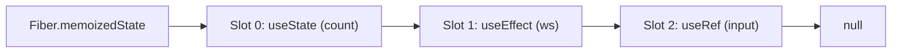
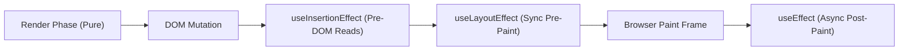
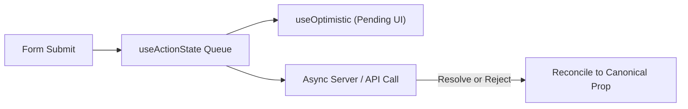

---
tags:
  - programming
  - frontend
  - react
  - hooks
  - react-19
  - concurrency
  - performance
created: 2025-12-29
updated: 2026-11-13
status: 🟢
level: mid-to-senior
---
# React Hooks Guide

> [!abstract] Core Invariant
> Hooks are not stateless utility helpers; each hook invocation reads and advances a sequential positional cursor along a **singly-linked list (`fiber.memoizedState`)** anchored to the component's Fiber node. Correctness requires identical hook call order across every render and strict separation between pure rendering and external side-effect synchronization.

---

## 1. First-Principles Mechanics: The Fiber Hooks Linked List

### 1.1 Architectural Motivation: Why Hooks Replaced Class Components

Prior to React 16.8, stateful logic required ES6 class components with imperative lifecycle methods (`componentDidMount`, `componentDidUpdate`, `componentWillUnmount`), alongside Higher-Order Components (HOCs) and Render Props for code reuse. That model produced three structural failure modes:
1. **Fragmented Subscriptions**: Establishing a single WebSocket or event listener split setup (`componentDidMount`), dependency comparison (`componentDidUpdate`), and teardown (`componentWillUnmount`) across three disconnected methods, frequently leaking listeners when update branches diverged.
2. **Wrapper Hell**: Composing authentication, telemetry, theme, and permissions via HOCs (`withAuth(withMetrics(withTheme(Panel)))`) inflated the component tree with artificial nesting and risked prop-name collisions.
3. **JavaScript `this` Binding Hazards & Poor Minification**: Class instances could not safely participate in ahead-of-time compiler optimizations like React Compiler because mutable instance properties (`this.state`, `this.timerId`) obscured reactive data dependencies.

Hooks solve all three issues by binding state cells and side-effect descriptors directly onto the component's `FiberNode` as plain JavaScript closures, allowing related subscription logic to co-locate in a single composable `use*` function.

### 1.2 `fiber.memoizedState` Cursor & Dispatcher Mechanics

When React executes a function component inside `beginWork` (`renderWithHooks`), it binds a module-global dispatcher (`ReactCurrentDispatcher.current`) to either `HooksDispatcherOnMount` (when `current === null`) or `HooksDispatcherOnUpdate` (on re-renders), and stores the active Fiber reference in `currentlyRenderingFiber`.

Each hook node in the singly-linked list attached to `fiber.memoizedState` carries this internal structure:

```typescript
// Conceptual internal Fiber Hook struct (ReactFiberHooks.js)
interface HookNode<S = unknown> {
  memoizedState: S; // Current state value, Effect descriptor, Ref object, or [val, deps] tuple
  baseState: S; // Base state before any skipped low-priority Transition updates
  baseQueue: UpdateNode<S> | null; // Circular list of skipped updates replayed on later renders
  queue: UpdateQueue<S> | null; // Circular pending update queue triggered by setState / dispatch
  next: HookNode | null; // Pointer to the next Hook called in this component render
}

interface UpdateNode<S> {
  lane: number; // 31-bit priority bitmask (SyncLane, TransitionLane, etc.)
  action: S | ((prev: S) => S);
  next: UpdateNode<S>; // Circular pointer back to head
}
```



#### Step-by-Step Mount vs Update Traversal

1. **Mount Pass (`HooksDispatcherOnMount`)**:
   - Component calls `const [count, setCount] = useState(0)` -> `mountWorkInProgressHook()` allocates `HookNode #0`, sets `fiber.memoizedState = HookNode #0`, initializes `memoizedState = 0`, and binds `dispatchSetState.bind(null, fiber, queue)`.
   - Component calls `useEffect(fn, [])` -> `mountWorkInProgressHook()` allocates `HookNode #1`, links `HookNode #0.next = HookNode #1`.
   - Component calls `useRef(null)` -> `mountWorkInProgressHook()` allocates `HookNode #2`, links `HookNode #1.next = HookNode #2`.
2. **Update Pass (`HooksDispatcherOnUpdate`)**:
   - React resets `currentHook = currentFiber.memoizedState` (from the committed `current` Fiber) and `workInProgressHook = null`.
   - Each `use*` invocation calls `updateWorkInProgressHook()`, which advances `currentHook = currentHook.next`, clones its state/queues onto the `workInProgress` Fiber's `HookNode`, processes queued updates matching active `renderLanes`, and returns the cell's value.

#### Exact Mechanical Failure of Conditional Hooks

Because React identifies hooks exclusively by **linked-list cursor index (`0, 1, 2...`)**—never by variable names, line numbers, or strings—calling a hook conditionally corrupts cursor alignment:

```typescript
// BROKEN: Conditional hook shifts linked-list cursor positions across renders
function UserProfile({ showBio }: { showBio: boolean }) {
  const [name, setName] = useState('Ada'); // Render 1: Slot 0 | Render 2: Slot 0
  if (showBio) {
    const [bio, setBio] = useState(''); // Render 1 (true): Slot 1 | Render 2 (false): SKIPPED!
  }
  useEffect(() => {
    document.title = name;
  }, [name]); // Render 1 (true): Slot 2 | Render 2 (false): Reads Slot 1 (bio's useState HookNode!)
  return <h1>{name}</h1>;
}
```

On Render 2 (`showBio = false`), `useEffect` calls `updateWorkInProgressHook()` at cursor index `1`, reading `bio`'s `useState` cell (`''`) while expecting an `Effect` descriptor object (`{ tag, create, destroy, deps }`). When Render 2 finishes with 2 hook invocations instead of 3, React detects `currentHook.next !== null` and throws:
`Error: Rendered fewer hooks than during the previous render.`
If a later branch adds an extra hook (`Rendered more hooks than during the previous render`), React crashes immediately during `beginWork` rather than letting mismatched state slots corrupt production data silently.

### 1.3 Rules of Hooks & Static Analysis

To guarantee identical cursor order on every render:
1. **Invoke Hooks Only at the Top Level**: Never call hooks inside `if` branches, `for`/`while` loops, nested callbacks, `try/catch` blocks, or after conditional early `return` statements. Place early returns strictly *after* all hook calls.
2. **Invoke Hooks Only Inside React Functions**: Call hooks solely inside React function components or custom hooks named with the `use` prefix (`useUserPermissions`).
3. **Static Enforcement**: Enable `eslint-plugin-react-hooks` rules `react-hooks/rules-of-hooks` (`error`) and `react-hooks/exhaustive-deps` (`warn`/`error`) in CI.
4. **React 19 `use()` Exception**: `use(promiseOrContext)` does **not** allocate a positional `HookNode` inside `fiber.memoizedState`—for Context it walks `fiber.dependencies` directly, and for Promises it binds `Suspense` wakeups directly to the `workInProgress` Fiber. Consequently, `use()` **can** legally run inside conditionals, loops, and after early returns.

---

## 2. Real-World Use Cases & Hook Selection Matrix

| Requirement | Primary Hook | Why Alternatives Fail |
|---|---|---|
| Simple local UI toggle, input value, modal open flag | `useState` | `useReducer` adds boilerplate for single-scalar transitions |
| Multi-field state with coupled transitions or finite-state machines | `useReducer` | Multiple `useState` calls risk impossible half-updated states (`loading: true` + `error: 'fail'`) and force unstable callback prop drilling |
| DOM element handle, timer ID, WebSocket ref, non-visual mutable counter | `useRef` | `useState` triggers redundant re-renders when updating non-visual bookkeeping values |
| Synchronizing React with browser APIs, timers, WebSockets, or analytics | `useEffect` | `useLayoutEffect` blocks browser painting; running side effects in render leaks under StrictMode and concurrent preemption |
| Reading synchronous DOM geometry (`getBoundingClientRect`) before paint | `useLayoutEffect` | `useEffect` executes post-paint, causing a visible 1-frame layout jump / tooltip flicker |
| CSS-in-JS runtime `<style>` tag injection before DOM reads | `useInsertionEffect` | `useLayoutEffect` runs after other child layout effects may already have measured stale unstyled geometry |
| Subscribing cleanly to mutable browser/external stores (`matchMedia`, Zustand) | `useSyncExternalStore` | `useEffect` + `useState` suffers concurrent tearing and delays initial snapshot until after paint |
| Non-blocking tab switch or server-action pending indicator | `useTransition` | Urgent `SyncLane` updates freeze interactive clicks/typing while heavy subtrees re-render |
| Keeping controlled `<input>` responsive while heavy downstream tree lags | `useDeferredValue` | Wrapping `setQuery` in `startTransition` causes dropped keystrokes and jumping text cursors |
| Optimistic list/like update tied to an async Transition or Form Action | `useOptimistic` | Manual `useState` optimistic copies require error-prone rollback bookkeeping when mutations fail or interleave |
| Managing async `<form action={fn}>` validation state & progressive enhancement | `useActionState` | Manual `isSubmitting`/`error` states duplicate pending tracking and do not queue sequential submits automatically |

---

## 3. Core State, Reducer & Effect Hooks in Production

### 3.1 `useState`: Lazy Initializers, Functional Updaters & Stale Closures

`useState<S>(initialState: S | (() => S)): [S, Dispatch<SetStateAction<S>>]`

#### 1. Lazy Initializer Pattern

Passing an expression directly (`useState(JSON.parse(localStorage.getItem('prefs') ?? '{}'))`) executes `JSON.parse(...)` on **every single re-render**, even though React ignores the argument after initial mount. Passing a zero-argument initializer function guarantees one-time execution on mount (plus once in dev `StrictMode` purity validation):

```tsx
interface Preferences {
  density: 'compact' | 'comfortable';
  sidebarCollapsed: boolean;
}

const DEFAULT_PREFS: Preferences = {
  density: 'comfortable',
  sidebarCollapsed: false,
};

function readInitialPreferences(): Preferences {
  if (typeof window === 'undefined') return DEFAULT_PREFS;
  try {
    const raw = window.localStorage.getItem('workspace.prefs');
    return raw ? (JSON.parse(raw) as Preferences) : DEFAULT_PREFS;
  } catch {
    return DEFAULT_PREFS;
  }
}

export function WorkspaceShell() {
  // Executed strictly on mount—never re-parsed during subsequent re-renders
  const [prefs, setPrefs] = useState<Preferences>(readInitialPreferences);
  return <div data-density={prefs.density} />;
}
```

#### 2. Functional Updaters & Stale Closure Traces

Every render captures immutable `const` snapshot bindings inside its closures. Consider calling `setCount(count + 1)` three times sequentially or inside a `setInterval(..., 1000)` registered on mount:

```tsx
// BUG: Captures initial `count = 0` permanently inside interval closure
useEffect(() => {
  const id = window.setInterval(() => {
    setCount(count + 1); // Always executes setCount(0 + 1) -> stuck at 1 forever
  }, 1000);
  return () => window.clearInterval(id);
}, []);

// CORRECT: Appends updater node `(c) => c + 1` to hook.queue.pending
useEffect(() => {
  const id = window.setInterval(() => {
    setCount((prev) => prev + 1); // Reduced sequentially against latest committed state
  }, 1000);
  return () => window.clearInterval(id);
}, []);
```

Whenever next state computes from prior state—or runs inside timers, event listeners, debounced closures, or consecutive updates—always pass an updater function `(prev) => next`.

#### 3. `Object.is` Bailout & Storing Function Values Trap

React compares incoming state against current `memoizedState` with **`Object.is(nextState, currentState)`**:
- **Mutation Bug**: Mutating an object or array in place (`items.push(item); setItems(items)`) passes the identical object reference. `Object.is` returns `true` and React **skips re-rendering entirely**. Always return fresh copies (`setItems((prev) => [...prev, item])`).
- **Eager Bailout**: When `hook.queue.pending === null` and `Object.is(nextState, currentState)` is `true`, React bails out *without even re-running the component function*.
- **Storing Functions in `useState`**: Because React treats any function argument to `setState(fn)` as an updater callback, storing a callback inside state requires wrapping it in a factory function:

```tsx
const [formatter, setFormatter] = useState<(n: number) => string>(
  () => (n: number) => `$${n.toFixed(2)}`
);
// Updating: wrap in outer arrow so React stores the inner function rather than invoking it as an updater
setFormatter(() => (n: number) => `€${n.toFixed(2)}`);
```

---

### 3.2 `useReducer`: Discriminated State Machines & Stable Dispatch

`useReducer<S, A>(reducer: (state: S, action: A) => S, initialArg, init?)`

Use `useReducer` when state transitions depend on multiple fields together, follow explicit finite-state-machine transitions, or need a stable `dispatch` reference across deep trees.

**Key Mechanical Invariants**:
1. **Guaranteed `dispatch` Identity**: React guarantees `Object.is(prevDispatch, nextDispatch) === true` for the lifetime of the component mount. Passing `dispatch` through Context or `React.memo` props never triggers child re-renders—eliminating `useCallback` wrappers.
2. **Pure Reducer Contract**: Reducers run inside the Render Phase (and execute twice in dev `StrictMode`). Never mutate `state`, trigger `fetch`, or call `localStorage.setItem` inside a reducer.
3. **Exhaustive TypeScript Discriminated Unions**: Modeling every action as a tagged union catches unhandled states at compile time.

```tsx
// Complete production shopping cart state machine with lazy init + Split Context
import {
  createContext,
  useContext,
  useReducer,
  type Dispatch,
  type ReactNode,
} from 'react';

export interface CartItem {
  sku: string;
  name: string;
  unitPriceCents: number;
  qty: number;
}

export type CartStatus = 'idle' | 'submitting' | 'failed';

export interface CartState {
  items: CartItem[];
  couponCode: string | null;
  status: CartStatus;
  errorMessage: string | null;
}

export type CartAction =
  | { type: 'ADD_ITEM'; item: Omit<CartItem, 'qty'> }
  | { type: 'SET_QTY'; sku: string; qty: number }
  | { type: 'REMOVE_ITEM'; sku: string }
  | { type: 'APPLY_COUPON'; code: string | null }
  | { type: 'CHECKOUT_START' }
  | { type: 'CHECKOUT_SUCCESS' }
  | { type: 'CHECKOUT_ERROR'; message: string };

function initCart(persistedSkus: CartItem[]): CartState {
  return {
    items: persistedSkus,
    couponCode: null,
    status: 'idle',
    errorMessage: null,
  };
}

function cartReducer(state: CartState, action: CartAction): CartState {
  switch (action.type) {
    case 'ADD_ITEM': {
      const existing = state.items.find((i) => i.sku === action.item.sku);
      const nextItems = existing
        ? state.items.map((i) =>
            i.sku === action.item.sku ? { ...i, qty: i.qty + 1 } : i
          )
        : [...state.items, { ...action.item, qty: 1 }];
      return { ...state, items: nextItems, errorMessage: null };
    }
    case 'SET_QTY': {
      if (action.qty <= 0) {
        return {
          ...state,
          items: state.items.filter((i) => i.sku !== action.sku),
        };
      }
      return {
        ...state,
        items: state.items.map((i) =>
          i.sku === action.sku ? { ...i, qty: action.qty } : i
        ),
      };
    }
    case 'REMOVE_ITEM':
      return {
        ...state,
        items: state.items.filter((i) => i.sku !== action.sku),
      };
    case 'APPLY_COUPON':
      return { ...state, couponCode: action.code };
    case 'CHECKOUT_START':
      return { ...state, status: 'submitting', errorMessage: null };
    case 'CHECKOUT_SUCCESS':
      return { items: [], couponCode: null, status: 'idle', errorMessage: null };
    case 'CHECKOUT_ERROR':
      return { ...state, status: 'failed', errorMessage: action.message };
    default: {
      const _exhaustive: never = action;
      return _exhaustive;
    }
  }
}

const CartStateContext = createContext<CartState | null>(null);
const CartDispatchContext = createContext<Dispatch<CartAction> | null>(null);

export function CartProvider({
  initialItems = [],
  children,
}: {
  initialItems?: CartItem[];
  children: ReactNode;
}) {
  const [state, dispatch] = useReducer(cartReducer, initialItems, initCart);
  return (
    <CartDispatchContext.Provider value={dispatch}>
      <CartStateContext.Provider value={state}>
        {children}
      </CartStateContext.Provider>
    </CartDispatchContext.Provider>
  );
}

export function useCartState(): CartState {
  const ctx = useContext(CartStateContext);
  if (!ctx) throw new Error('useCartState must be used inside CartProvider');
  return ctx;
}

export function useCartDispatch(): Dispatch<CartAction> {
  const ctx = useContext(CartDispatchContext);
  if (!ctx) throw new Error('useCartDispatch must be used inside CartProvider');
  return ctx;
}
```

---

### 3.3 Effect Lifecycle & Exact Commit Execution Timeline

Effects are escape hatches for synchronizing React components with **external systems** outside React's control (DOM mutations, IntersectionObservers, WebSockets, third-party canvas libraries, analytics, or network transport when not using an RSC/query library).



#### Exact Execution Sequence Across Updates & Unmount

| Hook | Timing Relative to DOM & Paint | Blocking Nature | Intended Purpose |
|---|---|---|---|
| **`useInsertionEffect`** | Fires *before* React mutates DOM nodes during Commit Mutation | Synchronous | Exclusively for CSS-in-JS libraries (`styled-components`, Emotion) inserting `<style>` tags before layout calculations occur. Cannot read refs reliably or update state normally |
| **`useLayoutEffect`** | Fires *after* DOM mutations and new `ref` attachment, **strictly before** browser paint | Synchronous (blocks paint) | Measuring DOM geometry (`getBoundingClientRect()`, `scrollHeight`) and repositioning tooltips/popovers atomically so users never witness a 1-frame flicker |
| **`useEffect`** | Fires **asynchronously after** the browser paints the frame | Non-blocking (passive) | WebSockets, `addEventListener`, timers, analytics beacons, imperative external library sync |

On a dependency change (`!Object.is(prevDep, nextDep)` for any item in `[deps]`):
1. React commits the new DOM using the new render snapshot.
2. Browser paints (for `useEffect`) or pauses pre-paint (for `useLayoutEffect`).
3. React executes the **previous render's cleanup function** (capturing the *old* render's closure variables!).
4. React executes the **new render's setup function** (capturing the *new* render's closure variables!).
5. On component unmount, React runs the final cleanup function one last time.

> [!warning] `useLayoutEffect` Server-Side Rendering (SSR) Diagnostic
> Neither `useEffect` nor `useLayoutEffect` executes on a Node/Edge server. Because `useLayoutEffect` assumes synchronous pre-paint browser layout exists, rendering it during SSR emits a React warning (`useLayoutEffect does nothing on the server`). Fix this by: (a) using CSS (`position: anchor`, Flexbox, Grid) where possible, (b) guarding client-only DOM panels behind a mounted state or dynamic client boundary, or (c) using `useSyncExternalStore` with a deterministic `getServerSnapshot` for environment reads.

#### `useLayoutEffect` Pre-Paint Tooltip Positioning Example

```tsx
import { useLayoutEffect, useRef, useState } from 'react';

interface Position {
  top: number;
  left: number;
}

export function AnchoredTooltip({
  anchorEl,
  text,
}: {
  anchorEl: HTMLElement | null;
  text: string;
}) {
  const tooltipRef = useRef<HTMLDivElement>(null);
  const [coords, setCoords] = useState<Position>({ top: 0, left: 0 });

  // Runs synchronously AFTER tooltip mounts to DOM, BEFORE browser paints frame 1
  useLayoutEffect(() => {
    if (!anchorEl || !tooltipRef.current) return;
    const anchorRect = anchorEl.getBoundingClientRect();
    const tipRect = tooltipRef.current.getBoundingClientRect();

    const fitsAbove = anchorRect.top - tipRect.height - 8 >= 0;
    const top = fitsAbove
      ? anchorRect.top - tipRect.height - 8
      : anchorRect.bottom + 8;
    const left = Math.max(
      8,
      Math.min(
        window.innerWidth - tipRect.width - 8,
        anchorRect.left + anchorRect.width / 2 - tipRect.width / 2
      )
    );
    setCoords({ top, left });
  }, [anchorEl, text]);

  return (
    <div
      ref={tooltipRef}
      role="tooltip"
      style={{
        position: 'fixed',
        top: coords.top,
        left: coords.left,
        zIndex: 50,
      }}
    >
      {text}
    </div>
  );
}
```

#### `StrictMode` Mount -> Cleanup -> Remount Stress Verification

In development `<StrictMode>`, every component runs `mount -> cleanup -> remount` automatically. If a component connects a `WebSocket` inside `useEffect` without returning `() => socket.close()`, two sockets stay open in development and double every message immediately. Never silence this check using `const mountedRef = useRef(false)` guards—write symmetric cleanup functions so re-mounting behaves identically to initial mounting.

#### Async Race Conditions: `AbortController` + `ignore` Flag

When a dependency (`userId`, `searchQuery`) changes rapidly, network latency variance causes out-of-order responses: Request A (`userId=1`, takes 900ms) resolves *after* Request B (`userId=2`, takes 120ms) and overwrites User 2's profile with User 1's payload.

Always combine **`AbortController`** (aborts HTTP sockets immediately) with a local **`ignore` boolean** (guards non-abortable SDK promises and post-JSON parsing ticks):

```tsx
useEffect(() => {
  const controller = new AbortController();
  let ignore = false;

  async function loadUserProfile() {
    setStatus('loading');
    try {
      const res = await fetch(`/api/users/${encodeURIComponent(userId)}`, {
        signal: controller.signal,
      });
      if (!res.ok) throw new Error(`HTTP ${res.status}`);
      const profile = (await res.json()) as UserProfile;
      if (!ignore) {
        setProfile(profile);
        setStatus('ready');
      }
    } catch (err) {
      if (err instanceof DOMException && err.name === 'AbortError') return;
      if (!ignore) {
        setError(err instanceof Error ? err.message : 'Request failed');
        setStatus('error');
      }
    }
  }

  void loadUserProfile();

  return () => {
    ignore = true;
    controller.abort();
  };
}, [userId]);
```

#### Separating Non-Reactive Event Logic Inside Effects (`useRef` Pattern & `useEffectEvent`)

Sometimes a long-lived connection (`WebSocket` tied strictly to `[roomId]`) needs to read the *latest* UI state (`theme`, `currentSoundPref`, `onMessageCallback`) without tearing down and reconnecting the socket whenever `theme` changes.

- **Standard React 19 Pattern (Latest-Value Ref)**: Update `latestRef.current = value` in an effect (or commit phase) and read `latestRef.current` inside the socket callback, omitting `value` from the socket effect's dependency array safely.
- **React 19.2+ `useEffectEvent`**: Declares a non-reactive event callback explicitly extracted from Effect reactive dependencies (`const onMsg = useEffectEvent((msg) => showToast(msg, theme));`), allowing ESLint `exhaustive-deps` to verify `[roomId]` cleanly without manual ref plumbing.

---

### 3.4 "You Might Not Need an Effect" Complete Replacement Catalog

| Anti-Pattern | Runtime Failure / Overhead | Production Replacement |
|---|---|---|
| **1. Computing Derived State** (`useEffect(() => setTotal(a + b), [a, b])`) | Extra render cycle + 1 stale intermediate frame | Compute synchronously during render: `const total = a + b;` (wrap in `useMemo` only if `> 1–2ms`) |
| **2. Resetting All Component State on Prop Change** (`useEffect(() => { setText(''); setPage(1); }, [threadId])`) | Renders 1 stale frame showing the previous `threadId`'s draft before clearing | Pass `key={threadId}` on the child component (`<ThreadComposer key={threadId} />`) to reset its Fiber state atomically |
| **3. Resetting Partial State on Prop Change** (`useEffect(() => setSelection(null), [items])`) | Delayed render pass and cascading child re-renders | Derive `const selection = items.find(i => i.id === selectedId) ?? null` (store only `selectedId`, never duplicate object!) |
| **4. Executing User-Triggered Mutations in Effects** (`useEffect(() => { if (submitted) postOrder(); }, [submitted])`) | StrictMode double-POSTs orders; navigating or re-mounting re-fires purchase; harder stack traces | Run `await postOrder()` directly inside the `onClick` / `onSubmit` event handler |
| **5. Chaining Cascading `useEffect` Hooks** (`Effect1 -> setA -> Effect2 -> setB -> Effect3 -> setC`) | `N+1` sequential render passes, flickering UI, brittle race ordering | Compute downstream values in render or execute the multi-field transition inside a single event handler / `useReducer` dispatch |
| **6. One-Time App Singleton Initialization** (`useEffect(() => initSdk(), [])`) | Runs twice in StrictMode dev and delays initialization until after mount | Guard outside components at module scope (`if (typeof window !== 'undefined' && !initialized) ...`) |
| **7. Subscribing to Mutable Browser/Global Stores** (`useEffect` + `window.addEventListener('online', ...)`) | Tearing under concurrent transitions; misses updates between render and effect commit | Replace with `useSyncExternalStore(subscribe, getSnapshot, getServerSnapshot)` |

---

## 4. Refs, DOM APIs, External Stores & Performance Hooks

### 4.1 `useRef`, React 19 Ref Cleanup Functions, `useImperativeHandle` & `useId`

#### `useRef` Mechanics & Render Purity Rule

`useRef<T>(initialValue: T): RefObject<T>` allocates a single persistent plain object `{ current: initialValue }` on `hook.memoizedState` once on mount and returns that identical object identity across every render. Mutating `ref.current = x` does **not** notify React or schedule a render.

**Strict Rules for `ref.current`**:
- Do **not** read or write `ref.current` during the Render Phase (except one-time lazy singleton creation: `if (cacheRef.current === null) cacheRef.current = new HeavyParser()`). Writing/reading refs during render breaks component idempotency and disables React Compiler memoization.
- Read and mutate `ref.current` inside event handlers, `useEffect`, or `useLayoutEffect`.

#### Callback Refs & React 19 Ref Cleanup Functions

A common silent bug is writing `useEffect(() => { observer.observe(elRef.current); }, [elRef.current])`. Because `ref.current` is assigned during Commit Layout *after* render and does **not** re-render the component when a conditional child mounts later (`{showPanel && <div ref={elRef} />}`), the `useEffect` never re-runs!

React 19 solves dynamic DOM lifecycle attachment natively by allowing **callback refs to return a cleanup function** (just like `useEffect`). When the DOM node unmounts or the callback ref identity changes, React invokes the returned cleanup automatically—replacing the old `if (node === null)` branch:

```tsx
// React 19 native ref cleanup function
import { useCallback, useState } from 'react';

export function DynamicMeasuredBox() {
  const [visible, setVisible] = useState(true);
  const [width, setWidth] = useState(0);

  const measureRef = useCallback((node: HTMLDivElement | null) => {
    if (!node) return;
    const observer = new ResizeObserver(([entry]) => {
      if (entry) setWidth(Math.round(entry.contentRect.width));
    });
    observer.observe(node);

    // Invoked automatically by React 19 when node unmounts or detaches
    return () => {
      observer.disconnect();
    };
  }, []);

  return (
    <div>
      <button type="button" onClick={() => setVisible((v) => !v)}>
        Toggle Panel
      </button>
      {visible && (
        <div ref={measureRef} style={{ resize: 'horizontal', overflow: 'auto', border: '1px solid' }}>
          Observed width: {width}px
        </div>
      )}
    </div>
  );
}
```

#### `useImperativeHandle` (With React 19 `ref` as Prop)

Rather than leaking the entire raw `HTMLInputElement` (allowing parents to mutate `.style` or `.innerHTML` arbitrarily), expose a narrow imperative handle (`focus`, `selectRange`, `scrollToBottom`) using `useImperativeHandle`. Notice in React 19, `ref` arrives directly in props without `React.forwardRef`:

```tsx
import { useImperativeHandle, useRef, type Ref } from 'react';

export interface SearchBoxHandle {
  focusAndSelect: () => void;
  clear: () => void;
}

export function SearchBox({
  ref,
  placeholder,
}: {
  ref?: Ref<SearchBoxHandle>;
  placeholder?: string;
}) {
  const inputRef = useRef<HTMLInputElement>(null);

  useImperativeHandle(
    ref,
    () => ({
      focusAndSelect() {
        inputRef.current?.focus();
        inputRef.current?.select();
      },
      clear() {
        if (inputRef.current) inputRef.current.value = '';
      },
    }),
    []
  );

  return <input ref={inputRef} type="search" placeholder={placeholder} />;
}
```

#### `useId` (SSR-Safe ARIA Bindings)

`useId()` generates a stable, unique string derived from the component's **structural depth path in the Fiber tree** (e.g., `«r1»` in React 19), producing identical IDs on both the SSR server and the hydrating client—preventing hydration mismatches caused by `Math.random()` or incrementing module counters.

- **Correct Uses**: Binding `<label htmlFor={id}>`, `aria-describedby`, `aria-labelledby`, and `<datalist>` targets—prefixing multiple related IDs from one call (`${baseId}-email`, `${baseId}-hint`, `${baseId}-err`).
- **Forbidden Use**: **Never pass `useId()` as a `key` in a list** (`key={useId()}`). List keys must originate from stable domain item data (`item.id`), not component structural render order.

---

### 4.2 `useSyncExternalStore`: Tear-Free External Store Subscriptions

`useSyncExternalStore<T>(subscribe: (onStoreChange: () => void) => () => void, getSnapshot: () => T, getServerSnapshot?: () => T): T`

Why `useEffect` + `useState` fails for external mutable stores (`window.matchMedia`, `navigator.onLine`, Redux, Zustand, browser `history`, IndexedDB listeners):
1. **Concurrent Tearing**: During a time-sliced transition render, Component A reads `store.getState()` before a 5ms yield, an external event mutates the store mid-yield, and Component B reads the newer value after resuming—rendering two contradictory versions of the same state in one frame. `useSyncExternalStore` forces synchronous re-renders whenever the store mutates during render and verifies snapshot consistency before committing.
2. **Pre-Effect Update Window**: Store mutations occurring between Render and post-paint `useEffect` subscription attachment are silently missed unless checked synchronously.

```tsx
// Complete SSR-safe useOnlineStatus built on useSyncExternalStore
import { useSyncExternalStore } from 'react';

function subscribeNetwork(callback: () => void): () => void {
  window.addEventListener('online', callback);
  window.addEventListener('offline', callback);
  return () => {
    window.removeEventListener('online', callback);
    window.removeEventListener('offline', callback);
  };
}

function getClientOnlineSnapshot(): boolean {
  return navigator.onLine;
}

function getServerOnlineSnapshot(): boolean {
  return true; // Deterministic fallback during SSR to avoid hydration mismatch
}

export function useOnlineStatus(): boolean {
  return useSyncExternalStore(
    subscribeNetwork,
    getClientOnlineSnapshot,
    getServerOnlineSnapshot
  );
}
```

> [!danger] `getSnapshot` Reference Stability & Infinite Render Loops
> React invokes `getSnapshot()` during render and compares the returned value with `Object.is`. If `getSnapshot` returns a newly constructed object or array literal (`() => ({ online: navigator.onLine, ts: Date.now() })`) when the underlying store has not changed, `Object.is(prev, next)` returns `false` on every render, trapping React in:
> `Error: Maximum update depth exceeded` / infinite re-render loops.
> Always return a primitive (`boolean`, `string`, `number`) or a **cached reference** stored inside the external store that updates *only* when the store state actually changes.

---

### 4.3 Memoization Hooks (`useMemo`, `useCallback`, `React.memo`) & React Compiler

Every manual memoization call introduces runtime cost:
- `useMemo(fn, deps)` allocates an array `[value, deps]` on `fiber.memoizedState`, retains old closure variables in heap memory (preventing GC of prior dependencies until invalidated), and executes an `Object.is` comparison loop over `deps` on *every* render.
- `useCallback(fn, deps)` still allocates the inline function closure `() => ...` on every render in JS, then discards it if `deps` are `Object.is`-equal—solely preserving the previous function reference.
- `React.memo(Component)` runs a shallow `Object.is` loop across every prop key on every parent render.

#### When Manual Memoization Earns Its Overhead

1. **Stabilizing Props Passed to `React.memo` Subtrees**: If `<HeavyDataGrid data={rows} onRowClick={handleClick} />` is wrapped in `React.memo`, omitting `useCallback` on `handleClick` or `useMemo` on derived `rows` completely breaks `React.memo` (every parent render produces new references, failing prop comparison).
2. **Stabilizing Dependencies of `useEffect` / Custom Hooks**: Passing an un-memoized `options` object or callback into a downstream `useEffect(..., [options])` re-runs the effect on every render.
3. **Stabilizing Context Provider Values**: Prevents unrelated consumers from waking up (or prefer Split State/Actions Context).
4. **Expensive Synchronous Calculations (`>= 1–2ms`)**: Verified via `performance.now()` or React DevTools Profiler Flamegraph (e.g., sorting/indexing thousands of records, computing layout matrices).

*Note on host DOM event handlers*: Writing `<button onClick={() => deleteRow(row.id)}>` inside a normal component does **not** hurt performance—React's root event delegation updates a single JS reference on the Fiber without touching DOM `addEventListener`. Do **not** litter simple UI trees with `useCallback` around native `<button>` handlers.

#### React 19 React Compiler (`babel-plugin-react-compiler`)

The **React Compiler** performs static data-flow and mutation analysis over component and hook ASTs at build time, automatically transforming components into fine-grained memoized reactive blocks using an internal memo cache hook (`_c(size)`):
- Automatically caches intermediate calculations, callback identities, *and* individual JSX expressions (`<div>...</div>`) without manual `useMemo`, `useCallback`, or `React.memo` boilerplate.
- **Compiler Contract (Rules of React)**: React Compiler assumes components obey strict purity and immutability:
  1. **Idempotent Render**: Same inputs (`props`, `state`, `context`) yield identical JSX.
  2. **Immutability After Sharing**: Local temporary mutations (`const arr = []; arr.push(x);`) *before* passing `arr` into JSX or another function are safe; mutating `props`, `state`, or an array *after* `<Child list={arr} />` has captured it violates immutability and causes skipped updates under compilation.
  3. **No `ref.current` Access in Render**: Reading or mutating refs during render prevents static reactivity analysis.
- **Escape Hatch & Tooling**: Install `eslint-plugin-react-compiler` (folded into modern `eslint-plugin-react-hooks` rules) to flag violations before enabling compilation; add `'use no memo';` at the top of a function body only as a temporary opt-out while refactoring legacy non-compliant code.

---

## 5. Concurrency & React 19 Complete Hooks Reference

### 5.1 `useTransition` & React 19 Async Transitions

`const [isPending, startTransition] = useTransition()`

`useTransition` marks state updates and asynchronous mutations inside `startTransition(scope)` as low-priority **Transitions (`TransitionLane`)**. Unlike urgent updates (`SyncLane`), React can pause, yield every 5ms, or discard an obsolete transition render whenever a higher-priority click or keystroke arrives.

**React 19 Async Transition Upgrade**: Previously, `startTransition` rejected `async` functions after the first `await` because React lost the synchronous execution context. In React 19, `startTransition(async () => { ... })` tracks the asynchronous lifetime automatically—keeping `isPending === true` across `await` boundaries until subsequent `setState` updates commit. *(Call `startTransition(() => setState(...))` again after `await` if deploying across mixed transpilers, or let React 19's native async context manage `isPending` cleanly.)*

```tsx
import { useState, useTransition } from 'react';

export function ProjectTabSwitcher({
  onSelectTab,
}: {
  onSelectTab: (tab: 'overview' | 'metrics' | 'audit') => Promise<void>;
}) {
  const [activeTab, setActiveTab] = useState<'overview' | 'metrics' | 'audit'>('overview');
  const [isPending, startTransition] = useTransition();

  function selectTab(nextTab: 'overview' | 'metrics' | 'audit') {
    startTransition(async () => {
      await onSelectTab(nextTab);
      setActiveTab(nextTab);
    });
  }

  return (
    <nav aria-label="Workspace views" aria-busy={isPending}>
      {(['overview', 'metrics', 'audit'] as const).map((tab) => (
        <button
          key={tab}
          type="button"
          aria-current={activeTab === tab ? 'page' : undefined}
          onClick={() => selectTab(tab)}
          style={{ opacity: isPending && activeTab !== tab ? 0.7 : 1 }}
        >
          {tab}
        </button>
      ))}
      {isPending && <span role="status">Loading view...</span>}
    </nav>
  );
}
```

---

### 5.2 `useDeferredValue(value, initialValue?)`

`const deferredValue = useDeferredValue(value, initialValue?)`

When you receive a fast-changing prop or controlled input string (`value`) and pass it down to an expensive child tree wrapped in `React.memo`, `useDeferredValue` produces a lagging copy that stays at the previous value during the urgent `SyncLane` render and updates asynchronously in a background `TransitionLane`.

**React 19 `initialValue` Parameter**: Passing `useDeferredValue(query, '')` renders `''` immediately on the **initial mount** pass and schedules the real `query` render in the background—preventing expensive initial mounts from blocking first paint or falling back to outer `<Suspense>` spinners.

```tsx
import { memo, useDeferredValue, useState } from 'react';

const ExpensiveFacetResults = memo(function ExpensiveFacetResults({
  filterText,
}: {
  filterText: string;
}) {
  // Simulates costly layout/filter work
  const matches = Array.from({ length: 1200 }, (_, i) => `Metric-${i}-${filterText}`);
  return (
    <ul>
      {matches.slice(0, 100).map((item) => (
        <li key={item}>{item}</li>
      ))}
    </ul>
  );
});

export function FacetFilterPanel() {
  const [text, setText] = useState('');
  const deferredText = useDeferredValue(text, '');
  const isUpdating = text !== deferredText;

  return (
    <div>
      <input
        type="search"
        aria-label="Filter metrics"
        value={text}
        onChange={(e) => setText(e.target.value)}
      />
      <div style={{ opacity: isUpdating ? 0.6 : 1 }}>
        <ExpensiveFacetResults filterText={deferredText} />
      </div>
    </div>
  );
}
```

---

### 5.3 `use(resource)`: Conditional Promise & Context Reading

`const value = use(promiseOrContext)`

React 19 introduces `use()`, a first-class primitive for reading **Promises** (integrating directly with `<Suspense>` and `<ErrorBoundary>`) and **React Context**—with one deliberate divergence from classic hooks: **`use()` CAN be invoked inside `if` statements, early-return blocks, and `for` loops** because it does not claim a positional slot in `fiber.memoizedState`.

```tsx
import { Suspense, createContext, use } from 'react';
import { ErrorBoundary } from 'react-error-boundary';

interface FeatureFlags {
  enableBillingV2: boolean;
}

const FlagsContext = createContext<FeatureFlags>({ enableBillingV2: false });

function InvoiceDetails({
  enabled,
  invoicePromise,
}: {
  enabled: boolean;
  invoicePromise: Promise<{ id: string; amountCents: number }>;
}) {
  if (!enabled) return <p>Billing view disabled.</p>;

  // Legal in React 19: use() invoked conditionally AFTER early return!
  const flags = use(FlagsContext);
  const invoice = use(invoicePromise);

  return (
    <article>
      <h3>Invoice #{invoice.id}</h3>
      <p>Amount: ${(invoice.amountCents / 100).toFixed(2)}</p>
      {flags.enableBillingV2 && <span>V2 Ledger Active</span>}
    </article>
  );
}

export function BillingSection({
  enabled,
  invoicePromise,
}: {
  enabled: boolean;
  invoicePromise: Promise<{ id: string; amountCents: number }>;
}) {
  return (
    <ErrorBoundary fallback={<p role="alert">Unable to load invoice.</p>}>
      <Suspense fallback={<p role="status">Fetching invoice...</p>}>
        <InvoiceDetails enabled={enabled} invoicePromise={invoicePromise} />
      </Suspense>
    </ErrorBoundary>
  );
}
```

> [!danger] Critical Anti-Pattern: Creating Promises Inline During Render
> Never call `use(fetch('/api/invoice').then(r => r.json()))` inside a client component body! When `use(promise)` suspends, React aborts and later **re-runs the entire component function** once the promise resolves. Calling `fetch(...)` inside render generates a **brand-new pending Promise object** on the retry render, forcing React to suspend again in an infinite loop. Always create and cache promises outside the suspending component—inside Server Components, router loaders, TanStack Query, or parent event handlers.

---

### 5.4 `useActionState`, `useFormStatus` & `useOptimistic`

React 19 standardizes end-to-end form actions and speculative mutations across client SPAs and Next.js Server Actions:

- **`useActionState<State, Payload>(actionFn, initialState, permalink?)`** (imported from `'react'`):
  - Returns `[state, dispatchAction, isPending]`.
  - Automatically queues sequential form submissions rather than colliding concurrent requests, receives `(previousState, formData)` when bound to `<form action={dispatchAction}>`, and captures validation/server errors cleanly in `state`.
  - Optional `permalink` specifies a progressive-enhancement URL when submitted before client JavaScript hydrates.
- **`useFormStatus()`** (imported from `'react-dom'`):
  - Returns `{ pending, data, method, action }` for the **nearest ancestor `<form>`**.
  - **Boundary Trap**: Calling `useFormStatus()` inside the *same* component that renders `<form>` always yields `pending: false` because it checks parent Fibers, not self/children! Always extract `<SubmitButton />` as a child component inside `<form>`.
- **`useOptimistic<State, OptimisticValue>(passthroughState, updateFn)`** (imported from `'react'`):
  - Projects immediate speculative UI state during an active Transition or Form Action (`updateFn(currentState, optimisticValue)`), and **automatically reconciles back to `passthroughState`** when the async transition settles or throws—eliminating manual failure-rollback state cleanup.



```tsx
import { useActionState, useOptimistic, useRef } from 'react';
import { useFormStatus } from 'react-dom';

interface TaskComment {
  id: string;
  author: string;
  body: string;
  pending?: boolean;
}

interface CommentFormState {
  error: string | null;
}

// Must live inside a child component beneath <form> for useFormStatus() to read form state
function SubmitCommentButton() {
  const { pending } = useFormStatus();
  return (
    <button type="submit" disabled={pending}>
      {pending ? 'Posting...' : 'Post Comment'}
    </button>
  );
}

export function TaskCommentFeed({
  canonicalComments,
  onPersistComment,
}: {
  canonicalComments: TaskComment[];
  onPersistComment: (body: string) => Promise<void>;
}) {
  const formRef = useRef<HTMLFormElement>(null);

  const [optimisticComments, addOptimisticComment] = useOptimistic(
    canonicalComments,
    (current: TaskComment[], draftBody: string): TaskComment[] => [
      ...current,
      {
        id: `optimistic-${crypto.randomUUID()}`,
        author: 'You',
        body: draftBody,
        pending: true,
      },
    ]
  );

  const [formState, formAction] = useActionState(
    async (_prev: CommentFormState, formData: FormData): Promise<CommentFormState> => {
      const body = String(formData.get('commentBody') ?? '').trim();
      if (body.length < 2) {
        return { error: 'Comment must contain at least 2 characters.' };
      }

      // Trigger speculative UI inside the active transition
      addOptimisticComment(body);
      formRef.current?.reset();

      try {
        await onPersistComment(body);
        return { error: null };
      } catch (err) {
        // Returning error finishes the action; useOptimistic reverts automatically to canonicalComments
        return {
          error: err instanceof Error ? err.message : 'Unable to save comment.',
        };
      }
    },
    { error: null }
  );

  return (
    <section aria-label="Task comments">
      <ul>
        {optimisticComments.map((comment) => (
          <li key={comment.id} style={{ opacity: comment.pending ? 0.55 : 1 }}>
            <strong>{comment.author}:</strong> {comment.body}{' '}
            {comment.pending && <em>(Sending...)</em>}
          </li>
        ))}
      </ul>

      <form ref={formRef} action={formAction}>
        <label htmlFor="comment-input">Add Comment</label>
        <input id="comment-input" name="commentBody" type="text" required />
        <SubmitCommentButton />
        {formState.error && <p role="alert">{formState.error}</p>}
      </form>
    </section>
  );
}
```

---

## 6. Production Custom Hooks Patterns Library

Every custom hook below handles StrictMode double-mounts, SSR safety, TypeScript inference, cleanup invariants, and edge cases cleanly.

### 6.1 `useDebounce` (Debounced Value)

Delays propagating rapidly changing reactive values (such as search queries) until `delayMs` elapses without updates. Avoids timer leaks via `clearTimeout` cleanup.

```typescript
// hooks/useDebounce.ts
import { useEffect, useState } from 'react';

export function useDebounce<T>(value: T, delayMs: number): T {
  const [debounced, setDebounced] = useState<T>(value);

  useEffect(() => {
    if (delayMs <= 0) {
      setDebounced(value);
      return;
    }
    const timerId = window.setTimeout(() => {
      setDebounced(value);
    }, delayMs);

    return () => window.clearTimeout(timerId);
  }, [value, delayMs]);

  return debounced;
}
```

### 6.2 `useDebouncedCallback` (With `.cancel()`, `.flush()` & Latest Callback Ref)

Debounces imperative event handlers (`onResize`, `autosaveDraft`) without forcing callers to wrap `fn` in `useCallback` and exposing explicit `.cancel()` and `.flush()` controls (e.g., flush pending autosave on `beforeunload` or blur).

```typescript
// hooks/useDebouncedCallback.ts
import { useCallback, useEffect, useMemo, useRef } from 'react';

export interface DebouncedFunction<TArgs extends unknown[]> {
  (...args: TArgs): void;
  cancel: () => void;
  flush: () => void;
}

export function useDebouncedCallback<TArgs extends unknown[]>(
  fn: (...args: TArgs) => void,
  delayMs: number
): DebouncedFunction<TArgs> {
  const fnRef = useRef(fn);
  const timerRef = useRef<number | null>(null);
  const pendingArgsRef = useRef<TArgs | null>(null);

  useEffect(() => {
    fnRef.current = fn;
  }, [fn]);

  const cancel = useCallback(() => {
    if (timerRef.current !== null) {
      window.clearTimeout(timerRef.current);
      timerRef.current = null;
    }
    pendingArgsRef.current = null;
  }, []);

  const flush = useCallback(() => {
    if (timerRef.current !== null && pendingArgsRef.current !== null) {
      const args = pendingArgsRef.current;
      cancel();
      fnRef.current(...args);
    }
  }, [cancel]);

  useEffect(() => cancel, [cancel]);

  return useMemo(() => {
    const debounced = ((...args: TArgs) => {
      pendingArgsRef.current = args;
      if (timerRef.current !== null) {
        window.clearTimeout(timerRef.current);
      }
      timerRef.current = window.setTimeout(() => {
        const captured = pendingArgsRef.current;
        timerRef.current = null;
        pendingArgsRef.current = null;
        if (captured) fnRef.current(...captured);
      }, delayMs);
    }) as DebouncedFunction<TArgs>;

    debounced.cancel = cancel;
    debounced.flush = flush;
    return debounced;
  }, [delayMs, cancel, flush]);
}
```

### 6.3 `usePrevious` (Previous Committed Value)

Tracks the value from the *previous committed render*. Writing `ref.current = value` inside post-commit `useEffect` (never directly during render!) keeps the hook concurrent-safe and compliant with React Compiler's "no ref mutation in render" contract.

```typescript
// hooks/usePrevious.ts
import { useEffect, useRef } from 'react';

export function usePrevious<T>(value: T): T | undefined {
  const prevRef = useRef<T | undefined>(undefined);

  useEffect(() => {
    prevRef.current = value;
  }, [value]);

  return prevRef.current;
}
```

### 6.4 `useEventListener` (Typed Window, Document & HTMLElement Listeners)

Attaches typed DOM listeners cleanly without forcing handler identity churn (`listenerRef` swaps the callback cleanly while the underlying `addEventListener` stays mounted).

```typescript
// hooks/useEventListener.ts
import { useEffect, useRef, type RefObject } from 'react';

export function useEventListener<K extends keyof WindowEventMap>(
  eventName: K,
  handler: (event: WindowEventMap[K]) => void,
  element?: undefined,
  options?: AddEventListenerOptions
): void;

export function useEventListener<
  K extends keyof HTMLElementEventMap,
  T extends HTMLElement,
>(
  eventName: K,
  handler: (event: HTMLElementEventMap[K]) => void,
  element: RefObject<T | null>,
  options?: AddEventListenerOptions
): void;

export function useEventListener<K extends keyof DocumentEventMap>(
  eventName: K,
  handler: (event: DocumentEventMap[K]) => void,
  element: RefObject<Document | null>,
  options?: AddEventListenerOptions
): void;

export function useEventListener(
  eventName: string,
  handler: (event: Event) => void,
  element?: RefObject<EventTarget | null>,
  options?: AddEventListenerOptions
): void {
  const savedHandler = useRef(handler);

  useEffect(() => {
    savedHandler.current = handler;
  }, [handler]);

  const capture = options?.capture;
  const passive = options?.passive;
  const once = options?.once;

  useEffect(() => {
    const target: EventTarget | null =
      element !== undefined ? element.current : typeof window !== 'undefined' ? window : null;
    if (!target) return;

    const listener = (event: Event) => savedHandler.current(event);
    target.addEventListener(eventName, listener, { capture, passive, once });
    return () => {
      target.removeEventListener(eventName, listener, { capture });
    };
  }, [eventName, element, capture, passive, once]);
}
```

### 6.5 `useMediaQuery` (Concurrent & SSR-Safe via `useSyncExternalStore`)

Reads CSS media query state synchronously without tearing or flashing stale mobile/desktop layouts after paint.

```typescript
// hooks/useMediaQuery.ts
import { useCallback, useSyncExternalStore } from 'react';

export function useMediaQuery(query: string, serverFallback = false): boolean {
  const subscribe = useCallback(
    (onStoreChange: () => void) => {
      if (typeof window === 'undefined') return () => {};
      const mediaQueryList = window.matchMedia(query);
      mediaQueryList.addEventListener('change', onStoreChange);
      return () => mediaQueryList.removeEventListener('change', onStoreChange);
    },
    [query]
  );

  const getSnapshot = useCallback(() => {
    return typeof window !== 'undefined' ? window.matchMedia(query).matches : serverFallback;
  }, [query, serverFallback]);

  const getServerSnapshot = useCallback(() => serverFallback, [serverFallback]);

  return useSyncExternalStore(subscribe, getSnapshot, getServerSnapshot);
}
```

### 6.6 `useIntersectionObserver` (Infinite Scroll & Viewport Lazy Mounts)

Combines a callback ref (`setTarget`) with `IntersectionObserver` so conditional mounts/unmounts attach cleanly without `ref.current` dependency bugs, supporting `freezeOnceVisible` for one-shot lazy image/chart reveal.

```typescript
// hooks/useIntersectionObserver.ts
import { useCallback, useEffect, useState } from 'react';

interface ObserverOptions {
  root?: Element | null;
  rootMargin?: string;
  threshold?: number | number[];
  freezeOnceVisible?: boolean;
}

export function useIntersectionObserver({
  root = null,
  rootMargin = '0px',
  threshold = 0,
  freezeOnceVisible = false,
}: ObserverOptions = {}) {
  const [target, setTarget] = useState<Element | null>(null);
  const [entry, setEntry] = useState<IntersectionObserverEntry | null>(null);

  const isVisible = Boolean(entry?.isIntersecting);
  const frozen = freezeOnceVisible && isVisible;

  useEffect(() => {
    if (!target || frozen || typeof IntersectionObserver === 'undefined') return;

    const observer = new IntersectionObserver(
      ([observed]) => {
        if (observed) setEntry(observed);
      },
      { root, rootMargin, threshold }
    );
    observer.observe(target);

    return () => observer.disconnect();
  }, [target, root, rootMargin, threshold, frozen]);

  const refCallback = useCallback((node: Element | null) => {
    setTarget(node);
  }, []);

  return { ref: refCallback, entry, isVisible };
}
```

### 6.7 `useLocalStorage` (SSR-Safe, Cross-Tab & Same-Tab Synchronized)

Synchronizes state with `window.localStorage`, guards against private-browsing quota exceptions and corrupt JSON, and propagates updates across both *other* browser tabs (`storage` event) and *multiple components inside the same tab* (`CustomEvent`).

```typescript
// hooks/useLocalStorage.ts
import { useCallback, useEffect, useState } from 'react';

const LOCAL_STORAGE_SYNC_EVENT = 'app:local-storage-sync';

function readStorage<T>(key: string, fallback: T): T {
  if (typeof window === 'undefined') return fallback;
  try {
    const raw = window.localStorage.getItem(key);
    return raw !== null ? (JSON.parse(raw) as T) : fallback;
  } catch {
    return fallback;
  }
}

export function useLocalStorage<T>(key: string, initialValue: T) {
  const [storedValue, setStoredValue] = useState<T>(() =>
    readStorage(key, initialValue)
  );

  // Sync when key prop changes
  useEffect(() => {
    setStoredValue(readStorage(key, initialValue));
  }, [key]); // eslint-disable-line react-hooks/exhaustive-deps

  const setValue = useCallback(
    (updater: T | ((prev: T) => T)) => {
      setStoredValue((prev) => {
        const nextValue =
          typeof updater === 'function'
            ? (updater as (p: T) => T)(prev)
            : updater;
        if (typeof window !== 'undefined') {
          try {
            window.localStorage.setItem(key, JSON.stringify(nextValue));
            window.dispatchEvent(
              new CustomEvent(LOCAL_STORAGE_SYNC_EVENT, {
                detail: { key, value: nextValue },
              })
            );
          } catch {
            // QuotaExceededError or restricted storage context; keep in-memory state
          }
        }
        return nextValue;
      });
    },
    [key]
  );

  useEffect(() => {
    if (typeof window === 'undefined') return;

    function handleCrossTab(e: StorageEvent) {
      if (e.key === key) {
        setStoredValue(readStorage(key, initialValue));
      }
    }

    function handleSameTab(e: Event) {
      const detail = (e as CustomEvent<{ key: string; value: T }>).detail;
      if (detail?.key === key) {
        setStoredValue(detail.value);
      }
    }

    window.addEventListener('storage', handleCrossTab);
    window.addEventListener(LOCAL_STORAGE_SYNC_EVENT, handleSameTab);
    return () => {
      window.removeEventListener('storage', handleCrossTab);
      window.removeEventListener(LOCAL_STORAGE_SYNC_EVENT, handleSameTab);
    };
  }, [key, initialValue]);

  return [storedValue, setValue] as const;
}
```

### 6.8 `useClickOutside` (Multi-Ref Popover & Portal Safe)

Closes dropdowns/popovers cleanly when pointers press outside *all* specified refs (essential when a trigger button and a `createPortal` floating menu live in separate DOM subtrees) or when `Escape` is pressed.

```typescript
// hooks/useClickOutside.ts
import { useEffect, useRef, type RefObject } from 'react';

export function useClickOutside(
  refs: Array<RefObject<HTMLElement | null>>,
  onOutsideAction: () => void,
  enabled = true
): void {
  const callbackRef = useRef(onOutsideAction);
  const refsRef = useRef(refs);

  useEffect(() => {
    callbackRef.current = onOutsideAction;
    refsRef.current = refs;
  });

  useEffect(() => {
    if (!enabled) return;

    function handlePointerDown(event: PointerEvent) {
      const target = event.target as Node | null;
      if (!target) return;
      const clickedInside = refsRef.current.some(
        (ref) => ref.current && ref.current.contains(target)
      );
      if (!clickedInside) callbackRef.current();
    }

    function handleKeyDown(event: KeyboardEvent) {
      if (event.key === 'Escape') callbackRef.current();
    }

    document.addEventListener('pointerdown', handlePointerDown, true);
    document.addEventListener('keydown', handleKeyDown);
    return () => {
      document.removeEventListener('pointerdown', handlePointerDown, true);
      document.removeEventListener('keydown', handleKeyDown);
    };
  }, [enabled]);
}
```

### 6.9 `useAbortableFetch` (Race-Free Async Fetch With Manual Refetch)

Encapsulates `AbortController` + `ignore` race protection, HTTP status verification, clean cancellation filtering, and manual `refetch()` invalidation for lightweight views where TanStack Query is not installed.

```typescript
// hooks/useAbortableFetch.ts
import { useCallback, useEffect, useState } from 'react';

export type FetchState<T> =
  | { status: 'loading'; data: T | null; error: null }
  | { status: 'success'; data: T; error: null }
  | { status: 'error'; data: null; error: string };

export function useAbortableFetch<T>(url: string | null) {
  const [reloadToken, setReloadToken] = useState(0);
  const [state, setState] = useState<FetchState<T>>({
    status: 'loading',
    data: null,
    error: null,
  });

  const refetch = useCallback(() => {
    setReloadToken((n) => n + 1);
  }, []);

  useEffect(() => {
    if (!url) return;
    const controller = new AbortController();
    let ignore = false;

    setState((prev) => ({
      status: 'loading',
      data: prev.status === 'success' ? prev.data : null,
      error: null,
    }));

    async function execute() {
      try {
        const res = await fetch(url!, { signal: controller.signal });
        if (!res.ok) throw new Error(`HTTP ${res.status}`);
        const json = (await res.json()) as T;
        if (!ignore) {
          setState({ status: 'success', data: json, error: null });
        }
      } catch (err) {
        if (err instanceof DOMException && err.name === 'AbortError') return;
        if (!ignore) {
          setState({
            status: 'error',
            data: null,
            error: err instanceof Error ? err.message : 'Network error',
          });
        }
      }
    }

    void execute();
    return () => {
      ignore = true;
      controller.abort();
    };
  }, [url, reloadToken]);

  return { ...state, refetch };
}
```

---

## 7. Production Debugging, Profiling & Operations Playbook

| Symptom | Mechanical Root Cause | Inspection Tool / Exact Step | Resolution |
|---|---|---|---|
| **`Maximum update depth exceeded`** | State setter called unconditionally during render, `useEffect` without deps mutating its own dependency (`useEffect(() => setList([...list]), [list])`), or `useSyncExternalStore` returning a fresh `{}` object from `getSnapshot` | Check React stack trace pointing to exact `useEffect` / `getSnapshot` hook slot; inspect `Hooks` tree in React DevTools | Remove unconditional render `setState`; stabilize deps or derive in render; cache `getSnapshot` output so unchanged stores return `Object.is`-identical references |
| **`Rendered more/fewer hooks than during the previous render`** | Hook invoked inside an `if`, loop, or after an early `return` statement—shifting `fiber.memoizedState` cursor slots | Run `npx eslint src --rule 'react-hooks/rules-of-hooks: error'` | Move all hook declarations unconditionally above early `return`s; move conditional subscriptions into dedicated child components or use React 19 `use()` |
| **Stale state inside `setInterval` / `WebSocket` / Event Listeners** | Callback mounted once (`[]` deps) captured Render #1's lexical bindings; omitted dependency ignored `exhaustive-deps` | Search codebase for `// eslint-disable-next-line react-hooks/exhaustive-deps` and inspect captured closure variables | Switch to functional updater `setState(prev => ...)`, store mutable latest read in `useRef`, or use React 19.2 `useEffectEvent` |
| **Effect fires infinitely when passing object/array prop** | Parent constructs fresh literal (`options={{ limit: 10 }}` or `filterFn={() => ...}`) on every render; child `useEffect(..., [options])` sees `!Object.is` every pass | React DevTools Profiler -> hover re-rendered component -> "Hook 2 changed" | Destructure primitive fields (`const { limit } = options; useEffect(..., [limit])`) or stabilize upstream with `useMemo` / `useCallback` / React Compiler |
| **Memory leaks / Detached timers after navigation** | Missing cleanup in `useEffect` (`setInterval`, `IntersectionObserver`, `WebSocket`) or callback `ref` | Toggle `<StrictMode>` locally; take before/after Heap Snapshots in Chrome DevTools Memory tab filtering `Detached` | Always return symmetric teardown functions (`clearInterval`, `observer.disconnect()`, `controller.abort()`) from Effects and React 19 callback refs |
| **Custom hook hard to inspect in React DevTools** | Anonymous state/effect chains inside deeply nested custom hooks | Open React DevTools Components -> inspect `hooks` section | Add `useDebugValue(status, s => \`Status: ${s}\`)` inside shared library custom hooks (lazy formatter avoids production overhead) |
| **1-frame tooltip/popover layout jump on open** | Measuring DOM rect inside async post-paint `useEffect` instead of synchronous pre-paint `useLayoutEffect` | Record Chrome Performance trace at `4x CPU slowdown` -> notice 1 painted frame at `(0, 0)` before final coordinates | Replace `useEffect` with `useLayoutEffect` for pre-paint DOM geometry reads and positional updates |

---

## 8. Comprehensive Worked Exercises

### Exercise 1: Eliminating WebSocket Stale Closures Without Connection Churn

A monitoring dashboard establishes a single WebSocket stream on mount and appends alerts matching `severityFilter`. In production, switching the dropdown from `'warn'` to `'critical'` has zero effect—the handler keeps matching `'warn'`, and `alerts` never holds more than `1` element! Colleagues suggested adding `[severityFilter]` to the `useEffect` dependency array.

```tsx
function LiveAlertMonitor({
  severityFilter,
}: {
  severityFilter: 'info' | 'warn' | 'critical';
}) {
  const [alerts, setAlerts] = useState<AlertEvent[]>([]);

  useEffect(() => {
    const ws = new WebSocket('wss://telemetry.company.example/alerts');
    ws.onmessage = (event) => {
      const parsed = JSON.parse(event.data as string) as AlertEvent;
      if (parsed.severity === severityFilter) {
        setAlerts([parsed, ...alerts].slice(0, 50));
      }
    };
    return () => ws.close();
  }, []);

  return <AlertFeed alerts={alerts} />;
}
```

**Tasks**:
1. Identify both stale-closure bugs inside `ws.onmessage` and explain why adding `[severityFilter]` to `useEffect` introduces a production regression.
2. Refactor `LiveAlertMonitor` so filter updates take effect immediately without tearing down the active `WebSocket`.

### Solution 1

1. **Diagnosis**:
   - **Bug 1 (Stale `severityFilter` and `alerts`)**: `ws.onmessage` binds inside the mount effect (`[]` dependencies) and forever captures Render #1's `severityFilter` (`'warn'`) and initial `alerts` (`[]`). Every matching event executes `[parsed, ...[]]`, overwriting the list to length `1` permanently.
   - **Bug 2 (Why `[severityFilter]` Regresses)**: Re-running the `useEffect` on every dropdown change calls `ws.close()` and opens a fresh TLS + WebSocket handshake—dropping live alerts emitted during the reconnect window and amplifying backend connection storms.
2. **Refactored Implementation (Latest-Value Ref + Functional Updater)**:

```tsx
import { useEffect, useRef, useState } from 'react';

interface AlertEvent {
  id: string;
  severity: 'info' | 'warn' | 'critical';
  message: string;
}

export function LiveAlertMonitor({
  severityFilter,
}: {
  severityFilter: 'info' | 'warn' | 'critical';
}) {
  const [alerts, setAlerts] = useState<AlertEvent[]>([]);

  // Keeps the latest filter readable inside the persistent WebSocket callback
  // (Alternatively in React 19.2+, wrap the message logic in useEffectEvent)
  const latestFilterRef = useRef(severityFilter);
  useEffect(() => {
    latestFilterRef.current = severityFilter;
  }, [severityFilter]);

  useEffect(() => {
    const ws = new WebSocket('wss://telemetry.company.example/alerts');
    ws.onmessage = (event) => {
      const parsed = JSON.parse(event.data as string) as AlertEvent;
      if (parsed.severity === latestFilterRef.current) {
        // Functional updater reads latest committed state queue without closing over `alerts`
        setAlerts((prev) => [parsed, ...prev].slice(0, 50));
      }
    };
    return () => ws.close();
  }, []);

  return (
    <ul aria-label="Live alerts">
      {alerts.map((a) => (
        <li key={a.id}>
          [{a.severity}] {a.message}
        </li>
      ))}
    </ul>
  );
}
```

---

### Exercise 2: Fixing an Async Search Race Condition & AbortError UI Flicker

An autocomplete search hook exhibits out-of-order overwrites when typing fast: typing `"r"` triggers a slow request (`950ms`) followed by `"react"` (`120ms`). `"react"` renders first, then `"r"` arrives later and overwrites the dropdown with stale results. Additionally, calling `controller.abort()` triggers the `catch` block and renders a fake `"The user aborted a request"` error banner.

**Tasks**:
Write a clean `useAutocompleteSearch<T>(query)` hook combining `AbortController`, an `ignore` boolean guard, empty-query fast bailout, and explicit `AbortError` filtering.

### Solution 2

```typescript
import { useEffect, useState } from 'react';

export interface AutocompleteState<T> {
  results: T[];
  isLoading: boolean;
  error: string | null;
}

export function useAutocompleteSearch<T>(query: string): AutocompleteState<T> {
  const [state, setState] = useState<AutocompleteState<T>>({
    results: [],
    isLoading: false,
    error: null,
  });

  useEffect(() => {
    const normalized = query.trim();
    if (!normalized) {
      setState({ results: [], isLoading: false, error: null });
      return;
    }

    const controller = new AbortController();
    let ignore = false;

    setState((prev) => ({ ...prev, isLoading: true, error: null }));

    async function fetchMatches() {
      try {
        const res = await fetch(
          `/api/autocomplete?q=${encodeURIComponent(normalized)}`,
          { signal: controller.signal }
        );
        if (!res.ok) throw new Error(`HTTP ${res.status}: Search unavailable`);

        const data = (await res.json()) as T[];
        // Double guard protects against responses resolving during res.json() microtasks
        if (!ignore) {
          setState({ results: data, isLoading: false, error: null });
        }
      } catch (err) {
        if (err instanceof DOMException && err.name === 'AbortError') {
          return; // Expected cancellation; do not reset loading to false if superseded or render error
        }
        if (!ignore) {
          setState({
            results: [],
            isLoading: false,
            error: err instanceof Error ? err.message : 'Unexpected search error',
          });
        }
      }
    }

    void fetchMatches();

    return () => {
      ignore = true;
      controller.abort();
    };
  }, [query]);

  return state;
}
```

---

### Exercise 3: Eliminating 3 Cascading `useEffect` Hooks & Duplicate Analytics Events

Inspect `OrderPricingPanel`. Profiling reveals **4 sequential renders** whenever `coupon` changes, a brief frame showing `$0.00` total, and `trackPromoActivated` firing twice on mount in StrictMode AND again every time `cartItems` quantity changes!

```tsx
function OrderPricingPanel({ cartItems }: { cartItems: { priceCents: number; qty: number }[] }) {
  const [coupon, setCoupon] = useState('');
  const [subtotalCents, setSubtotalCents] = useState(0);
  const [discountCents, setDiscountCents] = useState(0);
  const [totalCents, setTotalCents] = useState(0);

  useEffect(() => {
    setSubtotalCents(cartItems.reduce((acc, item) => acc + item.priceCents * item.qty, 0));
  }, [cartItems]);

  useEffect(() => {
    const rate = coupon === 'INFRA20' ? 0.2 : 0;
    setDiscountCents(Math.round(subtotalCents * rate));
    if (rate > 0) trackPromoActivated(coupon);
  }, [subtotalCents, coupon]);

  useEffect(() => {
    setTotalCents(subtotalCents - discountCents);
  }, [subtotalCents, discountCents]);

  return (
    <div>
      <input value={coupon} onChange={(e) => setCoupon(e.target.value)} />
      <p>Total: ${(totalCents / 100).toFixed(2)}</p>
    </div>
  );
}
```

**Tasks**:
1. Trace why modifying `cartItems` fires `trackPromoActivated`.
2. Eliminate **all three** `useEffect` hooks so pricing computes atomically in a single render pass and analytics fires strictly once when a user transitions into `'INFRA20'`.

### Solution 3

1. **Cascade Trace**:
   - Updating `cartItems` triggers Render 1 (stale totals) -> Effect 1 runs `setSubtotalCents` -> Render 2 -> Effect 2 runs because `subtotalCents` is in its `[subtotalCents, coupon]` dependency array, spuriously re-invoking `trackPromoActivated(coupon)` even though the user never changed the coupon, and calls `setDiscountCents` -> Render 3 -> Effect 3 calls `setTotalCents` -> Render 4.
2. **Zero-Effect Single-Pass Refactor**:

```tsx
import { useState } from 'react';

interface LineItem {
  priceCents: number;
  qty: number;
}

declare function trackPromoActivated(code: string): void;

export function OrderPricingPanel({ cartItems }: { cartItems: LineItem[] }) {
  const [coupon, setCoupon] = useState('');

  // Pure synchronous derivations during render: single pass, zero intermediate stale frames
  const subtotalCents = cartItems.reduce(
    (sum, item) => sum + item.priceCents * item.qty,
    0
  );
  const discountRate = coupon === 'INFRA20' ? 0.2 : 0;
  const discountCents = Math.round(subtotalCents * discountRate);
  const totalCents = subtotalCents - discountCents;

  function handleCouponChange(nextCode: string) {
    setCoupon(nextCode);
    // User-triggered telemetry belongs strictly inside the event handler
    if (nextCode === 'INFRA20' && coupon !== 'INFRA20') {
      trackPromoActivated(nextCode);
    }
  }

  return (
    <section aria-label="Order pricing summary">
      <label htmlFor="promo-code">Promo Code</label>
      <input
        id="promo-code"
        value={coupon}
        onChange={(e) => handleCouponChange(e.target.value)}
      />
      <p>Subtotal: ${(subtotalCents / 100).toFixed(2)}</p>
      <p>Discount: -${(discountCents / 100).toFixed(2)}</p>
      <p>Total: ${(totalCents / 100).toFixed(2)}</p>
    </section>
  );
}
```

---

### Exercise 4: Fixing a `useSyncExternalStore` Infinite Loop & SSR Hydration Mismatch

An engineer wrote a custom viewport hook using `useSyncExternalStore` to expose `{ width, isCompact }`. On mount, the browser immediately crashes with `Maximum update depth exceeded`, and in Next.js SSR it throws a missing `window` ReferenceError.

```tsx
function useViewportSummary() {
  return useSyncExternalStore(
    (cb) => {
      window.addEventListener('resize', cb);
      return () => window.removeEventListener('resize', cb);
    },
    () => ({
      width: window.innerWidth,
      isCompact: window.innerWidth < 768,
    })
  );
}
```

**Tasks**:
1. Explain the exact `Object.is` mechanism causing `Maximum update depth exceeded` in `useSyncExternalStore`.
2. Fix the implementation using cached snapshot state (updating cached object identity *only* when underlying dimensions change) plus a deterministic `getServerSnapshot`.

### Solution 4

1. **Mechanical Root Cause**:
   - `useSyncExternalStore` evaluates `getSnapshot()` multiple times during render and commit consistency checks, comparing consecutive snapshots with `Object.is(prev, next)`.
   - `() => ({ width: window.innerWidth, isCompact: ... })` allocates a **fresh object literal on every invocation**. Because `Object.is(objA, objB) === false`, React concludes the external store mutated mid-render, schedules an immediate synchronous re-render, gets another fresh `{}` literal, and loops until hitting the recursion limit (`Maximum update depth exceeded`).
   - Additionally, omitting the third parameter `getServerSnapshot` causes React SSR to throw `Missing getServerSnapshot, which is required for server-rendered content`.
2. **Cached Snapshot + SSR-Safe Solution**:

```typescript
import { useSyncExternalStore } from 'react';

interface ViewportSnapshot {
  width: number;
  isCompact: boolean;
}

const SERVER_SNAPSHOT: ViewportSnapshot = {
  width: 1280,
  isCompact: false,
};

let cachedClientSnapshot: ViewportSnapshot =
  typeof window !== 'undefined'
    ? { width: window.innerWidth, isCompact: window.innerWidth < 768 }
    : SERVER_SNAPSHOT;

function subscribeViewport(onStoreChange: () => void): () => void {
  function handleResize() {
    const nextWidth = window.innerWidth;
    const nextCompact = nextWidth < 768;
    // Mutate cached reference ONLY when serialized values actually changed
    if (
      cachedClientSnapshot.width !== nextWidth ||
      cachedClientSnapshot.isCompact !== nextCompact
    ) {
      cachedClientSnapshot = { width: nextWidth, isCompact: nextCompact };
      onStoreChange();
    }
  }

  window.addEventListener('resize', handleResize);
  return () => window.removeEventListener('resize', handleResize);
}

function getClientViewportSnapshot(): ViewportSnapshot {
  return cachedClientSnapshot;
}

function getServerViewportSnapshot(): ViewportSnapshot {
  return SERVER_SNAPSHOT;
}

export function useViewportSummary(): ViewportSnapshot {
  return useSyncExternalStore(
    subscribeViewport,
    getClientViewportSnapshot,
    getServerViewportSnapshot
  );
}
```

---

### Exercise 5: Fixing React 19 `useFormStatus`, `useActionState` & `useOptimistic` Rollback

A developer implemented a release-note deployment button and log list using React 19 hooks, reporting two defects:
1. `<button disabled={pending}>` stays clickable while the request runs because `useFormStatus()` is called inside `ReleaseDashboard`, the same component that renders `<form>`.
2. Calling `addOptimisticRelease` inside `onClick` outside the `useActionState` transition throws a React warning and leaves rejected `"v2.4.0 (Deploying)"` entries stuck in the UI after the API throws `503 Service Unavailable`.

**Tasks**:
Implement the corrected React 19 solution demonstrating proper `useFormStatus` component extraction, `useActionState` sequential queueing, and automatic `useOptimistic` rollback on failure.

### Solution 5

```tsx
import { useActionState, useOptimistic, useRef } from 'react';
import { useFormStatus } from 'react-dom';

export interface ReleaseEntry {
  id: string;
  version: string;
  deploying?: boolean;
}

interface DeployFormState {
  error: string | null;
}

// Child component beneath <form> so useFormStatus() reads the parent form's transition status
function DeployButton() {
  const { pending } = useFormStatus();
  return (
    <button type="submit" disabled={pending}>
      {pending ? 'Deploying...' : 'Trigger Release'}
    </button>
  );
}

export function ReleaseDashboard({
  releases,
  deployReleaseOnServer,
}: {
  releases: ReleaseEntry[];
  deployReleaseOnServer: (version: string) => Promise<void>;
}) {
  const formRef = useRef<HTMLFormElement>(null);

  const [optimisticReleases, addOptimisticRelease] = useOptimistic(
    releases,
    (current: ReleaseEntry[], version: string): ReleaseEntry[] => [
      { id: `opt-${crypto.randomUUID()}`, version, deploying: true },
      ...current,
    ]
  );

  const [actionState, formAction] = useActionState(
    async (_prev: DeployFormState, formData: FormData): Promise<DeployFormState> => {
      const version = String(formData.get('version') ?? '').trim();
      if (!/^v\d+\.\d+\.\d+$/.test(version)) {
        return { error: 'Version must follow semantic tag format (e.g., v2.4.0).' };
      }

      // Invoked inside the active Form Action transition; automatically reverts when action resolves/fails
      addOptimisticRelease(version);
      formRef.current?.reset();

      try {
        await deployReleaseOnServer(version);
        return { error: null };
      } catch (err) {
        return {
          error:
            err instanceof Error ? err.message : 'Deployment failed unexpectedly.',
        };
      }
    },
    { error: null }
  );

  return (
    <section aria-label="Release deployments">
      <form ref={formRef} action={formAction}>
        <label htmlFor="release-version">Release Tag</label>
        <input
          id="release-version"
          name="version"
          placeholder="v2.4.0"
          required
        />
        <DeployButton />
        {actionState.error && <p role="alert">{actionState.error}</p>}
      </form>

      <ul>
        {optimisticReleases.map((rel) => (
          <li key={rel.id} style={{ opacity: rel.deploying ? 0.55 : 1 }}>
            {rel.version} {rel.deploying && '(Deploying...)'}
          </li>
        ))}
      </ul>
    </section>
  );
}
```

When `deployReleaseOnServer` rejects with `503 Service Unavailable`, `useActionState` catches the error and returns `{ error: '...' }`. Once the async action completes, React automatically discards the temporary optimistic branch from `useOptimistic` and displays strictly the canonical `releases` prop alongside the accessible `role="alert"` error message.

---

## Related

- [[Programming/Frontend/Frontend Roadmap & Technologies|Frontend Roadmap & Technologies]] — Browser rendering frame budgets, Core Web Vitals, and frontend capability matrix
- [[Programming/Frontend/React Complete Guide|React Complete Guide]] — Fiber double-buffered architecture, 31-bit priority lanes, reconciliation, forms, and component testing
- [[Programming/Frontend/React Patterns Guide|React Patterns Guide]] — Headless hooks, prop getters, state reducers, and Split-Context Compound Components
- [[Programming/Frontend/Next.js Complete Guide|Next.js Complete Guide]] — Server vs Client component hook boundaries, Server Actions, and streaming SSR
- [[Programming/Software Engineering/Testing/Unit Testing|Unit Testing]] — Behavioral testing principles and deterministic isolation
- [[Programming/Programming Hub|Programming Hub]] — Cross-domain engineering architecture index
