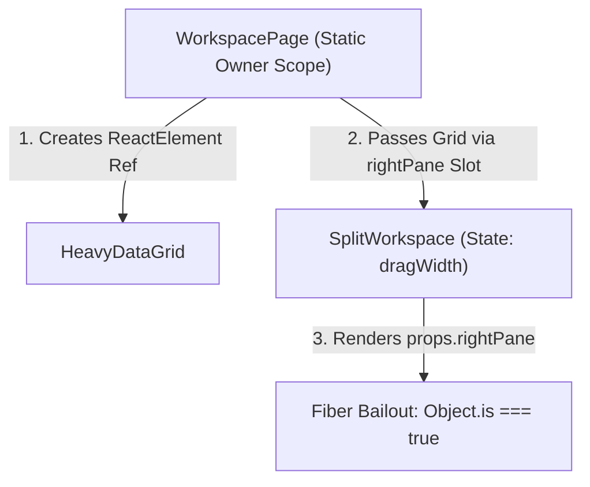
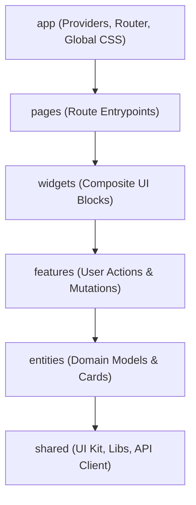
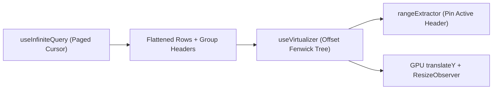

---
tags:
  - programming
  - frontend
  - react
  - design-patterns
  - typescript
  - architecture
  - performance
  - accessibility
created: 2025-12-29
updated: 2026-11-13
status: 🟢
level: mid-to-senior
---
# React Patterns Guide

> [!abstract] Core Invariant
> Scalable React architectures decouple state ownership from subtree instantiation, isolate context subscribers by update frequency, separate accessible state machines from visual DOM layers, and bound rendered DOM nodes to viewport capacity. Every production pattern exists to enforce strict TypeScript contracts, preserve React Fiber bailout invariants, and eliminate prop-explosion coupling.

---

## 1. First-Principles Mechanics & Complete Architecture

React UI architectures degrade in predictable ways as codebases scale: parent components accumulate dozens of configuration flags (`renderHeader`, `hideFooter`, `maxItems`, `onBeforeSelect`), single Context providers broadcast unrelated state mutations across hundreds of consumers, and custom UI controls reimplement incomplete keyboard navigation or focus traps ad hoc.

Understanding why modern React patterns work requires grounding every abstraction in React Fiber's reconciliation rules (see [[Programming/Frontend/React Complete Guide|React Complete Guide]] and [[Programming/Frontend/React Hooks Guide|React Hooks Guide]]).

### 1.1 Slot & Children Inversion (`Object.is` Element Bailout)

When JSX executes inside a component function (`<HeavyChart data={data} />`), Babel/SWC compiles it into `jsx(HeavyChart, { data })`, allocating a **brand-new immutable `ReactElement` object** on every render call. Inside Fiber's `beginWork()` loop, React compares the incoming `pendingProps` (and element reference on `fiber.memoizedProps`) against the previous committed fiber using `Object.is`.

If a stateful wrapper component instantiates child components directly inside its own render body, every state update in the wrapper recreates those child `ReactElement` references, forcing React to enter and reconcile every child subtree—even when their props did not change semantically.

**Children / Slot Inversion** moves JSX instantiation out of the stateful shell into a higher, stable owner scope and passes the resulting `ReactElement` references down as `children` or named props (`header`, `sidebar`, `footer`).



Step-by-step execution during a `pointermove` drag inside `SplitWorkspace`:
1. `WorkspacePage` rendered once earlier; its JSX call produced `<HeavyDataGrid rows={rows} />`, storing an immutable `ReactElement` object at memory reference `0x4A10`.
2. When the user drags the divider, `setDragWidth(px)` schedules an update strictly on `SplitWorkspace`'s Fiber node.
3. `SplitWorkspace` re-executes with its **existing** `props` object from `WorkspacePage`. Therefore, `props.rightPane` still points to `0x4A10`.
4. When React's reconciler inspects the `<aside>` and `<main>` children inside `SplitWorkspace`, it checks `oldProps === newProps` (`Object.is(0x4A10, 0x4A10) === true`) on `<HeavyDataGrid />` and executes `bailoutOnAlreadyFinishedWork()`, skipping `HeavyDataGrid` and all 5,000 child fibers completely without requiring `React.memo`.

```typescript
import { useState, type ReactNode } from 'react';

interface SplitWorkspaceProps {
  leftPane: ReactNode;
  rightPane: ReactNode;
  initialWidth?: number;
}

export function SplitWorkspace({
  leftPane,
  rightPane,
  initialWidth = 320,
}: SplitWorkspaceProps) {
  const [leftWidth, setLeftWidth] = useState(initialWidth);
  const [isDragging, setIsDragging] = useState(false);

  return (
    <div
      style={{
        display: 'grid',
        gridTemplateColumns: `${leftWidth}px 6px 1fr`,
        height: '100vh',
        userSelect: isDragging ? 'none' : 'auto',
      }}
      onPointerMove={(event) => {
        if (!isDragging) return;
        setLeftWidth(Math.max(200, Math.min(720, event.clientX)));
      }}
      onPointerUp={() => setIsDragging(false)}
    >
      <aside style={{ overflow: 'auto' }}>{leftPane}</aside>
      <div
        role="separator"
        aria-orientation="vertical"
        aria-valuenow={leftWidth}
        aria-valuemin={200}
        aria-valuemax={720}
        tabIndex={0}
        onPointerDown={(event) => {
          event.currentTarget.setPointerCapture(event.pointerId);
          setIsDragging(true);
        }}
        onKeyDown={(event) => {
          if (event.key === 'ArrowLeft') setLeftWidth((w) => Math.max(200, w - 16));
          if (event.key === 'ArrowRight') setLeftWidth((w) => Math.min(720, w + 16));
        }}
        style={{ cursor: 'col-resize', background: '#cbd5e1' }}
      />
      <main style={{ overflow: 'auto' }}>{rightPane}</main>
    </div>
  );
}

// Owner component isolates HeavyDataGrid and QueryEditor from 120Hz drag state:
export function AnalyticsWorkbench({ rows }: { rows: ReadonlyArray<{ id: string; metric: number }> }) {
  return (
    <SplitWorkspace
      leftPane={<QueryEditorPanel />}
      rightPane={<HeavyDataGrid rows={rows} />}
    />
  );
}
```

#### Why Slots Also Unlock Server-Client Composition (RSC)

In React Server Components (see [[Programming/Frontend/Next.js Complete Guide|Next.js Complete Guide]]), a `'use client'` module **cannot** import a Server Component directly (`import ServerTable from './ServerTable'` pulls database/filesystem code into the client bundler graph). However, a Server Component parent *can* render `<ClientInteractiveDrawer><ServerTable /></ClientInteractiveDrawer>`. React serializes `<ServerTable />` as an opaque RSC payload slot, allowing the client shell to toggle visibility or animate height without shipping any of `ServerTable`'s JavaScript or dependencies to the browser.

### 1.2 Superseding Legacy Patterns (HOCs & Render Props)

Before React 16.8 Hooks, reusing stateful logic required wrapping components in Higher-Order Components (HOCs) or passing render callbacks via Render Props. Both patterns introduced structural defects that custom Hooks and Slot composition eliminate.

#### Legacy Higher-Order Components (HOCs) vs Custom Hooks + Slots

```typescript
// LEGACY ANTI-PATTERN: HOC wrapper hell
// Failure modes:
// 1. Implicit prop injection collides if two HOCs both inject `data` or `loading`.
// 2. `ref` attaches to the outer wrapper instead of WrappedComponent unless wrapped in forwardRef.
// 3. Static properties on WrappedComponent are stripped unless manually hoisted.
function withViewportSize<P extends { viewportWidth: number }>(
  WrappedComponent: React.ComponentType<P>
) {
  return function WithViewportSize(props: Omit<P, 'viewportWidth'>) {
    const [width, setWidth] = useState(() =>
      typeof window === 'undefined' ? 1280 : window.innerWidth
    );
    useEffect(() => {
      const onResize = () => setWidth(window.innerWidth);
      window.addEventListener('resize', onResize);
      return () => window.removeEventListener('resize', onResize);
    }, []);
    return <WrappedComponent {...(props as P)} viewportWidth={width} />;
  };
}
```

**Modern Replacement (Custom Hook + Guard Wrapper)**:

```typescript
import { useSyncExternalStore, type ReactNode } from 'react';

function subscribeResize(callback: () => void) {
  window.addEventListener('resize', callback, { passive: true });
  return () => window.removeEventListener('resize', callback);
}

export function useViewportWidth(): number {
  return useSyncExternalStore(
    subscribeResize,
    () => window.innerWidth,
    () => 1280 // Deterministic SSR snapshot avoids hydration mismatch
  );
}

// Explicit data lineage, zero prop collisions, zero wrapper fiber overhead:
export function ResponsiveReportHeader() {
  const viewportWidth = useViewportWidth();
  return <header>{viewportWidth < 768 ? 'Compact View' : 'Expanded Analytics'}</header>;
}

// When gating rendering (e.g., auth/feature flags), replace HOCs with a Slot guard:
export function FeatureGate({
  enabled,
  fallback = null,
  children,
}: {
  enabled: boolean;
  fallback?: ReactNode;
  children: ReactNode;
}) {
  return enabled ? <>{children}</> : <>{fallback}</>;
}
```

#### Legacy Render Props vs Hooks (and When Render Callbacks Survive)

Render props (`<MouseTracker>{({ x, y }) => <Tooltip x={x} y={y} />}</MouseTracker>`) force deeply nested callback pyramids ("false hierarchy" in React DevTools) and pass fresh inline closures on every parent render. Custom hooks flatten state acquisition into linear statements at the top of the component.

The **one enduring production use case** for a render-callback prop (`(item: T, meta: RowMeta) => ReactNode`) is **loop inversion inside library primitives**: headless virtualizers (`@tanstack/react-virtual`), sortable data tables (`@tanstack/react-table`), and autocomplete option templates where the library owns iteration indices/virtual positions and injects per-row metadata into consumer-defined JSX.

---

## 2. Real-World Use Cases & Decision Matrix

Choosing the wrong abstraction creates either **rigid prop monoliths** (impossible to style or extend) or **premature over-engineering** (slow TypeScript inference and scattered indirection).

### 2.1 Six Concrete Engineering Scenarios

1. **High-Frequency Interactive Shells (`SplitWorkspace`, `StickyHeader`, `ScrollSpy`)**:
   - *Adopt*: **Slot & Children Inversion**.
   - *Avoid*: Pushing pointer/scroll state into global Context or wrapping 15 sibling children in `React.memo` + `useCallback`.
   - *Trade-off*: Zero extra allocations; preserves RSC compatibility automatically. Breaks only if the shell *must* pass dynamic runtime values *into* the slotted child (in which case, isolate that tiny consumer via a dedicated leaf component).

2. **Multi-Part Design System Primitives (`<Tabs>`, `<Accordion>`, `<Menu>`, `<Card>`)**:
   - *Adopt*: **Split-Context Compound Components**.
   - *Avoid*: Configuration object arrays (`<Tabs tabs={[{ title, icon, badge, content, disabled }]} />`) which accumulate endless per-field escape hatches whenever product teams need custom markup inside a tab header.
   - *Trade-off*: Consumers write slightly more JSX (`<Tabs.List>` + `<Tabs.Trigger>`) in exchange for arbitrary DOM nesting, complete ARIA wiring, and decoupled re-renders via separate State and Dispatch contexts.

3. **Accessible Custom Widgets Requiring Bespoke Branding (`<Combobox>`, `<DatePicker>`, `<Popover>`)**:
   - *Adopt*: **Headless State Hooks + Prop Getters** (`useCombobox`, `getInputProps`, `getOptionProps`).
   - *Avoid*: Opinionated styled component kits whose internal CSS overrides collide with Tailwind v4 / CSS Modules.
   - *Trade-off*: You own the CSS markup completely while the hook centralizes `aria-activedescendant`, `Home`/`End`/`Arrow` navigation, Escape dismissal, and safe event handler composition.

4. **Shared Enterprise Controls with Divergent Behavior Rules (`<MultiSelect>`, `<Pagination>`, `<DataTable>`)**:
   - *Adopt*: **Control Props (`useControllableState`) + `stateReducer`**.
   - *Avoid*: Adding feature-specific flags (`maxTags={3}`, `preventDeselectAdmin`, `confirmBeforePageChange`) into the shared design-system package.
   - *Trade-off*: Keeps the shared primitive small (`< 200` lines) while empowering product teams to veto or transform transitions at the call site. Requires documenting action payloads as part of your public API contract.

5. **Design-System Button / Link / Trigger Primitives**:
   - *Adopt*: **`as` Polymorphic Prop** for leaf styled primitives (`<Button as="a" href="/docs">`, `<Text as="h2">`) when TypeScript prop validation on the target element is simple; adopt **Radix `<Slot>` (`asChild`)** for headless behavioral triggers (`<Dialog.Trigger asChild><Button /></Dialog.Trigger>`) that must compose cleanly with third-party routing `<Link>` components.
   - *Avoid*: Deeply nested generic `as` wrappers chained across 4+ HOCs/components, which trigger TypeScript `TS2590` union complexity explosions.

6. **Large Datasets (`10,000+` Audit Rows) & Heavy Studio Modules (Code Editors, Charts, PDF Viewers)**:
   - *Adopt*: **`@tanstack/react-virtual` + `useInfiniteQuery`** when DOM node count exceeds `~1,500` nodes; **`React.lazy` + Intent Prefetching + Retry Error Boundary** when non-critical route/modal dependencies exceed `~80–100KB` gzipped.
   - *Avoid*: Virtualizing short lists (`< 100` rows), which breaks browser `Ctrl+F` find-in-page unnecessarily.

### 2.2 Pattern Selection Decision Matrix

| Pattern | Re-Render Isolation | TypeScript Compiler Cost | Bundle Overhead | Accessibility Ownership | Primary Failure Mode |
|---|---|---|---|---|---|
| **Slot / `children` Inversion** | Highest (Fiber bailout) | Negligible | `0 B` | Consumer | Creating JSX inside stateful shell instead of owner |
| **Split-Context Compound** | High (dispatch never updates) | Low | `~1–2 KB` | Shared Root + Subparts | Merging mutable state & stable actions into one Context value |
| **Headless Prop Getters** | High (hook scoped to leaf) | Moderate (generic HTML attrs) | `~2–4 KB` | Hook owns ARIA/keys | Consumer overwriting `onClick`/`onKeyDown` after spread |
| **Control Props + State Reducer** | Controlled by parent | Moderate (action unions) | `~1 KB` | Consumer / Hook | Impure `stateReducer` mutating objects or switching controlled mode |
| **Polymorphic `as` Prop** | Neutral | **High** (`TS2590` on deep stacks) | `0 B` | Element-dependent | Forgetting `Omit<ComponentPropsWithRef<E>, keyof Own>` |
| **Radix `<Slot>` (`asChild`)** | Neutral | Low | `~0.8 KB` | Trigger merges props | Passing multiple children or text node to `<Slot>` |
| **Virtualization (`react-virtual`)** | Bounded (`O(viewport)`) | Low | `~5 KB` | Needs `aria-rowcount` / `rowindex` | Animating `top` instead of `translateY`, missing `measureElement` |

---

## 3. Step-by-Step Practical Application ("How to Build With It in Production")

### 3.1 Feature-Sliced Design (FSD) Real Project Layout

Before implementing individual component patterns, organize modules so state ownership, shared primitives, and domain workflows do not collapse into circular dependency spaghetti. **Feature-Sliced Design (FSD)** enforces a strict unidirectional import hierarchy across 6 standardized layers:



**Strict Architectural Rules**:
1. **Top-Down Only**: A slice in layer $L$ may import ONLY from layers strictly below $L$ (`features/checkout` may import `entities/cart` and `shared/ui`, never `widgets/` or another `features/auth` slice directly).
2. **Public API Barrel (`index.ts`)**: External consumers import only from `features/bulk-export/index.ts`, never deep internal paths like `features/bulk-export/model/useExportStore.ts`. Note: keep barrels restricted to slice public APIs rather than massive `shared/ui/index.ts` wildcard exports (`export *`) if bundle tree-shaking is misconfigured (verify `"sideEffects": false` in `package.json`).
3. **Cross-Entity Composition**: If `entities/order` needs `entities/user` without coupling entities horizontally, compose them in `widgets/` or `features/` via **Slots** (`<OrderCard authorSlot={<UserBadge user={order.author} />} />`).

```text
src/
├── app/
│   ├── providers/
│   │   ├── QueryProvider.tsx          # TanStack QueryClient + ErrorBoundary
│   │   └── RouterProvider.tsx         # Route tree + lazyWithRetry loaders
│   └── styles/globals.css             # Tailwind v4 @theme tokens
├── pages/
│   └── audit-logs/
│       └── ui/AuditLogsPage.tsx       # Composes widgets + fetches route data
├── widgets/
│   └── audit-table/
│       ├── ui/AuditVirtualTable.tsx   # @tanstack/react-virtual + sticky headers
│       └── index.ts
├── features/
│   ├── workspace-onboarding/
│   │   ├── model/wizardSchemas.ts     # Zod per-step validation schemas
│   │   ├── ui/ProvisionWizard.tsx     # Multi-step wizard UI
│   │   └── index.ts
│   └── filter-tags/
│       ├── model/useMultiSelect.ts    # Control Props + State Reducer hook
│       ├── ui/TagCombobox.tsx         # Headless Prop Getters UI
│       └── index.ts
├── entities/
│   └── audit-event/
│       ├── model/types.ts             # Domain types & formatters
│       ├── ui/AuditEventRow.tsx       # Pure entity display component
│       └── index.ts
└── shared/
    ├── lib/
    │   ├── composeEventHandlers.ts    # Safe event composition
    │   ├── mergeRefs.ts               # React 19 ref + cleanup merger
    │   ├── lazyWithRetry.tsx          # Resilient code splitting + preload
    │   └── useControllableState.ts    # Controlled/uncontrolled state sync
    └── ui/
        ├── Button.tsx                 # Type-safe polymorphic primitive
        ├── Slot.tsx                   # Radix-style asChild prop merger
        ├── Tabs.tsx                   # Split-Context Compound Tabs
        └── Modal.tsx                  # Accessible focus-trapped Portal
```

Enforce these layer rules automatically in CI via `@feature-sliced/steiger` (`npx steiger src`) or `eslint-plugin-boundaries`.

---

### 3.2 Shared Foundation Utilities (`composeEventHandlers`, `mergeRefs`, `useControllableState`)

Every compound component, headless hook, and `<Slot>` primitive builds on three foundational utilities placed in `src/shared/lib/`.

#### 1. `src/shared/lib/composeEventHandlers.ts`

Never let a headless hook or `<Slot>` clobber a consumer's event listener. `composeEventHandlers` runs the consumer's handler first and respects `event.defaultPrevented`:

```typescript
export function composeEventHandlers<E extends { defaultPrevented: boolean }>(
  externalHandler?: (event: E) => void,
  internalHandler?: (event: E) => void,
  { checkForDefaultPrevented = true }: { checkForDefaultPrevented?: boolean } = {}
): (event: E) => void {
  return (event: E) => {
    externalHandler?.(event);
    if (!checkForDefaultPrevented || !event.defaultPrevented) {
      internalHandler?.(event);
    }
  };
}
```

#### 2. `src/shared/lib/mergeRefs.ts`

In React 19, `ref` is passed as a regular prop (without `forwardRef`) and callback refs may return a cleanup function (`() => void`). `mergeRefs` safely fans out attachment and cleanup across multiple refs (consumer ref + local measurement/focus ref):

```typescript
import type { Ref, RefCallback } from 'react';

type OptionalRef<T> = Ref<T> | undefined;

export function assignRef<T>(ref: OptionalRef<T>, value: T | null): (() => void) | void {
  if (typeof ref === 'function') {
    return ref(value);
  }
  if (ref != null) {
    ref.current = value;
  }
}

export function mergeRefs<T>(...refs: Array<OptionalRef<T>>): RefCallback<T> {
  return (node: T | null) => {
    const cleanups: Array<() => void> = [];

    for (const ref of refs) {
      const cleanup = assignRef(ref, node);
      if (typeof cleanup === 'function') {
        cleanups.push(cleanup);
      }
    }

    if (cleanups.length > 0) {
      return () => {
        for (const cleanup of cleanups) {
          cleanup();
        }
      };
    }

    // Fallback for React 18 callback refs without explicit cleanup return
    return () => {
      for (const ref of refs) {
        assignRef(ref, null);
      }
    };
  };
}
```

#### 3. `src/shared/lib/useControllableState.ts`

Powers both uncontrolled (`defaultValue`) and controlled (`value` + `onChange`) component APIs while catching illegal runtime transitions between modes in development:

```typescript
import { useCallback, useEffect, useLayoutEffect, useRef, useState } from 'react';

interface UseControllableStateOptions<T> {
  value?: T;
  defaultValue: T;
  onChange?: (nextValue: T) => void;
  name?: string;
}

export function useControllableState<T>({
  value,
  defaultValue,
  onChange,
  name = 'useControllableState',
}: UseControllableStateOptions<T>): [T, (next: T | ((prev: T) => T)) => void] {
  const [uncontrolledValue, setUncontrolledValue] = useState<T>(defaultValue);
  const isControlled = value !== undefined;
  const wasControlledRef = useRef(isControlled);

  useEffect(() => {
    if (process.env.NODE_ENV !== 'production' && wasControlledRef.current !== isControlled) {
      console.error(
        `[${name}] Switched from ${wasControlledRef.current ? 'controlled' : 'uncontrolled'} ` +
          `to ${isControlled ? 'controlled' : 'uncontrolled'}. Keep value consistently defined or undefined.`
      );
    }
    wasControlledRef.current = isControlled;
  }, [isControlled, name]);

  const currentValue = isControlled ? value : uncontrolledValue;

  // Synchronize latest ref post-commit to preserve React 19 / React Compiler render purity
  const latestRef = useRef({ currentValue, onChange });
  useLayoutEffect(() => {
    latestRef.current = { currentValue, onChange };
  });

  const setValue = useCallback(
    (next: T | ((prev: T) => T)) => {
      const prev = latestRef.current.currentValue;
      const resolved = typeof next === 'function' ? (next as (p: T) => T)(prev) : next;

      if (Object.is(prev, resolved)) return;

      if (!isControlled) {
        setUncontrolledValue(resolved);
      }
      latestRef.current.onChange?.(resolved);
    },
    [isControlled]
  );

  return [currentValue, setValue];
}
```

---

### 3.3 Compound Components (Strict TypeScript Split-Context Architecture)

#### Why `React.Children.map` + `React.cloneElement` Breaks in Production

Legacy compound component tutorials iterate over `React.Children.map(children, child => cloneElement(child, { activeId, onSelect }))`. That implementation breaks immediately in real applications for four structural reasons:
1. **Wrapper Elements & Layout Tags**: Wrapping `<Tabs.Trigger>` inside `<div className="flex gap-2">`, `<Tooltip>`, or `<>...</>` prevents `TabsRoot` from seeing `<Tabs.Trigger>` as a direct child, silently dropping injected props.
2. **Prop Collision & Type Loss**: `cloneElement` merges props invisibly at runtime, bypassing TypeScript checks and overwriting consumer props with matching names.
3. **RSC Opaque Payloads**: When a Server Component passes server-rendered nodes as `children` across a Client boundary, direct children are opaque lazy/reference objects—`cloneElement` throws or ignores nested slots.
4. **Broadcast Re-Renders**: Cloning injects changing state directly into every child, bypassing Fiber bailouts.

#### Production Split-Context Accessible `<Tabs>` (`src/shared/ui/Tabs.tsx`)

This complete implementation splits mutable state (`TabsStateContext`) from stable dispatch/registration handlers (`TabsDispatchContext`), supports both controlled and uncontrolled usage, generates collision-free ARIA linkages (`useId()`), and implements full WAI-ARIA Tabs Pattern keyboard navigation (`ArrowLeft`/`ArrowRight`/`ArrowUp`/`ArrowDown`, `Home`, `End`, automatic vs manual activation).

```typescript
import {
  createContext,
  useCallback,
  useContext,
  useId,
  useLayoutEffect,
  useMemo,
  useRef,
  type KeyboardEvent,
  type ReactNode,
  type RefObject,
} from 'react';
import { composeEventHandlers } from '../lib/composeEventHandlers';
import { useControllableState } from '../lib/useControllableState';

type Orientation = 'horizontal' | 'vertical';
type ActivationMode = 'automatic' | 'manual';

interface TabsDispatchContextValue {
  selectTab: (value: string) => void;
  focusRelativeTab: (currentValue: string, direction: 'next' | 'prev' | 'first' | 'last') => void;
  listRef: RefObject<HTMLDivElement | null>;
  baseId: string;
  orientation: Orientation;
}

// Isolate mutable activeValue from stable dispatch/configuration so Tabs.List
// and dispatch-only consumers never re-render when the active tab changes.
const TabsStateContext = createContext<string | null>(null);
const TabsDispatchContext = createContext<TabsDispatchContextValue | null>(null);

function useTabsState(componentName: string): string {
  const ctx = useContext(TabsStateContext);
  if (ctx === null) {
    throw new Error(`<${componentName}> must be rendered inside a <Tabs> root provider.`);
  }
  return ctx;
}

function useTabsDispatch(componentName: string): TabsDispatchContextValue {
  const ctx = useContext(TabsDispatchContext);
  if (!ctx) {
    throw new Error(`<${componentName}> must be rendered inside a <Tabs> root provider.`);
  }
  return ctx;
}

export interface TabsProps {
  value?: string;
  defaultValue?: string;
  onValueChange?: (value: string) => void;
  orientation?: Orientation;
  activationMode?: ActivationMode;
  children: ReactNode;
  className?: string;
}

function TabsRoot({
  value,
  defaultValue = '',
  onValueChange,
  orientation = 'horizontal',
  activationMode = 'automatic',
  children,
  className,
}: TabsProps) {
  const baseId = useId();
  const listRef = useRef<HTMLDivElement | null>(null);
  const [activeValue, setActiveValue] = useControllableState<string>({
    value,
    defaultValue,
    onChange: onValueChange,
    name: 'Tabs',
  });

  const activationRef = useRef(activationMode);
  useLayoutEffect(() => {
    activationRef.current = activationMode;
  });

  const selectTab = useCallback(
    (nextValue: string) => {
      setActiveValue(nextValue);
    },
    [setActiveValue]
  );

  const focusRelativeTab = useCallback(
    (currentValue: string, direction: 'next' | 'prev' | 'first' | 'last') => {
      const container = listRef.current;
      if (!container) return;

      // Querying enabled triggers in live DOM order works regardless of wrapper divs or fragments
      const enabledTabs = Array.from(
        container.querySelectorAll<HTMLButtonElement>('[role="tab"]:not([disabled])')
      );
      if (enabledTabs.length === 0) return;

      const currentIdx = enabledTabs.findIndex(
        (el) => el.dataset.tabValue === currentValue
      );

      let targetIdx = 0;
      if (direction === 'first') {
        targetIdx = 0;
      } else if (direction === 'last') {
        targetIdx = enabledTabs.length - 1;
      } else if (direction === 'next') {
        targetIdx = currentIdx < 0 ? 0 : (currentIdx + 1) % enabledTabs.length;
      } else {
        targetIdx = currentIdx <= 0 ? enabledTabs.length - 1 : currentIdx - 1;
      }

      const targetEl = enabledTabs[targetIdx];
      if (!targetEl) return;

      targetEl.focus();
      const targetValue = targetEl.dataset.tabValue;
      if (activationRef.current === 'automatic' && targetValue !== undefined) {
        setActiveValue(targetValue);
      }
    },
    [setActiveValue]
  );

  // Dispatch & config object identity stays frozen across activeValue updates
  const dispatchValue = useMemo<TabsDispatchContextValue>(
    () => ({ selectTab, focusRelativeTab, listRef, baseId, orientation }),
    [selectTab, focusRelativeTab, baseId, orientation]
  );

  return (
    <TabsDispatchContext.Provider value={dispatchValue}>
      <TabsStateContext.Provider value={activeValue}>
        <div data-orientation={orientation} className={className}>
          {children}
        </div>
      </TabsStateContext.Provider>
    </TabsDispatchContext.Provider>
  );
}

export interface TabsListProps {
  'aria-label': string;
  children: ReactNode;
  className?: string;
}

function TabsList({ 'aria-label': ariaLabel, children, className }: TabsListProps) {
  const { listRef, orientation } = useTabsDispatch('Tabs.List');

  // Reads ONLY TabsDispatchContext, skipping re-renders whenever activeValue changes.
  return (
    <div
      ref={listRef}
      role="tablist"
      aria-label={ariaLabel}
      aria-orientation={orientation}
      className={className}
    >
      {children}
    </div>
  );
}

export interface TabsTriggerProps
  extends Omit<React.ButtonHTMLAttributes<HTMLButtonElement>, 'value'> {
  value: string;
}

function TabsTrigger({
  value,
  disabled = false,
  onClick,
  onKeyDown,
  children,
  className,
  ...rest
}: TabsTriggerProps) {
  const activeValue = useTabsState('Tabs.Trigger');
  const { selectTab, focusRelativeTab, baseId, orientation } = useTabsDispatch('Tabs.Trigger');
  const isSelected = activeValue === value;

  const handleKeyDown = (event: KeyboardEvent<HTMLButtonElement>) => {
    const prevKey = orientation === 'horizontal' ? 'ArrowLeft' : 'ArrowUp';
    const nextKey = orientation === 'horizontal' ? 'ArrowRight' : 'ArrowDown';

    if (event.key === nextKey) {
      event.preventDefault();
      focusRelativeTab(value, 'next');
    } else if (event.key === prevKey) {
      event.preventDefault();
      focusRelativeTab(value, 'prev');
    } else if (event.key === 'Home') {
      event.preventDefault();
      focusRelativeTab(value, 'first');
    } else if (event.key === 'End') {
      event.preventDefault();
      focusRelativeTab(value, 'last');
    }
  };

  return (
    <button
      {...rest}
      type="button"
      role="tab"
      id={`${baseId}-tab-${value}`}
      aria-controls={`${baseId}-panel-${value}`}
      aria-selected={isSelected}
      tabIndex={isSelected ? 0 : -1}
      disabled={disabled}
      data-state={isSelected ? 'active' : 'inactive'}
      data-tab-value={value}
      className={className}
      onClick={composeEventHandlers(onClick, () => {
        if (!disabled) selectTab(value);
      })}
      onKeyDown={composeEventHandlers(onKeyDown, handleKeyDown)}
    >
      {children}
    </button>
  );
}

export interface TabsPanelProps extends React.HTMLAttributes<HTMLDivElement> {
  value: string;
  keepMounted?: boolean;
}

function TabsPanel({
  value,
  keepMounted = false,
  children,
  className,
  ...rest
}: TabsPanelProps) {
  const activeValue = useTabsState('Tabs.Panel');
  const { baseId } = useTabsDispatch('Tabs.Panel');
  const isSelected = activeValue === value;

  if (!isSelected && !keepMounted) {
    return null;
  }

  return (
    <div
      {...rest}
      role="tabpanel"
      id={`${baseId}-panel-${value}`}
      aria-labelledby={`${baseId}-tab-${value}`}
      hidden={!isSelected}
      tabIndex={0}
      className={className}
    >
      {children}
    </div>
  );
}

export const Tabs = Object.assign(TabsRoot, {
  List: TabsList,
  Trigger: TabsTrigger,
  Panel: TabsPanel,
});
```

Notice how `TabsList` can contain `<div className="flex gap-2">` or `<Tooltip>` wrappers around `<Tabs.Trigger>` without breaking roving `tabIndex` or `Arrow`/`Home`/`End` navigation, and `TabsDispatchContext` maintains a frozen object identity across tab switches so `Tabs.List` and dispatch-only controls (such as an external "Reset to Overview" action) never re-render when `activeValue` changes.

#### Extending Split-Context to `<Accordion>` and `<Select>` Suites

The exact same Split-Context architecture generalizes cleanly to **multi-item `<Accordion>`** and **compound `<Select>`** suites:
- **`<Accordion>` (`type="single" | "multiple"`)**: Store `openValues: ReadonlyArray<string>` in `AccordionStateContext`, store stable `toggleItem(id)` + `moveHeaderFocus(id, direction)` in `AccordionDispatchContext`, and provide an `AccordionItemContext` (`value: string`) so `<Accordion.Trigger>` (`aria-expanded`, `aria-controls`) and `<Accordion.Content>` (`role="region"`, `aria-labelledby`) share item identity without forcing consumers to pass `value="faq-1"` repeatedly to both children. Keyboard navigation maps `ArrowDown`/`ArrowUp`/`Home`/`End` directly across `[data-accordion-trigger]:not([disabled])` DOM elements inside the root container.
- **Compound `<Select>`**: Combine Split-Context (`SelectStateContext` holding `{ isOpen, highlightedId, selectedId }`, `SelectDispatchContext` holding `{ open, close, select, focusRelativeOption }`) with the Headless Prop-Getter rules from Section 3.4 so `<Select.Trigger>` manages `aria-expanded` / `aria-haspopup="listbox"` and `<Select.Content>` renders via `createPortal` while reading shared selection state seamlessly.

---

### 3.4 Headless UI & Prop Getters (`useCombobox`)

Headless hooks expose **pure behavioral contracts** through **prop getters** (`getInputProps`, `getToggleProps`, `getMenuProps`, `getOptionProps`). Every prop getter accepts optional consumer props (`userProps`) and merges ARIA attributes, refs, and composed event handlers automatically—making it impossible for consumers to accidentally overwrite accessibility bindings.

Below is a complete, accessible `useCombobox<T>` implementing the WAI-ARIA Combobox Listbox Popup pattern (`aria-autocomplete="list"`, `aria-activedescendant`, `ArrowDown`, `ArrowUp`, `Enter`, `Escape`, `Home`, `End`, outside pointer dismissal, and consumer `e.preventDefault()` cancellation):

```typescript
import {
  useCallback,
  useEffect,
  useId,
  useMemo,
  useRef,
  useState,
  type ButtonHTMLAttributes,
  type ChangeEvent,
  type HTMLAttributes,
  type InputHTMLAttributes,
  type KeyboardEvent,
  type LiHTMLAttributes,
  type Ref,
} from 'react';
import { composeEventHandlers } from '../lib/composeEventHandlers';
import { mergeRefs } from '../lib/mergeRefs';

export interface UseComboboxOptions<T> {
  items: ReadonlyArray<T>;
  itemToString: (item: T) => string;
  selectedItem: T | null;
  onSelectedItemChange: (item: T | null) => void;
  initialIsOpen?: boolean;
}

export function useCombobox<T>({
  items,
  itemToString,
  selectedItem,
  onSelectedItemChange,
  initialIsOpen = false,
}: UseComboboxOptions<T>) {
  const baseId = useId();
  const [isOpen, setIsOpen] = useState(initialIsOpen);
  const [inputValue, setInputValue] = useState(() =>
    selectedItem ? itemToString(selectedItem) : ''
  );
  const [highlightedIndex, setHighlightedIndex] = useState<number>(-1);

  const rootRef = useRef<HTMLDivElement | null>(null);
  const inputRef = useRef<HTMLInputElement | null>(null);

  const filteredItems = useMemo(() => {
    const query = inputValue.trim().toLowerCase();
    if (!query) return items;
    return items.filter((item) => itemToString(item).toLowerCase().includes(query));
  }, [items, inputValue, itemToString]);

  // Synchronize input text when parent updates selectedItem externally
  useEffect(() => {
    setInputValue(selectedItem ? itemToString(selectedItem) : '');
  }, [selectedItem, itemToString]);

  // Dismiss popup on pointerdown outside root container
  useEffect(() => {
    if (!isOpen) return;
    const handlePointerDown = (event: PointerEvent) => {
      if (rootRef.current && !rootRef.current.contains(event.target as Node)) {
        setIsOpen(false);
        setHighlightedIndex(-1);
      }
    };
    document.addEventListener('pointerdown', handlePointerDown);
    return () => document.removeEventListener('pointerdown', handlePointerDown);
  }, [isOpen]);

  const selectAtIndex = useCallback(
    (index: number) => {
      const item = filteredItems[index];
      if (!item) return;
      onSelectedItemChange(item);
      setInputValue(itemToString(item));
      setIsOpen(false);
      setHighlightedIndex(-1);
    },
    [filteredItems, itemToString, onSelectedItemChange]
  );

  const getOptionId = useCallback(
    (index: number) => `${baseId}-option-${index}`,
    [baseId]
  );

  const getLabelProps = useCallback(
    (userProps: HTMLAttributes<HTMLLabelElement> = {}) => ({
      ...userProps,
      id: `${baseId}-label`,
      htmlFor: `${baseId}-input`,
    }),
    [baseId]
  );

  const getInputProps = useCallback(
    (
      userProps: InputHTMLAttributes<HTMLInputElement> & { ref?: Ref<HTMLInputElement> } = {}
    ): InputHTMLAttributes<HTMLInputElement> & { ref: Ref<HTMLInputElement> } => {
      const { ref: userRef, onChange, onKeyDown, onFocus, ...rest } = userProps;

      return {
        ...rest,
        ref: mergeRefs(inputRef, userRef),
        id: `${baseId}-input`,
        role: 'combobox',
        'aria-autocomplete': 'list',
        'aria-expanded': isOpen,
        'aria-controls': `${baseId}-listbox`,
        'aria-labelledby': `${baseId}-label`,
        'aria-activedescendant':
          isOpen && highlightedIndex >= 0 ? getOptionId(highlightedIndex) : undefined,
        value: inputValue,
        onFocus: composeEventHandlers(onFocus, () => {
          setIsOpen(true);
        }),
        onChange: composeEventHandlers(onChange, (event: ChangeEvent<HTMLInputElement>) => {
          setInputValue(event.target.value);
          setIsOpen(true);
          setHighlightedIndex(0);
        }),
        onKeyDown: composeEventHandlers(onKeyDown, (event: KeyboardEvent<HTMLInputElement>) => {
          const lastIndex = filteredItems.length - 1;
          switch (event.key) {
            case 'ArrowDown':
              event.preventDefault();
              if (!isOpen) {
                setIsOpen(true);
                setHighlightedIndex(filteredItems.length > 0 ? 0 : -1);
              } else {
                setHighlightedIndex((idx) => (idx >= lastIndex ? 0 : idx + 1));
              }
              break;
            case 'ArrowUp':
              event.preventDefault();
              if (!isOpen) {
                setIsOpen(true);
                setHighlightedIndex(lastIndex);
              } else {
                setHighlightedIndex((idx) => (idx <= 0 ? lastIndex : idx - 1));
              }
              break;
            case 'Home':
              if (isOpen && filteredItems.length > 0) {
                event.preventDefault();
                setHighlightedIndex(0);
              }
              break;
            case 'End':
              if (isOpen && filteredItems.length > 0) {
                event.preventDefault();
                setHighlightedIndex(lastIndex);
              }
              break;
            case 'Enter':
              if (isOpen && highlightedIndex >= 0) {
                event.preventDefault();
                selectAtIndex(highlightedIndex);
              }
              break;
            case 'Escape':
              if (isOpen) {
                event.preventDefault();
                setIsOpen(false);
                setHighlightedIndex(-1);
                setInputValue(selectedItem ? itemToString(selectedItem) : '');
              }
              break;
          }
        }),
      };
    },
    [
      baseId,
      filteredItems.length,
      getOptionId,
      highlightedIndex,
      inputValue,
      isOpen,
      itemToString,
      selectAtIndex,
      selectedItem,
    ]
  );

  const getToggleProps = useCallback(
    (userProps: ButtonHTMLAttributes<HTMLButtonElement> = {}): ButtonHTMLAttributes<HTMLButtonElement> => ({
      ...userProps,
      type: userProps.type ?? 'button',
      tabIndex: -1,
      'aria-label': userProps['aria-label'] ?? 'Toggle options',
      'aria-expanded': isOpen,
      onClick: composeEventHandlers(userProps.onClick, () => {
        setIsOpen((prev) => {
          const next = !prev;
          if (next) inputRef.current?.focus();
          return next;
        });
      }),
    }),
    [isOpen]
  );

  const getMenuProps = useCallback(
    (userProps: HTMLAttributes<HTMLUListElement> = {}): HTMLAttributes<HTMLUListElement> => ({
      ...userProps,
      id: `${baseId}-listbox`,
      role: 'listbox',
      'aria-labelledby': `${baseId}-label`,
    }),
    [baseId]
  );

  const getOptionProps = useCallback(
    (
      index: number,
      item: T,
      userProps: LiHTMLAttributes<HTMLLIElement> = {}
    ): LiHTMLAttributes<HTMLLIElement> => {
      const isSelected = selectedItem !== null && Object.is(selectedItem, item);
      const isHighlighted = highlightedIndex === index;

      return {
        ...userProps,
        id: getOptionId(index),
        role: 'option',
        'aria-selected': isSelected,
        'data-highlighted': isHighlighted ? 'true' : 'false',
        onPointerMove: composeEventHandlers(userProps.onPointerMove, () => {
          if (highlightedIndex !== index) setHighlightedIndex(index);
        }),
        // Use onMouseDown preventDefault to avoid blurring the input before click fires
        onMouseDown: composeEventHandlers(userProps.onMouseDown, (event) => {
          event.preventDefault();
        }),
        onClick: composeEventHandlers(userProps.onClick, () => {
          selectAtIndex(index);
        }),
      };
    },
    [getOptionId, highlightedIndex, selectAtIndex, selectedItem]
  );

  return {
    rootRef,
    isOpen,
    inputValue,
    highlightedIndex,
    filteredItems,
    getLabelProps,
    getInputProps,
    getToggleProps,
    getMenuProps,
    getOptionProps,
    clearSelection: () => {
      onSelectedItemChange(null);
      setInputValue('');
      inputRef.current?.focus();
    },
  };
}
```

Usage with any design system (Tailwind v4, CSS Modules, or native elements) takes ~20 lines while retaining 100% keyboard and screen-reader conformance:

```tsx
interface RegionOption {
  id: string;
  label: string;
}

export function RegionCombobox({
  regions,
  value,
  onChange,
}: {
  regions: RegionOption[];
  value: RegionOption | null;
  onChange: (next: RegionOption | null) => void;
}) {
  const {
    rootRef,
    isOpen,
    filteredItems,
    highlightedIndex,
    getLabelProps,
    getInputProps,
    getToggleProps,
    getMenuProps,
    getOptionProps,
  } = useCombobox({
    items: regions,
    itemToString: (r) => r.label,
    selectedItem: value,
    onSelectedItemChange: onChange,
  });

  return (
    <div ref={rootRef} className="relative w-72">
      <label {...getLabelProps({ className: 'block text-sm font-medium' })}>
        Deployment Region
      </label>
      <div className="mt-1 flex rounded border border-slate-300">
        <input
          {...getInputProps({
            placeholder: 'Filter regions...',
            className: 'w-full px-3 py-2 text-sm outline-none',
            onKeyDown: (e) => {
              // Consumer can veto Escape clearing if a parent modal handles Escape:
              if (e.key === 'Escape' && e.shiftKey) e.preventDefault();
            },
          })}
        />
        <button {...getToggleProps({ className: 'px-2 text-slate-600' })}>v</button>
      </div>
      {isOpen && (
        <ul
          {...getMenuProps({
            className: 'absolute z-20 mt-1 max-h-56 w-full overflow-auto rounded border bg-white shadow-lg',
          })}
        >
          {filteredItems.length === 0 ? (
            <li className="px-3 py-2 text-sm text-slate-500">No matching regions</li>
          ) : (
            filteredItems.map((region, idx) => (
              <li
                key={region.id}
                {...getOptionProps(idx, region, {
                  className: `cursor-pointer px-3 py-2 text-sm ${
                    highlightedIndex === idx ? 'bg-blue-600 text-white' : 'text-slate-900'
                  }`,
                })}
              >
                {region.label}
              </li>
            ))
          )}
        </ul>
      )}
    </div>
  );
}
```

---

### 3.5 Control Props & State Reducer (`useMultiSelect`)

When building shared selection controls (`<MultiSelect>`, `<Pagination>`, `<DataTable>`), boolean escape-hatch props (`maxItems`, `preventEmpty`, `keepOpenOnSelect`, `pinnedIds`) quickly bloat the library surface. Combining **Control Props** (`selectedIds` / `onSelectedIdsChange` / `defaultSelectedIds`) with a **State Reducer** delegates transition overrides to the consumer while preserving default invariants out of the box.

```typescript
import { useCallback, useLayoutEffect, useRef } from 'react';
import { useControllableState } from '../lib/useControllableState';

export interface MultiSelectState {
  selectedIds: ReadonlyArray<string>;
}

export type MultiSelectAction =
  | { type: 'SELECT'; id: string }
  | { type: 'DESELECT'; id: string }
  | { type: 'TOGGLE'; id: string }
  | { type: 'SELECT_MANY'; ids: ReadonlyArray<string> }
  | { type: 'CLEAR' };

export type MultiSelectReducer = (
  currentState: MultiSelectState,
  action: MultiSelectAction,
  proposedState: MultiSelectState
) => MultiSelectState;

export interface UseMultiSelectOptions {
  selectedIds?: ReadonlyArray<string>;
  defaultSelectedIds?: ReadonlyArray<string>;
  onSelectedIdsChange?: (nextIds: ReadonlyArray<string>) => void;
  stateReducer?: MultiSelectReducer;
}

function defaultMultiSelectReducer(
  state: MultiSelectState,
  action: MultiSelectAction
): MultiSelectState {
  switch (action.type) {
    case 'SELECT':
      return state.selectedIds.includes(action.id)
        ? state
        : { selectedIds: [...state.selectedIds, action.id] };
    case 'DESELECT':
      return { selectedIds: state.selectedIds.filter((id) => id !== action.id) };
    case 'TOGGLE':
      return state.selectedIds.includes(action.id)
        ? { selectedIds: state.selectedIds.filter((id) => id !== action.id) }
        : { selectedIds: [...state.selectedIds, action.id] };
    case 'SELECT_MANY': {
      const merged = new Set([...state.selectedIds, ...action.ids]);
      return { selectedIds: Array.from(merged) };
    }
    case 'CLEAR':
      return state.selectedIds.length === 0 ? state : { selectedIds: [] };
  }
}

export function useMultiSelect({
  selectedIds: controlledIds,
  defaultSelectedIds = [],
  onSelectedIdsChange,
  stateReducer = (_current, _action, proposed) => proposed,
}: UseMultiSelectOptions = {}) {
  const [selectedIds, setSelectedIds] = useControllableState<ReadonlyArray<string>>({
    value: controlledIds,
    defaultValue: defaultSelectedIds,
    onChange: onSelectedIdsChange,
    name: 'useMultiSelect',
  });

  const reducerRef = useRef(stateReducer);
  useLayoutEffect(() => {
    reducerRef.current = stateReducer;
  });

  const dispatch = useCallback(
    (action: MultiSelectAction) => {
      setSelectedIds((prevIds) => {
        const currentState: MultiSelectState = { selectedIds: prevIds };
        const proposedState = defaultMultiSelectReducer(currentState, action);
        const finalState = reducerRef.current(currentState, action, proposedState);
        return finalState.selectedIds;
      });
    },
    [setSelectedIds]
  );

  return {
    selectedIds,
    isSelected: useCallback((id: string) => selectedIds.includes(id), [selectedIds]),
    select: useCallback((id: string) => dispatch({ type: 'SELECT', id }), [dispatch]),
    deselect: useCallback((id: string) => dispatch({ type: 'DESELECT', id }), [dispatch]),
    toggle: useCallback((id: string) => dispatch({ type: 'TOGGLE', id }), [dispatch]),
    selectMany: useCallback(
      (ids: ReadonlyArray<string>) => dispatch({ type: 'SELECT_MANY', ids }),
      [dispatch]
    ),
    clear: useCallback(() => dispatch({ type: 'CLEAR' }), [dispatch]),
  };
}
```

Consumer enforcement requires zero changes to `useMultiSelect`:
- **Scenario A (Uncontrolled, Max 4 Roles, Mandatory `'viewer'` Role)**: Pass a pure `stateReducer` clamping `SELECT_MANY` to 4 items and ensuring `'viewer'` always remains present on `DESELECT`/`CLEAR`.
- **Scenario B (Controlled URL Query Sync)**: Pass `selectedIds={searchParams.getAll('tag')}` and `onSelectedIdsChange={(ids) => setSearchParams(...)}`—the exact same `stateReducer` runs seamlessly before `onSelectedIdsChange` fires.

---

### 3.6 Type-Safe Polymorphic Components (`as`) vs Radix `<Slot>` (`asChild`)

#### Option A: Type-Safe Polymorphic `as` Prop (`src/shared/ui/Button.tsx`)

When creating an element primitive like `<Button>`, consumers need `<Button onClick={...}>Save</Button>`, `<Button as="a" href="/billing">Invoices</Button>`, or `<Button as={NextLink} href="/settings">Settings</Button>` with full TypeScript checking on `href` and `ref`.

**Critical TypeScript Invariant**: Subtract your own custom props (`keyof OwnProps | 'as'`) from `ComponentPropsWithRef<E>` via `Omit<...>`. Otherwise, if your `ButtonOwnProps` declares `size?: 'sm' | 'md' | 'lg'` and someone renders `<Button as="input" size="lg" />`, TypeScript intersects `'sm' | 'md' | 'lg'` with `<input>`'s native `size?: number` attribute—collapsing the type to `never`!

```typescript
import type { ComponentPropsWithRef, ElementType, ReactNode } from 'react';

type ButtonVariant = 'primary' | 'secondary' | 'danger';
type ButtonSize = 'sm' | 'md' | 'lg';

interface ButtonOwnProps<E extends ElementType> {
  as?: E;
  variant?: ButtonVariant;
  size?: ButtonSize;
  isLoading?: boolean;
  children?: ReactNode;
}

export type PolymorphicProps<E extends ElementType, OwnProps> = OwnProps &
  Omit<ComponentPropsWithRef<E>, keyof OwnProps>;

export type ButtonProps<E extends ElementType = 'button'> = PolymorphicProps<
  E,
  ButtonOwnProps<E>
>;

export function Button<E extends ElementType = 'button'>({
  as,
  variant = 'primary',
  size = 'md',
  isLoading = false,
  className = '',
  disabled,
  type,
  children,
  ...rest
}: ButtonProps<E>) {
  const Component = as ?? 'button';

  // Guard against accidental form submission when defaulting to <button>
  const resolvedType = Component === 'button' ? (type ?? 'button') : type;
  const isDisabled = Boolean(disabled || isLoading);

  return (
    <Component
      {...rest}
      type={resolvedType}
      disabled={Component === 'button' ? isDisabled : undefined}
      aria-disabled={Component !== 'button' && isDisabled ? true : rest['aria-disabled']}
      data-variant={variant}
      data-size={size}
      className={`inline-flex items-center justify-center rounded font-medium ${className}`}
    >
      {isLoading ? <span aria-hidden="true" className="mr-2 animate-spin">...</span> : null}
      {children}
    </Component>
  );
}
```

#### Option B: Radix-Style `<Slot>` (`asChild`) Composition (`src/shared/ui/Slot.tsx`)

While `as={Link}` works cleanly on leaf primitives, stacking multiple polymorphic wrappers (`<TooltipTrigger as={PopoverTrigger} as2={Button} as3={Link}>`) causes TypeScript union explosion (`TS2590`) and ambiguous prop ownership. **Radix `<Slot>` (`asChild`)** eliminates polymorphic generics entirely: the parent component renders `<Slot>` which merges its ARIA/event/style/ref props directly onto its single child ReactElement.

```typescript
import {
  Children,
  cloneElement,
  isValidElement,
  type HTMLAttributes,
  type ReactElement,
  type ReactNode,
  type Ref,
} from 'react';
import { composeEventHandlers } from '../lib/composeEventHandlers';
import { mergeRefs } from '../lib/mergeRefs';

type AnyProps = Record<string, unknown>;

function mergeSlotProps(slotProps: AnyProps, childProps: AnyProps): AnyProps {
  const merged: AnyProps = { ...childProps };

  for (const propName of Object.keys(slotProps)) {
    const slotValue = slotProps[propName];
    const childValue = childProps[propName];

    // Compose DOM event handlers (`onClick`, `onKeyDown`, etc.) safely
    const isEventHandler = /^on[A-Z]/.test(propName);
    if (isEventHandler && typeof slotValue === 'function' && typeof childValue === 'function') {
      merged[propName] = composeEventHandlers(
        childValue as (e: { defaultPrevented: boolean }) => void,
        slotValue as (e: { defaultPrevented: boolean }) => void
      );
    } else if (propName === 'style') {
      merged.style = {
        ...(slotValue as Record<string, unknown> | undefined),
        ...(childValue as Record<string, unknown> | undefined),
      };
    } else if (propName === 'className') {
      merged.className = [slotValue, childValue].filter(Boolean).join(' ');
    } else if (propName !== 'ref' && childValue === undefined) {
      merged[propName] = slotValue;
    } else if (propName !== 'ref' && slotValue !== undefined) {
      // Slot behavioral/ARIA attrs override undefined, while child props win except composed events/classes
      merged[propName] = propName.startsWith('aria-') || propName.startsWith('data-')
        ? (childValue ?? slotValue)
        : childValue;
    }
  }

  return merged;
}

export interface SlotProps extends HTMLAttributes<HTMLElement> {
  children?: ReactNode;
  ref?: Ref<HTMLElement>;
}

export function Slot({ children, ref, ...slotProps }: SlotProps) {
  const onlyChild = Children.only(children);

  if (!isValidElement<AnyProps & { ref?: Ref<HTMLElement> }>(onlyChild)) {
    throw new Error('<Slot> requires a single valid ReactElement child when asChild is true.');
  }

  // In React 19, ref lives inside `onlyChild.props.ref`
  const childRef = onlyChild.props.ref;
  const mergedProps = mergeSlotProps(slotProps, onlyChild.props);

  return cloneElement(onlyChild as ReactElement<AnyProps>, {
    ...mergedProps,
    ref: ref || childRef ? mergeRefs(ref, childRef) : undefined,
  });
}

// Usage in any headless trigger component with zero polymorphic generic bloat:
export function TrackedTrigger({
  asChild = false,
  trackingId,
  onClick,
  children,
  ...props
}: HTMLAttributes<HTMLButtonElement> & { asChild?: boolean; trackingId: string }) {
  const Component = asChild ? Slot : 'button';

  return (
    <Component
      {...props}
      data-track-id={trackingId}
      onClick={composeEventHandlers(onClick, () => {
        navigator.sendBeacon?.('/api/telemetry', JSON.stringify({ trackingId }));
      })}
    >
      {children}
    </Component>
  );
}

// Consumer writes: <TrackedTrigger asChild trackingId="upgrade_cta"><a href="/pricing">Upgrade</a></TrackedTrigger>
```

---

### 3.7 Accessible Focus-Trapped Modal Portal (`src/shared/ui/Modal.tsx`)

Production modals fail accessibility audits when they render inline inside `overflow: hidden` ancestors, allow `Tab` focus to escape behind the backdrop, jump horizontally when hiding scrollbars, or forget to return focus to the invoking trigger button.

Two subtle React lifecycle invariants make `Modal` reliable under active user input:
1. **Portal SSR Guard (`mounted`)**: `document.body` does not exist during SSR or static pre-rendering; deferring `createPortal` until post-mount prevents `ReferenceError: document is not defined` and hydration tree mismatches.
2. **Stabilizing `onClose` via `useLayoutEffect` Ref**: If a parent passes an inline `onClose={() => setOpen(false)}` and `onClose` sits in the focus-trap `useEffect` dependency array, every keystroke inside the modal that re-renders the parent tears down and re-runs the effect—ripping keyboard focus away from the active input back to the modal's first button. Storing `onClose` in `onCloseRef` keeps the focus-trap lifecycle strictly tied to `[open, mounted, initialFocusRef]`.

```typescript
import {
  useEffect,
  useId,
  useLayoutEffect,
  useRef,
  useState,
  type ReactNode,
} from 'react';
import { createPortal } from 'react-dom';

const FOCUSABLE_SELECTOR = [
  'a[href]',
  'button:not([disabled])',
  'input:not([disabled]):not([type="hidden"])',
  'select:not([disabled])',
  'textarea:not([disabled])',
  '[tabindex]:not([tabindex="-1"])',
].join(', ');

export interface ModalProps {
  open: boolean;
  onClose: () => void;
  title: string;
  description?: string;
  initialFocusRef?: React.RefObject<HTMLElement | null>;
  children: ReactNode;
}

export function Modal({
  open,
  onClose,
  title,
  description,
  initialFocusRef,
  children,
}: ModalProps) {
  const titleId = useId();
  const descriptionId = useId();
  const dialogRef = useRef<HTMLDivElement | null>(null);
  const previousFocusRef = useRef<HTMLElement | null>(null);
  const onCloseRef = useRef(onClose);
  const [mounted, setMounted] = useState(false);

  useLayoutEffect(() => {
    onCloseRef.current = onClose;
  });

  // Guard document.body access against SSR environments
  useEffect(() => {
    setMounted(true);
  }, []);

  useEffect(() => {
    if (!open || !mounted) return;

    previousFocusRef.current = document.activeElement as HTMLElement | null;

    // Prevent background layout shift when hiding the viewport scrollbar
    const scrollbarWidth = window.innerWidth - document.documentElement.clientWidth;
    const prevOverflow = document.body.style.overflow;
    const prevPaddingRight = document.body.style.paddingRight;
    document.body.style.overflow = 'hidden';
    if (scrollbarWidth > 0) {
      document.body.style.paddingRight = `${scrollbarWidth}px`;
    }

    // Move focus inside dialog cleanly after portal commits
    const focusTarget =
      initialFocusRef?.current ??
      dialogRef.current?.querySelector<HTMLElement>(FOCUSABLE_SELECTOR) ??
      dialogRef.current;
    focusTarget?.focus();

    const handleKeyDown = (event: KeyboardEvent) => {
      if (event.key === 'Escape') {
        event.stopPropagation();
        onCloseRef.current();
        return;
      }

      if (event.key !== 'Tab' || !dialogRef.current) return;

      const focusables = Array.from(
        dialogRef.current.querySelectorAll<HTMLElement>(FOCUSABLE_SELECTOR)
      ).filter((el) => el.offsetParent !== null || el === document.activeElement);

      if (focusables.length === 0) {
        event.preventDefault();
        dialogRef.current.focus();
        return;
      }

      const first = focusables[0];
      const last = focusables[focusables.length - 1];
      if (!first || !last) return;

      if (event.shiftKey && document.activeElement === first) {
        event.preventDefault();
        last.focus();
      } else if (!event.shiftKey && document.activeElement === last) {
        event.preventDefault();
        first.focus();
      }
    };

    document.addEventListener('keydown', handleKeyDown);

    return () => {
      document.removeEventListener('keydown', handleKeyDown);
      document.body.style.overflow = prevOverflow;
      document.body.style.paddingRight = prevPaddingRight;
      // Restore focus back to the trigger button so keyboard users keep their place
      previousFocusRef.current?.focus();
    };
  }, [open, mounted, initialFocusRef]);

  if (!open || !mounted) return null;

  return createPortal(
    <div
      className="fixed inset-0 z-50 flex items-center justify-center bg-slate-950/60 p-4"
      onMouseDown={(event) => {
        // Close ONLY when mousedown hits the backdrop itself, not dragging inside dialog
        if (event.target === event.currentTarget) {
          onClose();
        }
      }}
    >
      <div
        ref={dialogRef}
        role="dialog"
        aria-modal="true"
        aria-labelledby={titleId}
        aria-describedby={description ? descriptionId : undefined}
        tabIndex={-1}
        className="w-full max-w-lg rounded-lg bg-white p-6 shadow-2xl outline-none"
      >
        <div className="flex items-start justify-between gap-4">
          <h2 id={titleId} className="text-lg font-semibold text-slate-900">
            {title}
          </h2>
          <button
            type="button"
            aria-label="Close modal"
            onClick={onClose}
            className="rounded p-1 text-slate-500 hover:bg-slate-100"
          >
            x
          </button>
        </div>
        {description ? (
          <p id={descriptionId} className="mt-1 text-sm text-slate-600">
            {description}
          </p>
        ) : null}
        <div className="mt-4">{children}</div>
      </div>
    </div>,
    document.body
  );
}
```

---

### 3.8 Multi-Step Form Wizard with Zod Per-Step Schemas

Multi-step wizards fail when validation runs only on final submission (forcing users backward across 4 steps) or when moving back wipes entered fields. Define individual Zod schemas per step, merge them into the canonical submission schema, validate strictly the active step's keys on `Next`, and preserve one unified state model.

#### 1. `src/features/workspace-onboarding/model/wizardSchemas.ts`

```typescript
import { z } from 'zod';

export const stepOrganizationSchema = z.object({
  orgName: z.string().trim().min(2, 'Organization name must be at least 2 characters'),
  slug: z
    .string()
    .trim()
    .regex(/^[a-z0-9-]+$/, 'Slug may only contain lowercase letters, numbers, and hyphens'),
});

export const stepInfrastructureSchema = z.object({
  region: z.enum(['us-east-1', 'eu-central-1', 'ap-northeast-1']),
  retentionDays: z.coerce.number().int().min(7, 'Minimum 7 days').max(365, 'Maximum 365 days'),
});

export const stepBillingSchema = z.object({
  billingEmail: z.string().email('Enter a valid billing email address'),
  plan: z.enum(['starter', 'enterprise']),
});

export const fullWizardSchema = stepOrganizationSchema
  .merge(stepInfrastructureSchema)
  .merge(stepBillingSchema);

export type WizardFormValues = z.infer<typeof fullWizardSchema>;

export const WIZARD_STEPS = [
  { id: 'org', label: 'Organization', schema: stepOrganizationSchema },
  { id: 'infra', label: 'Infrastructure', schema: stepInfrastructureSchema },
  { id: 'billing', label: 'Billing', schema: stepBillingSchema },
] as const;
```

#### 2. `src/features/workspace-onboarding/ui/ProvisionWizard.tsx`

```typescript
import { useState, type FormEvent } from 'react';
import {
  WIZARD_STEPS,
  fullWizardSchema,
  type WizardFormValues,
} from '../model/wizardSchemas';

const INITIAL_VALUES: WizardFormValues = {
  orgName: '',
  slug: '',
  region: 'us-east-1',
  retentionDays: 30,
  billingEmail: '',
  plan: 'starter',
};

export function ProvisionWizard({
  onSubmitComplete,
}: {
  onSubmitComplete: (payload: WizardFormValues) => Promise<void>;
}) {
  const [stepIndex, setStepIndex] = useState(0);
  const [values, setValues] = useState<WizardFormValues>(INITIAL_VALUES);
  const [errors, setErrors] = useState<Partial<Record<keyof WizardFormValues, string>>>({});
  const [submitError, setSubmitError] = useState<string | null>(null);
  const [isSubmitting, setIsSubmitting] = useState(false);

  const activeStep = WIZARD_STEPS[stepIndex]!;
  const isFirstStep = stepIndex === 0;
  const isLastStep = stepIndex === WIZARD_STEPS.length - 1;

  function updateField<K extends keyof WizardFormValues>(field: K, value: WizardFormValues[K]) {
    setValues((prev) => ({ ...prev, [field]: value }));
    setErrors((prev) => {
      if (!prev[field]) return prev;
      const copy = { ...prev };
      delete copy[field];
      return copy;
    });
  }

  function validateCurrentStep(): boolean {
    const result = activeStep.schema.safeParse(values);
    if (result.success) {
      setErrors({});
      return true;
    }

    const fieldErrors: Partial<Record<keyof WizardFormValues, string>> = {};
    for (const issue of result.error.issues) {
      const key = issue.path[0] as keyof WizardFormValues | undefined;
      if (key && !fieldErrors[key]) {
        fieldErrors[key] = issue.message;
      }
    }
    setErrors(fieldErrors);
    return false;
  }

  function handleNext() {
    if (validateCurrentStep()) {
      setStepIndex((idx) => Math.min(WIZARD_STEPS.length - 1, idx + 1));
    }
  }

  function handleBack() {
    setErrors({});
    setStepIndex((idx) => Math.max(0, idx - 1));
  }

  async function handleSubmit(event: FormEvent<HTMLFormElement>) {
    event.preventDefault();
    if (!isLastStep) {
      handleNext();
      return;
    }

    if (!validateCurrentStep()) return;

    const finalParsed = fullWizardSchema.safeParse(values);
    if (!finalParsed.success) {
      setSubmitError('Previous steps contain invalid inputs.');
      return;
    }

    setIsSubmitting(true);
    setSubmitError(null);
    try {
      await onSubmitComplete(finalParsed.data);
    } catch (err) {
      setSubmitError(err instanceof Error ? err.message : 'Provisioning failed');
    } finally {
      setIsSubmitting(false);
    }
  }

  return (
    <form onSubmit={handleSubmit} noValidate className="mx-auto max-w-xl space-y-6 rounded border p-6">
      <nav aria-label="Wizard progress">
        <ol className="flex gap-4 text-sm">
          {WIZARD_STEPS.map((step, idx) => (
            <li
              key={step.id}
              aria-current={idx === stepIndex ? 'step' : undefined}
              className={idx === stepIndex ? 'font-bold text-blue-700' : 'text-slate-500'}
            >
              {idx + 1}. {step.label}
            </li>
          ))}
        </ol>
      </nav>

      {stepIndex === 0 && (
        <div className="space-y-4">
          <div>
            <label htmlFor="wiz-org" className="block text-sm font-medium">Organization Name</label>
            <input
              id="wiz-org"
              value={values.orgName}
              aria-invalid={Boolean(errors.orgName)}
              aria-describedby={errors.orgName ? 'wiz-org-err' : undefined}
              onChange={(e) => updateField('orgName', e.target.value)}
              className="mt-1 w-full rounded border px-3 py-2"
            />
            {errors.orgName ? <p id="wiz-org-err" className="mt-1 text-xs text-red-600">{errors.orgName}</p> : null}
          </div>
          <div>
            <label htmlFor="wiz-slug" className="block text-sm font-medium">Workspace Slug</label>
            <input
              id="wiz-slug"
              value={values.slug}
              aria-invalid={Boolean(errors.slug)}
              aria-describedby={errors.slug ? 'wiz-slug-err' : undefined}
              onChange={(e) => updateField('slug', e.target.value)}
              className="mt-1 w-full rounded border px-3 py-2"
            />
            {errors.slug ? <p id="wiz-slug-err" className="mt-1 text-xs text-red-600">{errors.slug}</p> : null}
          </div>
        </div>
      )}

      {stepIndex === 1 && (
        <div className="space-y-4">
          <div>
            <label htmlFor="wiz-region" className="block text-sm font-medium">Primary Region</label>
            <select
              id="wiz-region"
              value={values.region}
              onChange={(e) => updateField('region', e.target.value as WizardFormValues['region'])}
              className="mt-1 w-full rounded border px-3 py-2"
            >
              <option value="us-east-1">US East (N. Virginia)</option>
              <option value="eu-central-1">EU Central (Frankfurt)</option>
              <option value="ap-northeast-1">Asia Pacific (Tokyo)</option>
            </select>
          </div>
          <div>
            <label htmlFor="wiz-ret" className="block text-sm font-medium">Log Retention (Days)</label>
            <input
              id="wiz-ret"
              type="number"
              value={values.retentionDays}
              aria-invalid={Boolean(errors.retentionDays)}
              onChange={(e) => updateField('retentionDays', Number(e.target.value))}
              className="mt-1 w-full rounded border px-3 py-2"
            />
            {errors.retentionDays ? <p className="mt-1 text-xs text-red-600">{errors.retentionDays}</p> : null}
          </div>
        </div>
      )}

      {stepIndex === 2 && (
        <div className="space-y-4">
          <div>
            <label htmlFor="wiz-email" className="block text-sm font-medium">Billing Email</label>
            <input
              id="wiz-email"
              type="email"
              value={values.billingEmail}
              aria-invalid={Boolean(errors.billingEmail)}
              onChange={(e) => updateField('billingEmail', e.target.value)}
              className="mt-1 w-full rounded border px-3 py-2"
            />
            {errors.billingEmail ? <p className="mt-1 text-xs text-red-600">{errors.billingEmail}</p> : null}
          </div>
          <div>
            <label htmlFor="wiz-plan" className="block text-sm font-medium">Subscription Tier</label>
            <select
              id="wiz-plan"
              value={values.plan}
              onChange={(e) => updateField('plan', e.target.value as WizardFormValues['plan'])}
              className="mt-1 w-full rounded border px-3 py-2"
            >
              <option value="starter">Starter ($49/mo)</option>
              <option value="enterprise">Enterprise (Custom SLA)</option>
            </select>
          </div>
        </div>
      )}

      {submitError ? (
        <div role="alert" aria-live="polite" className="rounded bg-red-50 p-3 text-sm text-red-700">
          {submitError}
        </div>
      ) : null}

      <div className="flex justify-between">
        <button
          type="button"
          disabled={isFirstStep || isSubmitting}
          onClick={handleBack}
          className="rounded border px-4 py-2 text-sm disabled:opacity-40"
        >
          Back
        </button>
        {isLastStep ? (
          <button
            type="submit"
            disabled={isSubmitting}
            className="rounded bg-blue-600 px-4 py-2 text-sm text-white disabled:opacity-50"
          >
            {isSubmitting ? 'Provisioning...' : 'Provision Workspace'}
          </button>
        ) : (
          <button
            type="button"
            onClick={handleNext}
            className="rounded bg-blue-600 px-4 py-2 text-sm text-white"
          >
            Continue
          </button>
        )}
      </div>
    </form>
  );
}
```

---

### 3.9 Variable-Height Virtualization (`@tanstack/react-virtual`) + Sticky Headers + Infinite Scroll

Rendering `50,000` DOM nodes crashes mobile browser tabs and creates multi-second style recalculations. Windowing keeps active DOM nodes bounded to `viewportRows + 2 * overscan` (`~25–40` elements).



Key production mechanics implemented below:
1. **`measureElement` + `data-index`**: Dynamically tracks expanded stack traces or wrapped text via an internal `ResizeObserver`, automatically recalculating downstream offsets.
2. **GPU `transform: translateY(${virtualRow.start}px)`**: Positions rows strictly on the GPU compositor thread instead of triggering Blink layout via `top`.
3. **Sticky Section Headers via `rangeExtractor`**: Keeps the active date header (`stickyIndex`) rendered in the virtual list even after the viewport scrolls past its original offset, applying `position: sticky; top: 0` cleanly.
4. **Infinite Scroll Trigger**: Watches the highest rendered virtual index (`lastVirtualRow.index >= rows.length - 5`) to fetch the next cursor page ahead of reaching the bottom.

```typescript
import { useCallback, useEffect, useMemo, useRef, useState } from 'react';
import { useInfiniteQuery } from '@tanstack/react-query';
import { defaultRangeExtractor, useVirtualizer, type Range } from '@tanstack/react-virtual';

type AuditStreamRow =
  | { kind: 'header'; id: string; dateLabel: string }
  | { kind: 'event'; id: string; timestamp: string; actor: string; detail: string };

interface AuditPage {
  items: Array<{ id: string; dateLabel: string; timestamp: string; actor: string; detail: string }>;
  nextCursor: string | null;
}

async function fetchAuditPage(cursor: string | null): Promise<AuditPage> {
  const params = cursor ? `?cursor=${encodeURIComponent(cursor)}` : '';
  const response = await fetch(`/api/audit-events${params}`);
  if (!response.ok) throw new Error(`HTTP ${response.status}`);
  return response.json() as Promise<AuditPage>;
}

function findLastIndexAtOrBefore(indices: ReadonlyArray<number>, target: number): number | undefined {
  let match: number | undefined;
  for (const idx of indices) {
    if (idx <= target) match = idx;
    else break;
  }
  return match;
}

export function AuditVirtualTable() {
  const scrollContainerRef = useRef<HTMLDivElement | null>(null);
  const [expandedIds, setExpandedIds] = useState<Set<string>>(() => new Set());

  const { data, fetchNextPage, hasNextPage, isFetchingNextPage, status } = useInfiniteQuery({
    queryKey: ['audit-events'],
    queryFn: ({ pageParam }) => fetchAuditPage(pageParam),
    initialPageParam: null as string | null,
    getNextPageParam: (lastPage) => lastPage.nextCursor,
  });

  // Interleave group date headers into flattened stream
  const rows = useMemo<AuditStreamRow[]>(() => {
    if (!data) return [];
    const flattened: AuditStreamRow[] = [];
    let lastDate = '';
    for (const page of data.pages) {
      for (const item of page.items) {
        if (item.dateLabel !== lastDate) {
          flattened.push({ kind: 'header', id: `hdr-${item.dateLabel}`, dateLabel: item.dateLabel });
          lastDate = item.dateLabel;
        }
        flattened.push({ kind: 'event', ...item });
      }
    }
    return flattened;
  }, [data]);

  const stickyHeaderIndices = useMemo(
    () =>
      rows.reduce<number[]>((acc, row, idx) => {
        if (row.kind === 'header') acc.push(idx);
        return acc;
      }, []),
    [rows]
  );

  const rangeExtractor = useCallback(
    (range: Range) => {
      // Pin the latest date header at or above the current top virtual index
      const activeHeader = findLastIndexAtOrBefore(stickyHeaderIndices, range.startIndex);
      const next = new Set([
        ...(activeHeader !== undefined ? [activeHeader] : []),
        ...defaultRangeExtractor(range),
      ]);
      return Array.from(next).sort((a, b) => a - b);
    },
    [stickyHeaderIndices]
  );

  const rowVirtualizer = useVirtualizer({
    count: hasNextPage ? rows.length + 1 : rows.length,
    getScrollElement: () => scrollContainerRef.current,
    estimateSize: (index) => (rows[index]?.kind === 'header' ? 36 : 56),
    getItemKey: (index) => rows[index]?.id ?? 'loading-sentinel',
    overscan: 8,
    rangeExtractor,
  });

  const virtualItems = rowVirtualizer.getVirtualItems();
  const activeStickyIndex = findLastIndexAtOrBefore(
    stickyHeaderIndices,
    rowVirtualizer.range?.startIndex ?? 0
  );

  // Trigger next cursor fetch smoothly before user hits the bottom sentinel
  useEffect(() => {
    const lastItem = virtualItems[virtualItems.length - 1];
    if (!lastItem) return;
    if (lastItem.index >= rows.length - 5 && hasNextPage && !isFetchingNextPage) {
      void fetchNextPage();
    }
  }, [virtualItems, rows.length, hasNextPage, isFetchingNextPage, fetchNextPage]);

  if (status === 'pending') return <div className="p-4 text-sm">Loading audit stream...</div>;
  if (status === 'error') return <div role="alert" className="p-4 text-sm text-red-600">Failed to load logs.</div>;

  return (
    <div
      ref={scrollContainerRef}
      role="region"
      aria-label="Audit logs"
      style={{
        height: '620px',
        overflowY: 'auto',
        contain: 'strict',
        overflowAnchor: 'none', // Prevents browser native scroll anchoring from fighting virtualizer math
      }}
      className="rounded border border-slate-200 bg-white"
    >
      <div
        style={{
          height: `${rowVirtualizer.getTotalSize()}px`,
          width: '100%',
          position: 'relative',
        }}
      >
        {virtualItems.map((virtualRow) => {
          const isLoaderRow = virtualRow.index >= rows.length;
          const row = rows[virtualRow.index];

          if (isLoaderRow || !row) {
            return (
              <div
                key="loading-sentinel"
                style={{
                  position: 'absolute',
                  top: 0,
                  left: 0,
                  width: '100%',
                  transform: `translateY(${virtualRow.start}px)`,
                }}
                className="p-3 text-center text-xs text-slate-500"
              >
                {hasNextPage ? 'Loading older events...' : 'End of audit stream'}
              </div>
            );
          }

          if (row.kind === 'header') {
            const isPinned = activeStickyIndex === virtualRow.index;
            return (
              <div
                key={row.id}
                data-index={virtualRow.index}
                ref={rowVirtualizer.measureElement}
                style={
                  isPinned
                    ? { position: 'sticky', top: 0, zIndex: 2, width: '100%' }
                    : {
                        position: 'absolute',
                        top: 0,
                        left: 0,
                        width: '100%',
                        zIndex: 1,
                        transform: `translateY(${virtualRow.start}px)`,
                      }
                }
                className="border-b bg-slate-100 px-4 py-2 text-xs font-semibold uppercase tracking-wide text-slate-700"
              >
                {row.dateLabel}
              </div>
            );
          }

          const isExpanded = expandedIds.has(row.id);

          return (
            <div
              key={row.id}
              data-index={virtualRow.index}
              ref={rowVirtualizer.measureElement}
              style={{
                position: 'absolute',
                top: 0,
                left: 0,
                width: '100%',
                transform: `translateY(${virtualRow.start}px)`,
              }}
              className="border-b px-4 py-3 text-sm"
            >
              <div className="flex items-center justify-between gap-2">
                <span className="font-mono text-xs text-slate-500">{row.timestamp}</span>
                <span className="font-medium text-slate-900">{row.actor}</span>
                <button
                  type="button"
                  aria-expanded={isExpanded}
                  onClick={() => {
                    setExpandedIds((prev) => {
                      const next = new Set(prev);
                      if (next.has(row.id)) next.delete(row.id);
                      else next.add(row.id);
                      return next;
                    });
                  }}
                  className="text-xs text-blue-600 underline"
                >
                  {isExpanded ? 'Collapse' : 'Inspect payload'}
                </button>
              </div>
              <p className={isExpanded ? 'mt-2 whitespace-pre-wrap font-mono text-xs' : 'mt-1 truncate text-slate-700'}>
                {row.detail}
              </p>
            </div>
          );
        })}
      </div>
    </div>
  );
}
```

---

### 3.10 Resilient Code Splitting, Intent Prefetching & `ChunkLoadError` Recovery

Dynamic `import()` splits heavyweight modules (`monaco-editor`, PDF renderers, reporting charts) out of the entry bundle, cutting initial JS parse/compile latency. However, two real-world hazards break naive `React.lazy()`:
1. **Interaction Waterfall**: Fetching a `300KB` editor chunk only after `onClick` creates a visible `400–800ms` `<Suspense>` spinner delay.
2. **Stale Deployment `ChunkLoadError`**: Users keeping a browser tab open across a rolling deploy hold `index.html` referencing old content-hashed chunk names (`ChartModal.91a2c.js`). If the CDN purges old assets aggressively, clicking a lazy route throws `ChunkLoadError` / `Failed to fetch dynamically imported module`.

Mitigate both with (a) retaining old immutable JS chunks on `[[Programming/Software Engineering/System Design/CDN|CDN]]` for `>= 24 hours`, and (b) wrapping `React.lazy` in a resilient retry + guarded reload boundary (`src/shared/lib/lazyWithRetry.tsx`):

```typescript
import {
  Component,
  lazy,
  type ComponentType,
  type ErrorInfo,
  type ReactNode,
} from 'react';

const RELOAD_STORAGE_KEY = 'app_chunk_reload_ts';
const RELOAD_COOLDOWN_MS = 30_000;

function isChunkLoadError(error: unknown): boolean {
  if (!(error instanceof Error)) return false;
  return (
    error.name === 'ChunkLoadError' ||
    /Loading chunk [\w-]+ failed/i.test(error.message) ||
    /Failed to fetch dynamically imported module/i.test(error.message) ||
    /Importing a module script failed/i.test(error.message)
  );
}

export function lazyWithRetry<T extends ComponentType<any>>(
  importer: () => Promise<{ default: T }>,
  retries = 2
) {
  let cachedPromise: Promise<{ default: T }> | null = null;

  const loadModule = async (): Promise<{ default: T }> => {
    let lastError: unknown;
    for (let attempt = 0; attempt <= retries; attempt++) {
      try {
        return await importer();
      } catch (err) {
        lastError = err;
        if (!isChunkLoadError(err) || attempt === retries) break;
        // Exponential backoff handles transient Wi-Fi drops before escalating
        await new Promise((resolve) => setTimeout(resolve, 200 * 2 ** attempt));
      }
    }

    if (typeof window !== 'undefined' && isChunkLoadError(lastError)) {
      const lastReloadAt = Number(sessionStorage.getItem(RELOAD_STORAGE_KEY) ?? '0');
      const now = Date.now();
      // Guard prevents infinite hard-reload loops if CDN/network is down completely
      if (now - lastReloadAt > RELOAD_COOLDOWN_MS) {
        sessionStorage.setItem(RELOAD_STORAGE_KEY, String(now));
        window.location.reload();
        // Keep Suspense pending while browser navigates
        return new Promise<{ default: T }>(() => {});
      }
    }

    throw lastError;
  };

  const preload = () => {
    if (!cachedPromise) {
      cachedPromise = loadModule().catch((err) => {
        cachedPromise = null; // Allow future hover retries after offline recovery
        throw err;
      });
    }
    return cachedPromise;
  };

  const LazyComponent = lazy(preload);
  return { Component: LazyComponent, preload };
}

interface BoundaryState {
  hasError: boolean;
  isChunkFailure: boolean;
}

export class ChunkErrorBoundary extends Component<
  { children: ReactNode; fallback?: ReactNode },
  BoundaryState
> {
  state: BoundaryState = { hasError: false, isChunkFailure: false };

  static getDerivedStateFromError(error: unknown): BoundaryState {
    return { hasError: true, isChunkFailure: isChunkLoadError(error) };
  }

  componentDidCatch(error: Error, info: ErrorInfo) {
    console.error('[ChunkErrorBoundary]', error.message, info.componentStack);
  }

  render() {
    if (!this.state.hasError) return this.props.children;
    if (this.props.fallback) return this.props.fallback;

    return (
      <div role="alert" className="rounded border border-amber-300 bg-amber-50 p-4 text-sm">
        <p className="font-semibold text-amber-900">
          {this.state.isChunkFailure
            ? 'A newer version of this application was deployed.'
            : 'This section encountered an unexpected error.'}
        </p>
        <button
          type="button"
          onClick={() => window.location.reload()}
          className="mt-2 rounded bg-amber-800 px-3 py-1.5 text-white"
        >
          Reload application
        </button>
      </div>
    );
  }
}
```

Combine `lazyWithRetry` with **hover/focus intent preloading** so chunks start fetching `150–300ms` before click commitment:

```tsx
const { Component: SqlWorkbenchModal, preload: preloadWorkbench } = lazyWithRetry(
  () => import('../../widgets/sql-workbench/SqlWorkbenchModal')
);

export function LaunchWorkbenchButton({ onOpen }: { onOpen: () => void }) {
  return (
    <button
      type="button"
      onMouseEnter={() => void preloadWorkbench()}
      onFocus={() => void preloadWorkbench()}
      onClick={onOpen}
      className="rounded bg-slate-900 px-4 py-2 text-sm text-white"
    >
      Open SQL Workbench
    </button>
  );
}
```

---

### 3.11 Automated Pattern Verification (Vitest + React Testing Library)

Verify behavioral contracts—keyboard roving focus, event handler `preventDefault()` short-circuiting, controlled/uncontrolled transitions, and state reducer vetoes—rather than testing internal state variables (`[[Programming/Software Engineering/Testing/Unit Testing|Unit Testing]]`):

```typescript
import { describe, expect, it, vi } from 'vitest';
import { render, screen } from '@testing-library/react';
import userEvent from '@testing-library/user-event';
import { Tabs } from '../shared/ui/Tabs';
import { useMultiSelect } from '../features/filter-tags/model/useMultiSelect';
import { act, renderHook } from '@testing-library/react';

describe('Tabs Compound Component', () => {
  it('navigates across wrapped triggers with ArrowRight, Home, and End', async () => {
    const user = userEvent.setup();
    render(
      <Tabs defaultValue="metrics">
        <Tabs.List aria-label="Service telemetry">
          <div>
            <Tabs.Trigger value="metrics">Metrics</Tabs.Trigger>
          </div>
          <Tabs.Trigger value="logs">Logs</Tabs.Trigger>
          <Tabs.Trigger value="traces" disabled>Traces</Tabs.Trigger>
          <Tabs.Trigger value="alerts">Alerts</Tabs.Trigger>
        </Tabs.List>
        <Tabs.Panel value="metrics">Metrics content</Tabs.Panel>
        <Tabs.Panel value="logs">Logs content</Tabs.Panel>
        <Tabs.Panel value="alerts">Alerts content</Tabs.Panel>
      </Tabs>
    );

    const metricsTab = screen.getByRole('tab', { name: 'Metrics' });
    metricsTab.focus();

    await user.keyboard('{ArrowRight}');
    expect(screen.getByRole('tab', { name: 'Logs' })).toHaveFocus();
    expect(screen.getByText('Logs content')).toBeVisible();

    // Skips disabled "Traces" tab automatically
    await user.keyboard('{ArrowRight}');
    expect(screen.getByRole('tab', { name: 'Alerts' })).toHaveFocus();
    expect(screen.getByText('Alerts content')).toBeVisible();

    await user.keyboard('{Home}');
    expect(metricsTab).toHaveFocus();
  });

  it('respects consumer event.preventDefault() inside composed onClick', async () => {
    const user = userEvent.setup();
    const onValueChange = vi.fn();

    render(
      <Tabs defaultValue="a" onValueChange={onValueChange}>
        <Tabs.List aria-label="Demo">
          <Tabs.Trigger value="a">A</Tabs.Trigger>
          <Tabs.Trigger
            value="b"
            onClick={(e) => {
              e.preventDefault();
            }}
          >
            B
          </Tabs.Trigger>
        </Tabs.List>
        <Tabs.Panel value="a">Panel A</Tabs.Panel>
        <Tabs.Panel value="b">Panel B</Tabs.Panel>
      </Tabs>
    );

    await user.click(screen.getByRole('tab', { name: 'B' }));
    expect(onValueChange).not.toHaveBeenCalled();
    expect(screen.getByText('Panel A')).toBeVisible();
  });
});

describe('useMultiSelect State Reducer', () => {
  it('enforces max 2 items while permitting DESELECT and CLEAR', () => {
    const { result } = renderHook(() =>
      useMultiSelect({
        stateReducer: (current, action, proposed) => {
          if (action.type === 'SELECT' && current.selectedIds.length >= 2) {
            return current;
          }
          return proposed;
        },
      })
    );

    act(() => {
      result.current.select('react');
      result.current.select('ts');
      result.current.select('vite'); // Vetoed beyond limit
    });

    expect(result.current.selectedIds).toEqual(['react', 'ts']);

    act(() => result.current.deselect('react'));
    expect(result.current.selectedIds).toEqual(['ts']);
  });
});
```

---

## 4. Complete Reference Catalog, Anti-Patterns & Edge Cases

### 4.1 React 19 & Pattern Interoperability Reference

| Mechanism / API | Pattern Role | Critical 2025–2026 Invariant |
|---|---|---|
| **React 19 Native `ref` Prop** | Eliminates `forwardRef` boilerplate in `<Slot>`, `<Button>`, and `getInputProps()` | `ref` is now a standard prop inside `ComponentPropsWithRef<E>`; callback refs may return a cleanup function `() => void` that runs on unmount or element swap |
| **React Compiler** | Automatic component/prop memoization (`babel-plugin-react-compiler`) | Preserves `children` reference bailouts automatically ONLY when components obey pure render rules; mutating `props` or `ref.current` during render breaks compiler memoization |
| **`useId()`** | Deterministic SSR/Client ARIA ID generation | Never use `Math.random()` or incrementing module counters for `aria-controls` / `aria-labelledby`, which trigger React hydration mismatches |
| **`createPortal(node, container)`** | Escaping ancestor `overflow: hidden` / `transform` stacking traps | Events still bubble through the **React Fiber tree** (NOT just DOM ancestors); stop propagation deliberately on modal wrappers if parent React handlers listen for clicks |
| **`useSyncExternalStore`** | Tearing-free external store subscriptions (`window`, Redux, Zustand) | `getServerSnapshot` MUST return a deterministic value on SSR and initial hydration pass |

---

### 4.2 Anti-Patterns Catalog

#### Anti-Pattern 1: Defining Components Inside Another Component's Render Body

Declaring `function RowActions()` inside `function DataTable()` allocates a **brand-new function identity (`prevType !== nextType`)** on every render of `DataTable`. React's `O(n)` reconciler treats different function references as completely incompatible component types: it **unmounts and destroys the entire subtree DOM and hook state** on every parent render, killing input focus and causing scroll resets.

```typescript
// BROKEN: RowMenu allocates a fresh function identity on every DataTable render
function DataTableBroken({ rows }: { rows: Row[] }) {
  const [filter, setFilter] = useState('');

  function RowMenu({ id }: { id: string }) {
    const [open, setOpen] = useState(false); // Wiped on every filter keystroke!
    return <button onClick={() => setOpen(!open)}>{id}</button>;
  }

  return <>{rows.map((r) => <RowMenu key={r.id} id={r.id} />)}</>;
}

// FIXED: Hoist RowMenu to module scope and pass data strictly via props
function RowMenu({ id }: { id: string }) {
  const [open, setOpen] = useState(false);
  return <button onClick={() => setOpen(!open)}>{id}</button>;
}

function DataTableFixed({ rows }: { rows: Row[] }) {
  const [filter, setFilter] = useState('');
  return <>{rows.map((r) => <RowMenu key={r.id} id={r.id} />)}</>;
}
```

#### Anti-Pattern 2: Monolithic Inline Context Provider Objects

Passing `<AuthContext.Provider value={{ user, logout }}>` creates a new object literal `{}` every time the provider parent renders (for example, when an unrelated toast timer ticks). Every consumer calling `useContext(AuthContext)` fails `Object.is(prev, next)` and re-renders—even components that only destructure `logout`.

**Fix**: Split mutable state from stable callbacks (`StateContext` vs `DispatchContext`) and wrap state objects in `useMemo`.

#### Anti-Pattern 3: Overwriting Prop Getter Handlers After Spreading

```tsx
// BROKEN: consumer `onClick` completely replaces `getTriggerProps`'s internal toggle handler
<button {...getToggleProps()} onClick={() => analytics.track('toggle')}>Menu</button>

// FIXED: pass consumer handlers INTO the prop getter so composeEventHandlers merges both
<button {...getToggleProps({ onClick: () => analytics.track('toggle') })}>Menu</button>
```

#### Anti-Pattern 4: Calling `React.lazy(...)` Inside Render

```tsx
// BROKEN: creates a new lazy exotic wrapper on every render, causing infinite Suspend/remount loops
function DashboardTab({ tab }: { tab: string }) {
  const View = lazy(() => import(`./tabs/${tab}`));
  return <Suspense fallback="..."><View /></Suspense>;
}

// FIXED: declare lazy loaders once at module top level in a static map
const TAB_COMPONENTS = {
  overview: lazyWithRetry(() => import('./tabs/overview')).Component,
  billing: lazyWithRetry(() => import('./tabs/billing')).Component,
} as const;
```

#### Anti-Pattern 5: Animating Virtualizer Offsets with CSS `top` Instead of `transform`

Setting `style={{ top: virtualRow.start }}` forces Blink's Layout engine to recalculate box positions and dirty paint regions on every `scroll` tick (`120Hz` jank). Always keep `top: 0; left: 0` fixed and drive movement via `transform: translateY(${virtualRow.start}px)` so scrolling executes strictly on the GPU compositor thread.

#### Anti-Pattern 6: Unbounded Polymorphic `as` Stacks Triggering `TS2590`

Chaining `Button` -> `Interactive` -> `Surface` -> `Box` where each layer wraps `PolymorphicProps<E>` forces TypeScript to evaluate exponential intersection combinations across all intrinsic JSX tags (`JSX.IntrinsicElements`), stalling IDE autocomplete or aborting with `error TS2590: Expression produces a union type that is too complex to represent`. Reserve `as` for a single leaf primitive (`<Text>`, `<Button>`) and use `<Slot asChild>` for composable behaviors.

---

### 4.3 Concurrency, StrictMode & Security Hardening

1. **StrictMode Purity on `stateReducer` & State Updaters**:
   In development, React StrictMode double-invokes component bodies, `useState` functional updaters `(prev) => ...`, and `useMemo` callbacks to surface impure mutations. Inside `useMultiSelect`, `defaultMultiSelectReducer` and consumer `stateReducer` functions **must never** mutate `currentState.selectedIds.push(...)` or trigger side effects (`fetch`, `toast()`, analytics) inside the updater; return fresh immutable arrays/objects and trigger side effects inside event handlers or `useEffect`.
2. **React 19 Ref Cleanup Callbacks**:
   When attaching `ResizeObserver` or `IntersectionObserver` via callback refs inside compound/virtualized items, return a cleanup function directly from the callback ref (`return () => observer.disconnect()`) instead of juggling `useRef` + `useEffect` synchronization.
3. **Portal Background Isolation (`inert`)**:
   While `Modal` traps `Tab` focus inside the dialog, screen-reader virtual cursors (VoiceOver/NVDA) and browser `Ctrl+F` can still traverse elements underneath unless the application root is marked inert (`appRoot.inert = true` while `open === true`, cleaned up on close). Note that `inert` also blocks pointer events and focus automatically at the browser engine level.
4. **Polymorphic XSS & Unsafe `href` Guardrails**:
   - **Never** pass unvalidated server/CMS strings directly into `<Component as={cmsTag} />`: an attacker supplying `cmsTag = "script"` or `"iframe"` injects arbitrary executable DOM tags. Validate dynamic tags against a strict allowlist (`const ALLOWED_TAGS = new Set(['span', 'p', 'h2', 'a', 'button'])`).
   - When rendering `<Button as="a" href={userProvidedUrl}>`, sanitize protocols so `javascript:alert(1)` or `data:text/html,...` cannot execute on click:

```typescript
export function sanitizeHref(rawHref: string | undefined): string {
  if (!rawHref) return '#';
  const trimmed = rawHref.trim();
  if (trimmed.startsWith('/') || trimmed.startsWith('#')) return trimmed;
  try {
    const parsed = new URL(trimmed);
    return parsed.protocol === 'https:' || parsed.protocol === 'http:' || parsed.protocol === 'mailto:'
      ? parsed.toString()
      : '#';
  } catch {
    return '#';
  }
}
```

---

## 5. Production Debugging, Profiling & Operations Playbook

| Production Symptom | Underlying Root Cause | Exact Diagnostic Steps | Remediation |
|---|---|---|---|
| **Typing or divider dragging drops below `30fps`; Profiler shows 80+ unrelated rows rendering** | State owner instantiates children directly (`<HeavyGrid />`) instead of accepting `children`/slots, or passes inline Context `{ state, dispatch }` objects | 1. Open **React DevTools Profiler** -> enable *"Record why each component rendered"*. 2. Record a 2-second drag/type interaction. 3. Inspect grey/yellow Flamegraph bars reporting *"The parent component rendered"* or *"Context changed"* | Lift JSX instantiation into parent owner via Slot props (`leftPane`, `children`); split mutable state and stable dispatch into two separate Contexts |
| **Virtualizer rows overlap or scrollbar height jumps violently during wheel scroll** | Dynamic row heights changed (wrapped text/images/expand) without `measureElement`, unstable `key` (`index` vs `item.id`), or browser scroll-anchoring interfering | 1. Inspect DOM for missing `data-index` attributes or `top` CSS styles instead of `transform`. 2. Check scroll container computed CSS for `overflow-anchor` | Attach `ref={rowVirtualizer.measureElement}` + `data-index={virtualRow.index}`, configure `getItemKey: (i) => rows[i].id`, and set `overflowAnchor: 'none'` on the scroll viewport |
| **Sentry spikes with `ChunkLoadError: Failed to fetch dynamically imported module` right after deployment** | Rolling CDN purged older hashed assets (`app.oldhash.js`) while active users still hold stale `index.html` | 1. Inspect failing chunk URL in Sentry breadcrumb. 2. Run `curl -I https://cdn.example.com/assets/old-chunk.js` to confirm `404`. 3. Check `Cache-Control` headers on `index.html` vs `.js` assets | Retain previous release chunks on `[[Programming/Software Engineering/System Design/CDN\|CDN]]` for `>= 24h`; set `index.html` to `no-cache` and chunks to `immutable`; deploy `lazyWithRetry` + `ChunkErrorBoundary` |
| **TypeScript `tsc` takes `> 25s` or emits `TS2590` in design system consumers** | Deeply stacked polymorphic `as` components creating combinatorial `JSX.IntrinsicElements` unions | Run `npx tsc --noEmit --extendedDiagnostics` and `npx tsc --generateTrace ./ts-trace`; inspect trace in `chrome://tracing` or `@typescript/analyze-trace` for hot `checkExpression` nodes | Keep `as` strictly on leaf primitives (`Button`, `Text`); replace wrapper polymorphism with Radix `<Slot>` (`asChild`) |
| **Keyboard `Tab` escapes open Modal or Combobox dropdown inside Modal steals backdrop click** | Missing `FOCUSABLE_SELECTOR` wraparound, portal event bubbling through React tree to outer backdrop, or non-inert `#root` | 1. Log `document.activeElement` inside a `focusin` DevTools live expression while pressing `Tab`. 2. Inspect React DevTools component tree for nested portals inside `<Modal>` | Use `createPortal` + `Tab`/`Shift+Tab` focus trap, close ONLY when `event.target === event.currentTarget` on `onMouseDown`, and set `#root` `inert = true` while open |

---

## 6. Worked Exercises

### Exercise 1: Eliminating Drag Re-Render Storms & `useMemo` Coupling via Slot Inversion

A billing dashboard (`<SplitDashboard />`) lets engineers drag a vertical splitter (`leftWidthPx` updated on `onPointerMove`). Inside `<SplitDashboard />`, `<FilterSidebar />` and `<InvoiceGrid rows={rows} />` (`1,200` cells) render directly. Profiling reveals `~42ms` per `pointermove` frame (`< 24fps`). A junior developer proposed fixing it by calling `useMemo(() => <InvoiceGrid rows={rows} />, [rows])` inside `SplitDashboard`.

**Tasks**:
1. Explain precisely why `<InvoiceGrid />` re-renders on every pixel of splitter drag, and why `useMemo` inside `SplitDashboard` is an architectural smell compared to Slot composition.
2. Refactor `SplitDashboard` using **Named Slot Composition** (`sidebar`, `content`) + CSS custom properties / GPU-friendly layout so dragging runs at `120fps` with zero child reconciliations.

### Solution 1

1. **Mechanical Root Cause**:
   - Every `setLeftWidth(px)` triggers `SplitDashboard` to re-run its function body.
   - Because `<FilterSidebar />` and `<InvoiceGrid rows={rows} />` are JSX calls *inside* `SplitDashboard`, JS allocates fresh `ReactElement` objects on every mouse move (`Object.is(prevElement, nextElement) === false`). React reconciles all `1,200` table cells synchronously.
   - Wrapping JSX in `useMemo` inside `SplitDashboard` couples `SplitDashboard` to every child prop dependency (`rows`, callbacks, filters): whenever `InvoiceGrid` gains a new prop (`currency`, `onSelect`), forgetting to add it to `SplitDashboard`'s `useMemo` dependency array introduces stale closures. Slot inversion relies on the **parent owner** already holding stable JSX references—no dependency arrays required.

2. **Refactored Slot Composition**:

```typescript
import { useRef, useState, type ReactNode } from 'react';

interface ResizableShellProps {
  sidebar: ReactNode;
  content: ReactNode;
  defaultWidthPx?: number;
}

export function ResizableShell({
  sidebar,
  content,
  defaultWidthPx = 300,
}: ResizableShellProps) {
  const [sidebarWidth, setSidebarWidth] = useState(defaultWidthPx);
  const draggingRef = useRef(false);

  return (
    <div
      style={{
        display: 'grid',
        gridTemplateColumns: `${sidebarWidth}px 6px 1fr`,
        height: '100vh',
      }}
      onPointerMove={(e) => {
        if (!draggingRef.current) return;
        setSidebarWidth(Math.max(220, Math.min(640, e.clientX)));
      }}
      onPointerUp={() => {
        draggingRef.current = false;
      }}
    >
      <aside>{sidebar}</aside>
      <div
        role="separator"
        aria-orientation="vertical"
        aria-valuenow={sidebarWidth}
        tabIndex={0}
        onPointerDown={(e) => {
          e.currentTarget.setPointerCapture(e.pointerId);
          draggingRef.current = true;
        }}
        onKeyDown={(e) => {
          if (e.key === 'ArrowLeft') setSidebarWidth((w) => Math.max(220, w - 16));
          if (e.key === 'ArrowRight') setSidebarWidth((w) => Math.min(640, w + 16));
        }}
        style={{ cursor: 'col-resize', backgroundColor: '#cbd5e1' }}
      />
      <main>{content}</main>
    </div>
  );
}

// Parent owner instantiates sidebar and content outside ResizableShell's render scope:
export function BillingPage({ rows }: { rows: InvoiceRow[] }) {
  return (
    <ResizableShell
      sidebar={<FilterSidebar />}
      content={<InvoiceGrid rows={rows} />}
    />
  );
}
```

During dragging, `ResizableShell` re-renders with identical `sidebar` and `content` ReactElement references from `BillingPage`. Fiber's `bailoutOnAlreadyFinishedWork()` short-circuits both subtrees in `< 0.1ms`.

---

### Exercise 2: Fixing Polymorphic Prop Collisions, Lost Event Handlers & `asChild` Composition

A shared `<ActionControl>` suffers from three production bugs:
1. `<ActionControl as="input" size="lg" />` fails TypeScript compilation (`Type 'string' is not assignable to type 'number & "lg"'`) because native `<input>` defines `size?: number`.
2. `<ActionControl as="a" href="/pricing" onClick={trackCta}>` overwrites `<ActionControl>`'s built-in telemetry click handler (or breaks when spread order flips).
3. Consumers nesting `<TooltipTrigger>` around `<ActionControl>` hit `TS2590` when trying to stack polymorphic `as` components.

**Tasks**:
Implement a type-safe `<ActionControl>` supporting both `as` polymorphism (with `Omit` collision safety, safe `href` sanitization, and `composeEventHandlers`) AND `asChild` `<Slot>` compatibility so wrappers compose cleanly without generic overload bloat.

### Solution 2

```typescript
import type { ComponentPropsWithRef, ElementType, MouseEvent, ReactNode } from 'react';
import { composeEventHandlers } from '../shared/lib/composeEventHandlers';
import { Slot } from '../shared/ui/Slot';

function sanitizeUrl(href: unknown): string | undefined {
  if (typeof href !== 'string') return undefined;
  const trimmed = href.trim();
  if (trimmed.startsWith('/') || trimmed.startsWith('#')) return trimmed;
  try {
    const parsed = new URL(trimmed);
    return parsed.protocol === 'https:' || parsed.protocol === 'http:' ? parsed.toString() : '#';
  } catch {
    return '#';
  }
}

interface ActionOwnProps<E extends ElementType> {
  as?: E;
  asChild?: boolean;
  size?: 'sm' | 'md' | 'lg';
  telemetryKey: string;
  children?: ReactNode;
}

export type ActionControlProps<E extends ElementType = 'button'> = ActionOwnProps<E> &
  Omit<ComponentPropsWithRef<E>, keyof ActionOwnProps<E>>;

export function ActionControl<E extends ElementType = 'button'>({
  as,
  asChild = false,
  size = 'md',
  telemetryKey,
  onClick,
  children,
  ...rest
}: ActionControlProps<E>) {
  const Component: ElementType = asChild ? Slot : (as ?? 'button');

  const safeProps =
    Component === 'a' && 'href' in rest
      ? { ...rest, href: sanitizeUrl(rest.href) }
      : rest;

  const resolvedType =
    !asChild && Component === 'button' && !('type' in safeProps)
      ? 'button'
      : undefined;

  return (
    <Component
      {...safeProps}
      type={resolvedType ?? (safeProps as { type?: string }).type}
      data-size={size}
      data-telemetry-key={telemetryKey}
      onClick={composeEventHandlers(
        onClick as ((event: MouseEvent<HTMLElement>) => void) | undefined,
        () => {
          window.dispatchEvent(
            new CustomEvent('ds:action-click', { detail: { telemetryKey, size } })
          );
        }
      )}
    >
      {children}
    </Component>
  );
}
```

`Omit<ComponentPropsWithRef<E>, keyof ActionOwnProps<E>>` strips native `size?: number` cleanly before unioning `'sm' | 'md' | 'lg'`, `composeEventHandlers` runs consumer `onClick` first while respecting `event.preventDefault()`, and `asChild` routes prop/ref merging through `<Slot>` to eliminate stacked `TS2590` generics.

---

### Exercise 3: Enforcing Complex Business Rules on `<MultiSelect>` via Control Props + `stateReducer`

A team builds an IAM Role Picker using `useMultiSelect` (`src/features/filter-tags/model/useMultiSelect.ts`). Security policy requires:
1. Every user MUST keep the `'viewer'` role pinned (`DESELECT` and `CLEAR` cannot remove `'viewer'`).
2. A user may select at most `3` roles simultaneously (`SELECT` or `SELECT_MANY` beyond `3` ignores extra selections).
3. Selected roles synchronize directly with a parent component's React state (controlled mode) and emit an audit warning banner whenever a transition is clipped/vetoed.

**Tasks**:
Write the complete `<RolePolicyPicker>` component using `useMultiSelect` + a pure `stateReducer` and include a Vitest test proving all three constraints work without modifying `useMultiSelect.ts`.

### Solution 3

```typescript
import { useState } from 'react';
import {
  useMultiSelect,
  type MultiSelectAction,
  type MultiSelectState,
} from '../features/filter-tags/model/useMultiSelect';

const ALL_ROLES = ['viewer', 'editor', 'billing', 'deployer', 'security-admin'] as const;
const MANDATORY_ROLE = 'viewer';
const MAX_ROLES = 3;

export function enforceRolePolicy(
  current: MultiSelectState,
  _action: MultiSelectAction,
  proposed: MultiSelectState
): MultiSelectState {
  // Invariant 1: Mandatory base role can never be removed via DESELECT or CLEAR
  const withMandatory = proposed.selectedIds.includes(MANDATORY_ROLE)
    ? proposed.selectedIds
    : [MANDATORY_ROLE, ...proposed.selectedIds];

  // Invariant 2: Cap maximum simultaneous roles at 3, preserving existing order first
  if (withMandatory.length > MAX_ROLES) {
    return current.selectedIds.includes(MANDATORY_ROLE) && current.selectedIds.length <= MAX_ROLES
      ? current
      : { selectedIds: withMandatory.slice(0, MAX_ROLES) };
  }

  return { selectedIds: withMandatory };
}

export function RolePolicyPicker({
  value,
  onChange,
}: {
  value?: ReadonlyArray<string>;
  onChange?: (next: ReadonlyArray<string>) => void;
}) {
  const [policyNotice, setPolicyNotice] = useState<string | null>(null);

  const { selectedIds, isSelected, toggle, clear } = useMultiSelect({
    selectedIds: value,
    defaultSelectedIds: [MANDATORY_ROLE],
    onSelectedIdsChange: onChange,
    // Keep stateReducer 100% pure (zero setState side effects inside reducers)
    stateReducer: enforceRolePolicy,
  });

  function handleRoleToggle(role: string) {
    if (role === MANDATORY_ROLE && isSelected(role)) {
      setPolicyNotice(`Role "${MANDATORY_ROLE}" is mandatory and remains active.`);
    } else if (!isSelected(role) && selectedIds.length >= MAX_ROLES) {
      setPolicyNotice(`Maximum ${MAX_ROLES} roles allowed.`);
    } else {
      setPolicyNotice(null);
    }
    toggle(role);
  }

  function handleResetRoles() {
    if (selectedIds.includes(MANDATORY_ROLE)) {
      setPolicyNotice(`Role "${MANDATORY_ROLE}" is mandatory and remains active.`);
    } else {
      setPolicyNotice(null);
    }
    clear();
  }

  return (
    <section aria-label="IAM role policy picker">
      <div className="flex flex-wrap gap-2">
        {ALL_ROLES.map((role) => {
          const active = isSelected(role);
          return (
            <button
              key={role}
              type="button"
              aria-pressed={active}
              onClick={() => handleRoleToggle(role)}
              className={active ? 'bg-blue-600 text-white px-3 py-1 rounded' : 'border px-3 py-1 rounded'}
            >
              {role}
            </button>
          );
        })}
        <button type="button" onClick={handleResetRoles} className="text-sm underline">
          Reset Optional Roles
        </button>
      </div>
      <p className="mt-2 text-xs text-slate-600">
        Active ({selectedIds.length}/{MAX_ROLES}): {selectedIds.join(', ')}
      </p>
      {policyNotice ? (
        <p role="status" aria-live="polite" className="mt-1 text-xs text-amber-700">
          {policyNotice}
        </p>
      ) : null}
    </section>
  );
}
```

Unit test verifying controlled parent state + policy enforcement:

```typescript
import { describe, expect, it } from 'vitest';
import { render, screen } from '@testing-library/react';
import userEvent from '@testing-library/user-event';
import { useState } from 'react';
import { RolePolicyPicker } from './RolePolicyPicker';

describe('RolePolicyPicker', () => {
  it('pins viewer role and enforces max 3 selections in controlled mode', async () => {
    const user = userEvent.setup();
    function ControlledHost() {
      const [roles, setRoles] = useState<ReadonlyArray<string>>(['viewer']);
      return <RolePolicyPicker value={roles} onChange={setRoles} />;
    }

    render(<ControlledHost />);

    await user.click(screen.getByRole('button', { name: 'editor' }));
    await user.click(screen.getByRole('button', { name: 'billing' }));
    await user.click(screen.getByRole('button', { name: 'deployer' })); // 4th role rejected

    expect(screen.getByText(/Active \(3\/3\): viewer, editor, billing/)).toBeInTheDocument();
    expect(screen.getByRole('status')).toHaveTextContent('Maximum 3 roles allowed.');

    await user.click(screen.getByRole('button', { name: 'Reset Optional Roles' }));
    expect(screen.getByText(/Active \(1\/3\): viewer/)).toBeInTheDocument();
  });
});
```

---

### Exercise 4: Debugging Overlapping Variable-Height Rows & Duplicate Fetches in `@tanstack/react-virtual`

An activity feed renders `20,000` events with `@tanstack/react-virtual` and `useInfiniteQuery`, but exhibits three severe defects:
1. Expanding a JSON payload inside row #14 causes row #15 to overlap underneath row #14.
2. Fast mouse-wheel scrolling skips chunks or triggers `fetchNextPage()` three times concurrently for the same cursor.
3. The browser's native scroll anchoring shifts the viewport backward randomly whenever prepending or expanding items.

**Tasks**:
Diagnose all three defects and write the corrected virtualizer configuration and item wrapper.

### Solution 4

1. **Root Causes**:
   - **Row Overlap**: Either `estimateSize` returned a fixed height without attaching `ref={rowVirtualizer.measureElement}` + `data-index={virtualRow.index}` (so `ResizeObserver` never measured the expanded JSON block), or the row wrapper had an explicit fixed `height: ${virtualRow.size}px` CSS rule that clipped/ignored natural content height! (Critical rule: when using `measureElement` on variable-height rows, **omit** `height: ${virtualRow.size}px` on the row element so it sizes naturally to its content and reports the true height to `ResizeObserver`.)
   - **Duplicate Fetches**: Scroll triggers did not gate on `!isFetchingNextPage` or used a volatile `onScroll` check instead of guarding `[virtualItems, rows.length, hasNextPage, isFetchingNextPage]`.
   - **Scroll Anchoring Jumps**: Chromium's CSS `overflow-anchor: auto` tries to anchor scrolled content inside `position: relative` containers when dynamic elements resize above the viewport, fighting the virtualizer's `transform` offsets.

2. **Corrected Implementation**:

```tsx
<div
  ref={scrollContainerRef}
  style={{
    height: '600px',
    overflowY: 'auto',
    contain: 'strict',
    overflowAnchor: 'none', // Disables browser scroll anchoring conflict
  }}
>
  <div style={{ height: `${rowVirtualizer.getTotalSize()}px`, position: 'relative' }}>
    {virtualItems.map((virtualRow) => {
      const event = flatRows[virtualRow.index];
      if (!event) return null;
      return (
        <div
          key={event.id} // Never use array index; use stable event.id via getItemKey
          data-index={virtualRow.index}
          ref={rowVirtualizer.measureElement}
          style={{
            position: 'absolute',
            top: 0,
            left: 0,
            width: '100%',
            // Omit fixed `height` here so ResizeObserver measures natural expanded height
            transform: `translateY(${virtualRow.start}px)`,
          }}
        >
          <EventDetailsCard event={event} />
        </div>
      );
    })}
  </div>
</div>
```

And guard `fetchNextPage` strictly:

```typescript
useEffect(() => {
  const lastVisible = virtualItems[virtualItems.length - 1];
  if (!lastVisible) return;
  if (lastVisible.index >= flatRows.length - 5 && hasNextPage && !isFetchingNextPage) {
    void fetchNextPage();
  }
}, [virtualItems, flatRows.length, hasNextPage, isFetchingNextPage, fetchNextPage]);
```

---

### Exercise 5: Adding `inert` Background Isolation & Safe Exit Confirmation to a Lazy Multi-Step Wizard

A product ships the `ProvisionWizard` lazily inside a full-screen dialog opened from an analytics page. During security/accessibility QA and production monitoring, two issues surface:
1. Screen-reader users arrow past the modal boundary into background navigation links, and closing the modal drops focus onto `<body>` instead of the `"New Workspace"` button.
2. When users click `"Cancel"` with unsaved wizard data OR when a fresh deployment invalidates the lazy wizard chunk, users lose progress silently or see a white screen.

**Tasks**:
Compose `lazyWithRetry` + `ChunkErrorBoundary` + `Modal` (with `#root` `inert` synchronization) + an exit-confirmation state guard around `ProvisionWizard`.

### Solution 5

```tsx
import { Suspense, useEffect, useState } from 'react';
import { ChunkErrorBoundary, lazyWithRetry } from '../shared/lib/lazyWithRetry';
import { Modal } from '../shared/ui/Modal';

const { Component: ProvisionWizard, preload: preloadWizard } = lazyWithRetry(
  () => import('../features/workspace-onboarding/ui/ProvisionWizard')
);

export function WorkspaceLauncher() {
  const [wizardOpen, setWizardOpen] = useState(false);
  const [confirmExitOpen, setConfirmExitOpen] = useState(false);
  const [hasUnsavedChanges, setHasUnsavedChanges] = useState(false);

  // Isolate background application tree for screen readers while any modal is active
  useEffect(() => {
    const appRoot = document.getElementById('root');
    if (!appRoot) return;
    const anyOpen = wizardOpen || confirmExitOpen;
    appRoot.inert = anyOpen;
    return () => {
      appRoot.inert = false;
    };
  }, [wizardOpen, confirmExitOpen]);

  function requestCloseWizard() {
    if (hasUnsavedChanges) {
      setConfirmExitOpen(true);
    } else {
      setWizardOpen(false);
    }
  }

  return (
    <>
      <button
        type="button"
        onMouseEnter={() => void preloadWizard()}
        onFocus={() => void preloadWizard()}
        onClick={() => setWizardOpen(true)}
        className="rounded bg-blue-600 px-4 py-2 text-sm font-medium text-white"
      >
        New Workspace
      </button>

      <Modal
        open={wizardOpen}
        onClose={requestCloseWizard}
        title="Provision New Workspace"
        description="Configure organization identity, cloud region, and billing tier."
      >
        <ChunkErrorBoundary>
          <Suspense fallback={<div className="py-8 text-center text-sm">Loading wizard...</div>}>
            <div onChange={() => setHasUnsavedChanges(true)}>
              <ProvisionWizard
                onSubmitComplete={async (payload) => {
                  await fetch('/api/workspaces', {
                    method: 'POST',
                    headers: { 'Content-Type': 'application/json' },
                    body: JSON.stringify(payload),
                  });
                  setHasUnsavedChanges(false);
                  setWizardOpen(false);
                }}
              />
            </div>
          </Suspense>
        </ChunkErrorBoundary>
      </Modal>

      <Modal
        open={confirmExitOpen}
        onClose={() => setConfirmExitOpen(false)}
        title="Discard unsaved workspace setup?"
      >
        <p className="text-sm text-slate-600">
          Your entered organization and region configuration has not been provisioned yet.
        </p>
        <div className="mt-4 flex justify-end gap-3">
          <button
            type="button"
            onClick={() => setConfirmExitOpen(false)}
            className="rounded border px-3 py-1.5 text-sm"
          >
            Keep Editing
          </button>
          <button
            type="button"
            onClick={() => {
              setConfirmExitOpen(false);
              setHasUnsavedChanges(false);
              setWizardOpen(false);
            }}
            className="rounded bg-red-600 px-3 py-1.5 text-sm text-white"
          >
            Discard Changes
          </button>
        </div>
      </Modal>
    </>
  );
}
```

Because `Modal` captures `document.activeElement` before opening and restores focus on cleanup—and portals into `document.body` outside `#root`—setting `document.getElementById('root').inert = true` prevents screen readers and `Tab` traversal from touching background elements without inadvertently locking the portaled `<Modal>` itself.

---

## Related

- [[Programming/Programming Hub|Programming Hub]] — Complete curriculum index across systems, frontend, backend, and ML
- [[Programming/Frontend/Frontend Roadmap & Technologies|Frontend Roadmap & Technologies]] — Browser CRP, Event Loop scheduling, CWV optimization, and modern CSS architecture
- [[Programming/Frontend/React Complete Guide|React Complete Guide]] — Fiber reconciliation internals, priority lanes, Context propagation, and Error Boundaries
- [[Programming/Frontend/React Hooks Guide|React Hooks Guide]] — `memoizedState` internals, effect timing, `useSyncExternalStore`, and React Compiler purity
- [[Programming/Frontend/Next.js Complete Guide|Next.js Complete Guide]] — Server/Client slot composition across RSC boundaries and Server Action hardening
- [[Programming/Software Engineering/System Design/CDN|CDN]] — Immutable chunk retention windows preventing post-deploy `ChunkLoadError`
- [[Programming/Software Engineering/Testing/Unit Testing|Unit Testing]] — Vitest + Testing Library behavioral contract verification
- [[Programming/Software Engineering/Testing/E2E Testing|E2E Testing]] — Playwright automated accessibility, portal focus, and virtualized flow verification
