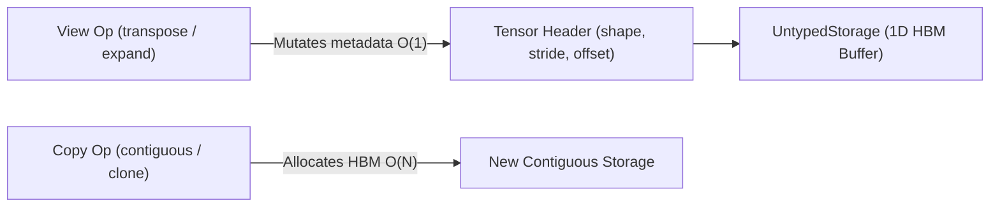
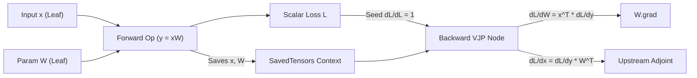
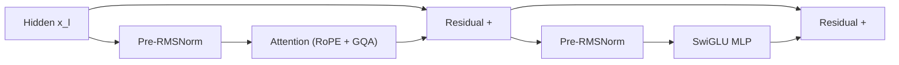

---
tags:
  - machine-learning
  - deep-learning
  - pytorch
  - transformers
  - distributed-training
created: 2026-01-04
updated: 2026-11-13
status: 🟢
level: mid-to-senior
---

# Deep Learning Guide

> [!abstract] Scope
> PyTorch memory layout physics, reverse-mode VJP autodiff, activation checkpointing, stabilization math (Kaiming/Xavier, RMSNorm, SwiGLU, Pre-LN, AdamW), modern Decoder Transformer anatomy from scratch (RoPE, GQA, FlashAttention-2 SDPA, KV-cache), mixed-precision BF16/FP16 training, `torch.compile`, FSDP2 sharding, VRAM budgeting, and NaN/convergence forensics.
> Navigation: [[Programming/Machine Learning/ML Hub|ML Hub]] · [[Programming/Machine Learning/ML Fundamentals Guide|ML Fundamentals Guide]] · [[Programming/Machine Learning/ML Algorithms Guide|ML Algorithms Guide]] · [[Programming/Machine Learning/ML Projects Guide|ML Projects Guide]] · [[Programming/Machine Learning/MLOps & Production ML Guide|MLOps & Production ML Guide]] · [[AI/AI Engineering/LLM Internals, Inference & Economics|LLM Internals, Inference & Economics]]

---

## 1. First-Principles Mechanics & Complete Architecture

Deep learning execution performance and numerical stability are governed by two coupled hardware-software layers: how tensors map logical multidimensional coordinates onto 1D GPU High-Bandwidth Memory (HBM) buffers, and how PyTorch's dynamic autograd engine records and tears down Vector-Jacobian Product (VJP) closures across execution graphs.

### 1.1 PyTorch Tensor Storage, Strides & Memory Physics

A PyTorch `Tensor` is a small C++ metadata header (`c10::TensorImpl`) holding `sizes` (shape), `strides`, `storage_offset`, `dtype`, `device`, and a reference-counted pointer to an underlying 1D flat byte buffer (`c10::Storage` / `UntypedStorage`). Multiple tensors can alias the exact same physical bytes in RAM or GPU HBM while exposing completely different logical shapes and indexing geometries.

For an $n$-dimensional tensor with logical indices $(i_0, i_1, \dots, i_{d-1})$, the exact physical element offset inside `UntypedStorage` is:

$$\text{flat\_index}(i_0, \dots, i_{d-1}) = \text{storage\_offset} + \sum_{k=0}^{d-1} i_k \cdot \text{stride}[k]$$

In standard row-major (C-contiguous) layout for shape $(S_0, S_1, \dots, S_{d-1})$, moving along the last axis advances by 1 element, and moving along axis $k$ jumps over the entire block of inner dimensions:

$$\text{stride}[k] = \prod_{j=k+1}^{d-1} S_j, \qquad \text{stride}[d-1] = 1$$



#### Views vs. Copies & Memory Aliasing Traps

| Operation | Internal Mechanism | Memory Cost | Contiguous Output? | Failure Mode / Production Trap |
|---|---|---|---|---|
| **`.view(*shape)`** | Recomputes `sizes` and `strides` in-place | $O(1)$ zero-copy | Preserves if contiguous | Raises `RuntimeError` if tensor strides violate single-span layout (e.g., after `.transpose()`) |
| **`.reshape(*shape)`** | Attempts `.view()`; falls back to `.contiguous().view()` | $O(1)$ or $O(N)$ | Yes if copied | Silent HBM allocation inside tight training loops if input became non-contiguous |
| **`.transpose()` / `.permute()`** | Swaps `shape` and `stride` entries | $O(1)$ zero-copy | **No** (strided view) | Downstream `.view()` fails; non-unit innermost stride prevents coalesced warp loads |
| **`.expand(*shape)`** | Sets `stride[k] = 0` along singleton dims | $O(1)$ zero-copy | **No** (`stride=0`) | In-place writes mutate `storage[0]`, silently corrupting every broadcast slice |
| **`.slice()` / `x[:, ::2]`** | Adjusts `storage_offset` and multiplies `stride` | $O(1)$ zero-copy | **No** | Holds a reference to the **entire** large `UntypedStorage`, preventing GC of sliced tensors |
| **`.contiguous()` / `.clone()`** | Allocates fresh buffer and copies in logical order | $O(N)$ bytes & BW | **Yes** | HBM bandwidth bottleneck when invoked repeatedly inside forward passes |

Two production invariants follow directly from `UntypedStorage` reference counting:

1. **Storage Pinning Leak**: Creating a tiny slice `head = huge_tensor[:4].clone()` frees `huge_tensor` once out of scope; creating `head = huge_tensor[:4]` (without `.clone()`) keeps the entire multi-gigabyte `UntypedStorage` alive until `head` is garbage-collected.
2. **Broadcasting Aliasing**: Calling `x.expand(B, D)` creates zero-stride dimensions where `x[0, j]` and `x[k, j]` point to the identical byte address. Any subsequent in-place op (`add_`, `zero_`, scatter) produces silent data corruption; PyTorch autograd rejects in-place ops on expanded tensors if gradients are tracked, yet inference code silently mutates shared rows.

```python
import torch

def inspect_tensor_memory_physics() -> None:
    base = torch.arange(12, dtype=torch.float32).reshape(3, 4)
    assert base.stride() == (4, 1) and base.is_contiguous()

    # 1. Transpose mutates strides in O(1) without copying bytes
    transposed = base.t()
    assert transposed.shape == (4, 3)
    assert transposed.stride() == (1, 4)
    assert transposed.data_ptr() == base.data_ptr()
    assert not transposed.is_contiguous()

    # Calling transposed.view(-1) raises RuntimeError; .contiguous() forces physical copy
    copied = transposed.contiguous()
    assert copied.stride() == (3, 1)
    assert copied.data_ptr() != base.data_ptr()

    # 2. Zero-stride expand trap: all rows share physical addresses
    vec = torch.tensor([10.0, 20.0, 30.0])
    expanded = vec.expand(4, 3)
    assert expanded.stride() == (0, 1)
    assert expanded.data_ptr() == vec.data_ptr()

    # 3. Zero-copy sliding window via as_strided (shape: [num_windows, win_len])
    stream = torch.arange(8, dtype=torch.float32)
    windows = torch.as_strided(stream, size=(6, 3), stride=(1, 1))
    assert windows.shape == (6, 3)
    assert windows.data_ptr() == stream.data_ptr()
```

#### GPU Memory Hierarchy, Coalescing & Tensor Core Alignment

Modern GPUs (NVIDIA A100/H100) separate massive slow off-chip **HBM** ($80\text{ GB}$, $\sim 2.0\text{–}3.35\text{ TB/s}$ bandwidth) from tiny ultra-fast on-chip **SRAM** ($\sim 20\text{–}50\text{ MB}$, $>19\text{ TB/s}$ bandwidth). An NVIDIA H100 delivers $989\text{ TFLOPS}$ in BF16 Tensor Cores against $3.35\text{ TB/s}$ HBM bandwidth, yielding an arithmetic intensity ridge point of $\frac{989 \times 10^{12}}{3.35 \times 10^{12}} \approx 295\text{ FLOPs/byte}$.

- **Compute-bound ops** (`GEMM`, large Conv2D): Perform hundreds of FLOPs per loaded byte; maximizing efficiency requires aligning matrix inner dimensions to multiples of **8** (FP16/BF16) or **16** (INT8/FP8) so hardware MMA (Matrix Multiply-Accumulate) instructions execute natively without scalar fallback tiles. For example, padding GPT-2 vocabulary `50,257 -> 50,304` (divisible by 64) accelerates the final LM head projection by $15\text{–}30\%$.
- **Memory-bandwidth-bound ops** (elementwise activations, RMSNorm, LayerNorm, softmax, residual add, dropout): Perform $1\text{–}5\text{ FLOPs/byte}$. Speed scales directly with minimizing HBM round-trips—which is why `torch.compile` kernel fusion and FlashAttention SRAM tiling deliver multi-fold wall-clock speedups without changing FLOP counts.
- **Channel Memory Format (`channels_last`)**: For 4D CNN tensors $(N, C, H, W)$, PyTorch's default NCHW layout puts spatial $W$ contiguous, forcing non-coalesced channel gathers inside Tensor Core implicit-GEMM kernels. Converting `tensor.to(memory_format=torch.channels_last)` reorders strides to NHWC ($C$ innermost) while preserving logical NCHW indexing (`tensor.shape`), improving Conv2D throughput by $20\text{–}35\%$ on Ampere/Hopper GPUs.

---

### 1.2 Reverse-Mode VJP Autodiff & Graph Retention

PyTorch constructs a dynamic Directed Acyclic Graph (DAG) on the fly during forward execution. Whenever any operand has `requires_grad=True`, the dispatcher records a backward node (`grad_fn`, e.g., `MmBackward0`, `AddBackward0`, `SiLUWithMultiplierBackward`) whose `next_functions` edges point backward to operand creators, and stashes minimal `SavedTensor` references needed to evaluate the local Jacobian during `.backward()`.



#### Forward-Mode (JVP) vs. Reverse-Mode (VJP)

Consider a deep neural network $f: \mathbb{R}^P \to \mathbb{R}^M$ with $P \approx 10^9$ parameters and a scalar training objective ($M = 1$):

- **Forward-mode (Jacobian-Vector Product, JVP)**: Propagates directional derivatives $\dot{y} = J_f(x) v$ alongside the forward pass for a single perturbation tangent $v \in \mathbb{R}^P$. Computing the full gradient vector requires $P$ separate forward passes ($O(P)$ cost)—completely intractable for deep networks.
- **Reverse-mode (Vector-Jacobian Product, VJP / Backpropagation)**: Seeds the output adjoint $\bar{L} = \frac{\partial L}{\partial L} = 1$ and traverses the DAG in reverse topological order, evaluating $\bar{x} = \bar{y} J_f(x)$ in **1 backward pass** regardless of parameter count $P$ (total backward FLOPs $\approx 2\times$ forward FLOPs: one GEMM for $\bar{X}$ and one GEMM for $\bar{W}$).

#### Exact Matrix & Loss VJPs

1. **Affine Linear Layer**: For $Y = XW + \mathbf{1}b^T$ with $X \in \mathbb{R}^{B \times d_{\text{in}}}$, $W \in \mathbb{R}^{d_{\text{in}} \times d_{\text{out}}}$, $b \in \mathbb{R}^{d_{\text{out}}}$, and upstream adjoint $\bar{Y} = \frac{\partial L}{\partial Y} \in \mathbb{R}^{B \times d_{\text{out}}}$, autograd never materializes the 4D tensor $\frac{\partial Y}{\partial W} \in \mathbb{R}^{B \times d_{\text{out}} \times d_{\text{in}} \times d_{\text{out}}}$. Matching matrix contractions yields:

$$\bar{X} = \bar{Y} W^T, \qquad \bar{W} = X^T \bar{Y}, \qquad \bar{b} = \sum_{i=1}^{B} \bar{Y}_{i,:}$$

Notice what `MmBackward0` must retain in VRAM until backward execution: **`X`** (to compute $\bar{W}$) and **`W`** (to compute $\bar{X}$). It does *not* need to save output `Y`.

2. **Fused LogSoftmax + Cross-Entropy**: For logits $z \in \mathbb{R}^V$, softmax probabilities $p_k = \frac{e^{z_k}}{\sum_j e^{z_j}}$, and one-hot target $y \in \{0, 1\}^V$, differentiating $L = -\sum_k y_k \log p_k$ cancels exponential factors cleanly to:

$$\frac{\partial L}{\partial z} = p - y$$

3. **Fan-Out Gradient Accumulation**: When a tensor $x$ feeds multiple downstream operations ($y_1 = f(x)$, $y_2 = g(x)$), PyTorch injects an implicit `AccumulateGrad` / sum junction during backward traversal:

$$\bar{x}_{\text{total}} = \bar{y}_1 \frac{\partial y_1}{\partial x} + \bar{y}_2 \frac{\partial y_2}{\partial x}$$

#### Why `.detach()` and `torch.inference_mode()` Prevent OOM Leaks

Three silent VRAM leaks and runtime failures occur when engineers ignore graph retention semantics:

1. **Metric Accumulation Leak (`total_loss += loss`)**: Every scalar tensor returned by `criterion(...)` carries `grad_fn=<NllLossBackward0>` pointing transitively back to every layer activation of that step. Writing `running_loss += loss` across $N$ iterations chains step $t$'s DAG onto step $t-1$'s DAG, holding all intermediate activations from step $1 \dots N$ in VRAM until OOM crashes the worker. **Fix**: extract plain Python numbers with `loss.item()` or strip graph pointers with `loss.detach()`.
2. **Stateful / RNN / Truncated BPTT Leak**: Passing hidden state `h` from step $t$ to step $t+1$ without `h = h.detach()` forces backpropagation through the entire sequence history since step 0, causing linearly growing VRAM and exploding/vanishing gradients across unbounded horizons.
3. **`torch.inference_mode()` vs. `torch.no_grad()`**: Both suppress `grad_fn` creation and prevent saving activations during validation or serving. However, `torch.no_grad()` still preserves tensor version-counter and view-tracking metadata in case outputs later enter a `requires_grad=True` subgraph. `torch.inference_mode()` disables view tracking and version bump bookkeeping entirely—zero autograd dispatch overhead and lower CPU launch latency in serving loops.
4. **In-Place Version Violation (`_version`)**: Modifying a saved activation in-place (e.g., `x.add_(1.0)` or `relu_(x)` after `x` was saved by a prior matmul) increments `x._version`. During `.backward()`, PyTorch detects the mismatch against the saved version counter and raises `RuntimeError: one of the variables needed for gradient computation has been modified by an inplace operation`.

```python
import torch

class CustomScaledSiLU(torch.autograd.Function):
    """Demonstrates explicit SavedTensor lifecycle in reverse-mode VJP."""

    @staticmethod
    def forward(ctx, x: torch.Tensor, beta: float) -> torch.Tensor:
        sig = torch.sigmoid(beta * x)
        # Save only x and sig; avoid recomputing sigmoid in backward
        ctx.save_for_backward(x, sig)
        ctx.beta = beta
        return x * sig

    @staticmethod
    def backward(ctx, grad_output: torch.Tensor):
        x, sig = ctx.saved_tensors
        beta = ctx.beta
        # d/dx [x * sigmoid(beta * x)] = sig + beta * x * sig * (1 - sig)
        local_deriv = sig * (1.0 + beta * x * (1.0 - sig))
        return grad_output * local_deriv, None
```

---

### 1.3 Gradient Checkpointing (Activation Recomputation)

During training of an $L$-layer Transformer without checkpointing, forward activations from all $L$ layers must remain pinned in VRAM until their corresponding backward nodes execute. For batch $B$, sequence length $S$, hidden dim $d$, and FFN dim $d_{\text{ff}} = \frac{8}{3}d$, activation VRAM dwarfs model weights at long context lengths ($S \ge 4096$).

**Gradient Checkpointing** (`torch.utils.checkpoint.checkpoint`) trades compute FLOPs for VRAM capacity:

- **Mechanism**: During the forward pass over a `TransformerBlock`, `checkpoint()` executes the block under `torch.no_grad()`, discarding all internal intermediate tensors (Q/K/V projections, RMSNorm outputs, SwiGLU gate/up intermediates) and storing **only the block boundary input tensor** $x_l \in \mathbb{R}^{B \times S \times d}$.
- **Backward Recomputation**: When backward traversal reaches block $l$, PyTorch triggers a local forward re-execution of block $l$ from $x_l$ *with autograd enabled*, materializing internal intermediates purely for block $l$, evaluating all VJPs for block $l$, and freeing the local intermediates immediately before moving to block $l-1$.
- **Exact Compute vs. Memory Trade-off**:
  - **Memory**: Drops peak activation storage across $L$ layers from $O(L \cdot B S (6d + 4d_{\text{ff}}))$ down to $O(L \cdot B S d + B S (6d + 4d_{\text{ff}}))$—often an **$8\times\text{–}15\times$ reduction** in activation VRAM.
  - **Compute**: Adds **1 extra forward pass** per checkpointed segment ($\sim 33\%$ extra wall-clock step time since backward is $\approx 2\times$ forward: $\frac{1 + 1 + 2}{1 + 2} = 1.33\times$). In practice, fitting $2\times\text{–}4\times$ larger micro-batches raises GPU Tensor Core occupancy and often leaves net tokens/sec nearly unchanged or faster.
- **Critical PyTorch 2.x Flag (`use_reentrant=False`)**: Legacy `use_reentrant=True` breaks `torch.compile`, mishandles inputs with `requires_grad=False`, and fails if any parameter inside the block receives zero gradient. Always specify `use_reentrant=False` and keep `preserve_rng_state=True` whenever Dropout or stochastic depth sits inside the checkpointed region so recomputed forward passes sample the identical dropout mask.

---

## 2. Real-World Use Cases & Architectural Decision Matrix

Selecting deep learning architectures, precision regimes, and distributed strategies requires matching inductive bias, dataset regime, and latency constraints against simpler baselines before introducing complexity.

| Problem / System Scenario | When to Adopt | When NOT to Use (Better Alternative) | Hardware / Latency & Scaling Trade-offs |
|---|---|---|---|
| **1. Structured Tabular Risk / Fraud ($10^3\text{–}10^7$ rows)** | Multi-modal fusion (text + image + tabular) or sequential clickstream tokens feeding shared embeddings | Pure tabular numerical/categorical signals (**LightGBM / XGBoost + OOF `TargetEncoder`** beats MLPs/TabNet on accuracy, calibration, and CPU serving latency) | Neural inference requires batching/ONNX; GBDTs score single rows in $<1\text{ ms}$ on CPU |
| **2. Industrial Vision Inspection ($<20\text{k}$ images)** | Transfer-learned **`timm` ConvNeXt / DINOv2** with frozen linear probe $\to$ two-stage differential LR unfreeze | Training CNN/ViT from random initialization (severe memorization & shortcut learning below $50\text{k}$ samples) | ConvNeXt-Tiny exports cleanly to **TensorRT FP16/INT8** ($<4\text{ ms}$/frame); ViTs need FlashAttention/bigger batches for peak occupancy |
| **3. Low-Latency Sequence Classification ($<25\text{ ms}$ CPU SLA)** | Distilled Bi-Directional Encoder (**DistilBERT / MiniLM**) exported to **ONNX Dynamic INT8** | Prompting autoregressive 7B–70B LLMs over HTTP (200–1500 ms latency, $100\times$ cost) or simple keyword triage (**TF-IDF + LogReg** clears $<1\text{ ms}$) | Encoder processes full sequence in 1 non-autoregressive pass; scales linearly with cores/batch size |
| **4. Autoregressive Generative / Long-Context Decoder** | Pre-LN Transformer with **RoPE + GQA + SwiGLU + SDPA FlashAttention-2 + KV-Cache** | Fixed-schema classification or extraction where non-causal encoder suffices | Prefill is compute-bound ($O(S^2)$ FLOPs); token-by-token decode is **HBM-bandwidth bound** by KV-cache reads |
| **5. Multi-GPU Training Scaling (DDP vs. FSDP2)** | **FSDP2 (`fully_shard`)** when weights + optimizer states exceed single-GPU VRAM ($P \ge 1\text{B}$); **DDP** when model fits comfortably on 1 GPU | Running FSDP2 on tiny models ($<200\text{M}$ params) over slow PCIe/Ethernet interconnects (AllGather/ReduceScatter communication overhead dominates) | DDP replicates $16P$ static bytes/GPU (AllReduce grads only); FSDP2 shards static bytes as $\frac{16P}{N}$ with overlapping layer prefetch |

---

## 3. Step-by-Step Practical Application: Modern Decoder Transformer From Scratch

Modern autoregressive LLMs (LLaMA-3, Qwen-2.5, Mistral) share a unified architectural blueprint: **Pre-RMSNorm**, **Rotary Position Embeddings (RoPE)** applied directly to $Q$ and $K$, **Grouped-Query Attention (GQA)** with **FlashAttention-2 SDPA**, **SwiGLU** gated MLPs with $d_{\text{ff}} \approx \frac{8}{3}d$, **BF16 `autocast`**, **AdamW decoupled weight decay**, and **FSDP2** sharding.

### 3.1 Production Project Directory Layout

```text
llm_pretrain/
├── config.py                # Model & training hyperparameters, Tensor Core alignment
├── model.py                 # RMSNorm, RoPE, GQA + KV-cache, SwiGLU, DecoderTransformer
├── optim.py                 # Weight-decay param grouping, AdamW, cosine-warmup scheduler
├── train_fsdp2.py           # BF16/FP16 AMP, gradient accumulation, FSDP2 + torch.compile
└── tests/
    └── test_transformer.py  # RoPE invariance, causal masking, KV-cache & 1-batch overfit checks
```

### 3.2 `config.py` — Architecture & Alignment Specification

```python
from dataclasses import dataclass

def align_up(value: int, multiple: int) -> int:
    return ((value + multiple - 1) // multiple) * multiple

@dataclass(frozen=True)
class ModelConfig:
    vocab_size: int = 32_000          # Multiple of 64 for Tensor Core MMA efficiency
    dim: int = 768                    # Model hidden dimension d
    n_layers: int = 12                # Number of Pre-LN Transformer blocks
    n_heads: int = 12                 # Number of query heads H_q
    n_kv_heads: int = 4               # Number of KV heads H_kv (GQA ratio = 3:1)
    max_seq_len: int = 2048           # Maximum context length supported by RoPE cache
    rope_theta: float = 500_000.0     # Base RoPE frequency (extended context safe)
    norm_eps: float = 1e-6            # RMSNorm epsilon floor
    ffn_align: int = 128              # Alignment multiple for SwiGLU hidden size
    tie_word_embeddings: bool = False # Untied embedding & LM head by default
    grad_checkpointing: bool = False  # Enable torch.utils.checkpoint per block

    def __post_init__(self) -> None:
        if self.dim % self.n_heads != 0:
            raise ValueError(f"dim ({self.dim}) must be divisible by n_heads ({self.n_heads})")
        if self.n_heads % self.n_kv_heads != 0:
            raise ValueError(f"n_heads ({self.n_heads}) must be divisible by n_kv_heads ({self.n_kv_heads})")
        if (self.dim // self.n_heads) % 2 != 0:
            raise ValueError("head_dim must be even for 2D RoPE rotations")

    @property
    def head_dim(self) -> int:
        return self.dim // self.n_heads

    @property
    def ffn_dim(self) -> int:
        # Derive 8/3 * d to match 2-matrix 4d parameter budget across 3 SwiGLU projections
        raw = int((8 * self.dim) / 3)
        return align_up(raw, self.ffn_align)

@dataclass(frozen=True)
class TrainConfig:
    micro_batch_size: int = 8
    grad_accum_steps: int = 4
    max_steps: int = 10_000
    warmup_steps: int = 500
    max_lr: float = 3e-4
    min_lr: float = 3e-5
    weight_decay: float = 0.1
    grad_clip_norm: float = 1.0
    dtype: str = "bfloat16"           # "bfloat16" (Ampere+) or "float16" (T4/V100)
    use_compile: bool = True
```

### 3.3 `model.py` — Complete Pre-LN Decoder Transformer (RoPE, GQA, KV-Cache, SwiGLU)

```python
import math
from typing import Optional
import torch
import torch.nn as nn
import torch.nn.functional as F
from torch.utils.checkpoint import checkpoint
from config import ModelConfig

class RMSNorm(nn.Module):
    """Root Mean Square Layer Normalization with mandatory FP32 variance upcast."""

    def __init__(self, dim: int, eps: float = 1e-6) -> None:
        super().__init__()
        self.eps = eps
        self.weight = nn.Parameter(torch.ones(dim))

    def forward(self, x: torch.Tensor) -> torch.Tensor:
        # Cast to float32 before squaring to prevent BF16/FP16 overflow/underflow in sum(x^2)
        x_fp32 = x.float()
        rms_inv = torch.rsqrt(x_fp32.pow(2).mean(dim=-1, keepdim=True) + self.eps)
        return (x_fp32 * rms_inv).to(x.dtype) * self.weight


def precompute_rope_cos_sin(
    head_dim: int, max_seq_len: int, theta: float = 500_000.0, device: Optional[torch.device] = None
) -> tuple[torch.Tensor, torch.Tensor]:
    """Precomputes cos and sin tables [max_seq_len, head_dim // 2] in FP32."""
    half_dim = head_dim // 2
    idx = torch.arange(0, head_dim, 2, device=device, dtype=torch.float32)
    inv_freq = 1.0 / (theta ** (idx / head_dim))  # [half_dim]
    positions = torch.arange(max_seq_len, device=device, dtype=torch.float32)
    angles = torch.outer(positions, inv_freq)    # [max_seq_len, half_dim]
    return torch.cos(angles), torch.sin(angles)


def apply_rope(
    x: torch.Tensor, cos: torch.Tensor, sin: torch.Tensor, start_pos: int = 0
) -> torch.Tensor:
    """
    Applies 2D rotary embeddings across pairs along the last dimension.
    x shape: [B, H, S, head_dim]
    cos/sin shape: [max_seq_len, head_dim // 2]
    """
    seq_len = x.size(2)
    cos_slice = cos[start_pos : start_pos + seq_len].unsqueeze(0).unsqueeze(0)  # [1, 1, S, D/2]
    sin_slice = sin[start_pos : start_pos + seq_len].unsqueeze(0).unsqueeze(0)

    x_fp32 = x.float()
    x_even = x_fp32[..., 0::2]
    x_odd = x_fp32[..., 1::2]

    rot_even = x_even * cos_slice - x_odd * sin_slice
    rot_odd = x_even * sin_slice + x_odd * cos_slice

    # Interleave even/odd pairs back into original [..., head_dim] layout
    out = torch.stack((rot_even, rot_odd), dim=-1).flatten(-2)
    return out.to(x.dtype)


def repeat_kv(x: torch.Tensor, n_rep: int) -> torch.Tensor:
    """Broadcasts KV heads [B, H_kv, S, D] -> [B, H_kv * n_rep, S, D] via zero-copy expand."""
    if n_rep == 1:
        return x
    b, h_kv, s, d = x.shape
    return x[:, :, None, :, :].expand(b, h_kv, n_rep, s, d).reshape(b, h_kv * n_rep, s, d)


class GroupedQueryAttention(nn.Module):
    def __init__(self, cfg: ModelConfig) -> None:
        super().__init__()
        self.n_heads = cfg.n_heads
        self.n_kv_heads = cfg.n_kv_heads
        self.n_rep = cfg.n_heads // cfg.n_kv_heads
        self.head_dim = cfg.head_dim

        self.wq = nn.Linear(cfg.dim, cfg.n_heads * cfg.head_dim, bias=False)
        self.wk = nn.Linear(cfg.dim, cfg.n_kv_heads * cfg.head_dim, bias=False)
        self.wv = nn.Linear(cfg.dim, cfg.n_kv_heads * cfg.head_dim, bias=False)
        self.wo = nn.Linear(cfg.n_heads * cfg.head_dim, cfg.dim, bias=False)

    def forward(
        self,
        x: torch.Tensor,
        cos: torch.Tensor,
        sin: torch.Tensor,
        past_kv: Optional[tuple[torch.Tensor, torch.Tensor]] = None,
        start_pos: int = 0,
    ) -> tuple[torch.Tensor, tuple[torch.Tensor, torch.Tensor]]:
        bsz, seq_len, _ = x.shape

        q = self.wq(x).view(bsz, seq_len, self.n_heads, self.head_dim).transpose(1, 2)
        k = self.wk(x).view(bsz, seq_len, self.n_kv_heads, self.head_dim).transpose(1, 2)
        v = self.wv(x).view(bsz, seq_len, self.n_kv_heads, self.head_dim).transpose(1, 2)

        q = apply_rope(q, cos, sin, start_pos=start_pos)
        k = apply_rope(k, cos, sin, start_pos=start_pos)

        if past_kv is not None:
            k_cache, v_cache = past_kv
            k = torch.cat([k_cache, k], dim=2)
            v = torch.cat([v_cache, v], dim=2)
        new_kv = (k, v)

        k_full = repeat_kv(k, self.n_rep)
        v_full = repeat_kv(v, self.n_rep)

        # FlashAttention-2 via SDPA: causal mask needed during prefill (seq_len > 1)
        # During 1-token KV-cache decoding (seq_len == 1), attending to all cached past tokens is valid
        is_causal = (past_kv is None) and (seq_len > 1)
        attn_out = F.scaled_dot_product_attention(q, k_full, v_full, attn_mask=None, is_causal=is_causal)

        attn_out = attn_out.transpose(1, 2).contiguous().view(bsz, seq_len, self.n_heads * self.head_dim)
        return self.wo(attn_out), new_kv


class SwiGLUFFN(nn.Module):
    def __init__(self, cfg: ModelConfig) -> None:
        super().__init__()
        self.w_gate = nn.Linear(cfg.dim, cfg.ffn_dim, bias=False)
        self.w_up = nn.Linear(cfg.dim, cfg.ffn_dim, bias=False)
        self.w_down = nn.Linear(cfg.ffn_dim, cfg.dim, bias=False)

    def forward(self, x: torch.Tensor) -> torch.Tensor:
        return self.w_down(F.silu(self.w_gate(x)) * self.w_up(x))


class TransformerBlock(nn.Module):
    def __init__(self, cfg: ModelConfig) -> None:
        super().__init__()
        self.attn_norm = RMSNorm(cfg.dim, eps=cfg.norm_eps)
        self.attn = GroupedQueryAttention(cfg)
        self.ffn_norm = RMSNorm(cfg.dim, eps=cfg.norm_eps)
        self.ffn = SwiGLUFFN(cfg)

    def forward(
        self,
        x: torch.Tensor,
        cos: torch.Tensor,
        sin: torch.Tensor,
        past_kv: Optional[tuple[torch.Tensor, torch.Tensor]] = None,
        start_pos: int = 0,
    ) -> tuple[torch.Tensor, tuple[torch.Tensor, torch.Tensor]]:
        attn_out, new_kv = self.attn(self.attn_norm(x), cos, sin, past_kv=past_kv, start_pos=start_pos)
        h = x + attn_out
        out = h + self.ffn(self.ffn_norm(h))
        return out, new_kv


class DecoderTransformer(nn.Module):
    def __init__(self, cfg: ModelConfig) -> None:
        super().__init__()
        self.cfg = cfg
        self.tok_emb = nn.Embedding(cfg.vocab_size, cfg.dim)
        self.layers = nn.ModuleList([TransformerBlock(cfg) for _ in range(cfg.n_layers)])
        self.final_norm = RMSNorm(cfg.dim, eps=cfg.norm_eps)
        self.lm_head = nn.Linear(cfg.dim, cfg.vocab_size, bias=False)

        if cfg.tie_word_embeddings:
            self.lm_head.weight = self.tok_emb.weight

        cos, sin = precompute_rope_cos_sin(cfg.head_dim, cfg.max_seq_len, cfg.rope_theta)
        self.register_buffer("rope_cos", cos, persistent=False)
        self.register_buffer("rope_sin", sin, persistent=False)

        self._init_weights()

    def _init_weights(self) -> None:
        std = 0.02
        residual_scale = 1.0 / math.sqrt(2.0 * self.cfg.n_layers)
        for name, module in self.named_modules():
            if isinstance(module, nn.Linear):
                # Scale residual output projections (wo, w_down) by 1 / sqrt(2L)
                target_std = std * residual_scale if name.endswith(("wo", "w_down")) else std
                nn.init.normal_(module.weight, mean=0.0, std=target_std)
            elif isinstance(module, nn.Embedding):
                nn.init.normal_(module.weight, mean=0.0, std=std)

    def forward(
        self,
        input_ids: torch.Tensor,
        past_kvs: Optional[list[tuple[torch.Tensor, torch.Tensor]]] = None,
        use_cache: bool = False,
    ) -> tuple[torch.Tensor, Optional[list[tuple[torch.Tensor, torch.Tensor]]]]:
        bsz, seq_len = input_ids.shape
        start_pos = 0 if past_kvs is None else past_kvs[0][0].size(2)
        if start_pos + seq_len > self.cfg.max_seq_len:
            raise ValueError(f"Sequence length {start_pos + seq_len} exceeds max_seq_len {self.cfg.max_seq_len}")

        h = self.tok_emb(input_ids)
        next_kvs = [] if use_cache else None

        for layer_idx, block in enumerate(self.layers):
            layer_past = None if past_kvs is None else past_kvs[layer_idx]
            if self.cfg.grad_checkpointing and self.training and not use_cache:
                # Recompute block activations during backward; preserve RNG if dropout added later
                def custom_forward(hidden: torch.Tensor, blk: TransformerBlock = block) -> torch.Tensor:
                    out, _ = blk(hidden, self.rope_cos, self.rope_sin, past_kv=None, start_pos=0)
                    return out

                h = checkpoint(custom_forward, h, use_reentrant=False)
            else:
                h, new_kv = block(h, self.rope_cos, self.rope_sin, past_kv=layer_past, start_pos=start_pos)
                if use_cache and next_kvs is not None:
                    next_kvs.append(new_kv)

        logits = self.lm_head(self.final_norm(h))
        return logits, next_kvs

    @torch.inference_mode()
    def generate(
        self,
        prompt_ids: torch.Tensor,
        max_new_tokens: int,
        temperature: float = 0.8,
        top_k: int = 50,
    ) -> torch.Tensor:
        self.eval()
        # 1. Prefill phase: compute KV cache across entire prompt in parallel
        logits, past_kvs = self(prompt_ids, past_kvs=None, use_cache=True)
        generated = [prompt_ids]
        next_token = self._sample_next(logits[:, -1, :], temperature, top_k)
        generated.append(next_token)

        # 2. Decode phase: feed only 1 token per step using O(1)-compute KV cache lookup
        for _ in range(max_new_tokens - 1):
            logits, past_kvs = self(next_token, past_kvs=past_kvs, use_cache=True)
            next_token = self._sample_next(logits[:, -1, :], temperature, top_k)
            generated.append(next_token)

        return torch.cat(generated, dim=1)

    @staticmethod
    def _sample_next(logits: torch.Tensor, temperature: float, top_k: int) -> torch.Tensor:
        if temperature <= 0.0:
            return logits.argmax(dim=-1, keepdim=True)
        scaled = logits / temperature
        if 0 < top_k < scaled.size(-1):
            top_vals, _ = torch.topk(scaled, top_k, dim=-1)
            cutoff = top_vals[:, -1].unsqueeze(-1)
            scaled = scaled.masked_fill(scaled < cutoff, float("-inf"))
        probs = F.softmax(scaled.float(), dim=-1)
        return torch.multinomial(probs, num_samples=1)
```

### 3.4 `optim.py` — AdamW Parameter Grouping & Cosine Warmup Schedule

```python
import math
import torch
import torch.nn as nn

def build_adamw_optimizer(
    model: nn.Module,
    lr: float = 3e-4,
    weight_decay: float = 0.1,
    betas: tuple[float, float] = (0.9, 0.95),
    eps: float = 1e-8,
    use_fused: bool = True,
) -> torch.optim.AdamW:
    """
    Separates 2D+ weight tensors (regularized) from 1D norms/biases (unregularized).
    """
    decay_params: list[nn.Parameter] = []
    no_decay_params: list[nn.Parameter] = []
    seen: set[int] = set()

    for param in model.parameters():
        if not param.requires_grad or id(param) in seen:
            continue
        seen.add(id(param))
        if param.ndim >= 2:
            decay_params.append(param)
        else:
            no_decay_params.append(param)

    param_groups = [
        {"params": decay_params, "weight_decay": weight_decay},
        {"params": no_decay_params, "weight_decay": 0.0},
    ]
    can_fuse = use_fused and torch.cuda.is_available()
    return torch.optim.AdamW(param_groups, lr=lr, betas=betas, eps=eps, fused=can_fuse)


def build_cosine_warmup_scheduler(
    optimizer: torch.optim.Optimizer,
    warmup_steps: int,
    max_steps: int,
    max_lr: float,
    min_lr: float,
) -> torch.optim.lr_scheduler.LambdaLR:
    min_ratio = min_lr / max_lr

    def lr_lambda(step: int) -> float:
        if step < warmup_steps:
            return float(step + 1) / float(max(1, warmup_steps))
        if step >= max_steps:
            return min_ratio
        progress = float(step - warmup_steps) / float(max(1, max_steps - warmup_steps))
        cosine = 0.5 * (1.0 + math.cos(math.pi * progress))
        return min_ratio + (1.0 - min_ratio) * cosine

    return torch.optim.lr_scheduler.LambdaLR(optimizer, lr_lambda=lr_lambda)
```

### 3.5 `train_fsdp2.py` — Mixed-Precision Training Step with FSDP2 & `torch.compile`

```python
import os
from typing import Iterator
import torch
import torch.distributed as dist
import torch.nn.functional as F
from torch.distributed.fsdp import MixedPrecisionPolicy, fully_shard

from config import ModelConfig, TrainConfig
from model import DecoderTransformer
from optim import build_adamw_optimizer, build_cosine_warmup_scheduler

def setup_distributed() -> tuple[int, int, torch.device]:
    if "RANK" in os.environ and "WORLD_SIZE" in os.environ:
        dist.init_process_group(backend="nccl")
        rank = int(os.environ["RANK"])
        local_rank = int(os.environ.get("LOCAL_RANK", 0))
        torch.cuda.set_device(local_rank)
        return rank, int(os.environ["WORLD_SIZE"]), torch.device("cuda", local_rank)
    device = torch.device("cuda" if torch.cuda.is_available() else "cpu")
    return 0, 1, device


def wrap_fsdp2(model: DecoderTransformer, amp_dtype: torch.dtype) -> DecoderTransformer:
    """
    Applies FSDP2 per-parameter DTensor sharding (fully_shard) bottom-up:
    shard each TransformerBlock individually, then shard the root model.
    """
    mp_policy = MixedPrecisionPolicy(
        param_dtype=amp_dtype,
        reduce_dtype=torch.float32,  # Accumulate cross-rank AllReduce in FP32
    )
    for block in model.layers:
        fully_shard(block, mp_policy=mp_policy)
    fully_shard(model, mp_policy=mp_policy)
    return model


def train_loop(
    model_cfg: ModelConfig,
    train_cfg: TrainConfig,
    batch_iter: Iterator[tuple[torch.Tensor, torch.Tensor]],
) -> None:
    rank, world_size, device = setup_distributed()
    amp_dtype = torch.bfloat16 if train_cfg.dtype == "bfloat16" else torch.float16
    use_amp = device.type == "cuda"
    use_scaler = use_amp and (amp_dtype == torch.float16)
    scaler = torch.amp.GradScaler("cuda", enabled=use_scaler)

    model = DecoderTransformer(model_cfg).to(device)
    if world_size > 1:
        model = wrap_fsdp2(model, amp_dtype=amp_dtype)

    if train_cfg.use_compile and device.type == "cuda":
        model = torch.compile(model, mode="default")

    optimizer = build_adamw_optimizer(model, lr=train_cfg.max_lr, weight_decay=train_cfg.weight_decay)
    scheduler = build_cosine_warmup_scheduler(
        optimizer, train_cfg.warmup_steps, train_cfg.max_steps, train_cfg.max_lr, train_cfg.min_lr
    )

    model.train()
    optimizer.zero_grad(set_to_none=True)

    for opt_step in range(train_cfg.max_steps):
        accum_loss_val = 0.0
        for micro_idx in range(train_cfg.grad_accum_steps):
            input_ids, targets = next(batch_iter)
            input_ids = input_ids.to(device, non_blocking=True)
            targets = targets.to(device, non_blocking=True)

            # Skip FSDP gradient ReduceScatter on intermediate accumulation micro-batches
            is_last_micro = micro_idx == (train_cfg.grad_accum_steps - 1)
            if world_size > 1 and hasattr(model, "set_requires_gradient_sync"):
                model.set_requires_gradient_sync(is_last_micro)

            with torch.amp.autocast(device.type, dtype=amp_dtype, enabled=use_amp):
                logits, _ = model(input_ids, use_cache=False)
                # Always cast logits to FP32 before CrossEntropy log-sum-exp
                loss = F.cross_entropy(
                    logits.view(-1, model_cfg.vocab_size).float(),
                    targets.view(-1),
                ) / train_cfg.grad_accum_steps

            if use_scaler:
                scaler.scale(loss).backward()
            else:
                loss.backward()

            # Detach via .item() immediately so DAG is freed after backward()
            accum_loss_val += loss.item() * train_cfg.grad_accum_steps

        if use_scaler:
            # CRITICAL: unscale_ MUST run before clip_grad_norm_ in FP16
            scaler.unscale_(optimizer)
        grad_norm = torch.nn.utils.clip_grad_norm_(model.parameters(), max_norm=train_cfg.grad_clip_norm)

        if use_scaler:
            scaler.step(optimizer)
            scaler.update()
        else:
            optimizer.step()

        scheduler.step()
        optimizer.zero_grad(set_to_none=True)

        if rank == 0 and opt_step % 50 == 0:
            lr_now = scheduler.get_last_lr()[0]
            print(f"step={opt_step:05d} loss={accum_loss_val:.4f} grad_norm={float(grad_norm):.3f} lr={lr_now:.2e}")

    if world_size > 1:
        dist.destroy_process_group()
```

### 3.6 `tests/test_transformer.py` — Numerical & Architectural Verification Suite

```python
import torch
import torch.nn.functional as F
from config import ModelConfig
from model import DecoderTransformer, apply_rope, precompute_rope_cos_sin
from optim import build_adamw_optimizer

def test_rope_relative_offset_invariance() -> None:
    head_dim = 64
    cos, sin = precompute_rope_cos_sin(head_dim=head_dim, max_seq_len=128)
    torch.manual_seed(0)
    q = torch.randn(1, 1, 1, head_dim)
    k = torch.randn(1, 1, 1, head_dim)

    # Compute dot product at positions (m=10, n=25) vs shifted (m=52, n=67) -> same delta=15
    q_m1 = apply_rope(q, cos, sin, start_pos=10)
    k_n1 = apply_rope(k, cos, sin, start_pos=25)
    dot_1 = (q_m1 * k_n1).sum()

    q_m2 = apply_rope(q, cos, sin, start_pos=52)
    k_n2 = apply_rope(k, cos, sin, start_pos=67)
    dot_2 = (q_m2 * k_n2).sum()

    assert torch.allclose(dot_1, dot_2, atol=1e-5), f"RoPE relative invariance violated: {dot_1} vs {dot_2}"


def test_kv_cache_and_causality_equivalence() -> None:
    cfg = ModelConfig(vocab_size=256, dim=128, n_layers=2, n_heads=4, n_kv_heads=2, max_seq_len=64)
    model = DecoderTransformer(cfg).eval()
    tokens = torch.randint(0, cfg.vocab_size, (2, 16))

    with torch.inference_mode():
        # Full parallel pass
        logits_full, _ = model(tokens, use_cache=False)

        # Prefill 15 tokens + 1-token KV-cached decode step
        logits_pre, kvs = model(tokens[:, :-1], use_cache=True)
        logits_step, _ = model(tokens[:, -1:], past_kvs=kvs, use_cache=True)

        assert torch.allclose(logits_full[:, -1, :], logits_step[:, 0, :], atol=1e-4)

        # Causal mask verification: changing future token 15 must leave logits at position <= 14 invariant
        perturbed = tokens.clone()
        perturbed[:, 15] = (perturbed[:, 15] + 1) % cfg.vocab_size
        logits_pert, _ = model(perturbed, use_cache=False)
        assert torch.allclose(logits_full[:, :15, :], logits_pert[:, :15, :], atol=1e-6)


def test_single_batch_overfit_and_optimizer_groups() -> None:
    cfg = ModelConfig(vocab_size=128, dim=64, n_layers=2, n_heads=4, n_kv_heads=2, max_seq_len=32)
    model = DecoderTransformer(cfg)
    opt = build_adamw_optimizer(model, lr=3e-3, weight_decay=0.1, use_fused=False)

    assert opt.param_groups[0]["weight_decay"] == 0.1  # 2D weights
    assert opt.param_groups[1]["weight_decay"] == 0.0  # 1D RMSNorm gamma

    x = torch.randint(0, cfg.vocab_size, (4, 16))
    y = torch.randint(0, cfg.vocab_size, (4, 16))
    initial_loss = None
    for _ in range(60):
        opt.zero_grad(set_to_none=True)
        logits, _ = model(x)
        loss = F.cross_entropy(logits.view(-1, cfg.vocab_size), y.view(-1))
        if initial_loss is None:
            initial_loss = loss.item()
        loss.backward()
        torch.nn.utils.clip_grad_norm_(model.parameters(), 1.0)
        opt.step()

    assert loss.item() < initial_loss * 0.25, f"Model failed 1-batch overfit: {initial_loss:.3f} -> {loss.item():.3f}"
```

---

## 4. Complete Framework Reference, Stabilization Math & Hardware Internals

### 4.1 Activation Functions & SwiGLU $\frac{8}{3}d$ Derivation

| Activation | Formula | Derivative | Key Property | Failure Mode |
|---|---|---|---|---|
| **ReLU** | $\max(0, x)$ | $\mathbb{I}(x > 0)$ | Scale-invariant, zero transcendental FLOPs | **Dying ReLU**: $z < 0$ across inputs $\implies \nabla = 0$ permanently |
| **GELU** | $x \Phi(x)$ | $\Phi(x) + x \phi(x)$ | Smooth non-monotonic gate around $0$ | Higher transcendental cost than ReLU without kernel fusion |
| **SiLU (Swish)** | $x \cdot \sigma(x)$ | $\sigma(x)(1 + x(1 - \sigma(x)))$ | Smooth, unbounded above, bounded below | Saves pre-activation $x$ in memory |
| **SwiGLU** | $(\text{SiLU}(xW_1) \odot xW_3)W_2$ | Product rule over gate & value | Multiplicative bilinear interaction | 3 weight matrices per FFN block |

A classical Transformer MLP uses two projections ($d \to 4d \to d$), costing $2 \cdot d \cdot (4d) = 8d^2$ parameters and $16 B S d^2$ FLOPs. **SwiGLU** introduces three projections: gate $W_1 \in \mathbb{R}^{d \times d_{\text{ff}}}$, up $W_3 \in \mathbb{R}^{d \times d_{\text{ff}}}$, and down $W_2 \in \mathbb{R}^{d_{\text{ff}} \times d}$:

$$\text{FFN}_{\text{SwiGLU}}(x) = \left(\text{SiLU}(xW_1) \odot (xW_3)\right) W_2$$

Equating parameter count across three matrices to the original $8d^2$ budget yields:

$$3 \cdot d \cdot d_{\text{ff}} = 8d^2 \implies d_{\text{ff}} = \frac{8}{3} d$$

Rounding $d_{\text{ff}}$ up to a hardware-friendly Tensor Core multiple of $128$ or $256$ preserves aligned MMA tiles (e.g., LLaMA-7B with $d = 4096 \implies \lceil \frac{8}{3} \cdot 4096 \rceil_{256} = 11{,}008$).

### 4.2 Variance Scaling, Residuals & Pre-LN vs. Post-LN Gradient Flow

In an $L$-layer linear stack $h_L = (\prod_{l=1}^L W_l)x$, activation variance compounds multiplicatively: if singular values $\sigma(W_l) < 1$, signals and gradients decay exponentially; if $\sigma(W_l) > 1$, they explode.

For zero-mean independent weights $w_{ij}$ and zero-mean inputs $x_j$ in $z_i = \sum_{j=1}^{n_{\text{in}}} w_{ij} x_j$:

$$\text{Var}(z_i) = n_{\text{in}} \cdot \text{Var}(w) \cdot \text{Var}(x)$$

- **Xavier / Glorot** (linear, $\tanh$, sigmoid near $0$): $\text{Var}(W) = \frac{2}{n_{\text{in}} + n_{\text{out}}}$, balancing forward `fan_in` and backward `fan_out` variance.
- **Kaiming / He** (ReLU / SiLU): ReLU zeroes all negative pre-activations of a symmetric distribution, halving second moments ($\mathbb{E}[\text{ReLU}(z)^2] = \frac{1}{2}\text{Var}(z)$). Kaiming multiplies variance by $2$:

$$\text{Var}(W) = \frac{2}{n_{\text{in}}} \quad (\text{mode}=\text{fan\_in})$$

#### Residual Connections & Output Projection Scaling

For residual update $x_{l+1} = x_l + F(x_l; \theta_l)$, unrolling from layer $l$ to $L$ gives $x_L = x_l + \sum_{i=l}^{L-1} F(x_i; \theta_i)$. Differentiating yields:

$$\frac{\partial L}{\partial x_l} = \frac{\partial L}{\partial x_L} \left( I + \frac{\partial}{\partial x_l} \sum_{i=l}^{L-1} F(x_i; \theta_i) \right)$$

The additive identity $I$ guarantees unimpeded backward gradient flow from the loss directly to early layers regardless of depth. Because each Transformer layer contributes two residual additions (Attention + FFN = $2L$ branches), scaling residual output projections ($W_O, W_2$) by $\frac{1}{\sqrt{2L}}$ at initialization keeps the trunk variance $O(1)$ across depth instead of growing proportionally to $2L$.

#### Pre-LN vs. Post-LN Transformer Gradient Dynamics



- **Post-LN** ($x_{l+1} = \text{LN}(x_l + F(x_l))$): Normalization sits directly *on* the residual trunk. At initialization, LayerNorm divides the sum $x_l + F(x_l)$ by $\sqrt{1 + \sigma_F^2}$, attenuating backward Jacobian norms as gradients travel from top to bottom layers while top layers receive large expected gradients—causing severe instability without delicate, long LR warmups.
- **Pre-LN** ($x_{l+1} = x_l + F(\text{LN}(x_l))$): Keeps the identity trunk completely unnormalized. Gradients flow cleanly through $+I$ from layer $L$ down to layer $1$ with uniform norm across depth, enabling stable training at high learning rates with minimal warmup. (Note: Pre-LN trunk norms grow slightly across layers, which the final `RMSNorm` before `lm_head` resolves.)

### 4.3 Normalization Layers: BatchNorm vs. LayerNorm vs. RMSNorm

| Layer | Normalization Axes | Parameters | Batch Dependent? | Inference Behavior | Primary Domain |
|---|---|---|---|---|---|
| **BatchNorm** | $(B, H, W)$ per channel $C$ | $\gamma, \beta \in \mathbb{R}^C$ + EMA stats | **Yes** | Uses frozen `running_mean` / `running_var` | CNNs with large batch ($B \ge 16$) |
| **LayerNorm** | Feature dim $D$ per token | $\gamma, \beta \in \mathbb{R}^D$ | **No** | Identical to training | BERT / GPT-2 / ViT |
| **RMSNorm** | Feature dim $D$ per token | $\gamma \in \mathbb{R}^D$ (no shift $\beta$) | **No** | Identical to training | Modern LLMs (LLaMA, Qwen, Gemma) |
| **GroupNorm** | $(C/G, H, W)$ per sample | $\gamma, \beta \in \mathbb{R}^C$ | **No** | Identical to training | Detection / small-batch CNNs ($B \le 4$) |

#### Why RMSNorm Beats LayerNorm in Throughput

LayerNorm computes mean $\mu = \frac{1}{D}\sum x_j$, subtracts $\mu$, computes variance $\sigma^2 = \frac{1}{D}\sum (x_j - \mu)^2$, normalizes, scales by $\gamma$, and shifts by $\beta$. **RMSNorm** drops mean-centering and bias $\beta$:

$$\text{RMSNorm}(x) = \frac{x}{\text{RMS}(x)} \odot \gamma, \qquad \text{RMS}(x) = \sqrt{\frac{1}{D}\sum_{j=1}^D x_j^2 + \epsilon}$$

Because normalization is strictly HBM-bandwidth bound, eliminating the mean reduction and bias parameter fetch reduces kernel execution latency by **15–30%** while maintaining equivalent perplexity. In PyTorch $\ge 2.4$, native `nn.RMSNorm` fuses this pass directly.

#### BatchNorm Micro-Batch & `eval()` Failure Modes

1. **Missing `model.eval()`**: In training mode, BatchNorm normalizes by the current mini-batch's statistics and updates EMA buffers. Running single-sample inference ($B=1$) without `model.eval()` yields `(x - x) / sqrt(eps) = 0` (collapsing every channel to $\beta$).
2. **Micro-Batch Variance Collapse ($B \le 4$)**: Computing variance across 2 images introduces massive gradient noise and corrupts `running_var`. Multi-GPU DDP exacerbates this by normalizing per GPU rank unless wrapped in `nn.SyncBatchNorm` (which inserts a blocking `AllReduce` per BatchNorm layer) or replaced with `GroupNorm`.

### 4.4 AdamW Decoupled Weight Decay & Optimizer State VRAM Math

Standard Adam tracks exponential moving averages of first moment $m_t$ and uncentered second moment $v_t$:

$$m_t = \beta_1 m_{t-1} + (1 - \beta_1) g_t, \qquad v_t = \beta_2 v_{t-1} + (1 - \beta_2) g_t^2$$

$$\hat{m}_t = \frac{m_t}{1 - \beta_1^t}, \qquad \hat{v}_t = \frac{v_t}{1 - \beta_2^t}$$

Adding $L_2$ penalty $\frac{\lambda}{2}\|\theta\|_2^2$ directly to the loss produces $g_t^{\text{L2}} = g_t + \lambda \theta_{t-1}$, injecting $\lambda \theta_{t-1}$ inside the adaptive denominator $\sqrt{\hat{v}_t}$: parameters with large historical gradient magnitudes receive suppressed weight decay, while rarely updated parameters decay aggressively. **AdamW** decouples shrinkage directly from the adaptive gradient step:

$$\theta_t^{\text{AdamW}} = (1 - \eta \lambda)\theta_{t-1} - \eta \frac{\hat{m}_t}{\sqrt{\hat{v}_t} + \epsilon}$$

#### Exact Static VRAM Breakdown for $P$ Parameters

Because mixed-precision updates $\eta \frac{\hat{m}_t}{\sqrt{\hat{v}_t}+\epsilon} \sim 10^{-5}$ would round to zero inside BF16's 7-bit mantissa ($\epsilon_{\text{BF16}} \approx 7.8 \times 10^{-3}$), standard mixed-precision AdamW **must** maintain an FP32 master parameter copy alongside FP32 moments:

| Training Mode | Model Weights | Gradients | FP32 Master Copy | AdamW Moments ($m_t, v_t$) | Total Static Bytes / Param | 7B Model Static VRAM |
|---|---|---|---|---|---|---|
| **Full FP32** | $4P$ | $4P$ | $0$ | $8P$ ($4P + 4P$) | **$16\text{ B}$** | $112\text{ GB}$ |
| **BF16 AMP (FP32 model + autocast)** | $4P$ | $4P$ | $0$ | $8P$ | **$16\text{ B}$** | $112\text{ GB}$ |
| **BF16 Weights + FP32 Master/AdamW** | $2P$ | $2P$ | $4P$ | $8P$ | **$16\text{ B}$** | $112\text{ GB}$ |
| **Pure BF16 Weights + 8-bit AdamW** | $2P$ | $2P$ | $0$ | $2P$ ($1P + 1P$) | **$6\text{ B}$** | $42\text{ GB}$ |
| **FSDP2 (8 GPUs, BF16 + FP32 States)** | $\frac{2P}{8}$ | $\frac{2P}{8}$ | $\frac{4P}{8}$ | $\frac{8P}{8}$ | **$2\text{ B/GPU}$** | **$14\text{ GB/GPU}$** |

### 4.5 Mixed Precision Mechanics, Cosine Warmup & Gradient Clipping

| Dtype | Sign / Exp / Mantissa | Dynamic Range | Subnormal Floor | Requires `GradScaler`? |
|---|---|---|---|---|
| **FP32** | 1 / 8 / 23 | $\pm 3.4 \times 10^{38}$ | $\sim 1.4 \times 10^{-45}$ | No |
| **FP16** | 1 / 5 / 10 | $\pm 65{,}504$ | $\sim 6.0 \times 10^{-8}$ | **Yes** |
| **BF16** | 1 / 8 / 7 | $\pm 3.4 \times 10^{38}$ | Matches FP32 exponent | **No** (Ampere / Ada / Hopper+) |

- **Why FP16 Needs `GradScaler` and Strict `unscale_` Ordering**: Small gradients ($10^{-7}$) underflow to exact `0.0` in FP16. `GradScaler` multiplies loss by $S$ (e.g. $2^{16}$) before `.backward()`. Before clipping gradients, **`scaler.unscale_(optimizer)` MUST execute first** to divide gradients by $S$ in FP32 and inspect for `Inf`/`NaN`; otherwise `clip_grad_norm_` compares scaled gradients ($S \cdot \|g\|_2$) against `max_norm=1.0`, silently throttling every update step by $S^{-1}$.
- **Why BF16 Is Lock-Free**: BF16 preserves FP32's full 8-bit exponent, eliminating gradient underflow without loss scaling or dynamic step-skip checks—while `torch.amp.autocast('cuda', dtype=torch.bfloat16)` automatically keeps reductions (`softmax`, `RMSNorm`, `cross_entropy`) in FP32.
- **Global Norm Gradient Clipping**: Computes $\|g\|_2 = \sqrt{\sum_i \|\nabla \theta_i\|_2^2}$ across all parameters and rescales uniformly by $\min\left(1, \frac{\tau}{\|g\|_2 + \epsilon}\right)$, preserving exact gradient vector direction during rare spiky batches.

### 4.6 RoPE, GQA, FlashAttention-2 SDPA & KV-Cache Internals

#### Rotary Position Embeddings (RoPE) Invariance

RoPE rotates each 2D coordinate pair $(x_{2i}, x_{2i+1})$ at sequence position $m$ by angle $m\theta_i$ where $\theta_i = \theta_{\text{base}}^{-2i/d}$:

$$R_{\Theta, m}^{(i)} = \begin{pmatrix} \cos m\theta_i & -\sin m\theta_i \\ \sin m\theta_i & \cos m\theta_i \end{pmatrix}$$

Because $R_m$ is orthogonal ($R_m^T = R_m^{-1}$) and rotations compose additively ($R_m^T R_n = R_{n-m}$), the inner product between query at position $m$ and key at position $n$ satisfies:

$$(R_m q)^T (R_n k) = q^T (R_m^T R_n) k = q^T R_{n - m} k$$

Attention scores depend **strictly on relative token distance $n - m$**, enabling zero-parameter length generalization via base-frequency scaling (`NTK` / `YaRN`) without retraining absolute position tables.

#### FlashAttention-2 IO Tiling (`F.scaled_dot_product_attention`)

Naive attention materializes $S = QK^T \in \mathbb{R}^{B \times H \times L \times L}$ and $P = \text{softmax}(S)$ in off-chip GPU HBM, requiring $O(L^2)$ HBM memory and $O(L^2)$ slow HBM reads/writes. **FlashAttention-2** partitions $Q, K, V$ into small tiles ($B_r \times d$, $B_c \times d$) loaded into fast on-chip SRAM and maintains running **online softmax** statistics $(m^{(j)}, \ell^{(j)}, O^{(j)})$ per query tile across $K, V$ blocks:

$$m_{\text{new}} = \max(m_{\text{old}}, \tilde{m}_j), \qquad \ell_{\text{new}} = e^{m_{\text{old}} - m_{\text{new}}} \ell_{\text{old}} + e^{\tilde{m}_j - m_{\text{new}}} \tilde{\ell}_j$$

By storing only the $O(L)$ log-sum-exp vector $L_i = m_i + \log \ell_i$ instead of the $O(L^2)$ attention matrix, FlashAttention-2 recomputes tile probabilities in SRAM during backward—cutting attention activation VRAM from $O(L^2)$ to $O(L)$ and boosting speed $2\times\text{–}4\times$.

> [!warning] Silent FlashAttention-2 Fallback Trap
> `F.scaled_dot_product_attention` silently falls back from `FLASH_ATTENTION` to the un-tiled `MATH` kernel ($O(L^2)$ VRAM!) whenever: (1) tensors are FP32 instead of FP16/BF16, (2) a custom float `attn_mask` (rather than `is_causal=True` or `None`) is passed on older PyTorch builds, or (3) `head_dim > 256`. Guard critical training setups with `with torch.nn.attention.sdpa_kernel(SDPBackend.FLASH_ATTENTION):` in tests to fail loudly on fallback.

#### GQA & KV-Cache Bandwidth Sizing

During autoregressive decoding at context length $L$, KV cache footprint per sequence is:

$$\text{KV Bytes} = 2 \times n_{\text{layers}} \times n_{\text{kv\_heads}} \times L \times d_{\text{head}} \times \text{bytes\_per\_elem}$$

Reducing `n_kv_heads` from $32$ (MHA) to $8$ (**GQA**, group size 4) cuts decode memory traffic and KV VRAM by **$4\times$**, directly multiplying maximum concurrent batch size and decode throughput (tokens/sec).

### 4.7 `torch.compile`, FSDP2 & Interactive VRAM Budget Calculator

- **`torch.compile`**: **TorchDynamo** traces Python bytecode into FX graphs; **AOTAutograd** captures joint forward-backward subgraphs; **TorchInductor** compiles fused **Triton** kernels that keep intermediate tensors in GPU registers/SRAM. Data-dependent Python branches (`if loss > 1.0:`) cause **graph breaks**, splitting fusion regions; dynamic tensor shapes without `dynamic=True` or power-of-2 bucketing cause repeated JIT compilation stalls.
- **FSDP2 (`fully_shard`) vs. FSDP1**: Legacy FSDP1 concatenated module weights into opaque `FlatParameter` 1D vectors, breaking `torch.compile` and per-parameter state inspection. FSDP2 shards **each parameter individually along dimension 0 as a `DTensor`**, supports per-layer `MixedPrecisionPolicy` (`param_dtype=torch.bfloat16, reduce_dtype=torch.float32`), interleaves `AllGather` prefetching with computation, and composes natively with Tensor Parallelism and `torch.compile`.

```python
from dataclasses import dataclass

@dataclass
class VRAMBudget:
    static_gb: float
    kv_cache_gb: float
    activation_gb: float
    total_gb: float

def estimate_transformer_vram(
    num_params_b: float,
    n_layers: int,
    dim: int,
    ffn_dim: int,
    n_kv_heads: int,
    head_dim: int,
    batch_size: int,
    seq_len: int,
    mode: str = "bf16_master",   # "fp32", "bf16_master", "bf16_8bit_adam"
    fsdp_gpus: int = 1,
    grad_checkpointing: bool = False,
    flash_attn: bool = True,
    n_q_heads: int = 32,
) -> VRAMBudget:
    """Computes static, KV-cache (inference=0 during train), and activation VRAM in GB (1e9 bytes)."""
    p = num_params_b * 1e9
    bytes_per_param = {"fp32": 16.0, "bf16_master": 16.0, "bf16_8bit_adam": 6.0}[mode]
    static_bytes = (p * bytes_per_param) / max(1, fsdp_gpus)

    # Activation memory per layer in BF16 (2 bytes):
    # Standard checkpointed saves 1 input tensor [B, S, d]; uncheckpointed saves ~ (6d + 4*ffn_dim) per token
    tokens = batch_size * seq_len
    if grad_checkpointing:
        act_per_layer = tokens * dim * 2.0
    else:
        attn_matrix = 0.0 if flash_attn else (batch_size * n_q_heads * seq_len * seq_len * 2.0)
        act_per_layer = tokens * (6 * dim + 4 * ffn_dim) * 2.0 + attn_matrix
    activation_bytes = n_layers * act_per_layer

    # KV cache footprint for inference sizing at identical batch/seq_len in BF16 (2 bytes)
    kv_bytes = 2.0 * n_layers * n_kv_heads * seq_len * head_dim * batch_size * 2.0

    return VRAMBudget(
        static_gb=round(static_bytes / 1e9, 2),
        kv_cache_gb=round(kv_bytes / 1e9, 2),
        activation_gb=round(activation_bytes / 1e9, 2),
        total_gb=round((static_bytes + activation_bytes) / 1e9, 2),
    )
```

### 4.8 Convolutional Neural Networks Reference

For spatial input width $W$, kernel size $K$, padding $P$, and stride $S$, output extent is $O = \lfloor \frac{W - K + 2P}{S} \rfloor + 1$, and cumulative effective receptive field grows across depth via:

$$r_l = r_{l-1} + (K_l - 1) \prod_{i=1}^{l-1} S_i$$

- **ResNet Bottleneck**: $1\times 1$ ($C \to C/4$) $\to 3\times 3$ ($C/4 \to C/4$) $\to 1\times 1$ ($C/4 \to C$) concentrates spatial compute inside narrow channels.
- **Depthwise Separable Conv** (ConvNeXt / MobileNet): Factorizes $K \times K \times C_{\text{in}} \times C_{\text{out}}$ into per-channel spatial filtering ($K^2 C_{\text{in}}$) plus $1\times 1$ channel mixing ($C_{\text{in}} C_{\text{out}}$), cutting MACs by $\frac{1}{C_{\text{out}}} + \frac{1}{K^2}$ ($\sim 8\text{–}9\times$ for $K=3$).

---

## 5. Production Debugging, Profiling & Operations Playbook

| Production Symptom | Underlying Root Cause | Exact Diagnostic Command / Probe | Permanent Fix |
|---|---|---|---|
| **`NaN` loss / weights within 50 steps** | FP16 without `GradScaler`, `clip_grad_norm_` before `scaler.unscale_()`, `log(softmax)` underflow, or `eps=1e-8` flushing to `0` in FP16 | Log `grad_norm` every step; run 1 step inside `with torch.autograd.detect_anomaly():`; check `torch.isfinite(x).all()` | Use `BF16` AMP (no scaler) or FP16 `GradScaler` with `unscale_` first; use `F.cross_entropy(logits.float(), y)`; set `eps >= 1e-6` |
| **Loss plateaus flat from step 0** | `CrossEntropy` target indices out of `[0, V)`, inverted `attn_mask` boolean convention, missing `optimizer.step()`, or dead ReLU / detached tensor | Run **1-batch overfit** (4 examples, dropout=0); check `[p.grad is None for p in model.parameters()]`; print `grad_norm` | Assert `0 <= y < V`, use `is_causal=True` instead of manual float masks, confirm `loss.backward()` reaches leaf weights |
| **Monotonically growing VRAM until OOM** | Accumulating `total_loss += loss` (retaining DAG), missing `.detach()` on recurrent state, or `torch.cuda.memory` fragmentation | Inspect `torch.cuda.memory_allocated()` per step; generate snapshot via `torch.cuda.memory._record_memory_history()` | Use `loss.item()`, wrap eval in `@torch.inference_mode()`, set `PYTORCH_CUDA_ALLOC_CONF=expandable_segments:True` |
| **GPU Utilization oscillates 0%–95%** | CPU `DataLoader` image decoding/tokenization bottleneck or synchronous `.cuda()` without pinned memory | Profile 10 steps with `torch.profiler.profile(...)` and inspect `DataLoader.__next__` gap in Chrome `chrome://tracing` / TensorBoard | Set `num_workers=4..8`, `pin_memory=True`, `persistent_workers=True`, `non_blocking=True`, pre-tokenize offline |
| **`torch.compile` 10x slower at start / spikes** | Variable sequence lengths triggering continuous JIT recompilation storms or Python graph breaks inside `forward()` | Run with `TORCH_LOGS="graph_breaks,recompiles" python train.py` | Pad/bucket sequence lengths to fixed multiples of 128 or pass `dynamic=True`; remove `.item()` / `print()` inside `forward()` |
| **DDP / FSDP2 job hangs silently at barrier** | Unequal batch count across ranks, rank-0 early exit skipping collective, or stale NCCL interface timeout | Launch with `NCCL_DEBUG=INFO TORCH_NCCL_ASYNC_ERROR_HANDLING=1` | Pad/truncate distributed sampler evenly (`drop_last=True`); synchronize early stopping flag across all ranks via `dist.broadcast` |

---

## 6. Worked Exercises

### Exercise 1: Manual Forward & Backward Pass with Residual Fan-Out

Consider a minimal residual block for scalar inputs $x_1 = 2.0, x_2 = -1.0$, target $y = 2.0$, weights $w_1 = 1.5, w_2 = 2.0$, and bias $b = -0.5$:

$$u_1 = w_1 x_1, \quad u_2 = w_2 x_2, \quad z = u_1 + u_2 + b, \quad a = \text{ReLU}(z), \quad \hat{y} = a + x_1, \quad L = \frac{1}{2}(\hat{y} - y)^2$$

1. Compute all forward activations, loss $L$, and exact reverse-mode VJPs $\frac{\partial L}{\partial w_1}, \frac{\partial L}{\partial w_2}, \frac{\partial L}{\partial b}, \frac{\partial L}{\partial x_1}, \frac{\partial L}{\partial x_2}$.
2. Repeat the gradient analysis if $b$ shifts to $-1.5$ and target becomes $y = 3.0$, contrasting $\frac{\partial L}{\partial w_1}$ vs $\frac{\partial L}{\partial x_1}$.

### Solution 1

**1. Forward Pass ($b = -0.5, y = 2.0$):**
- $u_1 = 1.5 \times 2.0 = 3.0$
- $u_2 = 2.0 \times (-1.0) = -2.0$
- $z = 3.0 + (-2.0) + (-0.5) = 0.5$
- $a = \text{ReLU}(0.5) = 0.5$
- $\hat{y} = 0.5 + 2.0 = 2.5$
- $L = \frac{1}{2}(2.5 - 2.0)^2 = \mathbf{0.125}$

**Reverse-Mode VJPs (seeding $\bar{L} = 1$):**
- Loss node: $\bar{\hat{y}} = \hat{y} - y = 2.5 - 2.0 = 0.5$
- Residual addition fan-out ($\hat{y} = a + x_1$):
  - $\bar{a} = 0.5$, $\bar{x}_{1,\text{skip}} = 0.5$
- ReLU node ($z = 0.5 > 0 \implies \text{ReLU}'(z) = 1$):
  - $\bar{z} = \bar{a} \cdot 1 = 0.5$
- Linear sum ($z = u_1 + u_2 + b$):
  - $\bar{u}_1 = 0.5$, $\bar{u}_2 = 0.5$, $\frac{\partial L}{\partial b} = \mathbf{0.5}$
- Multiplications ($u_1 = w_1 x_1, u_2 = w_2 x_2$):
  - $\frac{\partial L}{\partial w_1} = \bar{u}_1 x_1 = 0.5 \times 2.0 = \mathbf{1.0}$
  - $\frac{\partial L}{\partial w_2} = \bar{u}_2 x_2 = 0.5 \times (-1.0) = \mathbf{-0.5}$
  - $\bar{x}_{1,\text{main}} = \bar{u}_1 w_1 = 0.5 \times 1.5 = 0.75$
  - **Accumulated fan-out input gradient**: $\frac{\partial L}{\partial x_1} = \bar{x}_{1,\text{main}} + \bar{x}_{1,\text{skip}} = 0.75 + 0.5 = \mathbf{1.25}$
  - $\frac{\partial L}{\partial x_2} = \bar{u}_2 w_2 = 0.5 \times 2.0 = \mathbf{1.0}$

**2. Dead ReLU Regime ($b = -1.5, y = 3.0$):**
- Now $z = 3.0 - 2.0 - 1.5 = -0.5 < 0 \implies a = 0.0$, $\hat{y} = 0.0 + 2.0 = 2.0$, $L = \frac{1}{2}(2.0 - 3.0)^2 = 0.5$, and $\bar{\hat{y}} = -1.0$.
- Since $\text{ReLU}'(-0.5) = 0$, $\bar{z} = 0 \implies \frac{\partial L}{\partial w_1} = \frac{\partial L}{\partial w_2} = \frac{\partial L}{\partial b} = 0$ (main branch receives zero gradient).
- However, the skip edge keeps $\frac{\partial L}{\partial x_1} = \bar{x}_{1,\text{skip}} = \mathbf{-1.0} \neq 0$, propagating clean gradient signal past dead nonlinearities to upstream layers.

---

### Exercise 2: Proving $\frac{1}{\sqrt{d_k}}$ Scaling & Softmax Gradient Collapse

Let $q, k \in \mathbb{R}^{d_k}$ consist of independent components with $\mathbb{E}[q_i] = \mathbb{E}[k_i] = 0$ and $\text{Var}(q_i) = \text{Var}(k_i) = 1$.
1. Derive $\mathbb{E}[q^T k]$ and $\text{Var}(q^T k)$ explicitly, proving why dividing by $\sqrt{d_k}$ restores unit variance.
2. For $d_k = 512$, consider a two-key softmax with $q^T k_1 = +1\sigma$ and $q^T k_2 = -1\sigma$. Compute softmax probabilities and the diagonal gradient $\frac{\partial p_1}{\partial z_1} = p_1(1 - p_1)$ both **unscaled** and **scaled** by $\frac{1}{\sqrt{d_k}}$.

### Solution 2

**1. Variance Proof:**
By independence across components $i = 1, \dots, d_k$:

$$\mathbb{E}[q_i k_i] = \mathbb{E}[q_i]\mathbb{E}[k_i] = 0$$

$$\text{Var}(q_i k_i) = \mathbb{E}[q_i^2 k_i^2] - (\mathbb{E}[q_i k_i])^2 = \mathbb{E}[q_i^2]\mathbb{E}[k_i^2] = 1 \cdot 1 = 1$$

Summing across $d_k$ independent terms yields $\text{Var}(q^T k) = \sum_{i=1}^{d_k} 1 = d_k$ and standard deviation $\sigma = \sqrt{d_k}$. Multiplying the dot product by $c = \frac{1}{\sqrt{d_k}}$ scales variance by $c^2$:

$$\text{Var}\left(\frac{q^T k}{\sqrt{d_k}}\right) = \frac{1}{d_k} \cdot d_k = 1$$

**2. Numerical Collapse at $d_k = 512$:**
- Standard deviation: $\sigma = \sqrt{512} \approx 22.63$.
- **Unscaled logits**: $z_1 = +22.63, z_2 = -22.63$ ($\Delta z = 45.26$):
  $$p_1 = \frac{1}{1 + e^{-45.26}} \approx 1 - 2.21 \times 10^{-20}, \qquad p_2 \approx 2.21 \times 10^{-20}$$
  Since IEEE-754 FP32 machine epsilon is $\approx 1.19 \times 10^{-7}$, $p_1$ rounds strictly to `1.0` and $p_2$ to `0.0`. Thus $\frac{\partial p_1}{\partial z_1} = 1.0 \times 0.0 = \mathbf{0.0}$ identically—zero gradient flows into $Q$ and $K$.
- **Scaled logits**: $z'_1 = +1.0, z'_2 = -1.0$ ($\Delta z' = 2.0$):
  $$p_1 = \frac{1}{1 + e^{-2}} \approx 0.8808, \qquad p_2 \approx 0.1192$$
  $$\frac{\partial p_1}{\partial z'_1} = 0.8808 \times 0.1192 \approx \mathbf{0.1050}$$
  Gradients remain $O(10^{-1})$, keeping attention logits optimizable.

---

### Exercise 3: Diagnosing Train-vs-Validation Divergence & Micro-Batch Collapse

An engineer trains a ResNet classifier with `batch_size=2` (high-res images) and reports: (a) identical validation passes oscillate randomly between 41% and 78% accuracy, and (b) single-image serving (`batch_size=1`) collapses to constant garbage predictions. Inspect the evaluation function below and diagnose all three defects:

```python
def evaluate(model, val_loader, device):
    correct, total = 0, 0
    for imgs, labels in val_loader:
        imgs, labels = imgs.to(device), labels.to(device)
        preds = model(imgs).argmax(dim=1)
        correct += (preds == labels).sum().item()
        total += labels.size(0)
    return correct / total
```

### Solution 3

**Three Root Causes:**
1. **Missing `model.eval()`**: `BatchNorm2d` stays in training mode, computing normalization from the current validation mini-batch and mutating `running_mean`/`running_var`, while `Dropout` remains active—causing random validation fluctuations and $B=1$ collapse (`(x - x) / eps = 0`).
2. **Missing `@torch.inference_mode()`**: PyTorch builds backward graphs and caches activations on every validation batch, wasting VRAM and throughput.
3. **Training-Time Micro-Batch BatchNorm Instability ($B=2$)**: Even after calling `model.eval()`, training with $B=2$ computes noisy per-batch variances that corrupt `running_var` EMAs. Note that adding gradient accumulation *alone* does NOT fix BatchNorm because each micro-batch still runs its forward pass with $B=2$.

**Production Fix:**
Wrap evaluation in `@torch.inference_mode()` + `model.eval()`, and replace `BatchNorm2d` with `GroupNorm(num_groups=32, num_channels=C)` (batch-independent) or multi-GPU `SyncBatchNorm`.

```python
@torch.inference_mode()
def evaluate(model: torch.nn.Module, val_loader, device: torch.device) -> float:
    model.eval()
    correct, total = 0, 0
    for imgs, labels in val_loader:
        imgs = imgs.to(device, non_blocking=True)
        labels = labels.to(device, non_blocking=True)
        preds = model(imgs).argmax(dim=1)
        correct += (preds == labels).sum().item()
        total += labels.size(0)
    return correct / total
```

---

### Exercise 4: Exact VRAM Budgeting Across Mixed Precision, Checkpointing & FSDP2

You are training a **$3.0\text{B}$-parameter** ($P = 3.0 \times 10^9$) Transformer ($L = 28$ layers, $d = 2560$, $d_{\text{ff}} = 6912$, $H_q = 20$, $H_{kv} = 4$, $d_{\text{head}} = 128$, FlashAttention-2 enabled) with AdamW on **24 GB GPUs** (`1 GB = 10^9 bytes`).
1. Compute exact static VRAM per GPU under:
   - (a) Single GPU: `BF16` weights + `FP32` master copy/AdamW states
   - (b) Single GPU: `BF16` weights + `8-bit` quantized AdamW (no separate FP32 master)
   - (c) **8-GPU FSDP2 (`fully_shard`)**: `BF16` weights + `FP32` master/AdamW states sharded across 8 ranks
2. Compute activation VRAM at micro-batch $B = 4, S = 2048$ in BF16 both **without** and **with** gradient checkpointing (assuming uncheckpointed layers store $\approx 6 B S d + 4 B S d_{\text{ff}}$ elements and checkpointed layers store 1 boundary tensor $B S d$), plus inference KV-cache VRAM for $B = 32, S = 4096$ in BF16.

### Solution 4

**1. Static Memory per GPU ($P = 3.0 \times 10^9$):**
- **(a) Single GPU BF16 + FP32 Master/AdamW ($16\text{ B/param}$)**:
  $2P\text{ (weights)} + 2P\text{ (grads)} + 4P\text{ (master)} + 8P\text{ (m,v)} = 16 \times 3.0 = \mathbf{48.0\text{ GB}}$ (OOM on 24 GB).
- **(b) Single GPU BF16 + 8-bit AdamW ($6\text{ B/param}$)**:
  $2P + 2P + 2P = 6 \times 3.0 = \mathbf{18.0\text{ GB}}$.
- **(c) 8-GPU FSDP2 BF16 + FP32 Master/AdamW**:
  $\frac{48.0\text{ GB}}{8} = \mathbf{6.0\text{ GB/GPU}}$.

**2. Activation Memory ($B = 4, S = 2048 \implies 8{,}192\text{ tokens}$, $L = 28$, BF16 = 2 bytes):**
- **Without Gradient Checkpointing**:
  - Elements per token per layer: $6(2560) + 4(6912) = 15{,}360 + 27{,}648 = 43{,}008$.
  - Total activation VRAM: $28 \times 8{,}192 \times 43{,}008 \times 2\text{ B} \approx \mathbf{19.73\text{ GB}}$.
  - Even on 8-GPU FSDP2 ($6.0 + 19.73 = 25.73\text{ GB}$), uncheckpointed activations exceed 24 GB once logits and CUDA runtime ($\sim 1.5\text{ GB}$) are added!
- **With Gradient Checkpointing**:
  - Boundary checkpoints across 28 layers: $28 \times 8{,}192 \times 2560 \times 2\text{ B} \approx 1.17\text{ GB}$ plus 1 active recomputed block ($\approx 0.70\text{ GB}$) $\implies \mathbf{1.87\text{ GB}}$.
  - Total on **8-GPU FSDP2**: $6.0 + 1.87 \approx \mathbf{7.87\text{ GB/GPU}}$ (plenty of headroom on 24 GB).
  - Total on **Single GPU 8-bit AdamW**: $18.0 + 1.87 \approx \mathbf{19.87\text{ GB}}$ (fits tightly with `expandable_segments:True`).

**3. Inference KV-Cache at $B = 32, S = 4096$ (BF16 = 2 bytes):**

$$\text{KV VRAM} = 2 \times 28 \times 4 \times 4096 \times 128 \times 32 \times 2\text{ B} = \mathbf{7.52\text{ GB}}$$

Together with BF16 weights ($6.0\text{ GB}$), $32$ concurrent $4\text{k}$-context sequences consume $13.52\text{ GB}$, fitting easily on a single 24 GB GPU thanks to $5:1$ GQA compression (standard MHA with $H_{kv}=20$ would require $37.6\text{ GB}$ for KV cache alone!).

---

### Exercise 5: Fixing NaN Explosion & Wrong-Order Clipping in Mixed Precision

The FP16 training loop below explodes to `NaN` on step 12 on a V100 GPU (no native BF16 support) and skips zero updates cleanly when spikes happen. Identify all **four** bugs and write the exact corrected V100 (FP16) and A100/H100 (BF16) code:

```python
scaler = torch.amp.GradScaler("cuda")
for x, y in loader:
    optimizer.zero_grad()
    with torch.amp.autocast("cuda", dtype=torch.float16):
        probs = torch.softmax(model(x), dim=-1)
        loss = -torch.log(probs.gather(-1, y.unsqueeze(-1))).mean()
    scaler.scale(loss).backward()
    torch.nn.utils.clip_grad_norm_(model.parameters(), 1.0)
    optimizer.step()
    scaler.update()
```

### Solution 5

**Four Bugs:**
1. **Missing `scaler.unscale_(optimizer)` Before Clipping**: `clip_grad_norm_` runs directly on scaled gradients ($S \cdot g$ where $S = 65536$), falsely clipping valid gradients down by $65536\times$ and breaking overflow detection.
2. **Calling `optimizer.step()` Instead of `scaler.step(optimizer)`**: Direct `optimizer.step()` updates weights with raw scaled/unchecked gradients (`65536x` too large, or `Inf`/`NaN`), exploding weights immediately!
3. **Unstable Manual `log(softmax)` in FP16**: Small probabilities ($< 2^{-24}$) flush to `0.0` in FP16, turning `log(0)` into `-inf` and backward gradients into `NaN`.
4. **Calling `zero_grad()` Without `set_to_none=True` and Missing `non_blocking=True` Transfers**.

**Corrected Loop (V100 FP16 with `GradScaler`):**

```python
import torch
import torch.nn.functional as F

scaler = torch.amp.GradScaler("cuda")

for x, y in loader:
    x, y = x.cuda(non_blocking=True), y.cuda(non_blocking=True)
    optimizer.zero_grad(set_to_none=True)

    with torch.amp.autocast("cuda", dtype=torch.float16):
        logits = model(x)
        loss = F.cross_entropy(logits.float(), y)  # Stable FP32 log-sum-exp

    scaler.scale(loss).backward()
    scaler.unscale_(optimizer)                     # 1. Unscale to FP32 first
    torch.nn.utils.clip_grad_norm_(model.parameters(), 1.0)  # 2. Clip unscaled grads
    scaler.step(optimizer)                         # 3. Step only if no Inf/NaN
    scaler.update()                                # 4. Adjust scale factor S
```

*(On Ampere/Ada/Hopper GPUs, switch `dtype=torch.bfloat16` and remove `GradScaler` entirely, calling `loss.backward()`, `clip_grad_norm_`, and `optimizer.step()` directly.)*

---

### Exercise 6: Proving RoPE Invariance & Debugging a Silent FlashAttention + Autograd Leak

1. Prove algebraically in 2D ($d=2$) that for rotation matrix $R(\phi) = \begin{pmatrix} \cos\phi & -\sin\phi \\ \sin\phi & \cos\phi \end{pmatrix}$, rotating query $q$ by $m\theta$ and key $k$ by $n\theta$ yields $(R(m\theta)q)^T (R(n\theta)k) = q^T R((n-m)\theta) k$.
2. A developer trains a `max_seq_len=8192` decoder using `F.scaled_dot_product_attention(q, k, v, attn_mask=float_causal_mask)` and stores `history_losses.append(loss)` to log mean loss every epoch. Training runs 3.5x slower than expected and crashes with CUDA OOM at step 40. Diagnose both bugs and provide the exact fix.

### Solution 6

**1. Algebraic Proof of RoPE Relative Offset Invariance:**
Using matrix transpose identity $(AB)^T = B^T A^T$ and $R(\alpha)^T = R(-\alpha)$:

$$(R(m\theta) q)^T (R(n\theta) k) = q^T R(m\theta)^T R(n\theta) k = q^T R(-m\theta) R(n\theta) k$$

Expanding the $2\times 2$ matrix product $R(\alpha) R(\beta)$ with trigonometric angle-addition identities:

$$\begin{pmatrix} \cos\alpha & -\sin\alpha \\ \sin\alpha & \cos\alpha \end{pmatrix} \begin{pmatrix} \cos\beta & -\sin\beta \\ \sin\beta & \cos\beta \end{pmatrix} = \begin{pmatrix} \cos(\alpha+\beta) & -\sin(\alpha+\beta) \\ \sin(\alpha+\beta) & \cos(\alpha+\beta) \end{pmatrix} = R(\alpha+\beta)$$

Substituting $\alpha = -m\theta$ and $\beta = n\theta$ gives:

$$(R(m\theta) q)^T (R(n\theta) k) = q^T R\big((n - m)\theta\big) k$$

Because $(n - m)\theta$ depends solely on the relative distance $n - m$, dot products remain strictly invariant under global sequence shifts $(m + \Delta, n + \Delta)$.

**2. Diagnosing the Two OOM & Slowdown Bugs:**
- **Bug A (Silent FlashAttention Fallback via Custom Float `attn_mask`)**: Passing an explicit $8192 \times 8192$ additive float mask `float_causal_mask` forces `scaled_dot_product_attention` off the FlashAttention-2 kernel onto the un-tiled `MATH` backend, materializing $B \times H \times 8192 \times 8192$ score and softmax tensors in HBM per layer ($3.5\times$ slowdown + huge activation spike).
- **Bug B (Autograd Graph Retention via `history_losses.append(loss)`)**: Storing raw `loss` tensors in a Python list keeps every step's backward graph and activations alive in VRAM across steps 1–40 until OOM.

**Fixed Training Attention & Logging:**

```python
from torch.nn.attention import SDPBackend, sdpa_kernel

# 1. Force FlashAttention-2 / Efficient Attention cleanly with is_causal=True (no explicit mask!)
with sdpa_kernel([SDPBackend.FLASH_ATTENTION, SDPBackend.EFFICIENT_ATTENTION]):
    attn_out = F.scaled_dot_product_attention(q, k, v, attn_mask=None, is_causal=True)

# 2. Detach scalar loss immediately when recording metrics
history_losses.append(loss.detach().item())
```
