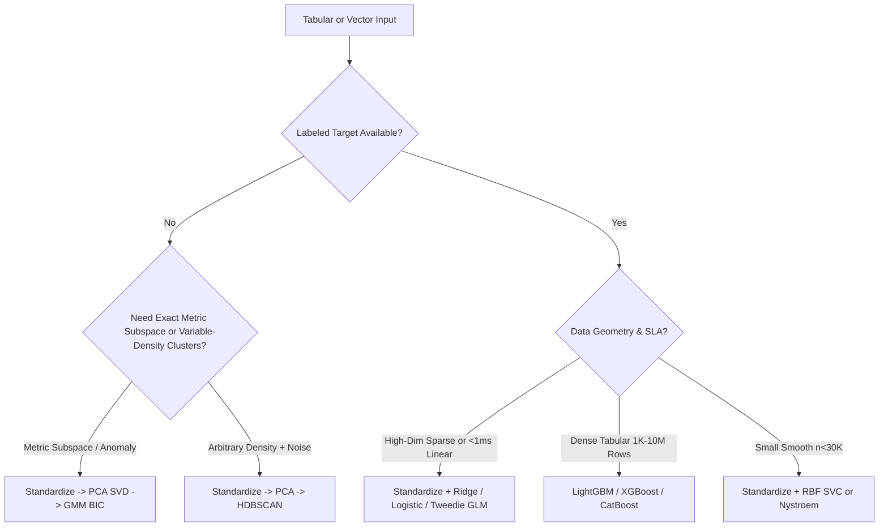
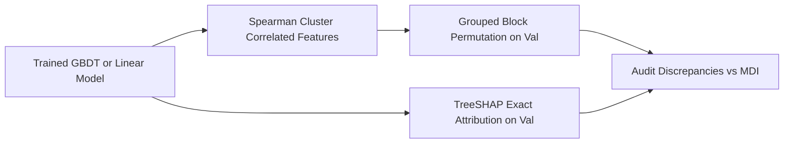

---
tags:
  - machine-learning
  - algorithms
  - gradient-boosting
  - linear-models
  - unsupervised-learning
created: 2026-01-04
updated: 2026-11-13
status: 🟢
level: mid-to-senior
---

# ML Algorithms Guide

> [!abstract] Scope
> First-principles algorithmic internals, optimization solvers, asymptotic complexity, structural traps, and production hyperparameter engineering across Generalized Linear Models (OLS/QR/SVD, IRLS, Poisson/Tweedie, Lasso subgradients), Kernel SVMs & Nystroem approximations, Tree Ensembles & Second-Order GBDTs (`XGBoost`, `LightGBM`, `CatBoost`), Unsupervised Density/Manifold methods (`K-Means++`, `GMM`, `HDBSCAN`, `PCA`, `UMAP`), and SHAP/Permutation Forensics.
> Navigation: [[Programming/Machine Learning/ML Hub|ML Hub]] · [[Programming/Machine Learning/ML Fundamentals Guide|ML Fundamentals Guide]] · [[Programming/Machine Learning/Deep Learning Guide|Deep Learning Guide]] · [[Programming/Machine Learning/ML Projects Guide|ML Projects Guide]] · [[Programming/Machine Learning/MLOps & Production ML Guide|MLOps & Production ML Guide]]

---

## 1. First-Principles Algorithmic Mechanics

### 1.1 Linear & Generalized Linear Models (GLMs)

#### OLS Closed-Form Normal Equation vs. QR / SVD Conditioning vs. Iterative Solvers

For design matrix $X \in \mathbb{R}^{n \times d}$ (including an intercept column) and target $y \in \mathbb{R}^n$, Ordinary Least Squares minimizes $\frac{1}{2}\|y - Xw\|_2^2$, yielding the Normal Equation:

$$\hat{w}_{\text{OLS}} = (X^T X)^{-1} X^T y$$

- **Computational Scaling Wall**: Materializing $X^T X$ costs $O(n d^2)$ operations and inverting the dense $d \times d$ Gram matrix costs $O(d^3)$. Above $d \approx 10^4$, explicit factorization exhausts memory and compute.
- **Numerical Ill-Conditioning ($\kappa^2$ Blowup)**: Let $X$ have singular values $\sigma_1 \ge \sigma_2 \ge \dots \ge \sigma_d > 0$ and condition number $\kappa(X) = \sigma_1 / \sigma_d$. Explicitly computing $X^T X = V \Sigma^2 V^T$ **squares the condition number**:

  $$\kappa(X^T X) = \left(\frac{\sigma_1}{\sigma_d}\right)^2 = \kappa(X)^2$$

  When collinear features give $\kappa(X) = 10^8$, $\kappa(X^T X) = 10^{16}$ exhausts all ~16 decimal digits of IEEE-754 `float64` mantissa precision, introducing catastrophic cancellation in $\hat{w}$.
- **Production Factorization Solvers**: `scipy.linalg.lstsq` and `sklearn.linear_model.LinearRegression` apply **Householder QR** ($X = Q R \implies R \hat{w} = Q^T y$) or **SVD** ($X = U \Sigma V^T \implies \hat{w} = V \Sigma^+ U^T y$) directly on $X$ in $O(n d^2)$ ($n \ge d$), maintaining sensitivity linear in $\kappa(X)$ and handling rank-deficient subspaces safely via singular value truncation.
- **Large-Scale Iterative Solvers ($n > 10^6$ or $d > 10^4$)**:
  - **SGD / SAGA**: Updates weights from single rows or mini-batches in $O(\text{nnz})$ sparse ops per iteration. SAGA stores a rolling average of per-sample gradients to eliminate stochastic gradient variance, yielding linear convergence on strongly convex $L_2$-regularized problems.
  - **L-BFGS (Limited-Memory BFGS)**: Quasi-Newton solver storing only the last $m \approx 10$ position/gradient displacement pairs $(s_k, y_k)$ in $O(m d)$ RAM to approximate the inverse Hessian action $H_k^{-1} \nabla \mathcal{L}$—achieving superlinear convergence on smooth convex GLMs without $O(d^2)$ matrix storage.

#### Logistic Regression, Softmax & Iteratively Reweighted Least Squares (IRLS)

Binary Logistic Regression models log-odds linearly:

$$\text{logit}(p_i) = \ln\left(\frac{p_i}{1 - p_i}\right) = w^T x_i + b, \qquad p_i = \sigma(w^T x_i + b) = \frac{1}{1 + e^{-(w^T x_i + b)}}$$

Each unit increase in $x_j$ multiplies predicted odds $\frac{p}{1 - p}$ by $e^{w_j}$. Minimizing negative log-likelihood produces the exact gradient and positive semidefinite Hessian:

$$\nabla_w \mathcal{L} = X^T (\hat{p} - y), \qquad H = X^T W X, \quad \text{where } W = \text{diag}\big(\hat{p}_i(1 - \hat{p}_i)\big)$$

Applying Newton-Raphson updates $w^{(t+1)} = w^{(t)} - H^{-1}\nabla_w \mathcal{L}$ reduces algebraically to **Iteratively Reweighted Least Squares (IRLS)**:

$$w^{(t+1)} = (X^T W X)^{-1} X^T W z_{\text{work}}, \qquad z_{\text{work}} = X w^{(t)} + W^{-1}(y - \hat{p})$$

Each IRLS step solves a weighted linear regression problem against the linearized working response $z_{\text{work}}$. Because $H \succeq 0$ (and $H + \lambda I \succ 0$ under $L_2$ penalty), Newton/IRLS converges in 5–15 quadratic iterations on moderate $d$, whereas L-BFGS replaces explicit $(X^T W X)^{-1}$ inversion when $d$ is large.

- **Linear Separability Divergence**: On linearly separable data, unregularized MLE drives $\|w\|_2 \to \infty$ so $\sigma(w^T x_i) \to 1$ or $0$, exploding predictions and overflowing floats. That is why `LogisticRegression` enforces $L_2$ penalty (`C=1.0`) by default.
- **Multinomial Softmax Shift Stability**: For $K$ classes with logits $z_k = w_k^T x + b_k$, always subtract $m = \max_j z_j$ before exponentiation to prevent `float64` overflow above $z_k \approx 709$:

  $$P(Y = k \mid x) = \frac{\exp(z_k - m)}{\sum_{j=1}^K \exp(z_j - m)}$$

#### Exponential Family & GLM Link Functions (Poisson, Gamma, Tweedie)

Standard OLS assumes homoscedastic Gaussian noise around conditional mean $\mu = w^T x$. Real-world count, duration, and revenue targets violate Gaussian assumptions (nonnegative domains, skewed tails, variance scaling with mean). **Generalized Linear Models (GLMs)** model distributions in the **exponential dispersion family**:

$$p(y \mid \theta, \phi) = \exp\left(\frac{y\theta - b(\theta)}{a(\phi)} + c(y, \phi)\right), \qquad \mu = \mathbb{E}[Y] = b'(\theta), \qquad \text{Var}(Y) = a(\phi) b''(\theta) = \phi V(\mu)$$

A strictly monotonic **link function** $g(\mu) = w^T x$ maps mean $\mu$ to unconstrained linear predictors. For positive targets, the log-link ($\mu = \exp(w^T x)$) guarantees strictly positive predictions and multiplicative feature semantics:

| GLM Family | Power $p$ ($V(\mu) = \mu^p$) | Canonical / Standard Link | Target Domain & Physical Semantics | Production Use Case |
| :--- | :--- | :--- | :--- | :--- |
| **Gaussian (OLS)** | $p = 0$ ($V(\mu) = 1$) | Identity: $\mu = \eta$ | $y \in \mathbb{R}$, symmetric homoscedastic noise | Continuous physical sensors, normalized residuals |
| **Poisson** | $p = 1$ ($V(\mu) = \mu$) | Log: $\ln(\mu) = \eta + \ln(\text{exposure})$ | Nonnegative integer counts $y \in \{0, 1, 2, \dots\}$ | Ad clicks, incident counts, ER arrivals per shift (use **offset** $\ln(\text{exposure})$ for varying rates) |
| **Gamma** | $p = 2$ ($V(\mu) = \mu^2$) | Log: $\ln(\mu) = \eta$ | Strictly positive right-skewed continuous ($y > 0$) | Claim severity given claim occurred, server tail latency, transaction value |
| **Tweedie** | **$p \in (1, 2)$** ($V(\mu) = \mu^p$) | Log: $\ln(\mu) = \eta$ | **Point mass at $y = 0$ + continuous positive tail ($y \ge 0$)** | **Insurance pure premium, customer LTV, hourly SKU sales** (models compound Poisson-Gamma arrival $\times$ size jointly!) |

Using MSE on Tweedie-distributed customer spend (90% zeros, 10% heavy-tailed spenders) places massive variance leverage on extreme spenders and predicts negative revenue for low-risk cohorts. `TweedieRegressor(power=1.5, link="log")` (and LightGBM/XGBoost `objective="tweedie"`) minimizes exact Tweedie deviance $D(y, \mu) = 2\left(\frac{\max(y, 0)^{2-p}}{(1-p)(2-p)} - \frac{y \mu^{1-p}}{1-p} + \frac{\mu^{2-p}}{2-p}\right)$, preserving nonnegativity and correctly weighting heteroscedastic variance.

**GLM Exposure Offsets & Overdispersion Diagnostics**:
- **Modeling Rates via Log-Exposure Offsets**: When modeling event counts $y_i$ accumulated over varying exposure durations $E_i$ (e.g., policy-years, page impressions, server hours), do not regress rate $y_i / E_i$ directly under OLS (which breaks variance scaling). Model raw count $y_i$ under Poisson/Tweedie log-link with a fixed coefficient-1 offset term:
  $$\ln \mathbb{E}[Y_i \mid x_i, E_i] = w^T x_i + \ln(E_i) \implies \mathbb{E}\left[\frac{Y_i}{E_i} \,\middle|\, x_i\right] = \exp(w^T x_i)$$
  In `XGBoost` / `LightGBM`, pass `base_margin = np.log(exposure)` (or `init_score`) during both training and serving.
- **Overdispersion Check ($\hat{\phi} > 1$)**: Pure Poisson enforces $\text{Var}(Y_i) = \mu_i$ ($\phi = 1$). Compute Pearson dispersion statistic $\hat{\phi} = \frac{1}{n - d}\sum_{i=1}^n \frac{(y_i - \hat{\mu}_i)^2}{V(\hat{\mu}_i)}$ on validation residuals. Whenever $\hat{\phi} > 2.0$, observed variance exceeds Poisson assumptions (e.g., unmeasured heterogeneity), underestimating standard errors and over-fitting sparse spikes; escalate to **Negative Binomial** ($\text{Var}(Y) = \mu + \alpha \mu^2$) or **Tweedie** / Quasi-Poisson dispersion weighting.

#### Multicollinearity, VIF & Regularization Subgradients (Ridge, Lasso, ElasticNet)

When predictor $X_j$ is well explained by linear regression on remaining predictors $X_{-j}$ with determination coefficient $R_j^2 \to 1$, $(X^T X)^{-1}$ blows up proportionally to the **Variance Inflation Factor**:

$$\text{VIF}_j = \frac{1}{1 - R_j^2}, \qquad \text{Var}(\hat{w}_j) = \frac{\sigma_\epsilon^2}{(n - 1)\,\text{Var}(X_j)} \cdot \text{VIF}_j$$

At $\text{VIF}_j > 10$, correlated coefficients swing violently with opposite signs across minor sample perturbations without affecting training loss.

**Lasso Subgradient Optimality & Coordinate Descent**:
Minimizing $\frac{1}{2n}\|y - Xw\|_2^2 + \lambda \|w\|_1$ is convex but non-differentiable where $w_j = 0$. The subdifferential of $\lvert w_j \rvert$ is $\text{sign}(w_j)$ for $w_j \ne 0$ and $[-1, +1]$ at $w_j = 0$. Optimizing coordinate $w_j$ while holding $w_{-j}$ fixed yields the exact **soft-thresholding operator** $S(\rho_j, n\lambda)$:

$$\rho_j = \sum_{i=1}^n x_{ij}\left(y_i - \sum_{k \ne j} x_{ik} w_k\right), \qquad w_j^* = \frac{\text{sign}(\rho_j) \max\big(\lvert \rho_j \rvert - n\lambda, \; 0\big)}{\sum_{i=1}^n x_{ij}^2}$$

Whenever partial correlation $\lvert \rho_j \rvert \le n\lambda$, $w_j^*$ snaps to **exact zero**. However, Lasso exhibits two fundamental limitations: (1) when $d > n$, Lasso can select at most $n$ nonzero variables; (2) given two strongly correlated predictive variables ($x_1 \approx x_2$), the $L_1$ objective lacks strict convexity along $w_1 + w_2 = c$, causing coordinate descent to pick one variable arbitrarily. **ElasticNet** ($\lambda \rho \|w\|_1 + \frac{\lambda(1-\rho)}{2}\|w\|_2^2$) restores strict convexity whenever $\rho < 1$, inducing sparsity alongside the **grouping effect** ($\lvert \hat{w}_j - \hat{w}_k \rvert \propto \sqrt{2(1 - \text{corr}(x_j, x_k))}$).

| Method | Penalty $\Omega(w)$ | Bayesian MAP Prior | Constraint Geometry | Collinearity & Feature Selection Behavior |
| :--- | :--- | :--- | :--- | :--- |
| **Ridge ($L_2$)** | $\frac{\lambda}{2}\lVert w \rVert_2^2$ | Gaussian $\mathcal{N}(0, \tau^2)$ | Smooth hypersphere | Closed-form $(X^T X + \lambda I)^{-1}X^T y$ always invertible ($d > n$ safe); splits weight equally across correlated pairs; dense weights |
| **Lasso ($L_1$)** | $\lambda \lVert w \rVert_1$ | Laplace $(0, b)$ | Cross-polytope (axis vertices) | Coordinate descent soft-thresholding; **exact sparsity**; **unstable under collinearity**, saturates at $\le n$ features |
| **ElasticNet** | $\lambda\big(\rho \lVert w \rVert_1 + \frac{1-\rho}{2}\lVert w \rVert_2^2\big)$ | Gaussian + Laplace mixture | Rounded diamond ($\rho < 1$ strictly convex) | Exact sparsity + **grouping effect** (retains correlated predictive blocks stably) |

---

### 1.2 Support Vector Machines, Kernels & High-Scale Approximations

#### Primal Optimization, Lagrangian Dual & KKT Complementary Slackness

Soft-margin SVM maximizes geometric margin $\frac{2}{\|w\|_2}$ subject to slack penalties $\xi_i \ge 0$ for $y_i \in \{-1, +1\}$:

$$\min_{w, b, \xi} \; \frac{1}{2}\|w\|_2^2 + C \sum_{i=1}^n \xi_i \quad \text{s.t.} \quad y_i(w^T \phi(x_i) + b) \ge 1 - \xi_i, \;\; \xi_i \ge 0$$

Introducing dual Lagrange multipliers $\alpha_i \ge 0$ (margin constraints) and $\mu_i \ge 0$ (slack nonnegativity), setting primal derivatives wrt $(w, b, \xi)$ to zero yields $w = \sum_{i=1}^n \alpha_i y_i \phi(x_i)$, $\sum_{i=1}^n \alpha_i y_i = 0$, and $C - \alpha_i - \mu_i = 0$. Substituting back yields the **Wolfe Dual Quadratic Program**:

$$\max_{\alpha} \; \sum_{i=1}^n \alpha_i - \frac{1}{2}\sum_{i=1}^n \sum_{j=1}^n \alpha_i \alpha_j y_i y_j K(x_i, x_j) \quad \text{s.t.} \quad 0 \le \alpha_i \le C, \;\; \sum_{i=1}^n \alpha_i y_i = 0$$

By **KKT Complementary Slackness** ($\alpha_i [y_i f(x_i) - 1 + \xi_i] = 0$ and $\mu_i \xi_i = (C - \alpha_i)\xi_i = 0$), every training observation falls into one of three regimes:
- **$\alpha_i = 0$**: $y_i f(x_i) \ge 1, \; \xi_i = 0$. Correctly classified outside margin; exerts **zero** influence on $w$ or predictions.
- **$0 < \alpha_i < C$**: $\mu_i > 0 \implies \xi_i = 0$ and $y_i f(x_i) = 1$. **Free support vectors** lying directly on the canonical margin hyperplanes (used to solve intercept $b = y_k - \sum_i \alpha_i y_i K(x_i, x_k)$).
- **$\alpha_i = C$**: $y_i f(x_i) = 1 - \xi_i \le 1$. **Bounded support vectors** violating or inside the margin.

#### Mercer's Condition, Kernel Trick & Scaling Approximations

Any symmetric function $K(x, z)$ whose Gram matrix $K_{ij} = K(x_i, x_j)$ is positive semidefinite ($c^T K c \ge 0$ for all finite point sets—**Mercer's condition**) guarantees existence of a Reproducing Kernel Hilbert Space (RKHS) mapping $\phi$ with $K(x, z) = \langle \phi(x), \phi(z) \rangle$ and strictly concave dual maximization.
- **RBF (Gaussian) Kernel**: $K(x_i, x_j) = \exp(-\gamma \|x_i - x_j\|_2^2)$ implicitly maps inputs into an infinite-dimensional polynomial Taylor expansion.
  - Large $C$: harsh slack penalty $\implies$ narrow margin, low bias, high variance.
  - Large $\gamma$: narrow locality radius $\implies$ decision surface wraps tight isolated islands around training support vectors (extreme overfitting).
- **The $O(n^2\text{–}n^3)$ Scaling Wall ($n > 50{,}000$)**: Materializing and solving the dense $n \times n$ kernel Gram matrix scales $O(n^2 d \text{ to } n^3)$ in compute and $O(n^2)$ in memory ($100\text{k}$ rows $\times 8\text{ bytes} = 80\text{ GB}$). Above $n \approx 50\text{k}$, replace `SVC(kernel="rbf")` with:
  1. **`LinearSVC`**: Solves the $L_2$-regularized hinge dual via coordinate descent in $O(n d)$ without kernel matrices.
  2. **`Nystroem` Approximation**: Samples $m \ll n$ landmark points (e.g., $m = 500$), computes $K_{nm} \in \mathbb{R}^{n \times m}$ and pseudoinverse square root $K_{mm}^{-1/2}$, projecting inputs explicitly into $\mathbb{R}^m$ via $Z = K_{nm} K_{mm}^{-1/2}$ so $Z Z^T \approx K$ (best low-rank spectral Nystroem match to exact kernel!). Complexity drops from $O(n^3)$ to **$O(n m d + n m^2)$**.
  3. **`RBFSampler` (Random Fourier Features)**: Invokes **Bochner's Theorem**—the Fourier transform of shift-invariant RBF kernel is Gaussian $\mathcal{N}(0, 2\gamma I)$—sampling $m$ random cosine projections $z_j(x) = \sqrt{2/m}\cos(\omega_j^T x + b_j)$ in $O(m d)$ without storing training landmarks. Pair `Nystroem` or `RBFSampler` with `SGDClassifier` / `LogisticRegression` for streaming kernel-like nonlinearity at linear scale.

#### Kernel Bandwidth Selection & $\epsilon$-Insensitive SVR

- **Why Unscaled Features Break `gamma="scale"`**: `sklearn.svm.SVC` defaults to `gamma="scale"`, computing $\gamma = \frac{1}{d \cdot \text{Var}(X)}$ across the *flattened* feature matrix! If one feature spans $[0, 10^6]$ while nine span $[0, 1]$, $\text{Var}(X)$ blows up, shrinking $\gamma \to 0$ and collapsing the RBF kernel to a flat constant. Always wrap `SVC`/`SVR` in `StandardScaler()`. Alternatively, the **median heuristic** sets $\gamma = \frac{1}{\text{median}_{i < j}(\|x_i - x_j\|_2^2)}$ so pairwise kernel similarities span $[e^{-2}, 1]$ smoothly without gradient vanishing.
- **$\epsilon$-Support Vector Regression (`SVR`)**: Penalizes only prediction deviations exceeding a dead-zone tube $\lvert y_i - f(x_i) \rvert > \epsilon$ using $\ell_\epsilon(r) = \max(0, \lvert r \rvert - \epsilon)$, maintaining dual sparsity because points inside the $\epsilon$-tube receive $\alpha_i = \alpha_i^* = 0$. Like SVC, `SVR` inherits $O(n^2\text{–}n^3)$ Gram matrix bottlenecks above $n \approx 30\text{k}$.

#### Curse of Dimensionality, $k$-NN & Approximate Nearest Neighbors

As dimension $d \to \infty$, Euclidean distances concentrate inside a thin hyperspherical shell: $\lim_{d \to \infty} \frac{d_{\max} - d_{\min}}{d_{\min}} \to 0$. Exact spatial trees (`KDTree`, `BallTree`) degenerate to $O(n d)$ brute-force scan past $d > 20$. At million-to-billion vector scale, production retrieval replaces exact $k$-NN with **HNSW (Hierarchical Navigable Small World)** multi-layer proximity skip-lists achieving **$O(\log n)$ query latency** at $95\text{–}99\%$ recall, or **IVF-PQ (Inverted File + Product Quantization)** compressing sub-vectors into byte codes for SIMD distance lookup.

---

### 1.3 Decision Trees, Random Forests & Second-Order Gradient Boosting (GBDT)

#### CART Splitting Mechanics & Structural Pathologies

Classification and Regression Trees partition $\mathbb{R}^d$ recursively via axis-aligned splits $x_j \le t$ maximizing impurity reduction $\Delta I = I(P) - \frac{n_L}{n} I(L) - \frac{n_R}{n} I(R)$:
- **Gini Impurity** (default in `scikit-learn`): $G(S) = 1 - \sum_{k=1}^K p_k^2$ ($O(K)$ arithmetic without $\log$).
- **Shannon Entropy**: $H(S) = -\sum_{k=1}^K p_k \log_2 p_k$ (penalizes slightly skewed mixed leaves more strongly; tree topology differs in $<2\%$ of splits).
- **Regression Variance Reduction**: minimizes $\sum_{i \in L}(y_i - \bar{y}_L)^2 + \sum_{i \in R}(y_i - \bar{y}_R)^2$.

**Two Critical Tree Properties**:
1. **Monotonic Transformation Invariance**: Split criteria depend solely on rank order. Standardizing, `np.log1p`, or Box-Cox transforms on features leave tree partitions invariant.
2. **Zero Extrapolation Pathology**: Predictions inside every terminal region equal constant leaf averages of training labels. If test inputs fall outside historical training ranges (e.g., inflation-adjusted house prices or upward trend time series), tree predictions clamp flatly at boundary leaf averages. *Fix*: fit a linear/trend model $f_{\text{lin}}(x)$ first and train the GBDT strictly on residuals $y - f_{\text{lin}}(x)$.

#### Random Forests: Decorrelation Variance Reduction & OOB Limits

For $B$ identically distributed trees with variance $\sigma^2$ and pairwise correlation $\rho \in [0, 1]$:

$$\text{Var}\left(\frac{1}{B}\sum_{b=1}^B T_b(x)\right) = \rho \sigma^2 + \frac{1 - \rho}{B}\sigma^2$$

Pure row bagging drives $\frac{1 - \rho}{B}\sigma^2 \to 0$ as $B \to \infty$, hitting an irreducible floor $\rho \sigma^2$ because dominant features force identical top splits. Random Forest samples `max_features` ($m \approx \sqrt{d}$ classification, $m \approx d/3$ regression) randomly at *every node*, reducing $\rho$. **Out-of-Bag (OOB)** scoring evaluates row $i$ across the $(1 - 1/n)^n \approx 36.8\%$ of trees excluding row $i$—unbiased **only under i.i.d. data**, severely leaky under grouped or time-series rows.

#### GBDT Second-Order Newton-Raphson Split Gain Derivation

Gradient Boosting builds an additive ensemble $\hat{y}_i^{(t)} = \hat{y}_i^{(t-1)} + \eta f_t(x_i)$. Expanding step-$t$ regularized objective via second-order Taylor series around $\hat{y}_i^{(t-1)}$ with first derivative $g_i = \partial_{\hat{y}} \ell(y_i, \hat{y}_i^{(t-1)})$ and second derivative $h_i = \partial_{\hat{y}}^2 \ell(y_i, \hat{y}_i^{(t-1)})$:

$$\mathcal{L}^{(t)} \approx \sum_{i=1}^n \left[ g_i f_t(x_i) + \frac{1}{2} h_i f_t(x_i)^2 \right] + \gamma T + \frac{1}{2}\lambda \sum_{j=1}^T w_j^2 + \alpha \sum_{j=1}^T \lvert w_j \rvert$$

Grouping instances assigned to leaf $j$ as $I_j = \{i \mid q(x_i) = j\}$ with $G_j = \sum_{i \in I_j} g_i$ and $H_j = \sum_{i \in I_j} h_i$:

$$\mathcal{L}^{(t)} = \sum_{j=1}^T \left[ G_j w_j + \frac{1}{2}(H_j + \lambda) w_j^2 + \alpha \lvert w_j \rvert \right] + \gamma T$$

For $\alpha = 0$ (pure $L_2$ leaf regularization; with $\alpha > 0$, numerator applies soft-thresholding $T_\alpha(G_j) = \text{sign}(G_j)\max(\lvert G_j \rvert - \alpha, 0)$), setting $\frac{\partial \mathcal{L}^{(t)}}{\partial w_j} = 0$ yields the **exact Newton leaf weight** and minimum leaf objective:

$$w_j^* = -\frac{G_j}{H_j + \lambda}, \qquad \mathcal{L}^{(t)*} = -\frac{1}{2}\sum_{j=1}^T \frac{G_j^2}{H_j + \lambda} + \gamma T$$

Evaluating a candidate split partitioning a parent node into Left ($L$) and Right ($R$) yields exact **Split Gain**:

$$\text{Gain} = \frac{1}{2}\left[\frac{G_L^2}{H_L + \lambda} + \frac{G_R^2}{H_R + \lambda} - \frac{(G_L + G_R)^2}{H_L + H_R + \lambda}\right] - \gamma$$

Additionally, **`min_child_weight`** blocks any split where $H_L < \text{min\_child\_weight}$ or $H_R < \text{min\_child\_weight}$. Under binary log-loss ($h_i = p_i(1-p_i)$), confident samples ($p_i = 0.01 \implies h_i \approx 0.01$) carry $25\times$ less curvature than uncertain samples ($p_i = 0.5 \implies h_i = 0.25$), dynamically requiring larger sample counts inside confident tails.


#### XGBoost vs. LightGBM vs. CatBoost Internals

1. **XGBoost (`tree_method="hist"`)**:
   - **Weighted Quantile Sketch**: Bins continuous features into $B$ histogram buckets weighted by Hessian curvature $h_i$ rather than uniform sample density, placing finer split resolution where prediction curvature is highest.
   - **Sparsity-Aware Default Branching**: Missing/zero entries are skipped during main split scans; at each threshold candidate, XGBoost tests routing *all* missing rows left vs. right and hard-codes the higher-Gain direction (`default_left`).
2. **LightGBM**:
   - **Histogram Subtraction**: Computes only the smaller child histogram and recovers the sibling via $H_{\text{right}} = H_{\text{parent}} - H_{\text{left}}$, halving split cost.
   - **Leaf-Wise (Best-First) Growth & `num_leaves` Trap**: Expands whichever leaf globally yields maximum $\text{Gain}$ rather than filling full depth layers. Achieves lower training loss with fewer nodes, **but if `max_depth=-1` and `num_leaves` is high (e.g., 128)**, leaf-wise growth constructs asymmetric 30-level paths memorizing isolated outlier pockets. Always constrain **`num_leaves < 2^{max_depth}`** (e.g., `max_depth=6` $\implies$ `num_leaves=31`) alongside `min_child_samples`.
   - **GOSS (Gradient-Based One-Side Sampling)**: Keeps top $a\%$ rows with largest $\lvert g_i \rvert$ (high residual error) and uniformly samples $b\%$ of remaining low-gradient rows, scaling sampled low-gradient instances by $\frac{1-a}{b}$ so total gradient expectation stays unbiased.
   - **EFB (Exclusive Feature Bundling)**: Uses greedy graph coloring to merge mutually exclusive sparse indicators into single dense histogram columns with non-overlapping bin offsets.
   - **Native Categorical Fisher Optimal Splits**: Finding optimal binary partition among $k$ unordered categories exhaustively checks $2^{k-1} - 1$ subsets. Fisher's theorem proves that for squared/Taylor objective $\sum G_j^2 / (H_j + \lambda)$, sorting the $k$ categories by smoothed gradient ratio $\frac{\sum_{i \in c} g_i}{\sum_{i \in c} h_i + \lambda_{\text{cat}}}$ and scanning only the $k - 1$ contiguous prefix thresholds finds the **globally optimal subset partition in $O(k \log k)$**!
3. **CatBoost**:
   - **Prediction Shift Leakage & Ordered Target Statistics / Ordered Boosting**: Standard GBDTs compute gradients $g_i$ and build splits using the *same* training examples, introducing target correlation bias (prediction shift). CatBoost generates random permutations $\sigma$ of training rows and computes online smoothed target statistics and residuals for row $\sigma_k$ strictly from preceding prefix rows $\{\sigma_1, \dots, \sigma_{k-1}\}$.
   - **Oblivious (Symmetric) Decision Trees**: Enforces identical `(feature, threshold)` splits across every node at depth $d$. A depth-$D$ oblivious tree maps every feature vector to a $D$-bit boolean index into a contiguous $2^D$-element leaf table—delivering **branchless SIMD inference ($O(D)$ bit shifts, $10\text{–}30\times$ lower CPU p99 latency)** while structurally regularizing against outlier paths.

#### ExtraTrees vs. Random Forest & Fisher Categorical Split Mechanics

- **Extremely Randomized Trees (`ExtraTreesClassifier`)**: Rather than scanning all sorted cutpoints $t$ per candidate feature inside each node, ExtraTrees draws random cutpoints uniformly between $[\min(x_j), \max(x_j)]$ across the $m$ sampled features and picks the best among those $m$ random thresholds (often trained with `bootstrap=False`). By randomizing split thresholds alongside features, pairwise tree correlation $\rho$ drops further and training speeds up $2\text{–}5\times$, trading slightly higher local bias for lower variance on noisy high-dimensional continuous features.
- **Concrete Fisher $O(k \log k)$ Categorical Split Walkthrough**: Suppose categorical `region` has $k = 4$ levels (`NA`, `EU`, `APAC`, `LATAM`) at a node with $\lambda_{\text{cat}} = 1.0$:
  1. Accumulate $(G_c, H_c)$ per category and compute smoothed score $s_c = \frac{G_c}{H_c + \lambda_{\text{cat}}}$ (e.g., `NA`: $-0.9$, `EU`: $-0.2$, `APAC`: $+0.4$, `LATAM`: $+1.1$).
  2. Sort categories strictly by $s_c$: `["NA", "EU", "APAC", "LATAM"]`.
  3. Test only the $k - 1 = 3$ prefix partitions (`{NA} | {EU,APAC,LATAM}`, `{NA,EU} | {APAC,LATAM}`, `{NA,EU,APAC} | {LATAM}`) via exact Newton Gain—bypassing the $2^{4-1} - 1 = 7$ exponential subset search while still guaranteeing the globally optimal split! On $k = 50$ categories, Fisher sorting reduces subset evaluations from $5.6 \times 10^{14}$ down to just **$49$ linear scans**.

---

### 1.4 Unsupervised Learning, Density Clustering & Manifold Projection

#### K-Means++ Initialization, EM Convergence & Cluster Validity

K-Means minimizes within-cluster squared Euclidean inertia (WCSS): $\min_{\{C_k, \mu_k\}} \sum_{k=1}^K \sum_{x_i \in C_k} \|x_i - \mu_k\|_2^2$. Lloyd's algorithm alternates **Assignment** ($x_i \to \arg\min_k \|x_i - \mu_k\|_2^2$) and **Centroid Update** ($\mu_k = \frac{1}{\lvert C_k \rvert}\sum_{x_i \in C_k} x_i$)—monotonically decreasing bounded inertia until stationary local convergence.
- **K-Means++ Seeding**: Uniform random centroid seeding traps Lloyd's algorithm in poor local minima. K-Means++ draws the first centroid uniformly, then selects each subsequent centroid $k$ with probability proportional to squared distance $D(x_i)^2$ from its nearest already-chosen centroid, guaranteeing $O(\log K)$-competitive expected inertia in $O(n K d)$ setup time.
- **Validation Indices**:
  - **Silhouette Score**: $s(i) = \frac{b(i) - a(i)}{\max(a(i), b(i))} \in [-1, 1]$, comparing mean intra-cluster distance $a(i)$ to nearest-neighbor cluster distance $b(i)$. High values favor compact, well-separated convex clusters.
  - **Davies-Bouldin Index**: $\frac{1}{K}\sum_{i=1}^K \max_{j \ne i} \frac{s_i + s_j}{d(\mu_i, \mu_j)}$ (lower is better), measuring within-cluster scatter relative to centroid separation.
  - **Structural Failure**: Assumes isotropic spherical equal-variance clusters; fails on concentric rings, elongated ellipses, variable densities, and outlier points (forcing every outlier into a centroid).

#### DBSCAN vs. HDBSCAN Density Clustering

- **DBSCAN**: Defines points as *core* if $\ge \text{min\_samples}$ neighbors lie within fixed Euclidean radius $\varepsilon$, chaining density-reachable core neighborhoods into arbitrary non-convex shapes and flagging remaining sparse points as noise (`-1`). Fails whenever clusters exhibit **different local densities** because global $\varepsilon$ either merges dense clusters or shatters sparse clusters into noise.
- **HDBSCAN (Hierarchical DBSCAN)**: Eliminates fixed $\varepsilon$ via four steps:
  1. Compute core distance $\text{core}_k(x)$ to the $k$-th nearest neighbor (`min_samples`).
  2. Define **Mutual Reachability Distance**:

     $$d_{\text{mreach}}(a, b) = \max\big(\text{core}_k(a), \; \text{core}_k(b), \; d(a, b)\big)$$

     Sparse points push neighbors outward, isolating noise cleanly without distorting dense cores.
  3. Build the Minimum Spanning Tree (Prim's algorithm) over $d_{\text{mreach}}$ and convert into a cluster hierarchy dendrogram across density thresholds $\lambda = 1 / d_{\text{mreach}}$.
  4. Condense tree splits below `min_cluster_size` and select clusters maximizing **Excess of Mass (EOM) persistence stability** $\sum_{x \in C} (\lambda_x - \lambda_{\text{birth}})$ (`cluster_selection_method="eom"`, or `"leaf"` for fine-grained sub-clusters). Built natively into `sklearn.cluster.HDBSCAN`.

#### Gaussian Mixture Models (GMM) & BIC Model Selection

GMM models data via soft probabilistic mixture $p(x_i) = \sum_{k=1}^K \pi_k \mathcal{N}(x_i \mid \mu_k, \Sigma_k)$ optimized via **Expectation-Maximization (EM)**:
- **E-Step (Soft Responsibilities)**:

  $$\gamma_{ik} = \frac{\pi_k \mathcal{N}(x_i \mid \mu_k, \Sigma_k)}{\sum_{j=1}^K \pi_j \mathcal{N}(x_i \mid \mu_j, \Sigma_j)}$$

- **M-Step (Weighted Parameter Updates)**:

  $$N_k = \sum_{i=1}^n \gamma_{ik}, \quad \pi_k = \frac{N_k}{n}, \quad \mu_k = \frac{1}{N_k}\sum_{i=1}^n \gamma_{ik} x_i, \quad \Sigma_k = \frac{1}{N_k}\sum_{i=1}^n \gamma_{ik}(x_i - \mu_k)(x_i - \mu_k)^T + \epsilon_{\text{reg}} I$$

Adding `reg_covar` ($\epsilon_{\text{reg}} I$) prevents log-likelihood divergence toward $+\infty$ if a component collapses onto a single point ($\det(\Sigma_k) \to 0$). Choose $K$ and `covariance_type` (`full`, `tied`, `diag`, `spherical`) by minimizing **Bayesian Information Criterion**: $\text{BIC} = -2 \ln \hat{L} + p \ln n$, where $p$ counts free mixture parameters ($K \cdot d(d+1)/2$ covariance entries for `full` vs. $K \cdot d$ for `diag`).

#### PCA via SVD vs. t-SNE vs. UMAP (Riemannian Fuzzy Simplicial Sets)

- **PCA via SVD**: Mean-center (and standardize when feature units differ!) $X \in \mathbb{R}^{n \times d}$ and factorize $X = U \Sigma V^T$. Right singular vectors $V$ equal eigenvectors of sample covariance $\frac{1}{n-1}X^T X = V \frac{\Sigma^2}{n-1} V^T$ with explained variance $\lambda_j = \frac{\sigma_j^2}{n-1}$. Deterministic, linear, preserves global Euclidean geometry, and supports exact out-of-sample `.transform(X_new)` projection.
- **t-SNE**: Maps high-$d$ distances into conditional Gaussian affinities $p_{j|i}$ calibrated to target **perplexity** (effective neighborhood entropy) and minimizes $\text{KL}(P \| Q)$ against low-$d$ **Student-$t$ ($\nu = 1$, Cauchy)** affinities $q_{ij} \propto (1 + \|z_i - z_j\|^2)^{-1}$ to prevent volume crowding in 2D. Scales $O(n^2)$ ($O(n \log n)$ Barnes-Hut), non-deterministic, **lacks `.transform()`**.
- **UMAP**: Models data on a local Riemannian manifold where each point $x_i$ normalizes distances using its nearest-neighbor offset $\rho_i$ and local scale $\sigma_i$ solving $\sum_j \exp\big(-\frac{\max(0, d(x_i, x_j) - \rho_i)}{\sigma_i}\big) = \log_2(\text{n\_neighbors})$. Symmetrizing directed fuzzy sets via probabilistic t-conorm ($p_{ij} = p_{j|i} + p_{i|j} - p_{j|i} p_{i|j}$) builds a weighted fuzzy simplicial complex, then optimizes low-dimensional cross-entropy via negative-sampling SGD (`min_dist`).

> [!danger] Why UMAP Distances Lie (Never Replace Features or Cluster UMAP Plots)
> Because UMAP rescales distances *independently around every point* via $(\rho_i, \sigma_i)$, local neighborhoods become artificially uniform in density across the entire manifold. Consequently, **visual cluster area, apparent point density, and inter-cluster distances in 2D UMAP/t-SNE embeddings are mathematical artifacts of `n_neighbors` and `min_dist`, NOT true metric geometry**. Never feed UMAP/t-SNE coordinates into K-Means, HDBSCAN, or anomaly detectors—cluster and score densities in standardized PCA or domain feature space instead.

---

## 2. Real-World Use Cases & Algorithm Selection Matrix



### Complete Algorithm Selection & Complexity Matrix

Notation: $n$ = samples, $d$ = features, $T$ = trees, $h$ = tree depth, $B$ = histogram bins, $m$ = Nystroem landmarks, $n_{sv}$ = support vectors.

| Algorithm | Train Complexity | Inference Latency | Native NaNs? | Scaling Req? | Best Production Regime | Interpretability | Primary Failure Mode |
| :--- | :--- | :--- | :--- | :--- | :--- | :--- | :--- |
| **Ridge / Lasso / Logistic / Tweedie** | $O(n d^2)$ (SVD) / $O(n d)$ (SAGA/L-BFGS) | $O(d)$ (sub-$\mu$s) | No | **Yes** | High-$d$ sparse text, zero-inflated LTV (`Tweedie`), baseline SLAs | **High** (weights / odds ratios) | Underfits nonlinear interactions; Lasso collinear instability |
| **CART Decision Tree** | $O(n d \log n)$ | $O(h)$ | Limited | No | Explainable business rules, fast prototypes | **High** (decision paths) | High variance; zero extrapolation outside training range |
| **Random Forest** | $O(T \cdot m_{\text{feat}} n \log n)$ | $O(T \cdot h)$ | Limited | No | Noisy low-tuning baselines | Medium (SHAP / permutation) | Slow high-$T$ inference, huge RAM footprint, no extrapolation |
| **XGBoost / LightGBM (`hist`)** | $O(T \cdot d B + T n)$ | $O(T \cdot h)$ | **Yes** (learned default) | No | Medium/large tabular ($10^3\text{–}10^7$ rows), ranking, quantiles | Medium (TreeSHAP $O(T L h^2)$) | Leaf-wise `num_leaves` overfitting; no extrapolation |
| **CatBoost** | $O(T \cdot n d)$ (ordered) | **$O(T \cdot D)$ SIMD branchless** | **Yes** | No | High-cardinality categoricals, **sub-2 ms p99 CPU serving** | Medium (TreeSHAP) | Slower training on dense float-only tables |
| **RBF SVM / Nystroem** | $O(n^2 d \text{–} n^3)$ / $O(n m^2)$ (Nystroem) | $O(n_{sv} d)$ / $O(m d)$ | No | **Yes** | Small smooth boundaries ($n < 30\text{k}$); `Nystroem` scales larger | Low | Exact SVM $O(n^2)$ RAM crash past $50\text{k}$ rows; uncalibrated margins |
| **$k$-NN / HNSW** | $O(1)$ / $O(n \log n)$ (HNSW) | $O(nd)$ / **$O(\log n)$ (HNSW)** | No | **Yes** | Dense embedding retrieval, cold-start matching | Medium (nearest neighbors) | Curse of dimensionality above $d \approx 20$ without normalization |
| **GMM / HDBSCAN** | $O(n K d^2)$ / $O(n^2)$ | $O(K d^2)$ / approx predict | No | **Yes** | Soft elliptical anomalies (`GMM + BIC`), arbitrary noisy density (`HDBSCAN`) | Low–Medium | GMM singular covariance without `reg_covar`; high-$d$ Euclidean decay |

### Concrete Scenario Decision Breakdown

1. **Real-Time RTB Ad-Bidding ($50\text{M}$ rows, 120 categorical/numeric features, $< 1.5\text{ ms}$ p99 CPU)**: Choose **`CatBoost` (depth 6 symmetric oblivious trees)** or **`SGDClassifier(loss="log_loss")` over hashed feature crosses**. CatBoost compiles each tree into a branchless 6-bit index lookup avoiding L1/L2 cache branch mispredictions; deep irregular LightGBM trees blow p99 latency budgets.
2. **Insurance Pure Premium / Zero-Inflated LTV ($2\text{M}$ policies, $92\%$ zero claims, $8\%$ heavy positive tail)**: Choose **`LightGBM` / `XGBoost` with `objective="tweedie"` ($p \approx 1.5$)** benchmarked against **`TweedieRegressor(power=1.5)`**. Avoid OLS/MSE (negative predictions + extreme claim leverage).
3. **Regulated Consumer Credit Underwriting ($100\text{k}$ rows, strict legal monotonicity)**: Choose **`XGBoost` / `LightGBM` / `HistGradientBoostingClassifier` with `monotone_constraints`** + disjoint Platt/Isotonic calibration + TreeSHAP adverse-action reason codes. Avoid unconstrained MLPs or uncalibrated SVMs.
4. **High-Dimensional Sparse Document Routing ($1\text{M}$ tickets, $200\text{k}$ TF-IDF features)**: Choose **`LogisticRegression` / `SGDClassifier` with $L_2$ penalty**. Linear solvers iterate strictly over nonzero entries ($O(\text{nnz})$), beating GBDTs in both speed and generalization in ultra-sparse linear spaces.
5. **Industrial Sensor Anomaly Detection ($500\text{k}$ rows, 18 telemetry sensors)**: Choose **`RobustScaler` $\to$ `PCA(0.95)` $\to$ `GaussianMixture` (BIC-selected $K$) or `HDBSCAN`**. Avoid clustering on 2D UMAP projections, which obliterate true density ratios and distance metrics.

---

## 3. Complete Reference: Hyperparameter Mechanics, Traps & Attribution Forensics

### Cross-Library GBDT Hyperparameter Mapping

| Control Mechanism | XGBoost (`hist`) | LightGBM | CatBoost | `sklearn` `HistGBDT` | Regularization Effect |
| :--- | :--- | :--- | :--- | :--- | :--- |
| **Step Shrinkage** | `learning_rate` ($\eta$) | `learning_rate` | `learning_rate` | `learning_rate` | Scales tree contribution; lower with `early_stopping` |
| **Tree Topology** | `max_depth` (depth-wise) | `num_leaves` ($< 2^{\text{max\_depth}}$) | `depth` (symmetric $2^D$ leaves) | `max_leaf_nodes`, `max_depth` | Primary structural complexity bound |
| **Min Curvature / Leaf Size** | `min_child_weight` ($\sum h_i$) | `min_child_samples` ($n_j$) + `min_child_weight` | `min_data_in_leaf` | `min_samples_leaf` | Blocks splits isolating noisy tiny pockets |
| **Split Pruning Floor** | `gamma` (`min_split_loss`) | `min_split_gain` | N/A (depth-fixed symmetric) | N/A | Minimum $\text{Gain}$ required to split node |
| **$L_2$ / $L_1$ Leaf Penalty** | `reg_lambda`, `reg_alpha` | `reg_lambda`, `reg_alpha` | `l2_leaf_reg` | `l2_regularization` | Shrinks $w_j^* = -G_j / (H_j + \lambda)$ |
| **Row & Col Subsampling** | `subsample`, `colsample_bytree` | `subsample` (`subsample_freq=1`), `colsample_bytree` | `subsample`, `rsm` | `max_features` | Variance reduction; note LightGBM requires `subsample_freq >= 1`! |
| **Monotonicity** | `monotone_constraints` | `monotone_constraints` | `monotone_constraints` | `monotonic_cst` | Enforces $\hat{f}(x_j + \Delta) \ge \hat{f}(x_j)$ globally |

### Monotonic Constraints, Early Stopping & Categorical Cardinality Traps

1. **Monotonic Constraints Mechanics**: Passing `+1` (non-decreasing) or `-1` (non-increasing) on feature $j$ constrains recursive tree growth: whenever a node splits on feature $j$, the algorithm tracks valid output bounds $[v_{\min}, v_{\max}]$ propagated down from ancestor splits on $j$, rejecting or clamping any child leaf weights violating $w_L^* \le w_R^*$ (for `+1`). This mathematically guarantees global monotonicity across the entire input space—essential for regulated credit risk (`debt_to_income`: `+1`, `credit_score`: `-1`) and dynamic pricing.
2. **Early Stopping & Refit Traps**:
   - Always pass an external validation fold via `eval_set=[(X_val, y_val)]` matching your CV topology (never random `validation_fraction=0.1` inside `HistGBDT` if data has groups or time order!).
   - LightGBM `subsample=0.8` is **silently ignored unless `subsample_freq=1`** (or `bagging_freq=1`) is explicitly set!
   - When refitting a tuned GBDT on combined `train + val` after finding `best_iteration_`, do NOT keep early stopping disabled with `n_estimators = best_iteration_` blindly—if dataset size grows by $25\%$ ($1 / 0.8$), scale iterations slightly ($\approx 1.1\text{–}1.2 \times \text{best\_iteration\_}$) OR average predictions across the $K$ CV fold models directly.
3. **Categorical Cardinality & Dtype Traps**:
   - Setting `enable_categorical=True` (XGBoost) or `categorical_feature` (LightGBM) with `pd.CategoricalDtype` binds integer codes strictly to the training `categories` index! If inference creates a fresh `pd.Series(...).astype("category")`, `"visa"` may encode as code `0` in training and code `2` at serving—causing silent catastrophic score corruption. Always serialize and enforce the exact `CategoricalDtype(categories=...)` vocabulary learned during training.
   - High-cardinality native categorical splits in LightGBM (`max_bin_by_feature`) can still overfit rare categories unless `cat_smooth` ($\ge 10$) and `min_data_per_group` ($\ge 50$) regularize Fisher split sorting.

### Feature Attribution Forensics & The Permutation Importance Collinearity Trap

| Attribution Method | Exact Mechanics | Major Failure Mode / Bias | Safe Engineering Practice |
| :--- | :--- | :--- | :--- |
| **MDI (Tree Gain / Impurity)** | Sums split impurity/gain reductions across all nodes using feature $j$ | **Biased toward high-cardinality continuous and random ID features** (more split candidates); computed strictly *in-sample* | Never use MDI alone for feature pruning or stakeholder explanations |
| **Permutation Importance** | Shuffles column $j$ across validation rows and measures metric drop ($\Delta \text{PR-AUC}$) | **Collinearity Splitting & OOD Trap**: when $X_1, X_2$ have $\rho = 0.96$, permuting $X_1$ drops score near zero because trees pivot onto $X_2$—AND creates impossible $(X_1^{\text{shuf}}, X_2^{\text{orig}})$ out-of-manifold samples! | Cluster correlated features via Spearman/hierarchical clustering and **permute entire correlated blocks together** |
| **TreeSHAP (`shap.TreeExplainer`)** | Exact polynomial-time ($O(T L D^2)$) game-theoretic Shapley credit allocation across tree paths | Tree-path interventional vs observational background choice splits collinear attribution between correlated proxies (still exposes total combined effect) | Inspect **SHAP summary + waterfall + interaction values ($\phi_{i,j}$)** on validation splits |



**Why Single-Column Permutation Importance Underreports Collinear Drivers**:
Suppose `annual_income` and `monthly_income` correlate at $\rho = 0.99$. A tree ensemble splits roughly half its paths on `annual_income` and half on `monthly_income`—or relies mostly on `monthly_income` if `annual_income` came slightly later in column tie-breaking. When standard `permutation_importance` shuffles `annual_income` while holding `monthly_income` frozen, two failures occur simultaneously:
1. **Substitutive Fallback**: The model compensates via unshuffled `monthly_income`, collapsing measured metric drop near zero and falsely declaring `annual_income` unimportant.
2. **Impossible Off-Manifold Combinations**: Shuffling pairs `annual_income = $250,000` with `monthly_income = $2,000`, evaluating trees inside empty regions never observed during training. Grouping correlated columns via hierarchical Ward linkage (`corr_threshold = 0.85`) and permuting clusters jointly restores exact group impact, while TreeSHAP reveals additive individual contributions and interaction terms $\phi_{i,j}$.

---

## 4. Step-by-Step Practical Application: Multi-Family Tuning, Monotonic GBDT & Forensics

Below is a production-grade comparison, Optuna tuning, SHAP/collinearity forensics, and unsupervised benchmarking suite. The final script (`run_sklearn_smoke.py`) runs directly against standard `numpy`/`scipy`/`scikit-learn` so every algorithmic invariant is immediately executable.

```text
ml_benchmark/
├── glm_and_kernel_baselines.py    # Tweedie GLM, ElasticNetCV, Nystroem + SGDClassifier
├── gbdt_optuna_trainer.py         # Optuna CV across LightGBM, XGBoost (monotonic), CatBoost
├── forensics_shap_permutation.py  # TreeSHAP waterfall/interactions + collinearity permutation trap
├── unsupervised_benchmark.py      # RobustScaler -> PCA SVD -> GMM BIC + HDBSCAN
└── run_sklearn_smoke.py           # Self-contained runnable verification suite
```

### `ml_benchmark/glm_and_kernel_baselines.py`

```python
import numpy as np
from sklearn.kernel_approximation import Nystroem
from sklearn.linear_model import ElasticNetCV, LogisticRegression, SGDClassifier, TweedieRegressor
from sklearn.pipeline import Pipeline
from sklearn.preprocessing import RobustScaler, StandardScaler


def build_tweedie_pricing_model(power: float = 1.5, alpha: float = 0.5) -> Pipeline:
    """Zero-inflated continuous target GLM (compound Poisson-Gamma for claims/LTV)."""
    return Pipeline([
        ("scaler", StandardScaler()),
        ("tweedie", TweedieRegressor(power=power, alpha=alpha, link="log", max_iter=500)),
    ])


def build_elasticnet_regressor() -> Pipeline:
    """Collinearity-stable sparse linear regressor with internal CV l1_ratio selection."""
    return Pipeline([
        ("scaler", RobustScaler()),
        ("enet", ElasticNetCV(l1_ratio=[0.1, 0.5, 0.8, 0.95], cv=5, max_iter=5000, random_state=42)),
    ])


def build_nystroem_kernel_classifier(n_components: int = 300, gamma: float = 0.05) -> Pipeline:
    """Scalable O(n*m^2) RBF kernel approximation paired with linear log-loss SGD."""
    return Pipeline([
        ("scaler", StandardScaler()),
        ("nystroem", Nystroem(kernel="rbf", gamma=gamma, n_components=n_components, random_state=42)),
        ("sgd", SGDClassifier(loss="log_loss", penalty="l2", alpha=1e-4, max_iter=1000, random_state=42)),
    ])


def build_regularized_logistic(c_reg: float = 1.0) -> Pipeline:
    """L2-regularized L-BFGS logistic baseline guaranteeing calibrated log-odds on linear manifolds."""
    return Pipeline([
        ("scaler", StandardScaler()),
        ("logreg", LogisticRegression(C=c_reg, solver="lbfgs", max_iter=1000, random_state=42)),
    ])
```

### `ml_benchmark/gbdt_optuna_trainer.py`

```python
import numpy as np
import optuna
import lightgbm as lgb
import xgboost as xgb
from catboost import CatBoostClassifier
from sklearn.metrics import average_precision_score
from sklearn.model_selection import StratifiedGroupKFold


def tune_lightgbm_with_invariants(
    X: np.ndarray,
    y: np.ndarray,
    groups: np.ndarray,
    monotone_constraints: list[int] | None = None,
    n_trials: int = 30,
) -> dict:
    """Tune LightGBM strictly inside StratifiedGroupKFold enforcing num_leaves < 2**max_depth."""
    cv = StratifiedGroupKFold(n_splits=5)

    def objective(trial: optuna.Trial) -> float:
        max_depth = trial.suggest_int("max_depth", 3, 7)
        # Enforce strict leaf-wise sparsity invariant: num_leaves strictly < 2^max_depth
        max_safe_leaves = min(63, (2 ** max_depth) - 1)
        num_leaves = trial.suggest_int("num_leaves", 7, max(8, max_safe_leaves))

        params = {
            "objective": "binary",
            "n_estimators": 2500,
            "learning_rate": trial.suggest_float("learning_rate", 0.015, 0.08, log=True),
            "max_depth": max_depth,
            "num_leaves": num_leaves,
            "min_child_samples": trial.suggest_int("min_child_samples", 30, 200),
            "min_split_gain": trial.suggest_float("min_split_gain", 0.0, 0.5),
            "subsample": trial.suggest_float("subsample", 0.65, 0.95),
            "subsample_freq": 1,  # Mandatory for LightGBM row bagging to activate
            "colsample_bytree": trial.suggest_float("colsample_bytree", 0.60, 0.95),
            "reg_alpha": trial.suggest_float("reg_alpha", 1e-2, 10.0, log=True),
            "reg_lambda": trial.suggest_float("reg_lambda", 1e-1, 20.0, log=True),
            "random_state": 42,
            "n_jobs": -1,
            "verbose": -1,
        }
        if monotone_constraints is not None:
            params["monotone_constraints"] = monotone_constraints

        fold_scores = []
        for tr_idx, va_idx in cv.split(X, y, groups):
            model = lgb.LGBMClassifier(**params)
            model.fit(
                X[tr_idx],
                y[tr_idx],
                eval_set=[(X[va_idx], y[va_idx])],
                eval_metric="average_precision",
                callbacks=[lgb.early_stopping(stopping_rounds=50, verbose=False)],
            )
            preds = model.predict_proba(X[va_idx])[:, 1]
            fold_scores.append(average_precision_score(y[va_idx], preds))
        return float(np.mean(fold_scores))

    study = optuna.create_study(direction="maximize", sampler=optuna.samplers.TPESampler(seed=42))
    study.optimize(objective, n_trials=n_trials)
    return {"best_pr_auc": study.best_value, "best_params": study.best_params}


def train_monotonic_xgboost_and_catboost(
    X_tr: np.ndarray,
    y_tr: np.ndarray,
    X_val: np.ndarray,
    y_val: np.ndarray,
    monotone_tuple: tuple[int, ...],
    cat_indices: list[int] | None = None,
) -> tuple[xgb.XGBClassifier, CatBoostClassifier]:
    """Fit constrained XGBoost (hist) and symmetric CatBoost with early stopping."""
    xgb_model = xgb.XGBClassifier(
        n_estimators=2000,
        learning_rate=0.03,
        max_depth=5,
        min_child_weight=5.0,
        gamma=0.1,
        subsample=0.8,
        colsample_bytree=0.8,
        reg_lambda=5.0,
        tree_method="hist",
        monotone_constraints=monotone_tuple,
        eval_metric="aucpr",
        early_stopping_rounds=50,
        random_state=42,
        n_jobs=-1,
    )
    xgb_model.fit(X_tr, y_tr, eval_set=[(X_val, y_val)], verbose=False)

    cb_model = CatBoostClassifier(
        iterations=2000,
        learning_rate=0.04,
        depth=6,
        l2_leaf_reg=5.0,
        eval_metric="PRAUC",
        monotone_constraints=list(monotone_tuple),
        cat_features=cat_indices or [],
        random_seed=42,
        verbose=False,
    )
    cb_model.fit(X_tr, y_tr, eval_set=(X_val, y_val), early_stopping_rounds=50)
    return xgb_model, cb_model
```

### `ml_benchmark/forensics_shap_permutation.py`

```python
import numpy as np
import shap
from scipy.cluster import hierarchy
from scipy.spatial.distance import squareform
from sklearn.inspection import permutation_importance
from sklearn.metrics import average_precision_score


def compute_treeshap_forensics(model, X_val: np.ndarray, feature_names: list[str], row_idx: int = 0) -> dict:
    """Compute global TreeSHAP importances, single-row waterfall drivers, and top interaction pair."""
    explainer = shap.TreeExplainer(model)
    shap_vals = explainer.shap_values(X_val)
    if isinstance(shap_vals, list):
        shap_vals = shap_vals[1]

    global_mean_abs = np.mean(np.abs(shap_vals), axis=0)
    top_global = sorted(zip(feature_names, global_mean_abs), key=lambda kv: kv[1], reverse=True)

    row_contribs = sorted(zip(feature_names, shap_vals[row_idx]), key=lambda kv: abs(kv[1]), reverse=True)
    interaction_vals = explainer.shap_interaction_values(X_val[:250])
    mean_interact = np.mean(np.abs(interaction_vals), axis=0)
    np.fill_diagonal(mean_interact, 0.0)
    i_max, j_max = np.unravel_index(np.argmax(mean_interact), mean_interact.shape)

    return {
        "global_shap": top_global,
        "row_waterfall": row_contribs,
        "strongest_interaction_pair": (feature_names[i_max], feature_names[j_max], float(mean_interact[i_max, j_max])),
    }


def grouped_permutation_importance(
    model,
    X_val: np.ndarray,
    y_val: np.ndarray,
    corr_threshold: float = 0.85,
    n_repeats: int = 10,
) -> list[tuple[list[int], float]]:
    """Permute collinear feature clusters jointly to avoid the single-column splitting trap."""
    corr = np.corrcoef(X_val, rowvar=False)
    corr = np.nan_to_num((corr + corr.T) / 2.0, nan=0.0)
    np.fill_diagonal(corr, 1.0)
    dist = np.clip(1.0 - np.abs(corr), 0.0, 1.0)
    linkage = hierarchy.ward(squareform(dist))
    cluster_ids = hierarchy.fcluster(linkage, t=1.0 - corr_threshold, criterion="distance")

    base_score = average_precision_score(y_val, model.predict_proba(X_val)[:, 1])
    rng = np.random.default_rng(42)
    results = []
    for cid in np.unique(cluster_ids):
        cols = np.where(cluster_ids == cid)[0].tolist()
        drops = []
        for _ in range(n_repeats):
            X_perm = X_val.copy()
            perm_order = rng.permutation(len(X_val))
            X_perm[:, cols] = X_perm[perm_order][:, cols]
            score = average_precision_score(y_val, model.predict_proba(X_perm)[:, 1])
            drops.append(base_score - score)
        results.append((cols, float(np.mean(drops))))
    return sorted(results, key=lambda item: item[1], reverse=True)
```

### `ml_benchmark/unsupervised_benchmark.py`

```python
import numpy as np
from sklearn.cluster import HDBSCAN
from sklearn.decomposition import PCA
from sklearn.metrics import davies_bouldin_score, silhouette_score
from sklearn.mixture import GaussianMixture
from sklearn.pipeline import Pipeline
from sklearn.preprocessing import RobustScaler


def select_gmm_by_bic(X_train: np.ndarray, k_range: range = range(2, 9)) -> dict:
    """Select optimal GMM cluster count and covariance geometry in standardized PCA subspace."""
    prep = Pipeline([
        ("scaler", RobustScaler()),
        ("pca", PCA(n_components=0.95, random_state=42)),
    ])
    Z = prep.fit_transform(X_train)

    best_bic = np.inf
    best_cfg = {}
    for cov_type in ("full", "tied", "diag"):
        for k in k_range:
            gmm = GaussianMixture(
                n_components=k,
                covariance_type=cov_type,
                reg_covar=1e-5,
                n_init=3,
                random_state=42,
            )
            gmm.fit(Z)
            bic = float(gmm.bic(Z))
            if bic < best_bic:
                best_bic = bic
                labels = gmm.predict(Z)
                best_cfg = {
                    "k": k,
                    "covariance_type": cov_type,
                    "bic": bic,
                    "silhouette": float(silhouette_score(Z, labels)),
                    "davies_bouldin": float(davies_bouldin_score(Z, labels)),
                    "n_pca_dims": int(Z.shape[1]),
                }
    return best_cfg


def run_hdbscan_density_clustering(X: np.ndarray, min_cluster_size: int = 35) -> dict:
    """Execute HDBSCAN mutual-reachability clustering directly in standardized PCA space."""
    Z = Pipeline([
        ("scaler", RobustScaler()),
        ("pca", PCA(n_components=0.95, random_state=42)),
    ]).fit_transform(X)

    clusterer = HDBSCAN(
        min_cluster_size=min_cluster_size,
        min_samples=10,
        cluster_selection_method="eom",
    )
    labels = clusterer.fit_predict(Z)
    non_noise = labels != -1
    n_clusters = len(set(labels) - {-1})
    sil = float(silhouette_score(Z[non_noise], labels[non_noise])) if n_clusters >= 2 else np.nan
    return {
        "n_clusters": n_clusters,
        "noise_fraction": float(np.mean(labels == -1)),
        "non_noise_silhouette": sil,
    }
```

### `ml_benchmark/run_sklearn_smoke.py` (Runnable Verification)

```python
import numpy as np
from sklearn.datasets import make_blobs, make_classification
from sklearn.ensemble import HistGradientBoostingClassifier
from sklearn.inspection import permutation_importance
from sklearn.metrics import average_precision_score, mean_tweedie_deviance
from sklearn.model_selection import train_test_split
from ml_benchmark.glm_and_kernel_baselines import (
    build_nystroem_kernel_classifier,
    build_tweedie_pricing_model,
)
from ml_benchmark.unsupervised_benchmark import run_hdbscan_density_clustering, select_gmm_by_bic


def demonstrate_permutation_collinearity_trap() -> dict[str, float]:
    """Prove single-column permutation masks true signal when features correlate strongly."""
    rng = np.random.default_rng(42)
    n = 2000
    x_signal = rng.normal(size=n)
    x_clone = x_signal + rng.normal(scale=0.05, size=n)  # corr ~ 0.998
    x_uncorr = rng.normal(size=n)
    X = np.column_stack([x_signal, x_clone, x_uncorr])
    logits = 2.5 * x_signal + 0.8 * x_uncorr
    y = rng.binomial(1, 1.0 / (1.0 + np.exp(-logits)))

    X_tr, X_va, y_tr, y_va = train_test_split(X, y, test_size=0.3, stratify=y, random_state=42)
    clf = HistGradientBoostingClassifier(max_iter=150, max_depth=4, random_state=42).fit(X_tr, y_tr)
    perm = permutation_importance(clf, X_va, y_va, n_repeats=10, random_state=42, scoring="average_precision")
    return {
        "x_signal_single_perm": float(perm.importances_mean[0]),
        "x_clone_single_perm": float(perm.importances_mean[1]),
        "x_uncorr_single_perm": float(perm.importances_mean[2]),
    }


def main() -> None:
    rng = np.random.default_rng(42)
    # 1. Tweedie zero-inflated regression verification
    X_tw = rng.normal(size=(1500, 4))
    mu = np.exp(0.6 * X_tw[:, 0] - 0.4 * X_tw[:, 1])
    y_tw = np.where(rng.random(1500) < 0.7, 0.0, mu * rng.gamma(shape=2.0, scale=0.5, size=1500))
    tweedie = build_tweedie_pricing_model(power=1.5, alpha=0.1).fit(X_tw[:1200], y_tw[:1200])
    tw_pred = tweedie.predict(X_tw[1200:])
    assert np.all(tw_pred > 0), "Log-link Tweedie predictions must remain strictly positive."
    print("Tweedie deviance:", round(mean_tweedie_deviance(y_tw[1200:], tw_pred, power=1.5), 4))

    # 2. Nystroem + Monotonic HistGBDT comparison
    X_clf, y_clf = make_classification(n_samples=3000, n_features=10, n_informative=6, random_state=42)
    X_tr, X_va, y_tr, y_va = train_test_split(X_clf, y_clf, test_size=0.25, stratify=y_clf, random_state=42)
    nys = build_nystroem_kernel_classifier(n_components=150, gamma=0.05).fit(X_tr, y_tr)
    hgb = HistGradientBoostingClassifier(
        max_iter=200,
        monotonic_cst=[1] + [0] * 9,
        random_state=42,
    ).fit(X_tr, y_tr)
    print("Nystroem PR-AUC:", round(average_precision_score(y_va, nys.predict_proba(X_va)[:, 1]), 4))
    print("Monotonic HGB PR-AUC:", round(average_precision_score(y_va, hgb.predict_proba(X_va)[:, 1]), 4))

    # 3. Unsupervised GMM BIC & HDBSCAN
    X_blobs, _ = make_blobs(n_samples=900, centers=4, cluster_std=[0.6, 1.4, 0.8, 1.1], random_state=42)
    print("GMM BIC Best:", select_gmm_by_bic(X_blobs))
    print("HDBSCAN Summary:", run_hdbscan_density_clustering(X_blobs, min_cluster_size=30))
    print("Permutation Collinearity Trap:", demonstrate_permutation_collinearity_trap())


if __name__ == "__main__":
    main()
```

---

## 5. Production Debugging, Profiling & Operations Playbook

| Symptom | Root Algorithmic Cause | Fast Diagnostic Command / Check | Production Remediation |
| :--- | :--- | :--- | :--- |
| **GBDT train PR-AUC $0.99$ vs. val $0.70$** | Unconstrained `num_leaves` ($2^d$) or tiny `min_child_samples` creating deep noise paths | Check average tree leaf depth and `model.best_iteration_` vs `n_estimators` | Enforce `num_leaves < 2^{max_depth}`, raise `min_child_samples` ($\ge 50$), add `subsample_freq=1` + `colsample_bytree=0.75` + `early_stopping` |
| **GBDT single-row CPU p99 exceeds $5\text{ ms}$ SLA** | $2{,}000+$ deep asymmetric LightGBM/RF trees causing L1/L2 cache pointer-chasing stalls | Benchmark `time.perf_counter_ns()` across $1{,}000$ sequential single-row calls | Compile via `treelite` / ONNX, reduce `n_estimators` via higher `learning_rate` + distillation, or switch to **CatBoost depth-6 oblivious trees** |
| **Native categorical scores silently break in serving** | `pd.CategoricalDtype` category-to-integer dictionary differed between train and serving payload | Assert `list(train_df[col].cat.categories) == list(serve_df[col].cat.categories)` | Persist exact `categories` vocabulary JSON alongside artifact, or use OOF `TargetEncoder` inside serialized `Pipeline` |
| **`SVC(kernel='rbf')` hits `MemoryError` or hangs $> 2\text{ hours}$** | $O(n^2)$ Gram matrix exceeds RAM ($n > 50\text{k}$) | Check `n * n * 8 / 1e9` GB Gram matrix size before calling `.fit()` | Replace with `Nystroem(n_components=300)` + `SGDClassifier` or `LinearSVC` + `CalibratedClassifierCV` |
| **`GaussianMixture` throws `LinAlgError: Singular matrix`** | Component covariance collapses onto $\le d$ points or exact collinear columns exist | Inspect `np.linalg.cond(X)` and smallest eigenvalues of `gmm.covariances_` | Scale with `RobustScaler` $\to$ `PCA(0.95)` before GMM, raise `reg_covar=1e-4`, or switch `covariance_type="diag"` |
| **True primary feature scores near $0$ in Permutation Importance** | Highly correlated proxy feature absorbs predictions when primary column is shuffled | Inspect hierarchical correlation dendrogram + compare MDI vs single permutation vs grouped permutation | Replace single-column permutation with **grouped correlation clustering permutation** and inspect **TreeSHAP** |

### Latency & Memory Profiling Snippet for Model Serving

Always benchmark single-row serving latency (`batch_size=1`) separately from throughput batch scoring (`batch_size=4096`): pointer-heavy Random Forests look fast in vectorized batch tests yet fail real-time REST SLAs due to L1/L2 instruction/branch cache misses:

```python
import time
import numpy as np


def profile_single_row_p99_ms(predict_fn, X_sample: np.ndarray, n_warmup: int = 100, n_iters: int = 1000) -> dict[str, float]:
    """Measure realistic single-request p50/p99 inference latency in milliseconds."""
    for i in range(n_warmup):
        predict_fn(X_sample[i % len(X_sample) : (i % len(X_sample)) + 1])

    latencies_ms = []
    for i in range(n_iters):
        row = X_sample[i % len(X_sample) : (i % len(X_sample)) + 1]
        t0 = time.perf_counter_ns()
        predict_fn(row)
        latencies_ms.append((time.perf_counter_ns() - t0) / 1e6)

    arr = np.array(latencies_ms)
    return {
        "p50_ms": float(np.percentile(arr, 50)),
        "p95_ms": float(np.percentile(arr, 95)),
        "p99_ms": float(np.percentile(arr, 99)),
    }
```

### Categorical Vocabulary Guard & Early-Stopping Refit Protocol

When deploying `LightGBM` or `XGBoost` with native categorical splits (`enable_categorical=True`), integer-code misalignment across JSON serving payloads corrupts splits without raising runtime exceptions. Enforce deterministic category mapping at inference ingress and verify monotonic constraints directly via unit probes:

```python
import numpy as np


def encode_locked_categorical_codes(
    values: list[str],
    trained_categories: list[str],
) -> np.ndarray:
    """Map raw string categories to exact training integer codes (-1 for unseen values)."""
    lookup = {cat: idx for idx, cat in enumerate(trained_categories)}
    return np.array([lookup.get(val, -1) for val in values], dtype=np.int32)


def assert_monotonic_response(predict_fn, X_probe: np.ndarray, col_idx: int, direction: int = 1) -> None:
    """Verify trained model strictly obeys monotonic constraint along feature col_idx."""
    X_low = X_probe.copy()
    X_high = X_probe.copy()
    delta = np.std(X_probe[:, col_idx]) + 1e-6
    X_high[:, col_idx] = X_low[:, col_idx] + delta

    p_low = predict_fn(X_low)
    p_high = predict_fn(X_high)
    if direction > 0:
        assert np.all(p_high + 1e-12 >= p_low), "Positive monotonicity violation detected."
    else:
        assert np.all(p_high <= p_low + 1e-12), "Negative monotonicity violation detected."
```

---

## 6. Worked Exercises

### Exercise 1: Hand-Computing XGBoost Optimal Leaf Weight & Split Gain

At iteration $t$ of binary log-loss XGBoost training ($g_i = p_i - y_i$, $h_i = p_i(1 - p_i)$), a parent node holds 4 observations:
- Sample 1 ($y_1=1, p_1=0.20$): $g_1 = -0.80, \; h_1 = 0.16$
- Sample 2 ($y_2=1, p_2=0.50$): $g_2 = -0.50, \; h_2 = 0.25$
- Sample 3 ($y_3=0, p_3=0.60$): $g_3 = +0.60, \; h_3 = 0.24$
- Sample 4 ($y_4=0, p_4=0.30$): $g_4 = +0.30, \; h_4 = 0.21$

A candidate split sends $\{1, 2\}$ to Left ($L$) and $\{3, 4\}$ to Right ($R$). Hyperparameters are $\lambda = 1.0$, `min_child_weight = 0.30`.
1. Compute $G_L, H_L, G_R, H_R$, and optimal leaf weights $w_L^*, w_R^*$.
2. Compute exact split $\text{Gain}$ for $\gamma = 0.05$ and determine acceptance.
3. Determine what happens if (a) $\gamma = 0.90$, or (b) `min_child_weight = 0.43`.

### Solution 1

**1. Leaf Aggregates & Optimal Weights:**
- **Left Leaf ($\{1, 2\}$)**:
  - $G_L = -0.80 + (-0.50) = -1.30$, $\; H_L = 0.16 + 0.25 = 0.41$
  - $w_L^* = -\frac{G_L}{H_L + \lambda} = -\frac{-1.30}{0.41 + 1.0} = \frac{1.30}{1.41} \approx \mathbf{+0.9220}$
- **Right Leaf ($\{3, 4\}$)**:
  - $G_R = 0.60 + 0.30 = +0.90$, $\; H_R = 0.24 + 0.21 = 0.45$
  - $w_R^* = -\frac{G_R}{H_R + \lambda} = -\frac{0.90}{0.45 + 1.0} = -\frac{0.90}{1.45} \approx \mathbf{-0.6207}$
- **Parent ($\{1, 2, 3, 4\}$)**: $G_P = -0.40, \; H_P = 0.86$.

**2. Split Gain Calculation ($\gamma = 0.05$):**
- Left score: $\frac{(-1.30)^2}{1.41} \approx 1.19858$; Right score: $\frac{(0.90)^2}{1.45} \approx 0.55862$; Parent score: $\frac{(-0.40)^2}{1.86} \approx 0.08602$.

$$\text{Gain} = \frac{1}{2}\big[1.19858 + 0.55862 - 0.08602\big] - 0.05 = 0.83559 - 0.05 = \mathbf{+0.7856}$$

Since $\text{Gain} > 0$ and $\min(H_L, H_R) = 0.41 \ge 0.30$, the split is **accepted**.

**3. Boundary Cases:**
- **(a) $\gamma = 0.90$**: $\text{Gain} = 0.8356 - 0.90 = \mathbf{-0.0644} < 0$. The loss reduction fails to overcome complexity cost $\gamma$, so XGBoost **prunes** the split.
- **(b) `min_child_weight = 0.43`**: $H_L = 0.41 < 0.43$. Even with positive gain, Left lacks minimum curvature mass, so the split is **rejected**.

---

### Exercise 2: Diagnosing LightGBM Leaf-Wise Overfitting

A LightGBM binary classifier trained on $25{,}000$ rows achieves **0.994 training PR-AUC** and **0.712 validation PR-AUC**:

```python
lgb.LGBMClassifier(
    n_estimators=1000,
    learning_rate=0.15,
    max_depth=-1,
    num_leaves=128,
    min_child_samples=5,
)
```

Diagnose the exact tree-topology cause and write the regularized fix.

### Solution 2

**Root Cause Diagnosis:**
LightGBM expands **leaf-wise (best-first)**. With `max_depth=-1` and `num_leaves=128`, leaf-wise splitting constructs **narrow asymmetric chains 20–40 levels deep** isolating pockets of 5 noisy training rows (`min_child_samples=5`). Combined with high `learning_rate=0.15`, zero early stopping, and zero column/row subsampling (`subsample_freq` unset), the ensemble overfits residual noise rapidly. Note that setting `max_depth=6` while leaving `num_leaves=128` simply grows dense unpruned depth-6 trees ($2^6 = 64 \le 128$).

**Corrected Regularized Configuration:**

```python
model = lgb.LGBMClassifier(
    n_estimators=3000,
    learning_rate=0.03,
    max_depth=6,
    num_leaves=31,          # Strictly < 2^6 = 64 enforces sparse leaf-wise structure
    min_child_samples=100,  # ~0.4% of 25k rows blocks isolated noise leaves
    min_split_gain=0.05,
    subsample=0.8,
    subsample_freq=1,       # Required for LightGBM bagging activation
    colsample_bytree=0.75,
    reg_lambda=5.0,
    random_state=42,
)
# Fit with eval_set=[(X_val, y_val)] and callbacks=[lgb.early_stopping(50)]
```

---

### Exercise 3: Fixing Linear Model Coefficient Instability Under Multicollinearity

An apartment rent model includes `sqft` and `sqm` ($1\text{ m}^2 \approx 10.764\text{ ft}^2$ plus rounding noise). OLS returns `sqft = +$420`, `sqm = -$3,100` ($\text{VIF} = 840$). On a minor resample, signs flip to `sqft = -380`, `sqm = +5,400` with unchanged training $R^2$.
1. Explain algebraically why OLS allows arbitrary opposing weights.
2. Explain why **Lasso** fails if stakeholders expect consistent feature weights across retraining runs.
3. Prescribe the exact pipeline fix.

### Solution 3

**1. Algebraic Cause:**
Because $\text{sqm} \approx \text{sqft} / 10.764$, $\sigma_{\min}(X) \to 0$ and $\kappa(X^T X) = \kappa(X)^2 \to \infty$. Any weight pair satisfying $w_{\text{sqft}} + w_{\text{sqm}}/10.764 = c$ generates virtually identical predictions $Xw$. With $\text{VIF} = 840$, coefficient variance inflates $840\times$ along the flat null-space direction, flipping signs on slight sampling noise.

**2. Why Lasso Fails Under Collinearity:**
The $L_1$ objective lacks strict convexity across collinear directions where variables provide equal loss reduction. Lasso picks *one* feature arbitrarily and zeroes the other—causing weekly retraining jobs to flip between picking `sqft` and `sqm`.

**3. Remediation:**
1. **Deduplicate**: drop unit-converted redundant features whenever $\text{VIF} > 10$ or $\lvert \rho \rvert > 0.95$.
2. **Regularize**: wrap `StandardScaler()` + `RidgeCV` or `ElasticNetCV` (`l1_ratio < 1.0`). Adding $\lambda I$ shifts singular directions $\sigma_j^2 \to \sigma_j^2 + \lambda$, eliminating the flat null-space valley and shrinking correlated weights evenly.

---

### Exercise 4: Architecture Selection Under Strict Production Constraints

Select and justify the optimal model architecture for three production workloads:
- **Workload A**: Real-time ad-bidding ($50\text{M}$ rows, $150$ tabular features including categoricals), hard SLA **$< 1.5\text{ ms}$ p99 single-row CPU**.
- **Workload B**: Regulated consumer credit underwriting ($80\text{k}$ rows, $35$ mixed features), legally requiring **strict monotonicity constraints** and calibrated PD.
- **Workload C**: Support ticket routing across 18 departments ($2\text{M}$ rows, $200{,}000$-dim sparse TF-IDF n-grams).

### Solution 4

| Workload | Selected Architecture | Justification & Why Alternatives Fail |
| :--- | :--- | :--- |
| **A (50M rows, $<1.5\text{ ms}$ p99)** | **`CatBoost` (depth-6 oblivious trees)** or **`LogisticRegression` w/ hashed crosses** | CatBoost depth-6 oblivious trees execute branchless $2^6$-entry SIMD bit-index lookups in sub-ms CPU time; irregular LightGBM/RF trees suffer CPU branch-prediction & cache misses; RBF SVM hits $O(n^2)$ OOM. |
| **B (Credit PD, 80k rows, Monotonic)** | **`XGBoost` / `LightGBM` w/ `monotone_constraints` + Disjoint Calibration** | Natively clamps recursive split bounds $[v_{\min}, v_{\max}]$ guaranteeing global monotonicity while capturing interactions; Random Forests lack native monotonic constraints in `sklearn`. |
| **C (2M rows, $d=200\text{k}$ Sparse)** | **`SGDClassifier(loss='log_loss')` / `LogisticRegression` ($L_2$, L-BFGS/SAGA)** | Iterates strictly over nonzero TF-IDF entries ($O(\text{nnz})$) with sub-ms inference; RBF SVM fails quadratically in $n$; GBDTs waste compute scanning $200\text{k}$ sparse histograms. |

---

### Exercise 5: Debugging a Broken UMAP + K-Means Pipeline

An engineer clusters unscaled sensor telemetry (`voltage` $\in [0, 5]$, `rpm` $\in [0, 10{,}000]$, `temp_c` $\in [20, 90]$) by running `UMAP(n_components=2)` directly on raw inputs, claims *"Cluster A has 3x larger variance than Cluster B"*, and deploys `KMeans(n_clusters=4)` on 2D UMAP coordinates for live anomaly detection. Identify all 4 defects and write the production-safe replacement.

### Solution 5

**4 Critical Defects:**
1. **Unscaled Distance Metric Dominance**: `rpm` spans $10^4$ vs `voltage` spanning $5$, giving `rpm` $4{,}000{,}000\times$ squared Euclidean weight.
2. **Misinterpreting Non-Metric UMAP Geometry**: UMAP normalizes neighborhoods locally per point via $(\rho_i, \sigma_i)$; 2D cluster sizes and inter-cluster spacing are non-metric visualization artifacts, making variance/distance ratios invalid.
3. **Clustering Distorted Embeddings**: Applying isotropic `KMeans` on non-metric UMAP coordinates partitions compression distortions and forces extreme anomalies into nearest centroids instead of isolating outliers.
4. **Brittle Scoring Pipeline**: Production anomaly detection requires deterministic scaling, linear orthogonal compression (`PCA`), and explicit density scoring (`GMM` log-likelihood or `HDBSCAN` `-1` flags).

**Corrected Pipeline:**

```python
import numpy as np
from sklearn.decomposition import PCA
from sklearn.mixture import GaussianMixture
from sklearn.pipeline import Pipeline
from sklearn.preprocessing import RobustScaler

anomaly_pipe = Pipeline([
    ("scaler", RobustScaler()),
    ("pca", PCA(n_components=0.95, random_state=42)),
    ("gmm", GaussianMixture(n_components=4, covariance_type="full", reg_covar=1e-5, random_state=42)),
])


def score_anomalies(pipe: Pipeline, X_train: np.ndarray, X_live: np.ndarray, q: float = 0.01):
    pipe.fit(X_train)
    cutoff = np.quantile(pipe.score_samples(X_train), q)
    live_log_prob = pipe.score_samples(X_live)
    return live_log_prob < cutoff, live_log_prob
```

---

### Exercise 6: SVM KKT Complementary Slackness, Nystroem Scaling & Tweedie Deviance

1. A soft-margin SVM ($C = 2.0$) solves binary classification ($y_i \in \{-1, +1\}$). After optimization, four training points have dual multipliers and decision scores $f(x_i) = w^T \phi(x_i) + b$:
   - Point 1 ($y_1 = +1$): $\alpha_1 = 0.0, \; f(x_1) = +1.8$
   - Point 2 ($y_2 = -1$): $\alpha_2 = 1.1, \; f(x_2) = -1.0$
   - Point 3 ($y_3 = +1$): $\alpha_3 = 2.0, \; f(x_3) = +0.4$
   - Point 4 ($y_4 = -1$): $\alpha_4 = 2.0, \; f(x_4) = +0.2$
   Classify each point's KKT status (non-support vector, free support vector, bounded margin violator, or misclassified), compute its exact slack $\xi_i$, and state which point(s) determine the exact intercept $b$.
2. A dataset grows to $n = 200{,}000$ rows and $d = 40$ features. Compute the RAM footprint (in GB, `float64`) of an exact dense RBF SVM Gram matrix vs. a `Nystroem(n_components=400)` explicit projection matrix $Z \in \mathbb{R}^{n \times m}$.
3. Explain mathematically why `TweedieRegressor(power=1.5)` fits zero-inflated continuous claim amounts ($y \ge 0$) cleanly whereas `Poisson` and `Gamma` individually fail.

### Solution 6

**1. Exact KKT & Slack Audit:**
From KKT conditions, $y_i f(x_i) \ge 1 - \xi_i$ with $\xi_i = \max(0, 1 - y_i f(x_i))$ when $\alpha_i > 0$:
- **Point 1** ($\alpha_1 = 0 < C$, $y_1 f(x_1) = +1.8 > 1$): **Non-support vector** outside the margin; $\xi_1 = 0$. Contributes zero to $w$ and $b$.
- **Point 2** ($0 < \alpha_2 = 1.1 < C$, $y_2 f(x_2) = (-1)(-1.0) = 1.0$): **Free support vector** strictly on the negative margin; $\xi_2 = 0$. Because $0 < \alpha_2 < C \implies \mu_2 = C - \alpha_2 = 0.9 > 0 \implies \xi_2 = 0$ rigorously, **Point 2 uniquely solves $b$** ($b = y_2 - w^T\phi(x_2) = -1 - w^T\phi(x_2)$).
- **Point 3** ($\alpha_3 = C = 2.0$, $y_3 f(x_3) = +0.4 < 1$): **Bounded support vector (margin violator)** on the correct side of the hyperplane ($f(x_3) > 0$); slack $\xi_3 = 1 - 0.4 = \mathbf{0.6}$.
- **Point 4** ($\alpha_4 = C = 2.0$, $y_4 f(x_4) = (-1)(+0.2) = -0.2 < 0$): **Bounded support vector (misclassified)** across the decision boundary; slack $\xi_4 = 1 - (-0.2) = \mathbf{1.2}$.

**2. Dense Gram Matrix vs. Nystroem Memory Footprint:**
- **Exact Dense RBF Gram Matrix ($n \times n$, 8 bytes/`float64`)**:
  $$\text{RAM}_{\text{exact}} = 200{,}000^2 \times 8\text{ bytes} = 4 \times 10^{10} \times 8 = 3.2 \times 10^{11}\text{ bytes} = \mathbf{320\text{ GB}}$$
  (Crashes any standard single-node server immediately.)
- **Nystroem Low-Rank Projection ($n \times m$ with $m = 400$, plus $m \times m$ landmark eigendecomposition)**:
  $$\text{RAM}_{\text{Nystroem}} = (200{,}000 \times 400 + 400^2) \times 8\text{ bytes} \approx 8.016 \times 10^7 \times 8 = 6.41 \times 10^8\text{ bytes} \approx \mathbf{0.64\text{ GB}}$$
  Nystroem cuts RAM by **$500\times$** and lets `SGDClassifier` train in seconds.

**3. Tweedie Compound Poisson-Gamma Mechanics ($p = 1.5$):**
- **Poisson ($p = 1$)** assumes unit dispersion over discrete integer counts and underweights continuous heavy tails.
- **Gamma ($p = 2$)** models strictly positive continuous amounts ($y > 0$); $\ln(0)$ blows up deviance at $y = 0$, crashing or requiring arbitrary $+ \epsilon$ hacks on 90% zero-claim policyholders.
- **Tweedie ($1 < p < 2$)** mathematically represents a **Poisson sum of $N$ i.i.d. Gamma claim sizes**: $Y = \sum_{k=1}^N Z_k$ where $N \sim \text{Poisson}(\lambda)$ and $Z_k \sim \text{Gamma}(\alpha, \beta)$. When $N = 0$, $Y = 0$ occurs with finite point-mass probability $\exp(-\lambda)$; when $N > 0$, $Y$ follows a skewed positive continuous distribution with variance $\text{Var}(Y) = \phi \mu^p$, capturing zero inflation and heavy tails inside a single convex GLM/GBDT objective.
