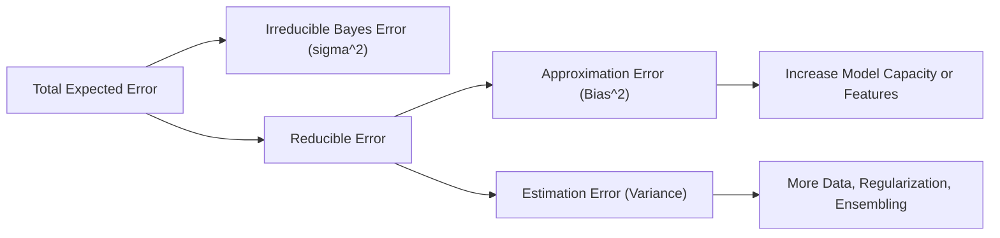
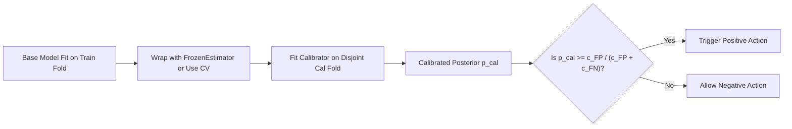

---
tags:
  - machine-learning
  - statistical-learning
  - cross-validation
  - feature-engineering
  - calibration
created: 2026-01-04
updated: 2026-11-13
status: 🟢
level: mid-to-senior
---

# ML Fundamentals Guide

> [!abstract] Scope
> First-principles statistical learning theory, PAC/VC generalization bounds, exact bias-variance decomposition, loss optimization geometry, zero-leakage splitting (`StratifiedGroupKFold`, `TimeSeriesSplit`, purged/embargoed CV, nested CV), out-of-fold empirical Bayes target encoding, probability calibration (Platt, Isotonic, Temperature scaling), cost-aligned thresholding, and runnable production verification tests.
> Navigation: [[Programming/Machine Learning/ML Hub|ML Hub]] · [[Programming/Machine Learning/ML Algorithms Guide|ML Algorithms Guide]] · [[Programming/Machine Learning/Deep Learning Guide|Deep Learning Guide]] · [[Programming/Machine Learning/ML Projects Guide|ML Projects Guide]] · [[Programming/Machine Learning/MLOps & Production ML Guide|MLOps & Production ML Guide]]

---

## 1. First-Principles Statistical Learning Mechanics & Loss Geometry

### 1.1 Expected Risk, Empirical Risk & PAC/VC Generalization Bounds

Supervised learning operates under an unknown joint probability distribution $(X, Y) \sim P(X, Y)$ over feature space $\mathcal{X} \subseteq \mathbb{R}^d$ and target space $\mathcal{Y}$. Given a nonnegative loss function $\ell(\hat{y}, y)$, the goal is selecting a hypothesis $f \in \mathcal{H}$ that minimizes **true expected risk**:

$$R(f) = \mathbb{E}_{(X, Y) \sim P}\big[\ell(f(X), Y)\big]$$

Because $P(X, Y)$ is unknown, an algorithm observes only a finite sample $D = \{(x_i, y_i)\}_{i=1}^n \sim P^n$ and minimizes the **empirical risk**:

$$\hat{R}_D(f) = \frac{1}{n} \sum_{i=1}^n \ell\big(f(x_i), y_i\big)$$

Minimizing $\hat{R}_D(f)$ alone over an unrestricted hypothesis class $\mathcal{H}$ drives training error toward zero by memorizing finite-sample noise. **Structural Risk Minimization (SRM)** bounds the generalization gap $R(f) - \hat{R}_D(f)$ by penalizing hypothesis complexity $\Omega(f)$:

$$\min_{f \in \mathcal{H}} \; \hat{R}_D(f) + \lambda \Omega(f)$$

#### PAC Uniform Convergence for Finite Hypothesis Classes

Consider binary classification under bounded 0-1 loss $\ell(f(x), y) = \mathbb{I}(f(x) \ne y) \in \{0, 1\}$. For any single fixed hypothesis $f$, Hoeffding's inequality bounds the tail probability that empirical risk deviates from true risk by more than $\epsilon > 0$:

$$P_D\big(\lvert R(f) - \hat{R}_D(f)\rvert > \epsilon\big) \le 2 \exp(-2n\epsilon^2)$$

Because Empirical Risk Minimization (ERM) *searches* across $\mathcal{H}$ to pick the minimizer $\hat{f}_D$ *after* observing $D$, the event $\lvert R(\hat{f}_D) - \hat{R}_D(\hat{f}_D) \rvert > \epsilon$ is bounded only via a union bound over every $f \in \mathcal{H}$:

$$P_D\left(\sup_{f \in \mathcal{H}} \lvert R(f) - \hat{R}_D(f) \rvert > \epsilon\right) \le \sum_{f \in \mathcal{H}} P_D\big(\lvert R(f) - \hat{R}_D(f) \rvert > \epsilon\big) \le 2 \lvert \mathcal{H} \rvert \exp(-2n\epsilon^2)$$

Setting the right-hand side to failure tolerance $\delta \in (0, 1)$ and solving for $\epsilon$ yields the **Probably Approximately Correct (PAC)** sample-complexity bound: with probability at least $1 - \delta$, simultaneously for all $f \in \mathcal{H}$:

$$R(f) \le \hat{R}_D(f) + \sqrt{\frac{\ln \lvert \mathcal{H} \rvert + \ln(2/\delta)}{2n}}, \qquad n \ge \frac{\ln \lvert \mathcal{H} \rvert + \ln(2/\delta)}{2\epsilon^2}$$

#### Infinite Hypothesis Classes: VC Dimension & Rademacher Complexity

Continuous parameter families (linear classifiers, SVMs, neural networks) have $\lvert \mathcal{H} \rvert = \infty$, making the naive union bound vacuous. Two tools restore tight bounds:

1. **Vapnik-Chervonenkis (VC) Dimension ($d_{\text{VC}}$)**: Even if $\lvert \mathcal{H} \rvert = \infty$, $\mathcal{H}$ can realize only finitely many distinct binary labelings (dichotomies) on $n$ fixed input points $x_1, \dots, x_n$. The VC dimension $d_{\text{VC}}(\mathcal{H})$ is the maximum number of points $m$ that $\mathcal{H}$ can **shatter** (realize all $2^m$ possible binary labelings).
   - An affine hyperplane $\text{sign}(w^T x + b)$ in $\mathbb{R}^d$ has $d_{\text{VC}} = d + 1$.
   - By the **Sauer-Shelah Lemma**, once $n > d_{\text{VC}}$, the growth function $\Pi_{\mathcal{H}}(n)$ is bounded polynomially rather than exponentially: $\Pi_{\mathcal{H}}(n) \le \left(\frac{en}{d_{\text{VC}}}\right)^{d_{\text{VC}}}$.
   - Replacing $\lvert \mathcal{H} \rvert$ with $\Pi_{\mathcal{H}}(2n)$ via symmetrization gives the VC generalization bound (with probability $\ge 1 - \delta$):

     $$R(f) \le \hat{R}_D(f) + \mathcal{O}\left(\sqrt{\frac{d_{\text{VC}} \ln(n / d_{\text{VC}}) + \ln(1/\delta)}{n}}\right)$$

   - **Operational takeaway**: Effective capacity requires $n \gg d_{\text{VC}}$. Unconstrained 10,000-dimensional linear features on 500 rows shatter the training set ($n < d_{\text{VC}}$), giving zero statistical guarantee without regularization.
2. **Rademacher Complexity ($\hat{\mathfrak{R}}_D(\mathcal{H})$)**: VC dimension is distribution-agnostic and worst-case over all feature geometries. Rademacher complexity directly measures how well $\mathcal{H}$ correlates with uniform random sign flips $\sigma_i \in \{-1, +1\}$ evaluated on the *actual* training inputs $x_1, \dots, x_n$:

   $$\hat{\mathfrak{R}}_D(\mathcal{H}) = \mathbb{E}_\sigma \left[\sup_{f \in \mathcal{H}} \frac{1}{n} \sum_{i=1}^n \sigma_i f(x_i)\right]$$

   For norm-bounded linear predictors $\mathcal{H} = \{x \mapsto w^T x : \|w\|_2 \le B\}$ over inputs bounded by $\|x_i\|_2 \le R$, Cauchy-Schwarz bounds $\hat{\mathfrak{R}}_D(\mathcal{H}) \le \frac{B R}{\sqrt{n}}$—**completely independent of ambient dimension $d$**. This proves why kernel SVMs (infinite implicit dimension) and high-dimensional regularized linear models ($d \gg n$) generalize reliably when the weight norm $\|w\|_2$ is controlled.

---

### 1.2 Exact Bias-Variance-Noise Decomposition

Assume data follows $Y = f^*(x) + \epsilon$ where $f^*(x) = \mathbb{E}[Y \mid X = x]$, $\mathbb{E}[\epsilon] = 0$, and $\text{Var}(\epsilon) = \sigma_\epsilon^2$ independent of $X$ and training sample $D$. For an estimator $\hat{f}_D(x)$ trained on random draw $D \sim P^n$, define the expected predictor across training samples as $\bar{f}(x) = \mathbb{E}_D[\hat{f}_D(x)]$. Expanding expected squared prediction error at query $x$:

$$\mathbb{E}_{D, \epsilon}\big[(Y - \hat{f}_D(x))^2\big] = \mathbb{E}_{D, \epsilon}\big[(f^*(x) + \epsilon - \hat{f}_D(x))^2\big]$$

Since $\mathbb{E}[\epsilon] = 0$ and $\epsilon \perp D$, the cross term $2\mathbb{E}[\epsilon(f^*(x) - \hat{f}_D(x))] = 0$:

$$= \mathbb{E}_D\big[(f^*(x) - \hat{f}_D(x))^2\big] + \sigma_\epsilon^2$$

Inserting $\pm \bar{f}(x)$ inside the quadratic term yields:

$$= \mathbb{E}_D\Big[\big((f^*(x) - \bar{f}(x)) + (\bar{f}(x) - \hat{f}_D(x))\big)^2\Big] + \sigma_\epsilon^2$$

Expanding the square gives three terms:

$$= \mathbb{E}_D\big[(f^*(x) - \bar{f}(x))^2\big] + \mathbb{E}_D\big[(\bar{f}(x) - \hat{f}_D(x))^2\big] + 2(f^*(x) - \bar{f}(x))\underbrace{\mathbb{E}_D\big[\bar{f}(x) - \hat{f}_D(x)\big]}_{= 0} + \sigma_\epsilon^2$$

Because $\mathbb{E}_D[\hat{f}_D(x)] = \bar{f}(x)$, the cross term vanishes identically, yielding the exact decomposition:

$$\mathbb{E}_{D, \epsilon}\big[(Y - \hat{f}_D(x))^2\big] = \underbrace{\big(\bar{f}(x) - f^*(x)\big)^2}_{\text{Bias}[\hat{f}(x)]^2} + \underbrace{\mathbb{E}_D\big[(\hat{f}_D(x) - \bar{f}(x))^2\big]}_{\text{Var}(\hat{f}(x))} + \underbrace{\sigma_\epsilon^2}_{\text{Irreducible Bayes Error}}$$

Total excess risk for any proper Bregman divergence loss (including Binary Cross-Entropy via KL divergence) obeys an analogous additive structure:

$$\mathbb{E}_D\big[D_{\text{KL}}(P(\cdot \mid x) \| \hat{P}_D(\cdot \mid x))\big] = D_{\text{KL}}\big(P(\cdot \mid x) \| \bar{P}(x)\big) + \mathbb{E}_D\big[D_{\text{KL}}(\bar{P}(x) \| \hat{P}_D(\cdot \mid x))\big]$$

where $\bar{P}(x)$ is the normalized geometric mean (logit-space average) of predictions across training draws.



| Error Component | Formal Definition | Root Cause | Production Remediation |
| :--- | :--- | :--- | :--- |
| **Irreducible (Bayes) Error** | $\sigma_\epsilon^2 = R(f_{\text{Bayes}}^*)$ | Intrinsic label stochasticity, unmeasured confounders, sensor noise | Acquire higher-signal features or clean label noise; model scaling yields zero gain |
| **Approximation Error (Bias²)** | $\inf_{f \in \mathcal{H}} R(f) - R(f^*)$ | Hypothesis space $\mathcal{H}$ too restrictive (linear model on nonlinear manifold) | Richer $\mathcal{H}$ (GBDTs, splines, interactions), lower $\lambda$, feature engineering |
| **Estimation Error (Variance)** | $R(\hat{f}_D) - \inf_{f \in \mathcal{H}} R(f)$ | High sensitivity to finite-sample fluctuations in $D$ | Increase $n$, $L_1$/$L_2$ penalties, bagging, early stopping, feature pruning |

---

### 1.3 Regularization Duality, Bayesian MAP Priors & Double Descent

#### Constrained Optimization vs. Penalized ERM Duality

Minimizing regularized empirical risk $\hat{R}_D(w) + \lambda \Omega(w)$ is mathematically dual to constrained ERM $\min_{w} \hat{R}_D(w) \;\text{s.t.}\; \Omega(w) \le t$. When $\hat{R}_D$ and $\Omega$ are convex and Slater's condition holds ($t > 0$), Lagrangian duality establishes a one-to-one mapping between penalty multiplier $\lambda > 0$ and norm budget $t > 0$.

#### Exact Bayesian MAP Equivalence

Penalized MLE directly corresponds to Bayesian Maximum A Posteriori (MAP) estimation with log-prior proportional to $-\lambda \Omega(w)$:

$$\hat{w}_{\text{MAP}} = \arg\max_w \; \ln P(D \mid w) + \ln P(w) = \arg\min_w \left[-\sum_{i=1}^n \ln P(y_i \mid x_i, w) - \ln P(w)\right]$$

Under Gaussian likelihood $y_i \sim \mathcal{N}(w^T x_i, \sigma_\epsilon^2)$:

1. **Gaussian Prior $\implies L_2$ (Ridge)**: Let $w_j \stackrel{\text{i.i.d.}}{\sim} \mathcal{N}(0, \tau^2)$. Then:

   $$-\ln P(w) = \frac{1}{2\tau^2} \|w\|_2^2 + \text{const} \implies \min_w \frac{1}{2\sigma_\epsilon^2}\|y - Xw\|_2^2 + \frac{1}{2\tau^2}\|w\|_2^2$$

   Multiplying by $\sigma_\epsilon^2$ recovers Ridge regression with $\lambda = \frac{\sigma_\epsilon^2}{\tau^2}$. Larger prior precision ($1/\tau^2$) or higher observation noise ($\sigma_\epsilon^2$) forces stronger weight shrinkage. In SVD coordinates ($X = U \Sigma V^T$), Ridge damps each singular direction $j$ smoothly by spectral filter factor $\frac{\sigma_j^2}{\sigma_j^2 + \lambda}$, keeping $(X^T X + \lambda I)$ strictly positive definite even when features are perfectly collinear.

2. **Laplace Prior $\implies L_1$ (Lasso)**: Let $w_j \stackrel{\text{i.i.d.}}{\sim} \text{Laplace}(0, b)$, where $p(w_j) = \frac{1}{2b}\exp(-\lvert w_j \rvert / b)$. Then:

   $$-\ln P(w) = \frac{1}{b}\|w\|_1 + \text{const} \implies \lambda = \frac{\sigma_\epsilon^2}{b}$$

   Geometrically, the $L_1$ norm ball $\|w\|_1 \le t$ forms a cross-polytope (diamond) with sharp vertices on coordinate axes. By KKT subgradient stationarity ($\partial \lvert w_j \rvert = [-1, 1]$ at $w_j = 0$), any feature $j$ satisfying $\left\lvert \frac{\partial \hat{R}_D}{\partial w_j} \right\rvert_{w_j=0} \le \lambda$ is pinned to **exact zero**, performing continuous embedded feature selection.

#### The Double Descent Caveat

Classical statistical learning predicts a strict U-shaped test error curve as capacity $p$ increases. Modern empirical and theoretical analyses establish that unregularized interpolators follow a **double descent** curve across two distinct regimes separated by the **interpolation threshold** ($p \approx n$):

- **Classical Underparameterized Regime ($p < n$)**: Standard bias-variance trade-off governs test error. Increasing capacity lowers bias while raising variance.
- **Interpolation Threshold Spike ($p \approx n$)**: When parameter count matches effective degrees of freedom without explicit regularization ($\lambda \to 0$), the design matrix becomes square and near-singular ($\sigma_{\min}(X) \to 0$). Forcing exact zero training residuals ($\hat{R}_D = 0$) requires extreme parameter norms $\|w\|_2 \propto \sigma_{\min}^{-1}(X) \to \infty$, exploding test variance.
- **Overparameterized Benign Interpolation Regime ($p \gg n$)**: Beyond $p > n$, infinitely many solutions achieve $\hat{R}_D = 0$. Minimum-norm solvers (Moore-Penrose pseudoinverse `lstsq`, or gradient descent initialized near zero) select the unique interpolator minimizing $\|w\|_2$, spreading residual noise energy cleanly across $p - n$ redundant orthogonal directions so test risk decreases again.

**Tabular Production Rule**: Structured tabular ML ($n \in [10^3, 10^7], d \in [10, 500]$) operates squarely inside the $n \gg p$ classical regime (or uses regularized GBDTs/linear models where explicit $\lambda$ / early stopping completely suppresses the interpolation variance spike). Never rely on unregularized $p \approx n$ interpolation in tabular pipelines—explicitly tune $\lambda$ via cross-validation.

---

### 1.4 Implicit Regularization Mechanics

Even when explicit norm penalties equal zero, training algorithms impose strong implicit capacity control:

- **Early Stopping in Gradient Descent**: Under squared loss $\frac{1}{2}\|y - Xw\|_2^2$, initializing $w^{(0)} = 0$ and running $T$ steps of gradient descent with step size $\eta < 2/\sigma_{\max}^2$ yields iterate $w^{(T)} = \sum_{j=1}^d \left[1 - (1 - \eta \sigma_j^2)^T\right] \frac{u_j^T y}{\sigma_j} v_j$. Comparing spectral filter $1 - (1 - \eta \sigma_j^2)^T$ to Ridge filter $\frac{\sigma_j^2}{\sigma_j^2 + \lambda}$ reveals algebraic equivalence at $\lambda_{\text{eff}} \approx \frac{1}{\eta T}$. Small singular directions (noise) are filtered out when stopping early.
- **Mini-Batch SGD Gradient Noise**: Sampling mini-batches of size $B \ll n$ injects stochastic covariance $\Sigma_{\text{SGD}} \propto \frac{\eta}{B} C_{\text{grad}}$, destabilizing trajectories inside narrow high-curvature valleys (sharp minima that generalize poorly) and trapping optimization inside wider, flatter basins.
- **Bootstrap Row & Column Subsampling (`Bagging`, `subsample`, `colsample_bytree`)**: Decouples correlated base estimators, slashing variance term $\frac{1-\rho}{B}\sigma^2$ without inflating structural approximation bias.

> [!warning] Regularization Scaling Invariant
> Norm-based penalties ($\|w\|_1, \|w\|_2^2$) and gradient-norm early stopping are **scale-variant**. Features on small numerical ranges (e.g., ratio $[0, 1]$) require larger weights than features measured in millions, causing uneven penalization unless numeric columns are standardized (`StandardScaler` or `RobustScaler`) strictly inside each training fold.

---

### 1.5 Loss Functions & Optimization Geometry

Training stability, outlier robustness, and conditional target semantics (mean vs. median vs. quantile vs. calibrated probability) are dictated directly by the curvature and tail behavior of $\ell(\hat{y}, y)$.

#### Regression Losses (Residual $r = \hat{y} - y$)

| Loss | Formula $\ell(y, \hat{y})$ | MLE Probabilistic Prior | Gradient $\frac{\partial \ell}{\partial \hat{y}}$ | Hessian $\frac{\partial^2 \ell}{\partial \hat{y}^2}$ | Conditional Target & Robustness |
| :--- | :--- | :--- | :--- | :--- | :--- |
| **MSE ($L_2$)** | $\frac{1}{2}(y - \hat{y})^2$ | Gaussian $\mathcal{N}(\hat{y}, \sigma^2)$ | $r$ | $1$ | **Conditional mean** $\mathbb{E}[Y\mid x]$; $O(r^2)$ loss blowup and unbounded $O(\lvert r \rvert)$ gradient make it brittle under outliers |
| **MAE ($L_1$)** | $\lvert y - \hat{y} \rvert$ | Laplace $(\hat{y}, b)$ | $\text{sign}(r)$ ($[-1, 1]$ at $0$) | $0$ a.e. | **Conditional median**; bounded gradient resists $y$-outliers; non-smooth at $r=0$, zero curvature stalls Newton GBDTs |
| **Huber** | $\begin{cases} \frac{1}{2}r^2 & \lvert r \rvert \le \delta \\ \delta(\lvert r \rvert - \frac{\delta}{2}) & \lvert r \rvert > \delta \end{cases}$ | Gaussian core, Laplace tails | $\text{clip}(r, -\delta, \delta)$ | $\mathbb{I}(\lvert r \rvert \le \delta)$ | Interpolates mean and median; $C^1$ smooth but discontinuous Hessian at $\lvert r \rvert = \delta$ |
| **Pseudo-Huber** | $\delta^2\left(\sqrt{1 + (r/\delta)^2} - 1\right)$ | Smooth heavy-tail hybrid | $\frac{r}{\sqrt{1 + (r/\delta)^2}}$ | $\left(1 + (r/\delta)^2\right)^{-3/2}$ | $C^\infty$ smooth everywhere with strictly positive curvature; drop-in replacement for second-order solvers |
| **Quantile (Pinball)** | $\max\big(\tau(y - \hat{y}), (\tau - 1)(y - \hat{y})\big)$ | Asymmetric Laplace | $-\tau$ ($r<0$), $1-\tau$ ($r>0$) | $0$ a.e. | **Conditional $\tau$-quantile** $Q_\tau(Y\mid x)$; yields prediction intervals via $\tau \in \{0.05, 0.95\}$ ($\tau=0.5 \equiv \frac{1}{2}\text{MAE}$) |

> [!info] Why MSE Outliers Dominate Optimization
> Although the first derivative wrt $\hat{y}$ is linear ($r$), the squared penalty scales as $O(r^2)$ and parameter gradient updates scale as $r \cdot x_i$. A single heavy-tailed target outlier ($r = 100\sigma$) exerts $100\times$ the pull of a typical sample on parameter updates and $10{,}000\times$ the loss weight, distorting predictions globally—especially for high-leverage points with large $\|x_i\|_2$.

#### Classification Losses & Strictly Proper Scoring Rules

A probabilistic loss $\ell(y, p)$ is a **strictly proper scoring rule** if its conditional expectation under true posterior $q = P(Y = 1 \mid x)$ is *uniquely* minimized at $p = q$.

- **Binary Cross-Entropy (Log-Loss) — Strictly Proper**:
  For logit $z = f(x)$ and predicted probability $p = \sigma(z) = \frac{1}{1 + e^{-z}}$:

  $$\ell_{\text{BCE}}(y, p) = -\big[y \log p + (1 - y)\log(1 - p)\big]$$

  Taking conditional expectation wrt $Y \sim \text{Bernoulli}(q)$:

  $$\mathbb{E}_{Y|x}[\ell_{\text{BCE}}(Y, p)] = -q \log p - (1 - q)\log(1 - p) = H(q) + D_{\text{KL}}\big(\text{Bern}(q) \,\|\, \text{Bern}(p)\big)$$

  By **Gibbs' inequality**, $D_{\text{KL}}(q \| p) \ge 0$ with equality *if and only if* $p = q$. Moreover, its logit derivatives cancel sigmoid saturation cleanly:

  $$\frac{\partial \ell_{\text{BCE}}}{\partial z} = p - y, \qquad \frac{\partial^2 \ell_{\text{BCE}}}{\partial z^2} = p(1 - p)$$

- **Hinge Loss (SVM Margin) — Not Proper**: $\ell_{\text{hinge}}(y, z) = \max(0, 1 - y z)$ for $y \in \{-1, +1\}$ minimizes expected risk at $\text{sign}(q - 0.5)$ rather than recovering continuous posterior $q$. Scores reflect signed margin distance, never calibrated probability.
- **Focal Loss (Extreme Class Imbalance) — Not Proper**:
  Define $p_t = p$ if $y = 1$ else $1 - p$, and class balancing weight $\alpha_t$:

  $$\ell_{\text{FL}}(p_t) = -\alpha_t (1 - p_t)^\gamma \log(p_t), \quad \gamma \ge 0$$

  When $\gamma = 2$, an easy negative predicted at $p_t = 0.99$ receives modulating factor $(1 - 0.99)^2 = 10^{-4}$, down-weighting background noise by $10{,}000\times$ so hard minority examples dominate gradients. Because $\gamma > 0$ alters the stationary point of $\mathbb{E}[\ell_{\text{FL}}]$, outputs are systematically shifted away from $0$ and $1$ and **must be post-hoc calibrated** before thresholding.

---

## 2. Real-World Use Cases & Engineering Decision Matrix

Designing a sound statistical pipeline begins by mapping production constraints—data topology, label delay, error asymmetry, and cardinality—to the exact validation, loss, and decision components.

| Production Scenario | Data & Label Topology | Required CV Protocol | Feature Encoding & Missingness | Objective & Calibration | Primary Evaluation & Decision Policy |
| :--- | :--- | :--- | :--- | :--- | :--- |
| **1. Payment Fraud Screening** | $0.2\%$ prevalence, 30-day chargeback lag, repeated `user_id` / `merchant_id` | Causal time split + `PurgedTimeSeriesSplitter(gap=30d)` | Out-of-fold `TargetEncoder(smooth="auto")` + `add_indicator=True` | Log-Loss (or weighted + prior correction) + held-out **Isotonic** | **PR-AUC**, ECE, expected cost at $\tau^* = \frac{C_{\text{FP}}}{C_{\text{FP}} + C_{\text{FN}}(x_i)}$ |
| **2. Multi-Horizon Retail Demand** | Non-stationary daily SKUs, strong seasonality, asymmetric stockout vs. holding cost | Expanding `TimeSeriesSplit(gap=H)` where $H$ = forecast horizon | Cyclical Fourier $\sin/\cos$, causal rolling lags ($t < t_0$), store OHE | **Pinball (Quantile)** loss at $\tau \in \{0.10, 0.50, 0.90\}$ | Weighted Pinball Loss, empirical $80\%$ interval coverage, inventory SLA cost |
| **3. Clinical Readmission (EHR)** | Repeated admissions per `patient_id`, MNAR lab tests (ordered only when sick) | **`StratifiedGroupKFold`** grouped strictly by `patient_id` | Median imputation + **mandatory missingness indicators** | Log-Loss + OOF **Platt (`sigmoid`)** on smaller clinical cohorts | **PR-AUC**, Brier Score, Reliability Diagram across risk deciles |
| **4. Search & Support Re-Ranking** | Query-document pairs grouped by `query_id`, graded relevance $\{0,1,2,3\}$ | **`GroupKFold`** grouped by `query_id` / `session_id` | Query-doc lexical overlap + `FeatureHasher` for unbounded IDs | Pairwise/Listwise LambdaMART or BCE + calibration | **`NDCG@10`**, **`MRR`**, latency-bounded top-$K$ precision |
| **5. Streaming Clickstream Churn** | $10^7$ events, unbounded `url` / `ua_string`, severe covariate drift | Rolling sliding-window temporal CV + live shadow validation | **`FeatureHasher`** ($2^{16}$ dims) + `RobustScaler` | SGD Log-Loss / HistGBDT + **Temperature / Isotonic** calibration | PR-AUC, Log-Loss, PSI covariate drift tracking |

### When NOT to Apply Heavy Calibration or Complex Encodings

- **Pure Top-$K$ Capacity Queues Without Expected Value Math**: If downstream operations always review the exact top 200 alerts per day (`rank <= 200`), any strictly monotonic transformation leaves ranking order unchanged; prioritize ranking quality (**PR-AUC**, **NDCG@k**) over Platt/Isotonic calibration.
- **High-Cardinality Categoricals on Small Data ($n < 500$ per split)**: Internal 5-fold `TargetEncoder` leaves insufficient samples per category, collapsing encodings onto the global prior. Prefer domain bucketing, `OneHotEncoder(min_frequency=0.05)`, or hierarchical entity embeddings/metadata features.
- **Non-Stationary Drift on Categorical IDs**: If `TargetEncoder` encodes ephemeral IDs (`session_id`, rotating IP prefixes) whose target associations evaporate within weeks, target encoding memorizes stale noise. Hash or replace IDs with causal sliding-window aggregates (`merchant_fraud_rate_last_30d` computed strictly at $t < t_i$).

---

## 3. Data Splitting, Leakage Physics & High-Scale Feature Engineering

Cross-validation must replicate the exact **production inference topology**—whether inference scores unseen i.i.d. draws, unseen entities, or strictly future timestamps.

### 3.1 Cross-Validation Splitting Topologies

| Splitter | Partitioning Rule | Required Use Case | Failure Mode When Misused |
| :--- | :--- | :--- | :--- |
| **`StratifiedKFold`** | Preserves global class ratio across folds via random sampling | Pure i.i.d. tabular classification with skewed labels | **Leaks entities & future targets** when rows share user/patient IDs or timestamps |
| **`GroupKFold` / `StratifiedGroupKFold`** | Enforces $\text{groups}(D_{\text{train}}) \cap \text{groups}(D_{\text{val}}) = \emptyset$ | Repeated observations per `user_id`, `patient_id`, `session_id`, or `query_id` | Plain `KFold` splits same-entity rows across folds—model memorizes entity baselines |
| **`TimeSeriesSplit(gap=H)`** | Strictly expanding/sliding causal windows ($t_{\text{train}} + H < t_{\text{val}}$) | Forecasting, fraud, churn, click-through deployed forward in time | Fails if `gap=0` while labels look forward $H$ steps or rolling lags span the boundary |
| **Purged & Embargoed CV** | Drops training rows whose label span $[t_i, t_i + \Delta]$ overlaps $D_{\text{val}}$; adds post-val embargo $\delta$ | Multi-day financial returns, 30-day default/churn windows, autocorrelated time blocks | Standard K-fold or zero-gap temporal split leaks target outcomes across fold boundaries |

**Why `StratifiedGroupKFold` Beats Naive `GroupKFold` on Imbalanced Data**: `GroupKFold` greedily assigns largest groups to folds matching sample count, ignoring positive class counts. Under 1% prevalence, one fold can easily receive 0.2% positives and another 2.5%, destabilizing fold-level threshold tuning and PR-AUC. `StratifiedGroupKFold` sorts groups by size/entropy and greedily minimizes fold-wise class distribution KL-divergence subject to strict group disjointness.

### 3.2 Purged & Embargoed Cross-Validation

In financial modeling, credit default prediction, and churn forecasting, observation $i$ made at prediction timestamp $t_i$ carries a **label evaluation horizon** $[t_i, t_i + \Delta]$ (for instance, *"did the borrower default within the next 30 days?"* or *"5-day forward return"*).

Suppose validation spans $[t_{\text{val\_start}}, t_{\text{val\_end}}]$:
1. **Purging**: Any training row $i$ with $t_i < t_{\text{val\_start}}$ whose label window $[t_i, t_i + \Delta]$ extends past $t_{\text{val\_start}}$ ($t_i + \Delta \ge t_{\text{val\_start}}$) directly contains outcome information occurring *during* the validation period. **Purge** all training samples where label intervals overlap the validation interval.
2. **Embargoing (in non-causal purged K-fold backtests)**: When evaluating a historical validation block inside the middle of a timeline, serial autocorrelation in features $X_t$ (such as 14-day rolling volatility or macro indicators) leaks information into training samples immediately *following* $t_{\text{val\_end}}$. **Embargo** by discarding an additional cooldown buffer $\delta$ immediately after $t_{\text{val\_end}}$ from the post-validation training fold.


For strictly causal forward forecasting in production, always drop post-validation data entirely (`TimeSeriesSplit` with `gap=H` purging training labels whose maturation extends into validation).

### 3.3 Nested Cross-Validation & Selection Optimism

Using the same $K$-fold CV loop both to search across $M$ hyperparameter configurations (`Optuna` / `GridSearchCV`) and to report final generalization performance produces **optimistic selection bias**. Because validation scores across $M$ trials fluctuate randomly with variance $\sigma_{\text{cv}}^2$, choosing $\arg\max_{m \le M} \hat{S}_m$ overfits the specific validation partition by approximately $\mathcal{O}\left(\sqrt{\frac{\ln M}{n_{\text{val}}}}\right)$ (often inflating AUC by $+0.01\text{–}0.04$ on $n < 5{,}000$).

**Nested Cross-Validation** eliminates selection optimism by separating **model selection** from **performance estimation**:
- **Outer Loop ($K_{\text{out}} = 5$)**: splits dataset into $(D_{\text{train}}^{(k)}, D_{\text{test}}^{(k)})$ strictly using the production topology (`StratifiedGroupKFold` or causal temporal blocks).
- **Inner Loop ($K_{\text{in}} = 3\text{–}5$)**: runs hyperparameter search *exclusively* inside $D_{\text{train}}^{(k)}$ to select $\theta_k^*$, refits on all of $D_{\text{train}}^{(k)}$, and evaluates once on unseen $D_{\text{test}}^{(k)}$.
- **Final Production Artifact**: after obtaining the unbiased outer generalization estimate (mean $\pm$ std across $K_{\text{out}}$ folds), run the exact inner hyperparameter selection procedure once on the full pre-holdout dataset to produce the deployed artifact.

### 3.4 Complete Five-Class Data Leakage Taxonomy

1. **Target / Future-Proxy Leakage**: Including features generated causally *after* the prediction point (e.g., `collections_agency_assigned` predicting loan default, `discharge_icd_code` predicting ER admission, `refund_timestamp` predicting checkout fraud). *Fix*: enforce strict point-in-time feature watermarks ($t_{\text{feature}} \le t_{\text{prediction}}$) via `ASOF` joins.
2. **Preprocessing Leakage**: Fitting `StandardScaler`, `SimpleImputer`, `PCA`, `SelectKBest`, `TargetEncoder`, or `SMOTE` on the full dataset prior to CV splitting. Validation moments ($\mu, \sigma$), feature selectors, or synthetic neighbors bleed into training folds. *Fix*: encapsulate every stateful step inside `sklearn.pipeline.Pipeline`.
3. **Temporal / Look-Ahead Leakage**: Computing entity lifetime aggregates (`user_total_spend`, `merchant_lifetime_fraud_rate`) across the entire historical table instead of strictly causal prefix windows ($t < t_i$), or shuffling time-ordered rows.
4. **Group / Entity Contamination**: Splitting repeated transactions, multi-session records, or near-duplicate image crops of the same entity across train and validation folds.
5. **Test-Set Contamination (Adaptive Overfitting)**: Iteratively tuning architectures, feature sets, or decision thresholds against feedback from the final test set. *Fix*: lock the final test set behind a single evaluation gate at project completion.

### 3.5 Out-of-Fold Smoothed Target Encoding Physics

High-cardinality categoricals (`merchant_id`, `sku`, `zip_code` with $k \sim 10^3\text{–}10^6$) fail under naive encoding:
- **One-Hot Explosion**: Generates $k$ sparse indicators, fracturing tree column subsampling (`colsample_bytree`), starving gain for rare categories, and spiking dense RAM to $O(n \cdot k)$.
- **Naive In-Fold Target Encoding**: Replacing category $c$ with empirical sample mean $\bar{y}_c$ leaks $y_i$ directly into $x_i$; any singleton ($n_c = 1$) maps to $\{0, 1\}$, letting downstream learners memorize training IDs perfectly while collapsing out-of-sample.

#### Empirical Bayes M-Estimate Shrinkage (`TargetEncoder(cv=5, smooth="auto")`)

Smooth each category mean $\bar{y}_c$ toward the training-fold global prior $\bar{y}_{\text{global}}$ weighted by category count $n_c$ and smoothing strength $m > 0$:

$$\hat{x}_c = \frac{n_c \bar{y}_c + m \bar{y}_{\text{global}}}{n_c + m} = \underbrace{\left(\frac{n_c}{n_c + m}\right)}_{\lambda(n_c)} \bar{y}_c + \big(1 - \lambda(n_c)\big)\bar{y}_{\text{global}}$$

In `sklearn.preprocessing.TargetEncoder(smooth="auto")`, smoothing $m$ is automatically derived via **Empirical Bayes (James-Stein) shrinkage** per category:

$$m = \frac{\hat{\sigma}_{\text{within}, c}^2}{\hat{\sigma}_{\text{between}}^2}$$

where $\hat{\sigma}_{\text{within}, c}^2$ estimates target variance inside category $c$ and $\hat{\sigma}_{\text{between}}^2$ estimates variance across category means. High-variance/noisy categories shrink aggressively toward $\bar{y}_{\text{global}}$, whereas consistent high-count categories approach $\bar{y}_c$.

**Two Critical Implementation Subtleties in `scikit-learn >= 1.5`**:
1. **`fit_transform()` vs. `fit()` + `transform()`**: Calling `encoder.fit_transform(X_train, y_train)` executes internal $K$-fold cross-fitting—rows in internal fold $j$ are encoded exclusively from the complementary $K - 1$ folds, *and* the encoder simultaneously stores full-`X_train` category statistics for subsequent `.transform(X_val)` calls! By contrast, manually calling `encoder.fit(X_train, y_train)` followed by `encoder.transform(X_train)` skips internal OOF cross-fitting and leaks training labels into training features. Encapsulating `TargetEncoder` inside `ColumnTransformer` + `Pipeline` automatically invokes `fit_transform` during `pipe.fit()` and `transform` during `pipe.predict()`.
2. **Internal `cv` Leakage on Grouped or Temporal Data**: `TargetEncoder(cv=5)` uses internal stratified/K-fold splitting *without* awareness of `groups` or timestamps! If the same `merchant_id` appears across multiple rows of the same user/time cluster inside `X_train`, internal random CV still computes cross-row averages within `X_train`. For strict causal temporal data, compute expanding time-ordered prefix statistics (`cumsum` shifted by 1) before modeling or pass a group-aware/chronological fold generator to custom encoding transformers.

### 3.6 Missingness Taxonomy, Feature Hashing & Periodic Encodings

#### Rubin's Missingness Mechanisms

| Mechanism | Probabilistic Condition | Production Example | Correct Handling |
| :--- | :--- | :--- | :--- |
| **MCAR** | $P(M \mid X_{\text{obs}}, X_{\text{miss}}, Y) = P(M)$ | Random telemetry packet drop | Median/mean imputation; complete-case rows unbiased |
| **MAR** | $P(M \mid X_{\text{obs}}, X_{\text{miss}}, Y) = P(M \mid X_{\text{obs}})$ | Younger applicants omit credit history field | Conditional multivariate imputation (`IterativeImputer` / MICE) |
| **MNAR** | $P(M \mid X)$ depends on $X_{\text{miss}}$ or $Y$ | High-income users skip salary; failing sensors drop offline | **Preserve missingness signal** via `SimpleImputer(..., add_indicator=True)` or native GBDT NaN branches |

> [!tip] Always Attach Missingness Indicators Outside Pure MCAR
> Pure median imputation collapses missing entries onto a single dense point, erasing the predictive signal that a laboratory panel was skipped or telemetry timed out. Setting `add_indicator=True` emits binary `missingindicator_*` columns so linear models and trees cleanly isolate missingness regimes.

- **Feature Hashing (`FeatureHasher`)**: Maps arbitrary unbounded strings (`url`, `user_agent`) into a fixed $2^b$-dimensional space using signed MurmurHash3 (`h(key) mod 2^b` with random sign `±1` ensuring unbiased expected inner products). Requires zero lookup tables at inference, bounding memory to $O(2^b)$.
- **Variance-Stabilizing Power Transforms**: `np.log1p(x)` compresses right-skewed nonnegative counts; **Box-Cox** ($x > 0$) and **Yeo-Johnson** ($x \in \mathbb{R}$) optimize $\lambda$ via profile log-likelihood to normalize residuals for linear models, GLMs, and PCA (redundant for monotonic-invariant tree splits).
- **Cyclical & Multi-Harmonic Fourier Encodings**: Raw integer hours $[0, 23]$ create a false jump between `23` and `0`. Map periodic features with period $T$ onto harmonics $k = 1, \dots, K$:

  $$\phi_k(t) = \left[\sin\left(\frac{2\pi k t}{T}\right), \; \cos\left(\frac{2\pi k t}{T}\right)\right]$$

  Including $K \ge 2$ harmonics lets linear models resolve sharp multimodal spikes (e.g., morning + evening commute peaks).

---

## 4. Metrics, Ranking, Calibration & Bayes-Optimal Decisioning

### 4.1 Skewed Classification Metrics: ROC-AUC vs. PR-AUC & MCC

Under $0.5\%$ positive prevalence, a trivial constant negative predictor hits **$99.5\%$ Accuracy**. Rare-event evaluation relies on Precision ($\frac{TP}{TP + FP}$), Recall / TPR ($\frac{TP}{TP + FN}$), **$F_\beta$**, and **Matthews Correlation Coefficient (MCC)**:

$$F_\beta = (1 + \beta^2) \frac{\text{Precision} \cdot \text{Recall}}{\beta^2 \cdot \text{Precision} + \text{Recall}}, \qquad \text{MCC} = \frac{TP \cdot TN - FP \cdot FN}{\sqrt{(TP+FP)(TP+FN)(TN+FP)(TN+FN)}}$$

Use $\beta = 2$ when missed positives dominate cost (clinical screening, severe fraud) and $\beta = 0.5$ when false alarms dominate cost (automated account suspension). $\text{MCC} \in [-1, +1]$ scores high only when all four confusion matrix cells are well calibrated.

#### Why ROC-AUC Masks False-Positive Explosions Under Extreme Skew

Let $\pi = \frac{P}{P + N}$ denote positive class prevalence:

- **ROC-AUC** integrates $\text{TPR} = \frac{TP}{P}$ against $\text{FPR} = \frac{FP}{N}$, equaling the pairwise rank probability $P(\hat{s}(X^+) > \hat{s}(X^-))$. Because $\text{TPR}$ conditions strictly on positives and $\text{FPR}$ strictly on negatives, **ROC-AUC is mathematically invariant to class prevalence $\pi$**. Under $0.5\%$ prevalence ($N = 199 P$), a benign-looking $\text{FPR} = 0.02$ generates $\approx 4\times$ more false positives than total positives in the entire dataset, saturating human review queues while leaving $\text{ROC-AUC} > 0.96$.
- **PR-AUC (Average Precision)** integrates $\text{Precision}$ against $\text{Recall}$, where prevalence enters directly:

  $$\text{Precision} = \frac{\pi \cdot \text{TPR}}{\pi \cdot \text{TPR} + (1 - \pi) \cdot \text{FPR}}$$

  A random classifier attains $\text{PR-AUC} = \pi$ (e.g., $0.005$ at $0.5\%$ prevalence, rather than $0.50$). Always optimize and compare rare-event ranking models on **PR-AUC / Average Precision**.

### 4.2 Ranking & Probabilistic Forecasting Metrics

- **DCG@k & NDCG@k (Normalized Discounted Cumulative Gain)**: For a ranked top-$k$ list with graded relevance labels $\text{rel}_i \in \{0, 1, 2, \dots\}$ at positions $i = 1, \dots, k$:

  $$\text{DCG}@k = \sum_{i=1}^k \frac{2^{\text{rel}_i} - 1}{\log_2(i + 1)}, \qquad \text{NDCG}@k = \frac{\text{DCG}@k}{\text{IDCG}@k}$$

  where $\text{IDCG}@k$ is the maximum achievable DCG from sorting items by true relevance. Emphasizes top slots via exponential relevance gain ($2^{\text{rel}_i} - 1$) and logarithmic position decay.
- **MRR (Mean Reciprocal Rank)**: Averages $\frac{1}{\text{rank}_q}$ across queries $q \in Q$, where $\text{rank}_q$ is the position of the *first* relevant item. Ideal for single-answer retrieval or support routing; insensitive to secondary relevant results.
- **MAP@k vs. NDCG@k**: `MAP@k` restricts items to binary relevance $\{0, 1\}$ and averages Precision@i at every relevant hit; `NDCG@k` natively incorporates multi-grade relevance (click vs. add-to-cart vs. purchase).
- **Regression & Interval Metrics**:
  - **Why MAPE Fails**: $\frac{1}{n}\sum \frac{\lvert y_i - \hat{y}_i \rvert}{\lvert y_i \rvert}$ blows up to $\infty$ when $y_i \to 0$ and asymmetrically penalizes over-prediction ($+50\%$ error on $y=10$ vs $-33\%$ for the same absolute gap), biasing forecasts downward toward harmonic medians. Replace with **WAPE** ($\frac{\sum \lvert y_i - \hat{y}_i \rvert}{\sum \lvert y_i \rvert}$) or **Pinball Loss**.
  - **Pinball Loss & Interval Score**: Training quantiles $\tau \in \{0.05, 0.50, 0.95\}$ yields a $90\%$ prediction interval $[L_i, U_i]$. Track empirical **coverage** ($\frac{1}{n}\sum \mathbb{I}(L_i \le y_i \le U_i) \approx 0.90$) alongside **mean interval width** ($\frac{1}{n}\sum (U_i - L_i)$)—narrower intervals at target coverage signify sharper epistemic uncertainty estimates.

### 4.3 Probability Calibration Mechanics

High ROC-AUC or PR-AUC guarantees only **ranking monotonicity**, not **calibration** ($\mathbb{P}(Y = 1 \mid \hat{p} = q) = q$). Boosted trees with extreme log-odds margins, SVMs, Naive Bayes, and weighted models frequently misstate true probabilities.

- **Reliability Diagrams**: Partition sorted $\hat{p} \in [0, 1]$ into $B$ quantile or uniform bins; plot empirical positive frequency $\text{acc}(B_b)$ vs. mean confidence $\text{conf}(B_b)$.
- **Expected Calibration Error (ECE)**:

  $$\text{ECE} = \sum_{b=1}^B \frac{\lvert B_b \rvert}{n} \big\lvert \text{acc}(B_b) - \text{conf}(B_b) \big\rvert$$

- **Brier Score Decomposition**: $\text{BS} = \frac{1}{n}\sum_{i=1}^n (\hat{p}_i - y_i)^2$ decomposes identically into:

  $$\text{BS} = \underbrace{\sum_{b=1}^B \frac{\lvert B_b \rvert}{n}\big(\text{conf}(B_b) - \text{acc}(B_b)\big)^2}_{\text{Reliability (Calibration Error) } \downarrow} - \underbrace{\sum_{b=1}^B \frac{\lvert B_b \rvert}{n}\big(\text{acc}(B_b) - \bar{y}\big)^2}_{\text{Resolution (Sharpness) } \uparrow} + \underbrace{\bar{y}(1 - \bar{y})}_{\text{Uncertainty}}$$

| Calibrator (`CalibratedClassifierCV`) | Mathematical Formulation | Calibration Data Required | Best Regime & Failure Mode |
| :--- | :--- | :--- | :--- |
| **Platt Scaling (`method='sigmoid'`)** | $\hat{p}_{\text{cal}} = \frac{1}{1 + \exp(a \cdot f(x) + b)}$ fit via MLE | Small ($n \ge 100$) | Fixes sigmoidal margin distortion (SVMs, regularized linear/GBDT scores); fails on asymmetric U-curves; uses OvR renormalization for multiclass |
| **Isotonic Regression (`method='isotonic'`)** | Non-parametric piecewise-constant monotonic curve via Pool Adjacent Violators Algorithm (PAVA) minimizing $\sum (y_i - \hat{p}_i)^2$ | Large ($n \ge 1{,}000$) | Arbitrary monotonic distortions (Random Forest variance shrinkage away from $0$ and $1$); overfits small sets into staircase spikes |
| **Temperature Scaling (`method='temperature'`)** | Single positive scalar $T > 0$: $\hat{p}_k = \frac{\exp(z_k / T)}{\sum_j \exp(z_j / T)}$ minimizing NLL | Small–Medium ($n \ge 200$) | **Native multiclass calibration** preserving exact `argmax` ranking accuracy identically; ideal for logits in neural nets and multiclass GBDTs |



> [!danger] Never Fit Calibrators on Training Data (and Replace Deprecated `cv='prefit'`)
> Fitting Platt, Isotonic, or Temperature scaling on the base estimator's training split memorizes in-sample overconfidence. In `scikit-learn >= 1.6`, calibrate either via cross-fitting `CalibratedClassifierCV(base, method='isotonic', cv=5)` OR wrap an already-fitted model with `from sklearn.frozen import FrozenEstimator` inside `CalibratedClassifierCV(FrozenEstimator(fitted_model), method='isotonic')` evaluated on a strictly disjoint temporal/grouped calibration fold.

### 4.4 The SMOTE Calibration Trap & Analytical Prior-Shift Correction

**Why SMOTE Degrades Modern Production Models**:
1. **Log-Odds Distortion**: Resampling minority examples to $50/50$ shifts baseline log-odds upward by $\ln\frac{\pi_{\text{synth}}/(1-\pi_{\text{synth}})}{\pi_{\text{true}}/(1-\pi_{\text{true}})}$, destroying calibration and invalidating cost thresholds.
2. **Manifold Corruption**: Interpolating k-NN line segments across mixed categorical/continuous spaces fabricates out-of-distribution synthetic points inside majority clusters, inflating false positives.
3. **Inferiority to Weighting + Thresholding**: Unweighted GBDTs (or moderate `class_weight` / `scale_pos_weight` + post-hoc calibration) consistently match or outperform SMOTE on PR-AUC and Brier Score while running orders of magnitude faster.

**Analytical Prior-Shift Recovery**: When training with minority class weight $w_+ > 1$ ($w_- = 1$), or after downsampling negatives so training prevalence becomes $\pi_{\text{train}}$ vs. true deployment prevalence $\pi_{\text{true}}$, Bayes' rule yields the exact logit offset recovering true-prior probabilities:

$$\text{logit}(p_{\text{true}}) = \ln\left(\frac{p_w}{1 - p_w}\right) - \ln(w_+), \qquad \text{or generally:} \quad \text{logit}(p_{\text{true}}) = \ln\left(\frac{p_{\text{train}}}{1 - p_{\text{train}}}\right) + \ln\left(\frac{\pi_{\text{true}}(1 - \pi_{\text{train}})}{(1 - \pi_{\text{true}})\pi_{\text{train}}}\right)$$

Converting back via $p_{\text{true}} = \sigma(\text{logit}(p_{\text{true}}))$ restores Bayes-aligned probabilities without retraining.

### 4.5 Bayes-Optimal Cost Thresholding & Instance-Dependent Decisioning

Default threshold $0.5$ is optimal **only** when probabilities are calibrated AND false positives carry equal cost to false negatives ($c_{\text{FP}} = c_{\text{FN}}$). Given misclassification costs $c_{\text{FP}}, c_{\text{FN}} > 0$ (with $c_{\text{TP}} = c_{\text{TN}} = 0$), predicting positive ($\hat{y} = 1$) minimizes expected cost iff:

$$\mathbb{E}[\text{Cost} \mid \hat{y} = 1] < \mathbb{E}[\text{Cost} \mid \hat{y} = 0] \iff (1 - p) c_{\text{FP}} < p \, c_{\text{FN}} \iff p > \tau^* = \frac{c_{\text{FP}}}{c_{\text{FP}} + c_{\text{FN}}}$$

- **Instance-Dependent Costs** (e.g., fraud chargeback $c_{\text{FN}}(x_i) = \text{amount}_i$, manual review cost $c_{\text{FP}} = \$15$): compute exact per-transaction threshold $\tau^*(x_i) = \frac{c_{\text{FP}}}{c_{\text{FP}} + \text{amount}_i}$ directly at inference—block a $\$2{,}000$ wire above $0.74\%$ risk, while allowing a $\$5$ coffee up to $75\%$ risk!
- **Empirical Cost Optimization (`TunedThresholdClassifierCV` / `FixedThresholdClassifier`)**: In `scikit-learn >= 1.5`, use `TunedThresholdClassifierCV(estimator, scoring=custom_cost_scorer, cv=5)` to optimize decision cutoffs out-of-fold when operating under complex nonlinear SLAs or top-$K$ review queue bottlenecks, and wrap the locked threshold with `FixedThresholdClassifier` for deployment parity.

---

## 5. Step-by-Step Practical Application: Zero-Leakage Production Pipeline & Unit Tests

Below is a complete, modular, runnable production tabular pipeline implementing custom purged temporal splitting, leak-free `ColumnTransformer` preprocessing (`TargetEncoder` + missing indicators + scalers), disjoint calibration via `FrozenEstimator`, Bayes-optimal cost thresholding, and automated zero-leakage unit tests.

```text
fraud_pipeline/
├── splitters.py               # PurgedTimeSeriesSplitter (BaseCrossValidator)
├── pipeline.py                # Leak-free ColumnTransformer + HistGBDT builder
├── calibration_threshold.py   # Disjoint calibrator, prior correction, ECE, cost curve
├── train_evaluate.py          # End-to-end training & out-of-time evaluation runner
└── tests/
    └── test_zero_leakage.py   # Future perturbation, purge gap, group & OOF encoder tests
```

### `fraud_pipeline/splitters.py`

```python
from collections.abc import Iterator
import numpy as np
from sklearn.model_selection import BaseCrossValidator


class PurgedTimeSeriesSplitter(BaseCrossValidator):
    """Causal expanding-window splitter enforcing label-horizon purge gap and cooldown embargo."""

    def __init__(
        self,
        n_splits: int = 5,
        purge_gap: int = 0,
        embargo: int = 0,
        min_train_size: int | None = None,
    ) -> None:
        if n_splits < 2:
            raise ValueError("n_splits must be at least 2.")
        if purge_gap < 0 or embargo < 0:
            raise ValueError("purge_gap and embargo must be non-negative.")
        self.n_splits = n_splits
        self.purge_gap = purge_gap
        self.embargo = embargo
        self.min_train_size = min_train_size

    def get_n_splits(self, X=None, y=None, groups=None) -> int:
        return self.n_splits

    def split(self, X, y=None, groups=None) -> Iterator[tuple[np.ndarray, np.ndarray]]:
        """Yield strictly ordered (train_idx, val_idx) respecting purge_gap before val_start."""
        n_samples = len(X)
        indices = np.arange(n_samples)
        block_size = n_samples // (self.n_splits + 1)
        if block_size <= 0:
            raise ValueError("Dataset too small for requested n_splits.")

        for fold in range(1, self.n_splits + 1):
            val_start = fold * block_size
            val_end = val_start + block_size if fold < self.n_splits else n_samples
            train_end = val_start - self.purge_gap
            if train_end <= 0:
                continue
            train_start = 0
            if self.min_train_size is not None and (train_end - train_start) < self.min_train_size:
                continue
            yield indices[train_start:train_end], indices[val_start:val_end]
```

### `fraud_pipeline/pipeline.py`

```python
from sklearn.compose import ColumnTransformer
from sklearn.ensemble import HistGradientBoostingClassifier
from sklearn.impute import SimpleImputer
from sklearn.pipeline import Pipeline
from sklearn.preprocessing import OneHotEncoder, RobustScaler, TargetEncoder


def build_zero_leakage_pipeline(
    num_cols: list[str],
    low_card_cols: list[str],
    high_card_cols: list[str],
    random_state: int = 42,
) -> Pipeline:
    """Construct an end-to-end zero-leakage preprocessing and classification pipeline."""
    num_pipe = Pipeline([
        ("imputer", SimpleImputer(strategy="median", add_indicator=True)),
        ("scaler", RobustScaler()),
    ])

    low_card_pipe = Pipeline([
        ("imputer", SimpleImputer(strategy="constant", fill_value="__missing__")),
        (
            "ohe",
            OneHotEncoder(
                handle_unknown="infrequent_if_exist",
                min_frequency=0.01,
                sparse_output=False,
            ),
        ),
    ])

    high_card_pipe = Pipeline([
        ("imputer", SimpleImputer(strategy="constant", fill_value="__missing__")),
        # TargetEncoder executes internal 5-fold OOF empirical Bayes smoothing during fit_transform()
        ("target_enc", TargetEncoder(cv=5, smooth="auto", target_type="binary")),
    ])

    preprocessor = ColumnTransformer(
        transformers=[
            ("num", num_pipe, num_cols),
            ("low_cat", low_card_pipe, low_card_cols),
            ("high_cat", high_card_pipe, high_card_cols),
        ],
        remainder="drop",
        verbose_feature_names_out=False,
    )

    clf = HistGradientBoostingClassifier(
        loss="log_loss",
        learning_rate=0.04,
        max_iter=300,
        max_leaf_nodes=31,
        min_samples_leaf=40,
        l2_regularization=2.0,
        early_stopping=True,
        validation_fraction=0.1,
        n_iter_no_change=20,
        random_state=random_state,
    )

    return Pipeline([
        ("prep", preprocessor),
        ("clf", clf),
    ])
```

### `fraud_pipeline/calibration_threshold.py`

```python
import numpy as np
from sklearn.calibration import CalibratedClassifierCV
from sklearn.frozen import FrozenEstimator
from sklearn.metrics import average_precision_score, brier_score_loss, log_loss


def prior_correct_probability(p_weighted: np.ndarray, pos_weight: float) -> np.ndarray:
    """Invert class_weight/scale_pos_weight in logit space to restore true-prior posteriors."""
    eps = 1e-15
    p_clip = np.clip(p_weighted, eps, 1.0 - eps)
    logit_w = np.log(p_clip / (1.0 - p_clip))
    logit_true = logit_w - np.log(pos_weight)
    return 1.0 / (1.0 + np.exp(-logit_true))


def expected_calibration_error(y_true: np.ndarray, y_prob: np.ndarray, n_bins: int = 10) -> float:
    """Compute quantile-weighted Expected Calibration Error (ECE) over probability bins."""
    bin_edges = np.linspace(0.0, 1.0, n_bins + 1)
    ece = 0.0
    n = len(y_true)
    for lo, hi in zip(bin_edges[:-1], bin_edges[1:]):
        mask = (y_prob >= lo) & (y_prob < hi if hi < 1.0 else y_prob <= hi)
        if not np.any(mask):
            continue
        bin_acc = float(np.mean(y_true[mask]))
        bin_conf = float(np.mean(y_prob[mask]))
        ece += (np.sum(mask) / n) * abs(bin_acc - bin_conf)
    return float(ece)


def fit_disjoint_calibrator(
    fitted_pipeline,
    X_cal,
    y_cal: np.ndarray,
    method: str = "isotonic",
) -> CalibratedClassifierCV:
    """Calibrate an already-fitted estimator strictly on a disjoint calibration split."""
    calibrator = CalibratedClassifierCV(
        estimator=FrozenEstimator(fitted_pipeline),
        method=method,
    )
    calibrator.fit(X_cal, y_cal)
    return calibrator


def bayes_optimal_threshold(cost_fp: float, cost_fn: float | np.ndarray) -> float | np.ndarray:
    """Compute exact Bayes risk-minimizing cutoff tau* = C_FP / (C_FP + C_FN)."""
    return cost_fp / (cost_fp + cost_fn)


def evaluate_cost_curve(
    y_true: np.ndarray,
    p_cal: np.ndarray,
    cost_fp: float,
    cost_fn: float | np.ndarray,
) -> dict[str, float]:
    """Compare Bayes-optimal thresholding against naive 0.50 cutoff."""
    tau_opt = bayes_optimal_threshold(cost_fp, cost_fn)
    pred_opt = (p_cal >= tau_opt).astype(int)
    pred_naive = (p_cal >= 0.50).astype(int)

    def _total_cost(preds: np.ndarray) -> float:
        fp_cost = np.sum((preds == 1) & (y_true == 0)) * cost_fp
        fn_mask = (preds == 0) & (y_true == 1)
        fn_cost = np.sum(cost_fn[fn_mask]) if isinstance(cost_fn, np.ndarray) else np.sum(fn_mask) * cost_fn
        return float(fp_cost + fn_cost)

    cost_opt = _total_cost(pred_opt)
    cost_naive = _total_cost(pred_naive)
    return {
        "pr_auc": float(average_precision_score(y_true, p_cal)),
        "brier_score": float(brier_score_loss(y_true, p_cal)),
        "log_loss": float(log_loss(y_true, p_cal)),
        "ece": expected_calibration_error(y_true, p_cal, n_bins=10),
        "cost_bayes_opt": cost_opt,
        "cost_naive_050": cost_naive,
        "net_savings": cost_naive - cost_opt,
    }
```

### `fraud_pipeline/train_evaluate.py`

```python
import numpy as np
from sklearn.datasets import make_classification
from sklearn.metrics import average_precision_score
from fraud_pipeline.pipeline import build_zero_leakage_pipeline
from fraud_pipeline.splitters import PurgedTimeSeriesSplitter
from fraud_pipeline.calibration_threshold import evaluate_cost_curve, fit_disjoint_calibrator


def run_synthetic_benchmark() -> dict[str, float]:
    """Execute purged temporal CV, disjoint isotonic calibration, and cost-curve evaluation."""
    rng = np.random.default_rng(42)
    n_rows = 6000
    X_num, y = make_classification(
        n_samples=n_rows,
        n_features=6,
        n_informative=4,
        weights=[0.96, 0.04],
        random_state=42,
    )
    # Append 2 categorical columns (low cardinality + high cardinality) and inject MNAR NaNs
    low_cat = rng.integers(0, 4, size=(n_rows, 1)).astype(object)
    high_cat = rng.integers(0, 80, size=(n_rows, 1)).astype(object)
    X_full = np.hstack([X_num.astype(object), low_cat, high_cat])
    mnar_mask = (y == 1) & (rng.random(n_rows) < 0.35)
    X_full[mnar_mask, 0] = np.nan

    num_idx = list(range(6))
    low_idx = [6]
    high_idx = [7]

    # Temporal split: 60% train, 20% disjoint calibration (with 120-row purge), 20% holdout test
    purge = 120
    tr_end = 3600
    cal_start = tr_end + purge
    cal_end = 4800
    test_start = cal_end + purge

    splitter = PurgedTimeSeriesSplitter(n_splits=3, purge_gap=purge)
    cv_scores = []
    for tr_idx, va_idx in splitter.split(X_full[:tr_end]):
        fold_pipe = build_zero_leakage_pipeline(num_idx, low_idx, high_idx)
        fold_pipe.fit(X_full[tr_idx], y[tr_idx])
        p_va = fold_pipe.predict_proba(X_full[va_idx])[:, 1]
        cv_scores.append(average_precision_score(y[va_idx], p_va))

    prod_pipe = build_zero_leakage_pipeline(num_idx, low_idx, high_idx)
    prod_pipe.fit(X_full[:tr_end], y[:tr_end])

    cal_model = fit_disjoint_calibrator(
        prod_pipe,
        X_full[cal_start:cal_end],
        y[cal_start:cal_end],
        method="sigmoid",
    )
    p_test = cal_model.predict_proba(X_full[test_start:])[:, 1]
    report = evaluate_cost_curve(y[test_start:], p_test, cost_fp=15.0, cost_fn=250.0)
    report["mean_purged_cv_pr_auc"] = float(np.mean(cv_scores))
    return report


if __name__ == "__main__":
    print(run_synthetic_benchmark())
```

### `fraud_pipeline/tests/test_zero_leakage.py`

```python
import unittest
import numpy as np
from sklearn.model_selection import StratifiedGroupKFold
from sklearn.preprocessing import TargetEncoder
from fraud_pipeline.pipeline import build_zero_leakage_pipeline
from fraud_pipeline.splitters import PurgedTimeSeriesSplitter
from fraud_pipeline.calibration_threshold import prior_correct_probability


class TestZeroLeakageInvariants(unittest.TestCase):
    def test_future_perturbation_invariance(self) -> None:
        """Mutating future rows after cutoff must leave fitted predictions on past rows unchanged."""
        rng = np.random.default_rng(7)
        X = np.hstack([
            rng.normal(size=(600, 4)).astype(object),
            rng.integers(0, 3, size=(600, 1)).astype(object),
            rng.integers(0, 25, size=(600, 1)).astype(object),
        ])
        y = rng.binomial(1, 0.15, size=600)
        cutoff = 400

        pipe_clean = build_zero_leakage_pipeline([0, 1, 2, 3], [4], [5])
        pipe_clean.fit(X[:cutoff], y[:cutoff])
        pred_clean = pipe_clean.predict_proba(X[:50])[:, 1]

        # Wildly corrupt future slice (>= cutoff)
        X_corrupt = X.copy()
        y_corrupt = y.copy()
        X_corrupt[cutoff:, :4] = 999999.0
        y_corrupt[cutoff:] = 1 - y_corrupt[cutoff:]

        pipe_corrupt = build_zero_leakage_pipeline([0, 1, 2, 3], [4], [5])
        pipe_corrupt.fit(X_corrupt[:cutoff], y_corrupt[:cutoff])
        pred_corrupt = pipe_corrupt.predict_proba(X_corrupt[:50])[:, 1]

        np.testing.assert_allclose(pred_clean, pred_corrupt, rtol=0.0, atol=1e-12)

    def test_purged_temporal_gap_invariant(self) -> None:
        """Every training index plus purge_gap must precede every validation index."""
        splitter = PurgedTimeSeriesSplitter(n_splits=4, purge_gap=35)
        X_dummy = np.zeros((400, 2))
        for tr_idx, va_idx in splitter.split(X_dummy):
            self.assertLess(tr_idx.max() + 35, va_idx.min() + 1)

    def test_group_disjoint_invariant(self) -> None:
        """StratifiedGroupKFold must never place an entity group in both train and val."""
        rng = np.random.default_rng(11)
        X = rng.normal(size=(300, 3))
        groups = np.repeat(np.arange(60), 5)
        y = np.repeat(rng.binomial(1, 0.2, size=60), 5)
        cv = StratifiedGroupKFold(n_splits=5)
        for tr_idx, va_idx in cv.split(X, y, groups):
            self.assertTrue(set(groups[tr_idx]).isdisjoint(set(groups[va_idx])))

    def test_target_encoder_shrinkage_and_unseen_prior(self) -> None:
        """TargetEncoder must shrink singletons toward prior and map unseen categories cleanly."""
        X_tr = np.array([["A"]] * 10 + [["B"]] * 1 + [["C"]] * 9, dtype=object)
        y_tr = np.array([0] * 10 + [1] * 1 + [0] * 5 + [1] * 4)
        enc = TargetEncoder(cv=2, smooth="auto", target_type="binary")
        X_tr_enc = enc.fit_transform(X_tr, y_tr)
        # Singleton 'B' (y=1) must not stay unshrunk at 1.0 during OOF fit_transform
        self.assertLess(float(X_tr_enc[10, 0]), 0.90)
        unseen_val = float(enc.transform(np.array([["UNSEEN_MERCHANT"]], dtype=object))[0, 0])
        self.assertAlmostEqual(unseen_val, float(np.mean(y_tr)), places=6)

    def test_prior_shift_algebraic_identity(self) -> None:
        """Logit prior correction must invert class-weight inflation exactly."""
        p_true = np.array([0.02, 0.15, 0.60])
        w = 8.0
        # Inflate odds by w
        odds_w = (p_true / (1.0 - p_true)) * w
        p_weighted = odds_w / (1.0 + odds_w)
        recovered = prior_correct_probability(p_weighted, pos_weight=w)
        np.testing.assert_allclose(recovered, p_true, rtol=1e-12, atol=1e-12)


if __name__ == "__main__":
    unittest.main()
```

---

## 6. Production Debugging, Profiling & Operations Playbook

| Production Symptom | Underlying Statistical Root Cause | Exact Diagnostic Probe | Verified Remediation |
| :--- | :--- | :--- | :--- |
| **CV PR-AUC $> 0.93$ collapses to $0.55$ in shadow deployment** | Future target proxy column, global `.fit_transform()` leakage, or random `KFold` over entity/time rows | Sort features by single-feature AUC; run adversarial validation (train classifier distinguishing `train` vs `live_shadow`: AUC $> 0.70$ exposes temporal/schema shift) | Enforce causal `ASOF` timestamps ($t_{\text{feat}} \le t_{\text{pred}}$), `PurgedTimeSeriesSplitter`, and wrap all transforms in `Pipeline` |
| **Threshold $\tau^*$ over-blocks $5\times$ expected volume** | Base model trained with `scale_pos_weight` or `SMOTE` without calibration/prior offset | Plot reliability curve + compute `ECE`; inspect `np.mean(p_pred)` vs true prevalence $\pi_{\text{val}}$ | Remove SMOTE; apply `FrozenEstimator` + `CalibratedClassifierCV` on disjoint calibration window or apply `-ln(w_+)` logit offset |
| **`TargetEncoder` throws NaN/explosion or leaks rare IDs** | Raw numeric IDs cast inconsistently, or `smooth` forced to `0.0` | Inspect `enc.encodings_` min/max values and verify `fit_transform()` vs `fit()+transform()` usage | Cast IDs cleanly via `SimpleImputer(fill_value="__missing__")`, enforce `smooth="auto"`, never call `.fit()` then `.transform()` on `X_train` |
| **Calibration curve flattens into coarse steps (`method="isotonic"`)** | Calibration set has $< 500$ samples or $< 50$ positive labels, causing PAVA staircase overfitting | Count unique probability outputs `len(np.unique(p_cal))` and check out-of-sample calibration log-loss | Switch to Platt (`method="sigmoid"`) or `method="temperature"` when calibration positives $< 200$ |
| **Non-nested Optuna CV score drops $-0.04$ on final test set** | Adaptive overfitting to validation split across $> 100$ hyperparameter trials | Compare best inner-CV score against outer-fold test score inside Nested CV | Reduce search degrees of freedom, add early stopping, and report outer Nested CV bounds |
| **Prediction intervals invert ($Q_{0.90} < Q_{0.10}$)** | Independent quantile models fit on sparse tails without ordering constraint | Assert `np.mean(q90 < q10)` across test slices | Sort quantile heads post-hoc (`np.sort(..., axis=1)`), train a joint multi-quantile tree/head, or predict residual dispersion around $Q_{0.50}$ |

### Diagnostic Adversarial Validation Snippet

When shadow or production metrics diverge unexpectedly from cross-validation, train a quick discriminator predicting `is_production = 1` vs `is_train = 0`. Any feature driving adversarial AUC $> 0.65$ pinpoints training-serving skew or timestamp leakage:

```python
import numpy as np
from sklearn.ensemble import HistGradientBoostingClassifier
from sklearn.inspection import permutation_importance
from sklearn.model_selection import cross_val_score


def run_adversarial_audit(X_train: np.ndarray, X_prod: np.ndarray, feature_names: list[str]) -> dict:
    """Detect covariate shift or training-serving skew between train and production slices."""
    X_adv = np.vstack([X_train, X_prod])
    y_adv = np.concatenate([np.zeros(len(X_train)), np.ones(len(X_prod))])
    clf = HistGradientBoostingClassifier(max_depth=4, max_iter=100, random_state=42)
    adv_auc = float(np.mean(cross_val_score(clf, X_adv, y_adv, cv=5, scoring="roc_auc")))

    clf.fit(X_adv, y_adv)
    imp = permutation_importance(clf, X_adv, y_adv, n_repeats=5, random_state=42, scoring="roc_auc")
    top_idx = np.argsort(imp.importances_mean)[::-1][:5]
    return {
        "adversarial_roc_auc": adv_auc,
        "top_drifting_features": [(feature_names[i], float(imp.importances_mean[i])) for i in top_idx],
    }
```

---

## 7. Worked Exercises

### Exercise 1: Bias-Variance Decomposition & Pseudo-Huber Geometry

A continuous process follows $Y = 2X + \epsilon$ with $\epsilon \sim \mathcal{N}(0, 4)$. At evaluation point $x_0 = 3$:
- Estimator $A$ always predicts constant $\hat{f}_A(3) = 4$.
- Estimator $B$ has $\mathbb{E}_D[\hat{f}_B(3)] = 5.5$ and $\text{Var}_D(\hat{f}_B(3)) = 2.0$.

1. Compute the exact Bias², Variance, Irreducible Error, and Total Expected MSE for both estimators at $x_0 = 3$.
2. Derive the exact first derivative $\ell'_\delta(r)$ and second derivative $\ell''_\delta(r)$ of the Pseudo-Huber loss $\ell_\delta(r) = \delta^2\left(\sqrt{1 + (r/\delta)^2} - 1\right)$ where $r = \hat{y} - y$, and prove mathematically why it resolves MAE's Newton-GBDT optimization failure.

### Solution 1

**1. Bias-Variance Calculation at $x_0 = 3$:**
- True conditional expectation: $f^*(3) = 2(3) = 6$.
- Irreducible Bayes noise variance: $\sigma_\epsilon^2 = \text{Var}(\epsilon) = 4$.
- **Estimator $A$**:
  - $\text{Bias}[\hat{f}_A(3)]^2 = (4 - 6)^2 = 4.0$
  - $\text{Var}(\hat{f}_A(3)) = 0.0$
  - $\text{MSE}_A(3) = 4.0 + 0.0 + 4.0 = \mathbf{8.0}$
- **Estimator $B$**:
  - $\text{Bias}[\hat{f}_B(3)]^2 = (5.5 - 6)^2 = (-0.5)^2 = 0.25$
  - $\text{Var}(\hat{f}_B(3)) = 2.0$
  - $\text{MSE}_B(3) = 0.25 + 2.0 + 4.0 = \mathbf{6.25}$

Estimator $B$ lowers expected MSE from $8.0$ to $6.25$ despite nonzero variance ($2.0 > 0$). No estimator can reduce MSE below $\sigma_\epsilon^2 = 4.0$.

**2. Pseudo-Huber Derivatives & Optimization Stability:**
Differentiate $\ell_\delta(r) = \delta^2\left((1 + r^2/\delta^2)^{1/2} - 1\right)$ wrt residual $r$:

$$\ell'_\delta(r) = \delta^2 \cdot \frac{1}{2}\left(1 + \frac{r^2}{\delta^2}\right)^{-1/2} \cdot \frac{2r}{\delta^2} = \frac{r}{\sqrt{1 + (r/\delta)^2}}$$

- **Small residual limit ($\lvert r \rvert \ll \delta$)**: $\sqrt{1 + (r/\delta)^2} \approx 1 \implies \ell'_\delta(r) \approx r$ (quadratic MSE regime).
- **Large outlier limit ($\lvert r \rvert \gg \delta$)**: $\sqrt{1 + (r/\delta)^2} \approx \lvert r \rvert/\delta \implies \ell'_\delta(r) \approx \delta \cdot \text{sign}(r)$ (bounded linear regime).

Differentiate $\ell'_\delta(r)$ via quotient rule:

$$\ell''_\delta(r) = \frac{\left(1 + \frac{r^2}{\delta^2}\right)^{1/2} - r \cdot \frac{r/\delta^2}{\left(1 + r^2/\delta^2\right)^{1/2}}}{1 + \frac{r^2}{\delta^2}} = \frac{1 + \frac{r^2}{\delta^2} - \frac{r^2}{\delta^2}}{\left(1 + \frac{r^2}{\delta^2}\right)^{3/2}} = \left(1 + \left(\frac{r}{\delta}\right)^2\right)^{-3/2}$$

Because $\ell''_\delta(r) > 0$ for every $r \in \mathbb{R}$ and $\ell_\delta \in C^\infty$, second-order Newton boosters (`XGBoost`, `LightGBM`) obtain strictly positive Hessians $h_i = \ell''_\delta(r_i) \in (0, 1]$ rather than raw MAE's $h_i = 0$ almost-everywhere breakdown.

---

### Exercise 2: Auditing & Fixing Broken Cross-Validation Code

A hospital 30-day readmission pipeline reported **0.94 ROC-AUC** in CV, but production AUC collapsed to **0.61**. Identify every leakage defect in the code below and write the leak-free replacement:

```python
import pandas as pd
from imblearn.over_sampling import SMOTE
from sklearn.impute import SimpleImputer
from sklearn.preprocessing import StandardScaler
from sklearn.model_selection import StratifiedKFold, cross_val_score
from sklearn.linear_model import LogisticRegression

df = pd.read_csv("admissions.csv")
# Columns: patient_id, admit_date, age, lab_sodium, discharge_to_hospice, readmitted_30d

X = df.drop(columns=["readmitted_30d", "patient_id", "admit_date"])
y = df["readmitted_30d"]

X = SimpleImputer(strategy="median").fit_transform(X)
X = StandardScaler().fit_transform(X)
X_res, y_res = SMOTE(random_state=42).fit_resample(X, y)

cv = StratifiedKFold(n_splits=5, shuffle=True, random_state=42)
scores = cross_val_score(LogisticRegression(), X_res, y_res, cv=cv, scoring="roc_auc")
```

### Solution 2

**Root Cause Audit (5 Distinct Defects):**
1. **Target / Future-Proxy Leakage (`discharge_to_hospice`)**: Hospice disposition settles at discharge (post-admission) and directly tracks terminal non-readmission or end-of-stay status.
2. **Preprocessing Leakage (`SimpleImputer` & `StandardScaler` fit on full `X`)**: Global medians and scaling moments leak validation distributions into training folds.
3. **Missingness Signal Destruction**: Imputing `lab_sodium` without `add_indicator=True` destroys MNAR signal (whether a sodium lab panel was ordered).
4. **SMOTE-Before-CV Leakage**: `SMOTE().fit_resample(X, y)` interpolates minority samples globally prior to CV, placing near-duplicate synthetic neighbors across both train and validation folds and inflating AUC artificially.
5. **Group & Temporal Contamination**: Dropping `patient_id` and shuffling across `admit_date` lets repeated admissions of identical patients straddle folds and leaks future care shifts backward.

**Production Leak-Free Fix (Causal Temporal Holdout + Grouped CV + Class Weighting):**

```python
import pandas as pd
from sklearn.compose import ColumnTransformer
from sklearn.impute import SimpleImputer
from sklearn.linear_model import LogisticRegression
from sklearn.model_selection import StratifiedGroupKFold, cross_val_score
from sklearn.pipeline import Pipeline
from sklearn.preprocessing import StandardScaler

df = pd.read_csv("admissions.csv", parse_dates=["admit_date"]).sort_values("admit_date")

cutoff = pd.Timestamp("2025-10-01")
train_df = df[df["admit_date"] < cutoff].copy()
test_df = df[df["admit_date"] >= cutoff].copy()

feature_cols = ["age", "lab_sodium"]  # strictly pre-prediction features
X_train, y_train = train_df[feature_cols], train_df["readmitted_30d"]
groups_train = train_df["patient_id"]

preprocessor = ColumnTransformer([
    ("num", Pipeline([
        ("imp", SimpleImputer(strategy="median", add_indicator=True)),
        ("scl", StandardScaler()),
    ]), feature_cols),
])

pipe = Pipeline([
    ("prep", preprocessor),
    ("clf", LogisticRegression(class_weight="balanced", max_iter=1000, random_state=42)),
])

cv = StratifiedGroupKFold(n_splits=5)
pr_auc_scores = cross_val_score(
    pipe, X_train, y_train, groups=groups_train, cv=cv, scoring="average_precision"
)
```

---

### Exercise 3: 1% Prevalence Metric Paradox (ROC-AUC vs. Precision Dilution)

A payment fraud test set of $10{,}000$ transactions contains $P = 100$ fraudulent transactions ($1.0\%$ prevalence) and $N = 9{,}900$ legitimate transactions:
- **Model A**: $\text{TPR} = 0.90$, $\text{FPR} = 0.05$
- **Model B**: $\text{TPR} = 0.70$, $\text{FPR} = 0.01$

1. Compute the exact confusion matrix ($TP, FP, FN, TN$), Accuracy, Precision, Recall, and $F_1$ score for both models.
2. Explain quantitatively why both achieve $\text{ROC-AUC} \approx 0.95$ while PR-AUC clearly identifies Model B as superior for a fraud review queue.

### Solution 3

**1. Exact Confusion Matrices & Metrics:**

- **Model A** ($\text{TPR}=0.90, \text{FPR}=0.05$):
  - $TP = 0.90 \times 100 = 90$, $\; FN = 10$
  - $FP = 0.05 \times 9{,}900 = 495$, $\; TN = 9{,}405$
  - $\text{Accuracy} = \frac{90 + 9{,}405}{10{,}000} = \mathbf{94.95\%}$
  - $\text{Precision} = \frac{90}{90 + 495} = \frac{90}{585} = \mathbf{15.38\%}$
  - $\text{Recall} = \mathbf{90.00\%}$, $\; F_1 = \frac{2 \times 90}{2(90) + 495 + 10} = \frac{180}{685} = \mathbf{26.28\%}$

- **Model B** ($\text{TPR}=0.70, \text{FPR}=0.01$):
  - $TP = 0.70 \times 100 = 70$, $\; FN = 30$
  - $FP = 0.01 \times 9{,}900 = 99$, $\; TN = 9{,}801$
  - $\text{Accuracy} = \frac{70 + 9{,}801}{10{,}000} = \mathbf{98.71\%}$
  - $\text{Precision} = \frac{70}{70 + 99} = \frac{70}{169} = \mathbf{41.42\%}$
  - $\text{Recall} = \mathbf{70.00\%}$, $\; F_1 = \frac{2 \times 70}{2(70) + 99 + 30} = \frac{140}{269} = \mathbf{52.04\%}$

**2. Why ROC Masks False-Positive Dilution:**
On the ROC plane, Model A sits at $(\text{FPR}=0.05, \text{TPR}=0.90)$ and Model B at $(\text{FPR}=0.01, \text{TPR}=0.70)$ because $\text{FPR}$ divides false alarms by $9{,}900$ negatives. On the Precision-Recall plane, $\text{Precision} = \frac{\pi \cdot \text{TPR}}{\pi \cdot \text{TPR} + (1 - \pi) \cdot \text{FPR}}$ weights $\text{FPR}$ by $\frac{1-\pi}{\pi} = 99\times$. Model A floods analysts with $585$ alerts to catch $90$ frauds ($84.6\%$ false positives), whereas Model B catches $70$ frauds across $169$ alerts ($2.7\times$ higher precision and double the $F_1$).

---

### Exercise 4: Out-of-Fold Smoothed Target Encoding Derivation

A training fold contains $100$ transactions with overall fraud rate $\bar{y}_{\text{global}} = 0.25$. Feature `merchant_id` uses smoothing $m = 10$:
- `M_A`: appears $n_c = 1$ time in training ($y = 1$).
- `M_B`: appears $n_c = 4$ times in training ($3$ frauds, $1$ legitimate $\implies \bar{y}_c = 0.75$).
- `M_C`: unseen during training, encountered at inference.

1. Compute naive vs. M-estimate smoothed inference encodings for `M_A`, `M_B`, and `M_C`.
2. During 5-fold internal OOF encoding (`TargetEncoder(cv=5)`), suppose `M_A` sits in sub-fold 1, while sub-folds $2\text{–}5$ ($80$ rows) contain $19$ frauds. What exact encoded value is assigned to that `M_A` training row?

### Solution 4

**1. Inference Mapping Fit on Full Training Fold:**

Using $\hat{x}_c = \frac{n_c \bar{y}_c + m \bar{y}_{\text{global}}}{n_c + m}$ with $m = 10, \bar{y}_{\text{global}} = 0.25$:

| Merchant | $n_c$ | Naive Encoding $\bar{y}_c$ | Smoothed M-Estimate $\hat{x}_c$ | Shrinkage Weight $\lambda = \frac{n_c}{n_c + 10}$ |
| :--- | :--- | :--- | :--- | :--- |
| **`M_A`** | $1$ | $\frac{1}{1} = \mathbf{1.0000}$ | $\frac{1(1.0) + 10(0.25)}{1 + 10} = \frac{3.5}{11} = \mathbf{0.3182}$ | $9.09\%$ |
| **`M_B`** | $4$ | $\frac{3}{4} = \mathbf{0.7500}$ | $\frac{4(0.75) + 10(0.25)}{4 + 10} = \frac{5.5}{14} = \mathbf{0.3929}$ | $28.57\%$ |
| **`M_C`** | $0$ | Undefined / Crash | $\frac{0 + 10(0.25)}{0 + 10} = \mathbf{0.2500}$ | $0.00\%$ |

Without smoothing, singleton `M_A` ($1.00$) outranks `M_B` ($0.75$) despite $4\times$ weaker support; smoothing appropriately ranks `M_B` ($0.3929$) above `M_A` ($0.3182$).

**2. Internal OOF Training Value for `M_A`:**
When encoding sub-fold 1 strictly from sub-folds $2\text{–}5$:
- $n_{M_A}^{\text{OOF}} = 0$, $\;\bar{y}^{\text{OOF}} = \frac{19}{80} = 0.2375$.
- Assigned training feature value: $\hat{x}_{M_A}^{\text{train}} = \frac{0 + 10(0.2375)}{0 + 10} = \mathbf{0.2375}$.

Because row $i$'s own label $y = 1$ never enters its training feature, downstream trees cannot isolate singleton IDs as zero-impurity split rules.

---

### Exercise 5: Expected-Utility Threshold & Prior-Shift Recalibration

A fraud screening model trained with `scale_pos_weight = 10` ($w_+ = 10, w_- = 1$) outputs a calibrated *weighted* probability $p_w = 0.45$ on a $\$200$ transaction:
- Approving fraud costs $c_{\text{FN}} = \$200$; falsely blocking a legitimate user costs $c_{\text{FP}} = \$15$.

1. Recover the true-prevalence calibrated probability $p_{\text{true}}$ via exact logit prior correction.
2. Compute the Bayes-optimal decision threshold $\tau^*$ and verify expected loss vs. naive threshold $0.50$.

### Solution 5

**1. Analytical Prior-Shift Correction:**

$$\text{odds}_w = \frac{0.45}{0.55} = \frac{9}{11}, \qquad \text{logit}(p_{\text{true}}) = \ln\left(\frac{9}{11}\right) - \ln(10) = \ln\left(\frac{9}{110}\right) \approx -2.5033$$

$$p_{\text{true}} = \frac{9/110}{1 + 9/110} = \frac{9}{119} \approx \mathbf{0.07563 \; (7.56\%)}$$

**2. Bayes-Optimal Threshold & Expected Cost Comparison:**

$$\tau^* = \frac{c_{\text{FP}}}{c_{\text{FP}} + c_{\text{FN}}} = \frac{15}{15 + 200} = \frac{15}{215} \approx \mathbf{0.06977 \; (6.98\%)}$$

Since $p_{\text{true}} = 7.56\% > \tau^* = 6.98\%$, the optimal action is to **block**:
- **Expected cost if blocked** ($\hat{y} = 1$): $(1 - \frac{9}{119}) \times \$15 = \mathbf{\$13.87}$
- **Expected cost if approved** ($\hat{y} = 0$, chosen by naive $p_w = 0.45 < 0.50$): $\frac{9}{119} \times \$200 = \mathbf{\$15.13}$

Naive $0.50$ thresholding loses $\$1.26$ per transaction in expectation; conversely, applying $\tau^* = 0.0698$ directly to uncorrected $p_w$ would falsely block low-risk customers whose true posterior sits near $0.75\%$.

---

### Exercise 6: Purged Temporal Splits, `NDCG@3` & Reliability ECE Audit

1. A credit-line model predicts **14-day delinquency** using daily snapshots from Day $1$ to Day $100$ (one snapshot per day), plus 7-day rolling payment features looking backward $[t - 6, t]$. You place a validation window on Days $71\text{–}90$. Which exact training days must be dropped in (a) a strictly causal expanding-window split and (b) a historical non-causal purged+embargoed CV split where a validation block sits on Days $41\text{–}60$ (post-val autocorrelation embargo $\delta = 7$ days)?
2. A search re-ranker returns top-3 results for a query with true graded relevance scores `[3, 0, 2]` (out of an ideal ranking `[3, 2, 1, 0]` across 4 retrieved candidates). Compute exact `NDCG@3`.
3. A calibrated binary classifier produces 3 evaluation bins on 1,000 samples:
   - Bin 1: $600$ samples, mean $\hat{p} = 0.05$, empirical positives $= 24$ ($4.0\%$)
   - Bin 2: $300$ samples, mean $\hat{p} = 0.25$, empirical positives $= 90$ ($30.0\%$)
   - Bin 3: $100$ samples, mean $\hat{p} = 0.80$, empirical positives $= 70$ ($70.0\%$)
   Compute the exact **ECE** and **Reliability component of Brier Score**.

### Solution 6

**1. Exact Purged & Embargoed Training Indices:**
Label $y_t$ evaluates default across $[t, t + 14]$ (reaching $t + 14$):
- **(a) Causal Expanding Split (Val = Days $71\text{–}90$)**: Any pre-val day $t$ with $t + 14 \ge 71 \iff t \ge 57$ overlaps the validation outcome period. Drop Days $57\text{–}70$ (**purge gap = $14$ days**) and all post-val days $91\text{–}100$; train strictly on **Days $1\text{–}56$**.
- **(b) Non-Causal Purged + Embargoed Split (Val = Days $41\text{–}60$, $\delta = 7$)**:
  - Pre-val purge: $t + 14 \ge 41 \implies t \ge 27$, so drop Days $27\text{–}40$; keep **Days $1\text{–}26$**.
  - Post-val embargo: validation Day $60$ has label span up to Day $74$ and 7-day rolling features overlap until Day $60 + \delta = 67$; enforce cooldown embargo $\delta = 7$ after validation end, dropping Days $61\text{–}67$ and keeping **Days $68\text{–}100$** (or after Day $74$ if label overlap from val into post-train features is strictly blocked).

**2. Exact `NDCG@3` Computation:**
- Observed top-3 ranking `[3, 0, 2]`:

  $$\text{DCG}@3 = \frac{2^3 - 1}{\log_2(2)} + \frac{2^0 - 1}{\log_2(3)} + \frac{2^2 - 1}{\log_2(4)} = \frac{7}{1.0} + \frac{0}{1.5850} + \frac{3}{2.0} = 7.0 + 0 + 1.5 = \mathbf{8.50}$$

- Ideal top-3 ranking from `[3, 2, 1, 0]` is `[3, 2, 1]`:

  $$\text{IDCG}@3 = \frac{7}{\log_2(2)} + \frac{2^2 - 1}{\log_2(3)} + \frac{2^1 - 1}{\log_2(4)} = 7.0 + \frac{3}{1.58496} + \frac{1}{2.0} \approx 7.0 + 1.89279 + 0.5 = \mathbf{9.39279}$$

- Normalized score: $\text{NDCG}@3 = \frac{8.50}{9.39279} \approx \mathbf{0.9049}$.

**3. Exact ECE & Brier Reliability Score:**

$$\text{ECE} = \frac{600}{1000}\lvert 0.04 - 0.05 \rvert + \frac{300}{1000}\lvert 0.30 - 0.25 \rvert + \frac{100}{1000}\lvert 0.70 - 0.80 \rvert = 0.6(0.01) + 0.3(0.05) + 0.1(0.10) = 0.006 + 0.015 + 0.010 = \mathbf{0.031 \; (3.1\%)}$$

$$\text{Reliability (Brier)} = 0.6(0.01)^2 + 0.3(0.05)^2 + 0.1(0.10)^2 = 0.00006 + 0.00075 + 0.00100 = \mathbf{0.00181}$$
