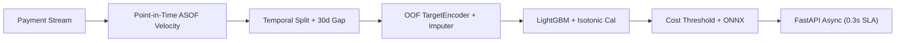
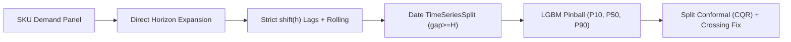
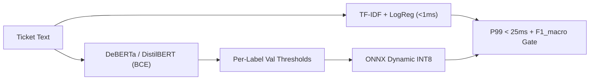
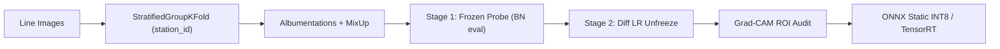

---
tags:
  - machine-learning
  - production-ml
  - xgboost
  - pytorch
  - forecasting
  - nlp
  - computer-vision
created: 2026-01-04
updated: 2026-11-13
status: 🟢
level: mid-to-senior
---

# ML Projects Guide

> [!abstract] Scope
> End-to-end production ML system design and runnable implementations across four core domains: real-time imbalanced tabular fraud detection, multi-horizon causal demand forecasting, sub-25 ms multi-label NLP triage, and low-sample industrial vision inspection. Integrates statistical invariants from [[Programming/Machine Learning/ML Fundamentals Guide|ML Fundamentals Guide]], model internals from [[Programming/Machine Learning/ML Algorithms Guide|ML Algorithms Guide]] and [[Programming/Machine Learning/Deep Learning Guide|Deep Learning Guide]], and operational pipelines in [[Programming/Machine Learning/MLOps & Production ML Guide|MLOps & Production ML Guide]].
> Navigation: [[Programming/Machine Learning/ML Hub|ML Hub]]

---

## 1. Production Architecture Selection Framework & Universal Invariants

Shipping production ML fails most often not from optimizer choice, but from mismatching model inductive bias to data geometry, leaking future information across evaluation boundaries, or shipping uncalibrated probabilities into cost-sensitive business rules.

### 1.1 Domain Architecture Selection & Trade-Off Matrix

| Domain & Data Regime | Default First Baseline | Production Escalation | Serving Runtime & Target SLA | Do NOT Use Unless Justified |
|---|---|---|---|---|
| **Tabular Risk / Fraud** ($10^4\text{–}10^7$ rows, $0.2\%\text{–}3\%$ positives) | Regularized LogisticRegression + OOF `TargetEncoder` | **LightGBM + Isotonic Calibration + Cost $\tau^*$** | FastAPI + ONNX Runtime (`< 300 ms` e2e w/ feature lookup; `< 5 ms` compute) | Deep tabular MLPs / TabNet (slower tuning, inferior calibration, higher tail latency) |
| **Multi-Horizon Panel Demand** ($10^3\text{–}10^5$ SKUs, intermittent zeros) | Seasonal Naive + Ridge w/ `shift(H)` lags | **Direct-Pooled LightGBM Quantile (P10/P50/P90) + CQR** or Tweedie | Batch Spark/DuckDB scoring + warehouse write | Unconstrained autoregressive LSTM (compounds step errors over horizon $H$) |
| **Multi-Label NLP Triage** ($K \ge 10$ tags, strict CPU latency) | `TF-IDF` + `OneVsRest(LogisticRegression)` | **DistilBERT / DeBERTa-v3 $\to$ ONNX Dynamic INT8** (or hybrid cascade) | ONNX Runtime CPU (`< 25 ms` P99 per ticket) | Frontier generative LLMs via HTTP (`200–1500 ms` latency, $100\times$ inference cost) |
| **Industrial Vision Inspection** ($500\text{–}5{,}000$ images, subtle defects) | Frozen `timm` **ConvNeXt / DINOv2** linear probe | **Two-Stage Differential LR + Albumentations + Grad-CAM** | TensorRT FP16/INT8 or ONNX Static INT8 (`< 10 ms`/frame) | Training ResNet/ViT from scratch (severe memorization & shortcut overfitting) |

### 1.2 Offline-to-Online Validation Gates (Mandatory Before Release)

1. **Zero Temporal & Group Leakage**: Training splits, target encoders, imputation statistics, and rolling features must reflect exact data availability at inference timestamp $t$ (`feat_ts < event_ts`).
2. **Calibration Verification**: Whenever decision logic uses expected cost or risk tiers, evaluate **Brier Score** and **Expected Calibration Error (ECE)** on a held-out temporal calibration slice—never apply economic thresholds to raw `scale_pos_weight` scores.
3. **Subgroup Slice Parity**: Verify primary metrics (`PR-AUC`, `wMAPE`, `F1_macro`) across tail classes, cold-start entities, and acquisition cohorts so head classes never mask silent tail collapse.
4. **Export Numerical Parity**: Measure `max_abs_diff` and rank-correlation between original Python/PyTorch predictions and exported ONNX/TensorRT artifacts (`max_abs_diff < 1e-4` for FP32, `> 0.995` rank correlation for INT8).
5. **Tail Latency Under Concurrency**: Benchmark P99 end-to-end latency under realistic burst concurrency, including preprocessing, tokenization, feature lookup timeouts, and model execution.

---

## 2. Project 1: Real-Time Imbalanced Fraud Detection (Tabular, 300 ms SLA)

### 2.1 System Architecture & Non-Negotiable Invariants

Real-time payment fraud combines extreme class imbalance ($0.3\%\text{–}2\%$ fraud), adversarial concept drift, high-cardinality entity identifiers (`merchant_id`, `device_hash`), delayed chargeback labels ($14\text{–}45$ days), and asymmetric misclassification costs ($C_{\text{FN}} \gg C_{\text{FP}}$).



#### Critical Engineering Mechanisms

1. **Point-in-Time `ASOF` Behavioral Velocity**: Raw transaction amount alone misses burst attacks. Features such as `user_tx_count_1h`, `user_amt_sum_24h`, and `device_distinct_users_7d` must aggregate **strictly prior** events (`hist.ts < curr.ts`). Including the current row or post-transaction updates creates silent training-serving skew when online scoring precedes database persistence.
2. **Maturation-Gap Temporal Splitting**: Recent transactions ($< 30$ days old) lack mature chargeback confirmation; labeling unresolved fraud as benign `0` injects systematic false negatives into training. Partition chronologically: `[Train] -> [30d Maturation Gap] -> [Calibration] -> [Held-out Test]`.
3. **Out-of-Fold (`cv=5`) Empirical Bayes `TargetEncoder`**: Global target encoding leaks validation labels into training rows for rare categories. Scikit-learn's `TargetEncoder(cv=5, smooth="auto")` computes cross-fitted empirical Bayes smoothed encodings during `.fit_transform(X_train, y_train)` while applying the global smoothed mapping to validation/test rows.
4. **Isotonic Calibration vs. Platt Scaling**: `IsotonicRegression(out_of_bounds="clip")` fits a non-parametric monotonic step function mapping raw model scores to calibrated probabilities without assuming a sigmoid shape—ideal when calibration slices contain $\ge 1{,}000$ positive events. For smaller calibration slices ($< 300$ positives), use parametric Platt scaling (`LogisticRegression` on log-odds) to avoid overfitting staircase plateaus.
5. **Expected-Cost Optimal Threshold $\tau^*$**: Given false-positive friction cost $C_{\text{FP}}$ (customer decline / manual review) and missed-fraud loss $C_{\text{FN}}$ (chargeback + goods + fees), declining/challenging maximizes expected profit when expected fraud loss exceeds review cost:

$$p \cdot C_{\text{FN}} > (1 - p) \cdot C_{\text{FP}} \implies \tau^* = \frac{C_{\text{FP}}}{C_{\text{FP}} + C_{\text{FN}}}$$

> [!warning] Never Threshold Uncalibrated `scale_pos_weight` Probabilities
> Setting `scale_pos_weight = 99` shifts model log-odds upward by $\ln(99) \approx +4.60$. Applying $\tau^* = 0.05$ directly to those distorted probabilities flags legitimate users en masse. Either train with unweighted `binary_logloss` or calibrate raw margins on an unweighted temporal calibration split before thresholding.

### 2.2 Complete Production Training, Calibration & ONNX Export (`fraud_pipeline.py`)

```python
from pathlib import Path
import json
import numpy as np
import pandas as pd
import optuna
import shap
import lightgbm as lgb
import joblib
import onnxruntime as ort
from onnxmltools import convert_lightgbm
from onnxmltools.convert.common.data_types import FloatTensorType
from sklearn.compose import ColumnTransformer
from sklearn.impute import SimpleImputer
from sklearn.isotonic import IsotonicRegression
from sklearn.metrics import average_precision_score, brier_score_loss
from sklearn.preprocessing import TargetEncoder

def compute_asof_velocity_features(tx_df: pd.DataFrame) -> pd.DataFrame:
    """
    Computes strictly causal trailing behavioral aggregates per user_id using closed='left'
    so the current transaction never contaminates its own velocity counters.
    """
    df = tx_df.sort_values(["user_id", "event_ts"]).reset_index(drop=True)
    df["event_ts"] = pd.to_datetime(df["event_ts"], utc=True)

    counts_1h, sums_24h, secs_since_prev = [], [], []
    for _, grp in df.groupby("user_id", sort=False):
        ts_ns = grp["event_ts"].astype("int64").to_numpy()
        amts = grp["amount_usd"].to_numpy(dtype=np.float64)
        n = len(grp)

        c1h = np.zeros(n, dtype=np.float32)
        s24h = np.zeros(n, dtype=np.float32)
        dt_prev = np.full(n, np.nan, dtype=np.float32)

        left_1h, left_24h = 0, 0
        running_sum_24h = 0.0
        one_h_ns = 3600 * 1_000_000_000
        day_ns = 24 * one_h_ns

        for i in range(n):
            t_now = ts_ns[i]
            while left_1h < i and (t_now - ts_ns[left_1h]) > one_h_ns:
                left_1h += 1
            while left_24h < i and (t_now - ts_ns[left_24h]) > day_ns:
                running_sum_24h -= amts[left_24h]
                left_24h += 1

            # Strict causal window [t_now - window, t_now): excludes i
            c1h[i] = float(i - left_1h)
            s24h[i] = float(running_sum_24h)
            if i > 0:
                dt_prev[i] = float((t_now - ts_ns[i - 1]) / 1e9)
            running_sum_24h += amts[i]

        counts_1h.append(c1h)
        sums_24h.append(s24h)
        secs_since_prev.append(dt_prev)

    df["user_tx_count_1h"] = np.concatenate(counts_1h)
    df["user_amt_sum_24h"] = np.concatenate(sums_24h)
    df["secs_since_prev_tx"] = np.concatenate(secs_since_prev)
    return df.sort_values("event_ts").reset_index(drop=True)


def temporal_split_with_gap(
    df: pd.DataFrame, time_col: str, maturation_gap_days: int = 30
) -> tuple[pd.DataFrame, pd.DataFrame, pd.DataFrame]:
    """Chronological split enforcing label maturation gap between train and evaluation."""
    ordered = df.sort_values(time_col).reset_index(drop=True)
    max_ts = ordered[time_col].max()
    mature_cutoff = max_ts - pd.Timedelta(days=maturation_gap_days)
    mature_df = ordered[ordered[time_col] <= mature_cutoff].reset_index(drop=True)

    n = len(mature_df)
    train_df = mature_df.iloc[: int(0.65 * n)].copy()
    cal_df = mature_df.iloc[int(0.65 * n) : int(0.80 * n)].copy()
    test_df = mature_df.iloc[int(0.80 * n) :].copy()
    return train_df, cal_df, test_df


def build_preprocessor(num_cols: list[str], cat_cols: list[str]) -> ColumnTransformer:
    return ColumnTransformer(
        transformers=[
            ("num", SimpleImputer(strategy="median", add_indicator=True), num_cols),
            ("cat", TargetEncoder(cv=5, smooth="auto", target_type="binary", random_state=42), cat_cols),
        ],
        remainder="drop",
    )


def expected_calibration_error(y_true: np.ndarray, y_prob: np.ndarray, n_bins: int = 10) -> float:
    bins = np.linspace(0.0, 1.0, n_bins + 1)
    ece = 0.0
    n = len(y_true)
    for lo, hi in zip(bins[:-1], bins[1:]):
        mask = (y_prob >= lo) & (y_prob < hi if hi < 1.0 else y_prob <= hi)
        if np.any(mask):
            ece += (np.sum(mask) / n) * abs(float(y_true[mask].mean()) - float(y_prob[mask].mean()))
    return float(ece)


def train_export_fraud_artifacts(
    raw_df: pd.DataFrame,
    num_cols: list[str],
    cat_cols: list[str],
    artifact_dir: str = "artifacts/fraud_v1",
    cost_fp: float = 15.0,
    cost_fn: float = 285.0,
    n_trials: int = 30,
) -> dict:
    out_path = Path(artifact_dir)
    out_path.mkdir(parents=True, exist_ok=True)

    feat_df = compute_asof_velocity_features(raw_df)
    train_df, cal_df, test_df = temporal_split_with_gap(feat_df, "event_ts", maturation_gap_days=30)

    all_num = num_cols + ["user_tx_count_1h", "user_amt_sum_24h", "secs_since_prev_tx"]
    features = all_num + cat_cols
    prep = build_preprocessor(all_num, cat_cols)

    X_tr = prep.fit_transform(train_df[features], train_df["is_fraud"]).astype(np.float32)
    X_cal = prep.transform(cal_df[features]).astype(np.float32)
    X_te = prep.transform(test_df[features]).astype(np.float32)
    y_tr = train_df["is_fraud"].to_numpy()
    y_cal = cal_df["is_fraud"].to_numpy()
    y_te = test_df["is_fraud"].to_numpy()

    def objective(trial: optuna.Trial) -> float:
        params = {
            "objective": "binary",
            "metric": "average_precision",
            "learning_rate": trial.suggest_float("learning_rate", 0.01, 0.12, log=True),
            "num_leaves": trial.suggest_int("num_leaves", 15, 95),
            "min_child_samples": trial.suggest_int("min_child_samples", 30, 300),
            "subsample": trial.suggest_float("subsample", 0.65, 1.0),
            "colsample_bytree": trial.suggest_float("colsample_bytree", 0.5, 1.0),
            "reg_lambda": trial.suggest_float("reg_lambda", 1e-2, 10.0, log=True),
            "n_estimators": 1200,
            "random_state": 42,
            "n_jobs": -1,
            "verbose": -1,
        }
        clf = lgb.LGBMClassifier(**params)
        pruning_cb = optuna.integration.LightGBMPruningCallback(trial, "average_precision")
        clf.fit(X_tr, y_tr, eval_set=[(X_cal, y_cal)], callbacks=[lgb.early_stopping(50, verbose=False), pruning_cb])
        return float(average_precision_score(y_cal, clf.predict_proba(X_cal)[:, 1]))

    study = optuna.create_study(direction="maximize", pruner=optuna.pruners.MedianPruner(n_warmup_steps=10))
    study.optimize(objective, n_trials=n_trials)

    best_clf = lgb.LGBMClassifier(**study.best_params, n_estimators=1200, random_state=42, n_jobs=-1, verbose=-1)
    best_clf.fit(X_tr, y_tr, eval_set=[(X_cal, y_cal)], callbacks=[lgb.early_stopping(50, verbose=False)])

    # Isotonic calibration on unweighted temporal calibration slice
    raw_cal = best_clf.predict_proba(X_cal)[:, 1]
    iso = IsotonicRegression(out_of_bounds="clip").fit(raw_cal, y_cal)

    raw_te = best_clf.predict_proba(X_te)[:, 1]
    cal_te = iso.transform(raw_te)
    tau_opt = cost_fp / (cost_fp + cost_fn)  # 15 / 300 = 0.05

    # Export LightGBM booster to ONNX and verify strict numerical parity
    n_features = X_tr.shape[1]
    onnx_model = convert_lightgbm(
        best_clf.booster_,
        initial_types=[("float_input", FloatTensorType([None, n_features]))],
        target_opset=15,
        zipmap=False,
    )
    onnx_path = out_path / "fraud_lgbm.onnx"
    onnx_path.write_bytes(onnx_model.SerializeToString())

    sess = ort.InferenceSession(str(onnx_path), providers=["CPUExecutionProvider"])
    onnx_probs = sess.run(None, {"float_input": X_te[:256]})[1][:, 1]
    max_parity_diff = float(np.max(np.abs(onnx_probs - raw_te[:256])))
    assert max_parity_diff < 1e-4, f"ONNX parity violation: {max_parity_diff}"

    # Adverse-action SHAP audit on test slice
    explainer = shap.TreeExplainer(best_clf)
    shap_vals = explainer.shap_values(X_te[:200])
    if isinstance(shap_vals, list):
        shap_vals = shap_vals[1]

    joblib.dump(prep, out_path / "preprocessor.joblib")
    joblib.dump(iso, out_path / "calibrator.joblib")
    meta = {"features": features, "tau_opt": tau_opt, "cost_fp": cost_fp, "cost_fn": cost_fn}
    (out_path / "metadata.json").write_text(json.dumps(meta, indent=2), encoding="utf-8")

    return {
        "test_pr_auc": float(average_precision_score(y_te, cal_te)),
        "test_brier": float(brier_score_loss(y_te, cal_te)),
        "test_ece": expected_calibration_error(y_te, cal_te),
        "tau_opt": tau_opt,
        "flag_rate": float((cal_te >= tau_opt).mean()),
        "onnx_max_abs_diff": max_parity_diff,
        "top_shap_mean_abs": np.abs(shap_vals).mean(axis=0).tolist(),
    }
```

### 2.3 Async 0.3s SLA FastAPI ONNX Serving Microservice (`fraud_serving.py`)

In real-time checkout scoring, model inference takes $< 2\text{ ms}$, while network round-trips to feature stores risk breaching the $300\text{ ms}$ SLA under tail GC pauses or cache misses. Enforce bounded `asyncio.wait_for` budgets and deterministic rule-based fallback rather than blocking checkout.

```python
import asyncio
import json
import math
import time
from contextlib import asynccontextmanager
from pathlib import Path
from typing import Protocol

import joblib
import numpy as np
import onnxruntime as ort
import pandas as pd
from fastapi import FastAPI
from pydantic import BaseModel, Field, field_validator

class FeatureStoreClient(Protocol):
    async def fetch_user_velocity(self, user_id: str) -> dict[str, float]:
        ...

class InMemoryAsyncFeatureStore:
    """Thread-safe async feature adapter mimicking Redis hash lookup (< 5ms SLA)."""

    def __init__(self, initial_state: dict[str, dict[str, float]] | None = None) -> None:
        self._store = initial_state or {}

    async def fetch_user_velocity(self, user_id: str) -> dict[str, float]:
        await asyncio.sleep(0.002)  # Simulate 2ms network RTT
        return self._store.get(
            user_id,
            {"user_tx_count_1h": float("nan"), "user_amt_sum_24h": float("nan"), "secs_since_prev_tx": float("nan")},
        )

class FraudScoreRequest(BaseModel):
    tx_id: str = Field(min_length=1, max_length=64)
    user_id: str = Field(min_length=1, max_length=64)
    merchant_id: str = Field(min_length=1, max_length=64)
    country_code: str = Field(pattern=r"^[A-Z]{2}$")
    amount_usd: float = Field(ge=0.0, le=250_000.0)
    card_present: int = Field(ge=0, le=1)

    @field_validator("amount_usd")
    @classmethod
    def check_finite_amount(cls, v: float) -> float:
        if not math.isfinite(v):
            raise ValueError("amount_usd must be finite")
        return v

class FraudScoreResponse(BaseModel):
    tx_id: str
    calibrated_prob: float
    decision: str
    degraded_fallback: bool
    latency_ms: float

class FraudEngine:
    def __init__(self, artifact_dir: Path, feature_store: FeatureStoreClient) -> None:
        self.prep = joblib.load(artifact_dir / "preprocessor.joblib")
        self.calibrator = joblib.load(artifact_dir / "calibrator.joblib")
        self.meta = json.loads((artifact_dir / "metadata.json").read_text(encoding="utf-8"))
        sess_opts = ort.SessionOptions()
        sess_opts.intra_op_num_threads = 1  # Avoid thread-pool contention under async workers
        self.session = ort.InferenceSession(
            str(artifact_dir / "fraud_lgbm.onnx"), sess_options=sess_opts, providers=["CPUExecutionProvider"]
        )
        self.input_name = self.session.get_inputs()[0].name
        self.feature_store = feature_store

    def _score_sync(self, row_df: pd.DataFrame) -> float:
        x_mat = self.prep.transform(row_df[self.meta["features"]]).astype(np.float32)
        raw_prob = float(self.session.run(None, {self.input_name: x_mat})[1][0, 1])
        return float(self.calibrator.transform(np.array([raw_prob]))[0])

    async def score_with_sla(self, req: FraudScoreRequest, sla_budget_s: float = 0.25) -> FraudScoreResponse:
        t0 = time.perf_counter()
        try:
            async with asyncio.timeout(sla_budget_s):
                vel = await self.feature_store.fetch_user_velocity(req.user_id)
                row = {
                    "amount_usd": req.amount_usd,
                    "card_present": float(req.card_present),
                    "merchant_id": req.merchant_id,
                    "country_code": req.country_code,
                    **vel,
                }
                row_df = pd.DataFrame([row])
                cal_prob = await asyncio.to_thread(self._score_sync, row_df)
                decision = "CHALLENGE" if cal_prob >= float(self.meta["tau_opt"]) else "APPROVE"
                return FraudScoreResponse(
                    tx_id=req.tx_id,
                    calibrated_prob=round(cal_prob, 5),
                    decision=decision,
                    degraded_fallback=False,
                    latency_ms=round((time.perf_counter() - t0) * 1000.0, 2),
                )
        except TimeoutError:
            # Deterministic fail-safe within 0.3s checkout SLA if Redis/scoring stalls
            fallback_decision = "CHALLENGE" if req.amount_usd >= 5000.0 else "APPROVE"
            return FraudScoreResponse(
                tx_id=req.tx_id,
                calibrated_prob=-1.0,
                decision=fallback_decision,
                degraded_fallback=True,
                latency_ms=round((time.perf_counter() - t0) * 1000.0, 2),
            )

engine_state: dict[str, FraudEngine] = {}

@asynccontextmanager
async def lifespan(app: FastAPI):
    store = InMemoryAsyncFeatureStore({"u_high_risk": {"user_tx_count_1h": 9.0, "user_amt_sum_24h": 4200.0, "secs_since_prev_tx": 14.0}})
    engine_state["fraud"] = FraudEngine(Path("artifacts/fraud_v1"), feature_store=store)
    yield
    engine_state.clear()

app = FastAPI(title="Fraud Scoring API", lifespan=lifespan)

@app.post("/v1/score", response_model=FraudScoreResponse)
async def score_transaction(req: FraudScoreRequest) -> FraudScoreResponse:
    return await engine_state["fraud"].score_with_sla(req, sla_budget_s=0.25)
```

---

## 3. Project 2: Multi-Horizon Causal Demand Forecasting

### 3.1 System Architecture & Causality Invariants

Multi-SKU demand forecasting must produce coherent multi-day trajectories across horizons $h \in \{1, \dots, H\}$ while handling intermittent zero sales, price/promotion spikes, and inventory asymmetric penalties requiring calibrated **P10 / P50 / P90 prediction intervals**.



#### Recursive vs. Direct vs. Direct-Pooled Multi-Horizon Trade-offs

| Strategy | Formulation | Error Accumulation? | Cross-Horizon Capacity | Production Verdict |
|---|---|---|---|---|
| **Recursive** | Fit 1-step model $\hat{y}_{t+1} = f(y_t, \dots)$; feed $\hat{y}_{t+1}$ back as lag to predict $t+2 \dots t+H$ | **Severe**: lag bias/variance compounds exponentially; breaks quantile coverage | Single model; fast to train | Avoid for $H > 3$ or volatile promo series |
| **Independent Direct** | Train $H$ separate models $f_h(x_t)$ predicting $y_{t+h}$ directly from origin $t$ | **Zero** | Ignores shared seasonal/elasticity structure across $h=1\dots H$; $H\times$ maintenance | Good when horizons have distinct dynamics and large data |
| **Direct-Pooled** | Expand panel by `horizon_step` $h \in [1, H]$, shifting lags $\ge h$, fitting one global model $f(x_t, h)$ | **Zero** | Pools all $(t, h)$ pairs across SKUs & horizons; clean single artifact | **Recommended production default** for panel GBDTs |

#### Zero-Inflated Intermittent Demand & Metric Selection

- **Why MAPE Fails**: $\text{MAPE} = \frac{1}{N} \sum \frac{|y_i - \hat{y}_i|}{|y_i|}$ diverges whenever $y_i = 0$ and biases models toward zero-underforecasting on low-volume SKUs. Replace MAPE with **Weighted MAPE (wMAPE)**:

$$\text{wMAPE} = \frac{\sum_{i=1}^N |y_i - \hat{y}_{50, i}|}{\sum_{i=1}^N |y_i|}$$

- **Intermittent / Count Formulations**: When $>40\%$ of SKU-days equal zero (spare parts, slow-moving retail), compare:
  1. **Tweedie Regression** (`objective="tweedie", tweedie_variance_power=1.3`): Models compound Poisson-Gamma distributions natively combining zero mass with right-skewed continuous magnitudes.
  2. **Two-Stage Hurdle Model**: Separate binary classifier $\hat{p}_i = P(Y_i > 0 \mid X_i)$ multiplied by conditional positive regressor $\hat{\mu}_i^+ = \mathbb{E}[Y_i \mid Y_i > 0, X_i]$.
- **Pinball Loss & Split Conformalized Quantile Regression (CQR)**: Tree quantile models train with asymmetric Pinball Loss for $q \in \{0.1, 0.5, 0.9\}$:

$$L_q(y, \hat{y}_q) = \max\big(q(y - \hat{y}_q),\ (q - 1)(y - \hat{y}_q)\big)$$

However, raw GBDT quantiles routinely under-cover on unseen dates (achieving 68% instead of nominal 80% empirical coverage). **Conformalized Quantile Regression (CQR)** adds a distribution-free finite-sample guarantee by computing conformity scores on a held-out calibration block:

$$E_i = \max\big(\hat{q}_{\text{lo}}(x_i) - y_i,\ y_i - \hat{q}_{\text{hi}}(x_i)\big)$$

Taking the $(1 - \alpha)(1 + 1/n_{\text{cal}})$ empirical quantile $s_{1-\alpha}$ of $\{E_i\}$ yields calibrated intervals $[\hat{q}_{\text{lo}}(x) - s_{1-\alpha},\ \hat{q}_{\text{hi}}(x) + s_{1-\alpha}]$.

### 3.2 Complete Causal Direct-Pooled Quantile + CQR Pipeline (`demand_forecasting.py`)

```python
import numpy as np
import pandas as pd
import lightgbm as lgb
from sklearn.model_selection import TimeSeriesSplit

def pinball_loss(y_true: np.ndarray, y_pred: np.ndarray, q: float) -> float:
    err = y_true - y_pred
    return float(np.mean(np.maximum(q * err, (q - 1.0) * err)))

def wmape(y_true: np.ndarray, y_pred: np.ndarray) -> float:
    return float(np.sum(np.abs(y_true - y_pred)) / np.maximum(np.sum(np.abs(y_true)), 1e-9))

def build_causal_direct_panel(df: pd.DataFrame, max_horizon: int = 14) -> pd.DataFrame:
    """
    Expands SKU daily demand into direct-pooled (origin_date, horizon_step) training rows.
    Every historical feature is anchored strictly <= origin_date (zero leakage into target_date).
    """
    base = df.sort_values(["sku_id", "date"]).copy()
    base["date"] = pd.to_datetime(base["date"])
    g = base.groupby("sku_id")["demand"]

    # Origin-time features known at forecast creation timestamp t_0
    base["orig_lag_0"] = base["demand"]
    base["orig_lag_7"] = g.shift(7)
    base["orig_lag_28"] = g.shift(28)
    base["orig_roll_mean_7"] = g.transform(lambda s: s.rolling(7, min_periods=1).mean())
    base["orig_roll_std_28"] = g.transform(lambda s: s.rolling(28, min_periods=7).std())
    base["orig_zero_rate_28"] = g.transform(lambda s: (s == 0).astype(float).rolling(28, min_periods=7).mean())

    frames = []
    for h in range(1, max_horizon + 1):
        sub = base.copy()
        sub["horizon_step"] = h
        sub["origin_date"] = sub["date"]
        sub["target_date"] = sub["origin_date"] + pd.to_timedelta(h, unit="D")
        # Future target y_{t0 + h}; promo_planned at target_date merged separately if deterministic
        sub["target_demand"] = sub.groupby("sku_id")["demand"].shift(-h)
        frames.append(sub)

    panel = pd.concat(frames, ignore_index=True)
    panel = panel.dropna(subset=["target_demand", "orig_lag_28", "orig_roll_std_28"]).reset_index(drop=True)

    # Calendar encodings belong strictly to target_date (known deterministically in advance)
    doy = panel["target_date"].dt.dayofyear
    panel["target_doy_sin"] = np.sin(2.0 * np.pi * doy / 365.25)
    panel["target_doy_cos"] = np.cos(2.0 * np.pi * doy / 365.25)
    panel["target_dow"] = panel["target_date"].dt.dayofweek.astype("category")
    panel["sku_id"] = panel["sku_id"].astype("category")
    return panel.sort_values(["origin_date", "sku_id", "horizon_step"]).reset_index(drop=True)


def fit_cqr_quantile_forecaster(
    panel: pd.DataFrame,
    feature_cols: list[str],
    max_horizon: int = 14,
    alpha: float = 0.20,  # 80% prediction interval -> P10 and P90
) -> dict:
    # Split strictly by unique origin_date with gap >= max_horizon so targets never overlap folds
    unique_origins = panel["origin_date"].drop_duplicates().sort_values().to_numpy()
    tscv = TimeSeriesSplit(n_splits=4, gap=max_horizon)

    quantiles = [alpha / 2.0, 0.5, 1.0 - alpha / 2.0]  # [0.1, 0.5, 0.9]
    oof_preds = {q: np.full(len(panel), np.nan) for q in quantiles}

    for tr_idx, val_idx in tscv.split(unique_origins):
        tr_dates = set(unique_origins[tr_idx])
        val_dates = set(unique_origins[val_idx])
        tr_mask = panel["origin_date"].isin(tr_dates)
        val_mask = panel["origin_date"].isin(val_dates)

        # Hold last 20% of validation fold origins for CQR calibration or use final fold calibration
        X_tr, y_tr = panel.loc[tr_mask, feature_cols], panel.loc[tr_mask, "target_demand"]
        X_val, y_val = panel.loc[val_mask, feature_cols], panel.loc[val_mask, "target_demand"]

        for q in quantiles:
            model = lgb.LGBMRegressor(
                objective="quantile",
                alpha=q,
                learning_rate=0.05,
                num_leaves=63,
                min_child_samples=40,
                n_estimators=700,
                random_state=42,
                n_jobs=-1,
                verbose=-1,
            )
            model.fit(X_tr, y_tr, eval_set=[(X_val, y_val)], callbacks=[lgb.early_stopping(40, verbose=False)])
            oof_preds[q][val_mask] = np.clip(model.predict(X_val), 0.0, None)

    valid_mask = ~np.isnan(oof_preds[0.5])
    y_valid = panel.loc[valid_mask, "target_demand"].to_numpy()
    raw_mat = np.vstack([oof_preds[quantiles[0]][valid_mask], oof_preds[0.5][valid_mask], oof_preds[quantiles[2]][valid_mask]]).T

    # Repair quantile crossing before CQR adjustment: P10 <= P50 <= P90
    repaired = np.maximum.accumulate(raw_mat, axis=1)

    # Split OOF evaluation chronologically into CQR Calibration (first 50%) and Test (last 50%)
    mid = len(y_valid) // 2
    cal_y, test_y = y_valid[:mid], y_valid[mid:]
    cal_lo, cal_hi = repaired[:mid, 0], repaired[:mid, 2]
    test_lo, test_p50, test_hi = repaired[mid:, 0], repaired[mid:, 1], repaired[mid:, 2]

    cqr_scores = np.maximum(cal_lo - cal_y, cal_y - cal_hi)
    n_cal = len(cqr_scores)
    q_level = min(1.0, (1.0 - alpha) * (1.0 + 1.0 / n_cal))
    s_adj = float(np.quantile(cqr_scores, q_level, method="higher"))

    adj_lo = np.clip(test_lo - s_adj, 0.0, None)
    adj_hi = np.clip(test_hi + s_adj, 0.0, None)

    raw_cov = float(np.mean((test_y >= test_lo) & (test_y <= test_hi)))
    cqr_cov = float(np.mean((test_y >= adj_lo) & (test_y <= adj_hi)))

    return {
        "test_wmape_p50": wmape(test_y, test_p50),
        "raw_pinball_p10": pinball_loss(test_y, test_lo, quantiles[0]),
        "raw_pinball_p90": pinball_loss(test_y, test_hi, quantiles[2]),
        "raw_coverage": raw_cov,
        "cqr_shift": s_adj,
        "cqr_coverage": cqr_cov,
    }
```

---

## 4. Project 3: Low-Latency Multi-Label NLP Support Triage (< 25 ms SLA)

### 4.1 System Architecture & Latency Discipline

Enterprise ticket routing assigns $K$ non-exclusive tags per text payload ($\mathbf{y} \in \{0, 1\}^K$) under a strict CPU inference ceiling ($\le 25\text{ ms}$ P99). Always verify whether a `< 1 ms` sparse linear model meets recall targets before paying transformer latency, and compress transformer deployments via **ONNX Runtime Dynamic INT8 Quantization**.



#### Core Engineering Invariants

1. **`BCEWithLogitsLoss` vs. `CrossEntropyLoss`**: Multi-label prediction models $K$ independent Bernoulli events $p_k = \sigma(z_k)$. Applying `CrossEntropyLoss` forces $\sum_k p_k = 1$, punishing secondary tags whenever a primary tag has high confidence. Use `BCEWithLogitsLoss(pos_weight=capped_weights)` where `pos_weight = torch.clamp((N - N_k) / max(N_k, 1), max=10.0)` prevents rare-class gradient explosions.
2. **Checkpoint on `F1_macro`, Not `F1_micro`**: `F1_micro` aggregates TP/FP/FN globally, letting 3 high-volume classes hide complete collapse (`F1 = 0.0`) on 15 long-tail routing queues. Checkpoint and tune thresholds on **`F1_macro`**.
3. **Per-Label Threshold Optimization ($\tau_1, \dots, \tau_K$)**: A uniform `0.5` cutoff misaligns with skewed class priors. Sweep thresholds $\tau_k \in [0.15, 0.85]$ exclusively on the **validation** split (with minimum support guard `pos_count >= 15`, else retain `0.5` to prevent overfitting single-digit tail tags).
4. **ONNX Dynamic INT8 Quantization**: Quantizes dense `MatMul`/`Gemm` weights offline to `int8` while dynamically quantizing activations at runtime. Shrinks transformer artifact footprint $\sim 3.5\times$ and accelerates CPU P99 latency $2.5\text{–}3.5\times$ with $< 0.5\%$ `F1_macro` variance.

### 4.2 Complete Sparse Baseline, Fine-Tuning, Threshold Tuning & INT8 Benchmark (`nlp_triage.py`)

```python
import time
import numpy as np
import torch
import torch.nn as nn
import onnxruntime as ort
from onnxruntime.quantization import QuantType, quantize_dynamic
from sklearn.feature_extraction.text import TfidfVectorizer
from sklearn.linear_model import LogisticRegression
from sklearn.metrics import f1_score
from sklearn.multiclass import OneVsRestClassifier
from sklearn.pipeline import Pipeline
from transformers import AutoModelForSequenceClassification, AutoTokenizer, get_cosine_schedule_with_warmup

def run_sparse_baseline(train_texts: list[str], y_train: np.ndarray, val_texts: list[str], y_val: np.ndarray) -> dict:
    pipe = Pipeline([
        ("tfidf", TfidfVectorizer(ngram_range=(1, 2), max_features=60_000, sublinear_tf=True)),
        ("clf", OneVsRestClassifier(LogisticRegression(C=2.0, class_weight="balanced", max_iter=500))),
    ])
    pipe.fit(train_texts, y_train)
    t0 = time.perf_counter()
    probs = pipe.predict_proba(val_texts)
    ms_per_doc = ((time.perf_counter() - t0) / max(1, len(val_texts))) * 1000.0
    preds = (probs >= 0.5).astype(int)
    return {
        "f1_macro": float(f1_score(y_val, preds, average="macro", zero_division=0)),
        "f1_micro": float(f1_score(y_val, preds, average="micro", zero_division=0)),
        "avg_ms_per_doc": round(ms_per_doc, 4),
        "pipeline": pipe,
    }


def tune_per_label_thresholds(val_probs: np.ndarray, val_labels: np.ndarray, min_pos_support: int = 15) -> np.ndarray:
    num_labels = val_labels.shape[1]
    thresholds = np.full(num_labels, 0.5, dtype=np.float32)
    grid = np.linspace(0.15, 0.85, 29)

    for k in range(num_labels):
        if int(val_labels[:, k].sum()) < min_pos_support:
            continue  # Avoid overfitting thresholds on ultra-rare classes
        best_tau, best_f1 = 0.5, -1.0
        for tau in grid:
            score = f1_score(val_labels[:, k], (val_probs[:, k] >= tau).astype(int), zero_division=0)
            if score > best_f1:
                best_f1, best_tau = score, float(tau)
        thresholds[k] = best_tau
    return thresholds


def finetune_multilabel_transformer(
    model_name: str,
    train_loader,
    val_loader,
    y_train_matrix: np.ndarray,
    num_labels: int,
    save_path: str = "best_triage_model.pt",
    epochs: int = 4,
    lr: float = 2e-5,
) -> tuple[float, np.ndarray]:
    device = torch.device("cuda" if torch.cuda.is_available() else "cpu")
    model = AutoModelForSequenceClassification.from_pretrained(
        model_name, num_labels=num_labels, problem_type="multi_label_classification"
    ).to(device)

    decay, no_decay = [], []
    for name, p in model.named_parameters():
        if not p.requires_grad:
            continue
        if p.ndim < 2 or "bias" in name or "LayerNorm" in name:
            no_decay.append(p)
        else:
            decay.append(p)

    optimizer = torch.optim.AdamW(
        [{"params": decay, "weight_decay": 0.01}, {"params": no_decay, "weight_decay": 0.0}], lr=lr
    )
    total_steps = len(train_loader) * epochs
    scheduler = get_cosine_schedule_with_warmup(optimizer, int(0.1 * total_steps), total_steps)

    # Capped positive class weights handle long-tail imbalance stably
    pos_counts = np.maximum(y_train_matrix.sum(axis=0), 1.0)
    neg_counts = len(y_train_matrix) - pos_counts
    pos_weight = torch.tensor(np.clip(neg_counts / pos_counts, 1.0, 10.0), dtype=torch.float32, device=device)
    criterion = nn.BCEWithLogitsLoss(pos_weight=pos_weight)

    best_macro, best_probs, best_labels = -1.0, None, None
    for _ in range(epochs):
        model.train()
        for batch in train_loader:
            optimizer.zero_grad(set_to_none=True)
            input_ids = batch["input_ids"].to(device, non_blocking=True)
            mask = batch["attention_mask"].to(device, non_blocking=True)
            labels = batch["labels"].float().to(device, non_blocking=True)

            with torch.amp.autocast("cuda", dtype=torch.bfloat16, enabled=device.type == "cuda"):
                logits = model(input_ids=input_ids, attention_mask=mask).logits
                loss = criterion(logits.float(), labels)

            loss.backward()
            torch.nn.utils.clip_grad_norm_(model.parameters(), 1.0)
            optimizer.step()
            scheduler.step()

        model.eval()
        all_probs, all_labels = [], []
        with torch.inference_mode():
            for batch in val_loader:
                logits = model(
                    input_ids=batch["input_ids"].to(device),
                    attention_mask=batch["attention_mask"].to(device),
                ).logits
                all_probs.append(torch.sigmoid(logits.float()).cpu().numpy())
                all_labels.append(batch["labels"].numpy())

        probs = np.vstack(all_probs)
        labels_np = np.vstack(all_labels)
        macro = float(f1_score(labels_np, (probs >= 0.5).astype(int), average="macro", zero_division=0))
        if macro > best_macro:
            best_macro, best_probs, best_labels = macro, probs, labels_np
            torch.save(model.state_dict(), save_path)

    opt_thresholds = tune_per_label_thresholds(best_probs, best_labels)
    tuned_macro = float(f1_score(best_labels, (best_probs >= opt_thresholds).astype(int), average="macro", zero_division=0))
    return tuned_macro, opt_thresholds


def export_int8_onnx_and_verify_sla(
    model_name: str, weights_path: str, val_texts: list[str], val_labels: np.ndarray, thresholds: np.ndarray, num_labels: int
) -> dict:
    tok = AutoTokenizer.from_pretrained(model_name)
    model = AutoModelForSequenceClassification.from_pretrained(model_name, num_labels=num_labels)
    model.load_state_dict(torch.load(weights_path, map_location="cpu", weights_only=True))
    model.eval()

    sample_enc = tok(val_texts[0], return_tensors="pt", padding="max_length", max_length=128, truncation=True)
    torch.onnx.export(
        model,
        (sample_enc["input_ids"], sample_enc["attention_mask"]),
        "triage_fp32.onnx",
        input_names=["input_ids", "attention_mask"],
        output_names=["logits"],
        dynamic_axes={"input_ids": {0: "batch", 1: "seq"}, "attention_mask": {0: "batch", 1: "seq"}},
        opset_version=17,
    )
    quantize_dynamic("triage_fp32.onnx", "triage_int8.onnx", weight_type=QuantType.QInt8)

    sess_opts = ort.SessionOptions()
    sess_opts.intra_op_num_threads = 4
    sess_opts.graph_optimization_level = ort.GraphOptimizationLevel.ORT_ENABLE_ALL
    sess = ort.InferenceSession("triage_int8.onnx", sess_options=sess_opts, providers=["CPUExecutionProvider"])

    # Warmup JIT buffers before latency measurement
    warm_in = {"input_ids": sample_enc["input_ids"].numpy(), "attention_mask": sample_enc["attention_mask"].numpy()}
    for _ in range(10):
        sess.run(None, warm_in)

    latencies_ms, int8_probs = [], []
    for txt in val_texts:
        enc = tok(txt, return_tensors="np", padding=True, max_length=128, truncation=True)
        t0 = time.perf_counter()
        logits = sess.run(None, {"input_ids": enc["input_ids"], "attention_mask": enc["attention_mask"]})[0]
        latencies_ms.append((time.perf_counter() - t0) * 1000.0)
        int8_probs.append(1.0 / (1.0 + np.exp(-logits[0])))

    probs_mat = np.vstack(int8_probs)
    int8_macro = float(f1_score(val_labels, (probs_mat >= thresholds).astype(int), average="macro", zero_division=0))
    p50_ms = float(np.percentile(latencies_ms, 50))
    p99_ms = float(np.percentile(latencies_ms, 99))

    assert p99_ms <= 25.0, f"SLA breach: ONNX INT8 P99={p99_ms:.2f}ms > 25.0ms"
    return {"int8_f1_macro": int8_macro, "p50_ms": round(p50_ms, 2), "p99_ms": round(p99_ms, 2)}
```

---

## 5. Project 4: Industrial Defect Vision Inspection (< 5,000 Samples, Edge TensorRT)

### 5.1 System Architecture, BatchNorm Traps & Shortcut Auditing

With $< 5{,}000$ images from manufacturing lines, training high-capacity Vision Transformers or ConvNets from scratch overfits background noise, lighting glare, or camera watermarks. Transfer learning requires strict **station-grouped splitting**, **frozen-BN stabilization**, **domain-valid geometric invariance**, and **Grad-CAM foreground localization gates**.



#### Critical CV Engineering Rules

1. **Frozen `BatchNorm2d` Trap in PyTorch**: Calling `model.train()` sets *every* submodule (`BatchNorm2d`, `Dropout`) to training mode—even parameters with `requires_grad=False`! During Stage 1 linear probing, keeping `model.train()` on a frozen backbone overwrites ImageNet/DINOv2 `running_mean` and `running_var` with tiny domain micro-batches, destroying representation geometry. Always override `train()` to force `self.backbone.eval()` during Stage 1.
2. **Group-Aware Splitting (`StratifiedGroupKFold`)**: Splitting images randomly puts near-duplicate consecutive conveyor frames and identical camera stations across train and validation, concealing **Clever Hans shortcuts** (memorizing camera bezel stamps or station lighting rather than surface cracks). Always group splits by `station_id` / `inspection_batch`.
3. **Physical Chirality & Augmentation Rules**: Never enable `HorizontalFlip` blindly. On directional weld seams, PCB footprints, or left/right anatomical radiographs, flipping alters defect class physics; restrict transforms to physical invariances (small rotations, brightness/contrast jitter, Gaussian sensor noise, CLAHE contrast).
4. **Grad-CAM Shortcut Energy Gate**: Register forward/backward hooks on the final spatial feature map (`ConvNeXt` stage 3 or ViT spatial reshape) and compute normalized $\text{CAM} = \text{ReLU}(\sum_k \alpha_k A^k)$. Quantify what fraction of CAM activation energy sits inside the object foreground ROI box versus outer margins.

### 5.2 Complete Two-Stage Transfer, Grad-CAM Audit & Static INT8 Quantization (`vision_inspection.py`)

```python
from pathlib import Path
import numpy as np
import torch
import torch.nn as nn
import torch.nn.functional as F
import albumentations as A
from albumentations.pytorch import ToTensorV2
import timm
from sklearn.model_selection import StratifiedGroupKFold
from onnxruntime.quantization import CalibrationDataReader, QuantFormat, QuantType, quantize_static

def build_transforms(img_size: int = 224) -> tuple[A.Compose, A.Compose]:
    train_tf = A.Compose([
        A.RandomResizedCrop(size=(img_size, img_size), scale=(0.82, 1.0)),
        A.RandomBrightnessContrast(brightness_limit=0.2, contrast_limit=0.2, p=0.5),
        A.Affine(rotate=(-12, 12), scale=(0.95, 1.05), p=0.5),
        A.GaussNoise(p=0.25),
        # Omit HorizontalFlip when defect orientation or part chirality is asymmetric
        A.Normalize(mean=(0.485, 0.456, 0.406), std=(0.229, 0.224, 0.225)),
        ToTensorV2(),
    ])
    val_tf = A.Compose([
        A.Resize(img_size, img_size),
        A.Normalize(mean=(0.485, 0.456, 0.406), std=(0.229, 0.224, 0.225)),
        ToTensorV2(),
    ])
    return train_tf, val_tf


def create_station_splits(labels: np.ndarray, station_ids: np.ndarray, n_splits: int = 5):
    sgkf = StratifiedGroupKFold(n_splits=n_splits)
    return list(sgkf.split(np.zeros(len(labels)), labels, groups=station_ids))


class DefectClassifier(nn.Module):
    def __init__(self, backbone_name: str = "convnext_tiny.fb_in22k_ft_in1k", num_classes: int = 4) -> None:
        super().__init__()
        self.backbone = timm.create_model(backbone_name, pretrained=True, num_classes=0)
        feat_dim = self.backbone.num_features
        self.head = nn.Sequential(nn.Dropout(0.2), nn.Linear(feat_dim, num_classes))
        self.freeze_backbone = True

    def set_stage(self, stage: int) -> None:
        self.freeze_backbone = (stage == 1)
        for p in self.backbone.parameters():
            p.requires_grad = not self.freeze_backbone
        for p in self.head.parameters():
            p.requires_grad = True

    def train(self, mode: bool = True):
        super().train(mode)
        if self.freeze_backbone:
            # Critical: prevent Stage 1 micro-batches from mutating pretrained BatchNorm running stats
            self.backbone.eval()
        return self

    def forward(self, x: torch.Tensor) -> torch.Tensor:
        feats = self.backbone(x)
        return self.head(feats)


def mixup_batch(x: torch.Tensor, y: torch.Tensor, num_classes: int, alpha: float = 0.4):
    lam = float(np.random.beta(alpha, alpha)) if alpha > 0 else 1.0
    perm = torch.randperm(x.size(0), device=x.device)
    mixed_x = lam * x + (1.0 - lam) * x[perm]
    y_oh = F.one_hot(y, num_classes=num_classes).float()
    soft_y = lam * y_oh + (1.0 - lam) * y_oh[perm]
    return mixed_x, soft_y


def build_stage_optimizer(model: DefectClassifier, stage: int) -> torch.optim.Optimizer:
    model.set_stage(stage)
    if stage == 1:
        return torch.optim.AdamW(model.head.parameters(), lr=1e-3, weight_decay=1e-2)
    return torch.optim.AdamW(
        [
            {"params": model.backbone.parameters(), "lr": 2e-5},
            {"params": model.head.parameters(), "lr": 3e-4},
        ],
        weight_decay=1e-2,
    )


def compute_gradcam_and_shortcut_audit(
    model: DefectClassifier,
    target_layer: nn.Module,
    img: torch.Tensor,
    class_idx: int,
    roi_mask: np.ndarray,
) -> tuple[np.ndarray, float]:
    """
    Computes Grad-CAM [h, w] and measures fraction of activation energy falling INSIDE
    the expected part ROI mask (values < 0.50 indicate Clever Hans background shortcuts).
    """
    acts, grads = [], []
    fh = target_layer.register_forward_hook(lambda m, inp, out: acts.append(out.detach()))
    bh = target_layer.register_full_backward_hook(lambda m, gin, gout: grads.append(gout[0].detach()))

    model.eval()
    logits = model(img)
    model.zero_grad(set_to_none=True)
    logits[0, class_idx].backward()
    fh.remove()
    bh.remove()

    fmap = acts[0][0]                     # [C, h, w]
    weights = grads[0][0].mean(dim=(1, 2))
    cam = torch.relu((weights[:, None, None] * fmap).sum(dim=0))
    cam = cam / (cam.max() + 1e-8)

    cam_up = F.interpolate(cam[None, None], size=roi_mask.shape, mode="bilinear", align_corners=False)[0, 0]
    cam_np = cam_up.cpu().numpy()
    roi_energy = float((cam_np * roi_mask).sum() / np.maximum(cam_np.sum(), 1e-8))
    return cam_np, roi_energy


class ImageCalibReader(CalibrationDataReader):
    """Representative calibration stream for ONNX Static INT8 QDQ PTQ."""

    def __init__(self, calib_batches: list[np.ndarray], input_name: str = "input") -> None:
        self._iter = iter([{input_name: b.astype(np.float32)} for b in calib_batches])

    def get_next(self):
        return next(self._iter, None)


def export_static_int8_and_trt_info(model: DefectClassifier, calib_batches: list[np.ndarray], out_dir: str = "artifacts/cv"):
    out_path = Path(out_dir)
    out_path.mkdir(parents=True, exist_ok=True)
    model.eval().cpu()

    dummy = torch.randn(1, 3, 224, 224)
    fp32_onnx = str(out_path / "defect_fp32.onnx")
    int8_onnx = str(out_path / "defect_int8_qdq.onnx")

    torch.onnx.export(
        model,
        dummy,
        fp32_onnx,
        input_names=["input"],
        output_names=["logits"],
        dynamic_axes={"input": {0: "batch"}, "logits": {0: "batch"}},
        opset_version=17,
    )
    quantize_static(
        model_input=fp32_onnx,
        model_output=int8_onnx,
        calibration_data_reader=ImageCalibReader(calib_batches, input_name="input"),
        quant_format=QuantFormat.QDQ,
        activation_type=QuantType.QUInt8,
        weight_type=QuantType.QInt8,
    )
    # Equivalent TensorRT compilation command for Jetson / L4 edge servers:
    trt_cmd = (
        f"trtexec --onnx={int8_onnx} --saveEngine={out_path}/defect_int8.plan "
        "--fp16 --int8 --minShapes=input:1x3x224x224 --optShapes=input:8x3x224x224 --maxShapes=input:16x3x224x224"
    )
    return {"fp32_onnx": fp32_onnx, "int8_onnx": int8_onnx, "trtexec_cmd": trt_cmd}
```

### 5.3 Vision Deployment Quantization Trade-off

| Export Format | Calibration Needed? | Typical Speedup (CPU / Edge GPU) | Accuracy Delta | Operational Trade-off |
|---|---|---|---|---|
| **ONNX FP32** | No | $1.2\text{–}1.6\times$ | $0\%$ | Portable baseline without numerical risk |
| **TensorRT FP16** | No | $2.5\text{–}3.5\times$ (GPU) | $< 0.1\%$ | Default GPU production runtime; fused Conv+Bias+Act |
| **ONNX / TensorRT Static INT8 (QDQ)** | Yes (200–500 rep images) | $3.0\text{–}4.5\times$ | $0.2\%\text{–}0.8\%$ | Essential for edge Jetson/CPU latency; audit per-class recall after calibration |

---

## 6. Silent Production Regression Case Studies & Forensic Playbook

| Symptom in Production | Hidden Pipeline Root Cause | Diagnostic Check | Permanent Architectural Fix |
|---|---|---|---|
| **Fraud `PR-AUC` drops $0.94 \to 0.61$; 38% false decline spike** | `TargetEncoder` fitted before `train_test_split`, plus `scale_pos_weight=99` fed straight into $\tau^* = 0.05$ | Compare `cal` vs `test` Brier score; verify `TargetEncoder` runs inside `ColumnTransformer` strictly on `X_train` | Chronological split + 30d gap; `TargetEncoder(cv=5)` on train only; `IsotonicRegression` calibration before $\tau^*$ |
| **Demand forecast hits 11% backtest MAPE, misses live trends by 45%** | `shift(1).rolling(7)` used for $H=14$ forecast + `TimeSeriesSplit(gap=0)` + MAPE ignoring zero-demand rows | Inspect `corr(feature, target_demand)` per lag; check `unique_dates` boundaries across CV folds | Direct-pooled panel with features anchored $\le t_0$; `TimeSeriesSplit(gap=H)` over `origin_date`; wMAPE + CQR |
| **NLP router has `F1_micro=0.89`, `F1_macro=0.21`, 78 ms CPU P99** | `CrossEntropyLoss` + `Softmax` forcing single-label competition + eager PyTorch `DeBERTa-base` FP32 | Print per-class confusion recall on tail 50% classes; profile CPU time per layer | Switch to `BCEWithLogitsLoss`, checkpoint on `F1_macro`, distill + `quantize_dynamic` INT8 ONNX |
| **Vision model logs 99% val acc, 52% accuracy on Line B** | Random split mixed Station 3 frames across train/val; model memorized camera bezel watermark | Run `compute_gradcam_and_shortcut_audit()` on false positives/negatives | `StratifiedGroupKFold` by `station_id`; crop ROI + photometric invariance; require ROI energy $> 0.65$ |
| **ONNX runtime predictions diverge from PyTorch training logits** | Training tokenizer used `padding="longest"` / lowercase normalization while serving passed raw cased text or fixed `max_length` pad mask mismatch | Run assertion checking `max_abs_diff < 1e-4` over 100 golden inputs between PyTorch & ONNX | Package canonical tokenizer config + preprocessing tests alongside `.onnx` artifact in CI |

---

## 7. Worked Exercises

### Exercise 1 (Tabular Fraud): Collapsing PR-AUC & Uncalibrated Threshold Explosion

A payment fraud model achieves **PR-AUC = 0.94** in offline validation but collapses to **PR-AUC = 0.61** in production while flagging **38%** of legitimate checkouts under $\tau^* = \frac{C_{\text{FP}}}{C_{\text{FP}} + C_{\text{FN}}} = \frac{10}{10 + 190} = 0.05$. Code review reveals:
- `TargetEncoder` was fitted on the entire dataset before `train_test_split(..., stratify=y)`.
- `LGBMClassifier(scale_pos_weight=99)` predictions went straight into `preds >= 0.05` without calibration.

Diagnose all three defects quantitatively and specify the exact corrected workflow.

### Solution 1

**Three Compounding Root Causes:**
1. **Target Encoding Leakage**: Fitting `TargetEncoder` before splitting embeds validation/test target outcomes into training and validation features—especially severe for low-count `merchant_id`/`device_hash` categories—artificially inflating offline PR-AUC from $0.61 \to 0.94$.
2. **Random Stratified Split Across Time**: Mixing concurrent timestamps leaks same-day fraud bursts and shared user histories between train and validation splits.
3. **Uncalibrated `scale_pos_weight=99` Log-Odds Shift**: Setting $w_+ = 99$ adds $\ln(99) \approx +4.60$ to model log-odds. A benign checkout with true fraud probability $p = 0.005$ ($\text{logit} \approx -5.29$) becomes shifted log-odds $-5.29 + 4.60 = -0.69 \implies \hat{p}_{\text{raw}} = \sigma(-0.69) \approx 0.334$. Because $0.334 > \tau^* = 0.05$, benign traffic floods the challenge queue.

**Corrected Workflow:**
1. Partition strictly chronologically with a label maturation gap: `train` $\to$ `calibration` $\to$ `test`.
2. Place `TargetEncoder(cv=5, smooth="auto")` inside `ColumnTransformer`, calling `.fit_transform` strictly on `train`.
3. Train unweighted (`binary_logloss`) or pass raw margins through `IsotonicRegression` fitted on the unweighted temporal calibration slice before applying $\tau^* = 0.05$.

---

### Exercise 2 (Time-Series Forecasting): Multi-Horizon Leakage & Zero-Demand Collapse

An engineer builds a 14-day-ahead ($H = 14$) store-SKU demand forecaster using:

```python
df["roll_7d"] = df.groupby("sku_id")["demand"].shift(1).rolling(7).mean()
tscv = TimeSeriesSplit(n_splits=5)  # gap=0
```

and selects hyperparameters using `MAPE`. Backtesting reports `MAPE = 11%`, yet live 14-day forecasts lag demand shifts by $45\%$, and intermittent SKUs trigger infinite losses. Diagnose all three bugs and provide the fix.

### Solution 2

1. **Multi-Horizon Target Leakage (`shift(1)` at $H=14$)**: When predicting target $y_{t_0 + 14}$ from origin $t_0$, the latest observed demand is $y_{t_0}$. On target row $t = t_0 + 14$, `shift(1).rolling(7)` averages $y_{t_0+7 \dots t_0+13}$—13 days of future demand unavailable at inference time. Anchor all rolling/lag features at origin $t_0$ (`shift(14).rolling(7).mean()` or direct-pooled origin rows).
2. **Row-Level `TimeSeriesSplit(gap=0)` on Multi-SKU Panels**: Splitting raw panel rows mixes SKUs across train/val at identical dates, and `gap=0` allows overlapping 14-day forecast targets across fold boundaries. Split on unique sorted `origin_date` values with `gap >= 14`.
3. **MAPE Instability on Zero/Intermittent Demand**: `MAPE` divides by $y_i$, exploding to $\infty$ when $y_i = 0$ and hyper-penalizing $1 \to 2$ predictions ($100\%$ error) while under-weighting high-volume items. Switch to **wMAPE** for aggregate accuracy and **Pinball Loss + CQR** across P10/P50/P90 for inventory safety-stock sizing.

---

### Exercise 3 (NLP Multi-Label Triage): Macro Collapse & CPU SLA Breach

A 20-class support ticket tagger logs `F1_micro = 0.89`, `F1_macro = 0.21`, and **78 ms** P99 latency per ticket on CPU against a **25 ms** SLA. Investigation reveals `nn.CrossEntropyLoss()` with `torch.softmax(logits, dim=-1)` and an unquantized FP32 `DeBERTa-base` runtime. Explain both failures and design the fix.

### Solution 3

**Root Causes:**
1. **Mutually Exclusive Softmax Suppression**: `CrossEntropyLoss` enforces $\sum_{k=1}^{20} p_k = 1$, forcing co-occurring tags to compete and crushing recall on the 17 tail classes (`F1_macro = 0.21`) while the 3 dominant classes keep `F1_micro = 0.89`.
2. **Unquantized FP32 `DeBERTa-base` on CPU**: 12 disentangled-attention layers in eager PyTorch FP32 saturate CPU memory bandwidth at ~78 ms/request.

**Remediation:**
1. Train with `nn.BCEWithLogitsLoss(pos_weight=capped_weights)` and independent `torch.sigmoid(logits)` outputs; checkpoint on validation **`F1_macro`** and tune per-label validation thresholds $\tau_k$.
2. Distill into a 6-layer encoder (`DistilBERT` / `MiniLM-L6`), export to **ONNX Runtime Dynamic INT8** (`~8–12 ms` P99), or add a `< 1 ms` `TF-IDF + LogisticRegression` confidence cascade before invoking ONNX.

---

### Exercise 4 (CV Transfer Learning): 99% Val Accuracy vs. 52% Line B Failure

A weld defect model reaches **99.1% validation accuracy** across 8,000 images from Line A but collapses to **52% accuracy** on Line B. Grad-CAM reveals peak energy on the **bottom-right camera timestamp watermark and conveyor bracket**, zero energy on the weld seam, and flipping images left-right halves accuracy. Diagnose all three issues and define the remediation.

### Solution 4

1. **Clever Hans Background Shortcut**: Defective parts occurred predominantly on Night Shift Station 3 (distinct watermark text and lighting bracket), allowing the CNN to classify timestamp pixels rather than weld geometry.
2. **Random Split Hiding Station Memorization**: Random splitting placed Station 3 images into both `train` and `val`. Replacing with `StratifiedGroupKFold` grouped by `station_id` catches domain overfitting immediately.
3. **Invalid Spatial/Mirror Assumptions & Missing ROI Masking**: Line B mounted cameras mirrored relative to Line A. Crop tightly to the deterministic weld ROI (masking HUD watermarks), verify chiral invariance before enabling horizontal flips, and add a **Grad-CAM ROI energy release gate** alongside validation Macro-F1.

---

### Exercise 5 (Forecasting Uncertainty): Conformalized Quantile Regression (CQR) & Crossing Repair

A direct-pooled demand forecaster predicts raw `[P10, P50, P90]` quantiles for 6 calibration SKU-dates below (target empirical coverage $1 - \alpha = 80\%$):

| Sample | True Demand $y_i$ | Raw $\hat{q}_{0.10}$ | Raw $\hat{q}_{0.50}$ | Raw $\hat{q}_{0.90}$ |
|---|---|---|---|---|
| 1 | `18` | `12` | `15` | `16` |
| 2 | `9` | `11` | `10` | `14` |
| 3 | `25` | `16` | `20` | `23` |
| 4 | `6` | `8` | `11` | `15` |
| 5 | `31` | `20` | `24` | `28` |
| 6 | `14` | `10` | `13` | `17` |

1. Repair any quantile crossing using `np.maximum.accumulate`, then compute the raw interval coverage across the 6 samples.
2. Compute every CQR conformity score $E_i = \max(\hat{q}_{\text{lo}} - y_i,\ y_i - \hat{q}_{\text{hi}})$, find the finite-sample conformal shift $s_{1-\alpha}$ at index $\lceil (n + 1)(1 - \alpha) \rceil$ ($n = 6, 1 - \alpha = 0.80$), and write the calibrated interval for a new forecast predicting repaired `[15, 19, 22]`.

### Solution 5

**1. Crossing Repair & Raw Coverage:**
Notice Sample 2 has raw crossing $\hat{q}_{0.10} = 11 > \hat{q}_{0.50} = 10$. Applying `np.maximum.accumulate` forces monotonic `P10 <= P50 <= P90`:
- Sample 2 repaired: `[11, 11, 14]`. All other rows are already monotonic (`[12,15,16]`, `[16,20,23]`, `[8,11,15]`, `[20,24,28]`, `[10,13,17]`).
- Raw interval hits ($y_i \in [\hat{q}_{0.10}, \hat{q}_{0.90}]$): Sample 1 ($18 \notin [12,16]$ Miss), Sample 2 ($9 \notin [11,14]$ Miss), Sample 3 ($25 \notin [16,23]$ Miss), Sample 4 ($6 \notin [8,15]$ Miss), Sample 5 ($31 \notin [20,28]$ Miss), Sample 6 ($14 \in [10,17]$ Hit).
- Raw empirical coverage = $1 / 6 = \mathbf{16.7\%}$ (severe under-coverage).

**2. CQR Conformity Scores & Calibrated Shift:**
- Sample 1: $\max(12 - 18,\ 18 - 16) = \max(-6, 2) = 2$
- Sample 2: $\max(11 - 9,\ 9 - 14) = \max(2, -5) = 2$
- Sample 3: $\max(16 - 25,\ 25 - 23) = \max(-9, 2) = 2$
- Sample 4: $\max(8 - 6,\ 6 - 15) = \max(2, -9) = 2$
- Sample 5: $\max(20 - 31,\ 31 - 28) = \max(-11, 3) = 3$
- Sample 6: $\max(10 - 14,\ 14 - 17) = \max(-4, -3) = -3$

Sorted conformity scores: `[-3, 2, 2, 2, 2, 3]`.
Finite-sample rank: $k = \lceil (6 + 1)(0.80) \rceil = \lceil 5.6 \rceil = \mathbf{6\text{th}}$ smallest score $\implies s_{0.80} = \mathbf{3}$.
For the new forecast `[15, 19, 22]`, the CQR-calibrated 80% prediction interval becomes:

$$[\max(0, 15 - 3),\ 22 + 3] = \mathbf{[12,\ 25]}$$

---

### Exercise 6 (Serving SLA & Export Audit): FastAPI Async Blocking & ONNX Divergence

A fraud API deployed behind 4 FastAPI Uvicorn workers claims a **200 ms** P99 SLA, yet under 80 concurrent requests P99 spikes to **1,450 ms** and ONNX probabilities differ from offline Python LightGBM predictions by `0.18`. Inspection reveals:
1. Inside `async def score(...)`, the endpoint calls synchronous `requests.post("http://redis-proxy/features")` and `model.predict(x)` directly on the event loop thread.
2. Offline training used `ColumnTransformer` median imputation, whereas online serving converted raw JSON directly to `np.array(..., dtype=np.float32)` replacing missing fields with `0.0` before calling `onnxruntime`.

Diagnose both failures and write the corrected async handler + parity test.

### Solution 6

**Root Causes:**
1. **Event-Loop Starvation**: Calling blocking `requests.post()` inside an `async def` route freezes the entire asyncio event loop for all concurrent connections sharing that Uvicorn worker, queuing 80 requests serially ($18\text{ ms} \times 80 \approx 1{,}440\text{ ms}$).
2. **Preprocessing / Null Imputation Divergence**: Feeding `0.0` for missing fields instead of passing `NaN` through the serialized `ColumnTransformer` (`SimpleImputer` + `TargetEncoder`) alters split directions (`0.0` vs imputed median or missing indicator `1.0`), shifting ONNX probabilities by `0.18`.

**Corrected Async Pattern & Parity Gate:**
1. Use async HTTP (`httpx.AsyncClient`) or async Redis (`redis.asyncio`) wrapped in `asyncio.timeout(0.15)` with fallback scoring, and offload CPU-bound preprocessing + ONNX calls via `await asyncio.to_thread(...)` with `intra_op_num_threads=1`.
2. Reuse the exact serialized `preprocessor.joblib` (`NaN` for missing fields) and verify `np.max(np.abs(onnx_probs - lgb_probs)) < 1e-4` in CI before publishing the container.
