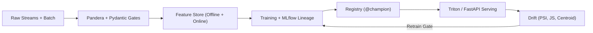
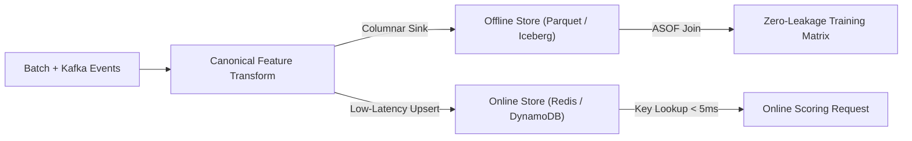
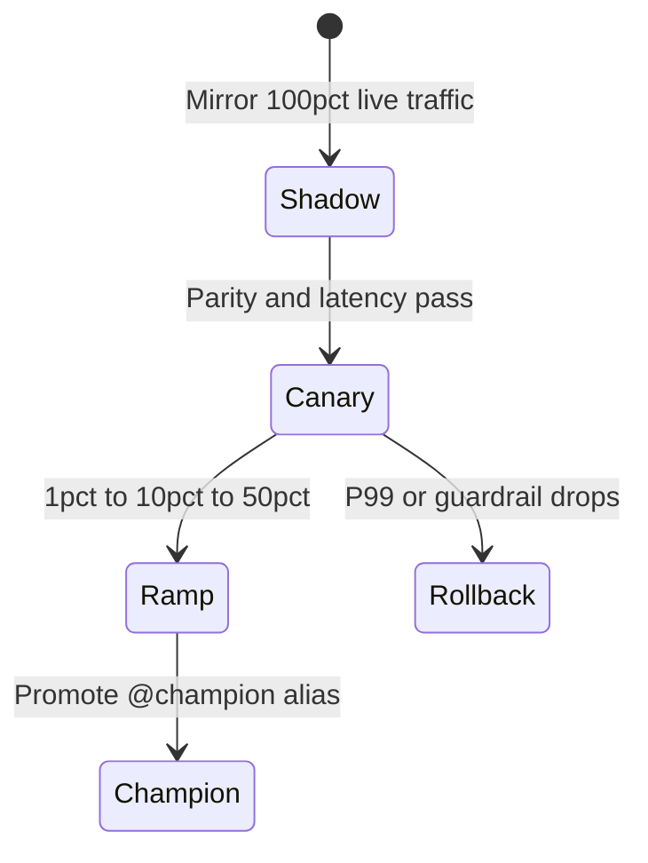

---
tags:
  - machine-learning
  - mlops
  - feature-store
  - serving
  - monitoring
created: 2026-11-13
updated: 2026-11-13
status: 🟢
level: mid-to-senior
---

# MLOps & Production ML Guide

> [!abstract] Scope
> Production ML system lifecycle, Pandera and Pydantic data contracts, point-in-time `ASOF` and Feast feature stores, training-serving skew elimination, immutable MLflow `@champion` / `@challenger` registries, Triton Dynamic Batching, ONNX/TensorRT INT8 optimization, shadow/canary/bandit rollouts, statistical drift detection without instant labels (`PSI`, `KS`, `JS`, embedding centroid shift), delayed-feedback attribution windows, feedback-loop IPW defenses, and incident triage. Operationalizes models from [[Programming/Machine Learning/ML Projects Guide|ML Projects Guide]] and [[Programming/Machine Learning/Deep Learning Guide|Deep Learning Guide]]; integrates DevOps foundations from [[Programming/Software Engineering/DevOps/Kubernetes|Kubernetes]], [[Programming/Software Engineering/DevOps/Observability|Observability]], and [[Programming/Software Engineering/System Design/ETL|ETL]].
> Navigation: [[Programming/Machine Learning/ML Hub|ML Hub]]

---

## 1. First-Principles Mechanics & Data Contracts

Production ML systems fail differently from deterministic microservices: an upstream schema mutation, silent `-1` null sentinel, or unit change (`cents` vs. `dollars`) leaves HTTP endpoints returning `200 OK` while silently destroying ranking calibration and revenue. Production stability requires enforcing **Data Contracts** at every storage and RPC boundary so corrupt data aborts pipelines *before* weights update or uncalibrated scores hit users.



### 1.1 Schema & Distributional CI Gates (`Pandera` + `Pydantic v2`)

| Gate Boundary | Tooling | Checked Invariants | Failure Behavior |
|---|---|---|---|
| **Batch Training / Feature ETL** | `Pandera`, `DuckDB` SQL asserts | Column dtypes, null ceilings, enum sets, monotonic UTC timestamps, range bounds, baseline-vs-batch PSI | Abort CI/Airflow DAG with exit code `1`; quarantine partition before training |
| **Online Inference Ingress** | `Pydantic v2` | Exact field types, finite floats (`math.isfinite`), bounded lengths/regexes | Return HTTP `422` or route request to deterministic fallback + Dead-Letter Queue |
| **Feature Store Materialization** | `Pandera` + freshness checks | Entity key uniqueness, watermark lag $\le \Delta_{\text{SLA}}$ | Hold Redis/DynamoDB upsert; keep valid prior snapshot within TTL |

### 1.2 Complete CI Data Contract & Distributional Gate Module (`contracts.py`)

```python
import math
import sys
import numpy as np
import pandas as pd
import pandera.pandas as pa
from pandera.typing import Series
from pydantic import BaseModel, Field, field_validator

class FraudTrainingContract(pa.DataFrameModel):
    """Strict batch training contract verified in CI before every model training run."""

    tx_id: Series[str] = pa.Field(unique=True, nullable=False)
    user_id: Series[str] = pa.Field(nullable=False, str_length={"min_value": 1, "max_value": 64})
    event_ts: Series[pa.DateTime] = pa.Field(nullable=False)
    amount_usd: Series[float] = pa.Field(ge=0.0, le=250_000.0, nullable=False)
    tx_count_24h: Series[int] = pa.Field(ge=0, le=10_000, nullable=False)
    country_code: Series[str] = pa.Field(str_matches=r"^[A-Z]{2}$", nullable=False)
    is_fraud: Series[int] = pa.Field(isin=[0, 1], nullable=False)

    @pa.dataframe_check
    def check_positive_class_band(cls, df: pd.DataFrame) -> bool:
        # Fail fast if upstream label join drops positive fraud records or duplicates positives
        rate = float(df["is_fraud"].mean())
        return 0.001 <= rate <= 0.25

    @pa.dataframe_check
    def check_utc_monotonicity_and_null_ceiling(cls, df: pd.DataFrame) -> bool:
        if df["event_ts"].dt.tz is None:
            return False
        # Require minimum 10,000 rows for stable training splits
        return len(df) >= 100

    class Config:
        strict = True   # Reject unexpected injected columns
        coerce = False  # Refuse silent string->float coercion hiding upstream breakage


def run_ci_distribution_gate(
    train_df: pd.DataFrame,
    baseline_quantiles: dict[str, list[float]],
    max_allowed_psi: float = 0.20,
) -> None:
    """
    Runs schema validation plus pre-training covariate shift checks against reference quantiles.
    Exits non-zero in CI on any contract breach.
    """
    validated = FraudTrainingContract.validate(train_df, lazy=True)
    for col, edges in baseline_quantiles.items():
        arr = validated[col].to_numpy(dtype=np.float64)
        hist, _ = np.histogram(arr, bins=np.array(edges, dtype=np.float64))
        actual = np.clip(hist / max(len(arr), 1), 1e-6, None)
        expected = np.full(len(actual), 1.0 / len(actual), dtype=np.float64)
        psi = float(np.sum((actual - expected) * np.log(actual / expected)))
        if psi > max_allowed_psi:
            raise ValueError(f"CI Contract Breach: feature '{col}' pre-train PSI={psi:.3f} > {max_allowed_psi}")


class OnlineFraudRequest(BaseModel):
    """Online FastAPI / Triton gateway ingress contract rejecting NaN/Inf and malformed entities."""

    tx_id: str = Field(min_length=1, max_length=64)
    user_id: str = Field(min_length=1, max_length=64)
    amount_usd: float = Field(ge=0.0, le=250_000.0)
    country_code: str = Field(pattern=r"^[A-Z]{2}$")
    card_present: int = Field(ge=0, le=1)

    @field_validator("amount_usd")
    @classmethod
    def reject_non_finite(cls, v: float) -> float:
        if not math.isfinite(v):
            raise ValueError("amount_usd must be finite (NaN/Inf rejected)")
        return v
```

---

## 2. Architectural Decision Matrix: Serving, Feature Stores & Rollouts

| Architectural Choice | When to Adopt | When NOT to Use (Better Alternative) | Latency / Consistency / Ops Trade-Off |
|---|---|---|---|
| **Batch Scoring** (Spark / DuckDB $\to$ DB) | Churn propensity, CRM campaigns, next-day demand replenishment | Checkout fraud or interactive search requiring real-time request context | Lowest infra cost, zero online GPU idling; staleness equals schedule cadence |
| **FastAPI + ONNX CPU** | Tabular GBDTs or quantized MiniLM encoders (`< 10k` RPS) | Large vision/LLM workloads saturating CPU cores | Simple OCI deployment, $< 15\text{ ms}$ P99 without GPU scheduling overhead |
| **Triton Inference Server + TensorRT** | High-QPS GPU vision/NLP transformers needing dynamic batching & multi-model ensembles | Low-QPS ($< 5\text{ RPS}$) tabular services where batching adds queue delay without GPU saturation | Dynamic batching boosts L4/A10G throughput $4\times\text{–}8\times$; adds `config.pbtxt` ops complexity |
| **Feast / Tecton Dual Feature Store** | Shared rolling aggregates across multiple teams/models requiring strict `< 5 ms` online SLA | Single-model static lookups directly from Postgres primary key | Eliminates training-serving skew via single feature definition; adds Redis/streaming sync cost |
| **Shadow $\to$ Canary $\to$ Champion** | High-stakes risk/pricing/defect models where errors carry financial or safety liability | Rapidly shifting ad/recommendation CTR arms with instant feedback | Zero blast radius during Shadow; requires double compute while shadowing |
| **Multi-Armed Bandit (Thompson)** | Fast-feedback recommendations/ads ($< 5\text{ min}$ reward latency) across discrete model arms | Delayed-label lending/fraud (30-day rewards cause bandit exploration collapse) | Minimizes regret dynamically; breaks if rewards arrive weeks late |

---

## 3. Point-in-Time Feature Stores & Training-Serving Skew Physics

A Feature Store separates **one canonical transformation definition** from two synchronized storage sinks so offline training datasets and online inference microservices compute identical feature semantics.



| Store Dimension | Offline Store (Parquet / Iceberg / Snowflake) | Online Store (Redis / DynamoDB) |
|---|---|---|
| **Access Pattern** | Columnar range scans across $10^6\text{–}10^{10}$ historical rows | Single-entity primary-key point lookup (`user_id`) |
| **Latency SLA** | Seconds to minutes (throughput-bound) | $< 5\text{ ms}$ P99 |
| **Retention** | Full multi-year immutable snapshot history | Latest materialized entity state with TTL expiration |
| **Primary Failure Mode** | Point-in-time leakage via naive SQL joins | Stale cache reads, eviction gaps, or skewed transform code |

### 3.1 Six Root Causes of Training-Serving Skew

1. **Duplicate Transformation Codebases**: Offline Spark SQL computes `LOG(amount + 1)` and imputes nulls with training median `42.50`, whereas online Python computes raw dollars and replaces missing Redis keys with `0.0`.
2. **Current-Event Inclusion Bias**: Online transaction scoring reads Redis *before* incrementing `tx_count_24h`, while offline batch SQL aggregated transactions with `ts <= event_ts` including the transaction being scored (`+1` systematic skew).
3. **Timezone / DST Mismatch**: Offline warehouse timestamps normalize to `UTC`, while online microservices call wall-clock `datetime.now()` in `US/Eastern` (shifting sliding windows by 4–5 hours).
4. **Float Precision / Rounding Drift**: Offline Parquet stores `float64` while online JSON serialization or FP16 quantization truncates edge split thresholds.
5. **Silent Stale TTL Reads**: Online Redis cache fails to expire keys cleanly or drops updates during Kafka consumer lag, feeding week-old velocity spikes.
6. **Non-Deterministic Tie-Breaking**: Identical timestamps between label events and stream updates resolve differently across SQL workers vs. streaming reducers.

### 3.2 Point-in-Time `ASOF` Joins (Pandas, SQL & Feast)

For each label event $(e_i, t_i)$ and streaming feature history $(e_i, \tau_j, f_j)$, a standard `LEFT JOIN` on `entity_id` creates a Cartesian explosion matching future features ($\tau_j > t_i$) backward onto past rows. A **Point-in-Time `ASOF` join** retrieves strictly the latest feature snapshot available prior to $t_i$ within freshness bound $\Delta_{\text{TTL}}$:

$$\tau^* = \max\big\{\tau_j : e_j = e_i \ \land \ t_i - \Delta_{\text{TTL}} \le \tau_j < t_i\big\}$$

Use strict inequality $\tau_j < t_i$ whenever downstream streams write post-event aggregates sharing the same event timestamp $t_i$.

```python
import pandas as pd

def point_in_time_asof_join(
    labels_df: pd.DataFrame, features_df: pd.DataFrame, ttl_hours: int = 24
) -> pd.DataFrame:
    """
    Executes zero-leakage backward ASOF join enforcing strict feat_ts < label_ts
    within freshness tolerance. Both frames MUST be sorted ascending on timestamp.
    """
    left = labels_df.copy()
    right = features_df.copy()
    left["label_ts"] = pd.to_datetime(left["label_ts"], utc=True)
    right["feat_ts"] = pd.to_datetime(right["feat_ts"], utc=True)

    left = left.sort_values("label_ts").reset_index(drop=True)
    right = right.sort_values("feat_ts").reset_index(drop=True)

    return pd.merge_asof(
        left,
        right,
        left_on="label_ts",
        right_on="feat_ts",
        by="user_id",
        direction="backward",
        allow_exact_matches=False,
        tolerance=pd.Timedelta(hours=ttl_hours),
    )
```

Equivalent warehouse SQL (`DuckDB` / `Snowflake` native `ASOF` syntax and portable ANSI-SQL `ROW_NUMBER()` fallback):

```sql
-- Option A: Native DuckDB / Snowflake ASOF LEFT JOIN
SELECT l.user_id, l.label_ts, l.is_fraud, f.risk_score_7d, f.tx_count_24h
FROM labels l
ASOF LEFT JOIN user_features f
  ON l.user_id = f.user_id
 AND f.feat_ts < l.label_ts
 AND f.feat_ts >= l.label_ts - INTERVAL '24 hours';

-- Option B: Portable ANSI-SQL (Postgres / BigQuery / Spark)
WITH ranked_snapshots AS (
    SELECT
        l.user_id,
        l.label_ts,
        l.is_fraud,
        f.risk_score_7d,
        f.tx_count_24h,
        ROW_NUMBER() OVER (
            PARTITION BY l.user_id, l.label_ts
            ORDER BY f.feat_ts DESC
        ) AS rn
    FROM labels l
    LEFT JOIN user_features f
      ON l.user_id = f.user_id
     AND f.feat_ts < l.label_ts
     AND f.feat_ts >= l.label_ts - INTERVAL '24 hours'
)
SELECT user_id, label_ts, is_fraud, risk_score_7d, tx_count_24h
FROM ranked_snapshots
WHERE rn = 1;
```

### 3.3 Canonical Shared Transforms & Declarative Feature Store Pattern

To guarantee zero skew between batch training and online serving: (1) declare feature schemas once via Feast-style `Entity` + `FeatureView` definitions backing both Parquet offline scans and Redis online writes, and (2) compile numeric preprocessing (`SimpleImputer`, `StandardScaler`, `OneHotEncoder`) directly into the **exported ONNX graph** alongside model weights using `skl2onnx` so serving executes byte-identical floating-point math.

```python
from datetime import timedelta
from feast import Entity, FeatureView, Field, FileSource
from feast.types import Float32, Int64
import numpy as np
from sklearn.compose import ColumnTransformer
from sklearn.impute import SimpleImputer
from sklearn.pipeline import Pipeline
from sklearn.preprocessing import StandardScaler
from sklearn.linear_model import LogisticRegression
from skl2onnx import convert_sklearn
from skl2onnx.common.data_types import FloatTensorType
import onnxruntime as ort

# 1. Declarative Feast definition serving both historical ASOF & Redis online lookups
user_entity = Entity(name="user_id", join_keys=["user_id"])
velocity_source = FileSource(
    name="user_velocity_parquet",
    path="s3://ml-features/user_velocity/",
    timestamp_field="feat_ts",
)
user_velocity_view = FeatureView(
    name="user_velocity_features",
    entities=[user_entity],
    ttl=timedelta(hours=24),
    schema=[
        Field(name="tx_count_24h", dtype=Int64),
        Field(name="avg_amt_usd_7d", dtype=Float32),
    ],
    online=True,
    source=velocity_source,
)

# 2. Bundle deterministic imputer + scaler + model inside a SINGLE ONNX graph
def build_zero_skew_onnx_pipeline(X_train: np.ndarray, y_train: np.ndarray, out_file: str) -> None:
    pipe = Pipeline([
        ("prep", ColumnTransformer([("num", Pipeline([("imp", SimpleImputer(strategy="median")), ("sc", StandardScaler())]), [0, 1])])),
        ("clf", LogisticRegression(C=1.0, max_iter=500)),
    ])
    pipe.fit(X_train, y_train)
    onnx_graph = convert_sklearn(pipe, initial_types=[("float_input", FloatTensorType([None, 2]))], target_opset=15)
    with open(out_file, "wb") as f:
        f.write(onnx_graph.SerializeToString())

    # Parity assertion between sklearn & single-graph ONNX
    sess = ort.InferenceSession(out_file, providers=["CPUExecutionProvider"])
    onnx_probs = sess.run(None, {"float_input": X_train[:32].astype(np.float32)})[1][:, 1]
    sk_probs = pipe.predict_proba(X_train[:32])[:, 1]
    assert np.max(np.abs(onnx_probs - sk_probs)) < 1e-5
```

---

## 4. Immutable Model Registry, Packaging & High-Throughput Serving

### 4.1 Immutable Lineage & MLflow `@champion` / `@challenger` Promotion Gate

Incident recovery requires pinning every live prediction to exact immutable lineage: Git commit SHA, OCI image digest (`sha256:...`), Iceberg/Delta dataset snapshot ID, feature cutoff timestamp, `ModelSignature`, and per-slice evaluation metrics. Legacy MLflow stages (`Staging`, `Production`) race under concurrent CI jobs. Assign immutable integer versions (`v14`) paired with explicit **aliases**: `@challenger`, `@champion`, and `@rollback`.

```python
import time
import numpy as np
import mlflow
import onnxruntime as ort
from mlflow.models import infer_signature
from sklearn.metrics import average_precision_score

def register_challenger_and_promote(
    onnx_model_proto,
    onnx_path: str,
    X_golden: np.ndarray,
    y_golden: np.ndarray,
    slice_masks: dict[str, np.ndarray],
    git_sha: str,
    dataset_snapshot: str,
    model_name: str = "fraud_scorer",
    max_p99_ms: float = 10.0,
) -> str:
    """
    Logs challenger artifact with immutable tags, runs multi-slice metric + P99 latency gate
    against current @champion, and atomically updates @rollback and @champion aliases.
    """
    client = mlflow.MlflowClient()

    sess = ort.InferenceSession(onnx_path, providers=["CPUExecutionProvider"])
    in_name = sess.get_inputs()[0].name
    sample_preds = sess.run(None, {in_name: X_golden[:16].astype(np.float32)})[1][:, 1]

    with mlflow.start_run(tags={"git_sha": git_sha, "dataset_snapshot": dataset_snapshot}):
        sig = infer_signature(X_golden[:16].astype(np.float32), sample_preds)
        info = mlflow.onnx.log_model(
            onnx_model_proto,
            artifact_path="model",
            signature=sig,
            registered_model_name=model_name,
        )
        challenger_ver = info.registered_model_version
        client.set_registered_model_alias(model_name, "challenger", challenger_ver)

        # 1. Measure challenger overall + critical subgroup slice PR-AUC
        chal_probs = sess.run(None, {in_name: X_golden.astype(np.float32)})[1][:, 1]
        chal_overall = float(average_precision_score(y_golden, chal_probs))
        mlflow.log_metric("golden_pr_auc", chal_overall)

        for slice_name, mask in slice_masks.items():
            slice_score = float(average_precision_score(y_golden[mask], chal_probs[mask]))
            mlflow.log_metric(f"slice_pr_auc_{slice_name}", slice_score)
            if slice_score < 0.55:
                raise RuntimeError(f"Promotion blocked: slice '{slice_name}' PR-AUC={slice_score:.3f} < 0.55")

        # 2. Measure single-item P99 inference latency
        latencies = []
        for idx in range(min(200, len(X_golden))):
            row = X_golden[idx : idx + 1].astype(np.float32)
            t0 = time.perf_counter()
            sess.run(None, {in_name: row})
            latencies.append((time.perf_counter() - t0) * 1000.0)
        p99_ms = float(np.percentile(latencies, 99))
        mlflow.log_metric("p99_ms", p99_ms)
        if p99_ms > max_p99_ms:
            raise RuntimeError(f"Promotion blocked: ONNX P99={p99_ms:.2f}ms > {max_p99_ms}ms")

    # 3. Compare against @champion if one exists; retain old champion as @rollback
    try:
        champ_mv = client.get_model_version_by_alias(model_name, "champion")
        champ_runs = mlflow.get_run(champ_mv.run_id)
        champ_pr_auc = float(champ_runs.data.metrics.get("golden_pr_auc", 0.0))
        if chal_overall < champ_pr_auc - 0.005:
            raise RuntimeError(f"Promotion blocked: challenger {chal_overall:.4f} < champion {champ_pr_auc:.4f}")
        client.set_registered_model_alias(model_name, "rollback", champ_mv.version)
    except mlflow.exceptions.RestException:
        pass  # Initial bootstrap deployment

    client.set_registered_model_alias(model_name, "champion", challenger_ver)
    return str(challenger_ver)
```

### 4.2 Triton Inference Server Dynamic Batching, Ensembles & TensorRT Calibration

Executing CUDA kernels with `batch_size=1` leaves 95%+ of Tensor Core arithmetic idle and bottlenecks on kernel-launch latency and HBM weight reads. **Triton Dynamic Batching** buffers concurrent inference requests in GPU queues up to `max_batch_size` or `max_queue_delay_microseconds`—whichever threshold triggers first—amalgamating independent API requests into dense batched Tensor Core GEMMs.

```protobuf
# Triton model_repository/triage_trt/config.pbtxt
name: "triage_trt"
platform: "tensorrt_plan"
max_batch_size: 32
input [
  { name: "input_ids" data_type: TYPE_INT32 dims: [ 128 ] },
  { name: "attention_mask" data_type: TYPE_INT32 dims: [ 128 ] }
]
output [
  { name: "logits" data_type: TYPE_FP32 dims: [ 24 ] }
]
dynamic_batching {
  preferred_batch_size: [ 8, 16, 32 ]
  max_queue_delay_microseconds: 3000
}
instance_group [
  {
    count: 2
    kind: KIND_GPU
    gpus: [ 0 ]
  }
]
```

#### Graph Optimization & Static INT8 Calibration Mechanics

1. **ONNX Runtime Graph Passes (`ORT_ENABLE_ALL`)**: Executes constant folding, dead-node elimination, horizontal `MatMul` fusion (combining $Q, K, V$ projections), and vertical operator fusion (`Conv + BatchNorm + ReLU`, `MatMul + Add + GELU`) to cut intermediate HBM traffic.
2. **TensorRT FP16 & Entropy INT8 Calibration**: `trtexec` lowers FP32 ONNX weights to FP16 or calibrates dynamic activation ranges across $200\text{–}500$ representative batches using `IInt8EntropyCalibrator2` (minimizing KL divergence $D_{\text{KL}}(P_{\text{FP32}} \| Q_{\text{INT8}})$ of quantized activation histograms):

```bash
trtexec \
  --onnx=triage_fp32.onnx \
  --saveEngine=triage_int8.plan \
  --fp16 --int8 \
  --minShapes=input_ids:1x128,attention_mask:1x128 \
  --optShapes=input_ids:16x128,attention_mask:16x128 \
  --maxShapes=input_ids:32x128,attention_mask:32x128 \
  --memPoolSize=workspace:2048
```

#### Kubernetes Serving Resilience & Custom-Metric Autoscaling

```yaml
apiVersion: apps/v1
kind: Deployment
metadata:
  name: triton-triage-serving
spec:
  replicas: 3
  template:
    spec:
      initContainers:
        - name: fetch-model-bundle
          image: amazon/aws-cli:2.17.0
          command: ["aws", "s3", "sync", "s3://ml-artifacts/triage/v14/", "/models/triage_trt/1/"]
          volumeMounts:
            - name: nvme-model-cache
              mountPath: /models
      containers:
        - name: triton
          image: nvcr.io/nvidia/tritonserver:25.02-py3
          args: ["tritonserver", "--model-repository=/models", "--strict-readiness=true"]
          ports:
            - containerPort: 8000
            - containerPort: 8002  # Prometheus metrics endpoint
          resources:
            limits:
              nvidia.com/gpu: "1"
          readinessProbe:
            httpGet:
              path: /v2/health/ready
              port: 8000
            initialDelaySeconds: 15
            periodSeconds: 5
          volumeMounts:
            - name: nvme-model-cache
              mountPath: /models
      volumes:
        - name: nvme-model-cache
          emptyDir:
            medium: Memory
---
apiVersion: autoscaling/v2
kind: HorizontalPodAutoscaler
metadata:
  name: triton-queue-hpa
spec:
  scaleTargetRef:
    apiVersion: apps/v1
    kind: Deployment
    name: triton-triage-serving
  minReplicas: 3
  maxReplicas: 16
  metrics:
    - type: Pods
      pods:
        metric:
          name: nv_inference_queue_duration_us
        target:
          type: AverageValue
          averageValue: "2500"  # Scale out before queue wait breaches 3ms SLA
```

Notice why three Kubernetes anti-patterns are resolved above: (1) weights sync into a fast local cache via `initContainer` rather than blocking Python ASGI startup (`CrashLoopBackOff`), (2) `--strict-readiness=true` ensures `/v2/health/ready` returns `200` only after TensorRT engines deserialize and warm up GPU memory, and (3) HPA scales on Triton queue latency `nv_inference_queue_duration_us` rather than CPU %, which stays flat at `< 20%` even when GPUs saturate.

### 4.3 Rollout Topologies & Little's Law GPU Sizing



- **Shadow Deployment**: Mirrors live payloads asynchronously to `@challenger`, logging predictions and latency without influencing user responses. Zero blast radius; verifies memory leaks, missing schema fields, and score alignment on live traffic.
- **Canary Rollout**: Routes $1\% \to 5\% \to 25\% \to 100\%$ live traffic behind automated SLO rollback monitors (`P99 latency`, `5xx`, score PSI, business KPI guardrails).
- **Little's Law & GPU Capacity Sizing**: For peak arrival rate $\lambda$ (req/s), chosen `max_batch_size` $B$ with measured GPU batch execution time $L_B$, and utilization safety factor $\rho \le 0.75$ (reserving headroom for Poisson arrival bursts), peak GPU throughput is $\mu_B = \frac{B}{L_B}$ and required $N + 1$ active GPUs equal:

$$N_{\text{gpus}} = \left\lceil \frac{\lambda}{\rho \cdot \mu_B} \right\rceil + 1, \qquad T_{\text{P99}} \le T_{\text{gateway}} + T_{\text{queue\_max}} + L_B$$

---

## 5. Production Observability Without Instant Labels

Ground-truth labels in fraud chargebacks ($30\text{–}90\text{ d}$), B2B churn ($60\text{ d}$), and credit underwriting ($90\text{–}180\text{ d}$) arrive weeks or months after inference. Monitoring systems **cannot** wait for delayed accuracy metrics—they must detect input, representation, and score distribution shifts in near real time while defending against right-censored label bias and selection bias.

### 5.1 Taxonomy of Distribution Shift

Factoring the joint distribution $P(X, Y) = P(Y \mid X) P(X) = P(X \mid Y) P(Y)$ isolates three distinct failure mechanisms:

| Shift Type | Formal Invariance / Change | Concrete Production Cause | Detectable Day 1 Without Labels? | Remediation |
|---|---|---|---|---|
| **Covariate Shift** | $P(X)$ shifts; $P(Y \mid X)$ unchanged | Upstream unit change, new marketing channel demographics, broken scraper | **Yes** (Feature `PSI`, `KS`, embedding centroid drift) | Fix broken ETL/schema; reweight importance or retrain on wider covariate domain |
| **Label (Prior) Shift** | $P(Y)$ shifts; $P(X \mid Y)$ unchanged | Coordinated fraud wave doubles base rate; holiday demand surge | Partially (Prediction histogram `PSI` / `JS` shifts) | Recalibrate intercept / prior odds $\ln\frac{P_{\text{new}}(Y=1)}{P_{\text{old}}(Y=1)}$ |
| **Concept Drift** | $P(Y \mid X)$ shifts | Adversaries alter attack patterns at identical amounts; macro inflation alters risk | **No** (Requires matured labels or immediate business proxy KPIs) | Sliding-window recency weighting; drop stale cohorts; trigger retrain |

### 5.2 Delayed-Feedback Attribution Windows & Feedback Loop Poisoning

#### Delayed-Feedback Attribution Windows (Right-Censoring Trap)

If fraud chargebacks take up to $W = 30$ days to settle, computing empirical precision or recall over transactions scored *yesterday* mislabels unsettled fraud as `0` (right-censoring), creating an illusion of collapsed recall or zero positive base rate. Correct evaluation uses **fixed maturation windows** (`score_ts <= NOW() - INTERVAL '30 days'`) or **survival-weighted importance**: if historical settlement curves show $60\%$ of eventual chargebacks arrive by day 7, divide observed day-7 positives by empirical maturation weight $w(7) = 0.60$ strictly on matured cohorts.

#### Feedback Loop Poisoning (Selection Bias) & IPW Defenses

When a fraud/credit model blocks high-risk applications ($A = 0$), ground-truth labels ($Y$) are observed **only on approved applications ($A = 1$)**. Retraining future models naively on observed $(X_i, Y_i)$ inside $\{i : A_i = 1\}$ blinds the model to every blocked sub-region, causing thresholds to drift uncontrollably.

**Production Defenses:**
1. **Bounded Exploration Holdout ($\epsilon$-Greedy Cohort)**: Randomly approve a strictly risk-capped fraction ($\epsilon = 1\%\text{–}2\%$ on transactions below dollar cap $\$500$) with recorded propensity score $p_i = P(A_i = 1 \mid x_i) = \epsilon$.
2. **Inverse Propensity Weighting (IPW) During Retraining**: Reweight approved observations by $w_i = \frac{1}{p_i}$, clipped at $w_{\max}$ (e.g., `25.0`, **clipped IPW**) to prevent high variance from rare exploration samples. Note that exploration samples carry weight $\frac{1}{0.02} = 50$ (or clipped $25$) relative to auto-approved samples ($p_i = 1 \implies w_i = 1$), recovering an unbiased estimate of true population risk $\mathbb{E}[Y \mid X]$.

### 5.3 Complete Runnable Production Drift & Alerting Engine (`monitoring_engine.py`)

This standalone module implements manual-grade exact **PSI** (with per-bin attribution), **KS statistic** (effect-size gated), **Jensen-Shannon Divergence**, **Embedding Centroid Cosine Shift** (for NLP/CV embeddings), and **Alert Dispatching**, plus unit checks.

```python
from dataclasses import dataclass
import numpy as np
from scipy.stats import ks_2samp

@dataclass(frozen=True)
class DriftReport:
    feature_name: str
    psi: float
    ks_stat: float
    ks_pvalue: float
    js_divergence: float
    severity: str
    top_shifted_bin_idx: int

def compute_psi_and_js(
    baseline_arr: np.ndarray,
    prod_arr: np.ndarray,
    n_bins: int = 10,
    eps: float = 1e-6,
) -> tuple[float, float, int]:
    """
    Computes Population Stability Index (PSI) and Jensen-Shannon Divergence (D_JS)
    using quantile bin edges frozen from the baseline training distribution.
    """
    edges = np.quantile(baseline_arr, np.linspace(0.0, 1.0, n_bins + 1))
    edges[0] = -np.inf
    edges[-1] = np.inf
    # Deduplicate identical quantile edges (common on zero-inflated features)
    edges = np.unique(edges)
    if len(edges) < 3:
        edges = np.linspace(float(np.min(baseline_arr)) - 1e-6, float(np.max(baseline_arr)) + 1e-6, 4)

    base_counts, _ = np.histogram(baseline_arr, bins=edges)
    prod_counts, _ = np.histogram(prod_arr, bins=edges)

    e_dist = base_counts / max(len(baseline_arr), 1)
    a_dist = prod_counts / max(len(prod_arr), 1)

    e_safe = np.clip(e_dist, eps, None)
    a_safe = np.clip(a_dist, eps, None)
    e_safe = e_safe / np.sum(e_safe)
    a_safe = a_safe / np.sum(a_safe)

    psi_bins = (a_safe - e_safe) * np.log(a_safe / e_safe)
    psi_total = float(np.sum(psi_bins))
    top_bin = int(np.argmax(psi_bins))

    m_dist = 0.5 * (e_safe + a_safe)
    kl_pm = np.sum(e_safe * np.log(e_safe / m_dist))
    kl_qm = np.sum(a_safe * np.log(a_safe / m_dist))
    js_div = float(0.5 * (kl_pm + kl_qm))

    return psi_total, js_div, top_bin


def compute_embedding_centroid_shift(base_embs: np.ndarray, prod_embs: np.ndarray) -> dict[str, float]:
    """
    Tracks representation drift for unstructured NLP/CV models where scalar PSI fails.
    Measures L2 centroid shift and cosine distance between mean unit embeddings.
    """
    mu_base = np.mean(base_embs, axis=0)
    mu_prod = np.mean(prod_embs, axis=0)
    l2_shift = float(np.linalg.norm(mu_prod - mu_base))

    norm_b = max(float(np.linalg.norm(mu_base)), 1e-9)
    norm_p = max(float(np.linalg.norm(mu_prod)), 1e-9)
    cos_sim = float(np.dot(mu_base, mu_prod) / (norm_b * norm_p))
    return {"centroid_l2_shift": round(l2_shift, 5), "centroid_cosine_distance": round(1.0 - cos_sim, 6)}


def evaluate_feature_drift(
    baseline_df: dict[str, np.ndarray],
    prod_df: dict[str, np.ndarray],
    baseline_scores: np.ndarray,
    prod_scores: np.ndarray,
) -> list[DriftReport]:
    """Monitors covariates and prediction score distributions; gates alerts on effect size."""
    reports: list[DriftReport] = []
    targets = list(baseline_df.items()) + [("__pred_score__", baseline_scores)]

    for name, base_vals in targets:
        prod_vals = prod_scores if name == "__pred_score__" else prod_df[name]
        psi, js_div, top_bin = compute_psi_and_js(base_vals, prod_vals, n_bins=10)
        ks_res = ks_2samp(base_vals, prod_vals)
        ks_stat = float(ks_res.statistic)
        ks_p = float(ks_res.pvalue)

        # Gate alerts by PSI & KS effect size (never p-value alone at large N!)
        if psi > 0.25 or ks_stat > 0.15:
            severity = "CRITICAL_DRIFT"
        elif psi >= 0.10 or ks_stat >= 0.08:
            severity = "MODERATE_DRIFT"
        else:
            severity = "NOMINAL"

        reports.append(
            DriftReport(
                feature_name=name,
                psi=round(psi, 4),
                ks_stat=round(ks_stat, 4),
                ks_pvalue=ks_p,
                js_divergence=round(js_div, 5),
                severity=severity,
                top_shifted_bin_idx=top_bin,
            )
        )
    return reports


def verify_monitoring_engine() -> None:
    rng = np.random.default_rng(42)
    base_amt = rng.lognormal(mean=3.5, sigma=0.6, size=5000)
    prod_nominal = rng.lognormal(mean=3.5, sigma=0.6, size=5000)
    prod_shifted = rng.lognormal(mean=4.4, sigma=0.8, size=5000)

    rep_ok = evaluate_feature_drift({"amount": base_amt}, {"amount": prod_nominal}, base_amt, prod_nominal)
    assert rep_ok[0].severity == "NOMINAL" and rep_ok[0].psi < 0.10

    rep_bad = evaluate_feature_drift({"amount": base_amt}, {"amount": prod_shifted}, base_amt, prod_shifted)
    assert rep_bad[0].severity == "CRITICAL_DRIFT" and rep_bad[0].psi > 0.25
```

---

## 6. Production Incident Triage Playbook

| Incident Symptom | Immediate Diagnostic Command / Query | Root Cause | Mitigation & Permanent Guardrail |
|---|---|---|---|
| **HTTP `200 OK` across API, yet approval/flag rate flips overnight** | Run `evaluate_feature_drift()` on last 1h feature logs + inspect top shifted bin | Upstream unit mismatch (`cents` vs `dollars`), timezone shift, or `-1` sentinel replacing `NaN` | Flip traffic back to `@rollback` alias; block pipeline in CI via `Pandera` strict schema + PSI gate |
| **Canary P99 spikes $5\times$ after Pod Autoscale event** | `kubectl logs` + Prometheus `nv_inference_queue_duration_us` & Pod startup timestamps | Cold-start S3 weight fetch + un-warmed TensorRT/CUDA JIT compilation on new replicas | Sync models in `initContainer` + run 5 dummy warmup batches before Triton `/v2/health/ready` opens |
| **Precision chart shows 85% $\to$ 12% crash on yesterday's traffic** | Query chargeback label maturation lag distribution `DATE_DIFF(chargeback_ts, tx_ts, DAY)` | Right-censored immature labels; recent transactions haven't cleared 30-day settlement window | Restrict automated precision/recall dashboards to `tx_ts <= CURRENT_DATE - INTERVAL '30 DAYS'` |
| **Retrained v15 fraud model misses obvious blocked fraud types** | Inspect training table `WHERE action = 'BLOCK'` count and exploration flag distribution | Feedback loop poisoning: model trained solely on previously approved (`A=1`) rows | Enable $1\%\text{–}2\%$ risk-capped exploration cohort + train with clipped IPW weights `1 / propensity` |
| **GPU Utilization `< 15%` while Triton pods drop requests (`503`)** | Inspect Triton metrics `nv_inference_queue_duration_us` vs `nv_inference_exec_count` | `max_batch_size=1` or `max_queue_delay_microseconds=0` forcing unbatched kernel launches | Enable `dynamic_batching` (`preferred_batch_size: [8, 16]`, `max_queue_delay_microseconds: 3000`) + queue HPA |
| **Large-$N$ KS drift page wakes on-call every 30 min on flat data** | Compare `ks_res.pvalue` vs `ks_res.statistic` (`D = 0.004, p = 1e-12`) | Evaluating significance via $p$-value on $N > 100\text{k}$ samples detects negligible noise | Gate PagerDuty alerts strictly on effect size (`PSI > 0.25` or `KS D > 0.15`), never `p < 0.01` |

---

## 7. Worked Exercises

### Exercise 1: Manual PSI Drift Calculation & Delayed-Label Alert Triage

A credit underwriting model monitors predicted default probabilities across 4 fixed training quantile bins. Over the past 24 hours, production scoring recorded the bin fractions below:

| Score Bin | Baseline ($E_i$) | Production ($A_i$) |
|---|---|---|
| `[0.00, 0.25)` | `0.40` | `0.20` |
| `[0.25, 0.50)` | `0.30` | `0.25` |
| `[0.50, 0.75)` | `0.20` | `0.30` |
| `[0.75, 1.00]` | `0.10` | `0.25` |

1. Compute the exact **PSI** across all 4 bins ($\ln(0.5) \approx -0.6931$, $\ln(5/6) \approx -0.1823$, $\ln(1.5) \approx 0.4055$, $\ln(2.5) \approx 0.9163$).
2. Classify alert severity using production thresholds (`< 0.10`, `0.10–0.25`, `> 0.25`) and explain why accuracy dashboards stayed green on day 1.

### Solution 1

**1. Per-Bin PSI:** $\text{PSI}_i = (A_i - E_i) \ln\left(\frac{A_i}{E_i}\right)$

- **Bin 1 `[0.00, 0.25)`**: $(0.20 - 0.40)\ln(0.5) = (-0.20)(-0.6931) = +0.1386$
- **Bin 2 `[0.25, 0.50)`**: $(0.25 - 0.30)\ln(5/6) = (-0.05)(-0.1823) = +0.0091$
- **Bin 3 `[0.50, 0.75)`**: $(0.30 - 0.20)\ln(1.5) = (+0.10)(+0.4055) = +0.0406$
- **Bin 4 `[0.75, 1.00]`**: $(0.25 - 0.10)\ln(2.5) = (+0.15)(+0.9163) = +0.1374$

$$\text{PSI} = 0.1386 + 0.0091 + 0.0406 + 0.1374 = \mathbf{0.3257}$$

**2. Classification & Operational Diagnosis:**
- Because $0.3257 > 0.25$, this triggers a **CRITICAL DRIFT** page (high-risk buckets `0.50–1.00` surged from $30\%$ to $55\%$ of volume).
- **Why Accuracy Monitoring Missed It**: Credit defaults mature over **60–180 days**. Ground-truth accuracy dashboards measure historical cohorts from months ago, leaving current pipeline/population shifts invisible without feature and score PSI monitoring.

---

### Exercise 2: Fixing a 4-Bug Training-Serving Skew Microservice

Offline training computes `tx_count_24h` in DuckDB SQL (in UTC, excluding the current transaction, filling missing users with training median `42.50` inside `SimpleImputer`), whereas the FastAPI scoring helper below serves online requests. Identify all **four** skew bugs and write the corrected implementation:

```python
def build_online_features(user_id: str, amount_cents: int, redis_client, db):
    now = datetime.now()  # Server timezone is US/Eastern
    recent_txs = db.query(
        "SELECT count(*) FROM tx WHERE user_id = %s AND ts >= %s",
        (user_id, now - timedelta(hours=24)),
    )  # Note: caller inserted current tx into `tx` BEFORE calling build_online_features!
    hist_avg = redis_client.get(f"avg_amt:{user_id}")
    return {
        "tx_count_24h": int(recent_txs[0][0]),
        "avg_amt_usd": float(hist_avg) if hist_avg else 0.0,
        "amount_usd": amount_cents,
    }
```

### Solution 2

**Four Training-Serving Skew Bugs:**
1. **Timezone Offset (`datetime.now()`)**: Server runs in `US/Eastern` (UTC-4/5) against UTC timestamps in `db`, shifting the 24-hour window by 4–5 hours! Always compute cutoffs in `timezone.utc`.
2. **Current-Transaction Inclusion (`+1` Bias)**: Because the incoming checkout row is already committed to `tx` before scoring, `SELECT count(*)` includes the current row (`tx_count_24h` is systematically `+1` higher online than offline). Exclude `tx_id != current_tx_id AND ts < event_ts_utc`.
3. **Null Imputation Skew (`0.0` vs. Median `42.50`)**: Missing Redis keys fall back to `0.0` rather than `float("nan")`, bypassing the serialized `SimpleImputer` and routing cold-start users into zero-spend branches.
4. **Unit Scale Mismatch (`amount_cents` vs. `amount_usd`)**: Passing integer cents without dividing by `100.0` inflates `amount_usd` by $100\times$.

```python
from datetime import datetime, timedelta, timezone

def build_online_features(
    user_id: str, tx_id: str, event_ts_utc: datetime, amount_cents: int, redis_client, db
) -> dict[str, float | int]:
    ts_utc = event_ts_utc.astimezone(timezone.utc)
    cutoff = ts_utc - timedelta(hours=24)
    recent_txs = db.query(
        "SELECT count(*) FROM tx WHERE user_id = %s AND tx_id != %s AND ts >= %s AND ts < %s",
        (user_id, tx_id, cutoff, ts_utc),
    )
    raw_avg = redis_client.get(f"avg_amt_usd:{user_id}")
    return {
        "tx_count_24h": int(recent_txs[0][0]),
        "avg_amt_usd": float(raw_avg) if raw_avg is not None else float("nan"),
        "amount_usd": amount_cents / 100.0,
    }
```

---

### Exercise 3: Designing a Strict `ASOF` Point-in-Time Join

Given the label and feature tables below for entity `u42`:

**Label Events (`labels`):**
- Event A: `(u42, label_ts = 12:00, y = 0)`
- Event B: `(u42, label_ts = 15:00, y = 1)`

**Feature Snapshot Log (`user_features`):**
- Row 1: `(u42, feat_ts = 10:00, velocity_1h = 1)`
- Row 2: `(u42, feat_ts = 12:00, velocity_1h = 9)` *(post-tx write emitted at exact event timestamp)*
- Row 3: `(u42, feat_ts = 14:30, velocity_1h = 4)`
- Row 4: `(u42, feat_ts = 16:00, velocity_1h = 12)`

1. Contrast naive `LEFT JOIN` vs. `merge_asof(..., allow_exact_matches=True)` failure modes.
2. Specify the exact matched rows under `allow_exact_matches=False` (`tolerance="4h"`) and write the portable ANSI-SQL query.

### Solution 3

**1. Failure Modes:**
- **Naive `LEFT JOIN` on `user_id`**: Emits $2 \times 4 = 8$ duplicated label rows, pairing Event A (`12:00`) with future snapshots from `14:30` and `16:00` (severe future leakage and sample duplication).
- **`allow_exact_matches=True`**: Matches Event A (`12:00`) to Row 2 (`feat_ts = 12:00, velocity_1h = 9`), leaking the post-transaction aggregate produced *by* Event A itself.

**2. Exact Zero-Leakage Matches (`feat_ts < label_ts` and `label_ts - feat_ts <= 4h`):**
- **Event A (`12:00`)**: Strict window `[08:00, 12:00)` $\implies$ **Row 1 (`10:00, velocity_1h = 1`)**.
- **Event B (`15:00`)**: Strict window `[11:00, 15:00)` contains Row 2 (`12:00`) and Row 3 (`14:30`); most recent is **Row 3 (`14:30, velocity_1h = 4`)**.

```sql
WITH ranked AS (
    SELECT
        l.user_id,
        l.label_ts,
        l.y,
        f.velocity_1h,
        ROW_NUMBER() OVER (
            PARTITION BY l.user_id, l.label_ts
            ORDER BY f.feat_ts DESC
        ) AS rn
    FROM labels l
    LEFT JOIN user_features f
      ON l.user_id = f.user_id
     AND f.feat_ts < l.label_ts
     AND f.feat_ts >= l.label_ts - INTERVAL '4 hours'
)
SELECT user_id, label_ts, y, velocity_1h
FROM ranked
WHERE rn = 1;
```

---

### Exercise 4: Sizing Triton Dynamic Batching & GPU Replicas Under P99 SLA

A TensorRT FP16 transformer endpoint must sustain **$\lambda = 2{,}400\text{ req/s}$** within an end-to-end **P99 latency SLA $\le 45\text{ ms}$**. API gateway + preprocessing takes **$5\text{ ms}$**, and Triton dynamic batching configures `max_queue_delay_microseconds = 4000` ($4\text{ ms}$). Single L4 GPU benchmarks yield:
- $B = 1$: $L_1 = 8\text{ ms}$
- $B = 16$: $L_{16} = 24\text{ ms}$
- $B = 32$: $L_{32} = 42\text{ ms}$

1. Determine the maximum `max_batch_size` satisfying the $45\text{ ms}$ P99 SLA.
2. Compute required L4 GPUs assuming sustained utilization ceiling $\rho = 0.75$ plus $N + 1$ AZ redundancy, and compare hardware count against unbatched $B = 1$ serving.

### Solution 4

**1. Batch Size vs. Latency Budget ($T_{\text{P99}} \le T_{\text{gw}} + T_{\text{queue\_max}} + L_B$):**
- **$B = 16$**: $5 + 4 + 24 = \mathbf{33\text{ ms}} \le 45\text{ ms}$ (**PASS**).
- **$B = 32$**: $5 + 4 + 42 = \mathbf{51\text{ ms}} > 45\text{ ms}$ (**FAIL**).
Select `max_batch_size = 16`.

**2. GPU Replica Sizing:**
- Peak raw throughput per L4 GPU at $B = 16$: $\mu_{16} = \frac{16}{0.024\text{ s}} = 666.67\text{ req/s}$.
- Sustained capacity at $\rho = 0.75$: $\mu_{\text{eff}} = 0.75 \times 666.67 = 500.0\text{ req/s per GPU}$.
- Active GPUs needed: $\lceil 2400 / 500 \rceil = \lceil 4.8 \rceil = 5$ GPUs $\implies$ **$6\text{ L4 GPUs}$** with $N + 1$ redundancy.
- **Unbatched $B = 1$ Comparison**: $\mu_1 = \frac{1}{0.008} = 125\text{ req/s}$, $\mu_{\text{eff}} = 93.75\text{ req/s}$, requiring $\lceil 2400 / 93.75 \rceil + 1 = 26 + 1 = \mathbf{27\text{ GPUs}}$ ($4.5\times$ hardware cost).

---

### Exercise 5: Feedback Loop Poisoning & Inverse Propensity Weighting (IPW)

A fraud decision engine inspects 10,000 incoming transactions in a homogeneous high-risk segment:
- **9,500 transactions** are scored risky and **blocked** ($A = 0$) unless selected by a **2% random exploration holdout** ($\epsilon = 0.02$). Thus $0.02 \times 9{,}500 = 190$ risky transactions are approved with propensity $p = 0.02$, and out of those $190$, **76 turn out to be actual fraud** ($Y = 1$).
- **500 transactions** are scored safe and **auto-approved** ($A = 1$, propensity $p = 1.00$); out of those $500$, **5 turn out to be actual fraud** ($Y = 1$).

1. Compute the **naive observed fraud rate** among all approved traffic ($A = 1$) without IPW.
2. Compute the **unbiased IPW fraud rate estimate** across the population, and explain how training unweighted vs. IPW-weighted affects future model calibration.

### Solution 5

**1. Naive Biased Fraud Rate (Ignoring Propensities):**
Total observed approved rows: $N_{\text{obs}} = 190 + 500 = 690$. Total observed frauds: $76 + 5 = 81$.

$$\hat{r}_{\text{naive}} = \frac{81}{690} = \mathbf{11.74\%}$$

Even worse, if **no** exploration holdout existed ($\epsilon = 0$), observed fraud rate would collapse to $\frac{5}{500} = 1.0\%$, deceiving downstream teams into assuming the high-risk segment is benign!

**2. Unbiased IPW Fraud Rate Estimate:**
Each approved observation $i$ receives weight $w_i = \frac{1}{p(A_i = 1 \mid x_i)}$:
- Exploration rows ($190$ approved, $76$ fraud): $w_i = \frac{1}{0.02} = 50$.
  - Weighted count $= 190 \times 50 = 9{,}500$.
  - Weighted fraud $= 76 \times 50 = 3{,}800$.
- Auto-approved rows ($500$ approved, $5$ fraud): $w_i = \frac{1}{1.0} = 1$.
  - Weighted count $= 500 \times 1 = 500$.
  - Weighted fraud $= 5 \times 1 = 5$.

$$\hat{r}_{\text{IPW}} = \frac{3800 + 5}{9500 + 500} = \frac{3805}{10{,}000} = \mathbf{38.05\%}$$

Training unweighted under-represents the blocked region by $50\times$, shrinking decision boundaries inward and allowing fraud back through. Applying clipped IPW (`sample_weight = np.clip(1.0 / propensity, 1.0, 50.0)`) restores true conditional probabilities $P(Y = 1 \mid X)$ across previously blocked traffic.

---

### Exercise 6: Delayed-Feedback Cohort Maturation & Canary Rollback Gate

An alerting job runs every hour comparing **daily observed fraud recall** against a 70% threshold and fires a P1 page at 02:00 UTC because yesterday's cohort (`T - 1 day`) shows **14% recall**, whereas historical weeks averaged **78% recall**. Simultaneously, a 10% canary rollout shows P99 latency at `21 ms` (baseline `19 ms`), HTTP `5xx = 0%`, and prediction score `PSI = 0.03`.

1. Diagnose why yesterday's `14% recall` alert is a false alarm caused by delayed-feedback right-censoring (given 30-day chargeback settlement).
2. Write the SQL cohort maturation query that computes valid recall strictly on matured cohorts and prevents right-censored false alarms while retaining day-1 canary safety gates.

### Solution 6

**1. Diagnosis:**
Chargeback notifications take 14–30 days to settle from card networks. On cohort `T - 1 day`, only ~18% of eventual frauds have settled (`0.18 * 0.78 = 14.0%`), while the remaining 82% are currently recorded as `is_fraud = 0` (**right-censored labels**). Meanwhile, the canary shows stable `PSI = 0.03 < 0.10`, nominal P99 latency, and zero `5xx` errors—confirming no regression.

**2. Matured-Cohort Evaluation SQL & Day-1 Canary Guardrails:**
Restrict label-based accuracy/recall queries to transactions older than the maturation horizon (`30 days`), while gating the live 10% canary on real-time observable signals (`PSI < 0.10`, P99 latency, `5xx` rate, and approval rate deviation):

```sql
WITH matured_decisions AS (
    SELECT
        DATE_TRUNC('day', s.scored_ts) AS cohort_day,
        s.model_version,
        s.predicted_flag,
        COALESCE(c.is_chargeback, 0) AS y_true
    FROM inference_scores s
    LEFT JOIN settled_chargebacks c
      ON s.tx_id = c.tx_id
    WHERE s.scored_ts <= NOW() - INTERVAL '30 days'
      AND s.scored_ts >= NOW() - INTERVAL '60 days'
)
SELECT
    cohort_day,
    model_version,
    COUNT(*) AS total_tx,
    SUM(y_true) AS matured_frauds,
    ROUND(
        SUM(CASE WHEN y_true = 1 AND predicted_flag = 1 THEN 1 ELSE 0 END)::NUMERIC
        / NULLIF(SUM(y_true), 0),
        4
    ) AS matured_recall
FROM matured_decisions
GROUP BY 1, 2
ORDER BY 1 DESC, 2;
```
