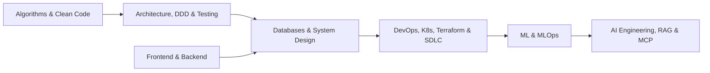

---
tags:
  - dashboard
  - programming
  - hub
banner: "https://images.unsplash.com/photo-1555066931-4365d14bab8c?w=1200"
banner_y: 0.4
created: 2025-12-29
updated: 2026-11-13
status: 🟢
level: mid-to-senior
---
# Engineering & AI Mastery Hub

> [!abstract] Tablet Study Operating Standard
> Zero-fluff, first-principles reference curriculum targeting **Mid-to-Senior engineering fluency**. Every domain monograph covers internal mechanics, invariants, failure modes, modern production configs, and worked diagnostic exercises.

## Curriculum Architecture



---

## Current Focus

| Priority | Track | Primary Hub | Status |
|:--------:|-------|-------------|:------:|
| 1 | Frontend (React 19 / Next.js 15) | [[Programming/Frontend/Frontend Roadmap & Technologies\|Frontend Roadmap]] | 🟡 Learning |
| 2 | Algorithms & LeetCode Patterns | [[Programming/Algorithms/Algorithms & LeetCode Roadmap\|Algorithms Roadmap]] | 🟡 Practicing |
| 3 | Backend (Node / NestJS / Auth) | [[Programming/Backend/Backend Roadmap & Technologies\|Backend Roadmap]] | 🟡 Learning |
| 4 | Platform, DevOps & SDLC | [[Programming/Software Engineering/DevOps/DevOps Complete Guide\|DevOps]] · [[Programming/Software Engineering/SDLC/SDLC Complete Guide\|SDLC]] | 🟢 Reference Ready |
| 5 | ML & AI Engineering | [[Programming/Machine Learning/ML Hub\|ML Hub]] · [[AI/AI Engineering Hub\|AI Engineering Hub]] | 🟢 Reference Ready |

---

## Core Technical Tracks

> [!info]+ Frontend Engineering — [[Programming/Frontend/Frontend Roadmap & Technologies|Frontend Roadmap & Technologies]]
> Critical Rendering Path, Core Web Vitals, React Fiber & Hooks, Composition Patterns, Next.js 15 RSC & Caching.
> - [[Programming/Frontend/React Complete Guide|React Complete Guide]] · [[Programming/Frontend/React Hooks Guide|React Hooks Guide]] · [[Programming/Frontend/React Patterns Guide|React Patterns Guide]] · [[Programming/Frontend/Next.js Complete Guide|Next.js Complete Guide]]

> [!info]+ Backend Engineering — [[Programming/Backend/Backend Roadmap & Technologies|Backend Roadmap & Technologies]]
> Node/libuv event loop, backpressure, V8 heap, OAuth 2.1 + PKCE, NestJS DI/Scopes/Lifecycle, Outbox, BullMQ, WebSockets.
> - [[Programming/Backend/Backend Core (Node, Event Loop, Auth & Concurrency)|Backend Core (Node, Event Loop, Auth & Concurrency)]] · [[Programming/Backend/NestJS Complete Guide|NestJS Complete Guide]] · [[Programming/Backend/NestJS Advanced Guide|NestJS Advanced Guide]]

> [!info]+ Software Engineering & Distributed Systems — [[Programming/Software Engineering/Software Engineering Roadmap|Software Engineering Roadmap]]
> Code craftsmanship, SOLID, Patterns, Clean Architecture, DDD, Testing, Relational/NoSQL internals, and high-scale System Design.
> - **Foundations**: [[Programming/Software Engineering/Clean Code/Clean Code Complete Guide|Clean Code]] · [[Programming/Software Engineering/SOLID/SOLID Principles Complete Guide|SOLID]] · [[Programming/Software Engineering/Design Patterns/Design Patterns Complete Guide|Design Patterns]] · [[Programming/Software Engineering/Refactoring/Refactoring Complete Guide|Refactoring]]
> - **Architecture & QA**: [[Programming/Software Engineering/Clean Architecture/Clean Architecture Complete Guide|Clean Architecture]] · [[Programming/Software Engineering/Architectural Patterns/Architectural Patterns Complete Guide|Architectural Patterns]] · [[Programming/Software Engineering/DDD/Domain-Driven Design Complete Guide|DDD]] · [[Programming/Software Engineering/Testing/Testing Complete Guide|Testing]]
> - **Data & Scale**: [[Programming/Software Engineering/Database Design/Database Design Complete Guide|Database Design]] · [[Programming/Software Engineering/System Design/System Design Complete Guide|System Design Complete Guide]] · [[Programming/Software Engineering/System Design/System Design Overview|System Design Overview]]

> [!info]+ Platform, DevOps, Containers, IaC & SDLC — [[Programming/Software Engineering/DevOps/DevOps Complete Guide|DevOps Map]] · [[Programming/Software Engineering/SDLC/SDLC Complete Guide|SDLC Map]]
> Linux namespaces/cgroups, multi-stage OCI builds, Compose, Kubernetes internals, Terraform DAG/state, GitHub Actions OIDC, Prometheus/Loki/OTel, DORA, and expand-and-contract migrations.
> - [[Programming/Software Engineering/DevOps/Docker|Docker]] · [[Programming/Software Engineering/DevOps/Docker Compose|Docker Compose]] · [[Programming/Software Engineering/DevOps/Kubernetes|Kubernetes]] · [[Programming/Software Engineering/DevOps/Terraform|Terraform]] · [[Programming/Software Engineering/DevOps/Observability|Observability]] · [[Programming/Software Engineering/SDLC/Release Engineering & Migrations|Release Engineering & Migrations]]

> [!info]+ Algorithms & Problem Solving — [[Programming/Algorithms/Algorithms & LeetCode Roadmap|Algorithms & LeetCode Roadmap]]
> Formal invariants, complexity budgeting, and Python/TypeScript pattern implementations.
> - [[Programming/Algorithms/Two Pointers, Sliding Window & Hashing|Two Pointers, Sliding Window & Hashing]] · [[Programming/Algorithms/Trees, Graphs & Shortest Paths|Trees, Graphs & Shortest Paths]] · [[Programming/Algorithms/Dynamic Programming, Greedy & Backtracking|Dynamic Programming, Greedy & Backtracking]] · [[Programming/Algorithms/Heaps, Tries, Union-Find & Monotonic Stacks|Heaps, Tries, Union-Find & Monotonic Stacks]]
> ```dataview
> TASK
> FROM "Programming/Algorithms"
> WHERE completed
> LIMIT 5
> ```

> [!info]+ Machine Learning & MLOps — [[Programming/Machine Learning/ML Hub|ML Hub]]
> Statistical learning invariants, GLMs/GBDTs, PyTorch/Transformer internals, end-to-end systems, and production MLOps.
> - [[Programming/Machine Learning/ML Fundamentals Guide|ML Fundamentals]] · [[Programming/Machine Learning/ML Algorithms Guide|ML Algorithms]] · [[Programming/Machine Learning/Deep Learning Guide|Deep Learning]] · [[Programming/Machine Learning/ML Projects Guide|ML Projects]] · [[Programming/Machine Learning/MLOps & Production ML Guide|MLOps & Production ML]]

> [!info]+ AI Engineering, RAG & Agentic Systems — [[AI/AI Engineering Hub|AI Engineering Hub]]
> LLM inference physics/economics, KV caching, constrained decoding, hybrid RAG, MCP protocol & ACI hardening, evals/security, and LoRA/DPO/GRPO.
> - [[AI/AI Engineering/LLM Internals, Inference & Economics|LLM Internals]] · [[AI/AI Engineering/Context Engineering & Structured Outputs|Context & Outputs]] · [[AI/AI Engineering/Production RAG Architecture|Production RAG]] · [[AI/AI Engineering/Agentic Systems, Tool Calling & MCP|Agents & MCP]] · [[AI/AI Engineering/LLM Evaluation, Guardrails & Security|Evals & Security]] · [[AI/AI Engineering/Fine-Tuning, LoRA & Alignment|Fine-Tuning & RLVR]]

---

## Live Vault Queries

### Recently Updated Platform, DevOps & AI Notes
```dataview
TABLE WITHOUT ID
	file.link as "Guide",
	file.folder as "Domain"
FROM "Programming" OR "AI"
WHERE !contains(file.name, "_Index")
SORT file.mtime desc
LIMIT 8
```

### Completed LeetCode Milestones
```dataview
LIST WITHOUT ID file.link
FROM "Programming/Algorithms"
WHERE status = "🟢"
```

---

## Career & Mastery Objectives
- [ ] Master React 19, Next.js 15 App Router, and NestJS production internals
- [ ] Solve 100 LeetCode problems across core invariant patterns
- [ ] Complete end-to-end Kubernetes + Terraform + OpenTelemetry platform deployment
- [ ] Pass Senior System Design & Database concurrency mock interviews
- [ ] Ship production RAG + MCP agentic system backed by automated CI evals
