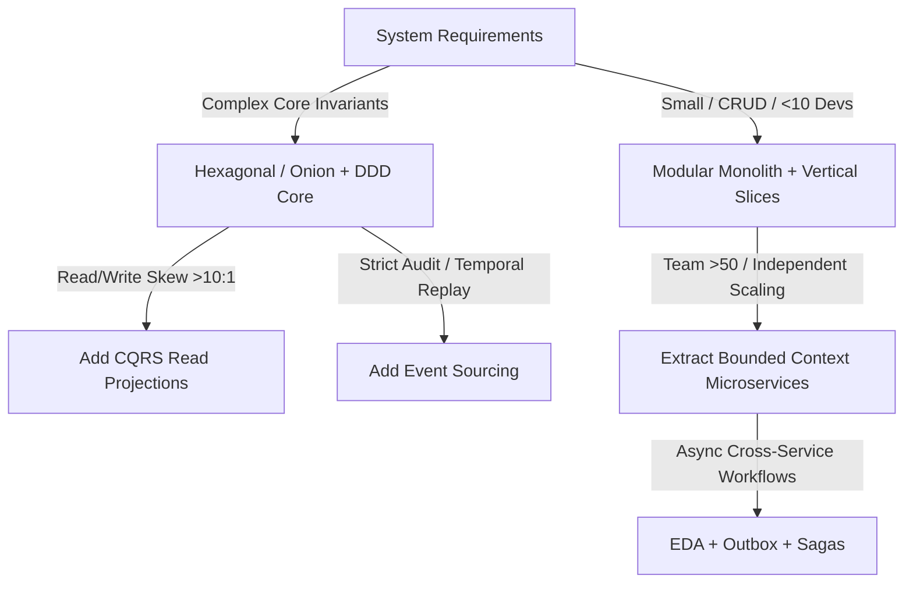

---
tags:
  - software-engineering
  - architectural-patterns
  - dashboard
created: 2026-01-02
updated: 2026-11-13
status: 🟢
level: mid-to-senior
---
# Architectural Patterns Complete Guide

> [!abstract] Vault Navigation
> Core architectural topology hub within [[Programming/Software Engineering/Software Engineering Roadmap|Software Engineering Roadmap]]. Pairs closely with [[Programming/Software Engineering/Clean Architecture/Clean Architecture Complete Guide|Clean Architecture Complete Guide]], [[Programming/Software Engineering/DDD/Domain-Driven Design Complete Guide|Domain-Driven Design Complete Guide]], and [[Programming/Software Engineering/System Design/System Design Complete Guide|System Design Complete Guide]].

Software architectural patterns govern how codebases partition responsibilities, manage dependency vectors, isolate state consistency boundaries, and scale across teams and runtime nodes. No pattern is universally optimal: every topology trades **upfront structural complexity** and **operational overhead** against **change isolation**, **scalability**, and **deployment independence**.

---

## 1. Core Architectural Topology Index

### Application & Code-Boundary Patterns

| Pattern | Core Axis | Status |
|---|---|---|
| [[Programming/Software Engineering/Architectural Patterns/Layered & Onion Architecture\|Layered & Onion Architecture]] | N-Tier persistence coupling & Anemic Domain traps vs Onion inward concentric rings | 🟢 |
| [[Programming/Software Engineering/Architectural Patterns/Hexagonal Architecture\|Hexagonal Architecture]] | Symmetric Primary/Secondary Ports & Adapters isolating domain core from I/O | 🟢 |
| [[Programming/Software Engineering/Architectural Patterns/Vertical Slice Architecture\|Vertical Slice Architecture]] | Feature-cohesive vertical slices eliminating horizontal shotgun surgery | 🟢 |
| [[Programming/Software Engineering/Architectural Patterns/Presentation Patterns (MVC, MVP, MVVM)\|Presentation Patterns (MVC, MVP, MVVM)]] | UI state decoupling, passive views, reactive binding, React/Signals parity | 🟢 |

### Data Flow, Eventing & Distributed System Patterns

| Pattern | Core Axis | Status |
|---|---|---|
| [[Programming/Software Engineering/Architectural Patterns/CQRS\|CQRS]] | Segregating command write consistency from optimized read projections | 🟢 |
| [[Programming/Software Engineering/Architectural Patterns/Event Sourcing\|Event Sourcing]] | Append-only event logs, rehydration, snapshots, optimistic concurrency, upcasting, crypto-shredding | 🟢 |
| [[Programming/Software Engineering/Architectural Patterns/Event-Driven Architecture\|Event-Driven Architecture]] | Outbox pattern, schema compatibility, idempotent consumers, Choreography vs Orchestration Sagas | 🟢 |
| [[Programming/Software Engineering/Architectural Patterns/Microservices\|Microservices]] | Conway's Law boundaries, distributed monolith trap, Modular Monolith, circuit breakers, service mesh | 🟢 |
| [[Programming/Software Engineering/Architectural Patterns/Microfrontends\|Microfrontends]] | Module Federation, shared singleton deps, independent deployability vs BFF coupling traps | 🟢 |

---

## 2. Architectural Trade-Off Comparison Matrix

| Pattern | Boilerplate / Cognitive Cost | Primary Failure Mode | Optimal Domain & Team Fit |
|---|---|---|---|
| **Traditional N-Tier Layered** | Low | Database-driven design, Anemic Domain Models, leaky persistence | Simple CRUD utilities, small backoffice tools |
| **Onion / Clean Architecture** | Moderate–High | Over-engineered 5-file mapping tax on trivial reads | Long-lived domain-heavy enterprise cores |
| **Hexagonal (Ports & Adapters)** | Moderate | Unnecessary port interfaces over stable internal helpers | Services swapping databases, queues, or external payment/ML providers |
| **Vertical Slice Architecture** | Low | Duplicating core domain invariants across slices if unmonitored | High-churn SaaS backends, mixed read/write complexity |
| **CQRS (Level 1 / Level 2)** | Low (L1) / High (L2) | Stale read lag breaking read-your-own-writes UX | Read/write throughput asymmetry ($>10:1$), complex search/analytics views |
| **Event Sourcing** | Very High | Immutable schema lock-in, missing snapshots, projection rebuild stalls | Financial ledgers, compliance audit logs, temporal state replay |
| **Event-Driven Architecture** | High | Dual-write split-brain, non-idempotent retries, unmonitored DLQs | Cross-context async decoupling, burst smoothing, multi-step Sagas |
| **Modular Monolith** | Low–Moderate | Accidental cross-module DB table joins or internal imports | Default choice for 90% of teams (<50 engineers) needing strong boundaries |
| **Microservices** | Very High | Distributed monoliths, chatty sync RPC chains, cascading latency | Independent team scaling (>50 engineers), distinct hardware/SLO isolation |
| **Microfrontends** | High | Bundle duplication, singleton React version skew, BFF waterfall chains | Truly autonomous multi-squad UI verticals with independent release cadences |

---

## 3. Architectural Selection Decision Flow

---

## 4. Foundational Rules Across Patterns

1. **Start Modular Monolith First**: Physical network boundaries add serialization latency, partial failure, distributed tracing overhead, and eventual consistency tax. Prove logical module boundaries in-process before paying the microservice distribution tax.
2. **Never Pair Dual-Writes Without an Outbox**: Whenever state changes must update both a database and an event bus, commit both inside one ACID local transaction using the Transactional Outbox pattern.
3. **Separate Command Consistency from Reporting Queries**: Even inside a simple monolith, let read queries project straight to flat DTOs while reserving rich Domain Aggregates strictly for state-mutating commands.
4. **Match Investment to Subdomain Value**: Apply heavy patterns (Hexagonal + DDD + Event Sourcing) exclusively to **Core Subdomains**; keep **Supporting** and **Generic** modules simple. See [[Programming/Software Engineering/DDD/Strategic Design|Strategic Design]].
