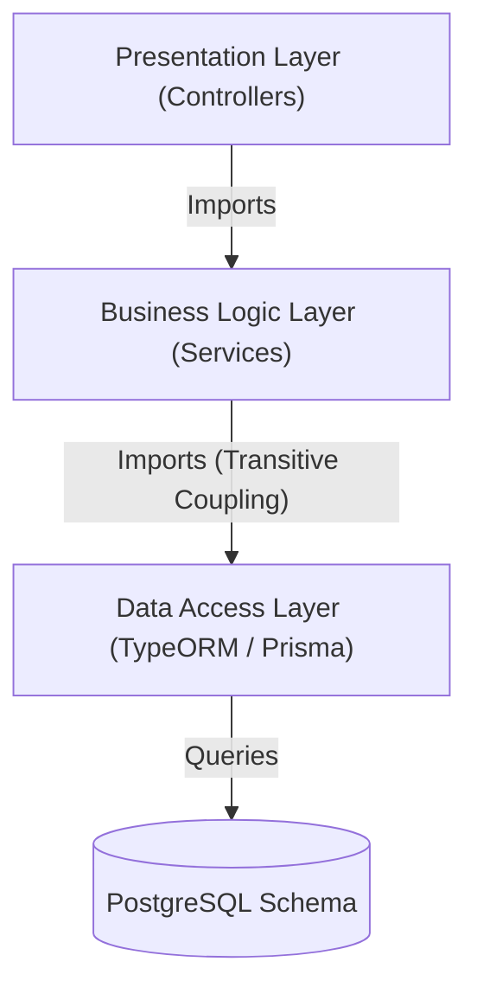
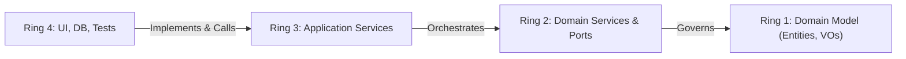

---
tags:
  - software-engineering
  - architectural-patterns
  - layered-architecture
  - onion-architecture
  - ddd
  - typescript
created: 2026-11-13
updated: 2026-11-13
status: 🟢
level: mid-to-senior
---
# Layered & Onion Architecture

> [!abstract] Vault Navigation
> Part of [[Programming/Software Engineering/Architectural Patterns/Architectural Patterns Complete Guide|Architectural Patterns Complete Guide]]. Directly precedes the dependency inversion models in [[Programming/Software Engineering/Clean Architecture/Clean Architecture Complete Guide|Clean Architecture Complete Guide]], [[Programming/Software Engineering/Clean Architecture/Dependency Rule|Dependency Rule]], and [[Programming/Software Engineering/Architectural Patterns/Hexagonal Architecture|Hexagonal Architecture]]. Contrasts structurally with [[Programming/Software Engineering/Architectural Patterns/Vertical Slice Architecture|Vertical Slice Architecture]].

Traditional **N-Tier Layered Architecture** groups modules by technical layer stacked vertically on top of a relational database engine. **Onion Architecture**, formulated by Jeffrey Palermo in 2008, reverses that coupling vector by placing a persistence-free **Domain Model** at the innermost core and forcing every ORM, HTTP framework, and message broker to point inward through interfaces owned by business policy.

---

## 1. First-Principles Mechanics & Complete Architecture

### 1.1 Traditional N-Tier Horizontal Layers & Transitive Database Coupling

In a standard 3-tier or 4-tier codebase, directory structure and import edges flow strictly top-to-bottom:

`Presentation Layer (Controllers)` $\rightarrow$ `Business Logic Layer (Services)` $\rightarrow$ `Data Access Layer (Repositories / ORM)` $\rightarrow$ `Database Engine`



At compile time and runtime, **coupling is transitive**. If `LoanApprovalService` (BLL) imports `LoanOrmEntity` and `Repository<LoanOrmEntity>` from TypeORM or `PrismaService` from `@prisma/client` (DAL), then business underwriting policy becomes transitively coupled to SQL column types, foreign-key lazy loaders, ORM decorator metadata, and database connection pools.

### 1.2 The Four Degeneration Mechanics of N-Tier Architecture

Over multi-year product evolution, unconstrained N-Tier backends predictably decay along four structural failure axes:

1. **Database-Driven Design**: Engineers design SQL tables first (`loans`, `applicants`, `credit_reports`), auto-generate ORM classes from those tables, and force business services to operate directly on table structures. Normalizing a SQL column into a child table breaks business rules and unit tests across the entire application.
2. **Anemic Domain Model**: Because ORM classes (`LoanOrmEntity`) act as passive property bags populated via reflection with public mutable setters (`loan.status = 'APPROVED'`), real business validation cannot live inside the entity. Instead, procedural conditional blocks accumulate outside entities inside services—leaving entities unable to guarantee their own valid state.
3. **God Services & Duplicated Invariants**: As workflows multiply, `LoanService` absorbs underwriting math, state transitions, audit formatting, and email scheduling into a 1,800-line procedural script. Meanwhile, a parallel `WebhookReevaluationService` mutates `loan.status` directly with slightly different debt-to-income thresholds, producing silent compliance drift.
4. **Leaky ORM & Lazy-Loading Serialization Storms**: Returning ORM entities straight from services into HTTP controllers leaks persistence internals across process boundaries:
   - Unawaited or lazy-loaded TypeORM `Promise<Installment[]>` relations trigger hidden **N+1 SQL queries** while Express/NestJS serializes JSON responses outside transaction boundaries.
   - Database-specific exceptions (`QueryFailedError: duplicate key value violates unique constraint`) propagate straight into HTTP handlers as `500 Internal Server Error` stack traces.

### 1.3 Concentric Onion Architecture: Inverting the Core

Onion Architecture breaks transitive database coupling by applying the [[Programming/Software Engineering/SOLID/Dependency Inversion|Dependency Inversion Principle (DIP)]] across **four concentric rings**:



| Ring | Layer Name | Allowed Imports | Responsibilities & Contents |
|---|---|---|---|
| **Ring 1 (Center)** | **Domain Model** | Standard library / pure language primitives **only** | Entities, Aggregate Roots, Value Objects (`Money`, `CreditScore`), Domain Errors, Domain Events, state machines enforcing invariants |
| **Ring 2** | **Domain Services & Interfaces** | Ring 1 (`Domain Model`) | Cross-aggregate stateless Domain Services (`UnderwritingPolicyService`), abstract Persistence & External Gateway interfaces (`LoanRepository`, `CreditBureauPort`, `UnitOfWorkPort`) |
| **Ring 3** | **Application Services** | Ring 1, Ring 2 | Use-case orchestration (`ApproveLoanApplicationService`), transaction boundary scoping, authorization assertions, idempotency verification, outbox dispatch |
| **Ring 4 (Outer)** | **Infrastructure, UI & Tests** | Ring 1, Ring 2, Ring 3, external SDKs | HTTP/gRPC controllers, ORM entities (`@Entity`), explicit Data Mappers, SQL/Redis/HTTP adapters, Composition Root (`AppModule`), Vitest harnesses |

#### The Two Non-Negotiable Onion Ring Rules

1. **Strictly Inward Dependency Vector**: Any outer ring may reference types defined in any inner ring; **zero inner rings may import or mention any outer ring**.
2. **Infrastructure Implements Core Abstractions**: Persistence repositories live in Ring 4 (`infrastructure/typeorm/typeorm-loan.repository.ts`), yet implement interfaces defined in Ring 2 (`domain/ports/loan.repository.ts`).

### 1.4 Open vs Closed Layering & the Architecture Sinkhole Anti-Pattern

Strict **closed layering** forbids Ring 4 controllers from bypassing Ring 3 even for simple reads. While closed layering protects write invariants, forcing trivial read endpoints (`GET /v1/currencies`, `GET /v1/loans/summary`) through empty `Controller -> ApplicationService -> RepositoryInterface -> RepositoryImpl -> Mapper -> DomainEntity -> ViewDto` wrappers produces the **Architecture Sinkhole Anti-Pattern**: 70% of files perform passive 1:1 data pass-throughs with zero business logic while multiplying boilerplate and GC allocations.

Pragmatic senior Onion systems apply **Controlled Read Bypass ([[Programming/Software Engineering/Architectural Patterns/CQRS|CQRS]])**:
- **Write Operations (Commands)** strictly obey closed concentric rings through `Application Service -> Domain Aggregate -> Write Repository Port`.
- **Read Operations (Queries)** execute flat read-only projections via a dedicated `QueryHandler` / `ReadRepositoryPort` returning plain DTOs straight from SQL without hydrating full Ring 1 Aggregates.

---

## 2. Real-World Use Cases & Comprehensive Decision Matrix

### 2.1 Five-Way Architectural Comparison Matrix

| Dimension | Traditional N-Tier Layered | Onion Architecture | Clean Architecture | Hexagonal (Ports & Adapters) | Vertical Slice Architecture |
|---|---|---|---|---|---|
| **Dependency Direction** | Top-down (`UI -> BLL -> DAL -> DB`) | Strictly Inward (`Infra -> App -> Domain`) | Strictly Inward across 4 explicit rings | Outside $\rightarrow$ Inside across symmetric Ports | Per-feature vertical cohesion; shared `domain/` optional |
| **Core Organizing Unit** | Technical layer folders (`services/`, `dal/`) | Concentric DDD Domain Model center | Enterprise Entities + Use Case Interactors + Presenters | Symmetric Primary & Secondary Ports around Core | Individual endpoint/capability slice (`create-order/`) |
| **Domain Protection** | Weak (Anemic ORM structs common) | Very High (Rich Aggregates + VOs) | Very High | High (if paired with rich Domain Model inside) | Flexible per slice (Transaction Script or DDD Aggregate) |
| **Read-Path Boilerplate** | Low | Moderate–High unless paired with CQRS read bypass | Highest (Interactors + Output Ports + Presenters) | Moderate | Lowest (raw parameterized SQL straight to DTO) |
| **DB Schema Isolation** | Poor (ORM changes break BLL & tests) | Excellent (Data Mapper absorbs SQL refactors) | Excellent | Excellent | Moderate (isolated per slice SQL; easy to refactor 1 query) |
| **Optimal Domain Fit** | Simple CRUD utilities, short-lived admin tools | Long-lived domain-heavy underwriting, insurance, ERP cores | Large regulated enterprise systems with strict delivery adapters | Integration-heavy services swapping DBs, queues, or external APIs | Rapidly evolving SaaS APIs with high endpoint churn |

### 2.2 When Plain 3-Tier CRUD Wins vs When Onion Pays for Itself

| Scenario | Recommended Architecture | Engineering Justification |
|---|---|---|
| **Internal Backoffice Admin Tool / CMS (`<15k LOC`)** | **Traditional N-Tier Layered** | Business rules consist primarily of field validation and single-table CRUD (`users`, `categories`, `posts`). Creating pure domain aggregates, mappers, and port interfaces doubles delivery time without preventing real bugs. |
| **Loan Underwriting, Insurance Claims, or Financial Ledger** | **Onion Architecture** | Complex multi-rule state machines (credit thresholds, debt-to-income caps, partial repayments, regulatory audit logs) outlive ORM versions and database schema normalizations by 5–10 years. |
| **Multi-Service SaaS Reporting & Analytics API** | **Vertical Slice or Onion + CQRS** | Endpoints join 6–8 tables for dynamic filters and CSV exports. Hydrating Onion Domain Entities on reads triggers massive memory churn and N+1 latency. |
| **Legacy N-Tier Monolith Suffering Schema Fragility** | **Incremental Onion Strangler** | Introduce Ring 1 Entities + Ring 2 Ports solely inside high-churn, bug-prone subdomains (`billing`, `underwriting`) while leaving stable CRUD modules untouched. |

---

## 3. Step-by-Step Practical Application: Refactoring Broken Anemic N-Tier into Rich Onion Core

This walkthrough converts a failing N-Tier `LoanApprovalService`—exhibiting ORM entity leakage, duplicated validation, race-prone status mutations, and cascading N+1 SQL queries—into a zero-leakage **Onion Architecture Core** in TypeScript.

### 3.1 The "Before" State: Broken Anemic N-Tier Implementation

Inspect every concrete flaw inside the legacy N-Tier code below:

```typescript
// BEFORE (BROKEN N-TIER): src/legacy/entities/loan.orm-entity.ts
import { Column, Entity, ManyToOne, OneToMany, PrimaryGeneratedColumn } from 'typeorm';

@Entity('loans')
export class LegacyLoanOrmEntity {
  @PrimaryGeneratedColumn('uuid')
  id!: string;

  @Column({ type: 'varchar' })
  status!: string; // Plain string allows invalid typos like 'APROVED'

  @Column({ type: 'integer' })
  principalCents!: number;

  @Column({ type: 'integer' })
  monthlyIncomeCents!: number;

  @Column({ type: 'integer' })
  existingMonthlyDebtCents!: number;

  @Column({ type: 'integer' })
  creditScore!: number;

  @ManyToOne(() => LegacyApplicantOrmEntity, { lazy: true })
  applicant!: Promise<LegacyApplicantOrmEntity>; // Lazy relation trap!

  @OneToMany(() => LegacyAuditOrmEntity, (a) => a.loan, { lazy: true })
  audits!: Promise<LegacyAuditOrmEntity[]>;
}
```

```typescript
// BEFORE (BROKEN N-TIER): src/legacy/services/loan-approval.service.ts
import { Repository } from 'typeorm';
import { LegacyLoanOrmEntity } from '../entities/loan.orm-entity';

export class LegacyLoanApprovalService {
  constructor(private readonly loanRepo: Repository<LegacyLoanOrmEntity>) {}

  async approveLoan(loanId: string, reviewerId: string): Promise<LegacyLoanOrmEntity> {
    // Flaw 1: Coupled directly to TypeORM Repository API & SQL schema
    const loan = await this.loanRepo.findOne({ where: { id: loanId } });
    if (!loan) throw new Error('Loan not found');

    // Flaw 2: Procedural business math duplicated across services (Anemic Entity)
    if (loan.status !== 'SUBMITTED') {
      throw new Error('Only submitted loans can be approved');
    }
    if (loan.creditScore < 640) {
      throw new Error('Credit score too low');
    }
    const monthlyPaymentEstimate = Math.round(loan.principalCents / 36);
    const totalMonthlyDebt = loan.existingMonthlyDebtCents + monthlyPaymentEstimate;
    if (totalMonthlyDebt / loan.monthlyIncomeCents > 0.43) {
      throw new Error('DTI exceeds 43%');
    }

    // Flaw 3: Direct raw field mutation without optimistic concurrency check
    loan.status = 'APPROVED';
    // Flaw 4: Returns raw TypeORM entity straight up to Express/NestJS controller!
    return this.loanRepo.save(loan);
  }
}
```

```typescript
// BEFORE (BROKEN N-TIER): src/legacy/controllers/loan.controller.ts
import { Controller, Param, Post, Body } from '@nestjs/common';
import { LegacyLoanApprovalService } from '../services/loan-approval.service';

@Controller('legacy/loans')
export class LegacyLoanController {
  constructor(private readonly service: LegacyLoanApprovalService) {}

  @Post(':id/approve')
  async approve(@Param('id') id: string, @Body('reviewerId') reviewerId: string) {
    const loanEntity = await this.service.approveLoan(id, reviewerId);
    // Flaw 5: Accessing lazy ORM relation inside controller triggers extra SQL queries during HTTP serialization
    const applicant = await loanEntity.applicant;
    return {
      id: loanEntity.id,
      status: loanEntity.status,
      applicantEmail: applicant.email,
    };
  }
}
```

### 3.2 Target Onion Directory Topology

```text
src/lending/
  domain/
    errors/
      lending.errors.ts
    value-objects/
      money.vo.ts
      credit-score.vo.ts
      debt-to-income.vo.ts
    entities/
      loan-application.aggregate.ts
    services/
      underwriting-policy.service.ts
    ports/
      loan-application.repository.ts
      credit-bureau.port.ts
      unit-of-work.port.ts
  application/
    use-cases/
      approve-loan-application.service.ts
    dto/
      approve-loan.dto.ts
  infrastructure/
    typeorm/
      entities/
        loan-application.orm-entity.ts
        loan-audit.orm-entity.ts
      mappers/
        loan-application.mapper.ts
      repositories/
        typeorm-loan-application.repository.ts
        typeorm-unit-of-work.ts
    bureau/
      http-credit-bureau.adapter.ts
  presentation/
    http/
      loan-application.controller.ts
  composition/
    lending.module.ts
  tests/
    loan-application.domain.spec.ts
    approve-loan.application.spec.ts
```

### 3.3 Ring 1: Pure Domain Model (Value Objects, Aggregate Root & Errors)

Ring 1 contains zero framework imports (`typeorm`, `@nestjs/*`, `express`). All business invariants execute deterministically in memory.

```typescript
// src/lending/domain/errors/lending.errors.ts
export abstract class LendingDomainError extends Error {
  abstract readonly code: string;

  protected constructor(message: string) {
    super(message);
    this.name = new.target.name;
  }
}

export class LoanApplicationNotFoundError extends LendingDomainError {
  readonly code = 'LOAN_APPLICATION_NOT_FOUND';
  constructor(readonly loanId: string) {
    super(`Loan application ${loanId} was not found`);
  }
}

export class InvalidLoanTransitionError extends LendingDomainError {
  readonly code = 'INVALID_LOAN_TRANSITION';
  constructor(message: string) {
    super(message);
  }
}

export class UnderwritingRejectedError extends LendingDomainError {
  readonly code = 'UNDERWRITING_POLICY_REJECTED';
  constructor(readonly reasons: string[]) {
    super(`Underwriting policy rejected loan: ${reasons.join('; ')}`);
  }
}

export class ConcurrentLoanModificationError extends LendingDomainError {
  readonly code = 'CONCURRENT_LOAN_MODIFICATION';
  constructor(readonly loanId: string) {
    super(`Loan application ${loanId} was modified by another transaction`);
  }
}
```

```typescript
// src/lending/domain/value-objects/money.vo.ts
export class Money {
  private constructor(readonly cents: number) {
    Object.freeze(this);
  }

  static fromCents(cents: number): Money {
    if (!Number.isInteger(cents) || cents < 0) {
      throw new Error(`Invalid minor-unit money amount: ${cents}`);
    }
    return new Money(cents);
  }

  add(other: Money): Money {
    return Money.fromCents(this.cents + other.cents);
  }

  divideRounded(divisor: number): Money {
    if (divisor <= 0) throw new Error('Divisor must be positive');
    return Money.fromCents(Math.round(this.cents / divisor));
  }
}
```

```typescript
// src/lending/domain/value-objects/credit-score.vo.ts
export class CreditScore {
  private constructor(readonly value: number) {
    Object.freeze(this);
  }

  static of(score: number): CreditScore {
    if (!Number.isInteger(score) || score < 300 || score > 850) {
      throw new Error(`FICO score must be an integer between 300 and 850, got ${score}`);
    }
    return new CreditScore(score);
  }

  meetsMinimum(minimum: number): boolean {
    return this.value >= minimum;
  }
}
```

```typescript
// src/lending/domain/value-objects/debt-to-income.vo.ts
import { Money } from './money.vo';

export class DebtToIncomeRatio {
  private constructor(readonly ratio: number) {
    Object.freeze(this);
  }

  static calculate(monthlyDebt: Money, monthlyGrossIncome: Money): DebtToIncomeRatio {
    if (monthlyGrossIncome.cents === 0) {
      return new DebtToIncomeRatio(1.0);
    }
    const raw = monthlyDebt.cents / monthlyGrossIncome.cents;
    return new DebtToIncomeRatio(Number(raw.toFixed(4)));
  }

  exceeds(maxAllowedRatio: number): boolean {
    return this.ratio > maxAllowedRatio;
  }
}
```

```typescript
// src/lending/domain/entities/loan-application.aggregate.ts
import {
  InvalidLoanTransitionError,
  UnderwritingRejectedError,
} from '../errors/lending.errors';
import { CreditScore } from '../value-objects/credit-score.vo';
import { DebtToIncomeRatio } from '../value-objects/debt-to-income.vo';
import { Money } from '../value-objects/money.vo';

export type LoanStatus = 'SUBMITTED' | 'APPROVED' | 'REJECTED';

export interface LoanAuditEntry {
  id: string;
  actorId: string;
  action: 'APPROVED' | 'REJECTED';
  note: string;
  occurredAt: Date;
}

export interface LoanApplicationSnapshot {
  id: string;
  applicantId: string;
  applicantEmail: string;
  principalCents: number;
  termMonths: number;
  monthlyIncomeCents: number;
  existingMonthlyDebtCents: number;
  creditScore: number;
  status: LoanStatus;
  rejectionReasons: string[];
  version: number;
  audits: LoanAuditEntry[];
}

export class LoanApplication {
  private readonly audits: LoanAuditEntry[];
  private rejectionReasons: string[];

  private constructor(
    readonly id: string,
    readonly applicantId: string,
    readonly applicantEmail: string,
    readonly principal: Money,
    readonly termMonths: number,
    readonly monthlyIncome: Money,
    readonly existingMonthlyDebt: Money,
    private currentCreditScore: CreditScore,
    private currentStatus: LoanStatus,
    rejectionReasons: string[],
    readonly version: number,
    audits: LoanAuditEntry[],
  ) {
    this.rejectionReasons = [...rejectionReasons];
    this.audits = [...audits];
  }

  static rehydrate(snapshot: LoanApplicationSnapshot): LoanApplication {
    return new LoanApplication(
      snapshot.id,
      snapshot.applicantId,
      snapshot.applicantEmail,
      Money.fromCents(snapshot.principalCents),
      snapshot.termMonths,
      Money.fromCents(snapshot.monthlyIncomeCents),
      Money.fromCents(snapshot.existingMonthlyDebtCents),
      CreditScore.of(snapshot.creditScore),
      snapshot.status,
      snapshot.rejectionReasons,
      snapshot.version,
      snapshot.audits,
    );
  }

  get status(): LoanStatus {
    return this.currentStatus;
  }

  get creditScore(): CreditScore {
    return this.currentCreditScore;
  }

  estimatedMonthlyInstallment(): Money {
    return this.principal.divideRounded(this.termMonths);
  }

  computeDebtToIncomeRatio(): DebtToIncomeRatio {
    const projectedDebt = this.existingMonthlyDebt.add(this.estimatedMonthlyInstallment());
    return DebtToIncomeRatio.calculate(projectedDebt, this.monthlyIncome);
  }

  approveWithUnderwriting(
    freshScore: CreditScore,
    reviewerId: string,
    policyFailures: string[],
    now: Date,
    auditEntryId: string,
  ): void {
    if (this.currentStatus !== 'SUBMITTED') {
      throw new InvalidLoanTransitionError(
        `Cannot approve loan ${this.id} from status ${this.currentStatus}`,
      );
    }

    this.currentCreditScore = freshScore;

    if (policyFailures.length > 0) {
      this.currentStatus = 'REJECTED';
      this.rejectionReasons = [...policyFailures];
      this.audits.push({
        id: auditEntryId,
        actorId: reviewerId,
        action: 'REJECTED',
        note: policyFailures.join('; '),
        occurredAt: now,
      });
      throw new UnderwritingRejectedError(policyFailures);
    }

    this.currentStatus = 'APPROVED';
    this.rejectionReasons = [];
    this.audits.push({
      id: auditEntryId,
      actorId: reviewerId,
      action: 'APPROVED',
      note: `Approved at score ${freshScore.value}`,
      occurredAt: now,
    });
  }

  toSnapshot(): LoanApplicationSnapshot {
    return {
      id: this.id,
      applicantId: this.applicantId,
      applicantEmail: this.applicantEmail,
      principalCents: this.principal.cents,
      termMonths: this.termMonths,
      monthlyIncomeCents: this.monthlyIncome.cents,
      existingMonthlyDebtCents: this.existingMonthlyDebt.cents,
      creditScore: this.currentCreditScore.value,
      status: this.currentStatus,
      rejectionReasons: [...this.rejectionReasons],
      version: this.version,
      audits: this.audits.map((a) => ({ ...a })),
    };
  }
}
```

### 3.4 Ring 2: Domain Services & Core Output Interfaces

Notice why `UnderwritingPolicyService` resides in Ring 2: it encodes pure domain policy rules (`MINIMUM_FICO = 640`, `MAX_DTI = 0.43`, tier principal caps) parameterized by applicant history, while Ring 2 ports define abstract persistence contracts owned strictly by the core.

```typescript
// src/lending/domain/services/underwriting-policy.service.ts
import { LoanApplication } from '../entities/loan-application.aggregate';
import { CreditScore } from '../value-objects/credit-score.vo';

export interface UnderwritingHistoryContext {
  activeDelinquentLoansCount: number;
}

export class UnderwritingPolicyService {
  private static readonly MIN_CREDIT_SCORE = 640;
  private static readonly MAX_DTI_RATIO = 0.43;
  private static readonly MAX_PRIME_PRINCIPAL_CENTS = 25_000_000;

  evaluateEligibility(
    loan: LoanApplication,
    freshScore: CreditScore,
    history: UnderwritingHistoryContext,
  ): string[] {
    const failures: string[] = [];

    if (!freshScore.meetsMinimum(UnderwritingPolicyService.MIN_CREDIT_SCORE)) {
      failures.push(
        `Credit score ${freshScore.value} is below minimum ${UnderwritingPolicyService.MIN_CREDIT_SCORE}`,
      );
    }

    const dti = loan.computeDebtToIncomeRatio();
    if (dti.exceeds(UnderwritingPolicyService.MAX_DTI_RATIO)) {
      failures.push(
        `Projected DTI ${(dti.ratio * 100).toFixed(1)}% exceeds 43.0% ceiling`,
      );
    }

    if (history.activeDelinquentLoansCount > 0) {
      failures.push(
        `Applicant has ${history.activeDelinquentLoansCount} active delinquent loan(s)`,
      );
    }

    if (
      loan.principal.cents > UnderwritingPolicyService.MAX_PRIME_PRINCIPAL_CENTS &&
      !freshScore.meetsMinimum(740)
    ) {
      failures.push('Loans above $250,000 require credit score >= 740');
    }

    return failures;
  }
}
```

```typescript
// src/lending/domain/ports/loan-application.repository.ts
import { LoanApplication } from '../entities/loan-application.aggregate';

export interface LoanApplicationRepository {
  findByIdWithDetails(loanId: string): Promise<LoanApplication | null>;
  countActiveDelinquenciesForApplicant(applicantId: string): Promise<number>;
  saveWithOptimisticLock(loan: LoanApplication): Promise<void>;
}
```

```typescript
// src/lending/domain/ports/credit-bureau.port.ts
import { CreditScore } from '../value-objects/credit-score.vo';

export const CREDIT_BUREAU_PORT = Symbol('CREDIT_BUREAU_PORT');

export interface CreditBureauPort {
  fetchCurrentScore(applicantId: string): Promise<CreditScore>;
}
```

```typescript
// src/lending/domain/ports/unit-of-work.port.ts
import { LoanApplicationRepository } from './loan-application.repository';

export const LENDING_UNIT_OF_WORK = Symbol('LENDING_UNIT_OF_WORK');

export interface LendingTransactionScope {
  loans: LoanApplicationRepository;
}

export interface LendingUnitOfWorkPort {
  execute<T>(work: (scope: LendingTransactionScope) => Promise<T>): Promise<T>;
}
```

### 3.5 Ring 3: Application Service (Use-Case Orchestration & Transaction Scope)

Ring 3 coordinates the credit bureau lookup outside long locks, computes domain underwriting failures using Ring 2 `UnderwritingPolicyService`, executes `LoanApplication.approveWithUnderwriting`, and persists atomically—even persisting `REJECTED` audit history when underwriting declines!

```typescript
// src/lending/application/dto/approve-loan.dto.ts
export interface ApproveLoanInput {
  loanId: string;
  reviewerId: string;
}

export interface ApproveLoanResult {
  loanId: string;
  status: 'APPROVED' | 'REJECTED';
  applicantEmail: string;
  creditScore: number;
  rejectionReasons: string[];
}
```

```typescript
// src/lending/application/use-cases/approve-loan-application.service.ts
import { randomUUID } from 'node:crypto';
import {
  LoanApplicationNotFoundError,
  UnderwritingRejectedError,
} from '../../domain/errors/lending.errors';
import { CreditBureauPort } from '../../domain/ports/credit-bureau.port';
import { LendingUnitOfWorkPort } from '../../domain/ports/unit-of-work.port';
import { UnderwritingPolicyService } from '../../domain/services/underwriting-policy.service';
import { ApproveLoanInput, ApproveLoanResult } from '../dto/approve-loan.dto';

export class ApproveLoanApplicationService {
  constructor(
    private readonly unitOfWork: LendingUnitOfWorkPort,
    private readonly creditBureau: CreditBureauPort,
    private readonly policyService: UnderwritingPolicyService,
    private readonly nowProvider: () => Date = () => new Date(),
  ) {}

  async execute(input: ApproveLoanInput): Promise<ApproveLoanResult> {
    // 1. Read applicant identifier outside TX before calling external credit bureau HTTP API
    const snapshotForExternalCheck = await this.unitOfWork.execute(async ({ loans }) => {
      const existing = await loans.findByIdWithDetails(input.loanId);
      if (!existing) throw new LoanApplicationNotFoundError(input.loanId);
      return existing.toSnapshot();
    });

    const freshScore = await this.creditBureau.fetchCurrentScore(
      snapshotForExternalCheck.applicantId,
    );

    // 2. Atomic write transaction: re-read latest state, evaluate policy, persist decision + audit
    return this.unitOfWork.execute(async ({ loans }) => {
      const loan = await loans.findByIdWithDetails(input.loanId);
      if (!loan) throw new LoanApplicationNotFoundError(input.loanId);

      const activeDelinquentLoansCount = await loans.countActiveDelinquenciesForApplicant(
        loan.applicantId,
      );

      const failures = this.policyService.evaluateEligibility(loan, freshScore, {
        activeDelinquentLoansCount,
      });

      const auditId = randomUUID();
      try {
        loan.approveWithUnderwriting(
          freshScore,
          input.reviewerId,
          failures,
          this.nowProvider(),
          auditId,
        );
      } catch (err) {
        if (err instanceof UnderwritingRejectedError) {
          // Persist REJECTED status and compliance audit trail before returning rejection result
          await loans.saveWithOptimisticLock(loan);
          const rejectedSnap = loan.toSnapshot();
          return {
            loanId: rejectedSnap.id,
            status: 'REJECTED',
            applicantEmail: rejectedSnap.applicantEmail,
            creditScore: rejectedSnap.creditScore,
            rejectionReasons: rejectedSnap.rejectionReasons,
          };
        }
        throw err;
      }

      await loans.saveWithOptimisticLock(loan);
      const approvedSnap = loan.toSnapshot();
      return {
        loanId: approvedSnap.id,
        status: 'APPROVED',
        applicantEmail: approvedSnap.applicantEmail,
        creditScore: approvedSnap.creditScore,
        rejectionReasons: [],
      };
    });
  }
}
```

### 3.6 Ring 4: Infrastructure ORM Entities, Explicit Mapper, Eager SQL Adapter & HTTP Controller

Notice how TypeORM `@Entity()` annotations stay **completely isolated inside Ring 4**. Furthermore, `TypeOrmLoanApplicationRepository` loads applicant email and audits via an explicit single SQL join (`leftJoinAndSelect`), eliminating lazy-load N+1 queries completely.

```typescript
// src/lending/infrastructure/typeorm/entities/loan-audit.orm-entity.ts
import { Column, Entity, JoinColumn, ManyToOne, PrimaryColumn } from 'typeorm';
import { LoanApplicationOrmEntity } from './loan-application.orm-entity';

@Entity('loan_audits')
export class LoanAuditOrmEntity {
  @PrimaryColumn('uuid')
  id!: string;

  @Column({ name: 'loan_id', type: 'uuid' })
  loanId!: string;

  @Column({ name: 'actor_id', type: 'varchar', length: 64 })
  actorId!: string;

  @Column({ type: 'varchar', length: 16 })
  action!: 'APPROVED' | 'REJECTED';

  @Column({ type: 'text' })
  note!: string;

  @Column({ name: 'occurred_at', type: 'timestamptz' })
  occurredAt!: Date;

  @ManyToOne(() => LoanApplicationOrmEntity, (loan) => loan.audits)
  @JoinColumn({ name: 'loan_id' })
  loan!: LoanApplicationOrmEntity;
}
```

```typescript
// src/lending/infrastructure/typeorm/entities/loan-application.orm-entity.ts
import { Column, Entity, OneToMany, PrimaryColumn, VersionColumn } from 'typeorm';
import { LoanStatus } from '../../../domain/entities/loan-application.aggregate';
import { LoanAuditOrmEntity } from './loan-audit.orm-entity';

@Entity('loan_applications')
export class LoanApplicationOrmEntity {
  @PrimaryColumn('uuid')
  id!: string;

  @Column({ name: 'applicant_id', type: 'uuid' })
  applicantId!: string;

  @Column({ name: 'applicant_email', type: 'varchar', length: 255 })
  applicantEmail!: string;

  @Column({ name: 'principal_cents', type: 'integer' })
  principalCents!: number;

  @Column({ name: 'term_months', type: 'integer' })
  termMonths!: number;

  @Column({ name: 'monthly_income_cents', type: 'integer' })
  monthlyIncomeCents!: number;

  @Column({ name: 'existing_monthly_debt_cents', type: 'integer' })
  existingMonthlyDebtCents!: number;

  @Column({ name: 'credit_score', type: 'integer' })
  creditScore!: number;

  @Column({ type: 'varchar', length: 24 })
  status!: LoanStatus;

  @Column({ name: 'rejection_reasons', type: 'jsonb', default: [] })
  rejectionReasons!: string[];

  @VersionColumn()
  version!: number;

  @OneToMany(() => LoanAuditOrmEntity, (audit) => audit.loan, { cascade: ['insert'] })
  audits!: LoanAuditOrmEntity[];
}
```

```typescript
// src/lending/infrastructure/typeorm/mappers/loan-application.mapper.ts
import { LoanApplication } from '../../../domain/entities/loan-application.aggregate';
import { LoanApplicationOrmEntity } from '../entities/loan-application.orm-entity';
import { LoanAuditOrmEntity } from '../entities/loan-audit.orm-entity';

export class LoanApplicationMapper {
  static toDomain(orm: LoanApplicationOrmEntity): LoanApplication {
    return LoanApplication.rehydrate({
      id: orm.id,
      applicantId: orm.applicantId,
      applicantEmail: orm.applicantEmail,
      principalCents: orm.principalCents,
      termMonths: orm.termMonths,
      monthlyIncomeCents: orm.monthlyIncomeCents,
      existingMonthlyDebtCents: orm.existingMonthlyDebtCents,
      creditScore: orm.creditScore,
      status: orm.status,
      rejectionReasons: orm.rejectionReasons ?? [],
      version: orm.version,
      audits: (orm.audits ?? []).map((a) => ({
        id: a.id,
        actorId: a.actorId,
        action: a.action,
        note: a.note,
        occurredAt: new Date(a.occurredAt),
      })),
    });
  }

  static toOrm(domain: LoanApplication): LoanApplicationOrmEntity {
    const snap = domain.toSnapshot();
    const orm = new LoanApplicationOrmEntity();
    orm.id = snap.id;
    orm.applicantId = snap.applicantId;
    orm.applicantEmail = snap.applicantEmail;
    orm.principalCents = snap.principalCents;
    orm.termMonths = snap.termMonths;
    orm.monthlyIncomeCents = snap.monthlyIncomeCents;
    orm.existingMonthlyDebtCents = snap.existingMonthlyDebtCents;
    orm.creditScore = snap.creditScore;
    orm.status = snap.status;
    orm.rejectionReasons = snap.rejectionReasons;
    orm.version = snap.version;
    orm.audits = snap.audits.map((a) => {
      const auditOrm = new LoanAuditOrmEntity();
      auditOrm.id = a.id;
      auditOrm.loanId = snap.id;
      auditOrm.actorId = a.actorId;
      auditOrm.action = a.action;
      auditOrm.note = a.note;
      auditOrm.occurredAt = a.occurredAt;
      return auditOrm;
    });
    return orm;
  }
}
```

```typescript
// src/lending/infrastructure/typeorm/repositories/typeorm-loan-application.repository.ts
import { EntityManager } from 'typeorm';
import { LoanApplication } from '../../../domain/entities/loan-application.aggregate';
import { ConcurrentLoanModificationError } from '../../../domain/errors/lending.errors';
import { LoanApplicationRepository } from '../../../domain/ports/loan-application.repository';
import { LoanApplicationOrmEntity } from '../entities/loan-application.orm-entity';
import { LoanAuditOrmEntity } from '../entities/loan-audit.orm-entity';
import { LoanApplicationMapper } from '../mappers/loan-application.mapper';

export class TypeOrmLoanApplicationRepository implements LoanApplicationRepository {
  constructor(private readonly manager: EntityManager) {}

  async findByIdWithDetails(loanId: string): Promise<LoanApplication | null> {
    // Explicit single-roundtrip JOIN replaces legacy lazy-loading N+1 queries
    const orm = await this.manager
      .createQueryBuilder(LoanApplicationOrmEntity, 'loan')
      .leftJoinAndSelect('loan.audits', 'audits')
      .where('loan.id = :loanId', { loanId })
      .getOne();

    return orm ? LoanApplicationMapper.toDomain(orm) : null;
  }

  async countActiveDelinquenciesForApplicant(applicantId: string): Promise<number> {
    const result = await this.manager
      .createQueryBuilder(LoanApplicationOrmEntity, 'loan')
      .where('loan.applicant_id = :applicantId', { applicantId })
      .andWhere('loan.status = :status', { status: 'DELINQUENT' })
      .getCount();
    return result;
  }

  async saveWithOptimisticLock(loan: LoanApplication): Promise<void> {
    const snap = loan.toSnapshot();
    const updateRes = await this.manager
      .createQueryBuilder()
      .update(LoanApplicationOrmEntity)
      .set({
        creditScore: snap.creditScore,
        status: snap.status,
        rejectionReasons: snap.rejectionReasons,
        version: () => 'version + 1',
      })
      .where('id = :id AND version = :version', {
        id: snap.id,
        version: snap.version,
      })
      .execute();

    if (updateRes.affected === 0) {
      throw new ConcurrentLoanModificationError(snap.id);
    }

    for (const audit of snap.audits) {
      await this.manager
        .createQueryBuilder()
        .insert()
        .into(LoanAuditOrmEntity)
        .values({
          id: audit.id,
          loanId: snap.id,
          actorId: audit.actorId,
          action: audit.action,
          note: audit.note,
          occurredAt: audit.occurredAt,
        })
        .orIgnore()
        .execute();
    }
  }
}
```

```typescript
// src/lending/infrastructure/typeorm/repositories/typeorm-unit-of-work.ts
import { DataSource } from 'typeorm';
import {
  LendingTransactionScope,
  LendingUnitOfWorkPort,
} from '../../../domain/ports/unit-of-work.port';
import { TypeOrmLoanApplicationRepository } from './typeorm-loan-application.repository';

export class TypeOrmLendingUnitOfWork implements LendingUnitOfWorkPort {
  constructor(private readonly dataSource: DataSource) {}

  async execute<T>(work: (scope: LendingTransactionScope) => Promise<T>): Promise<T> {
    return this.dataSource.transaction(async (entityManager) => {
      const scope: LendingTransactionScope = {
        loans: new TypeOrmLoanApplicationRepository(entityManager),
      };
      return work(scope);
    });
  }
}
```

```typescript
// src/lending/presentation/http/loan-application.controller.ts
import {
  BadRequestException,
  ConflictException,
  Controller,
  HttpCode,
  NotFoundException,
  Param,
  Post,
  Body,
} from '@nestjs/common';
import { z } from 'zod';
import { ApproveLoanApplicationService } from '../../application/use-cases/approve-loan-application.service';
import {
  ConcurrentLoanModificationError,
  InvalidLoanTransitionError,
  LoanApplicationNotFoundError,
} from '../../domain/errors/lending.errors';

const ApproveBodySchema = z.object({
  reviewerId: z.string().min(3).max(64),
});

@Controller('v1/loans')
export class LoanApplicationController {
  constructor(private readonly approveLoan: ApproveLoanApplicationService) {}

  @Post(':id/approve')
  @HttpCode(200)
  async approve(@Param('id') loanId: string, @Body() rawBody: unknown) {
    if (!z.string().uuid().safeParse(loanId).success) {
      throw new BadRequestException('Invalid loan UUID');
    }
    const body = ApproveBodySchema.safeParse(rawBody);
    if (!body.success) {
      throw new BadRequestException(body.error.flatten());
    }

    try {
      return await this.approveLoan.execute({
        loanId,
        reviewerId: body.data.reviewerId,
      });
    } catch (err) {
      if (err instanceof LoanApplicationNotFoundError) {
        throw new NotFoundException({ code: err.code, message: err.message });
      }
      if (
        err instanceof InvalidLoanTransitionError ||
        err instanceof ConcurrentLoanModificationError
      ) {
        throw new ConflictException({ code: err.code, message: err.message });
      }
      throw err;
    }
  }
}
```

### 3.7 Zero-DB Onion Domain & Application Tests

Notice how every business invariant executes in pure TypeScript with zero TypeORM decorators, zero database sockets, and sub-millisecond execution.

```typescript
// src/lending/tests/loan-application.domain.spec.ts
import { describe, expect, it } from 'vitest';
import { LoanApplication } from '../domain/entities/loan-application.aggregate';
import {
  InvalidLoanTransitionError,
  UnderwritingRejectedError,
} from '../domain/errors/lending.errors';
import { UnderwritingPolicyService } from '../domain/services/underwriting-policy.service';
import { CreditScore } from '../domain/value-objects/credit-score.vo';

describe('Onion Ring 1 & 2: LoanApplication Underwriting Invariants', () => {
  const policy = new UnderwritingPolicyService();

  function buildSubmittedLoan(overrides?: Partial<{
    principalCents: number;
    monthlyIncomeCents: number;
    existingMonthlyDebtCents: number;
    status: 'SUBMITTED' | 'APPROVED' | 'REJECTED';
  }>) {
    return LoanApplication.rehydrate({
      id: '11111111-1111-4111-8111-111111111111',
      applicantId: '22222222-2222-4222-8222-222222222222',
      applicantEmail: 'borrower@example.com',
      principalCents: overrides?.principalCents ?? 3_600_000, // $36,000 => $1,000/mo over 36m
      termMonths: 36,
      monthlyIncomeCents: overrides?.monthlyIncomeCents ?? 1_000_000, // $10,000/mo
      existingMonthlyDebtCents: overrides?.existingMonthlyDebtCents ?? 200_000, // $2,000/mo
      creditScore: 710,
      status: overrides?.status ?? 'SUBMITTED',
      rejectionReasons: [],
      version: 1,
      audits: [],
    });
  }

  it('approves eligible SUBMITTED loan and appends APPROVED compliance audit', () => {
    const loan = buildSubmittedLoan();
    const freshScore = CreditScore.of(720);
    const failures = policy.evaluateEligibility(loan, freshScore, {
      activeDelinquentLoansCount: 0,
    });

    expect(failures).toEqual([]);
    loan.approveWithUnderwriting(
      freshScore,
      'underwriter_07',
      failures,
      new Date('2026-11-13T12:00:00.000Z'),
      'audit_1',
    );

    const snap = loan.toSnapshot();
    expect(snap.status).toBe('APPROVED');
    expect(snap.creditScore).toBe(720);
    expect(snap.audits).toHaveLength(1);
    expect(snap.audits[0].action).toBe('APPROVED');
  });

  it('transitions loan to REJECTED and records reasons when DTI exceeds 43%', () => {
    const loan = buildSubmittedLoan({
      existingMonthlyDebtCents: 380_000, // $3,800 + $1,000 installment = $4,800 / $10,000 = 48% DTI
    });
    const freshScore = CreditScore.of(720);
    const failures = policy.evaluateEligibility(loan, freshScore, {
      activeDelinquentLoansCount: 0,
    });

    expect(() =>
      loan.approveWithUnderwriting(
        freshScore,
        'underwriter_07',
        failures,
        new Date('2026-11-13T12:00:00.000Z'),
        'audit_2',
      ),
    ).toThrow(UnderwritingRejectedError);

    expect(loan.status).toBe('REJECTED');
    expect(loan.toSnapshot().rejectionReasons[0]).toContain('48.0%');
  });

  it('forbids re-approving an already APPROVED loan', () => {
    const loan = buildSubmittedLoan({ status: 'APPROVED' });
    expect(() =>
      loan.approveWithUnderwriting(
        CreditScore.of(750),
        'underwriter_07',
        [],
        new Date('2026-11-13T12:00:00.000Z'),
        'audit_3',
      ),
    ).toThrow(InvalidLoanTransitionError);
  });
});
```

---

## 4. Complete Framework / Construct Reference & Architectural Guardrails

### 4.1 Enforcing Concentric Rings Mechanically (`eslint-plugin-boundaries` + `dependency-cruiser`)

Manual code reviews inevitably miss subtle inward leaks (`import { BadRequestException } from '@nestjs/common'` inside a Domain Entity). Enforce the Onion rings on every commit and CI pull request.

#### ESLint Boundaries Flat Configuration (`eslint.config.mjs`)

```javascript
// eslint.config.mjs
import boundaries from 'eslint-plugin-boundaries';
import tsParser from '@typescript-eslint/parser';

export default [
  {
    files: ['src/lending/**/*.ts'],
    languageOptions: { parser: tsParser },
    plugins: { boundaries },
    settings: {
      'boundaries/elements': [
        { type: 'domain', pattern: 'src/lending/domain/**' },
        { type: 'application', pattern: 'src/lending/application/**' },
        { type: 'infrastructure', pattern: 'src/lending/infrastructure/**' },
        { type: 'presentation', pattern: 'src/lending/presentation/**' },
        { type: 'composition', pattern: 'src/lending/composition/**' },
      ],
    },
    rules: {
      'boundaries/element-types': [
        'error',
        {
          default: 'disallow',
          rules: [
            { from: ['domain'], allow: ['domain'] },
            { from: ['application'], allow: ['domain', 'application'] },
            { from: ['infrastructure'], allow: ['domain', 'application', 'infrastructure'] },
            { from: ['presentation'], allow: ['domain', 'application', 'presentation'] },
            {
              from: ['composition'],
              allow: ['domain', 'application', 'infrastructure', 'presentation', 'composition'],
            },
          ],
        },
      ],
    },
  },
];
```

#### `dependency-cruiser` Rules Blocking Both Ring Violations & External SDK Leakage

```javascript
// .dependency-cruiser.cjs
module.exports = {
  forbidden: [
    {
      name: 'onion-domain-zero-outer-imports',
      severity: 'error',
      from: { path: '^src/[^/]+/domain/' },
      to: { path: '^src/[^/]+/(application|infrastructure|presentation|composition)/' },
    },
    {
      name: 'onion-domain-zero-framework-packages',
      severity: 'error',
      from: { path: '^src/[^/]+/domain/' },
      to: { path: 'node_modules/(typeorm|@prisma|pg|@nestjs|express|fastify|axios)' },
    },
    {
      name: 'onion-application-no-infra-or-presentation',
      severity: 'error',
      from: { path: '^src/[^/]+/application/' },
      to: { path: '^src/[^/]+/(infrastructure|presentation|composition)/' },
    },
    {
      name: 'onion-presentation-must-not-touch-infrastructure',
      severity: 'error',
      from: { path: '^src/[^/]+/presentation/' },
      to: { path: '^src/[^/]+/infrastructure/' },
    },
  ],
};
```

### 4.2 Persistence Mapping Trade-Offs & Transaction Boundaries

| Concern | Correct Onion Practice | Common Anti-Pattern |
|---|---|---|
| **Domain Entity Construction vs DB Loading** | Provide private constructor + `static createNew(...)` (runs initial creation invariants + emits creation event) and `static rehydrate(snapshot)` (restores historical DB rows faithfully) | Single `new LoanApplication()` constructor executing creation checks on historical records, failing when legacy data predates new validation rules |
| **ORM Entity Placement** | Separate `LoanApplicationOrmEntity` (`@Entity`) in `infrastructure/`, mapped explicitly via `LoanApplicationMapper` | Annotating `domain/LoanApplication.ts` directly with `@Entity()` and claiming "Onion-washing" |
| **Transaction Scope** | Managed in Ring 3 Application Service via `LendingUnitOfWorkPort` | Opening DB transactions inside HTTP Controllers (mixes transport with persistence) or inside Repositories (breaks multi-table atomicity) |
| **Read Queries & Pagination** | Explicit CQRS Read Projection (`LoanSummaryQueryPort`) bypassing Ring 1 hydration | Loading 500 `LoanApplication` Aggregates with `audits` joins just to render a table row |

---

## 5. Production Debugging, Profiling & Operations Playbook

| Symptom | Root Cause | Diagnostic Commands & Queries | Resolution |
|---|---|---|---|
| **HTTP `POST /approve` fires 42+ SQL `SELECT` queries per request** | Controller or mapper accessed a lazy ORM relation (`@OneToMany(..., { lazy: true })`) inside a loop | Enable TypeORM `logging: ['query']` or check `SELECT calls, query FROM pg_stat_statements ORDER BY calls DESC LIMIT 10;` | Eliminate lazy relations on ORM entities; replace `findOne` with explicit `createQueryBuilder().leftJoinAndSelect(...)` inside Ring 4 Repository |
| **Silent underwriting discrepancy between Web API and Nightly Batch Cron** | Business logic lived inside `LoanController` or an Anemic `BatchService` instead of Ring 1 `LoanApplication` + Ring 2 `UnderwritingPolicyService` | Diff conditional validation thresholds across controller/service files (`rg "creditScore\|0\.43" src/`) | Consolidate invariant into Ring 1/2 Domain Core and invoke Ring 3 `ApproveLoanApplicationService` from both HTTP and Cron |
| **Concurrent underwriter clicks overwrite each other silently (`Lost Update`)** | N-Tier `repository.save(orm)` executed unconditional `UPDATE ... WHERE id = $1` without `version` check | Inspect Postgres logs or test concurrent `Promise.all([approve(), approve()])` under `READ COMMITTED` | Enforce `WHERE id = :id AND version = :version` (`rowCount === 0 -> ConcurrentLoanModificationError -> HTTP 409`) |
| **External HTTP Bureau Timeout (`30s`) causes Postgres `max_connections` panic** | Application Service wrapped `creditBureau.fetchCurrentScore()` inside `dataSource.transaction(...)` | Query `SELECT pid, state, now() - xact_start AS duration, query FROM pg_stat_activity WHERE state = 'idle in transaction';` | Move external `creditBureau.fetchCurrentScore()` **before** opening the write `UnitOfWork` transaction (Section 3.5) |
| **PR merges TypeORM `EntityNotFoundError` import into `domain/`** | Missing mechanical CI architecture gate | Run `npx eslint src/lending` and `npx depcruise src --config .dependency-cruiser.cjs` | Add both lint and `depcruise` checks as required CI status checks blocking merges |

---

## 6. Worked Exercises

### Exercise 1: Identifying Why an N-Tier Refactor Broke Business Logic Tests

A TypeScript team runs a classic N-Tier backend (`Controllers -> Services -> Repositories -> Prisma/Postgres`). A sprint requirement changes `orders` from a single `shipping_address TEXT` column into a normalized `shipping_addresses` table with `1:N` shipment splits. Immediately, **18 business-logic service unit tests fail to compile** and `DiscountService` throws `TypeError` in staging. Explain structurally why N-Tier caused this blast radius and how Onion Architecture isolates the domain from schema normalization.

---

### Solution 1

#### Structural Diagnosis

In N-Tier Layered Architecture, `Business Logic Layer` (`OrderService`, `DiscountService`) depended directly on `DAL` types (`Prisma.OrderGetPayload` / `OrderRow`). Because business services inspected `order.shipping_address` directly from persistence models:

1. Splitting `shipping_address` into a normalized child table altered the generated Prisma type shape, breaking compilation across every business service and mock test fixture.
2. Any query omitting `{ include: { shippingAddresses: true } }` passed `undefined` silently into `DiscountService`, causing staging runtime exceptions.

#### Onion Architecture Isolation Fix

1. Define a pure `Order` Aggregate (Ring 1) exposing domain concepts (`order.destinationCountry()`, `order.calculateShippingTotal()`) independent of SQL normalization.
2. Define `OrderRepository` interface in Ring 2 returning fully reconstituted `Order` aggregates.
3. Update **strictly 1 file** (`PrismaOrderRepository` + its internal mapper in Ring 4 Infrastructure) to join `shipping_addresses` and rehydrate `Order` cleanly—leaving `DiscountService`, `Order`, and all 18 domain tests untouched and green.

---

### Exercise 2: Fixing the Architecture Sinkhole Anti-Pattern Safely

Audit a 4-tier enterprise service where `GET /v1/countries` passes through `CountryController -> CountryService -> CountryRepository -> Postgres`. `CountryService` contains only `return this.repo.findAll()`, and `CountryRepository` contains only `return this.prisma.country.findMany()`, yet the team maintains 4 interfaces, 4 DTO classes, and 4 mock-heavy unit test files. Should they refactor this into full Onion Architecture, keep 4-tier pass-throughs, or apply a more pragmatic boundary?

---

### Solution 2

#### Diagnosis: Architecture Sinkhole Anti-Pattern

Adding Onion rings or N-Tier service/interface wrappers around static reference-table reads (`GET /v1/countries`) delivers zero invariant protection while quadrupling file count, mapper overhead, and mock-test maintenance.

#### Pragmatic Remediation

- **Do NOT force static CRUD/reference reads through Ring 1 Domain Entities or redundant pass-through Services.**
- Adopt **CQRS Read Bypass** or a **Vertical Slice** query handler: let a focused `ListCountriesQuery` read directly from Postgres (or Redis cache) into a flat JSON DTO (`[{ code, name }]`), tested by 1 fast integration test.
- Reserve Onion Architecture's concentric domain isolation strictly for modules containing genuine state transitions and business invariants (underwriting, pricing, ledger accounting, inventory allocation).

---

### Exercise 3: Enforcing Onion Ring Boundaries During Legacy Code Migration

You inherit a tightly coupled N-Tier TypeScript monolith where `Domain` classes import `typeorm` and `express` error classes. You cannot rewrite 80,000 LOC at once. Design a **3-step incremental Strangler refactoring plan** to convert the highest-churn module (`billing`) into Onion Architecture while keeping `main` green and deployable daily.

---

### Solution 3

#### 3-Step Incremental Strangler Plan (`billing` Module)

1. **Step 1 — Establish Automated Baseline Guardrails (Zero Rewrites Yet)**:
   - Configure `.dependency-cruiser.cjs` / `eslint-plugin-boundaries` with `severity: 'warn'` or a frozen baseline ignore list (`--ignore-known`) covering existing legacy leaks, while **hard-failing CI on any NEW outward imports** from `src/billing/domain/**` to `typeorm`, `express`, or `infrastructure/**`.
2. **Step 2 — Invert Outbound Ports & Domain Exceptions Incrementally**:
   - Extract `InvoiceRepository` interface into `src/billing/domain/ports/`, wrap legacy ORM access in `TypeOrmInvoiceRepository` implementing that port, and wire via the Composition Root.
   - Replace `throw new BadRequestException(...)` (NestJS/Express HTTP coupling) inside billing rules with pure `InvoiceAlreadyPaidError` (Ring 1), catching and translating domain errors to HTTP `409`/`400` in a Ring 4 controller or exception filter.
3. **Step 3 — Separate ORM Decorators & Hydrate Pure Aggregates**:
   - Move `@Entity()/@Column()` classes into `src/billing/infrastructure/typeorm/entities/invoice.orm-entity.ts`, extract pure `Invoice` Aggregate + `Money` Value Object into `src/billing/domain/`, map explicitly inside `TypeOrmInvoiceRepository`, and delete the temporary legacy allowlist entry from CI.

---

### Exercise 4: Domain Service vs Entity Placement for Multi-Account Overdraft Transfers

Your Onion lending/banking platform adds a rule: *"Transferring funds from Checking Account A to Savings Account B succeeds even if A drops below $0, PROVIDED the customer's combined balance across Checking A + Savings B + Linked Credit Line C remains $\ge \$500$, and records a linked cross-account fee entry."* A junior engineer places all three account lookups and SQL queries inside `CheckingAccountEntity.transferTo(...)`. Explain why this violates Onion Architecture and show the exact Ring 1 + Ring 2 + Ring 3 refactoring.

---

### Solution 4

#### Diagnosis

Placing multi-account repository queries inside `CheckingAccountEntity` breaks Ring 1 purity (Entities must not call repositories or perform I/O) and violates Aggregate boundaries because one `Account` Aggregate does not own balances of sibling `Account` Aggregates.

#### Clean Ring 1 + Ring 2 + Ring 3 Refactor

1. **Ring 1 (`Account` Aggregate)**: Holds only single-account invariants (`account.withdraw(amount, allowNegativeBalance)`, `account.deposit(amount)`).
2. **Ring 2 (`OverdraftTransferPolicy` Domain Service)**: Accepts already-loaded `source: Account`, `destination: Account`, `linkedCredit: Account`, and `amount: Money`—purely in memory! Verifies `combinedBalance >= 500_00` cents and invokes `source.withdraw(..., true)` + `destination.deposit(...)`.
3. **Ring 3 (`TransferFundsApplicationService`)**: Opens `UnitOfWork`, loads all three `Account` aggregates via `AccountRepository`, delegates the cross-aggregate rule to `OverdraftTransferPolicy.executeTransfer(...)`, and commits all mutated aggregates atomically inside one database transaction.

---

### Exercise 5: Resolving N+1 Lazy-Load Serialization & ORM Leak in an Express/NestJS Controller

An N-Tier endpoint `GET /v1/loans/:id/review-view` exhibits 2,400ms latency in production when returning loans that have 150 audit records and 12 guarantor records. Logs show 163 SQL `SELECT` queries executed during `res.json(loan)`! Identify why TypeORM/Express triggered queries **after** `LoanService.getById()` already returned, and fix it cleanly using Onion Architecture.

---

### Solution 5

#### Root Cause

`LoanOrmEntity` declared `lazy` (`Promise<...>`) relations on `audits` and `guarantors` (or `eager: false` proxies accessed by custom getters). `LoanService` returned the live ORM proxy object straight into the HTTP controller, where JSON serialization or controller projection code iterated over relations—firing hidden `SELECT` queries per child row outside any explicit repository join.

#### Onion Remediation

1. Remove all `Promise<...>` lazy relations from ORM entities in Ring 4 (`LoanApplicationOrmEntity`).
2. Either:
   - **Write/Command Path**: Load `LoanApplication` via `TypeOrmLoanApplicationRepository.findByIdWithDetails(id)` using a single `leftJoinAndSelect` query and map to pure Ring 1 snapshot.
   - **Read/Review Path (Optimal for Read-Only Views)**: Create a flat `LoanReviewQueryPort` in Ring 2/3 implemented in Ring 4 with a single parameterized SQL query (`json_agg` or 2 flat indexed queries `WHERE loan_id = $1`) returning a plain `LoanReviewView` JSON DTO—zero ORM proxies, zero N+1 loops, reducing latency from 2,400ms to `<15ms`.

---

### Exercise 6: Writing `eslint-plugin-boundaries` Rules That Allow Composition Root Wiring Without Compromising Ring Isolation

A team adds `eslint-plugin-boundaries` to enforce Onion Architecture, blocking `infrastructure/` from importing `application/` and blocking `composition/` from importing `infrastructure/`. Immediately, `AppModule` fails lint because it cannot wire `TypeOrmLoanRepository` to `ApproveLoanApplicationService`! Fix the boundary matrix cleanly so **only** the Composition Root bridges all rings while Ring 1–3 and Presentation remain strictly isolated.

---

### Solution 6

#### Structural Rule Matrix

In Onion Architecture, **Composition Root** (`src/lending/composition/**`) is the sole privileged ring allowed to see both inner policy (`domain`, `application`) and outer concrete implementations (`infrastructure`, `presentation`). Meanwhile, **Presentation (`controllers`)** must NEVER import `infrastructure` directly—controllers depend only on `application` use cases and `domain` DTOs/errors.

```javascript
// Verified allow-matrix inside eslint-plugin-boundaries 'boundaries/element-types'
const onionRules = [
  // Ring 1: strictly self-contained
  { from: ['domain'], allow: ['domain'] },
  // Ring 2 & 3: depends only inward on domain + application
  { from: ['application'], allow: ['domain', 'application'] },
  // Ring 4 (Infra): implements domain ports / application contracts; never touches HTTP controllers
  { from: ['infrastructure'], allow: ['domain', 'application', 'infrastructure'] },
  // Ring 4 (Presentation): calls application use cases & catches domain errors; never touches SQL/ORM infra
  { from: ['presentation'], allow: ['domain', 'application', 'presentation'] },
  // Composition Root: wires concrete infra adapters into application services & controllers
  {
    from: ['composition'],
    allow: ['domain', 'application', 'infrastructure', 'presentation', 'composition'],
  },
];
```

Additionally, guard against Composition Root bloat by ensuring `src/lending/composition/**` contains **only DI bindings and factory wiring**—zero `if/else` business branches, validated via code review or cyclomatic complexity lint limits (`complexity: ['error', 6]` on `composition/**`).
