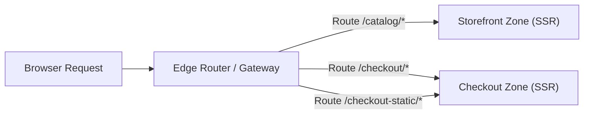
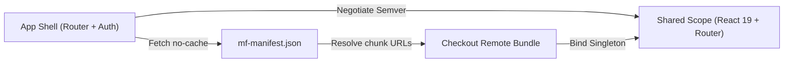

---
tags:
  - software-engineering
  - architectural-patterns
  - microfrontends
  - module-federation
created: 2026-01-02
updated: 2026-11-13
status: 🟢
level: mid-to-senior
---
# Microfrontends

> [!abstract] Vault Navigation
> Part of [[Programming/Software Engineering/Architectural Patterns/Architectural Patterns Complete Guide|Architectural Patterns Complete Guide]]. Applies organizational scaling principles from [[Programming/Software Engineering/Architectural Patterns/Microservices|Microservices]] and [[Programming/Software Engineering/DDD/Strategic Design|Strategic Design]] to browser applications. Pairs closely with [[Programming/Frontend/React Complete Guide|React Complete Guide]], [[Programming/Frontend/Next.js Complete Guide|Next.js Complete Guide]], [[Programming/Software Engineering/System Design/CDN|CDN]], and [[Programming/Software Engineering/System Design/API Design|API Design]].

**Microfrontends (MFEs)** partition a browser application along **business vertical boundaries** so autonomous frontend squads can build, test, and deploy separate UI sub-applications independently into production. Like backend microservices, MFEs solve an **organizational scaling and release-decoupling bottleneck**—never runtime browser performance. Naively splitting a frontend without strict bundle governance, singleton sharing rules, CSS isolation, and edge caching contracts degrades Core Web Vitals (**LCP**, **CLS**, **INP**) and recreates a **Distributed UI Monolith** in the browser.

---

## 1. First-Principles Mechanics & Composition Topologies

### 1.1 Vertical Route Slicing vs Horizontal Widget Soup

Microfrontend boundaries succeed when aligned to **Vertical Business Domains**, and fail when sliced into fine-grained **Horizontal Page Widgets**:

- **Vertical Slicing (Recommended)**: Each squad owns an entire route subtree end-to-end (`/catalog/*`, `/checkout/*`, `/account/*`) plus its paired vertical BFF. Only one thin global **App Shell** remains shared—handling top-level URL prefix routing, authentication session initialization, design tokens, and persistent top-level navigation chrome. At any moment on screen, typically **one** vertical remote owns the viewport.
- **Horizontal Slicing (High Coupling & CWV Risk)**: Mounting five independently deployed remotes simultaneously on a single page (`Header`, `Sidebar`, `CartBadge`, `ProductGrid`, `PromoBanner`) introduces layout shifts (**CLS**) as remotes resolve asynchronously at different speeds, forces a shared global cross-widget state bus, multiplies network round-trips (`mf-manifest.json` + chunks + parallel BFF waterfalls), and risks mixing conflicting framework versions on one DOM tree.

### 1.2 Five Composition Topologies Compared Mechanically

Frontend composition differs across three fundamental axes: **when composition occurs** (build time, edge/server time, or browser runtime), **how JavaScript scopes isolate**, and **how CSS rules isolate**.

#### 1. Build-Time NPM / Workspace Packages (Modular Monolith)
- **Mechanics**: Feature teams publish versioned TypeScript packages (`@acme/checkout-feature`) consumed by a central Shell `package.json` or Turborepo workspace. The bundler (`Vite`, `Rspack`, `Next.js`) tree-shakes and outputs one unified set of hashed chunks.
- **Reality Check**: **Not a runtime microfrontend.** Deploying a fix in `checkout` still forces a Shell version bump, full CI integration suite, and Shell redeployment. However, for organizations under ~40 frontend engineers, this delivers maximum Core Web Vitals, unified React Server Components (RSC), and zero-cost refactoring.

#### 2. Server-Side & Edge Composition (ESI / Edge Workers / Next.js Multi-Zones)
- **Mechanics**:
  - **Edge Side Includes (ESI) / Edge Workers**: A CDN proxy (`Cloudflare Workers`, `Fastly`, `Varnish`) fetches HTML fragments from upstream micro-apps in parallel, rewrites asset URLs, and streams a single assembled HTML document to the browser for optimal **First Contentful Paint (FCP)** and **LCP**.
  - **Next.js Multi-Zones**: Separate Next.js deployments own disjoint path prefixes (`/`, `/checkout/*`, `/docs/*`), stitched together seamlessly at the edge gateway or primary app's `rewrites()` using distinct `assetPrefix` paths (`/_next-checkout/static/...`) so static chunk paths never collide.
- **Trade-Off**: Eliminates client-side JS waterfall assembly and preserves full SSR/SEO; transitions *between* zones execute full document navigations (`hard reload`) rather than instant SPA client routing, making Multi-Zones ideal across distinct funnel stages (`Marketing -> Storefront -> Checkout`).



#### 3. Runtime Client Module Federation 2.0 (Webpack / Rspack / Vite)
- **Mechanics**: Each Remote compiles an independent bundle plus a runtime entry manifest (`mf-manifest.json` / `remoteEntry.js`). At runtime, the Host loads the Remote's manifest dynamically, initializes a shared dependency scope table (`__webpack_share_scopes__.default` or `@module-federation/runtime`), negotiates compatible **singleton** packages in memory via semver ranges, and mounts the exposed React/Vue module seamlessly inside the Host's client router.
- **Modern Tooling**: `@module-federation/enhanced` (Rspack / Webpack 5) and `@module-federation/vite` add dynamic type generation (`@mf-types`), runtime plugins, preloading hooks, and manifest-driven cache invalidation.



#### 4. Native Browser ES Modules + Import Maps & `single-spa`
- **Mechanics**: Instead of relying on bundler-specific federation runtimes, teams emit standard ES modules (`import ... from '@acme/checkout'`) mapped dynamically in `<script type="importmap">` JSON injected at the HTML edge (or updated dynamically via an Import Map Deployer service). Orchestrators like **`single-spa`** wrap each remote's lifecycle hooks (`bootstrap`, `mount`, `unmount`) to render heterogeneous frameworks (e.g., migrating an old Angular 14 app alongside React 19 routes).
- **Trade-Off**: Zero bundler lock-in and native browser module deduplication, but forfeits build-time tree-shaking across shared libraries (requiring carefully pre-built ESM vendor bundles) and demands strict import-map cache governance (`Cache-Control: no-store` on HTML or dynamic import-map JSON).

```html
<!-- Server-injected Import Map pinning shared singletons + content-hashed remote ESM entries -->
<script type="importmap">
{
  "imports": {
    "react": "https://cdn.acme.example/vendor/react@19.1.0/index.js",
    "react-dom/client": "https://cdn.acme.example/vendor/react-dom@19.1.0/client.js",
    "@acme/checkout": "https://cdn.acme.example/mfe/checkout/checkout.a41c92e1.js"
  }
}
</script>
```

#### 5. Web Components (`Custom Elements`) vs Sandboxed Iframes
- **Web Components**: Wrap a micro-app inside a custom HTML tag (`<acme-checkout-widget>`) optionally backed by `attachShadow({ mode: 'open' })`. Shadow DOM prevents external CSS leakage cleanly, yet complicates SSR (`Declarative Shadow DOM`), breaks global CSS frameworks unless tokens propagate via CSS Custom Properties, and requires bridging React 18/19 synthetic events and ARIA references (`aria-labelledby`) across Shadow boundaries.
- **Sandboxed `<iframe>`**: Provides absolute DOM, CSS, global variable (`window`), and security isolation (`sandbox="allow-scripts allow-same-origin"`), making it mandatory when embedding untrusted third-party merchant plugins. Inside first-party apps, iframes degrade UX severely: broken deep-linking/Back button sync, unresponsive height resizing, clipped dropdowns/modals trapped inside iframe viewports, and $N\times$ duplicated framework downloads.

### Complete Composition Topology Comparison

| Mechanism | Composition Time | CSS & JS Isolation | Framework Heterogeneity | SSR & LCP Performance | Primary Failure Mode |
| :--- | :--- | :--- | :--- | :--- | :--- |
| **Build-Time Packages** | CI build time | Shared runtime & styles | Single stack | Best (unified RSC / SSR) | Lockstep Shell rebuild on every squad deploy |
| **Next.js Multi-Zones / Edge ESI** | Server / CDN edge | Complete per-zone isolation | Multi-framework per zone | Excellent SSR & SEO | Hard page reload between zones; shared header drift |
| **Module Federation 2.0** | Browser runtime (`mf-manifest.json`) | Shared JS global; CSS needs prefix/layers | Same framework recommended | Client SPA default (SSR plugins complex) | Singleton React skew, 404 chunk skew, network waterfalls |
| **Native ESM + Import Maps (`single-spa`)** | Browser native loader | Shared global `window` | High (React + Vue + Angular) | Client-heavy unless paired with edge SSR | Weak tree-shaking across ESM vendor modules; complex CSP/caching |
| **Web Components + Shadow DOM** | Browser DOM mount | Strong Shadow CSS isolation; shared JS | High | Weak/complex SSR hydration | Accessibility (`ARIA`) barriers across shadow roots, modal clipping |
| **Sandboxed Iframes** | Browser frame load | Complete OS/process-grade sandbox | Unlimited | Poor (waterfall + duplicate JS) | Broken scroll/modals, URL sync hacks, $N\times$ RAM bloat |

---

## 2. Real-World Use Cases & Decision Matrix

### Scenario 1: 10-Engineer B2B Analytics Dashboard (Next.js)
- **Context**: Three feature areas (`Reports`, `Billing`, `User Admin`) maintained by 10 engineers collaborating daily.
- **Decision**: **Workspace Modular Monolith (Single Next.js App + Turborepo Packages + ESLint Boundaries)**.
- **Why MFEs Fail Here**: Moving to 4 Module Federation repos cuts unified RSC streaming, replaces instant TypeScript refactoring across PRs with NPM package publishing delays, and adds $4\times$ DevOps/Sentry source-map overhead with zero organizational benefit.

### Scenario 2: 140-Engineer Global Retail Platform (Storefront, Search, Checkout, Account)
- **Context**: `Checkout` processes strict PCI-adjacent fraud widgets and deploys cautiously twice weekly; `Storefront` and `Promotions` deploy 15 times daily across 14 squads.
- **Decision**: **Next.js Multi-Zones at Top Funnel (`/` vs `/checkout/*`) OR Vertical Module Federation 2.0 Inside Authenticated Portal**.
- **Why It Wins**: Multi-Zones gives SEO-critical Storefront routes pure edge SSR while isolating Checkout releases completely; within an authenticated single-page console (`/app/*`), vertical Module Federation preserves instant zero-reload client navigation while decoupling team deploy pipelines.

### Scenario 3: Strangler Migration from Legacy AngularJS/Vue 2 Monolith to React 19
- **Context**: An enterprise ERP with 350 screens cannot halt feature work for an 18-month rewrite.
- **Decision**: **`single-spa` + Web Components Route Strangler**.
- **Why It Wins**: Legacy routes stay mounted as one legacy micro-app while new routes mount cleanly as React 19 remotes inside the shared Shell, enabling incremental screen-by-screen retirement in production.

### Scenario 4: Third-Party Developer Plugin Marketplace Inside a SaaS IDE
- **Context**: External partners author custom UI panels running inside customer workspaces.
- **Decision**: **Sandboxed `<iframe>` + Typed `window.postMessage` RPC Bridge**.
- **Why Module Federation Fails Here**: Module Federation executes remote JS directly inside the Host's JavaScript realm (`window`, cookies, `localStorage`, DOM), creating catastrophic XSS / session hijacking vulnerabilities for untrusted code.

### Scenario 5: Multi-Squad Authenticated FinTech Console Requiring Instant Sub-Route Transitions
- **Context**: 60 frontend engineers across `Treasury`, `Payments`, `Risk`, and `Onboarding` sharing a unified workspace sidebar and live WebSocket alerts without full-page reloads.
- **Decision**: **Module Federation 2.0 (Rspack/Vite) with Vertical Route Ownership + Per-Vertical BFFs**.
- **Why It Wins**: Sharing `react`, `react-dom`, `react-router`, and `@fin/tokens` as singletons yields instantaneous SPA transitions while letting `Risk` deploy risk-rule UI fixes independently of `Payments`.

---

## 3. Step-by-Step Practical Application: Production Module Federation Stack

This complete implementation demonstrates a production-grade vertical MFE integration using Rspack/Webpack Module Federation 2.0 (`@module-federation/enhanced`), typed `CustomEvent` cross-MFE contracts, a fault-tolerant `RemoteModuleBoundary` handling CDN `404` chunk skew and load timeouts, a dedicated vertical BFF contract, CDN cache headers, and full Vitest tests.

### Project Directory Layout

```text
mfe-platform/
├── packages/
│   └── mfe-contracts/
│       └── src/
│           └── events.ts
├── apps/
│   ├── shell/
│   │   ├── rspack.config.ts
│   │   ├── src/
│   │   │   ├── index.ts
│   │   │   ├── bootstrap.tsx
│   │   │   └── components/
│   │   │       └── RemoteModuleBoundary.tsx
│   │   └── tests/
│   │       └── remote-boundary.test.tsx
│   └── checkout-remote/
│       ├── rspack.config.ts
│       ├── bff/
│       │   └── checkout-route.ts
│       └── src/
│           ├── index.ts
│           ├── bootstrap.tsx
│           └── CheckoutApp.tsx
└── infra/
    └── nginx-mfe-headers.conf
```

### 3.1 Typed Cross-MFE `CustomEvent` Contract (`packages/mfe-contracts/src/events.ts`)

Instead of sharing a global Redux or Zustand store (which couples state shape and reducer actions across team deployments), MFEs communicate coarse domain notifications strictly through versioned browser `CustomEvent` payloads plus a narrow `PlatformBridge` capability contract passed at mount.

```typescript
// packages/mfe-contracts/src/events.ts
export interface CartBadgeUpdatedDetail {
  version: 1;
  itemCount: number;
  updatedAtIso: string;
}

export interface OrderCompletedDetail {
  version: 1;
  orderId: string;
  totalCents: number;
  currency: string;
}

export interface MfeTelemetryEventDetail {
  version: 1;
  mfeName: string;
  eventName: string;
  metadata?: Record<string, string | number | boolean>;
}

export interface MfeEventMap {
  "acme:cart:badge-updated": CartBadgeUpdatedDetail;
  "acme:checkout:order-completed": OrderCompletedDetail;
  "acme:platform:telemetry": MfeTelemetryEventDetail;
}

export interface PlatformSessionBridge {
  /** Promise-deduplicated token/session accessor owned by the Shell */
  getAccessToken: () => Promise<string | null>;
  /** Top-level router navigation delegated to Shell for cross-MFE jumps */
  navigateToShellPath: (path: string) => void;
}

export function emitMfeEvent<K extends keyof MfeEventMap>(
  eventName: K,
  detail: MfeEventMap[K],
  target: EventTarget = window,
): void {
  target.dispatchEvent(
    new CustomEvent<MfeEventMap[K]>(eventName, {
      detail,
      bubbles: false,
      cancelable: false,
    }),
  );
}

export function subscribeMfeEvent<K extends keyof MfeEventMap>(
  eventName: K,
  handler: (detail: MfeEventMap[K]) => void,
  target: EventTarget = window,
): () => void {
  const listener: EventListener = (event) => {
    const custom = event as CustomEvent<unknown>;
    if (!custom.detail || typeof custom.detail !== "object") return;
    handler(custom.detail as MfeEventMap[K]);
  };
  target.addEventListener(eventName, listener);
  return () => target.removeEventListener(eventName, listener);
}
```

### 3.2 Async Bootstrap & Module Federation 2.0 Configs (`apps/shell` & `apps/checkout-remote`)

Notice two critical production invariants in the configs below:
1. **Async Entry (`import('./bootstrap')`)**: `index.ts` dynamically imports `bootstrap.tsx` so Module Federation negotiates shared singletons (`react`, `react-dom`, `react-router`) across all loaded remotes *before* React initializes its module-level dispatcher—preventing the need to mark dependencies `eager: true` on remotes.
2. **Strict Singleton Governance**: Setting `singleton: true` and `strictVersion: true` ensures incompatible React major bumps fail loudly in staging/CI rather than silently mounting two React dispatchers simultaneously.

```typescript
// apps/shell/src/index.ts (and identical pattern for apps/checkout-remote/src/index.ts)
void import("./bootstrap");
```

```typescript
// apps/shell/rspack.config.ts
import { defineConfig } from "@rspack/cli";
import { ModuleFederationPlugin } from "@module-federation/enhanced/rspack";
import pkg from "./package.json" with { type: "json" };

const CHECKOUT_REMOTE_URL =
  process.env.CHECKOUT_MF_URL ?? "https://cdn.acme.example/mfe/checkout/mf-manifest.json";

export default defineConfig({
  entry: "./src/index.ts",
  output: {
    publicPath: "auto",
    filename: "[name].[contenthash:8].js",
    chunkFilename: "[name].[contenthash:8].js",
  },
  plugins: [
    new ModuleFederationPlugin({
      name: "acme_shell",
      remotes: {
        checkout_mfe: `checkout_mfe@${CHECKOUT_REMOTE_URL}`,
      },
      shared: {
        react: {
          singleton: true,
          strictVersion: true,
          requiredVersion: pkg.dependencies.react,
        },
        "react-dom": {
          singleton: true,
          strictVersion: true,
          requiredVersion: pkg.dependencies["react-dom"],
        },
        "react-router": {
          singleton: true,
          strictVersion: true,
          requiredVersion: pkg.dependencies["react-router"],
        },
        "@acme/design-tokens": {
          singleton: true,
          requiredVersion: pkg.dependencies["@acme/design-tokens"],
        },
      },
    }),
  ],
});
```

```typescript
// apps/checkout-remote/rspack.config.ts
import { defineConfig } from "@rspack/cli";
import { ModuleFederationPlugin } from "@module-federation/enhanced/rspack";
import pkg from "./package.json" with { type: "json" };

export default defineConfig({
  entry: "./src/index.ts",
  output: {
    // 'auto' lets the remote load chunks relative to its own CDN origin, never Shell's host!
    publicPath: "auto",
    uniqueName: "checkout_mfe",
    filename: "[name].[contenthash:8].js",
    chunkFilename: "[name].[contenthash:8].js",
  },
  plugins: [
    new ModuleFederationPlugin({
      name: "checkout_mfe",
      manifest: true, // Emits mf-manifest.json for runtime asset discovery & preloading
      exposes: {
        "./CheckoutApp": "./src/CheckoutApp.tsx",
      },
      shared: {
        react: {
          singleton: true,
          strictVersion: true,
          requiredVersion: "^19.0.0",
        },
        "react-dom": {
          singleton: true,
          strictVersion: true,
          requiredVersion: "^19.0.0",
        },
        "react-router": {
          singleton: true,
          strictVersion: true,
          requiredVersion: "^7.0.0",
        },
        "@acme/design-tokens": {
          singleton: true,
          requiredVersion: pkg.dependencies["@acme/design-tokens"],
        },
      },
    }),
  ],
});
```

*(For Vite-based squads using `@module-federation/vite`, the identical `mf-manifest.json` + singleton invariant applies inside `vite.config.ts`; and for **Next.js App Router** deployments opting for Edge Multi-Zones instead of client federation, configure `rewrites()` + `assetPrefix`)*:

```typescript
// Alternative Bundler: apps/checkout-remote/vite.config.ts (@module-federation/vite)
import { defineConfig } from "vite";
import react from "@vitejs/plugin-react";
import { federation } from "@module-federation/vite";

export default defineConfig({
  base: "https://cdn.acme.example/mfe/checkout/",
  plugins: [
    react(),
    federation({
      name: "checkout_mfe",
      filename: "remoteEntry.js",
      manifest: true,
      exposes: {
        "./CheckoutApp": "./src/CheckoutApp.tsx",
      },
      shared: {
        react: { singleton: true, strictVersion: true, requiredVersion: "^19.0.0" },
        "react-dom": { singleton: true, strictVersion: true, requiredVersion: "^19.0.0" },
      },
    }),
  ],
});
```

```typescript
// Alternative Edge Topology: Primary Zone next.config.ts (Multi-Zones)
import type { NextConfig } from "next";

const nextConfig: NextConfig = {
  async rewrites() {
    const checkoutOrigin = process.env.CHECKOUT_ZONE_ORIGIN ?? "https://checkout-zone.internal";
    return [
      { source: "/checkout", destination: `${checkoutOrigin}/checkout` },
      { source: "/checkout/:path*", destination: `${checkoutOrigin}/checkout/:path*` },
      { source: "/checkout-static/:path*", destination: `${checkoutOrigin}/checkout-static/:path*` },
    ];
  },
};

export default nextConfig;
// Checkout Zone next.config.ts sets: assetPrefix: "/checkout-static"
```

### 3.3 Fault-Tolerant `RemoteModuleBoundary` (`apps/shell/src/components/RemoteModuleBoundary.tsx`)

A Remote CDN outage or chunk `404` during deployment skew must **never** crash the entire Shell (`Uncaught ChunkLoadError` leaving a blank white screen). `RemoteModuleBoundary` wraps `React.lazy` with:
1. A deterministic **load timeout** (`Promise.race`) rejecting stalled remote CDN scripts.
2. Detection of `ChunkLoadError` / network failures inside a React `ErrorBoundary`.
3. Clean recovery actions: retry dynamic mount (`retryNonce` triggering fresh manifest/chunk resolution) or fallback to a degraded legacy URL/support state while emitting structured telemetry.

```tsx
// apps/shell/src/components/RemoteModuleBoundary.tsx
import React, { Component, Suspense, useMemo, useState, type ReactNode } from "react";
import { emitMfeEvent } from "../../../../packages/mfe-contracts/src/events.js";

export class RemoteLoadTimeoutError extends Error {
  constructor(public readonly remoteName: string, public readonly timeoutMs: number) {
    super(`Remote "${remoteName}" failed to load within ${timeoutMs}ms`);
    this.name = "RemoteLoadTimeoutError";
  }
}

export function isChunkLoadFailure(error: unknown): boolean {
  if (!(error instanceof Error)) return false;
  return (
    error.name === "ChunkLoadError" ||
    error.name === "RemoteLoadTimeoutError" ||
    /loading chunk .* failed|failed to fetch dynamically imported module/i.test(error.message)
  );
}

interface BoundaryProps {
  remoteName: string;
  onRetry: () => void;
  fallbackRender?: (info: { error: Error; isChunkError: boolean; retry: () => void }) => ReactNode;
  children: ReactNode;
}

interface BoundaryState {
  error: Error | null;
}

class RemoteErrorBoundary extends Component<BoundaryProps, BoundaryState> {
  state: BoundaryState = { error: null };

  static getDerivedStateFromError(error: Error): BoundaryState {
    return { error };
  }

  componentDidCatch(error: Error): void {
    emitMfeEvent("acme:platform:telemetry", {
      version: 1,
      mfeName: this.props.remoteName,
      eventName: "remote_mount_failed",
      metadata: {
        errorName: error.name,
        isChunkFailure: isChunkLoadFailure(error),
      },
    });
  }

  private handleRetry = (): void => {
    this.setState({ error: null });
    this.props.onRetry();
  };

  render(): ReactNode {
    const { error } = this.state;
    if (!error) return this.props.children;

    const isChunkError = isChunkLoadFailure(error);
    if (this.props.fallbackRender) {
      return this.props.fallbackRender({ error, isChunkError, retry: this.handleRetry });
    }

    return (
      <section role="alert" data-testid={`mfe-fallback-${this.props.remoteName}`}>
        <h2>Module Temporarily Unavailable</h2>
        <p>
          {isChunkError
            ? "A new deployment occurred while loading this section."
            : "This section encountered an unexpected runtime error."}
        </p>
        <button type="button" onClick={this.handleRetry}>
          Retry Loading Module
        </button>
        {isChunkError && (
          <button type="button" onClick={() => window.location.reload()}>
            Reload Application
          </button>
        )}
      </section>
    );
  }
}

export interface RemoteModuleMountProps<P extends object> {
  remoteName: string;
  loader: () => Promise<{ default: React.ComponentType<P> }>;
  componentProps: P;
  timeoutMs?: number;
  loadingFallback?: ReactNode;
  errorFallback?: BoundaryProps["fallbackRender"];
}

export function RemoteModuleBoundary<P extends object>({
  remoteName,
  loader,
  componentProps,
  timeoutMs = 5_000,
  loadingFallback = <div role="status">Loading {remoteName}...</div>,
  errorFallback,
}: RemoteModuleMountProps<P>): React.ReactElement {
  const [attemptEpoch, setAttemptEpoch] = useState(0);

  const LazyRemoteComponent = useMemo(() => {
    return React.lazy(() => {
      let timerId: ReturnType<typeof setTimeout> | undefined;
      const timeoutPromise = new Promise<never>((_, reject) => {
        timerId = setTimeout(() => {
          reject(new RemoteLoadTimeoutError(remoteName, timeoutMs));
        }, timeoutMs);
      });

      return Promise.race([loader(), timeoutPromise]).finally(() => {
        if (timerId !== undefined) clearTimeout(timerId);
      });
    });
  }, [remoteName, loader, timeoutMs, attemptEpoch]);

  return (
    <RemoteErrorBoundary
      key={attemptEpoch}
      remoteName={remoteName}
      onRetry={() => setAttemptEpoch((n) => n + 1)}
      fallbackRender={errorFallback}
    >
      <Suspense fallback={loadingFallback}>
        <LazyRemoteComponent {...componentProps} />
      </Suspense>
    </RemoteErrorBoundary>
  );
}
```

### 3.4 Remote Component, Vertical BFF Contract & CDN Cache Rules

Each Remote isolates CSS under a dedicated class root (or PostCSS prefix), owns nested routing relative to its mounted `basename`, avoids calling `/me` redundantly by using the Shell's promise-deduplicated `PlatformSessionBridge`, and emits typed `CustomEvent` payloads back to the Shell chrome.

```tsx
// apps/checkout-remote/src/CheckoutApp.tsx
import React, { useState } from "react";
import {
  emitMfeEvent,
  type PlatformSessionBridge,
} from "../../../packages/mfe-contracts/src/events.js";

export interface CheckoutAppProps {
  cartId: string;
  bridge: PlatformSessionBridge;
  bffBaseUrl?: string;
}

export default function CheckoutApp({
  cartId,
  bridge,
  bffBaseUrl = "/bff/checkout",
}: CheckoutAppProps): React.ReactElement {
  const [submitting, setSubmitting] = useState(false);
  const [errorMessage, setErrorMessage] = useState<string | null>(null);

  async function handleConfirmOrder(): Promise<void> {
    if (submitting) return;
    setSubmitting(true);
    setErrorMessage(null);

    try {
      const token = await bridge.getAccessToken();
      const response = await fetch(`${bffBaseUrl}/orders`, {
        method: "POST",
        headers: {
          "content-type": "application/json",
          ...(token ? { authorization: `Bearer ${token}` } : {}),
        },
        body: JSON.stringify({ cartId }),
      });

      if (!response.ok) {
        throw new Error(`Order submission failed (${response.status})`);
      }

      const payload = (await response.json()) as {
        orderId: string;
        totalCents: number;
        currency: string;
      };

      emitMfeEvent("acme:cart:badge-updated", {
        version: 1,
        itemCount: 0,
        updatedAtIso: new Date().toISOString(),
      });
      emitMfeEvent("acme:checkout:order-completed", {
        version: 1,
        orderId: payload.orderId,
        totalCents: payload.totalCents,
        currency: payload.currency,
      });

      bridge.navigateToShellPath(`/orders/${payload.orderId}/confirmation`);
    } catch (err) {
      setErrorMessage(err instanceof Error ? err.message : "Unable to submit order");
    } finally {
      setSubmitting(false);
    }
  }

  return (
    <div className="mfe-checkout-root" data-mfe="checkout">
      <h1>Checkout Summary</h1>
      {errorMessage && <p role="alert">{errorMessage}</p>}
      <button type="button" disabled={submitting} onClick={() => void handleConfirmOrder()}>
        {submitting ? "Processing..." : "Confirm Order"}
      </button>
    </div>
  );
}
```

```tsx
// apps/shell/src/bootstrap.tsx — Shell Composition + Promise-Deduplicated Session Bridge
import React, { useEffect, useMemo, useState } from "react";
import { createRoot } from "react-dom/client";
import { RemoteModuleBoundary } from "./components/RemoteModuleBoundary.js";
import {
  subscribeMfeEvent,
  type PlatformSessionBridge,
} from "../../../packages/mfe-contracts/src/events.js";

function createDedupedTokenGetter(): () => Promise<string | null> {
  let inFlightPromise: Promise<string | null> | null = null;
  let cachedToken: string | null = null;
  let expiresAt = 0;

  return () => {
    if (cachedToken && Date.now() < expiresAt) {
      return Promise.resolve(cachedToken);
    }
    if (!inFlightPromise) {
      inFlightPromise = fetch("/auth/session-token", { credentials: "include" })
        .then(async (res) => {
          if (!res.ok) return null;
          const data = (await res.json()) as { accessToken: string; expiresInSec: number };
          cachedToken = data.accessToken;
          expiresAt = Date.now() + Math.max(5, data.expiresInSec - 10) * 1000;
          return cachedToken;
        })
        .catch(() => null)
        .finally(() => {
          inFlightPromise = null;
        });
    }
    return inFlightPromise;
  };
}

export function ShellApp(): React.ReactElement {
  const [cartCount, setCartCount] = useState(2);
  const getAccessToken = useMemo(() => createDedupedTokenGetter(), []);

  useEffect(() => {
    return subscribeMfeEvent("acme:cart:badge-updated", (detail) => {
      setCartCount(detail.itemCount);
    });
  }, []);

  const bridge = useMemo<PlatformSessionBridge>(
    () => ({
      getAccessToken,
      navigateToShellPath: (path) => {
        window.history.pushState({}, "", path);
      },
    }),
    [getAccessToken],
  );

  return (
    <main>
      <header>
        <span>Acme Store</span>
        <span aria-label="Cart count">Cart ({cartCount})</span>
      </header>
      <RemoteModuleBoundary
        remoteName="checkout_mfe"
        loader={() => import("checkout_mfe/CheckoutApp")}
        componentProps={{ cartId: "cart-active", bridge }}
        timeoutMs={5_000}
      />
    </main>
  );
}

const rootEl = document.getElementById("root");
if (rootEl) {
  createRoot(rootEl).render(<ShellApp />);
}
```

```typescript
// apps/checkout-remote/bff/checkout-route.ts — Dedicated Vertical BFF Route Contract
export interface CheckoutOrderRequest {
  cartId: string;
}

export interface CheckoutOrderResponse {
  orderId: string;
  totalCents: number;
  currency: "USD" | "EUR";
}

export async function handleCreateCheckoutOrder(
  req: Request,
  ordersServiceUrl: string,
): Promise<Response> {
  const authHeader = req.headers.get("authorization");
  if (!authHeader?.startsWith("Bearer ")) {
    return Response.json({ error: "Unauthorized" }, { status: 401 });
  }

  const body = (await req.json()) as Partial<CheckoutOrderRequest>;
  if (!body.cartId || typeof body.cartId !== "string") {
    return Response.json({ error: "cartId is required" }, { status: 400 });
  }

  const upstream = await fetch(`${ordersServiceUrl}/internal/orders`, {
    method: "POST",
    headers: {
      "content-type": "application/json",
      "authorization": authHeader,
    },
    body: JSON.stringify({ cartId: body.cartId }),
  });

  if (!upstream.ok) {
    return Response.json({ error: "Upstream checkout failure" }, { status: 502 });
  }

  const order = (await upstream.json()) as CheckoutOrderResponse;
  return Response.json(order, { status: 201 });
}
```

```nginx
# infra/nginx-mfe-headers.conf — Mandatory MFE CDN / Origin Caching Invariant
server {
  listen 8080;
  root /usr/share/nginx/html;

  # 1. NEVER long-cache manifests or entry files; stale manifests point to pruned/skewed chunks!
  location ~* /(mf-manifest\.json|mf-stats\.json|remoteEntry\.js)$ {
    add_header Cache-Control "public, max-age=0, must-revalidate" always;
    add_header Access-Control-Allow-Origin "https://app.acme.example" always;
  }

  # 2. Content-hashed JS/CSS chunks cache immutably for 1 year
  location ~* \.[a-f0-9]{8,}\.(js|css|woff2)$ {
    add_header Cache-Control "public, max-age=31536000, immutable" always;
    add_header Access-Control-Allow-Origin "https://app.acme.example" always;
  }
}
```

### 3.5 Complete Vitest + Testing Library Suite (`apps/shell/tests/remote-boundary.test.tsx`)

```tsx
// apps/shell/tests/remote-boundary.test.tsx
import React from "react";
import { afterEach, describe, expect, it, vi } from "vitest";
import { cleanup, fireEvent, render, screen, waitFor } from "@testing-library/react";
import { RemoteModuleBoundary } from "../src/components/RemoteModuleBoundary.js";
import {
  emitMfeEvent,
  subscribeMfeEvent,
} from "../../../packages/mfe-contracts/src/events.js";

afterEach(() => {
  cleanup();
  vi.useRealTimers();
});

describe("RemoteModuleBoundary resilience & recovery", () => {
  it("mounts remote component normally on fast resolution", async () => {
    const loader = vi.fn(async () => ({
      default: ({ title }: { title: string }) => <div>Mounted: {title}</div>,
    }));

    render(
      <RemoteModuleBoundary
        remoteName="checkout_mfe"
        loader={loader}
        componentProps={{ title: "Cart #42" }}
      />,
    );

    expect(screen.getByRole("status").textContent).toContain("Loading checkout_mfe");
    expect(await screen.findByText("Mounted: Cart #42")).toBeTruthy();
  });

  it("renders chunk-failure fallback when remote CDN returns 404 and recovers on retry", async () => {
    let shouldFail = true;
    const loader = vi.fn(async () => {
      if (shouldFail) {
        const err = new Error("Loading chunk 918 failed (404)");
        err.name = "ChunkLoadError";
        throw err;
      }
      return {
        default: ({ title }: { title: string }) => <div>Recovered: {title}</div>,
      };
    });

    const receivedEvents: string[] = [];
    const unsubscribe = subscribeMfeEvent("acme:platform:telemetry", (detail) => {
      receivedEvents.push(`${detail.mfeName}:${detail.eventName}`);
    });

    render(
      <RemoteModuleBoundary
        remoteName="checkout_mfe"
        loader={loader}
        componentProps={{ title: "Cart #99" }}
      />,
    );

    const alert = await screen.findByTestId("mfe-fallback-checkout_mfe");
    expect(alert.textContent).toContain("new deployment occurred");
    expect(receivedEvents).toContain("checkout_mfe:remote_mount_failed");

    shouldFail = false;
    fireEvent.click(screen.getByRole("button", { name: "Retry Loading Module" }));

    expect(await screen.findByText("Recovered: Cart #99")).toBeTruthy();
    unsubscribe();
  });

  it("aborts hung remote load with timeout fallback", async () => {
    vi.useFakeTimers();
    const neverResolvingLoader = () => new Promise<{ default: React.ComponentType<object> }>(() => {});

    render(
      <RemoteModuleBoundary
        remoteName="analytics_mfe"
        loader={neverResolvingLoader}
        componentProps={{}}
        timeoutMs={3000}
      />,
    );

    await vi.advanceTimersByTimeAsync(3100);
    await waitFor(() => {
      expect(screen.getByTestId("mfe-fallback-analytics_mfe")).toBeTruthy();
    });
  });

  it("delivers typed CustomEvents cleanly and detaches listeners on unsubscribe", () => {
    const received: number[] = [];
    const unsubscribe = subscribeMfeEvent("acme:cart:badge-updated", (detail) => {
      received.push(detail.itemCount);
    });

    emitMfeEvent("acme:cart:badge-updated", {
      version: 1,
      itemCount: 3,
      updatedAtIso: "2026-11-13T12:00:00Z",
    });
    expect(received).toEqual([3]);

    unsubscribe();

    emitMfeEvent("acme:cart:badge-updated", {
      version: 1,
      itemCount: 0,
      updatedAtIso: "2026-11-13T12:01:00Z",
    });
    expect(received).toEqual([3]);
  });
});
```

---

## 4. Complete MFE Internals Reference & Production Edge Cases

### 4.1 Singleton Dependency Skew & React Dispatcher Mechanics

Internally, React maintains a module-scoped pointer (`React.__CLIENT_INTERNALS_DO_NOT_USE_OR_WARN_USERS_THEY_CANNOT_UPGRADE.H` in React 19, or `ReactCurrentDispatcher` in React 18) set dynamically right before executing any function component render pass. React Context (`useContext(AuthContext)`) likewise compares object identity by reference (`===`), not string name!

When `shell` bundles React `19.0.1` and `checkout_mfe` accidentally omits `singleton: true` (or relaxes `strictVersion` causing Module Federation to load two React copies when major versions diverge):
1. `shell`'s React reconciler mounts `<CheckoutApp />` and attaches hook state to Shell's dispatcher.
2. Inside `<CheckoutApp />`, calling `useState()` reads `checkout_mfe`'s isolated `React` copy whose dispatcher pointer is still `null` $\implies$ immediate crash: **`Invalid hook call. Hooks can only be called inside the body of a function component`**!
3. Even with identical React versions, failing to mark `@acme/design-tokens` or `ThemeProvider` / `QueryClientProvider` context modules as shared singletons causes `useTheme()` inside a remote to return default `undefined` because two separate `createContext()` object references exist in memory.

### 4.2 CSS Collisions, Tailwind v4 Utility Leakage & Z-Index Wars

Two MFEs compiled independently share the single global browser cascade unless explicitly isolated:
- **Global Reset & Utility Collisions**: If Remote A runs Tailwind v4 and Remote B ships Bootstrap 5 or unprefixed global resets (`* { margin: 0; }`, `.btn`, `h1`), the stylesheet injected *last* wins globally—visually breaking the Shell navigation bar the moment a user visits Remote B!
- **Three Production CSS Isolation Strategies**:
  1. **PostCSS Prefix Scoping (`postcss-prefix-selector`)**: Wrap every CSS selector emitted by `checkout_mfe` automatically under `.mfe-checkout-root`, matching the root container class rendered by `CheckoutApp`.
  2. **Scoped Tailwind Prefix / Cascade `@layer`**: Configure `@import "tailwindcss" prefix(chk);` inside MFEs so utility classes never collide (`chk:flex` vs `flex`), or isolate legacy resets inside named `@layer legacy-reset` blocks below `@layer utilities`.
  3. **Shared Z-Index Scale Tokens**: Hardcoded `z-index: 9999` tooltips inside a Remote overlap the Shell's `z-index: 1000` global search modal! Enforce semantic CSS Custom Properties at `:root` (`--z-sticky: 100; --z-dropdown: 200; --z-modal: 400; --z-toast: 600`) across all squads via linting (`stylelint`).

### 4.3 Routing Ownership & Avoiding Distributed UI Monoliths

Never expose one global Redux store across independent MFEs: coupling global reducers forces teams to synchronize store migrations and makes rolling back a single Remote impossible without breaking Shell selectors.

- **URL as Primary Shared State**: Store active tabs, filters, pagination cursors, and entity IDs in the URL (`?tab=invoices&page=2`). Every MFE reads URL parameters via the singleton router or standard `URLSearchParams`.
- **Route Prefix Ownership (`basename`)**: Shell owns top-level matching (`<Route path="/checkout/*" element={<RemoteCheckout />} />`). The Remote mounts an internal sub-router anchored at `basename="/checkout"` (or uses relative child routes `<Route path="shipping" />`). Letting both Shell and Remote execute competing root `Navigate` catch-all redirects (`path="*"`) produces infinite browser `pushState` crash loops (`Maximum update depth exceeded`).
- **Session & Auth Waterfall Elimination**: Do **not** let every mounted MFE independently call `GET /api/auth/me` (`150 ms` waterfall on every route switch). Authenticate via `HttpOnly; SameSite=Lax` edge cookies or Shell-owned token exchange, and inject a promise-deduplicated `bridge.getAccessToken()` so concurrent calls resolve against one in-flight refresh promise.

### 4.4 Independent Deployability & Rollback Guarantees

1. **Manifest Cache Hygiene**: `mf-manifest.json` / `remoteEntry.js` **must** carry `Cache-Control: public, max-age=0, must-revalidate`. Only content-hashed assets (`checkout.9f31a2c8.js`) receive `max-age=31536000, immutable`.
2. **CDN Asset Retention Window**: Never run `aws s3 sync --delete` immediately on deploy! Active user tabs that loaded `v2.13.0`'s manifest 10 minutes earlier will request `v2.13.0` lazy route chunks when clicked. Retain old chunk hashes in object storage for **14–30 days** before lifecycle pruning.
3. **Developer Override Cookie / Import-Map Overrides**: Inject a staging override map in `Shell` controlled by local storage / signed DevTools toggle (`localStorage.getItem('mfe-override:checkout_mfe')`) allowing developers to test local `http://localhost:3002/mf-manifest.json` seamlessly against the deployed staging Shell without spinning up all 8 MFEs locally!

---

## 5. Production Debugging, Profiling & Operations Playbook

| Symptom | Root Cause Hypothesis | Exact Diagnostic Commands / Tools | Remediation |
| :--- | :--- | :--- | :--- |
| **`Invalid hook call` or `useContext()` returns `undefined` only inside Remote** | Dual `react` or context package instances loaded in memory | Inspect `window.__FEDERATION__.__INSTANCES__` in DevTools · Check Network tab for duplicate `react` chunk fetches | Set `singleton: true, strictVersion: true` on `react`, `react-dom`, and context providers; use async `bootstrap.tsx` entry |
| **`ChunkLoadError: Loading chunk ... failed (404)` right after Remote deploy** | `mf-manifest.json` cached by CDN/browser or old hashed chunks deleted from S3 | `curl -I https://cdn.acme.example/mfe/checkout/mf-manifest.json` (verify `Cache-Control`) | Set `max-age=0, must-revalidate` on manifest; stop `--delete` on S3 asset sync (keep chunks 14–30 days); add `RemoteModuleBoundary` |
| **Navbar or Shell layout breaks immediately after visiting one specific MFE** | Unscoped global CSS reset (`*`, `h1`, `.btn`) or colliding Tailwind utility output | DevTools Elements $\to$ Computed Styles trace stylesheet origin URL | Scope Remote CSS via `postcss-prefix-selector` (`.mfe-checkout-root`), Tailwind `prefix()`, or Shadow DOM |
| **Route transition triggers sequential `400 ms` blank gaps & duplicate `/me` API calls** | Waterfall chain: Shell chunk $\to$ manifest $\to$ Remote entry $\to$ Remote chunk $\to$ redundant auth BFF fetch | Chrome DevTools Network Waterfall + Performance `LCP` trace | Prefetch `mf-manifest.json` on hover (`link rel="prefetch"`), share promise-deduplicated `bridge.getAccessToken()`, combine vertical BFF reads |
| **Browser freezes with `Throttling navigation` / `Maximum update depth exceeded` on route change** | Shell and Remote routers both defining competing catch-all `*` fallback redirects without `basename` | React DevTools Profiler + `window.history.pushState` monkey-patch breakpoint | Assign explicit prefix `/checkout/*` to Shell; configure Remote internal router strictly relative or `basename="/checkout"` |

```bash
# Quick CDN Header & Federation Manifest Audit Commands
curl -sI https://cdn.acme.example/mfe/checkout/mf-manifest.json | grep -iE "cache-control|etag|access-control"
curl -s https://cdn.acme.example/mfe/checkout/mf-manifest.json | jq '.shared[] | {name, version, singleton}'
```

---

## 6. Worked Exercises

### Exercise 1: Production `Invalid Hook Call` & `ChunkLoadError (404)` After Independent Deploy

After deploying `checkout-mfe@v2.14.0` independently without redeploying `host-shell`, telemetry reports two incidents affecting 14% of sessions:
1. Users who opened the app *before* the deploy click "Proceed to Checkout" and crash with `ChunkLoadError: Loading chunk 842 failed (404)`.
2. A staging build throws `Error: Invalid hook call. Hooks can only be called inside the body of a function component` inside `<CheckoutSummary />`.

Diagnose the exact runtime mechanics causing both incidents and specify the complete fixes.

---

### Solution 1

#### 1. `ChunkLoadError (404)` Root Cause & Fix
- **Root Cause**: Either (a) the CDN/Nginx served `mf-manifest.json` / `remoteEntry.js` with a long `max-age` so browsers held `v2.13.0` chunk mappings pointing to `chunk-842.js`, or (b) the CI deploy script synced `v2.14.0` to S3 with `--delete`, deleting `chunk-842.js` from `v2.13.0` while active browser tabs still referenced it!
- **Fix**:
  1. Set `Cache-Control: public, max-age=0, must-revalidate` strictly on `mf-manifest.json` and `remoteEntry.js` while leaving content-hashed JS chunks `max-age=31536000, immutable`.
  2. Retain historical release chunks in S3/CDN for 14–30 days via lifecycle rules rather than `sync --delete`.
  3. Wrap lazy MFE mounts in `RemoteModuleBoundary` to catch chunk skew and trigger a clean reload/retry UX instead of a white screen.

#### 2. `Invalid Hook Call` Root Cause & Fix
- **Root Cause**: `checkout-mfe` upgraded `react` to `19.1.0` while `host-shell` remained on `18.3.1`, and `shared.react` either omitted `singleton: true` or had `strictVersion: false`. Module Federation loaded two separate `React` instances into memory; `<CheckoutSummary />` invoked `useState` against `checkout-mfe`'s uninitialized dispatcher pointer while mounted inside `host-shell`'s reconciler tree.
- **Fix**: Enforce `singleton: true` and `strictVersion: true` on `react`, `react-dom`, and context-bearing libraries in both Host and Remote configs, use async `import('./bootstrap')` initialization, and enforce React major/minor alignment via a shared platform compatibility check in CI before Remote upload.

---

### Exercise 2: Evaluating Microfrontends vs Workspace Modular Monolith for a 10-Person Team

A Series-A B2B SaaS startup has **10 frontend engineers** maintaining one Next.js dashboard (`Analytics`, `Billing Settings`, `User Admin`). Leadership proposes splitting into **4 separate repositories + Module Federation microfrontends + 4 BFFs**. Quantify **3 concrete engineering and Web Vitals penalties** this team will incur and design the superior modular alternative.

---

### Solution 2

#### 3 Quantified Penalties
1. **Core Web Vitals (`LCP` / `INP`) Degradation**: Moving from unified Next.js App Router SSR/RSC to client-side Module Federation remotes introduces sequential network waterfalls (`HTML -> Shell JS -> mf-manifest.json -> Remote Entry -> Remote Chunks -> BFF JSON`), routinely adding `300–900 ms` to LCP on mobile networks and disabling seamless RSC payload streaming.
2. **Loss of Atomic Cross-Module Type Safety**: Sharing TypeScript domain contracts, design tokens, and route helper types across 4 repositories forces manual NPM versioning/publishing cycles, turning a 5-minute single-PR rename into 4 staggered pull requests.
3. **High Operational Overhead per Engineer**: With 10 engineers (~2.5 per repo), squads pay $4\times$ CI pipeline maintenance, Playwright cross-repo mocking complexity, Sentry source-map management, and BFF coordination without having hit merge-queue bottlenecks.

#### Superior Alternative: Workspace Modular Monolith
Keep **one Next.js deployment** inside a Turborepo monorepo partitioned into strict vertical feature packages (`packages/feature-analytics`, `packages/feature-billing`, `packages/feature-admin`, `packages/ui`). Enforce architectural boundaries via `eslint-plugin-boundaries` (`no-cross-feature-imports`), decouple feature rollouts with Feature Flags, and revisit runtime MFEs only when scaling beyond ~40–60 engineers across genuinely divergent release cadences.

---

### Exercise 3: Eliminating CSS Leakage, Z-Index Wars & Auth Waterfalls

Two MFEs (`Shell` using Tailwind v4 + `LegacyBillingMFE` using Bootstrap 5) mount together. Visiting `LegacyBillingMFE` breaks `Shell`'s navbar buttons and heading sizes, `LegacyBillingMFE` confirmation modals appear *behind* the `Shell` top header (`z-index: 500` vs `z-index: 1000`), and switching sub-routes triggers duplicate sequential `GET /api/auth/me` calls (`180 ms` each). Solve all three issues cleanly.

---

### Solution 3

#### 1. CSS & Z-Index Isolation
- **Scope Legacy Bootstrap Styles**: Add `postcss-prefix-selector` to `LegacyBillingMFE` wrapping every emitted rule inside `.mfe-billing-root` (transforming `body`/`*` resets to `.mfe-billing-root`), or mount `LegacyBillingMFE` inside a Shadow DOM container forwarding design tokens (`--font-sans`, `--color-surface`) via inherited CSS Custom Properties.
- **Unify Z-Index Scale via Shared CSS Custom Properties**: Eliminate magic integer `z-index: 1000` constants; consume Shell-provided semantic tokens (`--z-sticky-nav: 200; --z-modal-backdrop: 500; --z-modal: 510`) so modals inside any Remote always stack cleanly above Shell headers.

#### 2. Eliminating Duplicate Auth Waterfalls
- Authenticate once at the Edge / API Gateway via `HttpOnly` session cookies or Shell bootstrap, and pass a **promise-deduplicated `PlatformSessionBridge`** (`bridge.getSession()`) down to mounted Remotes. Concurrent calls from `Shell` and `LegacyBillingMFE` await the exact same in-flight promise/cached session payload, removing the redundant `180 ms` `/me` round trip.

---

### Exercise 4: Untangling a Shared Global Redux Store & Router Crash Loop

An enterprise portal shares one global Redux store (`singleton: true`) across `Shell` and 4 Remotes (`Inventory`, `Orders`, `Pricing`, `Support`) and gives every Remote its own `<BrowserRouter>` containing `<Route path="*" element={<Navigate to="/" />} />`. Teams report:
1. Deploying `Orders` with a renamed Redux slice key crashes `Support` in production.
2. Navigating to `/orders/991` locks the browser tab with `Warning: Maximum update depth exceeded` as the URL flickers infinitely between `/` and `/orders/991`.

Diagnose both failure modes and prescribe the architectural refactoring.

---

### Solution 4

#### 1. Breaking the Distributed UI Monolith (Shared Redux Store)
- **Root Cause**: Putting domain state (`ordersSlice`, `inventorySlice`) inside a shared singleton Redux store recreates shared-database lockstep coupling in browser RAM—changing a reducer or selector breaks unrelated Remotes deployed asynchronously.
- **Fix**: Delete the global cross-MFE Redux store. Move each MFE's server cache into its own scoped local TanStack Query client/store inside that Remote. Communicate strictly across boundaries using **narrow typed `CustomEvent` notifications** (`acme:cart:badge-updated`) and **URL query state** (`?orderId=991`).

#### 2. Stopping the Infinite Router Loop
- **Root Cause**: Both `Shell` and `Support`/`Orders` rendered independent root `<BrowserRouter>` trees listening to `window.history`. When `/orders/991` matched inside `Orders`, `Support`'s active or stray fallback `<Route path="*">` fired `<Navigate to="/" />`, resetting the URL before `Orders` pushed back—creating an infinite `pushState` loop!
- **Fix**: Keep **exactly one `<BrowserRouter>` in `Shell`** owning prefix routes (`/orders/*`), and render Remotes using Shell's shared `react-router` singleton `<Routes>` with relative child paths (`path=":orderId"`)—or, if using independent framework routers, bind each Remote strictly to its `basename="/orders"` and **forbid** unmatched catch-all redirects back to `/` inside child Remotes.

---

### Exercise 5: Multi-Zone SSR vs Client Module Federation Waterfall Analysis

A retail storefront compares two architectures for its primary product-to-checkout flow on a `4G` mobile client (`RTT = 100 ms`):
- **Option A (Client Module Federation SPA)**: `Shell HTML (100 ms)` $\to$ `Shell JS (200 ms)` $\to$ `mf-manifest.json (100 ms)` $\to$ `Checkout JS (200 ms)` $\to$ `BFF JSON (150 ms)` $\to$ Render.
- **Option B (Next.js Multi-Zones SSR)**: Edge Gateway routes `/checkout/*` directly to the Checkout Next.js server, streaming pre-rendered SSR HTML (`250 ms` server + `100 ms` RTT) directly with inline initial payload.

1. Compare total time-to-meaningful-content (`LCP` baseline) for deep-linked landing directly on `/checkout/cart-42`.
2. Explain the single main UX trade-off of Option B when transitioning from `/catalog` to `/checkout`, and how modern browsers (`Speculation Rules` / prefetch) mitigate it.

---

### Solution 5

#### 1. Deep-Link Waterfall Comparison
- **Option A (Client Module Federation)**: Executes **5 serial network hops** before Checkout content paints: $100 + 200 + 100 + 200 + 150 = \mathbf{750\text{ ms+}}$ *minimum* network serialization time (plus JS parse/hydration CPU), delaying LCP noticeably on mobile devices.
- **Option B (Next.js Multi-Zones SSR)**: The edge gateway hits the Checkout server immediately, which queries its BFF in-DC (`~20 ms`) and streams rendered HTML containing product totals and buttons on the **first document response** ($\approx \mathbf{350\text{ ms}}$), cutting time-to-first-meaningful-paint roughly in half and improving SEO/conversion.

#### 2. Transition UX Trade-Off & Mitigation
- **Trade-Off**: Moving across Multi-Zone boundaries (`/catalog` owned by Storefront Zone $\to$ `/checkout` owned by Checkout Zone) executes a **full browser document navigation** instead of an in-memory SPA client transition, risking brief visual flashes or losing ephemeral client audio/drawer state.
- **Mitigation**: Keep shared header CSS/tokens identical across zones, use Chromium **Speculation Rules API** (`<script type="speculationrules">{"prerender": [{"urls": ["/checkout"]}]}</script>`) or `<link rel="prefetch">` on the "Proceed to Checkout" CTA hover/focus, and enable **Cross-Document View Transitions (`@view-transition { navigation: auto; }`)** for seamless zero-flash visual continuity across zones.
