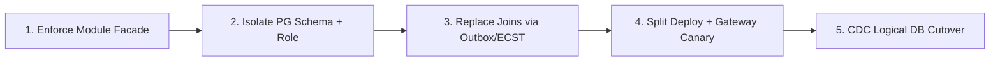
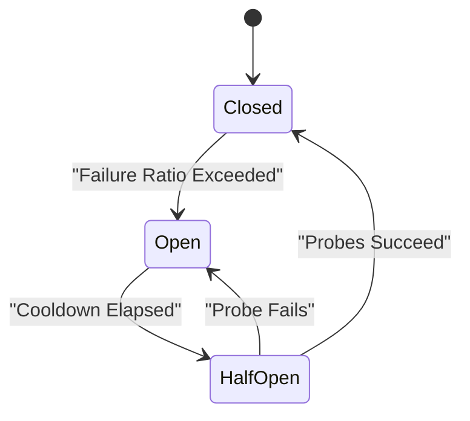
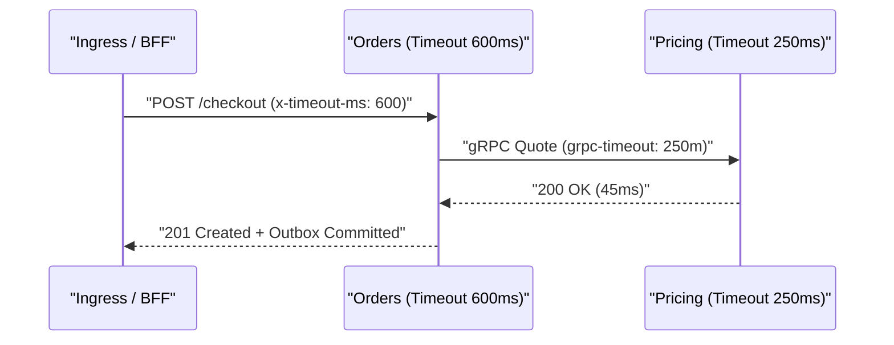

---
tags:
  - software-engineering
  - architectural-patterns
  - microservices
  - modular-monolith
  - resilience
created: 2026-01-02
updated: 2026-11-13
status: 🟢
level: mid-to-senior
---
# Microservices & Modular Monoliths

> [!abstract] Vault Navigation
> Part of [[Programming/Software Engineering/Architectural Patterns/Architectural Patterns Complete Guide|Architectural Patterns Complete Guide]]. Pairs closely with [[Programming/Software Engineering/DDD/Strategic Design|Strategic Design]], [[Programming/Software Engineering/Architectural Patterns/Event-Driven Architecture|Event-Driven Architecture]], [[Programming/Software Engineering/Architectural Patterns/CQRS|CQRS]], [[Programming/Software Engineering/System Design/API Design|API Design]], [[Programming/Software Engineering/SDLC/Release Engineering & Migrations|Release Engineering & Migrations]], and [[Programming/Software Engineering/DevOps/Kubernetes|Kubernetes]].

Microservices decompose a software system into independently deployable, network-isolated processes aligned to Bounded Contexts, each owning its private persistence boundary. Selecting physical process boundaries trades sub-microsecond in-memory method calls and local ACID database transactions for release autonomy across large engineering organizations, isolated failure blast radii, and heterogeneous compute scaling. When teams introduce network hops without decoupling data schemas, runtime dependencies, or deployment schedules, they build a **Distributed Monolith**—incurring network tail latency, partial failure modes, and distributed observability overhead without obtaining any organizational autonomy.

---

## 1. First-Principles Mechanics & Complete Architecture

### 1.1 Conway's Law, Inverse Conway Maneuver & Team Topologies

In 1968, Melvin Conway observed that organizations design systems whose architectural module boundaries mirror the communication paths between teams. If five backend squads share one database schema and coordinate pull requests through a centralized release committee, physically splitting their code into five Kubernetes deployments changes nothing: every schema change or API change still requires cross-team synchronization meetings and lockstep deployments.

Senior platform architects apply the **Inverse Conway Maneuver**: structure engineering squads intentionally around cohesive business domains ([[Programming/Software Engineering/DDD/Strategic Design|Strategic Design]]) and align Team Topologies to minimize cross-team coordination bandwidth:

- **Stream-Aligned Squads (6–9 engineers)**: Own one end-to-end business capability (for example, `Checkout` or `Billing`) from domain logic through database schema, CI pipeline, and production telemetry. Each squad ideally owns **1 to 3 cohesive services**, never 15 nano-services whose operational toil overwhelms feature delivery.
- **Platform Teams**: Provide paved self-service abstractions—Kubernetes ingress templates, OpenTelemetry collectors, Terraform database modules, and standardized RPC resilience SDKs—so Stream-Aligned squads do not reimplement mTLS, circuit breaking, or drain handlers independently.
- **Complicated-Subsystem Teams**: Isolate specialized mathematical, media, or GPU workloads (such as fraud ML scoring or video transcoding) behind clean asynchronous or low-cardinality gRPC interfaces.

### 1.2 Four Legitimate Distribution Boundaries vs Modular Monolith First

Crossing a process boundary converts a `~50 ns` function call into a `1–25 ms` serialized TCP/TLS/HTTP2 round trip subject to packet drops, DNS staleness, and partial failures. Only four architectural forces justify paying that distribution tax:

1. **Independent Deployability Across Large Engineering Orgs ($>40\text{–}60$ engineers)**: When a single repository hits continuous merge queue contention, CI suites take 45+ minutes even with incremental caching, or regulated billing teams must deploy bi-weekly while storefront experiments ship 20 times daily.
2. **Failure & Fault-Domain Isolation**: Isolating memory-hungry PDF renderers, legacy third-party SOAP adapters, or bursty webhook ingestion workers so an out-of-memory crash (`OOMKilled`) cannot take down core authentication or payment capture threads.
3. **Hardware & Runtime Heterogeneity**: Running PyTorch/CUDA recommendation inference on GPU nodes (`g5.xlarge` Python processes) alongside low-latency I/O API gateways in Go or Node.js on CPU-optimized compute (`c7g`).
4. **Compliance & Data-Residency Boundaries**: Confining PCI-DSS cardholder tokenization or regional PII records inside dedicated VPCs, databases, and narrow auditable services so only 2 services require formal compliance audits rather than 400,000 lines of monolith code.

When none of these four pressures bind tightly, **start with a Modular Monolith**:

| Architectural Dimension | Modular Monolith | Microservices |
| :--- | :--- | :--- |
| **Deployment Unit** | Single container / binary; strict internal module packages | $N$ independent containers, CI pipelines, and release cadences |
| **Data Ownership** | **Schema-per-module** inside one PostgreSQL cluster; zero cross-module SQL `JOIN`s | **Database-per-service**; cross-service views require API Composition or CQRS projections |
| **Inter-Module Call Mechanics** | In-process typed calls or in-memory/outbox domain events (`~50 ns–10 us`) | HTTP/REST, gRPC/Protobuf, or Kafka/Broker messages (`1–50 ms+`) |
| **Transaction Consistency** | Local ACID `BEGIN ... COMMIT` within a single module; Outbox for async side effects | No 2PC distributed transactions; Saga orchestration/choreography + eventual consistency |
| **Boundary Enforcement** | Compiler visibility (`internal/` in Go), ESLint boundary rules, ArchUnit | Network ACLs, mTLS SPIFFE identities, Protobuf/OpenAPI contracts |
| **Optimal Team Scale** | **1–50 engineers** proving Bounded Context boundaries cleanly | **$>50$ engineers** across autonomous stream-aligned verticals |

### 1.3 Anatomy of the Distributed Monolith Anti-Pattern

A **Distributed Monolith** forms when physical binaries split without severing logical and temporal coupling. Four runtime failure signatures reveal it immediately:

1. **Shared-Database Integration**: Two services read and write the same tables (`orders` and `invoices` in one schema). One column rename or `ALTER TABLE` migration triggers `ACCESS EXCLUSIVE` lock pileups and breaks queries in sibling services unless both teams deploy simultaneously.
2. **Synchronous Chatty RPC Chains**: Satisfying one user request cascades across `Gateway -> Orders -> Pricing -> Discounts -> Tax -> Inventory`. Availability decays multiplicatively across independent serial dependencies:
   $$A_{\text{chain}} = \prod_{i=1}^{n} A_i$$
   If 6 serial services each achieve $99.9\%$ monthly SLA, total chain availability drops to $0.999^6 = 99.401\%$—raising monthly outage exposure from $43.2\text{ min}$ to $258.8\text{ min}$ ($6\times$ worse!). Worse, **tail latency compounds**: if each downstream hop has $p = 0.01$ probability of hitting its `p99` slow tail independently, the probability that *at least one* hop in a 6-hop serial or fan-out call slows down is:
   $$P(\text{tail}) = 1 - (1 - 0.01)^6 = 5.85\%$$
   Nearly $6\%$ of end-user requests suffer `p99` tail latency!
3. **Shared Mutable Domain Libraries**: Publishing `@company/domain-core` containing ORM entities, database migrations, and shared DTO validation across 10 repositories turns every domain rule tweak into 10 coordinated dependency bumps and lockstep deployments.
4. **Distributed 2-Phase Commit (`2PC`) / Synchronous Rollback Locks**: Holding row locks across multiple microservices while waiting for a coordinator transaction stalls throughput under network jitter and collapses when any participant crashes mid-commit.

### 1.4 The Modular Monolith Graduation Protocol

Never perform a "big-bang rewrite" from monolith to microservices. Execute a **5-step zero-downtime graduation protocol** along one validated Bounded Context boundary inside the running Modular Monolith first:



1. **Enforce Module Facade & Lint Boundaries**: Refactor callers so external modules reach the target context (e.g., `Billing`) *only* through one narrow asynchronous/sync facade (`BillingFacade`). Enforce bans on deep internal imports via `eslint-plugin-boundaries`, ArchUnit, or Go `internal/` packages.
2. **Isolate PostgreSQL Schema & Revoke Cross-Schema Access**: Move `Billing` tables into a dedicated Postgres schema (`billing.*`) inside the same cluster. Create a dedicated `billing_role` and run `REVOKE SELECT ON billing.invoices FROM orders_role;` so the database engine itself rejects accidental cross-context SQL `JOIN`s at test/runtime.
3. **Eliminate Cross-Module Synchronous Coupling via Transactional Outbox & ECST**: Where `Orders` previously joined `billing.invoices`, have `Billing` publish `InvoicePaid` Event-Carried State Transfer (ECST) records via a Transactional Outbox ([[Programming/Software Engineering/Architectural Patterns/Event-Driven Architecture|Event-Driven Architecture]]). `Orders` maintains a slim local projection (`orders.billing_status_cache`).
4. **Extract Process Behind Gateway Canary (`Strangler Fig`)**: Extract the `Billing` module folder into its own container image reading the `billing.*` schema (still pointing to the existing database temporarily!). Route traffic through the API Gateway (`HTTPRoute` canary weights `1% -> 10% -> 100%`) while shadowing responses to validate parity.
5. **Physical Database Split (Only When Needed)**: Once zero cross-schema queries remain, establish PostgreSQL Logical Replication (`pgoutput` publication/subscription) or Debezium CDC to a standalone `billing-db` cluster, pause writes briefly for LSN catch-up (`<2s` drain window), flip the connection string, and retire the legacy schema.

---

## 2. Real-World Use Cases & Decision Matrix

Choosing between a Modular Monolith, API-Composed Microservices, Event-Driven Microservices, and specialized mesh/gateway topologies depends on team count, data consistency requirements, and workload heterogeneity.

### Scenario 1: 12-Engineer B2B SaaS Startup with Billing, Auth, and Workflows
- **Context**: Rapidly shifting domain boundaries; three feature squads merge 30 PRs/day into one TypeScript codebase backed by PostgreSQL and Redis.
- **Decision**: **Modular Monolith (Vertical Slices + Schema-per-Module)**.
- **Why Microservices Fail Here**: Splitting into 6 services adds 6 Dockerfiles, distributed trace debugging, contract-versioning churn, and network retry edge cases for zero organizational gain—all 12 engineers still touch overlapping customer workflows weekly.

### Scenario 2: 180-Engineer Marketplace Separating PCI Payments, GPU Visual Search, and Fulfillment
- **Context**: `Payments` requires strict PCI-DSS Level 1 audit boundaries and quarterly penetration tests; `VisualSearch` executes PyTorch image embeddings on NVIDIA GPUs; `Fulfillment` integrates erratic carrier webhooks.
- **Decision**: **Microservices Aligned to Bounded Contexts** (`Payments`, `VisualSearch`, `Catalog`, `Fulfillment`).
- **Why It Wins**: Isolating `Payments` limits PCI audit scope to 1 repository and 1 encrypted database; `VisualSearch` autoscales GPU pods independently without bloating REST API nodes; carrier webhook storms cannot exhaust checkout worker pools.

### Scenario 3: Order Confirmation Flow Triggering Loyalty Points, Receipts, and Analytics
- **Context**: Placing an order requires atomic inventory reservation and payment authorization, followed by loyalty accrual, email receipt rendering, and warehouse analytics updates.
- **Decision**: **Keep Critical Path (`Checkout -> Inventory/Payment`) Synchronous or Saga-Managed; Decouple Secondary Work via Transactional Outbox + Async Consumers**.
- **Why Sync Fails Here**: Synchronous calls to Email (`SES` outage) or Loyalty (`GC pause`) directly reduce checkout conversion and amplify checkout p99 tail latency.

### Scenario 4: Mobile Dashboard Needing User Profile + Recent Orders + Personalized Recommendations
- **Context**: A mobile client must render an account landing view combining `ProfileService`, `OrdersService`, and `RecommendationsService` over high-latency 4G networks.
- **Decision**: **API Composition BFF (Backend for Frontend)** aggregating parallel downstream calls with strict deadlines, `Promise.allSettled`, and graceful partial degradation.
- **When NOT to Use API Composition**: When the endpoint requires cross-service filtering, global sorting, and deep pagination across millions of rows (for example, *"search all unpaid orders by customer VIP tier sorted by customer name"*). API composition cannot efficiently paginate `LIMIT/OFFSET` across two separate databases; adopt a **CQRS Materialized Search Projection** ([[Programming/Software Engineering/Architectural Patterns/CQRS|CQRS]]) instead.

### Scenario 5: Scaling Cluster from 8 Node/Go Services to 45 Polyglot Services (`Go`, `Python`, `Java`)
- **Context**: Implementing identical circuit breakers, exponential backoff jitter, mTLS certificate rotation, and W3C `traceparent` headers inside four language SDKs leads to subtle inconsistencies and security rotation gaps.
- **Decision**: **Adopt Sidecarless Ambient Service Mesh (`Istio Ambient` / `Cilium`) or `Linkerd`** for L4 mTLS, traffic splitting, and observability, keeping domain-semantic fallbacks (like serving stale cached profiles) inside the BFF/application code.

### Topology & Integration Decision Matrix

| Architecture Pattern | Latency Profile | Consistency Model | Blast-Radius Isolation | Operational Tax | Avoid When |
| :--- | :--- | :--- | :--- | :--- | :--- |
| **Modular Monolith** | Lowest (`<0.1 ms` in-process) | Full local ACID + Outbox | Shared process OOM / CPU risk | Low (`1` DB, `1` CI/CD) | Hardware mismatch (GPU vs CPU) or $>50$ devs colliding in releases |
| **Microservices + Sync REST/gRPC** | Moderate (`2–50 ms/hop`) | Immediate read-after-write per call | Strong process isolation (needs Bulkheads) | High ($N$ deploys + tracing) | Deep call chains ($>3$ sync hops) without caching/async offload |
| **Microservices + API Composition BFF** | Bounded by slowest parallel branch | Point-in-time snapshot per sub-call | High via partial degradation & timeouts | Moderate–High | Cross-service `JOIN`s with dynamic multi-table `WHERE`/`ORDER BY`/`LIMIT` |
| **Microservices + EDA / CQRS Projections** | Fast local reads (`<5 ms` indexed query) | Eventual consistency (`10 ms–2 s` lag) | Highest temporal decoupling | Very High (Kafka, CDC, DLQ ops) | Strict real-time read-after-write invariant required across contexts |
| **Distributed Monolith** | High (`50–500 ms` chained) | Brittle implicit coupling | Zero (shared DB/lockstep crashes all) | Maximum | **Always anti-pattern**—consolidate back or decouple via Outbox |

---

## 3. Step-by-Step Practical Application: Resilient RPC Client, BFF & Zero-Downtime K8s

The following production-ready TypeScript layout implements a complete microservices resilience stack: deadline propagation across hops, finite-state Circuit Breakers, Semaphore Bulkheads, Full-Jitter exponential retries, an API Composition BFF with stale-cache fallback and partial degradation, `/livez` vs `/readyz` Kubernetes graceful drain probes, and Vitest failure-injection tests.

### Project Directory Structure

```text
services/account-bff/
├── package.json
├── tsconfig.json
├── src/
│   ├── resilience/
│   │   ├── circuit-breaker.ts
│   │   ├── bulkhead.ts
│   │   └── resilient-http-client.ts
│   ├── bff/
│   │   ├── contracts.ts
│   │   └── dashboard-aggregator.ts
│   └── health/
│       └── lifecycle.ts
├── k8s/
│   ├── deployment.yaml
│   ├── httproute.yaml
│   └── pdb.yaml
└── tests/
    └── resilient-bff.test.ts
```

### 3.1 Semaphore Bulkhead & Circuit Breaker (`src/resilience/bulkhead.ts` & `src/resilience/circuit-breaker.ts`)

Isolating concurrency per downstream prevents a single slow microservice (`RecommendationsService`) from occupying every socket and promise queue in the BFF, while the Circuit Breaker trips `OPEN` locally to fail fast in `<1 ms` during downstream brownouts.



```typescript
// src/resilience/bulkhead.ts
export class BulkheadRejectedError extends Error {
  constructor(public readonly resource: string, public readonly maxConcurrent: number) {
    super(`Bulkhead capacity exhausted for ${resource} (max=${maxConcurrent})`);
    this.name = "BulkheadRejectedError";
  }
}

/**
 * Limits concurrent in-flight calls to one downstream dependency.
 * Fails immediately without queuing indefinitely so callers do not accumulate stale work.
 */
export class SemaphoreBulkhead {
  private active = 0;

  constructor(
    private readonly resource: string,
    private readonly maxConcurrent: number,
  ) {
    if (maxConcurrent < 1) {
      throw new RangeError("maxConcurrent must be >= 1");
    }
  }

  get inFlight(): number {
    return this.active;
  }

  async run<T>(fn: () => Promise<T>): Promise<T> {
    if (this.active >= this.maxConcurrent) {
      throw new BulkheadRejectedError(this.resource, this.maxConcurrent);
    }
    this.active += 1;
    try {
      return await fn();
    } finally {
      this.active -= 1;
    }
  }
}
```

```typescript
// src/resilience/circuit-breaker.ts
export type BreakerState = "CLOSED" | "OPEN" | "HALF_OPEN";

export class CircuitOpenError extends Error {
  constructor(public readonly serviceName: string, public readonly retryAfterMs: number) {
    super(`Circuit breaker OPEN for ${serviceName}; retry after ${retryAfterMs}ms`);
    this.name = "CircuitOpenError";
  }
}

export interface CircuitBreakerConfig {
  serviceName: string;
  failureThresholdRatio: number; // e.g., 0.5 for >=50% errors
  minimumRequests: number;       // Minimum sample count before evaluating ratio
  windowMs: number;              // Sliding evaluation window
  openCooldownMs: number;        // Wait time before testing HALF_OPEN probe
  halfOpenMaxProbes: number;     // Consecutive successful probes needed to CLOSE
  now?: () => number;            // Injectable monotonic clock for deterministic testing
}

interface Sample {
  ts: number;
  ok: boolean;
}

export class CircuitBreaker {
  private state: BreakerState = "CLOSED";
  private samples: Sample[] = [];
  private openedAt = 0;
  private halfOpenProbesInFlight = 0;
  private halfOpenSuccesses = 0;
  private readonly now: () => number;

  constructor(private readonly cfg: CircuitBreakerConfig) {
    this.now = cfg.now ?? (() => Date.now());
  }

  get currentState(): BreakerState {
    if (this.state === "OPEN" && this.now() - this.openedAt >= this.cfg.openCooldownMs) {
      this.transitionTo("HALF_OPEN");
    }
    return this.state;
  }

  async execute<T>(fn: () => Promise<T>, isFailure: (err: unknown) => boolean = () => true): Promise<T> {
    const state = this.currentState;
    if (state === "OPEN") {
      const remaining = Math.max(0, this.cfg.openCooldownMs - (this.now() - this.openedAt));
      throw new CircuitOpenError(this.cfg.serviceName, remaining);
    }

    if (state === "HALF_OPEN") {
      if (this.halfOpenProbesInFlight >= 1) {
        // Gate probe concurrency strictly to prevent recovery thundering herd
        throw new CircuitOpenError(this.cfg.serviceName, 250);
      }
      this.halfOpenProbesInFlight += 1;
    }

    try {
      const result = await fn();
      this.recordSuccess(state);
      return result;
    } catch (err) {
      if (isFailure(err)) {
        this.recordFailure(state);
      } else {
        // Domain 4xx client errors should not trip infrastructure breakers
        this.recordSuccess(state);
      }
      throw err;
    } finally {
      if (state === "HALF_OPEN") {
        this.halfOpenProbesInFlight = Math.max(0, this.halfOpenProbesInFlight - 1);
      }
    }
  }

  private recordSuccess(observedState: BreakerState): void {
    if (observedState === "HALF_OPEN") {
      this.halfOpenSuccesses += 1;
      if (this.halfOpenSuccesses >= this.cfg.halfOpenMaxProbes) {
        this.transitionTo("CLOSED");
      }
      return;
    }
    this.pushSample(true);
  }

  private recordFailure(observedState: BreakerState): void {
    if (observedState === "HALF_OPEN") {
      this.transitionTo("OPEN");
      return;
    }
    this.pushSample(false);
    const total = this.samples.length;
    if (total < this.cfg.minimumRequests) return;
    const failures = this.samples.filter((s) => !s.ok).length;
    if (failures / total >= this.cfg.failureThresholdRatio) {
      this.transitionTo("OPEN");
    }
  }

  private pushSample(ok: boolean): void {
    const t = this.now();
    const cutoff = t - this.cfg.windowMs;
    this.samples.push({ ts: t, ok });
    while (this.samples.length > 0 && this.samples[0].ts < cutoff) {
      this.samples.shift();
    }
  }

  private transitionTo(next: BreakerState): void {
    this.state = next;
    if (next === "OPEN") {
      this.openedAt = this.now();
      this.halfOpenSuccesses = 0;
    } else if (next === "HALF_OPEN") {
      this.halfOpenSuccesses = 0;
      this.halfOpenProbesInFlight = 0;
    } else {
      this.samples = [];
      this.halfOpenSuccesses = 0;
    }
  }
}
```

### 3.2 Deadline-Propagating Resilient HTTP Client (`src/resilience/resilient-http-client.ts`)

Propagating remaining timeout budgets via `x-timeout-ms` and `traceparent` guarantees downstream services never compute expensive queries after the caller already abandoned the socket. Retries execute strictly on idempotent requests with **Full Jitter** and refuse to start if the remaining request deadline is insufficient.

```typescript
// src/resilience/resilient-http-client.ts
import { SemaphoreBulkhead } from "./bulkhead.js";
import { CircuitBreaker } from "./circuit-breaker.js";

export class DeadlineExceededError extends Error {
  constructor(service: string, remainingMs: number) {
    super(`Remaining deadline (${remainingMs}ms) insufficient to call ${service}`);
    this.name = "DeadlineExceededError";
  }
}

export class DownstreamHttpError extends Error {
  constructor(
    public readonly service: string,
    public readonly status: number,
    message: string,
  ) {
    super(`${service} returned HTTP ${status}: ${message}`);
    this.name = "DownstreamHttpError";
  }
}

export interface RequestContext {
  traceparent: string;
  deadlineEpochMs: number; // Derived at ingress: Date.now() + slaBudgetMs
}

export interface ResilientFetchOptions {
  method?: "GET" | "POST" | "PUT" | "DELETE";
  path: string;
  body?: unknown;
  idempotencyKey?: string;
  perAttemptTimeoutMs?: number;
  maxRetries?: number;
  baseBackoffMs?: number;
  maxBackoffMs?: number;
  minBudgetRequiredMs?: number;
}

export type FetchLike = (input: string, init?: RequestInit) => Promise<Response>;

const RETRYABLE_STATUSES = new Set([429, 502, 503, 504]);

export class ResilientHttpClient {
  constructor(
    private readonly serviceName: string,
    private readonly baseUrl: string,
    private readonly breaker: CircuitBreaker,
    private readonly bulkhead: SemaphoreBulkhead,
    private readonly fetchImpl: FetchLike = fetch,
    private readonly now: () => number = () => Date.now(),
    private readonly sleep: (ms: number) => Promise<void> = (ms) =>
      new Promise((resolve) => setTimeout(resolve, ms)),
  ) {}

  async requestJson<T>(ctx: RequestContext, opts: ResilientFetchOptions): Promise<T> {
    const method = opts.method ?? "GET";
    const minBudget = opts.minBudgetRequiredMs ?? 25;
    const isIdempotent =
      method === "GET" || method === "PUT" || method === "DELETE" || Boolean(opts.idempotencyKey);

    const maxAttempts = isIdempotent ? 1 + (opts.maxRetries ?? 2) : 1;
    const baseBackoff = opts.baseBackoffMs ?? 40;
    const maxBackoff = opts.maxBackoffMs ?? 500;

    let lastError: unknown;

    for (let attempt = 0; attempt < maxAttempts; attempt += 1) {
      const remainingBudgetMs = ctx.deadlineEpochMs - this.now();
      if (remainingBudgetMs < minBudget) {
        throw new DeadlineExceededError(this.serviceName, remainingBudgetMs);
      }

      // Clamp attempt timeout strictly below remaining caller deadline
      const attemptTimeoutMs = Math.min(opts.perAttemptTimeoutMs ?? 800, remainingBudgetMs);

      try {
        return await this.breaker.execute(
          () =>
            this.bulkhead.run(() =>
              this.singleAttempt<T>(ctx, opts, method, attemptTimeoutMs),
            ),
          (err) => {
            if (err instanceof DownstreamHttpError) {
              // 4xx client errors indicate bad inputs, not downstream outage
              return err.status >= 500 || err.status === 429;
            }
            return true;
          },
        );
      } catch (err) {
        lastError = err;
        const canRetry =
          attempt + 1 < maxAttempts &&
          isIdempotent &&
          this.isRetryableError(err);

        if (!canRetry) {
          throw err;
        }

        const cap = Math.min(maxBackoff, baseBackoff * 2 ** attempt);
        const fullJitterMs = Math.floor(Math.random() * cap);
        const postSleepBudget = ctx.deadlineEpochMs - (this.now() + fullJitterMs);
        if (postSleepBudget < minBudget) {
          throw new DeadlineExceededError(this.serviceName, postSleepBudget);
        }
        await this.sleep(fullJitterMs);
      }
    }

    throw lastError;
  }

  private async singleAttempt<T>(
    ctx: RequestContext,
    opts: ResilientFetchOptions,
    method: string,
    timeoutMs: number,
  ): Promise<T> {
    const controller = new AbortController();
    const timer = setTimeout(() => controller.abort(new Error("AttemptTimeout")), timeoutMs);

    try {
      const headers: Record<string, string> = {
        "accept": "application/json",
        "traceparent": ctx.traceparent,
        // Relative TTL header avoids inter-node clock skew bugs
        "x-timeout-ms": String(Math.max(1, Math.floor(timeoutMs))),
      };

      if (opts.idempotencyKey) {
        headers["idempotency-key"] = opts.idempotencyKey;
      }
      if (opts.body !== undefined) {
        headers["content-type"] = "application/json";
      }

      const res = await this.fetchImpl(`${this.baseUrl}${opts.path}`, {
        method,
        headers,
        body: opts.body !== undefined ? JSON.stringify(opts.body) : undefined,
        signal: controller.signal,
      });

      if (!res.ok) {
        const text = await res.text().catch(() => "");
        throw new DownstreamHttpError(this.serviceName, res.status, text.slice(0, 200));
      }

      return (await res.json()) as T;
    } finally {
      clearTimeout(timer);
    }
  }

  private isRetryableError(err: unknown): boolean {
    if (err instanceof DownstreamHttpError) {
      return RETRYABLE_STATUSES.has(err.status);
    }
    if (err instanceof Error && err.name === "CircuitOpenError") {
      return false; // Never retry immediately into an OPEN circuit breaker
    }
    if (err instanceof Error && err.name === "BulkheadRejectedError") {
      return false; // Do not amplify load against an already saturated bulkhead
    }
    return true;
  }
}
```

### 3.3 API Composition BFF Aggregator with Stale Cache & Partial Degradation (`src/bff/contracts.ts` & `src/bff/dashboard-aggregator.ts`)

Rather than failing an entire customer dashboard request when `RecommendationsService` stalls or `ProfileService` enters brownout, the BFF dispatches all independent reads concurrently under a unified deadline, applies `Promise.allSettled`, falls back to a bounded stale snapshot cache for profile metadata, and degrades non-critical recommendations explicitly.

```typescript
// src/bff/contracts.ts
export interface UserProfile {
  userId: string;
  displayName: string;
  tier: "STANDARD" | "PRO";
}

export interface OrderSummary {
  orderId: string;
  totalCents: number;
  currency: string;
  status: "PENDING" | "PAID" | "SHIPPED";
}

export interface RecommendationItem {
  sku: string;
  title: string;
  priceCents: number;
}

export interface DashboardResponse {
  profile: UserProfile;
  profileStale: boolean;
  recentOrders: OrderSummary[];
  recommendations: RecommendationItem[];
  degradedSubsystems: string[];
}

export interface StaleSnapshotStore<T> {
  get(key: string): Promise<T | null>;
  set(key: string, value: T, ttlSeconds: number): Promise<void>;
}

export class CriticalDependencyUnavailableError extends Error {
  constructor(public readonly dependency: string, public readonly causeError: unknown) {
    super(`Critical downstream dependency unavailable: ${dependency}`);
    this.name = "CriticalDependencyUnavailableError";
  }
}
```

```typescript
// src/bff/dashboard-aggregator.ts
import { ResilientHttpClient, type RequestContext } from "../resilience/resilient-http-client.js";
import {
  CriticalDependencyUnavailableError,
  type DashboardResponse,
  type OrderSummary,
  type RecommendationItem,
  type StaleSnapshotStore,
  type UserProfile,
} from "./contracts.js";

export interface DashboardClients {
  profileClient: ResilientHttpClient;
  ordersClient: ResilientHttpClient;
  recommendationsClient: ResilientHttpClient;
  profileFallbackCache: StaleSnapshotStore<UserProfile>;
}

export class DashboardAggregator {
  constructor(private readonly deps: DashboardClients) {}

  async getAccountDashboard(userId: string, ctx: RequestContext): Promise<DashboardResponse> {
    const encodedId = encodeURIComponent(userId);
    const degradedSubsystems: string[] = [];

    // Execute independent context fetches concurrently under unified ingress deadline
    const [profileRes, ordersRes, recsRes] = await Promise.allSettled([
      this.deps.profileClient.requestJson<UserProfile>(ctx, {
        path: `/internal/users/${encodedId}`,
        perAttemptTimeoutMs: 400,
        maxRetries: 1,
      }),
      this.deps.ordersClient.requestJson<{ orders: OrderSummary[] }>(ctx, {
        path: `/internal/orders?userId=${encodedId}&limit=5`,
        perAttemptTimeoutMs: 600,
        maxRetries: 1,
      }),
      this.deps.recommendationsClient.requestJson<{ items: RecommendationItem[] }>(ctx, {
        path: `/internal/recommendations?userId=${encodedId}&limit=4`,
        perAttemptTimeoutMs: 250,
        maxRetries: 0, // Optional enrichment must fail fast without consuming SLA budget
      }),
    ]);

    // 1. Orders: strictly critical live source of truth (no stale financial order fallback)
    if (ordersRes.status === "rejected") {
      throw new CriticalDependencyUnavailableError("orders-service", ordersRes.reason);
    }

    // 2. Profile: critical identity, but tolerates stale L2 snapshot during brownouts
    let profile: UserProfile;
    let profileStale = false;
    if (profileRes.status === "fulfilled") {
      profile = profileRes.value;
      // Best-effort cache refresh; never crash request if cache write fails
      void this.deps.profileFallbackCache
        .set(`profile:snapshot:${userId}`, profile, 3600)
        .catch(() => undefined);
    } else {
      const cachedProfile = await this.deps.profileFallbackCache.get(`profile:snapshot:${userId}`);
      if (!cachedProfile) {
        throw new CriticalDependencyUnavailableError("profile-service", profileRes.reason);
      }
      profile = cachedProfile;
      profileStale = true;
      degradedSubsystems.push("profile-live");
    }

    // 3. Recommendations: purely optional enrichment; degrade gracefully to empty array
    let recommendations: RecommendationItem[] = [];
    if (recsRes.status === "fulfilled") {
      recommendations = recsRes.value.items;
    } else {
      degradedSubsystems.push("recommendations");
    }

    return {
      profile,
      profileStale,
      recentOrders: ordersRes.value.orders,
      recommendations,
      degradedSubsystems,
    };
  }
}
```

### 3.4 Zero-Downtime Pod Drain & Kubernetes Production Manifests (`src/health/lifecycle.ts` & `k8s/`)

When Kubernetes deletes or replaces a Pod, the control plane executes two paths **asynchronously in parallel**: sending `SIGTERM` to PID 1 inside the container while simultaneously updating `EndpointSlice` objects so `kube-proxy` iptables rules and Envoy Gateway endpoints stop routing new TCP connections to the Pod IP. Without a `preStop` sleep and immediate `/readyz` failure flip, edge proxies send requests to an already closed socket for `1–4 seconds`, generating rolling-update `502 Bad Gateway` errors.

```typescript
// src/health/lifecycle.ts
import type { Server } from "node:http";

export interface DrainController {
  isReady: () => boolean;
  isAlive: () => boolean;
  initiateGracefulShutdown: (signal: string) => Promise<void>;
}

export function createDrainController(
  server: Server,
  deps: { checkDownstreamReadiness: () => Promise<boolean>; drainTimeoutMs?: number },
): DrainController {
  let shuttingDown = false;
  const drainTimeoutMs = deps.drainTimeoutMs ?? 20_000;

  return {
    // Liveness checks strictly process/event-loop responsiveness—NEVER external DBs!
    // Checking Redis/Postgres in /livez turns a transient DB blip into cluster-wide CrashLoopBackOff.
    isAlive: () => true,

    // Readiness immediately returns false upon SIGTERM so EndpointSlice controllers drop the pod
    isReady: () => !shuttingDown,

    initiateGracefulShutdown: async (signal: string): Promise<void> => {
      if (shuttingDown) return;
      shuttingDown = true;
      console.info(JSON.stringify({ event: "shutdown_initiated", signal }));

      // Allow in-flight keep-alive connections to complete cleanly
      server.closeIdleConnections?.();

      await Promise.race([
        new Promise<void>((resolve) => {
          server.close(() => resolve());
        }),
        new Promise<void>((resolve) => {
          setTimeout(() => {
            console.warn(JSON.stringify({ event: "force_closing_stale_sockets" }));
            server.closeAllConnections?.();
            resolve();
          }, drainTimeoutMs);
        }),
      ]);
    },
  };
}
```

```yaml
# k8s/deployment.yaml
apiVersion: apps/v1
kind: Deployment
metadata:
  name: account-bff
  namespace: commerce
spec:
  replicas: 6
  strategy:
    type: RollingUpdate
    rollingUpdate:
      maxUnavailable: 0
      maxSurge: 25%
  selector:
    matchLabels:
      app: account-bff
  template:
    metadata:
      labels:
        app: account-bff
    spec:
      terminationGracePeriodSeconds: 45
      topologySpreadConstraints:
        - maxSkew: 1
          topologyKey: topology.kubernetes.io/zone
          whenUnsatisfiable: ScheduleAnyway
          labelSelector:
            matchLabels:
              app: account-bff
      containers:
        - name: account-bff
          image: ghcr.io/acme/account-bff:2.14.0
          ports:
            - containerPort: 8080
              name: http
          env:
            - name: NODE_OPTIONS
              value: "--max-old-space-size=384"
          resources:
            requests:
              cpu: "250m"
              memory: "256Mi"
            limits:
              memory: "512Mi"
          lifecycle:
            preStop:
              exec:
                # Holds pod alive while EndpointSlice changes propagate across kube-proxy and Envoy
                command: ["/bin/sh", "-c", "sleep 6"]
          readinessProbe:
            httpGet:
              path: /readyz
              port: http
            initialDelaySeconds: 5
            periodSeconds: 3
            failureThreshold: 2
          livenessProbe:
            httpGet:
              path: /livez
              port: http
            initialDelaySeconds: 10
            periodSeconds: 10
            failureThreshold: 3
```

```yaml
# k8s/httproute.yaml
apiVersion: gateway.networking.k8s.io/v1
kind: HTTPRoute
metadata:
  name: account-bff-canary
  namespace: commerce
spec:
  parentRefs:
    - name: edge-gateway
      namespace: ingress-system
  hostnames:
    - "api.acme.example"
  rules:
    - matches:
        - path:
            type: PathPrefix
            value: /v1/account/dashboard
      timeouts:
        request: 1.5s
      backendRefs:
        - name: account-bff-stable
          port: 80
          weight: 95
        - name: account-bff-canary
          port: 80
          weight: 5
---
# k8s/pdb.yaml
apiVersion: policy/v1
kind: PodDisruptionBudget
metadata:
  name: account-bff-pdb
  namespace: commerce
spec:
  minAvailable: "75%"
  selector:
    matchLabels:
      app: account-bff
```

### 3.5 Complete Vitest Failure-Injection Test Suite (`tests/resilient-bff.test.ts`)

```typescript
// tests/resilient-bff.test.ts
import { describe, expect, it, vi } from "vitest";
import { SemaphoreBulkhead, BulkheadRejectedError } from "../src/resilience/bulkhead.js";
import { CircuitBreaker, CircuitOpenError } from "../src/resilience/circuit-breaker.js";
import {
  DeadlineExceededError,
  ResilientHttpClient,
  type RequestContext,
} from "../src/resilience/resilient-http-client.js";
import { DashboardAggregator } from "../src/bff/dashboard-aggregator.js";
import { CriticalDependencyUnavailableError, type UserProfile } from "../src/bff/contracts.js";

function jsonResponse(body: unknown, status = 200): Response {
  return new Response(JSON.stringify(body), {
    status,
    headers: { "content-type": "application/json" },
  });
}

describe("ResilientHttpClient & CircuitBreaker failure injection", () => {
  it("trips OPEN after failure ratio threshold and recovers via HALF_OPEN probes", async () => {
    let clockMs = 1_000_000;
    const now = () => clockMs;

    const breaker = new CircuitBreaker({
      serviceName: "orders",
      failureThresholdRatio: 0.5,
      minimumRequests: 4,
      windowMs: 10_000,
      openCooldownMs: 5_000,
      halfOpenMaxProbes: 2,
      now,
    });

    let downstreamStatus = 503;
    const fetchSpy = vi.fn(async () =>
      downstreamStatus === 200
        ? jsonResponse({ orders: [] }, 200)
        : jsonResponse({ err: "overload" }, downstreamStatus),
    );

    const client = new ResilientHttpClient(
      "orders",
      "http://orders.internal",
      breaker,
      new SemaphoreBulkhead("orders", 10),
      fetchSpy,
      now,
      async () => undefined,
    );

    const ctx: RequestContext = {
      traceparent: "00-4bf92f3577b34da6a3ce929d0e0e4736-00f067aa0ba902b7-01",
      deadlineEpochMs: clockMs + 5_000,
    };

    // Trigger 2 calls with 1 retry each => 4 failed samples >= minimumRequests
    await expect(client.requestJson(ctx, { path: "/orders", maxRetries: 1 })).rejects.toThrow();
    await expect(client.requestJson(ctx, { path: "/orders", maxRetries: 1 })).rejects.toThrow();
    expect(breaker.currentState).toBe("OPEN");

    const callsBeforeOpen = fetchSpy.mock.calls.length;
    // Next call fails locally in <1ms without hitting network
    await expect(client.requestJson(ctx, { path: "/orders" })).rejects.toThrow(CircuitOpenError);
    expect(fetchSpy.mock.calls.length).toBe(callsBeforeOpen);

    // Advance clock past cooldown => HALF_OPEN allows sequential probes
    clockMs += 5_500;
    ctx.deadlineEpochMs = clockMs + 5_000;
    downstreamStatus = 200;

    await expect(client.requestJson(ctx, { path: "/orders" })).resolves.toEqual({ orders: [] });
    expect(breaker.currentState).toBe("HALF_OPEN");
    await expect(client.requestJson(ctx, { path: "/orders" })).resolves.toEqual({ orders: [] });
    expect(breaker.currentState).toBe("CLOSED");
  });

  it("aborts immediately when remaining deadline budget is below minimum threshold", async () => {
    const clockMs = 2_000_000;
    const fetchSpy = vi.fn();
    const client = new ResilientHttpClient(
      "pricing",
      "http://pricing.internal",
      new CircuitBreaker({
        serviceName: "pricing",
        failureThresholdRatio: 0.5,
        minimumRequests: 5,
        windowMs: 10_000,
        openCooldownMs: 5_000,
        halfOpenMaxProbes: 1,
        now: () => clockMs,
      }),
      new SemaphoreBulkhead("pricing", 5),
      fetchSpy,
      () => clockMs,
    );

    await expect(
      client.requestJson(
        { traceparent: "00-abc-123-01", deadlineEpochMs: clockMs + 10 },
        { path: "/quote", minBudgetRequiredMs: 25 },
      ),
    ).rejects.toThrow(DeadlineExceededError);
    expect(fetchSpy).not.toHaveBeenCalled();
  });

  it("rejects excess concurrency immediately via SemaphoreBulkhead", async () => {
    const bulkhead = new SemaphoreBulkhead("recs", 1);
    let releaseFirst!: () => void;
    const blocker = new Promise<void>((resolve) => {
      releaseFirst = resolve;
    });

    const first = bulkhead.run(async () => {
      await blocker;
      return "ok";
    });

    await expect(bulkhead.run(async () => "overflow")).rejects.toThrow(BulkheadRejectedError);
    releaseFirst();
    await expect(first).resolves.toBe("ok");
  });
});

describe("DashboardAggregator graceful degradation", () => {
  function makeClient(name: string, fetchImpl: typeof fetch) {
    return new ResilientHttpClient(
      name,
      `http://${name}.internal`,
      new CircuitBreaker({
        serviceName: name,
        failureThresholdRatio: 0.5,
        minimumRequests: 10,
        windowMs: 10_000,
        openCooldownMs: 5_000,
        halfOpenMaxProbes: 1,
      }),
      new SemaphoreBulkhead(name, 10),
      fetchImpl,
      Date.now,
      async () => undefined,
    );
  }

  it("degrades recommendations and falls back to stale profile snapshot while serving live orders", async () => {
    const snapshotMap = new Map<string, UserProfile>([
      ["profile:snapshot:u-42", { userId: "u-42", displayName: "Ada L.", tier: "PRO" }],
    ]);

    const aggregator = new DashboardAggregator({
      profileClient: makeClient("profile", async () => jsonResponse({ error: "db down" }, 503)),
      ordersClient: makeClient("orders", async () =>
        jsonResponse({ orders: [{ orderId: "ord-1", totalCents: 4990, currency: "USD", status: "PAID" }] }),
      ),
      recommendationsClient: makeClient("recs", async () => jsonResponse({ error: "timeout" }, 504)),
      profileFallbackCache: {
        get: async (k) => snapshotMap.get(k) ?? null,
        set: async (k, v) => {
          snapshotMap.set(k, v);
        },
      },
    });

    const res = await aggregator.getAccountDashboard("u-42", {
      traceparent: "00-4bf92f3577b34da6a3ce929d0e0e4736-00f067aa0ba902b7-01",
      deadlineEpochMs: Date.now() + 2_000,
    });

    expect(res.profileStale).toBe(true);
    expect(res.profile.displayName).toBe("Ada L.");
    expect(res.recentOrders).toHaveLength(1);
    expect(res.recommendations).toEqual([]);
    expect(res.degradedSubsystems).toEqual(["profile-live", "recommendations"]);
  });

  it("fails request when critical orders service rejects", async () => {
    const aggregator = new DashboardAggregator({
      profileClient: makeClient("profile", async () =>
        jsonResponse({ userId: "u-42", displayName: "Ada L.", tier: "PRO" }),
      ),
      ordersClient: makeClient("orders", async () => jsonResponse({ error: "down" }, 503)),
      recommendationsClient: makeClient("recs", async () => jsonResponse({ items: [] })),
      profileFallbackCache: {
        get: async () => null,
        set: async () => undefined,
      },
    });

    await expect(
      aggregator.getAccountDashboard("u-42", {
        traceparent: "00-4bf92f3577b34da6a3ce929d0e0e4736-00f067aa0ba902b7-01",
        deadlineEpochMs: Date.now() + 2_000,
      }),
    ).rejects.toThrow(CriticalDependencyUnavailableError);
  });
});
```

---

## 4. Complete Communication, Data Isolation & Mesh Reference

### 4.1 Synchronous HTTP/gRPC vs Async Event Choreography & Outbox

| Mechanism | Protocol & Contract | Latency & Failure Coupling | Ideal Role |
| :--- | :--- | :--- | :--- |
| **HTTP/1.1 or HTTP/2 JSON (REST)** | OpenAPI 3.1 / JSON Schema | Higher payload overhead; universal tooling; coarse timeouts | Edge APIs, BFFs, external webhooks |
| **gRPC / Protobuf (HTTP/2)** | Strongly typed `.proto`; binary framing; native `grpc-timeout` deadline header; backward/forward field tags | Compact serialization (`3–10x` smaller than JSON); multiplexed HTTP/2 streams; requires L7 HTTP/2 load balancing | High-QPS internal RPC (`AuthZ`, `Pricing`, ML inference) |
| **gRPC Request Hedging** | Speculative duplicate request fired if primary exceeds `p95` delay | Cuts `p99` tail latency dramatically, **only safe on strictly idempotent read-only operations**; pair with hedging budgets ($\le 10\%$) | Read-heavy search/embedding backends with sporadic node GC pauses |
| **Async Events + Transactional Outbox** | Kafka / RabbitMQ / NATS with Avro/Protobuf/JSON Schema Registry | Producer commits domain state + `outbox_events` inside one ACID transaction; CDC/relay delivers at-least-once | Cross-context decoupling, Saga workflows, CQRS materialized read synchronization |



### 4.2 Database-per-Service Isolation Without Cross-Service Joins

Microservices prohibit direct SQL reads or foreign keys into another service's database because doing so exposes internal table layouts and locks both services into coordinated schema releases. Replace cross-service joins using three explicit patterns:

1. **API Composition (Query-Time Fan-Out)**: A BFF or Composer issues parallel key lookups (`orders` by `userId`, `users` by `userIds`) and joins in memory. Works well when cardinality is bounded ($< 100$ IDs per request) and filtering occurs primarily inside one primary service.
2. **CQRS Replicated Read Projections (Materialized Views)**: Subscribe to `OrderCreated`, `CustomerUpdated`, and `ProductRenamed` domain events into a dedicated query store (Elasticsearch/OpenSearch or denormalized PostgreSQL read table) owning all columns needed for multi-attribute search, sorting, and pagination. See [[Programming/Software Engineering/Architectural Patterns/CQRS|CQRS]].
3. **Referential Integrity Without Foreign Keys**: Store foreign IDs as opaque value references (`customer_id UUID` without `REFERENCES`), verify existence at command entry if strictly required, handle out-of-order deletions asynchronously via domain tombstone events (`CustomerDeleted` triggers `Orders` anonymization), and build idempotent reconciliation checks.

### 4.3 Load Shedding, Adaptive Concurrency & Retry Budgets

Circuit breakers protect *callers* from broken downstreams; **Load Shedding** protects *servers* from collapsing under inbound traffic surges:

- **LIFO Queueing + CoDel (Controlled Delay) / Deadline Inspection**: When worker queues fill during a surge, FIFO queues process the oldest requests first—which often already timed out on the client! Dropping requests whose `x-timeout-ms` already expired or serving newest requests (LIFO) ensures CPU cycles satisfy callers still waiting for responses.
- **Little's Law Capacity Bounds**: Given average concurrency $L = \lambda W$, if a service handles $W = 20\text{ ms}$ average latency across 8 cores with optimal saturation around $L = 64$ active requests, allowing 2,000 queued requests simply inflates $W$ without increasing throughput $\lambda$. Shed excess traffic early with `503 Service Unavailable` + `Retry-After`!
- **Per-Cluster Retry Budgets**: Instead of fixed `retries: 3` per caller (which causes $N$-hop exponential retry storms), enforce a sliding retry budget (e.g., Envoy `retry_budget: 20%` with `min_retry_concurrency: 3`) ensuring total retries never amplify cluster traffic beyond $1.2\times$.

### 4.4 Sidecar Service Mesh vs Ambient/eBPF vs API Gateway / BFF

| Layer / Topology | Security (mTLS) | Traffic Shaping & Canary | App Memory/CPU Overhead | Best Fit |
| :--- | :--- | :--- | :--- | :--- |
| **API Gateway + App SDKs** | North-South TLS; East-West relies on VPC/manual certs | Coarse north-south routing | Minimal (zero proxy per pod) | **1–15 services** in 1–2 languages |
| **Sidecar Service Mesh (Istio Envoy / Linkerd)** | Automated zero-trust SPIFFE mTLS rotated hourly | Full L7 canary weights, fault injection, retry budgets | **50–150 MB RAM + 0.05–0.15 vCPU per pod** (multiplied by 1,000 pods = huge bill!) | Regulated polyglot enterprises requiring strict per-pod L7 telemetry |
| **Sidecarless Ambient / eBPF (Istio Ambient / Cilium)** | Shared node-level `ztunnel` / WireGuard/IPsec L4 mTLS | L4 on node daemon; optional namespace L7 Waypoint proxies | **~80% lower RAM** than sidecar meshes; eliminates `127.0.0.1` iptables traversal hops | Modern large Kubernetes clusters balancing zero-trust mTLS with tight cloud unit economics |

### 4.5 Subtle Failure Modes & Security Hardening

1. **HTTP/2 Long-Lived Connection Pinning (`kube-proxy` Trap)**: Standard Kubernetes `Service` (`ClusterIP`) balances **TCP connections** via `iptables`/`IPVS`, not individual HTTP/2 or gRPC RPC streams. When HPA scales a downstream gRPC service from 2 pods to 10 pods, existing clients maintain persistent HTTP/2 connections pinned strictly to the original 2 pods—leaving the 8 new pods completely idle at `0%` CPU! **Fix**: Route internal gRPC through an L7 proxy (Envoy/Linkerd/Ambient Waypoint), enable headless Service + client-side round-robin gRPC resolver, and configure server-side `MAX_CONNECTION_AGE` (`~60s` with jitter) to force periodic stream rebalancing.
2. **Absolute Timestamp Clock Skew**: Passing `x-deadline: 2026-11-13T21:30:01Z` fails if Pod A's clock drifts `+400 ms` ahead of Pod B, causing Pod B to reject valid requests immediately as "expired." Always propagate **relative remaining timeout durations** (`x-timeout-ms: 450` or gRPC `grpc-timeout: 450m`) minus local serialization overhead.
3. **DNS Caching Inside Node.js / JVM**: Older runtimes or connection pools (`undici` / `http.Agent` `keepAlive`) reuse resolved pod IPs indefinitely unless `maxSockets`, `keepAliveTimeout`, or DNS TTL refresh intervals are bounded—preventing traffic shifts during Blue/Green or Endpoint rotations.

---

## 5. Production Debugging, Profiling & Operations Playbook

| Symptom | Root Cause Hypothesis | Exact Diagnostic Commands | Remediation |
| :--- | :--- | :--- | :--- |
| **Rolling update triggers brief `502 Bad Gateway` spikes (`1–5s`)** | `SIGTERM` closes app listener before Kubernetes `EndpointSlice` updates reach Envoy/`kube-proxy` | `kubectl get events -n commerce` · `kubectl describe pod <pod>` (verify `preStop` and `readinessProbe`) · Inspect Envoy `upstream_cx_connect_fail` | Add `lifecycle.preStop` `sleep 6`, fail `/readyz` on `SIGTERM`, wait `server.close()` for active requests |
| **HPA scales downstream to 12 pods, yet 2 original pods stay at `100%` CPU** | HTTP/2 / gRPC persistent connection pinning through L4 `ClusterIP` service | `ss -tnp \| grep :50051` · `kubectl top pods -n commerce` · Check `grpc_server_started_total` per pod | Enable headless Service + gRPC `round_robin` balancing, L7 mesh proxy, and `MAX_CONNECTION_AGE=60s` |
| **Cluster collapses into prolonged `504` storm long after brief GC blip ends** | Metastable retry amplification across nested synchronous services without jitter/breakers | Trace `span.kind=client` retries in OTel/Jaeger · PromQL: `sum(rate(http_client_requests_total[1m])) by (service)` | Remove intermediate hop retries; enable edge retries with Full Jitter + 20% retry budget + Circuit Breaker |
| **Pods enter `CrashLoopBackOff` during transient PostgreSQL failover** | `/livez` probe queries PostgreSQL, causing kubelet to kill and restart healthy pods simultaneously | `kubectl describe pod <pod>` (`Liveness probe failed`) · `kubectl logs --previous <pod>` | Separate `/livez` (pure process/loop health) from `/readyz` (dependency readiness) |
| **Downstream CPU pinned at `100%` processing work for already-timed-out clients** | Missing deadline propagation and FIFO queueing processing expired requests | Compare ingress latency vs downstream `handler_duration` spans in Jaeger/Tempo | Propagate `x-timeout-ms` / `grpc-timeout`; reject `<25 ms` remaining budgets and switch queues to deadline-aware load shedding |

```bash
# Rapid Microservices Kubernetes & Mesh Triage Bundle
kubectl get endpointslices -l kubernetes.io/service-name=orders-svc -n commerce
kubectl top pods -l app=orders-svc -n commerce --sort-by=cpu
istioctl proxy-status                                        # Verify Envoy xDS config sync across mesh
istioctl proxy-config endpoints <pod>.commerce | grep orders # Inspect live L7 endpoint weights & health
grpcurl -plaintext -H "grpc-timeout: 500m" orders.commerce:50051 orders.v1.OrderService/GetOrder
```

---

## 6. Worked Exercises

### Exercise 1: Diagnosing a Retry Storm & Metastable Amplification Collapse

An e-commerce API Gateway calls `Checkout -> Pricing -> Inventory -> Promotions` synchronously (`4` hops). Every hop configures `timeout: 5s` and `retries: 3` with zero jitter, no deadline propagation, and no circuit breaker. During a brief GC pause in `Promotions`, latency hits `5.2s` for `8 seconds`.

1. Calculate the **worst-case request amplification factor** hitting `Promotions` from a single incoming user request.
2. Calculate the **worst-case caller wait time** and explain quantitatively via Little's Law why the cluster remains pinned in a **metastable outage** long after the 8-second GC pause ends.
3. Prescribe 4 exact architectural and resilience fixes.

---

### Solution 1

#### 1. Multiplicative Retry Amplification Math
- Each service executes `1` initial try + `3` retries = **4 attempts** per incoming request:
  - Gateway $\to$ `Checkout`: $4^1 = 4$ attempts.
  - `Checkout` $\to$ `Pricing`: $4^2 = 16$ attempts.
  - `Pricing` $\to$ `Inventory`: $4^3 = 64$ attempts.
  - `Inventory` $\to$ `Promotions`: $4^4 = \mathbf{256\times}$ traffic amplification!
- One single customer browser click blasts `Promotions` with **256 redundant requests**.

#### 2. Wait Time & Metastable Failure State
- At `5s` timeout per attempt, serial retries stall upstream threads up to $4 \times 5\text{s} = 20\text{s}$ per hop—and because intermediate layers wait for downstream retries, top-level sockets exhaust worker pools within seconds.
- By Little's Law ($L = \lambda W$), inflating arrival rate $\lambda$ by $256\times$ while response time $W$ climbs into multi-second queueing builds a massive backlog $L$ inside `Promotions` and `Inventory`. Once `Promotions` exits GC, its CPU remains saturated draining the backlog of expired requests, keeping latency $>5\text{s}$ and continuously re-triggering new upstream timeouts in a self-sustaining **metastable state**.

#### 3. Four Exact Fixes
1. **Disable Intermediate Retries + Enforce Edge Retry Budgets**: Retry *only* at the outermost caller (`Gateway` or `BFF`) with `retry_budget <= 20%` and zero retries inside `Checkout`/`Pricing`/`Inventory`.
2. **Propagate Relative Deadlines (`x-timeout-ms` / `grpc-timeout`)**: Reject calls locally whenever remaining budget $<25\text{ ms}$, stopping dead work before hitting `Promotions`.
3. **Exponential Backoff with Full Jitter + Circuit Breaker**: Isolate `Promotions` behind a Circuit Breaker and `250 ms` bulkhead; when `OPEN`, degrade gracefully (`promotions = []`) rather than failing checkout.
4. **Eliminate Unnecessary Sync Hops**: Replicate active promotion rules into `Pricing` via Event-Carried State Transfer (ECST) or Redis L2 cache so `Checkout` never blocks synchronously on `Promotions`.

---

### Exercise 2: Multi-Hop Availability, Tail-Latency Amplification & Outbox Decoupling

A payment confirmation flow currently executes synchronously across 5 independent microservices (`A -> B -> C -> D -> E`), each having a monthly SLA of `99.9%` (`0.999` availability) and independent `1%` probability of hitting its `350 ms` `p99` slow tail.

1. Compute the theoretical monthly availability, monthly downtime minutes, and probability that a request hits at least one `p99` slow hop across the 5-hop chain.
2. Move `D` (Email Receipt) and `E` (Loyalty Accrual) behind a Transactional Outbox + Kafka consumer asynchronously, leaving `A -> B -> C` synchronous. Recompute availability, downtime minutes, and tail-latency probability.

---

### Solution 2

#### 1. 5-Hop Synchronous Availability & Tail Amplification
- **Chain Availability**: $A_5 = 0.999^5 \approx \mathbf{0.99501\ (99.501\%)}$.
- **Monthly Downtime** ($30 \times 24 \times 60 = 43{,}200\text{ min}$):
  $$\text{Downtime}_5 = 43{,}200 \times (1 - 0.99501) \approx \mathbf{215.6\text{ minutes/month}}$$
- **Probability of Hitting $\ge 1$ `p99` Tail Hop**:
  $$P_{\text{tail},5} = 1 - (1 - 0.01)^5 = 1 - 0.99^5 \approx \mathbf{4.90\%}$$
  *(Nearly 1 in 20 users experiences slow `p99` latency!)*

#### 2. 3-Hop Synchronous + Async Decoupling (`D`, `E`)
- Asynchronous stages `D` and `E` commit reliably into `outbox_events` inside `C`'s local ACID transaction and process via Kafka; temporary outages in Email or Loyalty queue safely without failing customer checkout.
- **New Availability**: $A_3 = 0.999^3 \approx \mathbf{0.997003\ (99.700\%)}$.
- **New Downtime**: $43{,}200 \times (1 - 0.997003) \approx \mathbf{129.5\text{ minutes/month}}$ (reducing user-facing downtime by **$40\%$**).
- **New Tail Probability**: $P_{\text{tail},3} = 1 - 0.99^3 \approx \mathbf{2.97\%}$ (eliminating Email/Loyalty latency spikes from checkout completely).

---

### Exercise 3: Breaking Apart a Shared-Database Distributed Monolith Safely

A company runs 3 separately deployed services (`Orders`, `Billing`, `Reporting`) connecting directly to the **exact same `prod_core` PostgreSQL database** and running cross-domain `JOIN`s (`SELECT ... FROM orders JOIN invoices JOIN users`). Schema migrations routinely break `Reporting` in production. Design a zero-downtime phased decomposition plan without a big-bang rewrite.

---

### Solution 3

#### 4-Phase Zero-Downtime Strangler Decomposition
1. **Phase 1 — Logical Schema Ownership + Role Isolation**:
   - Move tables into distinct schemas (`orders.orders`, `billing.invoices`).
   - Create isolated DB roles (`orders_role`, `billing_role`, `reporting_role`) and audit `pg_stat_statements` to identify every cross-schema SQL query.
   - Replace direct cross-schema writes immediately with explicit internal RPCs, and revoke cross-schema permissions once queries migrate (`REVOKE SELECT ON orders.orders FROM billing_role`).
2. **Phase 2 — Transactional Outbox & ECST Projections**:
   - Have `Orders` emit `OrderPlaced` and `OrderPaid` ECST payloads atomically via `orders.outbox_events` + Debezium CDC.
   - `Billing` consumes those events into a minimal local projection (`billing.order_snapshots`), removing every `orders.*` SQL join from `Billing`.
3. **Phase 3 — Isolate `Reporting` onto Dedicated Analytical Replica / Warehouse**:
   - Stream CDC events from all domain schemas into ClickHouse or a dedicated PostgreSQL reporting cluster using stable event schemas, completely insulating OLTP migrations from analytical queries.
4. **Phase 4 — Physical Database Split via Logical Replication**:
   - Replicate `billing.*` to a standalone `billing-pg` cluster via PostgreSQL `CREATE PUBLICATION` / `CREATE SUBSCRIPTION`, wait for `0` replication lag during a brief read-only/drain window (`<2s`), flip `Billing`'s connection pool DSN, and drop `billing.*` from `prod_core`.

---

### Exercise 4: Diagnosing Rolling-Update `502` Spikes & gRPC Connection Pinning

After migrating an internal Node/gRPC `PricingService` to Kubernetes behind a standard `ClusterIP` Service:
1. Every rolling deployment triggers a `2–3 second` burst of `502 Bad Gateway` / `RST_STREAM` errors even though `/health` returns `200 OK` while running.
2. When HPA scales `PricingService` from `2` pods to `10` pods during Black Friday traffic, the `2` original pods remain pinned at `98%` CPU while pods `3–10` sit at `1%` CPU.

Diagnose both kernel/network root causes and provide the exact Kubernetes + server configuration fixes.

---

### Solution 4

#### 1. Rolling-Update `502` Root Cause & Fix
- **Root Cause**: Kubernetes sends `SIGTERM` to the container simultaneously while asynchronously updating `EndpointSlice` entries across `kube-proxy` nodes and ingress proxies. Node immediately stops listening before upstream proxies remove the pod IP, causing active packets to hit closed ports. Furthermore, `/health` served both liveness and readiness.
- **Fix**:
  1. Split `/livez` (process loop alive) and `/readyz` (flips `503` immediately on `SIGTERM`).
  2. Add `lifecycle.preStop.exec.command: ["/bin/sh", "-c", "sleep 6"]` to keep the pod listening during async `EndpointSlice` propagation.
  3. Set `terminationGracePeriodSeconds: 45` and close idle keep-alive sockets gracefully after draining active requests (`server.close()`).

#### 2. gRPC `2`-Pod CPU Pinning Root Cause & Fix
- **Root Cause**: A standard `ClusterIP` Kubernetes `Service` performs **L4 TCP connection-level balancing** via `iptables`/`IPVS`. HTTP/2 gRPC multiplexes thousands of RPCs over **one persistent long-lived TCP connection** per client pod—so new pods added by HPA receive zero TCP connections from already-connected clients!
- **Fix**:
  1. Configure `clusterIP: None` (Headless Service) + client-side `round_robin` gRPC load-balancing policy (`grpc.service_config`), **or** route through an L7 Envoy/Linkerd/Ambient Waypoint proxy that balances per-HTTP/2 **request**, not per TCP socket.
  2. Set server-side gRPC `MAX_CONNECTION_AGE: 60s` (`+ 10s` jitter) + `MAX_CONNECTION_AGE_GRACE: 15s` so long-lived clients periodically reconnect and discover newly scaled HPA pods cleanly.

---

### Exercise 5: API Composition BFF vs CQRS Projection for Cross-Service Search

Product requests an Admin Console endpoint `GET /v1/admin/orders?status=PAID&customerTier=VIP&sort=customerName&page=4&pageSize=25`. `Orders` owns `orderId, customerId, status, totalCents` in `orders-db`; `Customers` owns `customerId, customerName, customerTier` in `customers-db`.

1. Explain mathematically and operationally why an API Composition BFF cannot implement accurate, performant multi-page sorting (`page=4`, `sort=customerName`) across both databases.
2. Design the clean CQRS Read Projection architecture handling this query in `<15 ms`, including out-of-order event arrival protection.

---

### Solution 5

#### 1. Why API Composition Fails Here
- Filtering by `customerTier=VIP` lives in `customers-db`, filtering by `status=PAID` lives in `orders-db`, and sorting globally by `customerName` spans both databases!
- To return exact rows `76–100` (`page=4`, `pageSize=25`), an API Composition BFF would either have to fetch **every** `PAID` order across history (`100,000+` rows) and **every** `VIP` customer into BFF RAM to join/sort before slicing `[75..100]` (`O(N)` memory/CPU catastrophe), or do iterative batched scatter-gather scans breaking pagination consistency whenever records change mid-page.

#### 2. CQRS Materialized Search Projection Design
1. **Dedicated Read Model**: Create an `admin-search-service` owning an indexed PostgreSQL projection (or OpenSearch index) `admin_order_views (order_id PK, customer_id, customer_name, customer_tier, status, total_cents, order_version, customer_version, updated_at)` with a composite index on `(status, customer_tier, customer_name)`.
2. **CDC / Outbox Ingestion**: `Orders` emits `OrderPlaced` / `OrderStatusChanged` (`order_version` monotonic); `Customers` emits `CustomerProfileUpdated` (`customer_version` monotonic).
3. **Out-of-Order & Missing-Order Protection**:
   - Store monotonic `order_version` / `customer_version` columns and perform conditional upserts (`WHERE EXCLUDED.order_version > admin_order_views.order_version`) so stale retries never overwrite newer state.
   - Maintain a small `customer_cache` table inside `admin-search` so if `OrderPlaced` arrives before `CustomerCreated` (or vice versa), an `UPSERT` merges attributes smoothly when either event lands without blocking ingestion.
4. **Query Execution**: `GET /v1/admin/orders` runs one single-index keyset or bounded query directly on `admin_order_views` in `<15 ms` without touching `Orders` or `Customers` at read time!

---

### Exercise 6: Fixing a Brownout Cascade via Deadline Budgets & Graceful Fallback

A BFF endpoint `GET /v1/checkout/summary` has a hard `1,200 ms` mobile SLA and sequentially calls:
1. `CartService` (avg `40 ms`, critical)
2. `PricingService` (avg `60 ms`, critical)
3. `ShippingEstimator` (normally `80 ms`, currently experiencing a downstream carrier brownout at `4,500 ms` per request with `3` default SDK retries!)
4. `LoyaltyBannerService` (avg `50 ms`, non-critical promotional UI badge)

Identify **all 4 architectural flaws** causing site-wide `504 Gateway Timeout` errors during the carrier brownout and write the corrected aggregation strategy with exact timeout budgets.

---

### Solution 6

#### 4 Architectural Flaws
1. **Sequential Execution**: Calling `ShippingEstimator` and `LoyaltyBannerService` sequentially wastes wall-clock latency instead of running independent lookups concurrently.
2. **Unbounded Retry + Timeout Exceeding BFF SLA**: `4,500 ms * 4 attempts = 18,000 ms` on `ShippingEstimator` guarantees the `1,200 ms` mobile gateway times out (`504`) and ties up BFF sockets for 18 seconds!
3. **Critical-Path Coupling to Optional/Degradable Dependencies**: Failing the entire checkout summary when `LoyaltyBannerService` or live carrier estimation degrades crashes conversions needlessly.
4. **Missing Circuit Breaker & Bulkhead**: Every mobile user continues hammering `ShippingEstimator` during the brownout, preventing carrier recovery and exhausting BFF event-loop/pool slots.

#### Corrected Execution & Budget Plan (`Total Budget = 1,200 ms`)
1. **Step 1 (`0–350 ms`)**: Call `CartService` first (if `CartService` returns `cartItems` needed by `Pricing` and `Shipping`, keep it `perAttemptTimeout: 250 ms`, `maxRetries: 1` within `350 ms` cap).
2. **Step 2 (Parallel Fan-Out via `Promise.allSettled`, Remaining Budget `~850 ms`)**:
   - `PricingService`: critical, `perAttemptTimeout: 400 ms`, `maxRetries: 1`, protected by Circuit Breaker + Bulkhead.
   - `ShippingEstimator`: `perAttemptTimeout: 350 ms`, `maxRetries: 0`, protected by tight Circuit Breaker (`OPEN` fails in `<1 ms`) + Bulkhead (`maxConcurrent: 20`). On rejection/open circuit, **fall back to deterministic cached table rate** (e.g., `"Standard Ground Estimate: $7.99 (live express temporarily unavailable)"`) flagged `shippingEstimatedFallback: true`.
   - `LoyaltyBannerService`: purely optional, `perAttemptTimeout: 200 ms`, `maxRetries: 0`; on rejection, return `loyaltyBanner: null` and append `"loyalty"` to `degradedSubsystems`.
3. **Result**: Checkout stays `200 OK` under `~600 ms` p99 throughout the `4.5s` carrier brownout instead of suffering global `504` failures!
