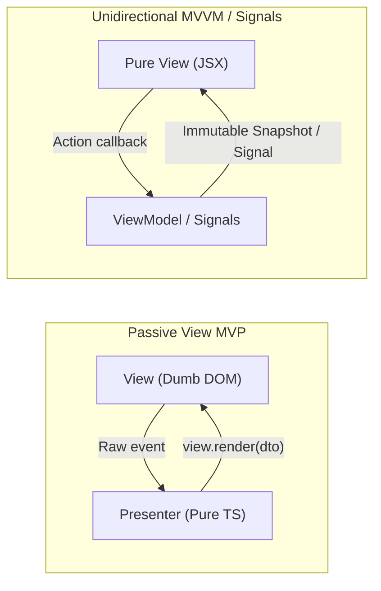
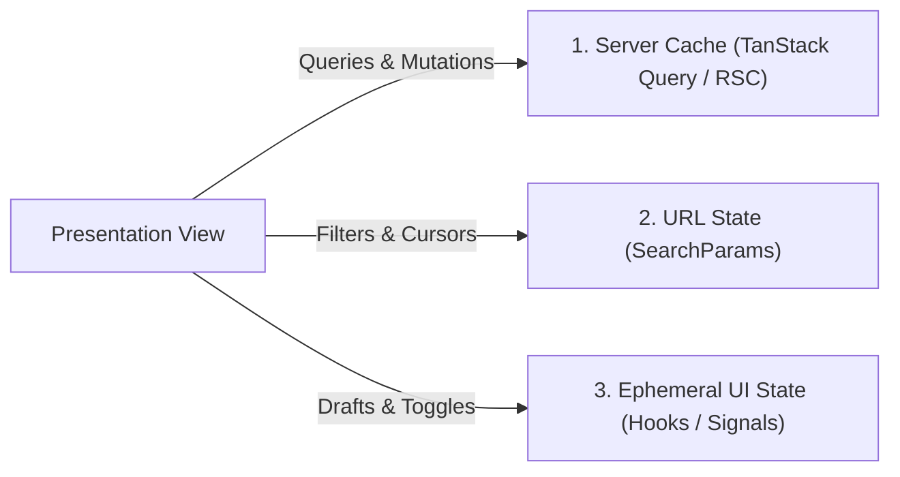

---
tags:
  - software-engineering
  - architectural-patterns
  - presentation-patterns
  - mvc
  - mvvm
created: 2026-11-13
updated: 2026-11-13
status: 🟢
level: mid-to-senior
---
# Presentation Patterns (MVC, MVP, MVVM) & Modern Frontend Parity

> [!abstract] Vault Navigation
> Part of [[Programming/Software Engineering/Architectural Patterns/Architectural Patterns Complete Guide|Architectural Patterns Complete Guide]]. Governs Ring 3 UI adapter boundaries within [[Programming/Software Engineering/Clean Architecture/Interface Adapters & Frameworks|Interface Adapters & Frameworks]] and [[Programming/Software Engineering/Clean Architecture/Dependency Rule|Dependency Rule]]. Pairs closely with [[Programming/Frontend/React Complete Guide|React Complete Guide]], [[Programming/Frontend/React Hooks Guide|React Hooks Guide]], [[Programming/Frontend/React Patterns Guide|React Patterns Guide]], [[Programming/Backend/NestJS Complete Guide|NestJS Complete Guide]], and [[Programming/Software Engineering/Testing/Unit Testing|Unit Testing]].

Presentation architectures isolate **volatile rendering toolkits** (DOM nodes, React fibers, server HTML templates, native UI widgets) from **presentation state transitions and formatting**, while isolating both from **core domain invariants and backend I/O**. Without explicit presentation boundaries, applications accumulate "fat components" or "fat controllers" that mix raw SQL/HTTP requests, floating-point money calculations, stale fetch race bugs, and CSS markup inside a single untestable file.

---

## 1. First-Principles Mechanics & Runtime Evolution

### 1.1 Evolution of UI State Decoupling

Every presentation architecture answers two concrete mechanical questions: **who receives raw user input first**, and **how state changes propagate back to screen pixels**.

#### 1. Classic Smalltalk MVC (1979 Desktop Observer Loop)
- **Control Flow**: User input enters the **Controller**, which mutates the **Model**; the **View** registers directly as an observer on Model properties and pulls updated attributes whenever notified.
- **Why Classic MVC Broke on Modern UIs**: Fine-grained bidirectional observer graphs across rich screens created unpredictable update cascades ("ping-pong notifications") and forced Views to import Model internals directly, making headless testing impossible without mocking complex observable graphs.

#### 2. Web Request-Response MVC (Rails, Spring MVC, NestJS + HTMX)
- **Control Flow**: An HTTP router dispatches the request to a **Controller**; the Controller validates inputs, invokes one Application Service / Use Case, builds a plain **ViewDTO**, and renders a stateless HTML **View** template (or HTMX hypermedia fragment swap) back over the wire.
- **Runtime Invariant**: Zero persistent client View state exists between requests outside HTML forms and URLs. Modern **React Server Components (RSC)** inside [[Programming/Frontend/Next.js Complete Guide|Next.js Complete Guide]] revisit this exact server-boundary separation for read paths while isolating interactive mutations into explicit Client Component islands.

#### 3. MVP — Passive View (WinForms, Android XML, Strict Headless Logic)
- **Control Flow**: The **View** is strictly passive and owns zero formatting or branching logic. User gestures (`onQuantityChanged`, `onSubmitClicked`) forward straight to a **Presenter** via an injected callback. The Presenter coordinates domain/API services, formats currency/dates into strings (`"$19.99"`), and drives UI updates explicitly through a framework-free interface (`ICheckoutView.render(dto)`).
- **Testing Superpower**: Because `ICheckoutView` contains zero DOM or React types, the entire presentation state machine executes in headless Node/Vitest in `<1 ms` using plain in-memory test doubles.

#### 4. Reactive Two-Way MVVM (WPF, SwiftUI, Angular `[(ngModel)]`, Vue `v-model`)
- **Control Flow**: The **View** binds declaratively to observable properties and command callbacks exposed by a **ViewModel**. Unlike MVP, the ViewModel holds **zero pointer or interface reference to the View**—a binding engine automatically synchronizes View controls when ViewModel observables emit new values.
- **Hazard**: Classic **two-way bindings** (`input <-> model`) mutating derived fields on `onChange` easily trigger re-entrant watcher cycles unless strictly constrained.

#### 5. Modern Unidirectional Data Flow (React Hooks + Server Cache) & Fine-Grained Signals
- **React Unidirectional Flow (`State -> UI -> Action -> State`)**: Eliminates implicit two-way mutations. A custom ViewModel Hook (`useCheckoutViewModel`) or `useSyncExternalStore` bridge supplies immutable state snapshots and explicit action dispatchers down to pure presentational JSX components. **Top-down VDOM reconciliation** re-executes component functions within modified subtrees and diffs virtual trees before patching the DOM.
- **Fine-Grained Signals (`SolidJS`, `Angular 18+ Signals`, `Svelte 5 Runes`, `Preact Signals`)**: Replaces coarse component re-execution with a runtime **directed reactive dependency graph**. Reading `totalDisplay()` inside a template text node subscribes *that exact DOM text node* (`Set<Reaction>`) directly to upstream signals (`items`, `coupon`). Mutating `quantity.set(3)` updates only affected computations and exact DOM leaves in **$O(1)$**—recovering true MVVM fine-grained binding ergonomics **without** two-way mutation cycles or dirty-checking loops.



### 1.2 Side-by-Side Architecture Comparison

| Pattern | Input Entry Point | View $\leftrightarrow$ Logic Coupling | State Propagation Mechanism | Headless Unit Test Speed | Primary Failure Mode |
| :--- | :--- | :--- | :--- | :--- | :--- |
| **Web Server MVC / HTMX** | HTTP Controller | Zero runtime coupling (HTML over wire) | Stateless HTTP request-response / HTML fragment swap | Fast (HTTP integration tests) | Fat Controller mixing SQL, pricing math, and template selection |
| **MVP (Passive View)** | Passive View delegates to Presenter | Presenter calls strict `IView` interface; View has zero logic | Imperative setter/render pushes from Presenter | Fastest (`<1 ms`, zero DOM needed) | Verbose `IView` boilerplate on simple forms; stale view references |
| **Classic Two-Way MVVM** | View bound declaratively to ViewModel | View binds to VM; VM has **zero reference** to View | Bidirectional reactive property bindings (`Observer`) | Fast (`<2 ms` VM unit tests) | Re-entrant two-way binding loops; God ViewModels |
| **React Hooks + Server Cache** | JSX event handlers invoke ViewModel callbacks | Pure View props from `useXViewModel` hook | Unidirectional VDOM render pass + Query Cache | Fast (`renderHook` or headless Store tests) | `useEffect` fetch race bugs; dumping Server Cache into Redux |
| **Fine-Grained Signals** | Event handlers mutate source Signals | Template reads `signal()` getters | Fine-grained dependency graph patching DOM leaves in $O(1)$ | Fastest (pure Signal graph tests) | Untracked async reads outside effect scopes; mutating signals inside `computed()` |

---

## 2. Real-World Use Cases & Decision Matrix

### Scenario 1: Public SEO Job Marketplace with One Interactive "Apply" Drawer
- **Context**: 10M monthly organic Google crawls across read-mostly job pages, plus a multi-field application modal.
- **Decision**: **Server-Side MVC / React Server Components (RSC) + Isolated Client Hook Island**.
- **Why Client SPA Fails Here**: Shipping a 400 KB client ViewModel bundle + empty loading skeleton slows LCP and hurts crawl efficiency; rendering semantic HTML directly on the server maximizes FCP/LCP while confining client state strictly to the Apply drawer.

### Scenario 2: High-Frequency Financial Trading Order Book Terminal
- **Context**: Browser screen rendering 200 live bid/ask price rows updating 60 times/second via WebSocket while the operator edits order quantity inputs concurrently.
- **Decision**: **Fine-Grained Signals (or External Headless Store + Per-Row Selectors)**.
- **Why Coarse Top-Down VDOM Fails Here**: Re-rendering a top-level container ViewModel at 60 Hz across 200 rows creates severe JS main-thread frame drops (**INP** > 200 ms) unless updates are narrowed to leaf signal subscribers.

### Scenario 3: Regulated Multi-Step Insurance Underwriting Form Shared Across Web & React Native
- **Context**: Complex validation rules, conditional actuarial tables, and strict deterministic test coverage required by compliance across two UI platforms.
- **Decision**: **Framework-Agnostic Headless Store / MVP State Machine**.
- **Why React-Only Hooks Fail Here**: Locking business transitions inside React-specific hooks (`useEffect`/`useState`) prevents straightforward sharing across non-React adapters or running 500 matrix compliance tests at sub-millisecond CI speed without JSDOM overhead.

### Scenario 4: Offline-First Ruggedized Warehouse Barcode Scanner PWA
- **Context**: Android tablets in Wi-Fi dead zones scanning 40 cartons/minute and flushing queued batches asynchronously.
- **Decision**: **Local-First Client MVVM / Headless Store + IndexedDB Outbox**.
- **Why Server MVC/HTMX Fails Here**: Requiring an HTTP server round trip per scan stalls operators for `300 ms` to total timeout whenever warehouse Wi-Fi drops.

### Scenario 5: Standard B2B SaaS CRUD Admin Console (`Filters`, `Tables`, `Modals`)
- **Context**: Multi-filter analytics tables, sortable pagination, and inline settings forms.
- **Decision**: **React Hook ViewModel + TanStack Query (Server State) + URL SearchParams (Navigation State)**.
- **Why Global Redux Fails Here**: Replicating remote table pages inside Redux requires manual cache invalidation, race cancellation, and breaks sharable filter URLs.

---

## 3. Step-by-Step Practical Application: The Checkout Cart Feature Two Ways

To make presentation boundaries concrete, this section implements the **exact same Checkout Cart feature**—quantity adjustments, server-authoritative coupon validation, integer-cents currency formatting, race-condition protection, and double-submit locking—using **(A) Headless Passive-View MVP** and **(B) Modern Headless Reactive Store + React ViewModel Hook**, backed by zero-DOM Vitest unit tests and a React Testing Library integration test.

### Project Directory Layout

```text
checkout-presentation/
├── src/
│   ├── domain/
│   │   └── checkout.types.ts
│   ├── mvp/
│   │   ├── checkout-presenter.ts
│   │   └── CheckoutMvpView.tsx
│   └── modern-mvvm/
│       ├── checkout-store.ts
│       ├── useCheckoutViewModel.ts
│       └── CheckoutModernView.tsx
└── tests/
    ├── checkout-headless.test.ts
    └── checkout-view.test.tsx
```

### 3.1 Shared Domain Contracts & Formatting (`src/domain/checkout.types.ts`)

Money always executes in **integer cents** (`4990`, never `49.90` IEEE-754 floats), and raw numeric amounts convert into formatted UI strings exclusively inside the Presenter or ViewModel—never inside JSX markup.

```typescript
// src/domain/checkout.types.ts
export interface CartLineItem {
  sku: string;
  name: string;
  unitPriceCents: number;
  quantity: number;
}

export interface ServerQuoteResponse {
  cartId: string;
  currency: "USD" | "EUR";
  items: CartLineItem[];
  subtotalCents: number;
  discountCents: number;
  taxCents: number;
  totalCents: number;
  appliedCoupon: string | null;
  couponError: string | null;
}

export interface SubmitOrderResult {
  orderId: string;
  totalCents: number;
}

export interface ICheckoutApi {
  fetchQuote(
    cartId: string,
    items: Array<{ sku: string; quantity: number }>,
    couponCode: string | null,
    signal?: AbortSignal,
  ): Promise<ServerQuoteResponse>;
  submitOrder(
    cartId: string,
    expectedTotalCents: number,
    couponCode: string | null,
  ): Promise<SubmitOrderResult>;
}

export interface CheckoutLineViewDTO {
  sku: string;
  name: string;
  quantity: number;
  unitPriceDisplay: string;
  lineTotalDisplay: string;
}

export interface CheckoutScreenDTO {
  isLoadingQuote: boolean;
  isSubmitting: boolean;
  canSubmit: boolean;
  couponInput: string;
  appliedCoupon: string | null;
  couponError: string | null;
  bannerError: string | null;
  lines: CheckoutLineViewDTO[];
  subtotalDisplay: string;
  discountDisplay: string;
  taxDisplay: string;
  totalDisplay: string;
  confirmedOrderId: string | null;
}

export function formatMoneyCents(cents: number, currency: "USD" | "EUR"): string {
  return new Intl.NumberFormat("en-US", {
    style: "currency",
    currency,
  }).format(cents / 100);
}

export function projectQuoteToLines(quote: ServerQuoteResponse): CheckoutLineViewDTO[] {
  return quote.items.map((item) => ({
    sku: item.sku,
    name: item.name,
    quantity: item.quantity,
    unitPriceDisplay: formatMoneyCents(item.unitPriceCents, quote.currency),
    lineTotalDisplay: formatMoneyCents(item.unitPriceCents * item.quantity, quote.currency),
  }));
}
```

### 3.2 Implementation A: Headless MVP Presenter + Thin React View

Notice `ICheckoutView` in `checkout-presenter.ts` has **zero React imports and zero DOM types**. Every asynchronous quote fetch increments `requestEpoch` (plus passes `AbortSignal`) so slow stale responses arriving out of order are discarded silently without corrupting newer cart quantities or coupons.

```typescript
// src/mvp/checkout-presenter.ts
import {
  formatMoneyCents,
  projectQuoteToLines,
  type CheckoutScreenDTO,
  type ICheckoutApi,
  type ServerQuoteResponse,
} from "../domain/checkout.types.js";

/** Strict Passive-View contract: implemented by React, mobile, or headless test double */
export interface ICheckoutView {
  render(model: CheckoutScreenDTO): void;
  notifyOrderConfirmed(orderId: string): void;
}

export class CheckoutPresenter {
  private couponInput = "";
  private appliedCoupon: string | null = null;
  private isLoadingQuote = false;
  private isSubmitting = false;
  private bannerError: string | null = null;
  private confirmedOrderId: string | null = null;
  private latestQuote: ServerQuoteResponse | null = null;
  private requestEpoch = 0;
  private activeAbortController: AbortController | null = null;

  constructor(
    private readonly cartId: string,
    private readonly api: ICheckoutApi,
    private readonly view: ICheckoutView,
  ) {}

  async initialize(initialItems: Array<{ sku: string; quantity: number }>): Promise<void> {
    await this.refreshQuote(initialItems, null);
  }

  onCouponInputChanged(nextValue: string): void {
    this.couponInput = nextValue.trim().toUpperCase();
    this.publishView();
  }

  async onApplyCoupon(): Promise<void> {
    if (!this.latestQuote || this.isSubmitting) return;
    const candidate = this.couponInput.trim().toUpperCase();
    await this.refreshQuote(
      this.latestQuote.items.map((i) => ({ sku: i.sku, quantity: i.quantity })),
      candidate.length > 0 ? candidate : null,
    );
  }

  async onQuantityChanged(sku: string, nextQuantity: number): Promise<void> {
    if (!this.latestQuote || this.isSubmitting) return;
    const clampedQty = Math.max(1, Math.min(99, Math.floor(nextQuantity)));
    const nextItems = this.latestQuote.items.map((item) =>
      item.sku === sku ? { sku: item.sku, quantity: clampedQty } : { sku: item.sku, quantity: item.quantity },
    );
    await this.refreshQuote(nextItems, this.appliedCoupon);
  }

  async onSubmitOrder(): Promise<void> {
    if (!this.latestQuote || this.isLoadingQuote || this.isSubmitting) return;

    this.isSubmitting = true;
    this.bannerError = null;
    this.publishView();

    try {
      const result = await this.api.submitOrder(
        this.cartId,
        this.latestQuote.totalCents,
        this.appliedCoupon,
      );
      this.confirmedOrderId = result.orderId;
      this.view.notifyOrderConfirmed(result.orderId);
    } catch (err) {
      this.bannerError = err instanceof Error ? err.message : "Order submission failed";
    } finally {
      this.isSubmitting = false;
      this.publishView();
    }
  }

  dispose(): void {
    this.activeAbortController?.abort();
  }

  private async refreshQuote(
    items: Array<{ sku: string; quantity: number }>,
    couponCode: string | null,
  ): Promise<void> {
    this.requestEpoch += 1;
    const myEpoch = this.requestEpoch;

    this.activeAbortController?.abort();
    const controller = new AbortController();
    this.activeAbortController = controller;

    this.isLoadingQuote = true;
    this.bannerError = null;
    this.publishView();

    try {
      const quote = await this.api.fetchQuote(this.cartId, items, couponCode, controller.signal);
      // Discard out-of-order stale response if user triggered a newer mutation while awaiting
      if (myEpoch !== this.requestEpoch) return;

      this.latestQuote = quote;
      this.appliedCoupon = quote.appliedCoupon;
    } catch (err) {
      if (myEpoch !== this.requestEpoch) return;
      if (err instanceof Error && err.name === "AbortError") return;
      this.bannerError = err instanceof Error ? err.message : "Unable to calculate cart quote";
    } finally {
      if (myEpoch === this.requestEpoch) {
        this.isLoadingQuote = false;
        this.publishView();
      }
    }
  }

  private publishView(): void {
    const q = this.latestQuote;
    const currency = q?.currency ?? "USD";

    const dto: CheckoutScreenDTO = {
      isLoadingQuote: this.isLoadingQuote,
      isSubmitting: this.isSubmitting,
      canSubmit: Boolean(q) && !this.isLoadingQuote && !this.isSubmitting && this.confirmedOrderId === null,
      couponInput: this.couponInput,
      appliedCoupon: q?.appliedCoupon ?? null,
      couponError: q?.couponError ?? null,
      bannerError: this.bannerError,
      lines: q ? projectQuoteToLines(q) : [],
      subtotalDisplay: formatMoneyCents(q?.subtotalCents ?? 0, currency),
      discountDisplay: formatMoneyCents(-(q?.discountCents ?? 0), currency),
      taxDisplay: formatMoneyCents(q?.taxCents ?? 0, currency),
      totalDisplay: formatMoneyCents(q?.totalCents ?? 0, currency),
      confirmedOrderId: this.confirmedOrderId,
    };
    this.view.render(dto);
  }
}
```

```tsx
// src/mvp/CheckoutMvpView.tsx — Thin Passive React Adapter
import React, { useEffect, useRef, useState } from "react";
import type { CheckoutScreenDTO, ICheckoutApi } from "../domain/checkout.types.js";
import { CheckoutPresenter } from "./checkout-presenter.js";

const INITIAL_DTO: CheckoutScreenDTO = {
  isLoadingQuote: true,
  isSubmitting: false,
  canSubmit: false,
  couponInput: "",
  appliedCoupon: null,
  couponError: null,
  bannerError: null,
  lines: [],
  subtotalDisplay: "$0.00",
  discountDisplay: "$0.00",
  taxDisplay: "$0.00",
  totalDisplay: "$0.00",
  confirmedOrderId: null,
};

export interface CheckoutMvpViewProps {
  cartId: string;
  initialItems: Array<{ sku: string; quantity: number }>;
  api: ICheckoutApi;
  onOrderConfirmed: (orderId: string) => void;
}

export function CheckoutMvpView({
  cartId,
  initialItems,
  api,
  onOrderConfirmed,
}: CheckoutMvpViewProps): React.ReactElement {
  const [vm, setVm] = useState<CheckoutScreenDTO>(INITIAL_DTO);
  const presenterRef = useRef<CheckoutPresenter | null>(null);

  useEffect(() => {
    const presenter = new CheckoutPresenter(cartId, api, {
      render: (nextModel) => setVm(nextModel),
      notifyOrderConfirmed: (orderId) => onOrderConfirmed(orderId),
    });
    presenterRef.current = presenter;
    void presenter.initialize(initialItems);
    return () => {
      presenter.dispose();
      presenterRef.current = null;
    };
  }, [cartId, api, initialItems, onOrderConfirmed]);

  return (
    <section aria-label="Checkout Cart">
      {vm.bannerError && <p role="alert">{vm.bannerError}</p>}
      <ul>
        {vm.lines.map((line) => (
          <li key={line.sku}>
            <span>{line.name}</span>
            <input
              aria-label={`Quantity for ${line.name}`}
              type="number"
              min={1}
              max={99}
              value={line.quantity}
              onChange={(e) => void presenterRef.current?.onQuantityChanged(line.sku, Number(e.target.value))}
            />
            <span>{line.lineTotalDisplay}</span>
          </li>
        ))}
      </ul>
      <div>
        <input
          aria-label="Coupon code"
          value={vm.couponInput}
          onChange={(e) => presenterRef.current?.onCouponInputChanged(e.target.value)}
        />
        <button type="button" onClick={() => void presenterRef.current?.onApplyCoupon()}>
          Apply Coupon
        </button>
        {vm.couponError && <span role="status">{vm.couponError}</span>}
      </div>
      <div>
        <p>Total: {vm.totalDisplay}</p>
        <button
          type="button"
          disabled={!vm.canSubmit}
          onClick={() => void presenterRef.current?.onSubmitOrder()}
        >
          {vm.isSubmitting ? "Submitting..." : "Place Order"}
        </button>
      </div>
    </section>
  );
}
```

### 3.3 Implementation B: Modern Headless Reactive Store + React ViewModel Hook + Pure View

In modern React/Signals architecture, instead of imperative `view.render(...)` callbacks, a **Headless Reactive Store** exposes immutable snapshots compatible with `useSyncExternalStore` (tearing-safe under React 19 concurrent rendering) and zero View pointers. The ViewModel hook (`useCheckoutViewModel`) wires lifecycle initialization cleanly and exposes reactive properties + actions to a pure presentational component.

```typescript
// src/modern-mvvm/checkout-store.ts
import {
  formatMoneyCents,
  projectQuoteToLines,
  type CheckoutScreenDTO,
  type ICheckoutApi,
  type ServerQuoteResponse,
} from "../domain/checkout.types.js";

type Listener = () => void;

export class CheckoutReactiveStore {
  private listeners = new Set<Listener>();
  private snapshot: CheckoutScreenDTO;
  private latestQuote: ServerQuoteResponse | null = null;
  private couponInput = "";
  private appliedCoupon: string | null = null;
  private isLoadingQuote = false;
  private isSubmitting = false;
  private bannerError: string | null = null;
  private confirmedOrderId: string | null = null;
  private requestEpoch = 0;
  private abortController: AbortController | null = null;

  constructor(
    private readonly cartId: string,
    private readonly api: ICheckoutApi,
    private readonly onConfirmed?: (orderId: string) => void,
  ) {
    this.snapshot = this.computeSnapshot();
  }

  subscribe = (listener: Listener): (() => void) => {
    this.listeners.add(listener);
    return () => this.listeners.delete(listener);
  };

  getSnapshot = (): CheckoutScreenDTO => this.snapshot;

  async loadInitial(items: Array<{ sku: string; quantity: number }>): Promise<void> {
    await this.fetchAuthoritativeQuote(items, null);
  }

  setCouponInput = (value: string): void => {
    this.couponInput = value.trim().toUpperCase();
    this.emit();
  };

  applyCoupon = async (): Promise<void> => {
    if (!this.latestQuote || this.isSubmitting) return;
    const code = this.couponInput.trim().toUpperCase();
    await this.fetchAuthoritativeQuote(
      this.latestQuote.items.map((i) => ({ sku: i.sku, quantity: i.quantity })),
      code.length > 0 ? code : null,
    );
  };

  updateQuantity = async (sku: string, nextQty: number): Promise<void> => {
    if (!this.latestQuote || this.isSubmitting) return;
    const safeQty = Math.max(1, Math.min(99, Math.floor(nextQty)));
    const nextItems = this.latestQuote.items.map((item) =>
      item.sku === sku ? { sku: item.sku, quantity: safeQty } : { sku: item.sku, quantity: item.quantity },
    );
    await this.fetchAuthoritativeQuote(nextItems, this.appliedCoupon);
  };

  submitOrder = async (): Promise<void> => {
    if (!this.latestQuote || this.isLoadingQuote || this.isSubmitting) return;
    this.isSubmitting = true;
    this.bannerError = null;
    this.emit();

    try {
      const result = await this.api.submitOrder(
        this.cartId,
        this.latestQuote.totalCents,
        this.appliedCoupon,
      );
      this.confirmedOrderId = result.orderId;
      this.onConfirmed?.(result.orderId);
    } catch (err) {
      this.bannerError = err instanceof Error ? err.message : "Order submission failed";
    } finally {
      this.isSubmitting = false;
      this.emit();
    }
  };

  dispose = (): void => {
    this.abortController?.abort();
  };

  private async fetchAuthoritativeQuote(
    items: Array<{ sku: string; quantity: number }>,
    couponCode: string | null,
  ): Promise<void> {
    this.requestEpoch += 1;
    const epoch = this.requestEpoch;

    this.abortController?.abort();
    const controller = new AbortController();
    this.abortController = controller;

    this.isLoadingQuote = true;
    this.bannerError = null;
    this.emit();

    try {
      const quote = await this.api.fetchQuote(this.cartId, items, couponCode, controller.signal);
      if (epoch !== this.requestEpoch) return;
      this.latestQuote = quote;
      this.appliedCoupon = quote.appliedCoupon;
    } catch (err) {
      if (epoch !== this.requestEpoch) return;
      if (err instanceof Error && err.name === "AbortError") return;
      this.bannerError = err instanceof Error ? err.message : "Failed to load quote";
    } finally {
      if (epoch === this.requestEpoch) {
        this.isLoadingQuote = false;
        this.emit();
      }
    }
  }

  private emit(): void {
    this.snapshot = this.computeSnapshot();
    for (const listener of this.listeners) {
      listener();
    }
  }

  private computeSnapshot(): CheckoutScreenDTO {
    const q = this.latestQuote;
    const currency = q?.currency ?? "USD";
    return {
      isLoadingQuote: this.isLoadingQuote,
      isSubmitting: this.isSubmitting,
      canSubmit: Boolean(q) && !this.isLoadingQuote && !this.isSubmitting && this.confirmedOrderId === null,
      couponInput: this.couponInput,
      appliedCoupon: q?.appliedCoupon ?? null,
      couponError: q?.couponError ?? null,
      bannerError: this.bannerError,
      lines: q ? projectQuoteToLines(q) : [],
      subtotalDisplay: formatMoneyCents(q?.subtotalCents ?? 0, currency),
      discountDisplay: formatMoneyCents(-(q?.discountCents ?? 0), currency),
      taxDisplay: formatMoneyCents(q?.taxCents ?? 0, currency),
      totalDisplay: formatMoneyCents(q?.totalCents ?? 0, currency),
      confirmedOrderId: this.confirmedOrderId,
    };
  }
}
```

```tsx
// src/modern-mvvm/useCheckoutViewModel.ts
import { useEffect, useMemo, useSyncExternalStore } from "react";
import type { CheckoutScreenDTO, ICheckoutApi } from "../domain/checkout.types.js";
import { CheckoutReactiveStore } from "./checkout-store.js";

export interface CheckoutViewModel {
  state: CheckoutScreenDTO;
  setCouponInput: (value: string) => void;
  applyCoupon: () => Promise<void>;
  updateQuantity: (sku: string, nextQty: number) => Promise<void>;
  submitOrder: () => Promise<void>;
}

export function useCheckoutViewModel(
  cartId: string,
  initialItems: Array<{ sku: string; quantity: number }>,
  api: ICheckoutApi,
  onOrderConfirmed: (orderId: string) => void,
): CheckoutViewModel {
  const store = useMemo(
    () => new CheckoutReactiveStore(cartId, api, onOrderConfirmed),
    [cartId, api, onOrderConfirmed],
  );

  useEffect(() => {
    void store.loadInitial(initialItems);
    return () => store.dispose();
  }, [store, initialItems]);

  const state = useSyncExternalStore(store.subscribe, store.getSnapshot, store.getSnapshot);

  return {
    state,
    setCouponInput: store.setCouponInput,
    applyCoupon: store.applyCoupon,
    updateQuantity: store.updateQuantity,
    submitOrder: store.submitOrder,
  };
}
```

```tsx
// src/modern-mvvm/CheckoutModernView.tsx — Pure Presentational View (Zero fetch / Zero Math)
import React from "react";
import type { CheckoutViewModel } from "./useCheckoutViewModel.js";

export function CheckoutModernView({ vm }: { vm: CheckoutViewModel }): React.ReactElement {
  const { state } = vm;

  return (
    <section aria-label="Modern Checkout">
      {state.bannerError && <p role="alert">{state.bannerError}</p>}
      <ul>
        {state.lines.map((line) => (
          <li key={line.sku}>
            <span>{line.name}</span>
            <span>{line.unitPriceDisplay}</span>
            <input
              aria-label={`Quantity for ${line.name}`}
              type="number"
              min={1}
              max={99}
              value={line.quantity}
              onChange={(e) => void vm.updateQuantity(line.sku, Number(e.target.value))}
            />
            <strong>{line.lineTotalDisplay}</strong>
          </li>
        ))}
      </ul>
      <div>
        <input
          aria-label="Coupon code"
          value={state.couponInput}
          onChange={(e) => vm.setCouponInput(e.target.value)}
        />
        <button type="button" onClick={() => void vm.applyCoupon()}>
          Apply Coupon
        </button>
        {state.couponError && <p role="status">{state.couponError}</p>}
      </div>
      <dl>
        <dt>Subtotal</dt>
        <dd>{state.subtotalDisplay}</dd>
        <dt>Discount</dt>
        <dd>{state.discountDisplay}</dd>
        <dt>Tax</dt>
        <dd>{state.taxDisplay}</dd>
        <dt>Total</dt>
        <dd data-testid="checkout-total">{state.totalDisplay}</dd>
      </dl>
      <button
        type="button"
        disabled={!state.canSubmit}
        onClick={() => void vm.submitOrder()}
      >
        {state.isSubmitting ? "Submitting..." : "Place Order"}
      </button>
    </section>
  );
}
```

### 3.4 Headless Zero-DOM Unit Tests & React Testing Library Integration Test

Separating `CheckoutPresenter` and `CheckoutReactiveStore` from DOM rendering allows running complex concurrency/race/currency suites in pure Node (`<2 ms`), reserving slow DOM rendering tests strictly for verifying interactive ARIA wiring.

```typescript
// tests/checkout-headless.test.ts (Zero DOM / Zero React mounted!)
import { describe, expect, it, vi } from "vitest";
import type { CheckoutScreenDTO, ICheckoutApi, ServerQuoteResponse } from "../src/domain/checkout.types.js";
import { CheckoutPresenter, type ICheckoutView } from "../src/mvp/checkout-presenter.js";
import { CheckoutReactiveStore } from "../src/modern-mvvm/checkout-store.js";

function makeQuote(qty: number, coupon: string | null): ServerQuoteResponse {
  const unitPriceCents = 2500;
  const subtotalCents = unitPriceCents * qty;
  const discountCents = coupon === "SAVE20" ? Math.round(subtotalCents * 0.2) : 0;
  const taxCents = Math.round((subtotalCents - discountCents) * 0.1);
  return {
    cartId: "cart-1",
    currency: "USD",
    items: [{ sku: "SKU-1", name: "Mechanical Keyboard", unitPriceCents, quantity: qty }],
    subtotalCents,
    discountCents,
    taxCents,
    totalCents: subtotalCents - discountCents + taxCents,
    appliedCoupon: coupon === "SAVE20" ? "SAVE20" : null,
    couponError: coupon && coupon !== "SAVE20" ? "Invalid coupon" : null,
  };
}

describe("Headless MVP Presenter (Zero-DOM Vitest)", () => {
  it("discards stale out-of-order quote responses cleanly and formats currency", async () => {
    let latestModel!: CheckoutScreenDTO;
    const confirmedSpy = vi.fn();
    const view: ICheckoutView = {
      render: (m) => {
        latestModel = m;
      },
      notifyOrderConfirmed: confirmedSpy,
    };

    let resolveSlowFirst!: (q: ServerQuoteResponse) => void;
    let callIdx = 0;

    const api: ICheckoutApi = {
      fetchQuote: vi.fn(async (_cartId, items, coupon) => {
        callIdx += 1;
        if (callIdx === 2) {
          // Simulate slow qty=2 response resolving AFTER qty=5 response!
          return new Promise<ServerQuoteResponse>((resolve) => {
            resolveSlowFirst = resolve;
          });
        }
        return makeQuote(items[0].quantity, coupon);
      }),
      submitOrder: vi.fn(async () => ({ orderId: "ORD-77", totalCents: 11000 })),
    };

    const presenter = new CheckoutPresenter("cart-1", api, view);
    await presenter.initialize([{ sku: "SKU-1", quantity: 1 }]);
    expect(latestModel.totalDisplay).toBe("$27.50");

    // Fire slow qty=2, then immediately fire fast qty=5 before qty=2 resolves
    const slowReq = presenter.onQuantityChanged("SKU-1", 2);
    await presenter.onQuantityChanged("SKU-1", 5);
    expect(latestModel.totalDisplay).toBe("$137.50");

    // Resolve stale qty=2 late -> must NOT overwrite qty=5!
    resolveSlowFirst(makeQuote(2, null));
    await slowReq;
    expect(latestModel.lines[0].quantity).toBe(5);
    expect(latestModel.totalDisplay).toBe("$137.50");

    await presenter.onSubmitOrder();
    expect(confirmedSpy).toHaveBeenCalledWith("ORD-77");
  });
});

describe("Headless Reactive Store (Zero-DOM Vitest)", () => {
  it("prevents concurrent double-submission and normalizes coupon casing", async () => {
    let resolveSubmit!: (val: { orderId: string; totalCents: number }) => void;
    const submitSpy = vi.fn(
      () =>
        new Promise<{ orderId: string; totalCents: number }>((resolve) => {
          resolveSubmit = resolve;
        }),
    );

    const api: ICheckoutApi = {
      fetchQuote: vi.fn(async (_id, items, coupon) => makeQuote(items[0].quantity, coupon)),
      submitOrder: submitSpy,
    };

    const confirmed = vi.fn();
    const store = new CheckoutReactiveStore("cart-9", api, confirmed);
    await store.loadInitial([{ sku: "SKU-1", quantity: 2 }]);

    store.setCouponInput("  save20 ");
    await store.applyCoupon();
    expect(store.getSnapshot().appliedCoupon).toBe("SAVE20");
    expect(store.getSnapshot().totalDisplay).toBe("$44.00");

    const p1 = store.submitOrder();
    const p2 = store.submitOrder(); // Second rapid click while submitting must be ignored
    expect(submitSpy).toHaveBeenCalledTimes(1);
    expect(store.getSnapshot().canSubmit).toBe(false);

    resolveSubmit({ orderId: "ORD-88", totalCents: 4400 });
    await Promise.all([p1, p2]);
    expect(confirmed).toHaveBeenCalledWith("ORD-88");
  });
});
```

```tsx
// tests/checkout-view.test.tsx — React Testing Library DOM Integration Test
import React from "react";
import { afterEach, describe, expect, it, vi } from "vitest";
import { cleanup, fireEvent, render, screen, waitFor } from "@testing-library/react";
import type { ICheckoutApi } from "../src/domain/checkout.types.js";
import { useCheckoutViewModel } from "../src/modern-mvvm/useCheckoutViewModel.js";
import { CheckoutModernView } from "../src/modern-mvvm/CheckoutModernView.js";

afterEach(cleanup);

function CheckoutContainer({
  api,
  onConfirmed,
}: {
  api: ICheckoutApi;
  onConfirmed: (id: string) => void;
}) {
  const initialItems = React.useMemo(() => [{ sku: "SKU-1", quantity: 1 }], []);
  const vm = useCheckoutViewModel("cart-1", initialItems, api, onConfirmed);
  return <CheckoutModernView vm={vm} />;
}

describe("CheckoutModernView integration", () => {
  it("binds ViewModel coupon application and order submission to accessible DOM controls", async () => {
    const api: ICheckoutApi = {
      fetchQuote: vi.fn(async (_id, items, coupon) => {
        const sub = 5000 * items[0].quantity;
        const disc = coupon === "SAVE20" ? 1000 : 0;
        return {
          cartId: "cart-1",
          currency: "USD",
          items: [{ sku: "SKU-1", name: "USB-C Dock", unitPriceCents: 5000, quantity: items[0].quantity }],
          subtotalCents: sub,
          discountCents: disc,
          taxCents: 0,
          totalCents: sub - disc,
          appliedCoupon: coupon === "SAVE20" ? "SAVE20" : null,
          couponError: null,
        };
      }),
      submitOrder: vi.fn(async () => ({ orderId: "ORD-900", totalCents: 4000 })),
    };

    const onConfirmed = vi.fn();
    render(<CheckoutContainer api={api} onConfirmed={onConfirmed} />);

    await waitFor(() => {
      expect(screen.getByTestId("checkout-total").textContent).toBe("$50.00");
    });

    fireEvent.change(screen.getByLabelText("Coupon code"), { target: { value: "save20" } });
    fireEvent.click(screen.getByRole("button", { name: "Apply Coupon" }));

    await waitFor(() => {
      expect(screen.getByTestId("checkout-total").textContent).toBe("$40.00");
    });

    fireEvent.click(screen.getByRole("button", { name: "Place Order" }));
    await waitFor(() => {
      expect(onConfirmed).toHaveBeenCalledWith("ORD-900");
    });
  });
});
```

---

## 4. Complete Presentation Reference & Failure Mechanics

### 4.1 The 3-Bucket State Segregation Taxonomy

Treating every piece of application state identically inside one giant global Redux/Zustand store causes stale caching, lost URLs, and unnecessary component re-renders. Partition frontend state strictly into **three buckets**:

| State Category | Concrete Examples | Authoritative Owner | Common Anti-Pattern |
| :--- | :--- | :--- | :--- |
| **1. Remote Server Cache State** | Product catalog, user profile, paginated orders, server cart quotes | **TanStack Query / SWR / Apollo / RSC** (automatic caching, stale-while-revalidate, request deduplication, `AbortSignal`) | Writing manual `useEffect(() => fetch(...).then(setState))` or mirroring REST JSON into Redux slices |
| **2. URL / Navigation State** | Search filter `?q=keyboard`, active tab, sort order, pagination cursor, modal route | **Router / `URLSearchParams`** | Storing active filters in React `useState` (breaks Back button, refresh persistence, and shared Slack links!) |
| **3. Local / Ephemeral UI State** | Unsubmitted coupon text draft, hover tooltips, accordion expanded flags, form dirty state | **Local `useState` / Reducer / Scoped Signal / Headless Store** | Hoisting `isDropdownOpen` or input draft keystrokes into global app state |



### 4.2 Five Classic Presentation Failure Mechanics

1. **Fat Controller / Fat Component Trap**: Placing validation regex, tax rate constants, `fetch()` orchestration, retry logic, and JSX inside one 800-line component or REST controller. Controllers must strictly validate input schema, delegate to one Use Case, and map output DTOs; UI components must strictly bind ViewModel state and forward actions.
2. **God Presenter / God ViewModel**: Letting one root `DashboardViewModel` manage 12 unrelated widgets (notifications, sidebar, billing table, analytics charts) forces hundreds of unrelated fields through one object reference, causing global re-render storms and fragile mocks. Split ViewModels along screen feature boundaries.
3. **Re-Entrant Two-Way Binding Feedback Loops**: Suppose a two-way bound form maintains both `netAmount` and `grossAmount` where changing `netAmount` updates `grossAmount = net * 1.2` and `grossAmount`'s two-way watcher writes `netAmount = gross / 1.2`. Floating-point rounding differences (`100 / 1.2 * 1.2 = 99.99999999999999`) trigger infinite circular `onChange` events! **Fix**: Keep **one single source of truth** (`activeInputMode` + `rawCents`) and **derive** the opposite display field purely via read-only computed selectors (`computed()` / `useMemo`), never via reciprocal mutating watchers.
4. **Leaking Domain Entities & Floating-Point Money into Views**: Returning raw database entities (`UserEntity` containing `passwordHash` or internal state flags) directly to templates or React components couples UI rendering to database migrations. Always map into explicit `ViewDTO` projections, computing formatted currency strings cleanly in integer cents inside the Presenter/ViewModel.
5. **Unprotected `useEffect` Fetch Races**: Triggering `fetch('/api/orders/' + id)` inside `useEffect` without an `AbortController` or monotonic `requestEpoch` allows a slow request for `id=A` to resolve *after* a fast request for `id=B`, overwriting newer UI state silently!

### 4.3 Fine-Grained Signals vs React VDOM Mechanics

Understanding runtime execution differences avoids subtle performance bugs:
- **React Top-Down Re-Rendering + `useSyncExternalStore`**: Calling `setState` schedules a render pass starting at the owning component down through children unless memoized (`React Compiler` / `React.memo`). External stores must integrate via `useSyncExternalStore` so React 19 concurrent features never observe inconsistent UI "tearing" across transitions.
- **Signals (`Solid`, `Angular`, `Svelte 5`)**: Track reads dynamically on an active execution stack (`currentObserver`). A `computed(() => a() + b())` caches its value lazily and recomputes *only* when `a` or `b` changes **and** a live DOM/effect observer reads it.
- **Signal Anti-Pattern**: Mutating another signal inside a `computed()` getter or launching untracked async reads *after* an `await` inside an `effect()` breaks dependency tracking silently; wrap side effects explicitly in `effect()` / `untracked()`.

---

## 5. Production Debugging, Profiling & Operations Playbook

| Symptom | Root Cause Hypothesis | Exact Diagnostic Tools / Commands | Remediation |
| :--- | :--- | :--- | :--- |
| **Switching filters fast (`A -> B -> A`) sporadically shows `A`'s numbers under `B`'s header** | Unprotected `useEffect` async fetch race missing `AbortController` or query-key scoping | DevTools Network throttling (`Slow 3G`) + log request/response sequence IDs | Migrate Server State to TanStack Query (`queryKey: ['metrics', filter]`) or enforce `AbortController` + `requestEpoch` |
| **Typing into one form input lags (`>100 ms` INP) across a 300-row table** | God ViewModel / Context value recreating new object reference at top of tree on every keystroke | React DevTools Profiler ("Highlight updates when components render" + Flamegraph) | Isolate input state down into leaf component, split Context into state vs stable dispatch, or adopt Signals |
| **Browser freezes with `Maximum update depth exceeded` when editing a numeric field** | Re-entrant two-way binding loop or `useEffect` mutating its own dependency array | Chrome DevTools Performance call stack trace on repeating setter frame | Replace reciprocal watchers with single source of truth + read-only derived `computed()` |
| **Copying URL into a new tab loses search filters, sorting, and active page** | Navigation state trapped inside ephemeral React `useState` or Redux memory | Inspect browser `window.location.search` vs Redux DevTools state tree | Move filter/sort/pagination state strictly into `URLSearchParams` (`useSearchParams`) |
| **Unit tests take `40+ seconds` booting JSDOM just to test discount & tax validation** | Business/presentation logic trapped inside `.tsx` components coupled to DOM providers | Measure Vitest `--reporter=verbose` per-file timing (`jsdom` vs `node` environment) | Extract pure Presenter / Headless Reactive Store into `environment: 'node'` unit tests; test DOM wiring lightly |

```bash
# Run pure Node headless presentation tests in milliseconds (no JSDOM boot)
npx vitest run tests/checkout-headless.test.ts --environment node
# Run React Testing Library DOM integration verification
npx vitest run tests/checkout-view.test.tsx --environment jsdom
```

---

## 6. Worked Exercises

### Exercise 1: Refactoring a Mixed Fat Component into Clean ViewModel + Server State

Inspect this single-file React component mixing `fetch()`, optimistic coupon math, `alert()`, and DOM markup. Identify **4 architectural defects**, and design the complete refactored split into Server State Layer + ViewModel Hook + Pure View.

```tsx
import { useEffect, useState } from "react";

export function InvoiceCheckout({ invoiceId }: { invoiceId: string }) {
  const [invoice, setInvoice] = useState<any>(null);
  const [coupon, setCoupon] = useState("");
  const [loading, setLoading] = useState(true);

  useEffect(() => {
    fetch(`/api/invoices/${invoiceId}`)
      .then((r) => r.json())
      .then((d) => {
        setInvoice(d);
        setLoading(false);
      });
  }, [invoiceId]);

  const discount = coupon === "SAVE20" ? invoice?.subtotalCents * 0.2 : 0;
  const finalDisplay = `$${((invoice?.subtotalCents - discount) / 100).toFixed(2)}`;

  async function pay() {
    await fetch(`/api/invoices/${invoiceId}/pay`, {
      method: "POST",
      body: JSON.stringify({ coupon }),
    });
    alert("Paid!");
  }

  if (loading) return <div>Loading...</div>;
  return (
    <div>
      <h1>{finalDisplay}</h1>
      <input value={coupon} onChange={(e) => setCoupon(e.target.value)} />
      <button onClick={pay}>Pay</button>
    </div>
  );
}
```

---

### Solution 1

#### 4 Architectural Defects
1. **Unprotected Server State (`useEffect` Race & Missing Error/Abort Handling)**: Rapidly switching `invoiceId` causes out-of-order responses to overwrite newer invoices; HTTP `500` or network drops leave `loading === true` permanently with zero error boundary or retry.
2. **Client-Side Security & Financial Math Bug**: Hardcoding `coupon === "SAVE20" ? * 0.2` in the browser exposes pricing rules, allows client manipulation, and computes floating-point multiplication without integer rounding.
3. **Browser Global Side Effect (`alert`) & Double-Submit Vulnerability**: Calling `window.alert` couples presentation transitions to blocking browser dialogs and omits an `isPaying` submission lock against double clicks.
4. **Tight Presentation-to-DOM Coupling**: Formatting, HTTP fetching, and JSX sit inside one function, forcing full DOM mounting just to test display formatting or payment error banners.

#### Clean Refactored Architecture
1. **Server State Layer (`useInvoiceQuery.ts`)**: Use TanStack Query `useQuery({ queryKey: ["invoice", invoiceId], queryFn: ({ signal }) => fetchInvoice(invoiceId, signal) })` plus `useMutation` calling `POST /pay` and invalidating `["invoice", invoiceId]` cleanly.
2. **ViewModel Hook (`useInvoiceCheckoutVM(invoiceId)`)**: Combines server quote query + ephemeral `couponInput` draft + `isPaying` guard, validates coupon previews against a server quote endpoint, formats `Intl.NumberFormat` integer cents safely, and returns `{ displayAmount, couponInput, setCouponInput, canPay, pay, paymentError, paidSuccess }`.
3. **Pure Passive View (`InvoiceCheckoutView.tsx`)**: Renders props straight from `useInvoiceCheckoutVM` with zero `fetch`, zero `useEffect`, zero `alert`, and accessible inline status banners.

---

### Exercise 2: Deciding Server MVC/RSC vs Client MVVM/Signals Across Two Products

Compare two contrasting applications:
1. **Internal Ruggedized Warehouse Scanner App**: Operates on low-CPU Android tablets inside warehouse Wi-Fi dead zones; operators scan 40 cartons/minute offline and sync batches on reconnect.
2. **SEO-Driven Public Job Board**: Serves 10M monthly Google organic search visits across job detail pages containing one interactive `"Apply Now"` modal.

Select the optimal presentation architecture for each and explain why choosing the opposite pattern causes production failure.

---

### Solution 2

1. **Warehouse Scanner App $\to$ Local-First Client MVVM / Fine-Grained Signals SPA + IndexedDB Queue**:
   - *Why*: Operators require **0 ms local scan feedback offline**, storing scan entries in IndexedDB/SQLite immediately via optimistic ViewModel commands and draining a background sync queue upon reconnection.
   - *Why Server MVC fails*: Round-tripping HTML fragments over HTTP per barcode scan blocks operators (`300 ms` to total timeout) in every warehouse dead zone.
2. **Public Job Board $\to$ Server-Side MVC / React Server Components (SSR) + Small Client Island**:
   - *Why*: Full semantic job HTML renders immediately at the edge/origin server for optimal **LCP** and instant search engine indexing while shipping near-zero JS to mobile browsers, loading interactive ViewModel JS exclusively when `"Apply Now"` opens.
   - *Why Client SPA MVVM fails*: Shipping a large client runtime + loading spinner before fetching job JSON penalizes LCP, wastes mobile battery/CPU, and complicates SEO crawling.

---

### Exercise 3: Fixing Stale Dashboard Metrics & Broken URL Sharing via the 3-Bucket Taxonomy

A SaaS analytics dashboard stores `dateRange`, `selectedRegion`, and fetched `metricsRows` inside a single global Redux slice. Users report two production bugs:
1. Pasting a filtered dashboard URL into Slack opens an unfiltered default screen for coworkers.
2. Switching `dateRange` rapidly (`"7d" -> "90d" -> "7d"`) intermittently renders `"90d"` numbers underneath the `"7d"` header!

Diagnose both failures using the **3-Bucket State Taxonomy** and prescribe the exact fix.

---

### Solution 3

#### Diagnosis
1. **Bucket 2 Violation (URL State Trapped in Ephemeral Redux)**: `dateRange` and `selectedRegion` are navigation/filter state, yet lived inside ephemeral Redux memory instead of URL query parameters (`?range=7d&region=eu`). Copy-pasting the URL or clicking browser Back lost filter context completely.
2. **Bucket 1 Violation (Server Cache Stored Unkeyed Without Cancellation)**: Manual Redux async thunks wrote responses blindly to `state.metricsRows`. The heavier `"90d"` query finished *after* the lighter `"7d"` query and overwrote `state.metricsRows` with stale `"90d"` metrics!

#### Complete Architectural Fix
1. **Promote Filters to URL State**: Read and update `dateRange` and `selectedRegion` exclusively through `useSearchParams()` (single source of truth).
2. **Move `metricsRows` to Keyed Server Cache (`TanStack Query`)**: Key queries explicitly by filter parameters (`queryKey: ["metrics", dateRange, selectedRegion]`) passing `signal` to `fetch()`. Switching back to `"7d"` either aborts the stale `"90d"` request or isolates `"90d"` safely under its own cache key without corrupting `"7d"` UI output.
3. **Remove the Redundant Redux Slice**: Only tiny local UI controls (for example, `isExportModalOpen`) remain in local component `useState`.

---

### Exercise 4: Breaking an Infinite Re-Entrant Two-Way Binding Loop in a Tax Calculator

A billing form uses bidirectional watchers between two reactive fields: `netPrice` and `grossPrice` (with 15% VAT tax):
- Watching `netPrice` runs: `grossPrice.set(round2(netPrice * 1.15))`
- Watching `grossPrice` runs: `netPrice.set(round2(grossPrice / 1.15))`

Typing `netPrice = 10.00` triggers `grossPrice = 11.50`, which triggers `netPrice = 10.00`, fine—until a user enters `netPrice = 10.05`: `10.05 * 1.15 = 11.5575 -> 11.56`, then `11.56 / 1.15 = 10.05217 -> 10.05` (or with `10.03 * 1.15 = 11.5345 -> 11.53 -> 10.026 -> 10.03`, and for certain values `10.04` / `20.07` alternates infinitely!). Show the exact root cause and write the unidirectional reactive fix using integer cents.

---

### Solution 4

#### Root Cause
Bidirectional synchronizing watchers assume an exact mathematical bijection ($f^{-1}(f(x)) = x$), which fails under rounding quantization ($\text{round}(1004 \times 1.15) = 1155$; $\text{round}(1155 / 1.15) = 1004$, whereas other pairs like `taxRate = 1.07` or `1.13` map distinct cents or alternate values across rounding boundaries) and turns user edits into cyclic state mutations.

#### Unidirectional Derived Fix (Single Source of Truth in Integer Cents)

```typescript
// Single source of truth: store WHICH field the user is editing + raw integer cents
type ActiveBasis = "NET" | "GROSS";

interface TaxEditorState {
  basis: ActiveBasis;
  enteredCents: number;
  taxBps: number; // e.g., 1500 = 15.00%
}

function deriveTaxAmounts(state: TaxEditorState): { netCents: number; grossCents: number; taxCents: number } {
  if (state.basis === "NET") {
    const netCents = state.enteredCents;
    const grossCents = Math.round((netCents * (10_000 + state.taxBps)) / 10_000);
    return { netCents, grossCents, taxCents: grossCents - netCents };
  }
  const grossCents = state.enteredCents;
  const netCents = Math.round((grossCents * 10_000) / (10_000 + state.taxBps));
  return { netCents, grossCents, taxCents: grossCents - netCents };
}
// UI dispatches { basis: "NET", enteredCents } or { basis: "GROSS", enteredCents }—zero reciprocal watchers!
```

---

### Exercise 5: Decoupling a Cross-Platform Validation Wizard for Sub-Millisecond Headless Testing

An organization builds a 3-step onboarding wizard (`Company Info -> Compliance Docs -> Plan Selection`) deployed on both **Web (React)** and **Mobile (React Native)**. Currently, step validation and transition guards live inside React `<Step1Form>` components, forcing engineers to run 45-second JSDOM + Enzyme/RTL suites for every business-rule tweak, and logic diverges monthly between Web and Mobile.

Design the presentation architecture separating shared wizard state transitions from React/Native rendering so 100% of navigation and validation rules test in `<5 ms` in pure Node Vitest.

---

### Solution 5

#### Headless Wizard Store / State Machine + Thin Platform Adapters
1. **Shared Core Package (`@acme/onboarding-vm`)**:
   - Implement a pure TypeScript **`OnboardingWizardStore`** (following Section 3.3's `subscribe` / `getSnapshot` pattern or finite state machine) owning step enum (`"COMPANY" | "COMPLIANCE" | "PLAN" | "SUBMITTED"`), field values, deterministic pure validator functions (`validateCompanyStep(draft): FieldErrors`), `canAdvance`, `goNext()`, `goBack()`, and `submit(apiPort)`.
   - Zero React, zero React Native, and zero `window` imports inside `@acme/onboarding-vm`!
2. **Thin Framework Views**:
   - **Web**: `useOnboardingVM` wraps `useSyncExternalStore(store.subscribe, store.getSnapshot)` and renders semantic `<form>` HTML elements.
   - **React Native**: Exact same `useOnboardingVM` hook renders `<TextInput>` and `<Pressable>` native views—guaranteeing identical validation behavior and step guards across both platforms.
3. **Sub-Millisecond Headless Test Suite**:
   - Vitest runs inside `--environment node`, instantiating `new OnboardingWizardStore(mockApi)` directly and asserting step locking, invalid tax ID errors, Back-step state preservation, and async submission errors across 100 cases in `<5 ms`, reserving minimal RTL/Detox tests strictly for checking visual input wiring.
