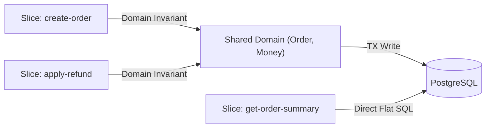
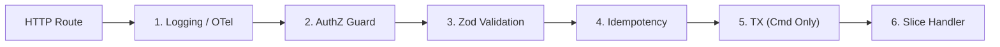

---
tags:
  - software-engineering
  - architectural-patterns
  - vertical-slice-architecture
  - cqrs
  - mediatr
  - typescript
created: 2026-11-13
updated: 2026-11-13
status: 🟢
level: mid-to-senior
---
# Vertical Slice Architecture

> [!abstract] Vault Navigation
> Part of [[Programming/Software Engineering/Architectural Patterns/Architectural Patterns Complete Guide|Architectural Patterns Complete Guide]]. Offers a feature-cohesive alternative to horizontal ceremony in [[Programming/Software Engineering/Clean Architecture/Clean Architecture Complete Guide|Clean Architecture Complete Guide]] and [[Programming/Software Engineering/Architectural Patterns/Layered & Onion Architecture|Layered & Onion Architecture]]. Pairs directly with [[Programming/Software Engineering/Architectural Patterns/CQRS|CQRS]], [[Programming/Software Engineering/Architectural Patterns/Event-Driven Architecture|Event-Driven Architecture]], and [[Programming/Software Engineering/SOLID/Interface Segregation Principle|Interface Segregation Principle]].

Coined by Jimmy Bogard, **Vertical Slice Architecture (VSA)** partitions a codebase around **individual business capabilities and request/response paths (features)** rather than horizontal technical roles (`controllers/`, `services/`, `repositories/`, `mappers/`). The primary structural objective is minimizing coupling *between* independent features while maximizing cohesion *along each feature's axis of change*.

---

## 1. First-Principles Mechanics & Complete Architecture

### 1.1 Axis of Change Cohesion vs Horizontal Shotgun Surgery

In horizontal architectures (N-Tier or rigid Clean Architecture), adding a single optional checkout parameter such as `taxExemptionCertId` triggers **Shotgun Surgery** across 6–8 disconnected directories:

`HttpRequestDto` $\rightarrow$ `CreateOrderController` $\rightarrow$ `CreateOrderCommand` $\rightarrow$ `CreateOrderHandler` $\rightarrow$ `OrderService` $\rightarrow$ `IOrderRepository` $\rightarrow$ `OrderOrmMapper` $\rightarrow$ `OrderViewModel`.

Because horizontal architectures force every feature through shared `OrderService` and `IOrderRepository` abstractions, unrelated capabilities become coupled across interface signatures. Adding a filtering query to `IOrderRepository` for an `Analytics` dashboard forces updating mock stubs across 25 unrelated unit test files in `Checkout` and `Refunds`.

Vertical Slice Architecture flips the axis of modularization **90 degrees**:



Every feature request (`create-order`, `get-order-summary`, `apply-refund`, `cancel-order`) owns a self-contained vertical column from HTTP/queue boundary down to SQL execution.

### 1.2 Anatomy of a Slice & the Per-Endpoint Implementation Spectrum

Rather than forcing every endpoint through identical 5-file ceremony, Vertical Slice Architecture grants **per-slice architectural autonomy**:

| Slice Profile | Optimal Implementation Style | Hydration & Transaction Cost |
|---|---|---|
| **Read Query Endpoint** (`get-order-summary`, `search-catalog`) | Direct parameterized SQL / Drizzle / Dapper query projecting straight into flat JSON response DTO | Zero domain aggregate allocation, **zero `BEGIN/COMMIT` transaction** |
| **Simple CRUD / Reference Mutation** (`update-shipping-note`) | Co-located Zod schema + concise Transaction Script (`UPDATE ... RETURNING`) inside 1 file | Minimal boilerplate (~60 LOC total) |
| **Complex State Machine / Multi-Invariant Command** (`create-order`, `apply-refund`) | Zod validator + Pipeline TX + calls shared Rich Domain Aggregate (`Order.create()`, `order.applyRefund()`) | Full invariant protection + outbox event atomicity |

Inside one slice folder (`src/features/orders/create-order/`), all components that change together reside side-by-side:
1. **Input Contract & Zod Validator**: Parses and validates external transport fields strictly for this endpoint.
2. **Typed Request Marker (`ICommand<T>` vs `IQuery<T>`)**: Tells the central request pipeline whether to wrap execution in a database transaction.
3. **Slice Handler**: Orchestrates validation, loads domain state or executes raw SQL, commits changes, and emits outbox events.
4. **Transport Binding (Fastify / NestJS Route)**: Binds URL, auth metadata, and domain-error-to-HTTP-status mapping.
5. **Co-Located Tests**: Unit and slice integration tests sitting right next to the slice handler.

### 1.3 Cross-Cutting Concerns via Pipeline Behaviors (Mediator Pattern)

Eliminating horizontal service layers must NOT mean copy-pasting authentication, structured logging, Zod validation, idempotency locks, and `BEGIN/COMMIT` transaction handling into 80 vertical slice handlers. VSA centralizes technical cross-cutting boilerplate using a **Request Dispatch Pipeline (Mediator + Pipeline Behaviors)**—popularized by `MediatR` in .NET and implemented natively in TypeScript via typed middleware chains or Fastify hooks.



**Ordering Invariant (Outer $\rightarrow$ Inner)**:
1. **Logging / OpenTelemetry Tracing (`Outer`)**: Captures total request duration, `correlationId`, slice name, and unhandled exceptions.
2. **Authentication & Tenant Authorization**: Rejects `401/403` before validating payloads or acquiring connections.
3. **Input Validation (`Zod`)**: Fails malformed inputs (`400`/`422`) in sub-millisecond memory **before touching PostgreSQL**.
4. **Transaction Scope (`Inner`, Conditional on `kind === 'command'`)**: Checks out a `pg.PoolClient` and executes `BEGIN` exclusively for mutating Commands—bypassing transaction overhead entirely for read-only Queries.
5. **Idempotency Guard (`Inside TX`)**: Inserts/locks `(tenant_id, endpoint_key, idempotency_key)` on the active transaction connection so duplicate client retries commit or replay atomically alongside business writes.

### 1.4 Cross-Slice Isolation Rules & Hybrid VSA + DDD

The fastest way to ruin Vertical Slice Architecture is **copy-pasting domain business rules** across slices—or letting `create-order` directly import internal helper functions from `apply-refund`. Follow three strict governance rules:

1. **Zero Slice-to-Slice Imports**: `features/orders/create-order/**` must NEVER import anything from `features/orders/apply-refund/**` or `features/billing/**`. Deleting a feature folder must compile cleanly without breaking sibling slices.
2. **Hybrid VSA + Shared Domain Core for Convergent Invariants**: Whenever multiple slices enforce the **same business invariant** (e.g., `Order` refundable balance limits, `Money` minor-unit rounding, `OrderStatus` state machine), push that rule **down into a shared `shared/domain/` Aggregate or Value Object**. Vertical Slices replace horizontal *application/repository service layers*, never cohesive Domain Entities!
3. **Cross-Slice Communication via Committed State or Domain Events**: Sibling slices coordinate either by querying committed SQL tables directly or asynchronously via transactional **Outbox Domain Events** ([[Programming/Software Engineering/Architectural Patterns/Event-Driven Architecture|Event-Driven Architecture]]).

---

## 2. Real-World Use Cases & Decision Matrix

### 2.1 Vertical Slice vs Horizontal & Hexagonal Topologies

| Architectural Dimension | Vertical Slice Architecture | Traditional N-Tier Layered | Onion / Clean Architecture | Hexagonal (Ports & Adapters) |
|---|---|---|---|---|
| **Folder Structure** | By feature/endpoint (`features/orders/create-order/`) | By technical role (`controllers/`, `services/`, `dal/`) | Concentric rings (`domain/`, `application/`, `infra/`) | Core + Primary/Secondary Ports + Adapters |
| **Change Blast Radius** | **1 folder per endpoint PR** (zero accidental ripple) | Multi-folder edits across shared Service & Repo | Moderate–High (DTO, Command, Handler, Port, Repo, Mapper) | Moderate (Port + Core + Adapter mapping) |
| **Read Query Performance** | **Optimal** (flat SQL projection directly per Query slice) | Often pulls eager ORM graphs through generic Repo methods | High mapper overhead unless CQRS read bypass added | Requires explicit Query Port bypass |
| **Handling Multi-Protocol Triggers** | Extra adapter wiring if REST + gRPC + Kafka share identical orchestration | Moderate | Strong | **Strongest** (explicit Driving Port parity) |
| **Primary Structural Risk** | Duplicating domain invariants if team skips pushing shared rules to `domain/` | Anemic Domain Model + God Service + Leaky ORM | Architecture Sinkhole on trivial CRUD endpoints | Port explosion (1:1 mirroring of DB queries) |

### 2.2 When to Adopt vs When Not to Use VSA

| Engineering Context | Verdict | Rationale & Trade-Off |
|---|---|---|
| **Fast-Moving SaaS / B2B Product Backend (Mixed Reads + Complex Writes)** | **Adopt Vertical Slice + Shared Domain Core** | 70% of endpoints stay lean ~100-line slices while complex financial/order slices still share rock-solid DDD Aggregates |
| **Monolith Suffering Bloated `IOrderRepository` (25+ Query Methods)** | **Adopt Vertical Slice** | Eliminates god-repositories immediately; each reporting/list endpoint owns its exact tuned SQL query |
| **Multi-Protocol Headless Engine (Identical Workflows via REST + gRPC + CLI + Kafka)** | **Prefer Hexagonal or Thin Driving Port Wrapping Shared Slice** | If 4 transport adapters invoke identical workflows, maintain explicit Driving Ports so protocol routing never duplicates command invocation |
| **Team Copy-Pasting Identical Pricing/Tax Rules into 5 Endpoint Files** | **Stop & Refactor to Hybrid VSA + Domain Core** | Extract `Order` / `PricingPolicy` into `shared/domain/`; VSA isolates request handlers, not core business math |

---

## 3. Step-by-Step Practical Application: Multi-Slice Order Feature Module

This section builds a complete runnable **Multi-Slice Order Feature Module** using TypeScript, Fastify, Zod, and `pg` (PostgreSQL). Notice the deliberate hybrid architecture:
- **Shared Domain Core (`shared/domain/`)**: Protects convergent `Money` arithmetic and `Order` state-machine / refund-cap invariants.
- **Pipeline Mediator (`shared/pipeline/`)**: Handles logging, Zod validation, conditional transaction management, and idempotency automatically.
- **3 Cohesive Vertical Slices (`features/orders/`)**: `create-order` (transactional write using Domain Aggregate), `get-order-summary` (zero-hydration flat SQL CQRS read), and `apply-refund` (row-locked transactional write using Domain Aggregate).

### 3.1 Project Directory Layout

```text
src/
  shared/
    domain/
      domain-errors.ts
      money.vo.ts
      order.aggregate.ts
    pipeline/
      mediator.ts
      behaviors.ts
  features/
    orders/
      create-order/
        create-order.slice.ts
        create-order.spec.ts
      get-order-summary/
        get-order-summary.slice.ts
        get-order-summary.spec.ts
      apply-refund/
        apply-refund.slice.ts
        apply-refund.spec.ts
      orders.routes.ts
  app.ts
```

### 3.2 Shared Domain Core (Convergent Invariants Only)

```typescript
// src/shared/domain/domain-errors.ts
export abstract class DomainError extends Error {
  abstract readonly code: string;
  abstract readonly httpStatus: number;

  protected constructor(message: string) {
    super(message);
    this.name = new.target.name;
  }
}

export class ValidationDomainError extends DomainError {
  readonly code = 'VALIDATION_FAILED';
  readonly httpStatus = 400;
  constructor(
    message: string,
    readonly details: unknown,
  ) {
    super(message);
  }
}

export class OrderNotFoundError extends DomainError {
  readonly code = 'ORDER_NOT_FOUND';
  readonly httpStatus = 404;
  constructor(readonly orderId: string) {
    super(`Order ${orderId} not found`);
  }
}

export class InvalidOrderTransitionError extends DomainError {
  readonly code = 'INVALID_ORDER_TRANSITION';
  readonly httpStatus = 409;
  constructor(message: string) {
    super(message);
  }
}

export class RefundLimitExceededError extends DomainError {
  readonly code = 'REFUND_LIMIT_EXCEEDED';
  readonly httpStatus = 422;
  constructor(requestedCents: number, remainingCents: number) {
    super(
      `Requested refund (${requestedCents}c) exceeds remaining refundable balance (${remainingCents}c)`,
    );
  }
}

export class DuplicateIdempotencyConflictError extends DomainError {
  readonly code = 'IDEMPOTENCY_KEY_REUSED_WITH_DIFFERENT_PAYLOAD';
  readonly httpStatus = 409;
  constructor(key: string) {
    super(`Idempotency key ${key} already committed with a different request payload`);
  }
}
```

```typescript
// src/shared/domain/money.vo.ts
export type Currency = 'USD' | 'EUR';

export class Money {
  private constructor(
    readonly cents: number,
    readonly currency: Currency,
  ) {
    Object.freeze(this);
  }

  static of(cents: number, currency: Currency): Money {
    if (!Number.isInteger(cents) || cents < 0) {
      throw new Error(`Money cents must be a non-negative integer, received ${cents}`);
    }
    return new Money(cents, currency);
  }

  add(other: Money): Money {
    this.assertSameCurrency(other);
    return Money.of(this.cents + other.cents, this.currency);
  }

  subtract(other: Money): Money {
    this.assertSameCurrency(other);
    if (other.cents > this.cents) {
      throw new Error(`Cannot subtract ${other.cents} from ${this.cents}`);
    }
    return Money.of(this.cents - other.cents, this.currency);
  }

  multiply(quantity: number): Money {
    if (!Number.isInteger(quantity) || quantity <= 0) {
      throw new Error(`Quantity must be a positive integer, got ${quantity}`);
    }
    return Money.of(this.cents * quantity, this.currency);
  }

  private assertSameCurrency(other: Money): void {
    if (this.currency !== other.currency) {
      throw new Error(`Currency mismatch: ${this.currency} vs ${other.currency}`);
    }
  }
}
```

```typescript
// src/shared/domain/order.aggregate.ts
import {
  InvalidOrderTransitionError,
  RefundLimitExceededError,
} from './domain-errors';
import { Currency, Money } from './money.vo';

export type OrderStatus = 'PAID' | 'PARTIALLY_REFUNDED' | 'REFUNDED' | 'CANCELED';

export interface OrderLineInput {
  sku: string;
  quantity: number;
  unitPriceCents: number;
}

export interface OrderLineSnapshot {
  sku: string;
  quantity: number;
  unitPriceCents: number;
  lineTotalCents: number;
}

export interface OrderSnapshot {
  id: string;
  tenantId: string;
  customerId: string;
  currency: Currency;
  status: OrderStatus;
  totalCents: number;
  refundedCents: number;
  version: number;
  lines: OrderLineSnapshot[];
}

export class Order {
  private constructor(
    readonly id: string,
    readonly tenantId: string,
    readonly customerId: string,
    readonly currency: Currency,
    private currentStatus: OrderStatus,
    readonly total: Money,
    private refunded: Money,
    readonly version: number,
    readonly lines: ReadonlyArray<OrderLineSnapshot>,
  ) {}

  static createPaid(params: {
    id: string;
    tenantId: string;
    customerId: string;
    currency: Currency;
    items: OrderLineInput[];
  }): Order {
    if (params.items.length === 0) {
      throw new InvalidOrderTransitionError('Order must contain at least one line item');
    }

    let runningTotal = Money.of(0, params.currency);
    const computedLines: OrderLineSnapshot[] = params.items.map((item) => {
      const unit = Money.of(item.unitPriceCents, params.currency);
      const lineTotal = unit.multiply(item.quantity);
      runningTotal = runningTotal.add(lineTotal);
      return {
        sku: item.sku,
        quantity: item.quantity,
        unitPriceCents: item.unitPriceCents,
        lineTotalCents: lineTotal.cents,
      };
    });

    if (runningTotal.cents === 0) {
      throw new InvalidOrderTransitionError('Paid order total must exceed zero');
    }

    return new Order(
      params.id,
      params.tenantId,
      params.customerId,
      params.currency,
      'PAID',
      runningTotal,
      Money.of(0, params.currency),
      1,
      computedLines,
    );
  }

  static rehydrate(snap: OrderSnapshot): Order {
    return new Order(
      snap.id,
      snap.tenantId,
      snap.customerId,
      snap.currency,
      snap.status,
      Money.of(snap.totalCents, snap.currency),
      Money.of(snap.refundedCents, snap.currency),
      snap.version,
      snap.lines,
    );
  }

  get status(): OrderStatus {
    return this.currentStatus;
  }

  remainingRefundable(): Money {
    return this.total.subtract(this.refunded);
  }

  applyRefund(requestedAmount: Money): void {
    if (this.currentStatus === 'CANCELED' || this.currentStatus === 'REFUNDED') {
      throw new InvalidOrderTransitionError(
        `Order ${this.id} cannot be refunded in status ${this.currentStatus}`,
      );
    }

    const remaining = this.remainingRefundable();
    if (requestedAmount.cents <= 0) {
      throw new InvalidOrderTransitionError('Refund amount must be positive');
    }
    if (requestedAmount.cents > remaining.cents) {
      throw new RefundLimitExceededError(requestedAmount.cents, remaining.cents);
    }

    this.refunded = this.refunded.add(requestedAmount);
    this.currentStatus =
      this.refunded.cents === this.total.cents ? 'REFUNDED' : 'PARTIALLY_REFUNDED';
  }

  toSnapshot(): OrderSnapshot {
    return {
      id: this.id,
      tenantId: this.tenantId,
      customerId: this.customerId,
      currency: this.currency,
      status: this.currentStatus,
      totalCents: this.total.cents,
      refundedCents: this.refunded.cents,
      version: this.version,
      lines: this.lines.map((l) => ({ ...l })),
    };
  }
}
```

### 3.3 Typed Mediator & Request Pipeline Behaviors

Notice how `TransactionBehavior` inspects `request.kind === 'command'` so Query slices never check out a transaction or execute `BEGIN/COMMIT`. Meanwhile, `ValidationBehavior` runs **outside** `TransactionBehavior` so invalid payloads reject in memory without consuming a Postgres pool connection.

```typescript
// src/shared/pipeline/mediator.ts
import { PoolClient } from 'pg';
import { ZodType } from 'zod';

export interface RequestMetadata {
  readonly kind: 'command' | 'query';
  readonly sliceName: string;
  readonly schema: ZodType<unknown>;
  readonly idempotencyKey?: string;
}

export interface SliceRequest<TResponse> {
  readonly meta: RequestMetadata;
  readonly tenantId: string;
  readonly correlationId: string;
  readonly _responseType?: TResponse;
}

export interface ExecutionContext {
  dbClient?: PoolClient;
}

export type NextHandler<TResponse> = () => Promise<TResponse>;

export interface PipelineBehavior {
  handle<TReq extends SliceRequest<TRes>, TRes>(
    request: TReq,
    context: ExecutionContext,
    next: NextHandler<TRes>,
  ): Promise<TRes>;
}

export interface SliceHandler<TReq extends SliceRequest<TRes>, TRes> {
  execute(request: TReq, context: ExecutionContext): Promise<TRes>;
}

export class SliceMediator {
  private readonly handlers = new Map<string, SliceHandler<SliceRequest<unknown>, unknown>>();

  constructor(private readonly behaviors: PipelineBehavior[]) {}

  register<TReq extends SliceRequest<TRes>, TRes>(
    sliceName: string,
    handler: SliceHandler<TReq, TRes>,
  ): void {
    this.handlers.set(sliceName, handler as SliceHandler<SliceRequest<unknown>, unknown>);
  }

  async send<TRes>(request: SliceRequest<TRes>): Promise<TRes> {
    const handler = this.handlers.get(request.meta.sliceName);
    if (!handler) {
      throw new Error(`No slice handler registered for ${request.meta.sliceName}`);
    }

    const context: ExecutionContext = {};
    let dispatch: NextHandler<TRes> = () =>
      handler.execute(request, context) as Promise<TRes>;

    for (let i = this.behaviors.length - 1; i >= 0; i -= 1) {
      const behavior = this.behaviors[i];
      const currentNext = dispatch;
      dispatch = () => behavior.handle(request, context, currentNext);
    }

    return dispatch();
  }
}
```

```typescript
// src/shared/pipeline/behaviors.ts
import { createHash } from 'node:crypto';
import { Pool } from 'pg';
import {
  DuplicateIdempotencyConflictError,
  ValidationDomainError,
} from '../domain/domain-errors';
import {
  ExecutionContext,
  NextHandler,
  PipelineBehavior,
  SliceRequest,
} from './mediator';

export class LoggingBehavior implements PipelineBehavior {
  constructor(
    private readonly logger: Pick<Console, 'info' | 'error'> = console,
  ) {}

  async handle<TReq extends SliceRequest<TRes>, TRes>(
    request: TReq,
    _context: ExecutionContext,
    next: NextHandler<TRes>,
  ): Promise<TRes> {
    const startMs = performance.now();
    try {
      const result = await next();
      const elapsedMs = Number((performance.now() - startMs).toFixed(2));
      this.logger.info(
        JSON.stringify({
          event: 'slice.completed',
          slice: request.meta.sliceName,
          kind: request.meta.kind,
          tenantId: request.tenantId,
          correlationId: request.correlationId,
          elapsedMs,
        }),
      );
      return result;
    } catch (err) {
      const elapsedMs = Number((performance.now() - startMs).toFixed(2));
      this.logger.error(
        JSON.stringify({
          event: 'slice.failed',
          slice: request.meta.sliceName,
          correlationId: request.correlationId,
          elapsedMs,
          error: err instanceof Error ? err.message : String(err),
        }),
      );
      throw err;
    }
  }
}

export class ValidationBehavior implements PipelineBehavior {
  async handle<TReq extends SliceRequest<TRes>, TRes>(
    request: TReq,
    _context: ExecutionContext,
    next: NextHandler<TRes>,
  ): Promise<TRes> {
    const parsed = request.meta.schema.safeParse(request);
    if (!parsed.success) {
      throw new ValidationDomainError(
        `Schema validation failed for slice ${request.meta.sliceName}`,
        parsed.error.flatten(),
      );
    }
    return next();
  }
}

export class TransactionBehavior implements PipelineBehavior {
  constructor(private readonly pool: Pool) {}

  async handle<TReq extends SliceRequest<TRes>, TRes>(
    request: TReq,
    context: ExecutionContext,
    next: NextHandler<TRes>,
  ): Promise<TRes> {
    // Query slices execute lock-free outside database transactions
    if (request.meta.kind === 'query') {
      return next();
    }

    const client = await this.pool.connect();
    context.dbClient = client;
    try {
      await client.query('BEGIN');
      const response = await next();
      await client.query('COMMIT');
      return response;
    } catch (err) {
      await client.query('ROLLBACK');
      throw err;
    } finally {
      context.dbClient = undefined;
      client.release();
    }
  }
}

export class IdempotencyBehavior implements PipelineBehavior {
  async handle<TReq extends SliceRequest<TRes>, TRes>(
    request: TReq,
    context: ExecutionContext,
    next: NextHandler<TRes>,
  ): Promise<TRes> {
    const key = request.meta.idempotencyKey;
    if (request.meta.kind !== 'command' || !key) {
      return next();
    }
    if (!context.dbClient) {
      throw new Error('IdempotencyBehavior must run inside TransactionBehavior');
    }

    const requestHash = createHash('sha256')
      .update(JSON.stringify({ slice: request.meta.sliceName, payload: request }))
      .digest('hex');

    // Serialize concurrent retries for the identical (tenant, slice, key) tuple
    const existing = await context.dbClient.query<{
      request_hash: string;
      response_json: TRes;
    }>(
      `SELECT request_hash, response_json
         FROM idempotency_keys
        WHERE tenant_id = $1 AND slice_name = $2 AND idempotency_key = $3
        FOR UPDATE`,
      [request.tenantId, request.meta.sliceName, key],
    );

    if (existing.rows[0]) {
      if (existing.rows[0].request_hash !== requestHash) {
        throw new DuplicateIdempotencyConflictError(key);
      }
      return existing.rows[0].response_json;
    }

    const response = await next();

    await context.dbClient.query(
      `INSERT INTO idempotency_keys (tenant_id, slice_name, idempotency_key, request_hash, response_json)
       VALUES ($1, $2, $3, $4, $5)`,
      [request.tenantId, request.meta.sliceName, key, requestHash, JSON.stringify(response)],
    );

    return response;
  }
}
```

### 3.4 Slice 1: `create-order` (Transactional Command + Shared Domain Invariant + Outbox)

```typescript
// src/features/orders/create-order/create-order.slice.ts
import { randomUUID } from 'node:crypto';
import { z } from 'zod';
import { Order } from '../../../shared/domain/order.aggregate';
import { Currency } from '../../../shared/domain/money.vo';
import {
  ExecutionContext,
  RequestMetadata,
  SliceHandler,
  SliceRequest,
} from '../../../shared/pipeline/mediator';

export const CreateOrderSchema = z.object({
  tenantId: z.string().uuid(),
  correlationId: z.string().min(1),
  customerId: z.string().uuid(),
  currency: z.enum(['USD', 'EUR']),
  items: z
    .array(
      z.object({
        sku: z.string().min(1).max(64),
        quantity: z.number().int().positive(),
        unitPriceCents: z.number().int().nonnegative(),
      }),
    )
    .min(1),
});

export interface CreateOrderResponse {
  orderId: string;
  status: string;
  totalCents: number;
  currency: Currency;
}

export class CreateOrderCommand implements SliceRequest<CreateOrderResponse> {
  readonly meta: RequestMetadata;

  constructor(
    readonly tenantId: string,
    readonly correlationId: string,
    readonly customerId: string,
    readonly currency: Currency,
    readonly items: Array<{ sku: string; quantity: number; unitPriceCents: number }>,
    idempotencyKey?: string,
  ) {
    this.meta = {
      kind: 'command',
      sliceName: 'orders.createOrder',
      schema: CreateOrderSchema,
      idempotencyKey,
    };
  }
}

export class CreateOrderHandler
  implements SliceHandler<CreateOrderCommand, CreateOrderResponse>
{
  async execute(
    cmd: CreateOrderCommand,
    context: ExecutionContext,
  ): Promise<CreateOrderResponse> {
    const db = context.dbClient;
    if (!db) throw new Error('CreateOrderHandler requires active DB transaction');

    // Invoke shared rich Domain Aggregate to enforce line math & non-zero total invariants
    const order = Order.createPaid({
      id: randomUUID(),
      tenantId: cmd.tenantId,
      customerId: cmd.customerId,
      currency: cmd.currency,
      items: cmd.items,
    });
    const snap = order.toSnapshot();

    await db.query(
      `INSERT INTO orders (id, tenant_id, customer_id, currency, status, total_cents, refunded_cents, version)
       VALUES ($1, $2, $3, $4, $5, $6, $7, $8)`,
      [
        snap.id,
        snap.tenantId,
        snap.customerId,
        snap.currency,
        snap.status,
        snap.totalCents,
        snap.refundedCents,
        snap.version,
      ],
    );

    for (const line of snap.lines) {
      await db.query(
        `INSERT INTO order_lines (id, order_id, sku, quantity, unit_price_cents, line_total_cents)
         VALUES ($1, $2, $3, $4, $5, $6)`,
        [
          randomUUID(),
          snap.id,
          line.sku,
          line.quantity,
          line.unitPriceCents,
          line.lineTotalCents,
        ],
      );
    }

    await db.query(
      `INSERT INTO outbox_events (id, aggregate_type, aggregate_id, event_type, payload)
       VALUES ($1, 'Order', $2, 'OrderPaid', $3)`,
      [
        randomUUID(),
        snap.id,
        JSON.stringify({
          orderId: snap.id,
          tenantId: snap.tenantId,
          totalCents: snap.totalCents,
          currency: snap.currency,
        }),
      ],
    );

    return {
      orderId: snap.id,
      status: snap.status,
      totalCents: snap.totalCents,
      currency: snap.currency,
    };
  }
}
```

### 3.5 Slice 2: `get-order-summary` (Direct Zero-Hydration CQRS Read Slice)

Notice how this Query slice injects `Pool` directly, sets `kind: 'query'` so `TransactionBehavior` skips creating a database transaction, and projects a multi-table SQL join straight into a flat JSON DTO with **zero Domain Aggregate or ORM mapper overhead**.

```typescript
// src/features/orders/get-order-summary/get-order-summary.slice.ts
import { Pool } from 'pg';
import { z } from 'zod';
import { OrderNotFoundError } from '../../../shared/domain/domain-errors';
import {
  ExecutionContext,
  RequestMetadata,
  SliceHandler,
  SliceRequest,
} from '../../../shared/pipeline/mediator';

export const GetOrderSummarySchema = z.object({
  tenantId: z.string().uuid(),
  correlationId: z.string().min(1),
  orderId: z.string().uuid(),
});

export interface OrderSummaryResponse {
  orderId: string;
  customerId: string;
  status: string;
  currency: string;
  totalCents: number;
  refundedCents: number;
  remainingRefundableCents: number;
  itemCount: number;
  refundCount: number;
  lines: Array<{
    sku: string;
    quantity: number;
    unitPriceCents: number;
    lineTotalCents: number;
  }>;
}

export class GetOrderSummaryQuery implements SliceRequest<OrderSummaryResponse> {
  readonly meta: RequestMetadata = {
    kind: 'query',
    sliceName: 'orders.getOrderSummary',
    schema: GetOrderSummarySchema,
  };

  constructor(
    readonly tenantId: string,
    readonly correlationId: string,
    readonly orderId: string,
  ) {}
}

export class GetOrderSummaryHandler
  implements SliceHandler<GetOrderSummaryQuery, OrderSummaryResponse>
{
  constructor(private readonly pool: Pool) {}

  async execute(
    query: GetOrderSummaryQuery,
    _context: ExecutionContext,
  ): Promise<OrderSummaryResponse> {
    const { rows } = await this.pool.query<{
      id: string;
      customer_id: string;
      status: string;
      currency: string;
      total_cents: number;
      refunded_cents: number;
      refund_count: string;
      lines_json: OrderSummaryResponse['lines'];
    }>(
      `SELECT o.id,
              o.customer_id,
              o.status,
              o.currency,
              o.total_cents,
              o.refunded_cents,
              COALESCE(r.cnt, 0) AS refund_count,
              COALESCE(
                (SELECT json_agg(json_build_object(
                   'sku', ol.sku,
                   'quantity', ol.quantity,
                   'unitPriceCents', ol.unit_price_cents,
                   'lineTotalCents', ol.line_total_cents
                 ) ORDER BY ol.sku ASC)
                 FROM order_lines ol
                 WHERE ol.order_id = o.id),
                '[]'::json
              ) AS lines_json
         FROM orders o
         LEFT JOIN (
           SELECT order_id, COUNT(*)::text AS cnt
             FROM order_refunds
            GROUP BY order_id
         ) r ON r.order_id = o.id
        WHERE o.id = $1
          AND o.tenant_id = $2`,
      [query.orderId, query.tenantId],
    );

    const row = rows[0];
    if (!row) {
      throw new OrderNotFoundError(query.orderId);
    }

    const total = Number(row.total_cents);
    const refunded = Number(row.refunded_cents);

    return {
      orderId: row.id,
      customerId: row.customer_id,
      status: row.status,
      currency: row.currency,
      totalCents: total,
      refundedCents: refunded,
      remainingRefundableCents: total - refunded,
      itemCount: row.lines_json.length,
      refundCount: Number(row.refund_count),
      lines: row.lines_json,
    };
  }
}
```

### 3.6 Slice 3: `apply-refund` (Row-Locked Command Slice Reusing `Order` Aggregate)

```typescript
// src/features/orders/apply-refund/apply-refund.slice.ts
import { randomUUID } from 'node:crypto';
import { z } from 'zod';
import { OrderNotFoundError } from '../../../shared/domain/domain-errors';
import { Currency, Money } from '../../../shared/domain/money.vo';
import { Order, OrderStatus } from '../../../shared/domain/order.aggregate';
import {
  ExecutionContext,
  RequestMetadata,
  SliceHandler,
  SliceRequest,
} from '../../../shared/pipeline/mediator';

export const ApplyRefundSchema = z.object({
  tenantId: z.string().uuid(),
  correlationId: z.string().min(1),
  orderId: z.string().uuid(),
  amountCents: z.number().int().positive(),
  reason: z.string().trim().min(3).max(200),
});

export interface ApplyRefundResponse {
  refundId: string;
  orderId: string;
  status: OrderStatus;
  refundedCents: number;
  remainingRefundableCents: number;
}

export class ApplyRefundCommand implements SliceRequest<ApplyRefundResponse> {
  readonly meta: RequestMetadata;

  constructor(
    readonly tenantId: string,
    readonly correlationId: string,
    readonly orderId: string,
    readonly amountCents: number,
    readonly reason: string,
    idempotencyKey?: string,
  ) {
    this.meta = {
      kind: 'command',
      sliceName: 'orders.applyRefund',
      schema: ApplyRefundSchema,
      idempotencyKey,
    };
  }
}

export class ApplyRefundHandler
  implements SliceHandler<ApplyRefundCommand, ApplyRefundResponse>
{
  async execute(
    cmd: ApplyRefundCommand,
    context: ExecutionContext,
  ): Promise<ApplyRefundResponse> {
    const db = context.dbClient;
    if (!db) throw new Error('ApplyRefundHandler requires active DB transaction');

    // Row-level pessimistic lock prevents concurrent partial refunds from over-refunding total
    const { rows } = await db.query<{
      id: string;
      tenant_id: string;
      customer_id: string;
      currency: Currency;
      status: OrderStatus;
      total_cents: number;
      refunded_cents: number;
      version: number;
    }>(
      `SELECT id, tenant_id, customer_id, currency, status, total_cents, refunded_cents, version
         FROM orders
        WHERE id = $1
          AND tenant_id = $2
        FOR UPDATE`,
      [cmd.orderId, cmd.tenantId],
    );

    const row = rows[0];
    if (!row) {
      throw new OrderNotFoundError(cmd.orderId);
    }

    const order = Order.rehydrate({
      id: row.id,
      tenantId: row.tenant_id,
      customerId: row.customer_id,
      currency: row.currency,
      status: row.status,
      totalCents: Number(row.total_cents),
      refundedCents: Number(row.refunded_cents),
      version: Number(row.version),
      lines: [],
    });

    // Enforce shared domain refund cap & status machine invariant
    order.applyRefund(Money.of(cmd.amountCents, order.currency));
    const snap = order.toSnapshot();
    const refundId = randomUUID();

    await db.query(
      `UPDATE orders
          SET status = $1,
              refunded_cents = $2,
              version = version + 1
        WHERE id = $3`,
      [snap.status, snap.refundedCents, snap.id],
    );

    await db.query(
      `INSERT INTO order_refunds (id, order_id, tenant_id, amount_cents, reason)
       VALUES ($1, $2, $3, $4, $5)`,
      [refundId, snap.id, snap.tenantId, cmd.amountCents, cmd.reason],
    );

    await db.query(
      `INSERT INTO outbox_events (id, aggregate_type, aggregate_id, event_type, payload)
       VALUES ($1, 'Order', $2, 'OrderRefundApplied', $3)`,
      [
        randomUUID(),
        snap.id,
        JSON.stringify({
          refundId,
          orderId: snap.id,
          amountCents: cmd.amountCents,
          newStatus: snap.status,
        }),
      ],
    );

    return {
      refundId,
      orderId: snap.id,
      status: snap.status,
      refundedCents: snap.refundedCents,
      remainingRefundableCents: order.remainingRefundable().cents,
    };
  }
}
```

### 3.7 Fastify Route Registration & Application Assembly

```typescript
// src/features/orders/orders.routes.ts
import { FastifyInstance } from 'fastify';
import { DomainError, ValidationDomainError } from '../../shared/domain/domain-errors';
import { SliceMediator } from '../../shared/pipeline/mediator';
import { ApplyRefundCommand } from './apply-refund/apply-refund.slice';
import { CreateOrderCommand } from './create-order/create-order.slice';
import { GetOrderSummaryQuery } from './get-order-summary/get-order-summary.slice';

export function registerOrderSlices(app: FastifyInstance, mediator: SliceMediator): void {
  app.setErrorHandler((error, _req, reply) => {
    if (error instanceof ValidationDomainError) {
      return reply.status(400).send({ code: error.code, message: error.message, details: error.details });
    }
    if (error instanceof DomainError) {
      return reply.status(error.httpStatus).send({ code: error.code, message: error.message });
    }
    throw error;
  });

  app.post('/v1/orders', async (req, reply) => {
    const body = req.body as {
      customerId: string;
      currency: 'USD' | 'EUR';
      items: Array<{ sku: string; quantity: number; unitPriceCents: number }>;
    };
    const tenantId = String(req.headers['x-tenant-id'] ?? '');
    const correlationId = String(req.headers['x-correlation-id'] ?? req.id);
    const idempotencyKey = req.headers['idempotency-key']
      ? String(req.headers['idempotency-key'])
      : undefined;

    const result = await mediator.send(
      new CreateOrderCommand(
        tenantId,
        correlationId,
        body.customerId,
        body.currency,
        body.items,
        idempotencyKey,
      ),
    );
    return reply.status(201).send(result);
  });

  app.get('/v1/orders/:id/summary', async (req, reply) => {
    const params = req.params as { id: string };
    const tenantId = String(req.headers['x-tenant-id'] ?? '');
    const correlationId = String(req.headers['x-correlation-id'] ?? req.id);

    const summary = await mediator.send(
      new GetOrderSummaryQuery(tenantId, correlationId, params.id),
    );
    return reply.status(200).send(summary);
  });

  app.post('/v1/orders/:id/refunds', async (req, reply) => {
    const params = req.params as { id: string };
    const body = req.body as { amountCents: number; reason: string };
    const tenantId = String(req.headers['x-tenant-id'] ?? '');
    const correlationId = String(req.headers['x-correlation-id'] ?? req.id);
    const idempotencyKey = req.headers['idempotency-key']
      ? String(req.headers['idempotency-key'])
      : undefined;

    const refund = await mediator.send(
      new ApplyRefundCommand(
        tenantId,
        correlationId,
        params.id,
        body.amountCents,
        body.reason,
        idempotencyKey,
      ),
    );
    return reply.status(200).send(refund);
  });
}
```

```typescript
// src/app.ts
import Fastify from 'fastify';
import { Pool } from 'pg';
import { registerOrderSlices } from './features/orders/orders.routes';
import { ApplyRefundHandler } from './features/orders/apply-refund/apply-refund.slice';
import { CreateOrderHandler } from './features/orders/create-order/create-order.slice';
import { GetOrderSummaryHandler } from './features/orders/get-order-summary/get-order-summary.slice';
import {
  IdempotencyBehavior,
  LoggingBehavior,
  TransactionBehavior,
  ValidationBehavior,
} from './shared/pipeline/behaviors';
import { SliceMediator } from './shared/pipeline/mediator';

export function buildOrderApp(pool: Pool) {
  const app = Fastify();

  // Order matters: Logging -> Validation -> Transaction -> Idempotency -> Handler
  const mediator = new SliceMediator([
    new LoggingBehavior(),
    new ValidationBehavior(),
    new TransactionBehavior(pool),
    new IdempotencyBehavior(),
  ]);

  mediator.register('orders.createOrder', new CreateOrderHandler());
  mediator.register('orders.getOrderSummary', new GetOrderSummaryHandler(pool));
  mediator.register('orders.applyRefund', new ApplyRefundHandler());

  registerOrderSlices(app, mediator);
  return app;
}
```

### 3.8 Co-Located Slice & Pipeline Tests

```typescript
// src/features/orders/apply-refund/apply-refund.spec.ts
import { describe, expect, it, vi } from 'vitest';
import { Pool } from 'pg';
import { buildOrderApp } from '../../../app';
import { RefundLimitExceededError } from '../../../shared/domain/domain-errors';
import { Money } from '../../../shared/domain/money.vo';
import { Order } from '../../../shared/domain/order.aggregate';

describe('Vertical Slice: apply-refund & Pipeline Guards', () => {
  it('enforces remaining refundable invariant inside Order Aggregate', () => {
    const order = Order.createPaid({
      id: '11111111-1111-4111-8111-111111111111',
      tenantId: '22222222-2222-4222-8222-222222222222',
      customerId: '33333333-3333-4333-8333-333333333333',
      currency: 'USD',
      items: [{ sku: 'PRO_SEAT', quantity: 2, unitPriceCents: 2500 }],
    });

    order.applyRefund(Money.of(3000, 'USD'));
    expect(order.status).toBe('PARTIALLY_REFUNDED');
    expect(order.remainingRefundable().cents).toBe(2000);

    expect(() => order.applyRefund(Money.of(2001, 'USD'))).toThrow(
      RefundLimitExceededError,
    );
  });

  it('rejects invalid Zod payload before acquiring any Postgres pool connection', async () => {
    const connectSpy = vi.fn();
    const fakePool = { connect: connectSpy, query: vi.fn() } as unknown as Pool;
    const app = buildOrderApp(fakePool);

    const res = await app.inject({
      method: 'POST',
      url: '/v1/orders/not-a-uuid/refunds',
      headers: { 'x-tenant-id': '22222222-2222-4222-8222-222222222222' },
      payload: { amountCents: -50, reason: 'x' },
    });

    expect(res.statusCode).toBe(400);
    expect(connectSpy).not.toHaveBeenCalled();
  });
});
```

---

## 4. Complete Construct Reference & Cross-Slice Governance

### 4.1 Single-File vs Multi-File Slice Structure

| Slice Complexity | Recommended File Topology | Rationale |
|---|---|---|
| **Simple Query or CRUD (`<150 LOC`)** | Single `get-order-summary.slice.ts` + `get-order-summary.spec.ts` | Entire request schema, SQL query, handler, and response types fit cleanly on one screen with zero cross-file jumping |
| **Complex Transactional Slice (`>250 LOC`)** | Split inside slice folder: `slice.schema.ts`, `slice.handler.ts`, `slice.sql.ts`, `slice.spec.ts` | Keeps internal complexity organized while still guaranteeing deleting 1 folder removes the feature completely |

### 4.2 Enforcing Cross-Slice Isolation Mechanically (`dependency-cruiser`)

Without static rules, convenience imports leak between sibling slices (`create-order` importing helper types from `apply-refund`), destroying slice independence. Enforce **zero sibling slice imports** via `dependency-cruiser`:

```javascript
// .dependency-cruiser.cjs
module.exports = {
  forbidden: [
    {
      name: 'no-cross-slice-imports-inside-orders',
      severity: 'error',
      from: { path: '^src/features/orders/([^/]+)/' },
      to: {
        path: '^src/features/orders/([^/]+)/',
        pathNot: '^src/features/orders/$1/',
      },
    },
    {
      name: 'shared-domain-must-not-import-slices-or-infra',
      severity: 'error',
      from: { path: '^src/shared/domain/' },
      to: { path: '^src/(features|shared/pipeline)/|node_modules/(pg|fastify|zod)' },
    },
    {
      name: 'slices-must-not-import-other-feature-modules',
      severity: 'error',
      from: { path: '^src/features/([^/]+)/' },
      to: {
        path: '^src/features/([^/]+)/',
        pathNot: '^src/features/$1/',
      },
    },
  ],
};
```

### 4.3 Sharing Code Safely: The Rule of Three & Subtle Failure Modes

1. **Duplicate Transport DTOs Freely; Share Only Domain Invariants**: Two endpoints (`create-order` and `get-order-summary`) may return overlapping JSON fields (`totalCents`, `status`), yet should keep **separate Request/Response DTOs**. Coupling two endpoints to one shared `OrderResponseDto` forces breaking API fields simultaneously across features. Conversely, business calculations (`Order.applyRefund`, `Money.multiply`) converge in `shared/domain/` immediately once reused.
2. **Idempotency Key Scoping Across Endpoints**: Always key idempotency records by `(tenant_id, slice_name, idempotency_key)` rather than `idempotency_key` alone. Otherwise, a client reusing `idem_123` on `create-order` and later on `apply-refund` collides across slices.
3. **Tenant Isolation in Raw SQL Query Slices**: Because Query slices bypass ORM global filters/interceptors and issue direct SQL against `Pool`, missing `AND tenant_id = $2` creates severe cross-tenant data leakage (IDOR). Enforce tenant scoping via mandatory `SliceRequest.tenantId` + CI SQL static assertions or PostgreSQL **Row-Level Security (`RLS`)**.
4. **Never Cache Error Responses in `IdempotencyBehavior`**: Only persist `response_json` in `idempotency_keys` *after* `await next()` succeeds inside the database transaction. On thrown validation or transient DB failures, PostgreSQL rolls back both the business mutation and the idempotency record automatically so clients can safely retry.

---

## 5. Production Debugging, Profiling & Operations Playbook

| Symptom | Root Cause | Diagnostic Commands & Telemetry | Remediation |
|---|---|---|---|
| **Bot invalid-JSON spike (`400`) exhausts PostgreSQL connection pool** | `TransactionBehavior` placed *before* `ValidationBehavior` or `AuthZBehavior` in `SliceMediator` | Check `SELECT count(*), state FROM pg_stat_activity GROUP BY 1,2;` during 400 flood + verify behavior array order in `src/app.ts` | Move `ValidationBehavior` and AuthZ **outer** to `TransactionBehavior`; verify `connectSpy.not.toHaveBeenCalled()` in unit test |
| **Query slice `GET /v1/orders/:id/summary` degrades to 850ms at 5M rows** | Missing composite index on child tables joined by flat SQL projection (`order_refunds.order_id`, `order_lines.order_id`) | Run `EXPLAIN (ANALYZE, BUFFERS) SELECT ...` in `psql`; inspect `Seq Scan on order_refunds` | Add `CREATE INDEX CONCURRENTLY idx_order_refunds_order_id ON order_refunds(order_id);` and `(tenant_id, id)` covering index |
| **Concurrent double `POST /refunds` leaves `refunded_cents > total_cents`** | `apply-refund` read `orders` without `FOR UPDATE` row lock or `version` predicate | Reproduce via two concurrent `Promise.all` Fastify injections; inspect `SELECT total_cents, refunded_cents FROM orders` | Add `FOR UPDATE` on `SELECT ... FROM orders WHERE id = $1 AND tenant_id = $2` inside `TransactionBehavior` |
| **Changing `apply-refund` breaks TypeScript build in `create-order` tests** | Developer accidentally imported an internal helper/type from `apply-refund` into `create-order` | Run `npx depcruise src --config .dependency-cruiser.cjs` | Delete cross-slice import; move genuine invariant into `src/shared/domain/` or duplicate local helper |
| **`idempotency_keys` table grows unbounded (50M+ rows) causing index bloat** | No TTL pruning job on committed idempotency entries | Run `SELECT pg_size_pretty(pg_total_relation_size('idempotency_keys'));` | Add `created_at` partition or nightly `DELETE FROM idempotency_keys WHERE created_at < NOW() - INTERVAL '7 days'` |

---

## 6. Worked Exercises

### Exercise 1: Eliminating Shotgun Surgery & God-Repository Bloat

A Clean Architecture TypeScript service has an `IOrderRepository` interface containing 19 query methods (`findPaidOrdersForCustomer`, `findOrdersPendingShipment`, `getOrderWithTaxSummary`, `countMonthlyOrdersByTenant`, etc.). Every time the `Analytics` team adds a new dashboard filter, they modify `IOrderRepository`, breaking mock setups across 34 unrelated unit test files in `Checkout` and `Fulfillment`. Refactor this topology using **Vertical Slice Architecture** while preserving unit testability for complex checkout pricing.

---

### Solution 1

#### Root Cause

Combining unrelated read queries and command persistence onto a single shared horizontal `IOrderRepository` interface violates **Interface Segregation Principle (ISP)** and creates artificial compile-time coupling between independent teams.

#### Vertical Slice Refactoring

1. **Delete Shared Read Methods from `OrderRepository`**: Restrict write persistence purely to command slices loading/saving `Order` Aggregates.
2. **Isolate Each Read Endpoint as an Independent Query Slice**:
   - `features/analytics/get-monthly-order-counts/get-monthly-order-counts.slice.ts` injects `Pool` directly, runs its tuned parameterized SQL aggregation with `kind: 'query'`, and tests against PostgreSQL (Testcontainers)—zero mocks.
   - `features/fulfillment/list-pending-shipments/list-pending-shipments.slice.ts` owns its own SQL query and response shape independently.
3. **Keep Checkout Pricing Pure**: `features/checkout/place-order/place-order.slice.ts` delegates calculations to `Order.calculateTotals()` inside `shared/domain/order.aggregate.ts`, unit tested in memory in `<2ms`.
- *Outcome*: Adding analytics filters edits **1 file** (`get-monthly-order-counts.slice.ts`) and breaks zero tests in Checkout or Fulfillment.

---

### Exercise 2: Preventing Invariant Duplication Across Three Overlapping Slices

Your team adopted Vertical Slice Architecture strictly ("never share code between slices"). Three months later, `CreateOrderSlice`, `AddItemToOrderSlice`, and `ApplyPromoSlice` all independently implement slightly different copies of *"orders over $100 get free shipping unless containing hazardous freight"*. A product change adjusts the threshold to `$150`, and an engineer misses updating `ApplyPromoSlice`, causing silent revenue loss in production. Fix this without sliding back into bloated horizontal `OrderService` layers.

---

### Solution 2

#### Diagnosis: Misinterpreting "Vertical Slices" as "Copy-Paste Domain Rules"

Vertical Slice Architecture isolates **request handlers, transport DTOs, validators, and persistence queries**—NOT core business invariants. Duplicating domain policies across slices causes silent invariant drift.

#### Clean Fix: Push Convergent Invariants to `shared/domain/`

```typescript
// src/shared/domain/shipping-policy.ts
import { Money } from './money.vo';

export interface ShippableLine {
  isHazardousFreight: boolean;
  lineTotal: Money;
}

export class ShippingPolicy {
  private static readonly FREE_SHIPPING_THRESHOLD_CENTS = 15_000; // $150.00
  private static readonly STANDARD_FEE_CENTS = 1_500;

  static calculateFee(subtotal: Money, lines: ReadonlyArray<ShippableLine>): Money {
    const containsHazmat = lines.some((l) => l.isHazardousFreight);
    if (!containsHazmat && subtotal.cents >= ShippingPolicy.FREE_SHIPPING_THRESHOLD_CENTS) {
      return Money.of(0, subtotal.currency);
    }
    return Money.of(ShippingPolicy.STANDARD_FEE_CENTS, subtotal.currency);
  }
}
```

- Each slice (`CreateOrder`, `AddItemToOrder`, `ApplyPromo`) retains its own isolated folder, validator, SQL query, and response contract while calling `ShippingPolicy.calculateFee(...)` (or `order.recalculateTotals()`).
- Future threshold changes occur in **1 single authoritative domain policy** covered by pure unit tests.

---

### Exercise 3: Ordering Pipeline Behaviors to Prevent Connection-Pool Exhaustion

A team configures `SliceMediator` behaviors in this order:
`1. TransactionBehavior (BEGIN/COMMIT)` $\rightarrow$ `2. RateLimitBehavior` $\rightarrow$ `3. ValidationBehavior` $\rightarrow$ `4. AuthZBehavior` $\rightarrow$ `5. SliceHandler`.
During a bot scraping surge sending invalid JSON payloads and unauthorized tokens (`401`/`400`), the PostgreSQL connection pool saturates (`100/100` active connections) and legitimate checkout requests time out. Explain the exact bug in the pipeline order and rewrite the optimal configuration.

---

### Solution 3

#### Root Cause

Placing `TransactionBehavior` at **Position 1 (outermost)** forces **every single invalid, unauthenticated, or rate-limited HTTP request** to check out a scarce PostgreSQL connection and issue `BEGIN` + `ROLLBACK` before `RateLimit`, `Validation`, or `AuthZ` ever execute. Furthermore, opening `BEGIN/COMMIT` on read-only Query slices wastes network round-trips even on valid traffic.

#### Optimal Pipeline Ordering

```typescript
const mediator = new SliceMediator([
  new LoggingBehavior(),        // 1. Zero DB I/O, captures full duration & traceId
  new RateLimitBehavior(redis), // 2. Fast Redis token-bucket reject (429)
  new AuthZBehavior(),          // 3. Stateless JWT / tenant check (401/403)
  new ValidationBehavior(),     // 4. In-memory Zod schema parse (400)
  new TransactionBehavior(pool),// 5. Opens BEGIN/COMMIT strictly if meta.kind === 'command'
  new IdempotencyBehavior(),    // 6. Runs inside active DB transaction
]);
```

With this ordering, 100% of malformed bots and unauthorized bursts short-circuit in `<1ms` without acquiring a single PostgreSQL pool connection.

---

### Exercise 4: Fixing Idempotency Race Conditions & Cross-Endpoint Collisions

An engineer writes a custom `IdempotencyBehavior` checking `SELECT response_json FROM idempotency_keys WHERE idempotency_key = $1` **without** `FOR UPDATE` and **without** scoping by `tenant_id` or `slice_name`. Under parallel mobile retries (`Promise.all` firing two identical `POST /v1/orders/:id/refunds` requests 3ms apart), **both requests pass the initial `SELECT` check** and issue two partial refunds—and later a different tenant's `create-order` fails with a unique key collision! Provide the complete schema and corrected `IdempotencyBehavior` fix.

---

### Solution 4

#### Two Production Bugs Diagnosed

1. **Check-Then-Act Race (`TOCTOU`)**: Under PostgreSQL default `READ COMMITTED`, two concurrent transactions reading `SELECT ...` without `FOR UPDATE` (or `INSERT ... ON CONFLICT DO NOTHING`) both observe zero rows and execute the handler twice before either inserts.
2. **Global Key Namespace Collision**: Keying solely on `idempotency_key` violates tenant isolation and collides if a client sends the same `Idempotency-Key` header to two different slices.

#### Production Schema & Atomic Lock Fix

```sql
CREATE TABLE idempotency_keys (
  tenant_id       UUID NOT NULL,
  slice_name      TEXT NOT NULL,
  idempotency_key TEXT NOT NULL,
  request_hash    TEXT NOT NULL,
  response_json   JSONB NOT NULL,
  created_at      TIMESTAMPTZ NOT NULL DEFAULT NOW(),
  PRIMARY KEY (tenant_id, slice_name, idempotency_key)
);
```

Inside `IdempotencyBehavior` (running inside `TransactionBehavior`), execute an atomic placeholder lock or advisory lock before proceeding:

```typescript
// Acquire deterministic transaction-scoped advisory lock on (tenantId, sliceName, key)
// so concurrent identical requests serialize cleanly even when the row does not exist yet!
await context.dbClient.query(
  `SELECT pg_advisory_xact_lock(hashtext($1 || ':' || $2 || ':' || $3))`,
  [request.tenantId, request.meta.sliceName, key],
);

const existing = await context.dbClient.query<{
  request_hash: string;
  response_json: TRes;
}>(
  `SELECT request_hash, response_json
     FROM idempotency_keys
    WHERE tenant_id = $1 AND slice_name = $2 AND idempotency_key = $3`,
  [request.tenantId, request.meta.sliceName, key],
);
```

Transaction B waits on `pg_advisory_xact_lock` until Transaction A commits; when Transaction B resumes, `existing.rows[0]` exists and replays Transaction A's exact response without re-running `apply-refund`.

---

### Exercise 5: Enforcing Cross-Slice Isolation Rules While Permitting Shared Domain Core

A team adopts Vertical Slices under `src/features/orders/<slice-name>/`. Within 4 months, `cancel-order` imports `OrderCancellationReasonSchema` from `create-order`, and `list-orders` imports `calculateDiscount` directly from `apply-discount`, creating a tangled web where deleting `apply-discount` breaks `list-orders`. Write `eslint-plugin-boundaries` rules that strictly isolate every slice folder from sibling slices while allowing imports from `src/shared/domain/` and `src/shared/pipeline/`.

---

### Solution 5

Because dynamic folder capture (`$1`) in `dependency-cruiser` enforces arbitrary sibling slice boundaries cleanly, pair `eslint-plugin-boundaries` (for coarse `shared` vs `features` rules) with `.dependency-cruiser.cjs` capturing the exact slice folder name:

```javascript
// .dependency-cruiser.cjs
module.exports = {
  forbidden: [
    {
      name: 'vsa-forbid-cross-slice-imports',
      severity: 'error',
      comment: 'A vertical slice must never import internal files of any sibling slice.',
      from: { path: '^src/features/([^/]+)/([^/]+)/' },
      to: {
        path: '^src/features/([^/]+)/([^/]+)/',
        pathNot: '^src/features/$1/$2/',
      },
    },
    {
      name: 'vsa-forbid-shared-domain-depending-on-features',
      severity: 'error',
      from: { path: '^src/shared/domain/' },
      to: { path: '^src/(features|shared/pipeline)/' },
    },
  ],
};
```

Wait—what about `src/features/orders/orders.routes.ts` wiring all slices in that feature group together? Allow `orders.routes.ts` (top-level feature router) via an explicit `from: { pathNot: 'orders\\.routes\\.ts$' }` exception on the feature composition file while keeping all slice folders (`create-order/`, `cancel-order/`, `apply-refund/`) 100% isolated from each other.

---

### Exercise 6: Converting a Multi-Table N+1 ORM Endpoint into a Zero-Hydration CQRS Read Slice

An endpoint `GET /v1/orders/dashboard` currently reuses `OrderRepository.findRecentByTenant()` (which hydrates 50 `Order` Aggregates, loads `OrderLine` child entities via lazy queries, and iterates in JavaScript to count refunds), producing 101 SQL queries and 920ms p95 latency. Convert this endpoint into a **Vertical Query Slice** using a single PostgreSQL query with keyset pagination, explicit tenant isolation, and zero aggregate hydration.

---

### Solution 6

#### Complete Keyset-Paginated Query Slice

```typescript
// src/features/orders/list-orders-dashboard/list-orders-dashboard.slice.ts
import { Pool } from 'pg';
import { z } from 'zod';
import {
  ExecutionContext,
  RequestMetadata,
  SliceHandler,
  SliceRequest,
} from '../../../shared/pipeline/mediator';

export const ListOrdersDashboardSchema = z.object({
  tenantId: z.string().uuid(),
  correlationId: z.string().min(1),
  cursorCreatedAtIso: z.string().datetime().optional(),
  limit: z.number().int().min(1).max(100),
});

export interface OrderDashboardRow {
  orderId: string;
  customerId: string;
  status: string;
  totalCents: number;
  refundedCents: number;
  lineCount: number;
  createdAtIso: string;
}

export class ListOrdersDashboardQuery implements SliceRequest<OrderDashboardRow[]> {
  readonly meta: RequestMetadata = {
    kind: 'query',
    sliceName: 'orders.listDashboard',
    schema: ListOrdersDashboardSchema,
  };

  constructor(
    readonly tenantId: string,
    readonly correlationId: string,
    readonly limit: number,
    readonly cursorCreatedAtIso?: string,
  ) {}
}

export class ListOrdersDashboardHandler
  implements SliceHandler<ListOrdersDashboardQuery, OrderDashboardRow[]>
{
  constructor(private readonly pool: Pool) {}

  async execute(
    q: ListOrdersDashboardQuery,
    _context: ExecutionContext,
  ): Promise<OrderDashboardRow[]> {
    const { rows } = await this.pool.query<{
      id: string;
      customer_id: string;
      status: string;
      total_cents: number;
      refunded_cents: number;
      line_count: string;
      created_at: Date;
    }>(
      `SELECT o.id,
              o.customer_id,
              o.status,
              o.total_cents,
              o.refunded_cents,
              COUNT(ol.id)::text AS line_count,
              o.created_at
         FROM orders o
         LEFT JOIN order_lines ol ON ol.order_id = o.id
        WHERE o.tenant_id = $1
          AND ($2::timestamptz IS NULL OR o.created_at < $2::timestamptz)
        GROUP BY o.id
        ORDER BY o.created_at DESC
        LIMIT $3`,
      [q.tenantId, q.cursorCreatedAtIso ?? null, q.limit],
    );

    return rows.map((r) => ({
      orderId: r.id,
      customerId: r.customer_id,
      status: r.status,
      totalCents: Number(r.total_cents),
      refundedCents: Number(r.refunded_cents),
      lineCount: Number(r.line_count),
      createdAtIso: r.created_at.toISOString(),
    }));
  }
}
```

Backed by `CREATE INDEX idx_orders_tenant_created_desc ON orders(tenant_id, created_at DESC);`, this Query Slice replaces 101 ORM queries with **1 index-backed SQL query**, skips `TransactionBehavior` completely (`kind: 'query'`), enforces `tenant_id = $1`, and stays completely decoupled from write-side `Order` Aggregates.
