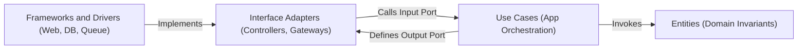

---
tags:
  - software-engineering
  - clean-architecture
  - dashboard
created: 2026-01-02
updated: 2026-11-13
status: 🟢
level: mid-to-senior
---
# Clean Architecture Complete Guide

> [!abstract] Vault Navigation
> Architectural hub within [[Programming/Software Engineering/Software Engineering Roadmap|Software Engineering Roadmap]]. Companion structural guides: [[Programming/Software Engineering/Architectural Patterns/Hexagonal Architecture|Hexagonal Architecture]], [[Programming/Software Engineering/Architectural Patterns/Layered & Onion Architecture|Layered & Onion Architecture]], and [[Programming/Software Engineering/Architectural Patterns/Vertical Slice Architecture|Vertical Slice Architecture]].

Clean Architecture enforces a single structural invariant: **source-code dependencies must point strictly inward toward high-level business policy**, isolating domain invariants and application orchestration from volatile delivery mechanisms (HTTP, gRPC, GraphQL), persistence engines, and third-party SDKs.

---

## 1. Core Knowledge Map

| Module | Engineering Scope | Status |
|---|---|---|
| [[Programming/Software Engineering/Clean Architecture/Overview\|Overview]] | Architectural optionality, Screaming Architecture, 5 decoupling invariants, CRUD over-engineering trade-offs | 🟢 |
| [[Programming/Software Engineering/Clean Architecture/Dependency Rule\|Dependency Rule]] | Inward dependency vector, Boundary Crossing DTOs, DIP in TypeScript & Go, CQRS-lite query bypass | 🟢 |
| [[Programming/Software Engineering/Clean Architecture/Entities & Use Cases\|Entities & Use Cases]] | Enterprise invariants vs application interactors, rich vs anemic models, transaction ownership | 🟢 |
| [[Programming/Software Engineering/Clean Architecture/Interface Adapters & Frameworks\|Interface Adapters & Frameworks]] | Controllers, Presenters, Gateways, ORM isolation, Composition Root & DI container tradeoffs | 🟢 |

---

## 2. Concentric Boundary Model

### Layer Responsibilities & Coupling Rules

| Ring | Contains | Knows About | Forbidden Dependencies |
|---|---|---|---|
| **1. Entities** | Enterprise domain objects, value types, invariant checks, domain exceptions | Standard library only (pure language primitives) | Use cases, ORMs, HTTP types, DI frameworks, `process.env` |
| **2. Use Cases** | Application interactors, Input/Output Ports, boundary DTOs, transaction orchestration | Entities + own Ports | Controllers, SQL dialects, Express/Fastify, Prisma/TypeORM models |
| **3. Interface Adapters** | HTTP/gRPC controllers, Presenters, Repository/Gateway implementations, data mappers | Use Cases, Ports, Entities | Framework-specific entrypoint bootstrapping (kept in Ring 4) |
| **4. Frameworks & Drivers** | Web server runtime, DB driver pools, message broker SDKs, Composition Root (`main`) | All inner rings (wired exclusively at startup) | Business logic or domain validation rules |

---

## 3. Clean Architecture vs Sibling Topologies

| Dimension | Clean Architecture | Hexagonal (Ports & Adapters) | Onion Architecture | Vertical Slice Architecture |
|---|---|---|---|---|
| **Primary Axis** | 4 explicit concentric policy rings | Symmetric inside/outside boundary (Ports) | Concentric domain-centric rings | Cohesive per-feature request slices |
| **Port Naming** | Input Port / Output Port + Interactor + Presenter | Primary (Driving) / Secondary (Driven) Ports | Domain Services / App Services / Infra Interfaces | Often MediatR handlers + thin inline ports |
| **Boilerplate Cost** | High (DTO mapping across 3–4 boundaries) | Moderate (ports at edge only) | Moderate-to-High | Low (each slice picks local abstraction depth) |
| **Ideal Fit** | Complex multi-channel enterprise domains with volatile infra | Long-lived backend services swapping queues/DBs/APIs | DDD-heavy transactional cores | High-churn CRUD/SaaS products with divergent read/write needs |

---

## 4. Adoption Guardrails (Avoiding Cargo-Cult Boilerplate)

> [!warning] The Abstraction Tax Trap
> Applying full 4-ring Clean Architecture with separate Request DTOs, Entities, Persistence Models, Presenters, and Interfaces to every `GET /users/:id` endpoint triples file count without protecting meaningful invariants.

1. **Apply Strict Ring Isolation to Command/Write Paths with Complex Rules**: Enforce Entities + Use Cases where state transitions carry financial, security, regulatory, or multi-step consistency invariants.
2. **Use Query Bypass (CQRS-Lite) for Read Endpoints**: Let read handlers query optimized SQL views or DTO projections directly via a thin read interface rather than hydrating full domain aggregates only to serialize them back into JSON. See [[Programming/Software Engineering/Architectural Patterns/CQRS|CQRS]].
3. **Reserve Separate Domain & Persistence Models for Structural Divergence**: If your Postgres table columns map 1:1 to your domain object and zero ORM decorators leak into business logic, delaying separate persistence DTOs until schema divergence occurs avoids dead mapper boilerplate.

---

## 5. Cross-Cutting References

- [[Programming/Software Engineering/SOLID/Dependency Inversion|Dependency Inversion]] — Compile-time decoupling mechanics enabling Output Ports
- [[Programming/Software Engineering/DDD/Tactical Design & Building Blocks|Tactical Design & Building Blocks]] — Entities, Value Objects, Aggregates, and Repositories inside the inner rings
- [[Programming/Software Engineering/Testing/Unit Testing|Unit Testing]] — Fast, framework-free domain and use-case verification enabled by inward dependencies
