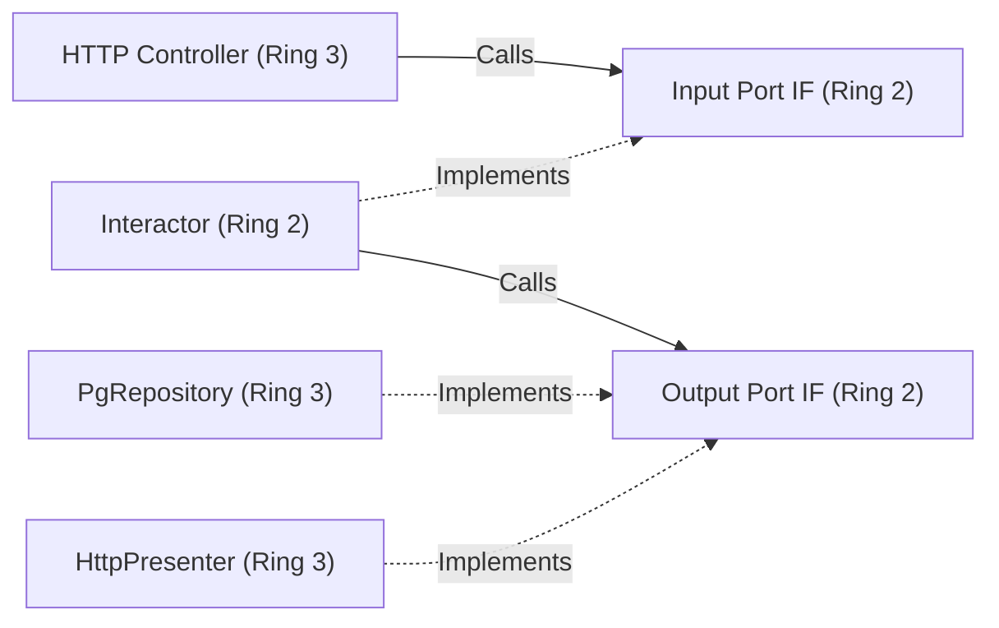
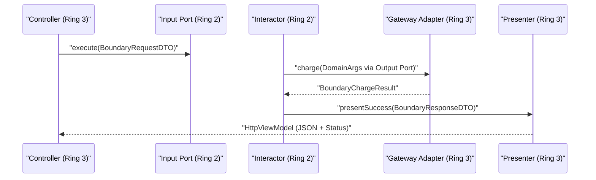
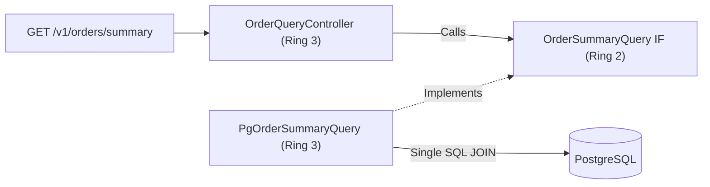

---
tags:
  - software-engineering
  - clean-architecture
  - dependency-rule
  - dip
created: 2026-01-02
updated: 2026-11-13
status: 🟢
level: mid-to-senior
---
# The Dependency Rule

> [!abstract] Hub Context
> Part of [[Programming/Software Engineering/Clean Architecture/Clean Architecture Complete Guide|Clean Architecture Complete Guide]] and [[Programming/Software Engineering/Clean Architecture/Overview|Overview]]. Applies [[Programming/Software Engineering/SOLID/Dependency Inversion|Dependency Inversion]] and [[Programming/Software Engineering/SOLID/Interface Segregation Principle|Interface Segregation Principle]] across ring boundaries, feeding directly into [[Programming/Software Engineering/Clean Architecture/Entities & Use Cases|Entities & Use Cases]] and [[Programming/Software Engineering/Clean Architecture/Interface Adapters & Frameworks|Interface Adapters & Frameworks]].

The **Dependency Rule** is the single non-negotiable invariant governing Clean Architecture: **source-code dependencies may only point inward**. Nothing in an inner ring—neither runtime value, class name, function signature, type alias, exception class, nor module path—may reference anything declared in an outer ring.

---

## 1. First-Principles Mechanics of the Inward Dependency Rule

### 1.1 Lexical Imports, AST Dependency Graphs, and Transitive Poisoning

In compiled and bundled languages (TypeScript, Go, Java, Rust, C#), a "source-code dependency" is an explicit edge in the Abstract Syntax Tree (AST) module graph created by any of five syntactic constructs:

1. **Runtime Value Imports (`import { Pool } from 'pg'`, `import "database/sql"`)**: Loads and executes module-level side effects (`new PrismaClient()`, `dotenv.config()`, native `.node` C++ addon bindings) inside the importing graph.
2. **Type-Only Imports (`import type { Prisma } from '@prisma/client'`)**: Even though TypeScript erases `import type` from emitted `.js`, the TypeScript compiler AST (`tsc`), project reference builder (`tsc -b`), and linter still draw a directed compile-time edge from the inner package to `@prisma/client`. Regenerating database schemas immediately triggers recompilation and type errors inside business code.
3. **Class Inheritance & Parameter Decorators (`extends BaseEntity`, `@Column()`, `@Injectable()`)**: Decorator metadata emits `__decorate(...)` and `Reflect.metadata(...)` calls referencing outer framework symbols at runtime.
4. **Exception Class Catching (`catch (err) { if (err instanceof Stripe.errors.StripeCardError) }`)**: Catching vendor or SQL driver errors inside a Use Case forces a direct runtime import of the vendor SDK.
5. **Barrel Re-Exports (`index.ts`)**: Importing a pure helper from `src/ordering/index.ts` pulls every sibling module re-exported by that barrel into Node/Vitest/Webpack/esbuild unless tree-shaking proves side-effect freedom.

#### How One Upward Import Breaks an Entire Core Module
Suppose one developer adds `import { PrismaClient } from '@prisma/client'` or `import { Request } from 'express'` inside `src/payments/application/CapturePaymentInteractor.ts`. That single AST edge triggers four cascading systems failures:

- **Unit Test Infrastructure Coupling**: Running `vitest run` on pure payment math now resolves `@prisma/client`, triggers native query-engine binary checks or missing environment lookups, and forces engineers to mock Prisma internals instead of passing a 10-line in-memory `Map` fake.
- **Bundler & Edge Runtime Collapse**: Next.js Edge Middleware, Cloudflare Workers, or browser client bundles importing shared domain validation schemas fail compilation with `Module not found: Can't resolve 'fs' / 'net' / 'tls'` because the bundler walks transitive imports from Domain $\rightarrow$ Use Case $\rightarrow$ Prisma/Postgres Driver.
- **Project Reference Cycle & Recompilation Amplification**: Under incremental TypeScript builds (`tsc -b`), modifying an HTTP adapter type or running `prisma generate` invalidates the TypeScript build hash of `core`, forcing downstream recompilation of every module and worker consuming `core`.
- **Circular Import Runtime Undefined Errors & Go Build Failures**: When `usecase` imports `postgres` while `postgres` imports `usecase` entities/DTOs, ESM/CommonJS hits Temporal Dead Zone (`ReferenceError: Cannot access 'Order' before initialization`) or `undefined` exported classes at boot, while the Go compiler immediately aborts compilation with `import cycle not allowed`.

### 1.2 Compile-Time Dependency Direction vs Runtime Flow of Control

Runtime execution frequently travels **outward**—a Use Case invokes a PostgreSQL repository, calls a Stripe payment gateway, and hands results to an HTTP Presenter. Without boundary inversion, invoking outer code forces an outward `import`.

Clean Architecture resolves the conflict between outward runtime control flow and inward compile-time dependencies using **Polymorphism (Dynamic Dispatch)** and **Dependency Inversion (DIP)**:



Trace the mechanics in compiled bytecode / V8 memory:

1. **Compile Time**: `CapturePaymentInteractor` (Ring 2) holds private fields typed exclusively against `PaymentOrderRepository` and `CapturePaymentOutputPort` (interfaces declared inside Ring 2). Zero edges leave Ring 2 outward toward Ring 3 or Ring 4.
2. **Startup Wiring (Composition Root in Ring 4)**: At process boot (`src/main.ts`), the Composition Root instantiates concrete Ring 3 adapters (`PgPaymentOrderRepository`, `StripePaymentProcessor`, `HttpCapturePaymentPresenter`) and passes those heap object references into `new CapturePaymentInteractor(...)`.
3. **Runtime Dispatch**: When `CapturePaymentInteractor` executes `await this.orders.findById(orderId)`, the V8 runtime or Go interface itable dispatches via the object reference's method table directly into `PgPaymentOrderRepository.findById` in Ring 3—without `CapturePaymentInteractor` ever containing an import edge toward `PgPaymentOrderRepository`.

### 1.3 Boundary Crossing Mechanics: Input Ports, Output Ports, and Boundary DTOs

Every architectural boundary crossing must convert data into **isolated, behavior-free Data Transfer Objects (Boundary DTOs)** owned by the inner ring.



#### Strict Rules for Inbound and Outbound Boundary Crossings

| Crossing Direction | Caller $\rightarrow$ Callee | Permitted Payload Type | Forbidden Payload Type & Failure Mode |
|---|---|---|---|
| **Inward (Delivery $\rightarrow$ Use Case)** | `Controller` $\rightarrow$ `InputPort.execute(req)` | Plain immutable `RequestModel` / `Command` containing primitive strings, numbers, dates, booleans, or Value Objects | Express `Request`, Fastify `FastifyRequest`, HTTP `Headers`, cookies, raw multipart streams, Zod parsed AST objects |
| **Inward (Adapter $\rightarrow$ Use Case)** | `RepositoryAdapter` $\rightarrow$ `Interactor` (return value) | Pure Ring 1 `Entity` (reconstituted cleanly) or Ring 2 `BoundaryRecord` | `Prisma.Order`, TypeORM `@Entity()` proxy class, Mongoose `Document`, `pg.QueryResult` |
| **Outward (Use Case $\rightarrow$ Gateway)** | `Interactor` $\rightarrow$ `OutputPort` (argument) | Plain domain primitives (`OrderId`, `Money`, `idempotencyKey`) | Raw SQL snippets, Stripe `PaymentIntentCreateParams`, vendor webhook headers |
| **Outward (Use Case $\rightarrow$ Presenter)** | `Interactor` $\rightarrow$ `OutputPort.present(res)` | Flat `ResponseModel` DTO (plain readonly fields, ISO timestamps, integer cents) | Mutable Ring 1 `Entity` instances (leaks internal business state, exposes setters/methods, couples HTTP JSON schema to entity internals) |

#### Why Passing Domain Entities Out to Controllers/Presenters Breaks Isolation
Returning a Ring 1 `Order` Entity straight out of a Use Case to an HTTP controller creates two structural failures:

1. **Implicit Serialization Leakage**: `JSON.stringify(order)` serializes private internal fields (`passwordHash`, `internalRiskScore`, `version`, `_domainEvents`), leaking security metadata or tying public API response keys directly to private class field renames.
2. **State Mutation Outside Transactions**: A controller holding a live `Order` Entity reference can call domain mutation methods after persistence has already committed, producing silent state divergence between response JSON and committed database rows.

---

## 2. Real-World Use Cases, Pragmatic Boundaries & CQRS-Lite Bypass

Enforcing all four Clean Architecture abstractions (`InputPort` + `Interactor` + `OutputPort` + `Presenter`) unconditionally across every operation introduces excessive ceremony when an application has simple synchronous HTTP endpoints or reporting tables.

### 2.1 Boundary Architecture Decision Matrix

| Boundary Pattern | Components Required | Optimal Real-World Use Cases | When NOT to Use |
|---|---|---|---|
| **1. Classic Uncle Bob 4-Part Boundary** (`InputPort` + `Interactor` + `OutputPort` + `Presenter`) | Request DTO, Input Port, Interactor, Output Port, Response DTO, Presenter, ViewModel | Multi-output targets sharing one execution path (e.g., same Use Case renders REST JSON, PDF invoice buffer, CLI stdout, and WebSocket stream), or streaming/progress callbacks | Single-delivery REST/GraphQL endpoints returning one JSON shape per command |
| **2. Lean Command Boundary** (`CommandUseCase` returning `Result<ResponseDTO, DomainError>`) | Command DTO, Use Case class, Driven Output Ports (`Repo`, `Gateway`, `Clock`), Result DTO | **85% of production write commands** (checkout, refunds, ledger transfers, subscription upgrades, permission updates) | Read-only dashboards or trivial single-table admin lookups |
| **3. CQRS-Lite Query Bypass** (Read-Only Query Port returning SQL Projection) | Query Interface (`application/queries/`), Projection View DTO, SQL Query Adapter (`adapters/postgres/`) | Paginated search, reporting tables, admin dashboards, multi-table aggregations requiring tuned SQL joins and covering indexes | Transactional state mutations enforcing multi-step business invariants |
| **4. Direct Framework Slice** (Zod + DB client inside route handler) | Route handler + schema validator + query | `/healthz`, `/readyz`, simple lookup/tag tables without invariants, short-lived feature flags | Multi-channel business flows, monetary operations, regulated state machines |

### 2.2 CQRS-Lite Query Bypass Mechanics (Without Violating the Dependency Rule)

A widespread misconception claims that bypassing Domain Entities for read queries violates Clean Architecture. In fact, **CQRS-Lite obeys the Dependency Rule completely** because the dependency arrow still points strictly inward.



#### Why This Pattern Obeys Every Structural Invariant
1. **Ring 2 Owns the Read Contract**: `OrderSummaryQuery` and its projection DTO `OrderSummaryView` reside in `src/ordering/application/queries/`. They contain zero `pg`, `Prisma`, or SQL imports.
2. **Ring 3 Executes Tuned SQL Directly**: `PgOrderSummaryQuery` sits in `src/ordering/adapters/postgres/`, imports the Ring 2 interface (`inward` dependency), runs an optimized `SELECT ... JOIN ...` projection directly into `OrderSummaryView`, and never touches Domain Entities or Write Repositories.
3. **Controller Remains DB-Agnostic**: The HTTP Controller depends solely on `OrderSummaryQuery` (Ring 2 interface). Swapping PostgreSQL for Elasticsearch or Redis read-through caching leaves both the Query Contract and Controller unchanged.
4. **Zero Hydration Tax**: Read paths avoid instantiating aggregate object graphs, loading unused child arrays, or running business invariants on already-persisted historical records. See [[Programming/Software Engineering/Architectural Patterns/CQRS|CQRS]].

---

## 3. Complete Multi-Language Proof Implementations

### 3.1 Complete TypeScript Proof: `OrderPaymentBoundary` (Classic Input/Output Port + Boundary DTOs + CQRS-Lite)

The complete implementation below demonstrates a production **Order Payment Capture** boundary featuring:
- Pure Ring 1 `PaymentOrder` Entity with minor-unit integer currency arithmetic and explicit state machine (`AUTHORIZED -> CAPTURED | CAPTURE_FAILED`).
- Formal Ring 2 Boundary file (`CapturePaymentBoundary.ts`) declaring `CapturePaymentInputPort`, `CapturePaymentOutputPort`, `CapturePaymentRequest`, `CapturePaymentSuccessResponse`, and `CapturePaymentFailureResponse`.
- Driven Ring 2 Output Ports (`PaymentOrderRepository`, `PaymentProcessorGateway`, `ClockPort`) completely decoupled from Stripe and Postgres.
- Ring 3 HTTP Presenter (`HttpCapturePaymentPresenter`) translating domain output into HTTP ViewModels (`200`, `402`, `404`, `409`) and Ring 3 Anti-Corruption Adapters (`StripePaymentProcessor`, `PgPaymentOrderRepository`).
- Ring 2 + Ring 3 CQRS-Lite Read Query (`OrderPaymentStatusQuery`).

#### Ring 1: Domain Entity (`src/payments/domain/PaymentOrder.ts`)

```typescript
// src/payments/domain/PaymentOrder.ts — Ring 1 Entity (Zero external imports)
export type PaymentOrderStatus = 'AUTHORIZED' | 'CAPTURED' | 'CAPTURE_FAILED' | 'VOIDED';

export interface PaymentOrderSnapshot {
  readonly id: string;
  readonly customerId: string;
  readonly currency: string;
  readonly authorizedCents: number;
  readonly capturedCents: number;
  readonly processorAuthRef: string;
  readonly status: PaymentOrderStatus;
  readonly version: number;
  readonly updatedAt: Date;
}

export class PaymentDomainError extends Error {
  constructor(
    public readonly code:
      | 'INVALID_AMOUNT'
      | 'INVALID_STATE'
      | 'EXCEEDS_AUTHORIZED'
      | 'CURRENCY_MISMATCH',
    message: string,
  ) {
    super(message);
    this.name = 'PaymentDomainError';
  }
}

export class PaymentOrder {
  private constructor(private props: PaymentOrderSnapshot) {}

  static reconstitute(snapshot: PaymentOrderSnapshot): PaymentOrder {
    return new PaymentOrder({ ...snapshot });
  }

  get id(): string {
    return this.props.id;
  }

  get processorAuthRef(): string {
    return this.props.processorAuthRef;
  }

  get currency(): string {
    return this.props.currency;
  }

  get version(): number {
    return this.props.version;
  }

  get status(): PaymentOrderStatus {
    return this.props.status;
  }

  snapshot(): PaymentOrderSnapshot {
    return { ...this.props };
  }

  validateCaptureRequest(captureCents: number, currency: string): void {
    if (this.props.status !== 'AUTHORIZED') {
      throw new PaymentDomainError(
        'INVALID_STATE',
        `Order ${this.props.id} is in status ${this.props.status} and cannot be captured`,
      );
    }
    if (!Number.isInteger(captureCents) || captureCents <= 0) {
      throw new PaymentDomainError('INVALID_AMOUNT', 'Capture amount must be a positive integer');
    }
    if (currency !== this.props.currency) {
      throw new PaymentDomainError(
        'CURRENCY_MISMATCH',
        `Expected currency ${this.props.currency}, received ${currency}`,
      );
    }
    if (captureCents > this.props.authorizedCents) {
      throw new PaymentDomainError(
        'EXCEEDS_AUTHORIZED',
        `Capture ${captureCents} exceeds authorized ${this.props.authorizedCents}`,
      );
    }
  }

  markCaptured(capturedCents: number, now: Date): void {
    if (this.props.status !== 'AUTHORIZED') {
      throw new PaymentDomainError('INVALID_STATE', `Cannot transition ${this.props.status} to CAPTURED`);
    }
    this.props = {
      ...this.props,
      capturedCents,
      status: 'CAPTURED',
      updatedAt: now,
    };
  }

  markCaptureFailed(now: Date): void {
    if (this.props.status !== 'AUTHORIZED') {
      throw new PaymentDomainError('INVALID_STATE', `Cannot transition ${this.props.status} to CAPTURE_FAILED`);
    }
    this.props = {
      ...this.props,
      status: 'CAPTURE_FAILED',
      updatedAt: now,
    };
  }
}
```

#### Ring 2: Formal Boundary Contract (`src/payments/application/CapturePaymentBoundary.ts`)

```typescript
// src/payments/application/CapturePaymentBoundary.ts — Ring 2 Input/Output Ports & Boundary DTOs
export interface CapturePaymentRequest {
  readonly orderId: string;
  readonly captureCents: number;
  readonly currency: string;
  readonly idempotencyKey: string;
}

export interface CapturePaymentSuccessResponse {
  readonly orderId: string;
  readonly capturedCents: number;
  readonly currency: string;
  readonly processorCaptureRef: string;
  readonly capturedAtIso: string;
}

export type CaptureFailureReason =
  | 'ORDER_NOT_FOUND'
  | 'INVALID_STATE'
  | 'INVALID_AMOUNT'
  | 'CURRENCY_MISMATCH'
  | 'EXCEEDS_AUTHORIZED'
  | 'PROCESSOR_DECLINED'
  | 'CONCURRENT_MODIFICATION';

export interface CapturePaymentFailureResponse {
  readonly orderId: string;
  readonly reason: CaptureFailureReason;
  readonly message: string;
}

export interface CapturePaymentInputPort {
  execute(request: CapturePaymentRequest): Promise<void>;
}

export interface CapturePaymentOutputPort {
  presentSuccess(response: CapturePaymentSuccessResponse): void;
  presentFailure(error: CapturePaymentFailureResponse): void;
}
```

#### Ring 2: Driven Output Ports (`src/payments/application/ports/PaymentDrivenPorts.ts`)

```typescript
// src/payments/application/ports/PaymentDrivenPorts.ts — Ring 2 Driven Ports (Zero vendor/DB imports)
import { PaymentOrder } from '../../domain/PaymentOrder';

export interface PaymentOrderRepository {
  findById(orderId: string): Promise<PaymentOrder | null>;
  save(order: PaymentOrder, expectedVersion: number): Promise<boolean>; // false = optimistic lock conflict
}

export type GatewayCaptureOutcome =
  | { readonly ok: true; readonly processorCaptureRef: string }
  | { readonly ok: false; readonly declineCode: string; readonly declineMessage: string };

export interface PaymentProcessorGateway {
  captureAuthorization(params: {
    processorAuthRef: string;
    amountCents: number;
    currency: string;
    idempotencyKey: string;
  }): Promise<GatewayCaptureOutcome>;
}

export interface ClockPort {
  now(): Date;
}
```

#### Ring 2: Interactor & CQRS-Lite Read Port (`src/payments/application/`)

```typescript
// src/payments/application/CapturePaymentInteractor.ts — Ring 2 Use Case
import { PaymentDomainError } from '../domain/PaymentOrder';
import {
  CapturePaymentInputPort,
  CapturePaymentOutputPort,
  CapturePaymentRequest,
} from './CapturePaymentBoundary';
import {
  ClockPort,
  PaymentOrderRepository,
  PaymentProcessorGateway,
} from './ports/PaymentDrivenPorts';

export class CapturePaymentInteractor implements CapturePaymentInputPort {
  constructor(
    private readonly orders: PaymentOrderRepository,
    private readonly processor: PaymentProcessorGateway,
    private readonly clock: ClockPort,
    private readonly presenter: CapturePaymentOutputPort,
  ) {}

  async execute(request: CapturePaymentRequest): Promise<void> {
    const order = await this.orders.findById(request.orderId);
    if (!order) {
      this.presenter.presentFailure({
        orderId: request.orderId,
        reason: 'ORDER_NOT_FOUND',
        message: `Payment order ${request.orderId} not found`,
      });
      return;
    }

    try {
      order.validateCaptureRequest(request.captureCents, request.currency);
    } catch (err) {
      if (err instanceof PaymentDomainError) {
        this.presenter.presentFailure({
          orderId: request.orderId,
          reason: err.code,
          message: err.message,
        });
        return;
      }
      throw err;
    }

    const expectedVersion = order.version;
    const outcome = await this.processor.captureAuthorization({
      processorAuthRef: order.processorAuthRef,
      amountCents: request.captureCents,
      currency: request.currency,
      idempotencyKey: request.idempotencyKey,
    });

    const now = this.clock.now();
    if (!outcome.ok) {
      order.markCaptureFailed(now);
      await this.orders.save(order, expectedVersion);
      this.presenter.presentFailure({
        orderId: order.id,
        reason: 'PROCESSOR_DECLINED',
        message: `${outcome.declineCode}: ${outcome.declineMessage}`,
      });
      return;
    }

    order.markCaptured(request.captureCents, now);
    const saved = await this.orders.save(order, expectedVersion);
    if (!saved) {
      this.presenter.presentFailure({
        orderId: order.id,
        reason: 'CONCURRENT_MODIFICATION',
        message: 'Order state changed during payment capture; retry safely with idempotency key',
      });
      return;
    }

    this.presenter.presentSuccess({
      orderId: order.id,
      capturedCents: request.captureCents,
      currency: order.currency,
      processorCaptureRef: outcome.processorCaptureRef,
      capturedAtIso: now.toISOString(),
    });
  }
}
```

```typescript
// src/payments/application/queries/OrderPaymentStatusQuery.ts — CQRS-Lite Read Port
export interface OrderPaymentStatusView {
  readonly orderId: string;
  readonly status: string;
  readonly authorizedCents: number;
  readonly capturedCents: number;
  readonly currency: string;
  readonly updatedAtIso: string;
}

export interface OrderPaymentStatusQuery {
  findStatus(orderId: string): Promise<OrderPaymentStatusView | null>;
}
```

#### Ring 3: HTTP Presenter, Controller & Outer Gateways (`src/payments/adapters/`)

```typescript
// src/payments/adapters/http/HttpCapturePaymentPresenter.ts — Ring 3 Output Port Implementation
import {
  CaptureFailureReason,
  CapturePaymentFailureResponse,
  CapturePaymentOutputPort,
  CapturePaymentSuccessResponse,
} from '../../application/CapturePaymentBoundary';

export interface HttpResponseViewModel {
  readonly statusCode: number;
  readonly body: Record<string, unknown>;
}

const FAILURE_STATUS_MAP: Record<CaptureFailureReason, number> = {
  ORDER_NOT_FOUND: 404,
  INVALID_AMOUNT: 400,
  CURRENCY_MISMATCH: 400,
  EXCEEDS_AUTHORIZED: 422,
  INVALID_STATE: 409,
  CONCURRENT_MODIFICATION: 409,
  PROCESSOR_DECLINED: 402,
};

export class HttpCapturePaymentPresenter implements CapturePaymentOutputPort {
  private viewModel: HttpResponseViewModel | null = null;

  presentSuccess(response: CapturePaymentSuccessResponse): void {
    this.viewModel = {
      statusCode: 200,
      body: {
        orderId: response.orderId,
        capturedAmount: {
          cents: response.capturedCents,
          currency: response.currency,
        },
        processorRef: response.processorCaptureRef,
        capturedAt: response.capturedAtIso,
      },
    };
  }

  presentFailure(error: CapturePaymentFailureResponse): void {
    this.viewModel = {
      statusCode: FAILURE_STATUS_MAP[error.reason],
      body: {
        error: {
          code: error.reason,
          orderId: error.orderId,
          message: error.message,
        },
      },
    };
  }

  getViewModel(): HttpResponseViewModel {
    if (!this.viewModel) {
      throw new Error('Presenter invoked without output from interactor');
    }
    return this.viewModel;
  }
}
```

```typescript
// src/payments/adapters/http/CapturePaymentController.ts — Ring 3 Inbound Adapter
import { FastifyReply, FastifyRequest } from 'fastify';
import { z } from 'zod';
import {
  CapturePaymentInputPort,
  CapturePaymentOutputPort,
} from '../../application/CapturePaymentBoundary';
import { OrderPaymentStatusQuery } from '../../application/queries/OrderPaymentStatusQuery';
import { HttpCapturePaymentPresenter } from './HttpCapturePaymentPresenter';

const CaptureBodySchema = z.object({
  captureCents: z.number().int().positive(),
  currency: z.string().regex(/^[A-Z]{3}$/),
});

export type CaptureUseCaseFactory = (
  presenter: CapturePaymentOutputPort,
) => CapturePaymentInputPort;

export class PaymentHttpController {
  constructor(
    private readonly makeCaptureUseCase: CaptureUseCaseFactory,
    private readonly statusQuery: OrderPaymentStatusQuery,
  ) {}

  async capture(
    req: FastifyRequest<{ Params: { orderId: string } }>,
    reply: FastifyReply,
  ) {
    const idempotencyKey = req.headers['idempotency-key'];
    if (typeof idempotencyKey !== 'string' || idempotencyKey.trim().length < 8) {
      return reply.code(400).send({ error: 'Valid Idempotency-Key header required' });
    }

    const parsed = CaptureBodySchema.safeParse(req.body);
    if (!parsed.success) {
      return reply.code(400).send({ error: 'Invalid capture payload' });
    }

    const presenter = new HttpCapturePaymentPresenter();
    const interactor = this.makeCaptureUseCase(presenter);

    await interactor.execute({
      orderId: req.params.orderId,
      captureCents: parsed.data.captureCents,
      currency: parsed.data.currency,
      idempotencyKey,
    });

    const vm = presenter.getViewModel();
    return reply.code(vm.statusCode).send(vm.body);
  }

  async getStatus(
    req: FastifyRequest<{ Params: { orderId: string } }>,
    reply: FastifyReply,
  ) {
    const view = await this.statusQuery.findStatus(req.params.orderId);
    if (!view) {
      return reply.code(404).send({ error: 'Payment order not found' });
    }
    return reply.code(200).send(view);
  }
}
```

```typescript
// src/payments/adapters/stripe/StripePaymentProcessor.ts — Ring 3 Anti-Corruption Gateway
import Stripe from 'stripe';
import {
  GatewayCaptureOutcome,
  PaymentProcessorGateway,
} from '../../application/ports/PaymentDrivenPorts';

export class StripePaymentProcessor implements PaymentProcessorGateway {
  constructor(private readonly stripe: Stripe) {}

  async captureAuthorization(params: {
    processorAuthRef: string;
    amountCents: number;
    currency: string;
    idempotencyKey: string;
  }): Promise<GatewayCaptureOutcome> {
    try {
      const intent = await this.stripe.paymentIntents.capture(
        params.processorAuthRef,
        { amount_to_capture: params.amountCents },
        { idempotencyKey: params.idempotencyKey },
      );

      const latestChargeId =
        typeof intent.latest_charge === 'string'
          ? intent.latest_charge
          : intent.latest_charge?.id ?? intent.id;

      return {
        ok: true,
        processorCaptureRef: latestChargeId,
      };
    } catch (err) {
      if (err instanceof Stripe.errors.StripeCardError) {
        return {
          ok: false,
          declineCode: err.code ?? 'CARD_DECLINED',
          declineMessage: err.message,
        };
      }
      throw err;
    }
  }
}
```

```typescript
// src/payments/adapters/postgres/PgPaymentOrderRepository.ts — Ring 3 Persistence + CQRS-Lite Query
import { Pool } from 'pg';
import { PaymentOrder, PaymentOrderStatus } from '../../domain/PaymentOrder';
import { PaymentOrderRepository } from '../../application/ports/PaymentDrivenPorts';
import {
  OrderPaymentStatusQuery,
  OrderPaymentStatusView,
} from '../../application/queries/OrderPaymentStatusQuery';

export class PgPaymentOrderRepository implements PaymentOrderRepository {
  constructor(private readonly pool: Pool) {}

  async findById(orderId: string): Promise<PaymentOrder | null> {
    const { rows } = await this.pool.query<{
      id: string;
      customer_id: string;
      currency: string;
      authorized_cents: number;
      captured_cents: number;
      processor_auth_ref: string;
      status: PaymentOrderStatus;
      version: number;
      updated_at: Date;
    }>(
      `SELECT id, customer_id, currency, authorized_cents, captured_cents,
              processor_auth_ref, status, version, updated_at
       FROM payment_orders
       WHERE id = $1`,
      [orderId],
    );

    const row = rows[0];
    if (!row) return null;

    return PaymentOrder.reconstitute({
      id: row.id,
      customerId: row.customer_id,
      currency: row.currency,
      authorizedCents: row.authorized_cents,
      capturedCents: row.captured_cents,
      processorAuthRef: row.processor_auth_ref,
      status: row.status,
      version: row.version,
      updatedAt: row.updated_at,
    });
  }

  async save(order: PaymentOrder, expectedVersion: number): Promise<boolean> {
    const snap = order.snapshot();
    const res = await this.pool.query(
      `UPDATE payment_orders
       SET status = $1,
           captured_cents = $2,
           updated_at = $3,
           version = version + 1
       WHERE id = $4 AND version = $5`,
      [snap.status, snap.capturedCents, snap.updatedAt, snap.id, expectedVersion],
    );
    return (res.rowCount ?? 0) === 1;
  }
}

export class PgOrderPaymentStatusQuery implements OrderPaymentStatusQuery {
  constructor(private readonly pool: Pool) {}

  async findStatus(orderId: string): Promise<OrderPaymentStatusView | null> {
    const { rows } = await this.pool.query<{
      id: string;
      status: string;
      authorized_cents: number;
      captured_cents: number;
      currency: string;
      updated_at: Date;
    }>(
      `SELECT id, status, authorized_cents, captured_cents, currency, updated_at
       FROM payment_orders
       WHERE id = $1`,
      [orderId],
    );
    const r = rows[0];
    if (!r) return null;
    return {
      orderId: r.id,
      status: r.status,
      authorizedCents: r.authorized_cents,
      capturedCents: r.captured_cents,
      currency: r.currency,
      updatedAtIso: r.updated_at.toISOString(),
    };
  }
}
```

#### Ring 4: Composition Root (`src/main.ts`)

```typescript
// src/main.ts — Composition Root wiring PaymentHttpController per request presenter
import Fastify from 'fastify';
import { Pool } from 'pg';
import Stripe from 'stripe';
import { CapturePaymentInteractor } from './payments/application/CapturePaymentInteractor';
import { PaymentHttpController } from './payments/adapters/http/CapturePaymentController';
import {
  PgOrderPaymentStatusQuery,
  PgPaymentOrderRepository,
} from './payments/adapters/postgres/PgPaymentOrderRepository';
import { StripePaymentProcessor } from './payments/adapters/stripe/StripePaymentProcessor';

export async function startServer(): Promise<void> {
  const pool = new Pool({ connectionString: process.env.DATABASE_URL });
  const stripe = new Stripe(process.env.STRIPE_SECRET_KEY!);
  const clock = { now: () => new Date() };

  const orderRepo = new PgPaymentOrderRepository(pool);
  const statusQuery = new PgOrderPaymentStatusQuery(pool);
  const processor = new StripePaymentProcessor(stripe);

  const controller = new PaymentHttpController(
    (presenter) => new CapturePaymentInteractor(orderRepo, processor, clock, presenter),
    statusQuery,
  );

  const app = Fastify();
  app.post('/v1/payments/:orderId/capture', (req, reply) => controller.capture(req as never, reply));
  app.get('/v1/payments/:orderId', (req, reply) => controller.getStatus(req as never, reply));
  await app.listen({ port: 3000, host: '0.0.0.0' });
}
```

Look closely at the compile-time `import` arrows across all files above:
- `PaymentOrder.ts` imports **nothing**.
- `CapturePaymentBoundary.ts` imports **nothing**.
- `PaymentDrivenPorts.ts` imports `PaymentOrder` (**inward**).
- `CapturePaymentInteractor.ts` imports `PaymentOrder` and Ring 2 ports (**inward / same ring**).
- `HttpCapturePaymentPresenter.ts`, `CapturePaymentController.ts`, `StripePaymentProcessor.ts`, and `PgPaymentOrderRepository.ts` import Ring 1/2 types (**strictly inward**).
- Only `src/main.ts` imports concrete outer implementations and binds them together.

### 3.2 Complete Idiomatic Go Layout: Consumer-Owned Implicit Interfaces

Go enforces package DAGs strictly at compile time—import cycles never compile. However, teams coming from Java or C# frequently misplace Go interfaces inside `internal/billing/postgres` or create an oversized `internal/core/port` package containing 20-method repository interfaces.

Two idiomatic Go rules keep Clean Architecture minimal and compliant:
1. **Consumer-Owned Small Interfaces**: Define tiny 1–2 method interfaces (`InvoiceReader`, `InvoiceWriter`, `GatewayCharger`) right inside the consumer package (`internal/billing/usecase`) or inside a pure contract package (`internal/core/port` when multiple modules share canonical domain contracts). Because Go interfaces are satisfied **implicitly**, `internal/billing/postgres` returns concrete `*Store` structs and **never imports `usecase`**—eliminating circular package dependencies structurally.
2. **Accept Interfaces, Return Structs**: Use Cases accept narrow interface parameters; concrete adapters return `*postgres.InvoiceStore`.

```text
cmd/api/main.go                     # Ring 4: Composition Root (wires concrete *Store & *StripeClient)
internal/
├── billing/
│   ├── domain/invoice.go           # Ring 1: Pure entities & state transitions (zero external imports)
│   ├── usecase/pay_invoice.go      # Ring 2: Interactor + consumer-owned small ports
│   ├── postgres/invoice_store.go   # Ring 3: SQL store (imports domain + database/sql only; NEVER usecase)
│   └── http/pay_handler.go         # Ring 3: Transport adapter + own consumer interface PayInvoiceRunner
```

```go
// internal/billing/domain/invoice.go — Ring 1 Pure Domain (Zero external imports)
package domain

import (
	"errors"
	"time"
)

type InvoiceStatus string

const (
	StatusDraft  InvoiceStatus = "DRAFT"
	StatusIssued InvoiceStatus = "ISSUED"
	StatusPaid   InvoiceStatus = "PAID"
)

var (
	ErrInvoiceNotFound     = errors.New("invoice not found")
	ErrInvalidInvoiceState = errors.New("invoice cannot transition from current status")
	ErrConcurrentUpdate    = errors.New("concurrent invoice modification")
)

type Invoice struct {
	ID          string
	CustomerID  string
	AmountCents int64
	Currency    string
	Status      InvoiceStatus
	PaidAt      *time.Time
	Version     int64
}

func (inv *Invoice) MarkPaid(chargeRef string, now time.Time) error {
	if inv.Status != StatusIssued {
		return ErrInvalidInvoiceState
	}
	if chargeRef == "" {
		return errors.New("charge reference required")
	}
	paidAt := now.UTC()
	inv.Status = StatusPaid
	inv.PaidAt = &paidAt
	return nil
}
```

```go
// internal/billing/usecase/pay_invoice.go — Ring 2 Interactor + Consumer-Owned Ports
package usecase

import (
	"context"
	"time"

	"app/internal/billing/domain"
)

// Consumer-owned narrow interfaces: postgres and stripe never import this package!
type InvoiceStore interface {
	GetByID(ctx context.Context, id string) (*domain.Invoice, error)
	SavePaid(ctx context.Context, inv *domain.Invoice, expectedVersion int64) error
}

type PaymentCharger interface {
	Charge(ctx context.Context, customerID string, amountCents int64, currency string, idempotencyKey string) (string, error)
}

type Clock interface {
	Now() time.Time
}

type PayInvoiceInput struct {
	InvoiceID      string
	IdempotencyKey string
}

type PayInvoiceOutput struct {
	InvoiceID string
	Status    domain.InvoiceStatus
	ChargeRef string
}

type PayInvoice struct {
	store   InvoiceStore
	charger PaymentCharger
	clock   Clock
}

func NewPayInvoice(store InvoiceStore, charger PaymentCharger, clock Clock) *PayInvoice {
	return &PayInvoice{store: store, charger: charger, clock: clock}
}

func (uc *PayInvoice) Execute(ctx context.Context, in PayInvoiceInput) (PayInvoiceOutput, error) {
	inv, err := uc.store.GetByID(ctx, in.InvoiceID)
	if err != nil {
		return PayInvoiceOutput{}, err
	}
	if inv.Status != domain.StatusIssued {
		return PayInvoiceOutput{}, domain.ErrInvalidInvoiceState
	}

	chargeRef, err := uc.charger.Charge(ctx, inv.CustomerID, inv.AmountCents, inv.Currency, in.IdempotencyKey)
	if err != nil {
		return PayInvoiceOutput{}, err
	}

	expectedVersion := inv.Version
	if err := inv.MarkPaid(chargeRef, uc.clock.Now()); err != nil {
		return PayInvoiceOutput{}, err
	}

	if err := uc.store.SavePaid(ctx, inv, expectedVersion); err != nil {
		return PayInvoiceOutput{}, err
	}

	return PayInvoiceOutput{
		InvoiceID: inv.ID,
		Status:    inv.Status,
		ChargeRef: chargeRef,
	}, nil
}
```

```go
// internal/billing/postgres/invoice_store.go — Ring 3 Adapter (Imports domain + database/sql ONLY)
package postgres

import (
	"context"
	"database/sql"
	"errors"

	"app/internal/billing/domain"
)

type InvoiceStore struct {
	db *sql.DB
}

func NewInvoiceStore(db *sql.DB) *InvoiceStore {
	return &InvoiceStore{db: db}
}

func (s *InvoiceStore) GetByID(ctx context.Context, id string) (*domain.Invoice, error) {
	const q = `SELECT id, customer_id, amount_cents, currency, status, paid_at, version
	           FROM invoices WHERE id = $1`
	var inv domain.Invoice
	var paidAt sql.NullTime
	err := s.db.QueryRowContext(ctx, q, id).Scan(
		&inv.ID,
		&inv.CustomerID,
		&inv.AmountCents,
		&inv.Currency,
		&inv.Status,
		&paidAt,
		&inv.Version,
	)
	if errors.Is(err, sql.ErrNoRows) {
		return nil, domain.ErrInvoiceNotFound
	}
	if err != nil {
		return nil, err
	}
	if paidAt.Valid {
		t := paidAt.Time
		inv.PaidAt = &t
	}
	return &inv, nil
}

func (s *InvoiceStore) SavePaid(ctx context.Context, inv *domain.Invoice, expectedVersion int64) error {
	const q = `UPDATE invoices
	           SET status = $1, paid_at = $2, version = version + 1
	           WHERE id = $3 AND version = $4`
	res, err := s.db.ExecContext(ctx, q, inv.Status, inv.PaidAt, inv.ID, expectedVersion)
	if err != nil {
		return err
	}
	affected, err := res.RowsAffected()
	if err != nil {
		return err
	}
	if affected == 0 {
		return domain.ErrConcurrentUpdate
	}
	return nil
}
```

```go
// internal/billing/http/pay_handler.go — Ring 3 Transport Adapter (Consumer-defined executor port)
package httpadapter

import (
	"context"
	"encoding/json"
	"errors"
	"net/http"

	"app/internal/billing/domain"
	"app/internal/billing/usecase"
)

type PayInvoiceExecutor interface {
	Execute(ctx context.Context, in usecase.PayInvoiceInput) (usecase.PayInvoiceOutput, error)
}

type PayInvoiceHandler struct {
	exec PayInvoiceExecutor
}

func NewPayInvoiceHandler(exec PayInvoiceExecutor) *PayInvoiceHandler {
	return &PayInvoiceHandler{exec: exec}
}

func (h *PayInvoiceHandler) ServeHTTP(w http.ResponseWriter, r *http.Request) {
	idempotencyKey := r.Header.Get("Idempotency-Key")
	if idempotencyKey == "" {
		http.Error(w, "missing Idempotency-Key", http.StatusBadRequest)
		return
	}
	invoiceID := r.PathValue("id")
	out, err := h.exec.Execute(r.Context(), usecase.PayInvoiceInput{
		InvoiceID:      invoiceID,
		IdempotencyKey: idempotencyKey,
	})
	if err != nil {
		switch {
		case errors.Is(err, domain.ErrInvoiceNotFound):
			http.Error(w, err.Error(), http.StatusNotFound)
		case errors.Is(err, domain.ErrInvalidInvoiceState), errors.Is(err, domain.ErrConcurrentUpdate):
			http.Error(w, err.Error(), http.StatusConflict)
		default:
			http.Error(w, "internal error", http.StatusInternalServerError)
		}
		return
	}
	w.Header().Set("Content-Type", "application/json")
	w.WriteHeader(http.StatusOK)
	_ = json.NewEncoder(w).Encode(map[string]any{
		"invoiceId": out.InvoiceID,
		"status":    out.Status,
		"chargeRef": out.ChargeRef,
	})
}
```

```go
// cmd/api/main.go — Ring 4 Composition Root (Verifies interface satisfaction cleanly)
package main

import (
	"context"
	"database/sql"
	"encoding/json"
	"fmt"
	"log"
	"net/http"
	"os"
	"time"

	httpadapter "app/internal/billing/http"
	"app/internal/billing/postgres"
	"app/internal/billing/usecase"
)

type systemClock struct{}

func (systemClock) Now() time.Time { return time.Now().UTC() }

type stripeCharger struct {
	httpClient *http.Client
	apiKey     string
}

func (c *stripeCharger) Charge(ctx context.Context, customerID string, amountCents int64, currency string, key string) (string, error) {
	req, err := http.NewRequestWithContext(ctx, http.MethodPost, "https://api.stripe.com/v1/charges", nil)
	if err != nil {
		return "", err
	}
	req.Header.Set("Authorization", "Bearer "+c.apiKey)
	req.Header.Set("Idempotency-Key", key)
	q := req.URL.Query()
	q.Set("customer", customerID)
	q.Set("amount", fmt.Sprintf("%d", amountCents))
	q.Set("currency", currency)
	req.URL.RawQuery = q.Encode()

	resp, err := c.httpClient.Do(req)
	if err != nil {
		return "", err
	}
	defer resp.Body.Close()
	if resp.StatusCode >= 400 {
		return "", fmt.Errorf("stripe charge failed with status %d", resp.StatusCode)
	}
	var parsed struct {
		ID string `json:"id"`
	}
	if err := json.NewDecoder(resp.Body).Decode(&parsed); err != nil {
		return "", err
	}
	return parsed.ID, nil
}

// Compile-time interface assertions sit cleanly in main/tests without coupling postgres -> usecase
var (
	_ usecase.InvoiceStore           = (*postgres.InvoiceStore)(nil)
	_ usecase.PaymentCharger         = (*stripeCharger)(nil)
	_ httpadapter.PayInvoiceExecutor = (*usecase.PayInvoice)(nil)
)

func main() {
	db, err := sql.Open("pgx", os.Getenv("DATABASE_URL"))
	if err != nil {
		log.Fatal(err)
	}
	defer db.Close()

	store := postgres.NewInvoiceStore(db)
	charger := &stripeCharger{
		httpClient: &http.Client{Timeout: 5 * time.Second},
		apiKey:     os.Getenv("STRIPE_KEY"),
	}
	uc := usecase.NewPayInvoice(store, charger, systemClock{})
	handler := httpadapter.NewPayInvoiceHandler(uc)

	mux := http.NewServeMux()
	mux.Handle("POST /v1/invoices/{id}/pay", handler)
	log.Fatal(http.ListenAndServe(":8080", mux))
}
```

#### Consumer-Owned Ports vs Shared `internal/core/port` Package in Go

When multiple sibling use-case packages share canonical repository contracts, teams sometimes organize ports under `internal/core/port`:

```text
internal/
├── core/
│   ├── domain/invoice.go           # Ring 1 entities & value types
│   ├── port/billing_ports.go       # Ring 2 shared Input/Output ports (imports domain ONLY)
│   └── service/pay_invoice.go      # Ring 2 interactors (imports domain + port)
└── adapters/
    ├── postgres/invoice_store.go   # Ring 3 returns *InvoiceStore (imports domain + database/sql)
    └── http/pay_handler.go         # Ring 3 calls port.PayInvoicePort
```

Even when using `internal/core/port`, never bundle 15 unrelated methods onto a single `BillingRepository` interface. Keep each port narrow (`InvoiceReader`, `InvoiceWriter`, `PaymentCharger`) and verify via Go's implicit interface satisfaction that `internal/adapters/postgres` never imports `internal/core/service` or `internal/adapters/http`.

---

## 4. Automated Architectural Fitness Functions & CI Enforcement

Relying solely on human code reviews to protect the Dependency Rule fails reliably under sprint deadlines: one rushed `import` from `application/` to `@prisma/client` or `adapters/` merges quietly and metastasizes across the codebase. Senior engineering teams convert the Dependency Rule into **automated CI build gates**.

### 4.1 `dependency-cruiser` Configuration (`.dependency-cruiser.cjs`)

`dependency-cruiser` walks the complete TypeScript/JavaScript AST import graph (including dynamic `import()`, `import type`, CommonJS `require`, and Node core builtins) and fails CI immediately on any forbidden boundary crossing.

```javascript
// .dependency-cruiser.cjs — CI Architectural Fitness Gate
/** @type {import('dependency-cruiser').IConfiguration} */
module.exports = {
  forbidden: [
    {
      name: 'domain-must-be-pure',
      comment: 'Ring 1 Domain Entities may only import shared/kernel or sibling domain files.',
      severity: 'error',
      from: { path: '^src/[^/]+/domain/' },
      to: {
        pathNot: [
          '^src/([^/]+)/domain/',
          '^src/shared/kernel/',
        ],
      },
    },
    {
      name: 'domain-no-node-builtins',
      comment: 'Domain logic must never call fs, net, http, crypto, or process directly.',
      severity: 'error',
      from: { path: '^src/[^/]+/domain/' },
      to: { dependencyTypes: ['core'] },
    },
    {
      name: 'application-inward-only',
      comment: 'Ring 2 Use Cases/Ports may not depend on adapters, frameworks, or composition root.',
      severity: 'error',
      from: { path: '^src/[^/]+/application/' },
      to: {
        path: [
          '^src/[^/]+/adapters/',
          '^src/main\\.ts$',
        ],
      },
    },
    {
      name: 'application-no-infra-packages',
      comment: 'Ring 2 Use Cases may not import web frameworks, ORMs, DB drivers, or vendor SDKs.',
      severity: 'error',
      from: { path: '^src/[^/]+/application/' },
      to: {
        path: '^node_modules/(express|fastify|@nestjs|@prisma|pg|typeorm|drizzle-orm|stripe|ioredis)/',
      },
    },
    {
      name: 'no-cross-module-internals',
      comment: 'Modules may only import another module public index.ts, never internal domain/application/adapters.',
      severity: 'error',
      from: {
        path: '^src/([^/]+)/',
      },
      to: {
        path: '^src/([^/]+)/(domain|application|adapters)/',
        pathNot: ['^src/$1/', '^src/shared/'],
      },
    },
    {
      name: 'adapters-cannot-import-main',
      comment: 'Ring 3 Adapters must never import Ring 4 bootstrap / Composition Root.',
      severity: 'error',
      from: { path: '^src/[^/]+/adapters/' },
      to: { path: '^src/main\\.ts$' },
    },
    {
      name: 'no-circular-dependencies',
      comment: 'Reject all circular module dependency graphs.',
      severity: 'error',
      from: {},
      to: { circular: true },
    },
  ],
  options: {
    doNotFollow: {
      path: 'node_modules',
    },
    tsPreCompilationDeps: true,
    tsConfig: {
      fileName: 'tsconfig.json',
    },
    enhancedResolveOptions: {
      exportsFields: ['exports'],
      conditionNames: ['import', 'require', 'node', 'default'],
    },
  },
};
```

Execute in `package.json` CI scripts:

```json
{
  "scripts": {
    "arch:check": "depcruise src --config .dependency-cruiser.cjs --output-type err-long"
  }
}
```

### 4.2 `eslint-plugin-boundaries` Flat Config (`eslint.config.mjs`)

While `dependency-cruiser` validates the full graph in CI, `eslint-plugin-boundaries` gives engineers immediate **red-squiggly feedback inside VS Code / JetBrains** the moment an illegal `import` is typed.

```javascript
// eslint.config.mjs — ESLint v9 Flat Config enforcing Clean Architecture rings & module encapsulation
import tseslint from 'typescript-eslint';
import boundaries from 'eslint-plugin-boundaries';

export default tseslint.config(
  ...tseslint.configs.recommended,
  {
    files: ['src/**/*.ts'],
    plugins: { boundaries },
    settings: {
      'boundaries/include': ['src/**/*.ts'],
      'boundaries/elements': [
        {
          type: 'shared-kernel',
          pattern: 'src/shared/kernel/**',
          mode: 'full',
        },
        {
          type: 'domain',
          pattern: 'src/*(ordering|billing|payments|fulfillment)/domain/**',
          capture: ['module'],
          mode: 'full',
        },
        {
          type: 'application',
          pattern: 'src/*(ordering|billing|payments|fulfillment)/application/**',
          capture: ['module'],
          mode: 'full',
        },
        {
          type: 'adapters',
          pattern: 'src/*(ordering|billing|payments|fulfillment)/adapters/**',
          capture: ['module'],
          mode: 'full',
        },
        {
          type: 'module-facade',
          pattern: 'src/*(ordering|billing|payments|fulfillment)/index.ts',
          capture: ['module'],
          mode: 'full',
        },
        {
          type: 'composition-root',
          pattern: 'src/main.ts',
          mode: 'full',
        },
      ],
    },
    rules: {
      'boundaries/element-types': [
        'error',
        {
          default: 'disallow',
          rules: [
            {
              from: ['shared-kernel'],
              allow: ['shared-kernel'],
            },
            {
              from: ['domain'],
              allow: [['domain', { module: '${from.module}' }], 'shared-kernel'],
            },
            {
              from: ['application'],
              allow: [
                ['domain', { module: '${from.module}' }],
                ['application', { module: '${from.module}' }],
                'shared-kernel',
                'module-facade',
              ],
            },
            {
              from: ['adapters'],
              allow: [
                ['domain', { module: '${from.module}' }],
                ['application', { module: '${from.module}' }],
                ['adapters', { module: '${from.module}' }],
                'shared-kernel',
                'module-facade',
              ],
            },
            {
              from: ['module-facade'],
              allow: [
                ['domain', { module: '${from.module}' }],
                ['application', { module: '${from.module}' }],
                ['adapters', { module: '${from.module}' }],
              ],
            },
            {
              from: ['composition-root'],
              allow: ['module-facade', 'shared-kernel', 'domain', 'application', 'adapters'],
            },
          ],
        },
      ],
      'boundaries/no-unknown-files': ['error'],
    },
  },
);
```

### 4.3 TypeScript Project References (`tsc -b`) Physical Compiler Enforcement

In monorepos or multi-package repositories, TypeScript Project References enforce the Dependency Rule natively at the compiler level—no third-party lint plugin required:

```json
// packages/core/tsconfig.json — Inner Rings: ZERO references to infra packages
{
  "compilerOptions": {
    "composite": true,
    "rootDir": "src",
    "outDir": "dist",
    "strict": true
  },
  "include": ["src/**/*.ts"]
}
```

```json
// packages/adapters/tsconfig.json — Outer Ring: references core strictly inward
{
  "compilerOptions": {
    "composite": true,
    "rootDir": "src",
    "outDir": "dist",
    "strict": true
  },
  "references": [{ "path": "../core" }],
  "include": ["src/**/*.ts"]
}
```

If any file inside `packages/core` imports from `packages/adapters`, `tsc -b` fails immediately with `TS6307: File is not listed within the file list of project 'packages/core/tsconfig.json'`—converting the Dependency Rule into a hard compiler invariant.

### 4.4 Go CI Enforcement (`golangci-lint` `depguard`)

In Go repositories, combine `depguard` in `.golangci.yml` with `go list` checks to forbid Ring 1/2 packages from importing SQL, HTTP, or adapter packages:

```yaml
# .golangci.yml — Automated Dependency Rule Enforcement for Go
linters:
  enable:
    - depguard

linters-settings:
  depguard:
    rules:
      domain-purity:
        files:
          - "**/internal/*/domain/*.go"
        deny:
          - pkg: "database/sql"
            desc: "Domain entities must not import SQL drivers"
          - pkg: "net/http"
            desc: "Domain entities must not import HTTP transport packages"
          - pkg: "github.com/jackc/pgx"
            desc: "Domain entities must not import pgx drivers"
          - pkg: "app/internal/"
            desc: "Domain entities cannot depend on usecase or adapter internal packages"
      usecase-inward-only:
        files:
          - "**/internal/*/usecase/*.go"
        deny:
          - pkg: "database/sql"
            desc: "Use cases must define consumer ports instead of importing database/sql"
          - pkg: "net/http"
            desc: "Use cases must remain transport-agnostic"
          - pkg: "github.com/stripe/stripe-go"
            desc: "Use cases must invoke PaymentCharger ports, never Stripe SDK directly"
```

---

## 5. Edge Cases, Subtle Violations & Operations Playbook

### 5.1 Subtle Dependency Rule Violations Often Missed in Review

1. **`import type` Leakage From ORM Codegen**: Importing `import type { Prisma } from '@prisma/client'` in `application/` leaves emitted JS clean, yet breaks `tsc -b` boundary isolation, ties application DTO field names (`snake_case` vs `camelCase`) to schema migrations, and forces `prisma generate` before core tests compile. Always define independent boundary types inside `application/`.
2. **Barrel File (`index.ts`) Transitive Poisoning**: Exporting `PgOrderRepository` from the same `src/ordering/index.ts` that exports `Money` or `CancelOrderCommand` causes unit test runners or Edge runtimes importing `CancelOrderCommand` to evaluate `pg`, `pg-native`, or `fs` imports unless explicitly split into `src/ordering/contracts.ts` (Ring 2 public types only) vs `src/ordering/module.ts` (Ring 4 wiring).
3. **Leaking Infrastructure Exceptions Across Output Ports**: Allowing `PrismaClientKnownRequestError` (`code === 'P2002'`) or `pg.DatabaseError` (`23505`) to escape `PgOrderRepository` forces Use Cases or HTTP Controllers to import `pg`/`prisma` types in `catch` blocks. Wrap and translate every driver exception inside the Adapter into domain/boundary errors (`DuplicateOrderError`, `OptimisticConcurrencyError`, `TransientStorageError`).
4. **Nondeterministic Global Singletons Inside Entities**: Calling `new Date()`, `Date.now()`, `Math.random()`, or `crypto.randomUUID()` inside Ring 1 Entities embeds hidden implicit I/O dependencies, making deterministic replay tests flaky. Pass timestamps (`now: Date`) and generated identifiers (`id: string`) as explicit method arguments or inject `ClockPort` / `IdGeneratorPort` in Ring 2 Use Cases.
5. **Over-Shared `OutputPort` Presenter Coupling**: Injecting one shared `OutputPort` into a singleton Use Case instance (e.g., NestJS singleton service holding a mutable `this.viewModel`) causes **cross-request race corruption** under concurrent HTTP traffic. Either instantiate per-request Use Case + Presenter pairs (as shown in Section 3.1's `CaptureUseCaseFactory`), pass `OutputPort` as a method argument `execute(req, presenter)`, or return `Promise<Result<Response, Error>>` directly.

### 5.2 Production Debugging & Architectural Refactoring Playbook

| Symptom | Exact Diagnostic Command / Check | Root Cause | Concrete Fix |
|---|---|---|---|
| **Core unit tests fail in CI without `.env` or Postgres running** | Run `npx depcruise src --config .dependency-cruiser.cjs` or `npx madge --image graph.svg src/` | Domain or Use Case imports an outer module or barrel file initializing `Pool`, `Stripe`, or `process.env` | Isolate Ring 1/2 exports away from concrete adapters; wire concrete classes solely in `src/main.ts` |
| **Next.js Edge / Cloudflare Worker fails with `Can't resolve 'net' / 'fs'`** | Run `npx tsc -b --explainFiles` or inspect bundler trace via `npx esbuild src/edge.ts --bundle --metafile=meta.json` | Shared package imported by Edge function transitively pulls Postgres/Node adapter | Split pure contracts (`domain` + boundary DTOs) into separate `tsconfig` composite package with zero Node deps |
| **Go compilation fails with `import cycle not allowed`** | Run `go list -f '{{.ImportPath}} -> {{.Imports}}' ./internal/...` | Outer `postgres` package imports `usecase` constants/types while `usecase` imports `*postgres.Store` | Extract shared structs/errors into `internal/<mod>/domain`; define narrow consumer interfaces in `usecase`; drop `usecase` import from `postgres` |
| **Cross-request data corruption when using Presenter callbacks** | Stress test endpoint with `npx autocannon -c 50 -d 10 http://localhost:3000/...` | Singleton Use Case stores mutable reference to one shared stateful Presenter instance | Instantiate Presenter per request via factory OR return immutable `CaptureResult` value directly from `execute()` |
| **Slow TypeScript incremental builds (`tsc -b` > 40s)** | Run `npx tsc -b --extendedDiagnostics` | Monolithic single `tsconfig.json` or upward import invalidating core hash on adapter edits | Partition `domain`/`application` and `adapters` into composite `tsconfig.json` Project References |

---

## 6. Worked Exercises

### Exercise 1: Resolving a Go Import Cycle Using Consumer-Owned Interfaces
A Go service fails compilation with `import cycle not allowed` between `internal/orders/usecase` and `internal/orders/postgres`. Inspect both files, explain both Dependency Rule violations, and produce the complete idiomatic fix:

```go
// internal/orders/usecase/create_order.go
package usecase

import (
	"context"
	"app/internal/orders/postgres"
)

type CreateOrder struct {
	repo *postgres.OrderRepo
}

func (u *CreateOrder) Run(ctx context.Context, itemID string) error {
	return u.repo.Insert(ctx, itemID)
}
```

```go
// internal/orders/postgres/order_repo.go
package postgres

import (
	"context"
	"database/sql"
	"app/internal/orders/usecase"
)

type OrderRepo struct{ db *sql.DB }

func (r *OrderRepo) Insert(ctx context.Context, itemID string) error {
	_, err := r.db.ExecContext(ctx, "INSERT INTO orders(item_id, status) VALUES ($1, $2)",
		itemID, usecase.StatusPending)
	return err
}
```

### Solution 1

#### Root Cause Diagnosis
1. **Outward Source-Code Violation**: `internal/orders/usecase` (Ring 2) directly imports `internal/orders/postgres` (Ring 3) and binds to concrete `*postgres.OrderRepo`.
2. **Misplaced Domain Constants**: `StatusPending` lives inside `usecase`, forcing `postgres` to import `usecase` upward/sideways and closing the illegal package cycle.

#### Idiomatic Consumer-Owned Fix

```go
// internal/orders/domain/order.go — Ring 1 Pure Domain
package domain

type OrderStatus string

const StatusPending OrderStatus = "PENDING"
```

```go
// internal/orders/usecase/create_order.go — Ring 2 Use Case + Consumer Port
package usecase

import "context"

type OrderInserter interface {
	Insert(ctx context.Context, itemID string) error
}

type CreateOrder struct {
	repo OrderInserter
}

func NewCreateOrder(repo OrderInserter) *CreateOrder {
	return &CreateOrder{repo: repo}
}

func (u *CreateOrder) Run(ctx context.Context, itemID string) error {
	return u.repo.Insert(ctx, itemID)
}
```

```go
// internal/orders/postgres/order_repo.go — Ring 3 Adapter (Imports domain + database/sql ONLY)
package postgres

import (
	"context"
	"database/sql"
	"app/internal/orders/domain"
)

type OrderRepo struct{ db *sql.DB }

func NewOrderRepo(db *sql.DB) *OrderRepo {
	return &OrderRepo{db: db}
}

func (r *OrderRepo) Insert(ctx context.Context, itemID string) error {
	_, err := r.db.ExecContext(
		ctx,
		"INSERT INTO orders(item_id, status) VALUES ($1, $2)",
		itemID,
		string(domain.StatusPending),
	)
	return err
}
```

The package dependency graph is now strictly acyclic and inward: `postgres -> domain`, `usecase -> domain`, and `cmd/api/main -> {postgres, usecase}`.

---

### Exercise 2: Diagnosing Leaky ORM Proxies and Reflection Bypass in Entities
A TypeScript Use Case (`UpdateCustomerEmailUseCase`) loads `Customer` from `src/customers/domain/Customer.ts`, which is annotated with TypeORM decorators:

```typescript
// src/customers/domain/Customer.ts
import { Column, Entity, OneToMany, PrimaryGeneratedColumn } from 'typeorm';
import { Order } from '../../orders/domain/Order';

@Entity('customers')
export class Customer {
  @PrimaryGeneratedColumn('uuid')
  id!: string;

  @Column({ unique: true })
  email!: string;

  @OneToMany(() => Order, (order) => order.customer, { lazy: true })
  orders!: Promise<Order[]>;

  changeEmail(newEmail: string): void {
    if (!newEmail.includes('@')) throw new Error('Invalid email');
    this.email = newEmail.toLowerCase();
  }
}
```

Identify **3 severe runtime and architectural failures** caused by violating the Dependency Rule on `Customer`, and implement the complete boundary-safe separation (`domain/Customer.ts` + `adapters/postgres/CustomerOrmEntity.ts` + `TypeOrmCustomerRepository.ts`).

### Solution 2

#### Three Production Failures
1. **Hidden Lazy-Loading Network I/O Inside Pure Domain Logic**: `orders!: Promise<Order[]>` attaches a TypeORM lazy-loading proxy at runtime. Any domain rule iterating `await this.orders` silently fires unmanaged SQL queries inside domain logic ($N+1$ explosions in production) and throws uninitialized property errors inside unit tests.
2. **Reflection Constructor Bypass & Unenforced Invariants**: TypeORM instantiates entities using `Object.create(Customer.prototype)` without calling constructors, bypassing domain validation (`id!: string`, `email!: string`) and allowing invalid states in memory.
3. **Cross-Bounded-Context & Schema Coupling**: `@OneToMany(() => Order)` hard-wires the `customers` domain directly to the `orders` module and binds domain property changes directly to SQL column migrations.

#### Boundary-Safe Implementation

```typescript
// 1. src/customers/domain/Customer.ts — Ring 1 Pure Entity (Zero TypeORM imports)
export class EmailAddress {
  private constructor(public readonly value: string) {}

  static create(raw: string): EmailAddress {
    const normalized = raw.trim().toLowerCase();
    if (!/^[^\s@]+@[^\s@]+\.[^\s@]+$/.test(normalized)) {
      throw new Error(`Invalid email format: ${raw}`);
    }
    return new EmailAddress(normalized);
  }
}

export class Customer {
  private constructor(
    public readonly id: string,
    private emailAddress: EmailAddress,
  ) {}

  static reconstitute(id: string, email: string): Customer {
    return new Customer(id, EmailAddress.create(email));
  }

  changeEmail(rawNewEmail: string): void {
    this.emailAddress = EmailAddress.create(rawNewEmail);
  }

  get email(): string {
    return this.emailAddress.value;
  }
}
```

```typescript
// 2. src/customers/adapters/postgres/CustomerOrmEntity.ts — Ring 3 Persistence Model
import { Column, Entity, PrimaryColumn } from 'typeorm';

@Entity('customers')
export class CustomerOrmEntity {
  @PrimaryColumn('uuid')
  id!: string;

  @Column({ unique: true })
  email!: string;
}
```

```typescript
// 3. src/customers/adapters/postgres/TypeOrmCustomerRepository.ts — Ring 3 Mapper + Adapter
import { Repository } from 'typeorm';
import { Customer } from '../../domain/Customer';
import { CustomerRepository } from '../../application/ports/CustomerRepository';
import { CustomerOrmEntity } from './CustomerOrmEntity';

export class TypeOrmCustomerRepository implements CustomerRepository {
  constructor(private readonly ormRepo: Repository<CustomerOrmEntity>) {}

  async findById(id: string): Promise<Customer | null> {
    const row = await this.ormRepo.findOneBy({ id });
    return row ? Customer.reconstitute(row.id, row.email) : null;
  }

  async save(customer: Customer): Promise<void> {
    const row = new CustomerOrmEntity();
    row.id = customer.id;
    row.email = customer.email;
    await this.ormRepo.save(row);
  }
}
```

---

### Exercise 3: Replacing 7-File Read Ceremony with CQRS-Lite Safely
A team's `GetInvoiceDetails` endpoint currently spans 7 files: `GetInvoiceDetailsController.ts`, `GetInvoiceDetailsHttpRequest.ts`, `GetInvoiceDetailsInputPort.ts`, `GetInvoiceDetailsInteractor.ts`, `GetInvoiceDetailsOutputPort.ts`, `GetInvoiceDetailsPresenter.ts`, and `InvoiceRepository.ts` (which joins 4 tables to hydrate full `Invoice` aggregates including `LineItem` arrays only to return `{ invoiceNumber, customerName, totalCents, status }`). Show how to collapse this cleanly to a Query Port + SQL Adapter while preserving 100% inward Dependency Rule compliance.

### Solution 3

#### Complete CQRS-Lite Refactor (Zero Aggregate Hydration, Strict Inward Dependencies)

```typescript
// 1. src/billing/application/queries/GetInvoiceDetailsQuery.ts — Ring 2 Read Port
export interface InvoiceDetailsView {
  readonly invoiceNumber: string;
  readonly customerName: string;
  readonly totalCents: number;
  readonly status: string;
}

export interface GetInvoiceDetailsQuery {
  findById(tenantId: string, invoiceId: string): Promise<InvoiceDetailsView | null>;
}
```

```typescript
// 2. src/billing/adapters/postgres/PgInvoiceDetailsQuery.ts — Ring 3 SQL Projection
import { Pool } from 'pg';
import {
  GetInvoiceDetailsQuery,
  InvoiceDetailsView,
} from '../../application/queries/GetInvoiceDetailsQuery';

export class PgInvoiceDetailsQuery implements GetInvoiceDetailsQuery {
  constructor(private readonly pool: Pool) {}

  async findById(tenantId: string, invoiceId: string): Promise<InvoiceDetailsView | null> {
    const { rows } = await this.pool.query<{
      invoice_number: string;
      customer_name: string;
      total_cents: number;
      status: string;
    }>(
      `SELECT i.invoice_number, c.name AS customer_name, i.total_cents, i.status
       FROM invoices i
       JOIN customers c ON c.id = i.customer_id
       WHERE i.tenant_id = $1 AND i.id = $2`,
      [tenantId, invoiceId],
    );

    const row = rows[0];
    if (!row) return null;
    return {
      invoiceNumber: row.invoice_number,
      customerName: row.customer_name,
      totalCents: row.total_cents,
      status: row.status,
    };
  }
}
```

```typescript
// 3. src/billing/adapters/http/InvoiceQueryController.ts — Ring 3 Controller
import { FastifyReply, FastifyRequest } from 'fastify';
import { GetInvoiceDetailsQuery } from '../../application/queries/GetInvoiceDetailsQuery';

export class InvoiceQueryController {
  constructor(private readonly query: GetInvoiceDetailsQuery) {}

  async getDetails(
    req: FastifyRequest<{ Params: { id: string } }>,
    reply: FastifyReply,
  ) {
    const tenantId = req.headers['x-tenant-id'];
    if (typeof tenantId !== 'string' || tenantId.length === 0) {
      return reply.code(401).send({ error: 'Missing tenant identity' });
    }
    const view = await this.query.findById(tenantId, req.params.id);
    if (!view) return reply.code(404).send({ error: 'Invoice not found' });
    return reply.code(200).send(view);
  }
}
```

Both outer Ring 3 classes (`PgInvoiceDetailsQuery` and `InvoiceQueryController`) depend strictly inward on `GetInvoiceDetailsQuery` (Ring 2). File count drops from 7 to 3, unused `LineItem` joins disappear, and SQL remains fully decoupled from the HTTP controller.

---

### Exercise 4: Fixing Barrel File (`index.ts`) Transitive Poisoning in Unit Tests
A team organizes `src/catalog/index.ts` as a single convenience barrel exporting both domain entities and Postgres adapters:

```typescript
// src/catalog/index.ts
export { Product } from './domain/Product';
export { CreateProductUseCase } from './application/CreateProductUseCase';
export { PgProductRepository } from './adapters/postgres/PgProductRepository';
```

Meanwhile, `src/ordering/application/PlaceOrderUseCase.ts` imports `import { Product } from '../../catalog'`. When running pure unit tests for `PlaceOrderUseCase`, Vitest crashes with `TypeError: Cannot read properties of undefined` or attempts to initialize `pg` native modules and fails in Edge environments. Explain the exact AST/runtime mechanism causing this failure and provide the corrected module boundary layout.

### Solution 4

#### Mechanical Root Cause
JavaScript/TypeScript module evaluation executes top-level imports synchronously across every export in an entry file unless split physically. Because `src/ordering/application/PlaceOrderUseCase.ts` imports from `src/catalog/index.ts`, Node/Vitest loads `PgProductRepository.ts` (Ring 3) and transitively evaluates `import { Pool } from 'pg'` and any outer database setup—violating both the Dependency Rule (`ordering/application` transitively imports `catalog/adapters/postgres`) and Node/Edge isolation.

#### Fix: Split Public Module Contracts from Wiring Exports

```typescript
// src/catalog/contracts.ts — Pure Ring 1/2 Public Module Surface (Zero adapter imports!)
export { Product } from './domain/Product';
export type { ProductPriceLookupPort } from './application/ports/ProductPriceLookupPort';
```

```typescript
// src/catalog/wiring.ts — Ring 4 Composition Root Exports ONLY
export { CreateProductUseCase } from './application/CreateProductUseCase';
export { PgProductRepository } from './adapters/postgres/PgProductRepository';
```

Update `PlaceOrderUseCase.ts` to import strictly from `../../catalog/contracts`, while `src/main.ts` imports `wiring.ts`. Configure `dependency-cruiser` to allow `application/` imports from `*/contracts.ts` while blocking imports from `*/wiring.ts` or `*/adapters/**`.

---

### Exercise 5: Translating a Stripe Webhook Event Across an Anti-Corruption Inbound Boundary
An engineering team wants to handle Stripe's `invoice.payment_succeeded` webhook cleanly. Right now, `ProcessStripeWebhookUseCase` receives `Stripe.Event` directly and calls `stripe.webhooks.constructEvent(rawBody, sig, process.env.STRIPE_WEBHOOK_SECRET!)` inside the Use Case. Show how to invert and isolate this webhook boundary cleanly so `ProcessPaymentSucceededUseCase` has zero imports from `stripe`, `express`, or `process.env`.

### Solution 5

#### Boundary Separation: Ring 3 Webhook Controller vs Ring 2 Use Case
HMAC cryptographic verification (`constructEvent`) requires the raw HTTP byte buffer, the `stripe-signature` HTTP header, and the `STRIPE_WEBHOOK_SECRET` environment configuration—all 100% Ring 3/4 transport and vendor details. Translate the raw HTTP webhook into an explicit **Boundary Command DTO** inside the Ring 3 Webhook Controller before calling the Use Case:

```typescript
// 1. src/billing/application/RecordExternalPaymentUseCase.ts — Ring 2 (Zero Stripe/HTTP imports)
export interface RecordExternalPaymentCommand {
  readonly eventId: string;
  readonly invoiceId: string;
  readonly paidCents: number;
  readonly currency: string;
  readonly occurredAt: Date;
}

export interface ProcessedWebhookEventStore {
  markProcessedIfNew(eventId: string, processedAt: Date): Promise<boolean>;
}

export interface InvoiceSettlementRepository {
  markPaidFromExternalEvent(invoiceId: string, paidCents: number, paidAt: Date): Promise<void>;
}

export class RecordExternalPaymentUseCase {
  constructor(
    private readonly events: ProcessedWebhookEventStore,
    private readonly invoices: InvoiceSettlementRepository,
  ) {}

  async execute(cmd: RecordExternalPaymentCommand): Promise<{ deduplicated: boolean }> {
    const isNew = await this.events.markProcessedIfNew(cmd.eventId, cmd.occurredAt);
    if (!isNew) {
      return { deduplicated: true };
    }
    await this.invoices.markPaidFromExternalEvent(cmd.invoiceId, cmd.paidCents, cmd.occurredAt);
    return { deduplicated: false };
  }
}
```

```typescript
// 2. src/billing/adapters/http/StripeWebhookController.ts — Ring 3 Anti-Corruption Inbound Adapter
import { FastifyReply, FastifyRequest } from 'fastify';
import Stripe from 'stripe';
import { RecordExternalPaymentUseCase } from '../../application/RecordExternalPaymentUseCase';

export class StripeWebhookController {
  constructor(
    private readonly stripe: Stripe,
    private readonly webhookSecret: string,
    private readonly recordPayment: RecordExternalPaymentUseCase,
  ) {}

  async handle(req: FastifyRequest<{ Body: Buffer }>, reply: FastifyReply) {
    const signature = req.headers['stripe-signature'];
    if (typeof signature !== 'string') {
      return reply.code(400).send({ error: 'Missing stripe-signature header' });
    }

    let event: Stripe.Event;
    try {
      event = this.stripe.webhooks.constructEvent(req.body, signature, this.webhookSecret);
    } catch {
      return reply.code(400).send({ error: 'Invalid webhook signature' });
    }

    if (event.type !== 'invoice.payment_succeeded') {
      return reply.code(202).send({ ignored: event.type });
    }

    const invoiceObj = event.data.object as Stripe.Invoice;
    const internalInvoiceId = invoiceObj.metadata?.internal_invoice_id;
    if (!internalInvoiceId) {
      return reply.code(422).send({ error: 'Missing internal_invoice_id metadata' });
    }

    const result = await this.recordPayment.execute({
      eventId: event.id,
      invoiceId: internalInvoiceId,
      paidCents: invoiceObj.amount_paid,
      currency: invoiceObj.currency.toUpperCase(),
      occurredAt: new Date(event.created * 1000),
    });

    return reply.code(200).send(result);
  }
}
```

Notice how `RecordExternalPaymentUseCase` can now be tested in 1 millisecond against an in-memory `Set<string>` for idempotency deduplication, completely shielded from Stripe SDK signatures, raw body buffers, and webhook secrets.

---

### Exercise 6: Writing a `dependency-cruiser` Fitness Rule Blocking Cross-Context Leaks & `import type` ORM Leaks
A modular monolith with `src/inventory/` and `src/shipping/` recently suffered an incident where:
1. `src/shipping/application/CreateShipmentUseCase.ts` added `import type { Prisma } from '@prisma/client'` to type its internal lookup map.
2. `src/shipping/adapters/postgres/PgShipmentRepository.ts` imported `src/inventory/domain/WarehouseStock.ts` directly instead of calling `src/inventory/contracts.ts`.

Write the exact `dependency-cruiser` rules blocking both violations (including `import type` checks!) and explain why `--ts-pre-compilation-deps` is required for rule #1 to catch type-only imports.

### Solution 6

#### Complete `.dependency-cruiser.cjs` Rules

```javascript
// .dependency-cruiser.cjs
/** @type {import('dependency-cruiser').IConfiguration} */
module.exports = {
  forbidden: [
    {
      name: 'block-prisma-and-orm-types-in-core',
      comment: 'Forbid even import type references to @prisma/client or ORMs inside domain/application.',
      severity: 'error',
      from: { path: '^src/[^/]+/(domain|application)/' },
      to: {
        path: '^node_modules/(@prisma/client|prisma|typeorm|drizzle-orm)/',
      },
    },
    {
      name: 'enforce-module-contract-boundary',
      comment: 'Modules may only import external bounded contexts via contracts.ts, never internal domain/application/adapters.',
      severity: 'error',
      from: { path: '^src/([^/]+)/' },
      to: {
        path: '^src/([^/]+)/(domain|application|adapters)/',
        pathNot: ['^src/$1/', '^src/shared/'],
      },
    },
  ],
  options: {
    tsPreCompilationDeps: true,
    tsConfig: {
      fileName: 'tsconfig.json',
    },
  },
};
```

#### Why `tsPreCompilationDeps: true` Is Essential
Standard JavaScript/CommonJS AST scanners inspect emitted code after TypeScript strips `import type { Prisma } from '@prisma/client'`—making type-only ORM leaks invisible to JS-only linters. Enabling `tsPreCompilationDeps: true` instructs `dependency-cruiser` to parse the **pre-transpilation TypeScript AST**, catching `import type` edges immediately in CI before `tsc` strips them.
