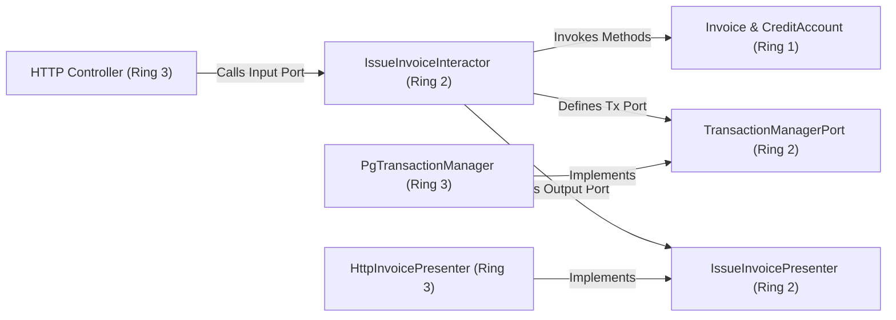
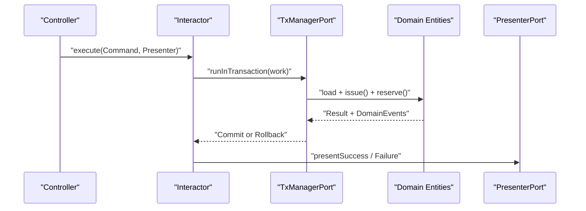

---
tags:
  - software-engineering
  - clean-architecture
  - entities
  - use-cases
  - ddd
  - typescript
created: 2026-11-13
updated: 2026-11-13
status: 🟢
level: mid-to-senior
---
# Entities & Use Cases

> [!abstract] Hub Context
> Part of [[Programming/Software Engineering/Clean Architecture/Clean Architecture Complete Guide|Clean Architecture Complete Guide]]. Follows [[Programming/Software Engineering/Clean Architecture/Dependency Rule|Dependency Rule]] and connects directly to [[Programming/Software Engineering/DDD/Tactical Design & Building Blocks|Tactical Design & Building Blocks]], [[Programming/Software Engineering/Clean Architecture/Interface Adapters & Frameworks|Interface Adapters & Frameworks]], and [[Programming/Software Engineering/Database Design/Transactions|Transactions]].

The two innermost rings of Clean Architecture divide core business software into **Enterprise Business Rules (Entities)** in Ring 1 and **Application Business Rules (Use Cases / Interactors)** in Ring 2. Separating these two layers isolates slow-changing domain invariants—rules that hold regardless of whether software is automated via REST APIs, CLI batches, or background queues—from fast-changing application orchestration workflows, transaction scopes, and external integration sequencing.

---

## 1. First-Principles Mechanics & Complete Architecture

### 1.1 Exact Split Criteria: Ring 1 vs Ring 2

Engineers frequently misplace validation or state-mutation rules between Entities and Use Cases, resulting in either **Anemic Domain Models** (dumb data structs manipulated by procedural Use Cases) or **Impure Entities** (domain classes issuing SQL queries or HTTP requests). The deterministic boundary rule relies on **execution context and policy scope**:

1. **Enterprise Business Rules (Entities / Value Objects / Domain Services — Ring 1)**: Rules inherent to the business domain itself that remain invariant across every possible delivery channel, workflow, or application. Ring 1 code executes strictly in-memory using pure language primitives and standard-library deterministic math.
   - *Concrete B2B Billing Examples*: `Money` cannot hold negative or fractional minor units; cross-currency addition is illegal; an `Invoice` cannot issue with zero line items; an `Invoice` in `ISSUED` or `VOIDED` status cannot double-issue; a `CreditAccount` cannot reserve credit exceeding `creditLimit - reservedBalance` or accept charges while `SUSPENDED`.
2. **Application Business Rules (Use Cases / Interactors — Ring 2)**: Workflow-specific orchestration defining what the software system does when a specific actor triggers an application command. Use Cases own dependency coordination through Output Ports, transaction atomicity, authorization policy enforcement against the authenticated caller, idempotency replay checks, and invocation of Domain Entities.
   - *Concrete B2B Billing Examples*: Verify the caller's `tenantId` matches the `CreditAccount` owner; check `IdempotencyPort` for a matching prior request hash; open an atomic unit of work via `TransactionManagerPort`; fetch `CreditAccount`, `Invoice`, and buyer tier discount policy; call `invoice.applyTierDiscount(...)`, `invoice.issue(now)`, and `creditAccount.reserveCredit(...)`; persist mutated aggregates, idempotency record, and outbox receipt event in one commit; pass the structured result to `IssueInvoicePresenter`.

| Architectural Dimension | Ring 1: Entities & Value Objects | Ring 2: Use Cases & Interactors |
|---|---|---|
| **Change Driver** | Financial math, legal compliance, state-machine invariants | New API flows, notification triggers, auth policies, step ordering |
| **Permitted Imports** | Same-domain Value Objects, Entities, Domain Services, pure `Result` types | Ring 1 Domain types + Ring 2 Input/Output Port interfaces |
| **Forbidden Imports** | Repositories, SQL clients, ORMs, HTTP frameworks, `Date.now()`, `process.env` | Express/Fastify, NestJS decorators, Prisma/TypeORM, `pg`, Axios/Stripe SDKs |
| **Side Effects** | Zero I/O; may append `DomainEvent` records into an internal uncommitted list | Coordinates database transactions, outbox writes, clocks, and ports |
| **Concurrency Model** | Holds explicit `version` attribute; protects internal object invariants | Owns optimistic concurrency retries, transaction boundaries, and locking order |
| **Test Execution** | Microsecond synchronous instantiation with zero stubs | Sub-millisecond async execution using deterministic in-memory fake ports |

### 1.2 Runtime Flow of Control vs Compile-Time Dependencies

At runtime, execution enters from an outer delivery adapter into a Use Case Input Port, loads aggregates through driven ports, mutates domain state inside Ring 1, persists state through transaction-scoped repositories, and pushes output data to a Presenter Output Port. At compile time, **every source-code import points strictly inward toward Ring 1**.



Notice why `IssueInvoiceInteractor` defines `TransactionManagerPort`, `CreditAccountRepository`, `InvoiceRepository`, and `IssueInvoicePresenter` inside Ring 2 (`src/billing/application/ports/`): Ring 2 dictates the exact contract it requires, while Ring 3 adapters (`PgTransactionManager`, `HttpInvoicePresenter`) import Ring 2 interfaces to satisfy them via [[Programming/Software Engineering/SOLID/Dependency Inversion|Dependency Inversion]].

### 1.3 Sequence of Execution Inside a Transactional Interactor

Every state-changing Use Case follows a strict five-phase sequence designed to prevent partial writes, stale reads, and long-held database locks during external I/O:



1. **Pre-Transaction Sanitization & Policy Gate**: Verify structural invariants on the Command DTO (non-empty strings) and enforce caller permission capabilities (`invoice:issue`) before acquiring any database connection from the pool.
2. **Idempotency Resolution Inside Transaction**: Acquire or inspect the idempotency record scoped to `(tenantId, idempotencyKey)` inside the same database transaction that persists domain mutations so idempotency markers and aggregate state share identical ACID guarantees.
3. **Hydration & Tenant Ownership Check**: Load Aggregate Roots via repository ports (`reconstitute`), verify resource-level ownership (`account.tenantId === cmd.actor.tenantId`), and obtain deterministic current time from `ClockPort`.
4. **Pure Domain Execution**: Pass loaded parameters and Value Objects into Entity methods (`invoice.issue(...)`, `creditAccount.reserveCredit(...)`). If any domain check returns an error `Result`, signal transaction rollback cleanly and map the failure to the Output Port.
5. **Atomic Persistence & Outbox Commit**: Save updated aggregates using optimistic concurrency checks (`expectedVersion`), record the `InvoiceIssued` integration payload in the transactional outbox table, store the serialized idempotency response snapshot, commit once, and render via `IssueInvoicePresenter`.

### 1.4 Aggregate Consistency Boundaries Inside Ring 1

An **Aggregate** is a cluster of domain objects treated as a single unit for invariant enforcement. Choosing aggregate boundaries determines both transactional contention and Entity design:

- **Single-Aggregate Invariant**: `Invoice` owns its `InvoiceLineItem[]` collection and `subtotal` calculation. No external object can hold a direct mutable reference to an `InvoiceLineItem` or add a line without passing through `Invoice.addLine(...)`, ensuring `Invoice.status === 'DRAFT'` is checked on every mutation.
- **Cross-Aggregate Invariant**: `CreditAccount` and `Invoice` live as **separate Aggregate Roots**. Why not embed every `Invoice` inside `CreditAccount`? A high-volume B2B enterprise customer accumulates 50,000+ invoices over time; loading 50,000 child rows into memory on every credit check causes OOM crashes and locks the entire customer subtree. Instead, `CreditAccount` tracks only the scalar `reservedBalance`, while the `IssueInvoiceInteractor` coordinates both `Invoice` and `CreditAccount` within a single `TransactionManagerPort` boundary (or via saga/outbox when accounts live in separate databases).

---

## 2. Real-World Use Cases & Decision Matrix

### 2.1 Rich Domain Model vs Anemic Transaction Script

| Factor | Rich Domain Model (Clean Entities) | Anemic Domain Model / Transaction Script |
|---|---|---|
| **Invariant Enforcement** | Guaranteed impossible to mutate state illegally; constructors and methods validate transitions | Validation lives inside scattered service functions; callers easily bypass rules |
| **Mutation API** | Domain verbs (`account.reserveCredit(amount, invId)`) hiding internal fields | Public mutable properties or setters (`account.reservedCents += x`) |
| **Testability** | Pure synchronous unit tests directly on `Invoice` and `CreditAccount` without fake repos | Requires setting up full Use Case / Service dependencies for every mathematical rule |
| **Allocation & Complexity Cost** | Requires explicit factories, `reconstitute()`, private state, and mappers | Minimal code for simple pass-through updates |

> [!warning] Hidden Damage of Public Setters on Entities
> Exposing `invoice.status = 'ISSUED'` or `setReservedCents(val)` turns an Entity into a raw struct. Six months later, a second team adds a `BulkImportInvoicesUseCase` or `AdminOverrideUseCase` that forgets to check `CreditAccount.availableCredit()`, silently corrupting ledger invariants in production. Private fields combined with domain verb methods close every illegal mutation path at compile time.

### 2.2 `Result<T, E>` Discriminated Unions vs Throwing Domain Exceptions

In TypeScript, `throw new Error(...)` erases failure modes from a function's type signature: callers have no compile-time visibility into which business errors a method can produce. Using a discriminated union `Result<T, E>` for **expected domain rejections** while reserving thrown exceptions for **unexpected bugs or infrastructure crashes** gives strict exhaustive checking across Ring 1, Ring 2, and Ring 3.

| Criterion | Typed `Result<T, E>` Union | Throwing Custom Exceptions |
|---|---|---|
| **Compiler Exhaustiveness** | TypeScript enforces handling every `E` variant via `switch` + `never` guard | Unchecked; missing `catch` branch silently escalates to HTTP `500` |
| **Performance Under Failure** | Zero `Error.captureStackTrace()` V8 stack unwinding overhead on validation rejects | Capturing V8 stack frames costs 10–50 microseconds per expected business rejection |
| **Transaction Rollback Ergonomics** | Requires explicit rollback signaling (`tx.markRollbackOnly()` or sentinel) inside `runInTransaction` | Any uncaught exception triggers automatic `ROLLBACK` inside standard `try/catch` Tx wrappers |
| **Best Applied To** | Business rule rejections (`INSUFFICIENT_CREDIT`, `INVOICE_ALREADY_ISSUED`, `FORBIDDEN`) | Programmer bugs (`NaN` minor units), corrupted DB state, dropped TCP sockets |

### 2.3 Real-World Adoption Scenarios & Decision Matrix

| Engineering Scenario | Recommended Inner Architecture | Justification & Trade-Off |
|---|---|---|
| **1. B2B Credit Line & Invoice Issuance** | Full Rich Entities + Interactor + `TransactionManagerPort` + `IdempotencyPort` | High financial risk; state transitions must survive concurrent HTTP retries and CLI backfills identically |
| **2. AR Aging & Invoice Search Dashboard** | **CQRS Read Query Bypass** (Query interface returning flat read DTO directly) | Hydrating `Invoice` and `CreditAccount` aggregates just to render paginated tables wastes CPU and SQL joins |
| **3. Multi-Service Checkout + Payment PSP** | Interactor commits `PENDING` + Outbox; async worker calls PSP outside DB lock | Calling Stripe/Adyen HTTP inside an open SQL transaction stalls Postgres connection pools during PSP latency spikes |
| **4. Shared Pricing Policy Across 3 Use Cases** | Pure **Domain Service** (`TierPricingPolicy`) injected or invoked inside Ring 1/2 | Prevents Use-Case-calling-Use-Case spaghetti and keeps discount rounding math unit-testable |
| **5. Static Lookup Table CRUD (Currencies/Countries)** | Thin Vertical Slice / Validated DTO directly to SQL | Zero state-machine invariants; wrapping a 3-column lookup table in Entities adds dead boilerplate |
| **6. High-Throughput Clickstream Ingestion** | Stateless stream transform + batch `COPY` / bulk `INSERT` | Instantiating thousands of validated Value Objects per millisecond spikes V8 young-generation GC |

### 2.4 Avoiding Use-Case-Calling-Use-Case Spaghetti

A recurring architectural failure occurs when `BulkApproveInvoicesUseCase` injects `IssueInvoiceInteractor` or `CheckoutUseCase` injects `ReserveCreditUseCase` and `SendReceiptUseCase`. Calling one Use Case from inside another produces four compounding failures:

1. **Nested Transaction Collisions**: Each Use Case calls `txManager.runInTransaction(...)`, either opening nested independent transactions (partial commits when the outer caller fails) or forcing complex savepoint propagation across port abstractions.
2. **Duplicate Authorization & Idempotency Overhead**: The inner Use Case repeats actor authorization and idempotency checks already performed by the outer coordinator.
3. **Presenter / Output Port Coupling**: Inner Use Cases bound to an Output Port (`IssueInvoicePresenter`) cannot easily return raw domain entities to an outer Use Case without awkward mock presenters.
4. **Transaction Lock Expansion**: Combining multiple workflows synchronously holds row locks across unrelated aggregates.

**Structural Remedies**:
- **Shared Synchronous Domain Logic**: Extract the reusable rule (for example, `InvoicePricingPolicy.applyBuyerTier(...)` or `CreditReservationService.reserveForInvoice(account, invoice, now)`) into a pure **Domain Service** in Ring 1. Both Use Cases call the Domain Service inside their own single `runInTransaction` scope.
- **Asynchronous Follow-Up Workflows**: When `IssueInvoiceInteractor` commits an issued invoice, it writes an `InvoiceIssued` event to `OutboxPort` inside the same transaction. Separate downstream Use Cases (`GeneratePdfReceiptUseCase`, `DispatchWebhookUseCase`) execute asynchronously as outbox event consumers with independent retries.

---

## 3. Step-by-Step Practical Application: B2B Credit Line & Invoice Issuance Core

Below is a complete, framework-free, runnable TypeScript inner core for a **B2B Credit Line & Invoice Issuance** bounded context, wired strictly via ports and verified with an in-memory Vitest test suite. Notice zero imports from Node HTTP servers, Express, Fastify, NestJS, Prisma, TypeORM, or PostgreSQL drivers exist anywhere in `src/billing/domain/` or `src/billing/application/`.

### 3.1 Screaming Directory Topology

```text
src/billing/
  domain/
    shared/
      Result.ts
      DomainEvent.ts
    value-objects/
      Money.ts
      BuyerTier.ts
    entities/
      CreditAccount.ts
      Invoice.ts
    services/
      TierPricingPolicy.ts
  application/
    ports/
      IssueInvoicePorts.ts
    use-cases/
      IssueInvoiceInteractor.ts
tests/billing/
  fakes/
    InMemoryBillingFakes.ts
  unit/
    IssueInvoiceInteractor.spec.ts
```

### 3.2 Ring 1 Shared Primitives (`Result.ts` and `DomainEvent.ts`)

```typescript
// src/billing/domain/shared/Result.ts
export type Result<T, E> =
  | { readonly ok: true; readonly value: T }
  | { readonly ok: false; readonly error: E };

export const ok = <T>(value: T): Result<T, never> => ({ ok: true, value });

export const err = <E>(error: E): Result<never, E> => ({ ok: false, error });

export function assertNever(value: never): never {
  throw new Error(`Unhandled discriminated union member: ${JSON.stringify(value)}`);
}

export class InvariantViolationError extends Error {
  constructor(message: string) {
    super(message);
    this.name = 'InvariantViolationError';
  }
}
```

```typescript
// src/billing/domain/shared/DomainEvent.ts
export interface DomainEvent<TType extends string = string, TPayload = unknown> {
  readonly eventId: string;
  readonly eventType: TType;
  readonly aggregateId: string;
  readonly aggregateType: 'CreditAccount' | 'Invoice';
  readonly occurredAtIso: string;
  readonly payload: TPayload;
}
```

### 3.3 Ring 1 Value Objects (`Money.ts` and `BuyerTier.ts`)

`Money` enforces integer minor-unit arithmetic (`cents`), prevents `NaN` or floating-point drift, rejects negative totals on construction, and prevents mixed-currency arithmetic. `BuyerTier` encapsulates wholesale discount rules deterministically using integer basis points (`100 bps = 1%`).

```typescript
// src/billing/domain/value-objects/Money.ts
import { InvariantViolationError, Result, err, ok } from '../shared/Result';

export type CurrencyCode = 'USD' | 'EUR' | 'GBP';

export type MoneyError =
  | { readonly code: 'NEGATIVE_OR_INVALID_MONEY'; readonly amountCents: number }
  | { readonly code: 'CURRENCY_MISMATCH'; readonly left: CurrencyCode; readonly right: CurrencyCode }
  | { readonly code: 'INSUFFICIENT_AMOUNT'; readonly available: number; readonly requested: number };

export class Money {
  private constructor(
    public readonly cents: number,
    public readonly currency: CurrencyCode,
  ) {}

  static create(cents: number, currency: CurrencyCode): Result<Money, MoneyError> {
    if (!Number.isSafeInteger(cents) || cents < 0) {
      return err({ code: 'NEGATIVE_OR_INVALID_MONEY', amountCents: cents });
    }
    return ok(new Money(cents, currency));
  }

  static reconstitute(cents: number, currency: CurrencyCode): Money {
    if (!Number.isSafeInteger(cents) || cents < 0) {
      throw new InvariantViolationError(`Corrupted persisted money cents: ${cents}`);
    }
    return new Money(cents, currency);
  }

  static zero(currency: CurrencyCode): Money {
    return new Money(0, currency);
  }

  add(other: Money): Result<Money, MoneyError> {
    if (this.currency !== other.currency) {
      return err({ code: 'CURRENCY_MISMATCH', left: this.currency, right: other.currency });
    }
    const sum = this.cents + other.cents;
    if (!Number.isSafeInteger(sum)) {
      throw new InvariantViolationError('Money integer overflow during addition');
    }
    return ok(new Money(sum, this.currency));
  }

  subtract(other: Money): Result<Money, MoneyError> {
    if (this.currency !== other.currency) {
      return err({ code: 'CURRENCY_MISMATCH', left: this.currency, right: other.currency });
    }
    if (other.cents > this.cents) {
      return err({
        code: 'INSUFFICIENT_AMOUNT',
        available: this.cents,
        requested: other.cents,
      });
    }
    return ok(new Money(this.cents - other.cents, this.currency));
  }

  applyBasisPointsDiscount(discountBps: number): Money {
    if (!Number.isInteger(discountBps) || discountBps < 0 || discountBps > 10_000) {
      throw new InvariantViolationError(`Discount basis points out of range [0..10000]: ${discountBps}`);
    }
    if (discountBps === 0) return this;
    const discountCents = Math.round((this.cents * discountBps) / 10_000);
    return new Money(this.cents - discountCents, this.currency);
  }

  isGreaterThan(other: Money): boolean {
    if (this.currency !== other.currency) {
      throw new InvariantViolationError(`Cannot compare ${this.currency} with ${other.currency}`);
    }
    return this.cents > other.cents;
  }

  equals(other: Money): boolean {
    return this.currency === other.currency && this.cents === other.cents;
  }
}
```

```typescript
// src/billing/domain/value-objects/BuyerTier.ts
import { InvariantViolationError } from '../shared/Result';

export type BuyerTierCode = 'STANDARD' | 'PREFERRED' | 'ENTERPRISE';

export class BuyerTier {
  private constructor(
    public readonly code: BuyerTierCode,
    public readonly discountBps: number,
  ) {}

  static fromCode(code: BuyerTierCode): BuyerTier {
    switch (code) {
      case 'STANDARD':
        return new BuyerTier('STANDARD', 0);
      case 'PREFERRED':
        return new BuyerTier('PREFERRED', 500); // 5.00% discount
      case 'ENTERPRISE':
        return new BuyerTier('ENTERPRISE', 1_200); // 12.00% discount
      default:
        throw new InvariantViolationError(`Unknown buyer tier: ${String(code)}`);
    }
  }
}
```

### 3.4 Ring 1 Aggregate Roots (`CreditAccount.ts` and `Invoice.ts`)

Both aggregates hide mutable properties behind private fields, expose explicit factory methods (`open` / `createDraft`) separate from DB hydration (`reconstitute`), buffer domain events locally without executing I/O, and carry optimistic `version` numbers.

```typescript
// src/billing/domain/entities/CreditAccount.ts
import { DomainEvent } from '../shared/DomainEvent';
import { InvariantViolationError, Result, err, ok } from '../shared/Result';
import { CurrencyCode, Money } from '../value-objects/Money';

export type CreditAccountStatus = 'ACTIVE' | 'SUSPENDED' | 'CLOSED';

export type CreditReservationError =
  | { readonly code: 'ACCOUNT_NOT_ACTIVE'; readonly accountId: string; readonly status: CreditAccountStatus }
  | { readonly code: 'ZERO_OR_NEGATIVE_RESERVATION'; readonly amountCents: number }
  | { readonly code: 'CURRENCY_MISMATCH'; readonly accountCurrency: CurrencyCode; readonly requestedCurrency: CurrencyCode }
  | { readonly code: 'INSUFFICIENT_CREDIT'; readonly availableCents: number; readonly requestedCents: number };

export interface CreditReservedEventPayload {
  readonly accountId: string;
  readonly tenantId: string;
  readonly invoiceId: string;
  readonly reservedDeltaCents: number;
  readonly remainingCreditCents: number;
  readonly currency: CurrencyCode;
}

export class CreditAccount {
  private domainEvents: DomainEvent[] = [];

  private constructor(
    public readonly id: string,
    public readonly tenantId: string,
    public readonly currency: CurrencyCode,
    private _creditLimit: Money,
    private _reservedBalance: Money,
    private _status: CreditAccountStatus,
    private _version: number,
  ) {}

  static open(params: {
    id: string;
    tenantId: string;
    creditLimit: Money;
  }): CreditAccount {
    if (!params.id.trim() || !params.tenantId.trim()) {
      throw new InvariantViolationError('CreditAccount requires non-empty id and tenantId');
    }
    return new CreditAccount(
      params.id,
      params.tenantId,
      params.creditLimit.currency,
      params.creditLimit,
      Money.zero(params.creditLimit.currency),
      'ACTIVE',
      0,
    );
  }

  static reconstitute(params: {
    id: string;
    tenantId: string;
    currency: CurrencyCode;
    creditLimitCents: number;
    reservedBalanceCents: number;
    status: CreditAccountStatus;
    version: number;
  }): CreditAccount {
    const limit = Money.reconstitute(params.creditLimitCents, params.currency);
    const reserved = Money.reconstitute(params.reservedBalanceCents, params.currency);
    if (reserved.isGreaterThan(limit)) {
      throw new InvariantViolationError(
        `Persisted CreditAccount ${params.id} has reserved ${reserved.cents} > limit ${limit.cents}`,
      );
    }
    return new CreditAccount(
      params.id,
      params.tenantId,
      params.currency,
      limit,
      reserved,
      params.status,
      params.version,
    );
  }

  reserveCredit(
    amount: Money,
    invoiceId: string,
    nowUtc: Date,
    eventId: string,
  ): Result<void, CreditReservationError> {
    if (this._status !== 'ACTIVE') {
      return err({
        code: 'ACCOUNT_NOT_ACTIVE',
        accountId: this.id,
        status: this._status,
      });
    }
    if (amount.currency !== this.currency) {
      return err({
        code: 'CURRENCY_MISMATCH',
        accountCurrency: this.currency,
        requestedCurrency: amount.currency,
      });
    }
    if (amount.cents <= 0) {
      return err({
        code: 'ZERO_OR_NEGATIVE_RESERVATION',
        amountCents: amount.cents,
      });
    }

    const available = this.availableCredit();
    if (amount.isGreaterThan(available)) {
      return err({
        code: 'INSUFFICIENT_CREDIT',
        availableCents: available.cents,
        requestedCents: amount.cents,
      });
    }

    const nextReserved = this._reservedBalance.add(amount);
    if (!nextReserved.ok) {
      throw new InvariantViolationError(`Unexpected currency failure adding credit: ${nextReserved.error.code}`);
    }

    this._reservedBalance = nextReserved.value;
    const remaining = this.availableCredit();

    this.domainEvents.push({
      eventId,
      eventType: 'CreditReserved',
      aggregateId: this.id,
      aggregateType: 'CreditAccount',
      occurredAtIso: nowUtc.toISOString(),
      payload: {
        accountId: this.id,
        tenantId: this.tenantId,
        invoiceId,
        reservedDeltaCents: amount.cents,
        remainingCreditCents: remaining.cents,
        currency: this.currency,
      } satisfies CreditReservedEventPayload,
    });

    return ok(undefined);
  }

  availableCredit(): Money {
    const diff = this._creditLimit.subtract(this._reservedBalance);
    if (!diff.ok) {
      throw new InvariantViolationError('CreditAccount invariant broken: reserved exceeds limit');
    }
    return diff.value;
  }

  suspend(): void {
    if (this._status === 'CLOSED') {
      throw new InvariantViolationError('Cannot suspend a closed CreditAccount');
    }
    this._status = 'SUSPENDED';
  }

  pullDomainEvents(): readonly DomainEvent[] {
    const events = [...this.domainEvents];
    this.domainEvents = [];
    return events;
  }

  get creditLimit(): Money {
    return this._creditLimit;
  }

  get reservedBalance(): Money {
    return this._reservedBalance;
  }

  get status(): CreditAccountStatus {
    return this._status;
  }

  get version(): number {
    return this._version;
  }
}
```

```typescript
// src/billing/domain/entities/Invoice.ts
import { DomainEvent } from '../shared/DomainEvent';
import { InvariantViolationError, Result, err, ok } from '../shared/Result';
import { BuyerTier } from '../value-objects/BuyerTier';
import { CurrencyCode, Money } from '../value-objects/Money';

export type InvoiceStatus = 'DRAFT' | 'ISSUED' | 'VOIDED';

export interface InvoiceLineProps {
  readonly sku: string;
  readonly description: string;
  readonly quantity: number;
  readonly unitPriceCents: number;
}

export class InvoiceLineItem {
  private constructor(
    public readonly sku: string,
    public readonly description: string,
    public readonly quantity: number,
    public readonly unitPrice: Money,
    public readonly lineTotal: Money,
  ) {}

  static create(props: InvoiceLineProps, currency: CurrencyCode): Result<InvoiceLineItem, InvoiceError> {
    if (!props.sku.trim() || !props.description.trim()) {
      return err({ code: 'INVALID_LINE_ITEM', reason: 'SKU and description must be non-empty' });
    }
    if (!Number.isSafeInteger(props.quantity) || props.quantity <= 0) {
      return err({ code: 'INVALID_LINE_ITEM', reason: 'Line quantity must be a positive integer' });
    }
    const unitPriceResult = Money.create(props.unitPriceCents, currency);
    if (!unitPriceResult.ok || unitPriceResult.value.cents <= 0) {
      return err({ code: 'INVALID_LINE_ITEM', reason: 'Unit price must be a positive integer in minor units' });
    }
    const lineCents = props.unitPriceCents * props.quantity;
    const lineTotalResult = Money.create(lineCents, currency);
    if (!lineTotalResult.ok) {
      return err({ code: 'INVALID_LINE_ITEM', reason: 'Line total exceeds safe integer precision' });
    }
    return ok(
      new InvoiceLineItem(
        props.sku.trim(),
        props.description.trim(),
        props.quantity,
        unitPriceResult.value,
        lineTotalResult.value,
      ),
    );
  }
}

export type InvoiceError =
  | { readonly code: 'INVALID_LINE_ITEM'; readonly reason: string }
  | { readonly code: 'EMPTY_INVOICE'; readonly invoiceId: string }
  | { readonly code: 'INVOICE_ALREADY_ISSUED'; readonly invoiceId: string; readonly issuedAtIso: string }
  | { readonly code: 'INVOICE_VOIDED'; readonly invoiceId: string };

export interface InvoiceIssuedEventPayload {
  readonly invoiceId: string;
  readonly tenantId: string;
  readonly accountId: string;
  readonly grossTotalCents: number;
  readonly discountCents: number;
  readonly netTotalCents: number;
  readonly currency: CurrencyCode;
  readonly tierApplied: string;
  readonly issuedAtIso: string;
}

export class Invoice {
  private domainEvents: DomainEvent[] = [];

  private constructor(
    public readonly id: string,
    public readonly tenantId: string,
    public readonly accountId: string,
    public readonly currency: CurrencyCode,
    private readonly _lines: InvoiceLineItem[],
    private _discountBps: number,
    private _status: InvoiceStatus,
    private _issuedAt: Date | null,
    private _version: number,
  ) {}

  static createDraft(params: {
    id: string;
    tenantId: string;
    accountId: string;
    currency: CurrencyCode;
    lines: readonly InvoiceLineProps[];
  }): Result<Invoice, InvoiceError> {
    if (!params.id.trim() || !params.tenantId.trim() || !params.accountId.trim()) {
      throw new InvariantViolationError('Invoice requires id, tenantId, and accountId');
    }
    if (params.lines.length === 0) {
      return err({ code: 'EMPTY_INVOICE', invoiceId: params.id });
    }

    const builtLines: InvoiceLineItem[] = [];
    for (const raw of params.lines) {
      const itemRes = InvoiceLineItem.create(raw, params.currency);
      if (!itemRes.ok) return err(itemRes.error);
      builtLines.push(itemRes.value);
    }

    return ok(
      new Invoice(
        params.id,
        params.tenantId,
        params.accountId,
        params.currency,
        builtLines,
        0,
        'DRAFT',
        null,
        0,
      ),
    );
  }

  static reconstitute(params: {
    id: string;
    tenantId: string;
    accountId: string;
    currency: CurrencyCode;
    lines: readonly InvoiceLineProps[];
    discountBps: number;
    status: InvoiceStatus;
    issuedAtIso: string | null;
    version: number;
  }): Invoice {
    const builtLines: InvoiceLineItem[] = params.lines.map((raw) => {
      const res = InvoiceLineItem.create(raw, params.currency);
      if (!res.ok) {
        throw new InvariantViolationError(`Corrupted line item in invoice ${params.id}: ${res.error.reason}`);
      }
      return res.value;
    });
    return new Invoice(
      params.id,
      params.tenantId,
      params.accountId,
      params.currency,
      builtLines,
      params.discountBps,
      params.status,
      params.issuedAtIso ? new Date(params.issuedAtIso) : null,
      params.version,
    );
  }

  grossTotal(): Money {
    let total = Money.zero(this.currency);
    for (const line of this._lines) {
      const added = total.add(line.lineTotal);
      if (!added.ok) {
        throw new InvariantViolationError(`Line currency mismatch in invoice ${this.id}`);
      }
      total = added.value;
    }
    return total;
  }

  netTotal(): Money {
    return this.grossTotal().applyBasisPointsDiscount(this._discountBps);
  }

  applyTierDiscount(tier: BuyerTier): Result<void, InvoiceError> {
    if (this._status === 'ISSUED') {
      return err({
        code: 'INVOICE_ALREADY_ISSUED',
        invoiceId: this.id,
        issuedAtIso: this._issuedAt!.toISOString(),
      });
    }
    if (this._status === 'VOIDED') {
      return err({ code: 'INVOICE_VOIDED', invoiceId: this.id });
    }
    this._discountBps = tier.discountBps;
    return ok(undefined);
  }

  issue(nowUtc: Date, eventId: string): Result<Money, InvoiceError> {
    if (this._status === 'ISSUED') {
      return err({
        code: 'INVOICE_ALREADY_ISSUED',
        invoiceId: this.id,
        issuedAtIso: this._issuedAt!.toISOString(),
      });
    }
    if (this._status === 'VOIDED') {
      return err({ code: 'INVOICE_VOIDED', invoiceId: this.id });
    }
    if (this._lines.length === 0) {
      return err({ code: 'EMPTY_INVOICE', invoiceId: this.id });
    }

    const gross = this.grossTotal();
    const net = this.netTotal();
    const discountRes = gross.subtract(net);
    const discountCents = discountRes.ok ? discountRes.value.cents : 0;

    this._status = 'ISSUED';
    this._issuedAt = new Date(nowUtc.getTime());

    this.domainEvents.push({
      eventId,
      eventType: 'InvoiceIssued',
      aggregateId: this.id,
      aggregateType: 'Invoice',
      occurredAtIso: this._issuedAt.toISOString(),
      payload: {
        invoiceId: this.id,
        tenantId: this.tenantId,
        accountId: this.accountId,
        grossTotalCents: gross.cents,
        discountCents,
        netTotalCents: net.cents,
        currency: this.currency,
        tierApplied: `${this._discountBps}bps`,
        issuedAtIso: this._issuedAt.toISOString(),
      } satisfies InvoiceIssuedEventPayload,
    });

    return ok(net);
  }

  pullDomainEvents(): readonly DomainEvent[] {
    const events = [...this.domainEvents];
    this.domainEvents = [];
    return events;
  }

  get lines(): readonly InvoiceLineItem[] {
    return this._lines;
  }

  get discountBps(): number {
    return this._discountBps;
  }

  get status(): InvoiceStatus {
    return this._status;
  }

  get issuedAt(): Date | null {
    return this._issuedAt ? new Date(this._issuedAt.getTime()) : null;
  }

  get version(): number {
    return this._version;
  }
}
```

### 3.5 Ring 2 Ports: `TransactionManagerPort`, `IdempotencyPort`, and Output Port (`IssueInvoicePorts.ts`)

Notice how `TransactionManagerPort.runInTransaction` exposes transactional repository handles (`BillingTxPorts`) alongside a `tx.rollback()` capability without referencing SQL connections, Prisma clients, or TypeORM `EntityManager`.

```typescript
// src/billing/application/ports/IssueInvoicePorts.ts
import { CreditAccount, CreditAccountStatus } from '../../domain/entities/CreditAccount';
import { Invoice, InvoiceLineProps } from '../../domain/entities/Invoice';
import { DomainEvent } from '../../domain/shared/DomainEvent';
import { BuyerTierCode } from '../../domain/value-objects/BuyerTier';
import { CurrencyCode } from '../../domain/value-objects/Money';

export interface AuthenticatedActor {
  readonly userId: string;
  readonly tenantId: string;
  readonly permissions: readonly string[];
}

export interface IssueInvoiceCommand {
  readonly actor: AuthenticatedActor;
  readonly idempotencyKey: string;
  readonly invoiceId: string;
  readonly accountId: string;
  readonly currency: CurrencyCode;
  readonly lines: readonly InvoiceLineProps[];
}

export interface IssueInvoiceResponse {
  readonly invoiceId: string;
  readonly accountId: string;
  readonly grossTotalCents: number;
  readonly netTotalCents: number;
  readonly discountBps: number;
  readonly remainingCreditCents: number;
  readonly currency: CurrencyCode;
  readonly issuedAtIso: string;
}

export type IssueInvoiceError =
  | { readonly code: 'FORBIDDEN_ACTION'; readonly requiredPermission: string }
  | { readonly code: 'FORBIDDEN_TENANT_ACCESS'; readonly accountId: string }
  | { readonly code: 'ACCOUNT_NOT_FOUND'; readonly accountId: string }
  | { readonly code: 'ACCOUNT_NOT_ACTIVE'; readonly accountId: string; readonly status: CreditAccountStatus }
  | { readonly code: 'INVOICE_ALREADY_ISSUED'; readonly invoiceId: string; readonly issuedAtIso: string }
  | { readonly code: 'INVOICE_VOIDED'; readonly invoiceId: string }
  | { readonly code: 'INVALID_INVOICE_DATA'; readonly reason: string }
  | { readonly code: 'CURRENCY_MISMATCH'; readonly expected: CurrencyCode; readonly actual: CurrencyCode }
  | { readonly code: 'INSUFFICIENT_CREDIT'; readonly availableCents: number; readonly requestedCents: number }
  | { readonly code: 'IDEMPOTENCY_CONFLICT'; readonly idempotencyKey: string }
  | { readonly code: 'IDEMPOTENCY_IN_FLIGHT'; readonly idempotencyKey: string }
  | { readonly code: 'CONCURRENCY_CONFLICT'; readonly resourceId: string };

export interface IssueInvoicePresenter<TView> {
  presentSuccess(output: IssueInvoiceResponse): TView;
  presentIdempotentReplay(output: IssueInvoiceResponse): TView;
  presentFailure(error: IssueInvoiceError): TView;
}

export interface IssueInvoiceInputPort {
  execute<TView>(
    cmd: IssueInvoiceCommand,
    presenter: IssueInvoicePresenter<TView>,
  ): Promise<TView>;
}

export interface CreditAccountRepository {
  findByIdForUpdate(accountId: string): Promise<CreditAccount | null>;
  save(account: CreditAccount): Promise<{ ok: true } | { ok: false; reason: 'OPTIMISTIC_LOCK_CONFLICT' }>;
}

export interface InvoiceRepository {
  findById(invoiceId: string): Promise<Invoice | null>;
  save(invoice: Invoice): Promise<{ ok: true } | { ok: false; reason: 'OPTIMISTIC_LOCK_CONFLICT' | 'DUPLICATE_ID' }>;
}

export interface BuyerTierPort {
  getTierForAccount(tenantId: string, accountId: string): Promise<BuyerTierCode>;
}

export interface OutboxPort {
  appendBatch(events: readonly DomainEvent[]): Promise<void>;
}

export type IdempotencyLookupResult =
  | { readonly state: 'NEW' }
  | { readonly state: 'IN_PROGRESS' }
  | { readonly state: 'HASH_MISMATCH' }
  | { readonly state: 'COMPLETED'; readonly response: IssueInvoiceResponse };

export interface IdempotencyPort {
  claimOrInspect(
    tenantId: string,
    idempotencyKey: string,
    requestHash: string,
  ): Promise<IdempotencyLookupResult>;
  markCompleted(
    tenantId: string,
    idempotencyKey: string,
    response: IssueInvoiceResponse,
  ): Promise<void>;
}

export interface BillingTxPorts {
  readonly creditAccounts: CreditAccountRepository;
  readonly invoices: InvoiceRepository;
  readonly buyerTiers: BuyerTierPort;
  readonly outbox: OutboxPort;
  readonly idempotency: IdempotencyPort;
  rollback(): void;
}

export interface TransactionManagerPort {
  runInTransaction<T>(work: (txPorts: BillingTxPorts) => Promise<T>): Promise<T>;
}

export interface ClockPort {
  nowUtc(): Date;
}

export interface IdGeneratorPort {
  nextEventId(): string;
}
```

### 3.6 Ring 2 Interactor (`IssueInvoiceInteractor.ts`)

Notice how every responsibility stays razor-sharp:
- Pure deterministic request hashing (`computeCanonicalPayloadHash`) uses FNV-1a / canonical JSON serialization without importing Node's `node:crypto` if strict zero-platform portability is desired, or a `HashPort` when SHA-256 is required.
- Authorization checks occur cleanly inside Ring 2: permission check (`invoice:issue`) runs before touching database transactions, while tenant-ownership check (`account.tenantId === cmd.actor.tenantId`) runs immediately after hydrating `CreditAccount`.
- When any domain or repository `Result` indicates failure inside `runInTransaction`, `tx.rollback()` is invoked explicitly so the transaction manager never commits partial mutations.

```typescript
// src/billing/application/use-cases/IssueInvoiceInteractor.ts
import type { CreditReservationError } from '../../domain/entities/CreditAccount';
import { Invoice, InvoiceError } from '../../domain/entities/Invoice';
import { assertNever, Result, err, ok } from '../../domain/shared/Result';
import { BuyerTier } from '../../domain/value-objects/BuyerTier';
import {
  BillingTxPorts,
  ClockPort,
  IdGeneratorPort,
  IssueInvoiceCommand,
  IssueInvoiceError,
  IssueInvoiceInputPort,
  IssueInvoicePresenter,
  IssueInvoiceResponse,
  TransactionManagerPort,
} from '../ports/IssueInvoicePorts';

type TxExecutionOutcome =
  | { readonly kind: 'CREATED'; readonly response: IssueInvoiceResponse }
  | { readonly kind: 'REPLAYED'; readonly response: IssueInvoiceResponse }
  | { readonly kind: 'FAILED'; readonly error: IssueInvoiceError };

export class IssueInvoiceInteractor implements IssueInvoiceInputPort {
  constructor(
    private readonly txManager: TransactionManagerPort,
    private readonly clock: ClockPort,
    private readonly idGen: IdGeneratorPort,
  ) {}

  async execute<TView>(
    cmd: IssueInvoiceCommand,
    presenter: IssueInvoicePresenter<TView>,
  ): Promise<TView> {
    if (!cmd.actor.permissions.includes('invoice:issue')) {
      return presenter.presentFailure({
        code: 'FORBIDDEN_ACTION',
        requiredPermission: 'invoice:issue',
      });
    }

    if (!cmd.idempotencyKey.trim()) {
      return presenter.presentFailure({
        code: 'INVALID_INVOICE_DATA',
        reason: 'Idempotency key is required',
      });
    }

    const requestHash = this.canonicalCommandHash(cmd);

    const outcome = await this.txManager.runInTransaction<TxExecutionOutcome>(
      async (tx) => this.executeInsideTx(tx, cmd, requestHash),
    );

    switch (outcome.kind) {
      case 'CREATED':
        return presenter.presentSuccess(outcome.response);
      case 'REPLAYED':
        return presenter.presentIdempotentReplay(outcome.response);
      case 'FAILED':
        return presenter.presentFailure(outcome.error);
      default:
        return assertNever(outcome);
    }
  }

  private async executeInsideTx(
    tx: BillingTxPorts,
    cmd: IssueInvoiceCommand,
    requestHash: string,
  ): Promise<TxExecutionOutcome> {
    const fail = (error: IssueInvoiceError): TxExecutionOutcome => {
      tx.rollback();
      return { kind: 'FAILED', error };
    };

    const idempotency = await tx.idempotency.claimOrInspect(
      cmd.actor.tenantId,
      cmd.idempotencyKey,
      requestHash,
    );

    if (idempotency.state === 'COMPLETED') {
      return { kind: 'REPLAYED', response: idempotency.response };
    }
    if (idempotency.state === 'HASH_MISMATCH') {
      return fail({ code: 'IDEMPOTENCY_CONFLICT', idempotencyKey: cmd.idempotencyKey });
    }
    if (idempotency.state === 'IN_PROGRESS') {
      return fail({ code: 'IDEMPOTENCY_IN_FLIGHT', idempotencyKey: cmd.idempotencyKey });
    }

    const account = await tx.creditAccounts.findByIdForUpdate(cmd.accountId);
    if (!account) {
      return fail({ code: 'ACCOUNT_NOT_FOUND', accountId: cmd.accountId });
    }
    if (account.tenantId !== cmd.actor.tenantId) {
      return fail({ code: 'FORBIDDEN_TENANT_ACCESS', accountId: cmd.accountId });
    }

    const invoiceRes = await this.loadOrCreateDraft(tx, cmd);
    if (!invoiceRes.ok) {
      return fail(invoiceRes.error);
    }
    const invoice = invoiceRes.value;

    if (invoice.tenantId !== cmd.actor.tenantId) {
      return fail({ code: 'FORBIDDEN_TENANT_ACCESS', accountId: cmd.accountId });
    }

    const tierCode = await tx.buyerTiers.getTierForAccount(cmd.actor.tenantId, account.id);
    const tier = BuyerTier.fromCode(tierCode);

    const discountRes = invoice.applyTierDiscount(tier);
    if (!discountRes.ok) {
      return fail(this.mapInvoiceError(discountRes.error));
    }

    const nowUtc = this.clock.nowUtc();
    const issueRes = invoice.issue(nowUtc, this.idGen.nextEventId());
    if (!issueRes.ok) {
      return fail(this.mapInvoiceError(issueRes.error));
    }

    const netTotal = issueRes.value;
    const reserveRes = account.reserveCredit(
      netTotal,
      invoice.id,
      nowUtc,
      this.idGen.nextEventId(),
    );
    if (!reserveRes.ok) {
      return fail(this.mapReservationError(reserveRes.error));
    }

    const saveInvRes = await tx.invoices.save(invoice);
    if (!saveInvRes.ok) {
      return fail({ code: 'CONCURRENCY_CONFLICT', resourceId: invoice.id });
    }

    const saveAccRes = await tx.creditAccounts.save(account);
    if (!saveAccRes.ok) {
      return fail({ code: 'CONCURRENCY_CONFLICT', resourceId: account.id });
    }

    const domainEvents = [
      ...invoice.pullDomainEvents(),
      ...account.pullDomainEvents(),
    ];
    await tx.outbox.appendBatch(domainEvents);

    const response: IssueInvoiceResponse = {
      invoiceId: invoice.id,
      accountId: account.id,
      grossTotalCents: invoice.grossTotal().cents,
      netTotalCents: netTotal.cents,
      discountBps: invoice.discountBps,
      remainingCreditCents: account.availableCredit().cents,
      currency: invoice.currency,
      issuedAtIso: nowUtc.toISOString(),
    };

    await tx.idempotency.markCompleted(cmd.actor.tenantId, cmd.idempotencyKey, response);
    return { kind: 'CREATED', response };
  }

  private async loadOrCreateDraft(
    tx: BillingTxPorts,
    cmd: IssueInvoiceCommand,
  ): Promise<Result<Invoice, IssueInvoiceError>> {
    const existing = await tx.invoices.findById(cmd.invoiceId);
    if (existing) {
      return ok(existing);
    }
    const created = Invoice.createDraft({
      id: cmd.invoiceId,
      tenantId: cmd.actor.tenantId,
      accountId: cmd.accountId,
      currency: cmd.currency,
      lines: cmd.lines,
    });
    if (!created.ok) {
      return err(this.mapInvoiceError(created.error));
    }
    return ok(created.value);
  }

  private mapInvoiceError(error: InvoiceError): IssueInvoiceError {
    switch (error.code) {
      case 'EMPTY_INVOICE':
        return { code: 'INVALID_INVOICE_DATA', reason: 'Invoice must contain at least one line item' };
      case 'INVALID_LINE_ITEM':
        return { code: 'INVALID_INVOICE_DATA', reason: error.reason };
      case 'INVOICE_ALREADY_ISSUED':
        return {
          code: 'INVOICE_ALREADY_ISSUED',
          invoiceId: error.invoiceId,
          issuedAtIso: error.issuedAtIso,
        };
      case 'INVOICE_VOIDED':
        return { code: 'INVOICE_VOIDED', invoiceId: error.invoiceId };
      default:
        return assertNever(error);
    }
  }

  private mapReservationError(error: CreditReservationError): IssueInvoiceError {
    switch (error.code) {
      case 'ACCOUNT_NOT_ACTIVE':
        return { code: 'ACCOUNT_NOT_ACTIVE', accountId: error.accountId, status: error.status };
      case 'CURRENCY_MISMATCH':
        return { code: 'CURRENCY_MISMATCH', expected: error.accountCurrency, actual: error.requestedCurrency };
      case 'ZERO_OR_NEGATIVE_RESERVATION':
        return { code: 'INVALID_INVOICE_DATA', reason: 'Net invoice total must be positive' };
      case 'INSUFFICIENT_CREDIT':
        return {
          code: 'INSUFFICIENT_CREDIT',
          availableCents: error.availableCents,
          requestedCents: error.requestedCents,
        };
      default:
        return assertNever(error);
    }
  }

  private canonicalCommandHash(cmd: IssueInvoiceCommand): string {
    const canonical = JSON.stringify({
      tenantId: cmd.actor.tenantId,
      invoiceId: cmd.invoiceId,
      accountId: cmd.accountId,
      currency: cmd.currency,
      lines: cmd.lines.map((l) => ({
        sku: l.sku.trim(),
        quantity: l.quantity,
        unitPriceCents: l.unitPriceCents,
      })),
    });
    let hash = 2166136261;
    for (let i = 0; i < canonical.length; i += 1) {
      hash ^= canonical.charCodeAt(i);
      hash = Math.imul(hash, 16777619);
    }
    return (hash >>> 0).toString(16).padStart(8, '0');
  }
}
```

### 3.7 Fast Sub-Second In-Memory Vitest Suite (Zero Mocks, Zero Docker)

By implementing an in-memory `InMemoryTransactionManager` that takes deep structural snapshots on entry and discards mutations whenever `tx.rollback()` is called or an error throws, the unit suite verifies real rollback behavior, optimistic locking, idempotency replay, authorization, and domain invariants in milliseconds. See [[Programming/Software Engineering/Testing/Unit Testing|Unit Testing]] and [[Programming/Software Engineering/Testing/Mocking|Mocking]].

```typescript
// tests/billing/fakes/InMemoryBillingFakes.ts
import {
  BillingTxPorts,
  ClockPort,
  CreditAccountRepository,
  IdGeneratorPort,
  IdempotencyLookupResult,
  IdempotencyPort,
  InvoiceRepository,
  IssueInvoiceError,
  IssueInvoicePresenter,
  IssueInvoiceResponse,
  OutboxPort,
  TransactionManagerPort,
} from '../../../src/billing/application/ports/IssueInvoicePorts';
import { CreditAccount, CreditAccountStatus } from '../../../src/billing/domain/entities/CreditAccount';
import { Invoice, InvoiceLineProps, InvoiceStatus } from '../../../src/billing/domain/entities/Invoice';
import { DomainEvent } from '../../../src/billing/domain/shared/DomainEvent';
import { BuyerTierCode } from '../../../src/billing/domain/value-objects/BuyerTier';
import { CurrencyCode } from '../../../src/billing/domain/value-objects/Money';

interface StoredAccountRow {
  id: string;
  tenantId: string;
  currency: CurrencyCode;
  creditLimitCents: number;
  reservedBalanceCents: number;
  status: CreditAccountStatus;
  version: number;
}

interface StoredInvoiceRow {
  id: string;
  tenantId: string;
  accountId: string;
  currency: CurrencyCode;
  lines: InvoiceLineProps[];
  discountBps: number;
  status: InvoiceStatus;
  issuedAtIso: string | null;
  version: number;
}

interface StoredIdempotencyRow {
  hash: string;
  state: 'IN_PROGRESS' | 'COMPLETED';
  response?: IssueInvoiceResponse;
}

export class InMemoryBillingDatabase {
  public accounts = new Map<string, StoredAccountRow>();
  public invoices = new Map<string, StoredInvoiceRow>();
  public buyerTiers = new Map<string, BuyerTierCode>();
  public idempotency = new Map<string, StoredIdempotencyRow>();
  public outbox: DomainEvent[] = [];

  cloneSnapshot(): InMemoryBillingDatabase {
    const copy = new InMemoryBillingDatabase();
    copy.accounts = new Map(structuredClone([...this.accounts.entries()]));
    copy.invoices = new Map(structuredClone([...this.invoices.entries()]));
    copy.buyerTiers = new Map(this.buyerTiers);
    copy.idempotency = new Map(structuredClone([...this.idempotency.entries()]));
    copy.outbox = structuredClone(this.outbox);
    return copy;
  }

  restoreFrom(snapshot: InMemoryBillingDatabase): void {
    this.accounts = snapshot.accounts;
    this.invoices = snapshot.invoices;
    this.buyerTiers = snapshot.buyerTiers;
    this.idempotency = snapshot.idempotency;
    this.outbox = snapshot.outbox;
  }
}

export class InMemoryTransactionManager implements TransactionManagerPort {
  constructor(private readonly db: InMemoryBillingDatabase) {}

  async runInTransaction<T>(work: (txPorts: BillingTxPorts) => Promise<T>): Promise<T> {
    const workingCopy = this.db.cloneSnapshot();
    let rolledBack = false;

    const txPorts: BillingTxPorts = {
      creditAccounts: new InMemoryCreditAccountRepo(workingCopy),
      invoices: new InMemoryInvoiceRepo(workingCopy),
      buyerTiers: {
        async getTierForAccount(tenantId, accountId) {
          return workingCopy.buyerTiers.get(`${tenantId}:${accountId}`) ?? 'STANDARD';
        },
      },
      outbox: new InMemoryOutbox(workingCopy),
      idempotency: new InMemoryIdempotency(workingCopy),
      rollback: () => {
        rolledBack = true;
      },
    };

    try {
      const result = await work(txPorts);
      if (!rolledBack) {
        this.db.restoreFrom(workingCopy);
      }
      return result;
    } catch (error) {
      rolledBack = true;
      throw error;
    }
  }
}

class InMemoryCreditAccountRepo implements CreditAccountRepository {
  constructor(private readonly db: InMemoryBillingDatabase) {}

  async findByIdForUpdate(accountId: string): Promise<CreditAccount | null> {
    const row = this.db.accounts.get(accountId);
    return row ? CreditAccount.reconstitute(row) : null;
  }

  async save(account: CreditAccount): Promise<{ ok: true } | { ok: false; reason: 'OPTIMISTIC_LOCK_CONFLICT' }> {
    const current = this.db.accounts.get(account.id);
    if (current && current.version !== account.version) {
      return { ok: false, reason: 'OPTIMISTIC_LOCK_CONFLICT' };
    }
    this.db.accounts.set(account.id, {
      id: account.id,
      tenantId: account.tenantId,
      currency: account.currency,
      creditLimitCents: account.creditLimit.cents,
      reservedBalanceCents: account.reservedBalance.cents,
      status: account.status,
      version: account.version + 1,
    });
    return { ok: true };
  }
}

class InMemoryInvoiceRepo implements InvoiceRepository {
  constructor(private readonly db: InMemoryBillingDatabase) {}

  async findById(invoiceId: string): Promise<Invoice | null> {
    const row = this.db.invoices.get(invoiceId);
    return row ? Invoice.reconstitute(row) : null;
  }

  async save(invoice: Invoice): Promise<{ ok: true } | { ok: false; reason: 'OPTIMISTIC_LOCK_CONFLICT' | 'DUPLICATE_ID' }> {
    const current = this.db.invoices.get(invoice.id);
    if (current && current.version !== invoice.version) {
      return { ok: false, reason: 'OPTIMISTIC_LOCK_CONFLICT' };
    }
    this.db.invoices.set(invoice.id, {
      id: invoice.id,
      tenantId: invoice.tenantId,
      accountId: invoice.accountId,
      currency: invoice.currency,
      lines: invoice.lines.map((l) => ({
        sku: l.sku,
        description: l.description,
        quantity: l.quantity,
        unitPriceCents: l.unitPrice.cents,
      })),
      discountBps: invoice.discountBps,
      status: invoice.status,
      issuedAtIso: invoice.issuedAt ? invoice.issuedAt.toISOString() : null,
      version: invoice.version + 1,
    });
    return { ok: true };
  }
}

class InMemoryOutbox implements OutboxPort {
  constructor(private readonly db: InMemoryBillingDatabase) {}

  async appendBatch(events: readonly DomainEvent[]): Promise<void> {
    this.db.outbox.push(...events);
  }
}

class InMemoryIdempotency implements IdempotencyPort {
  constructor(private readonly db: InMemoryBillingDatabase) {}

  async claimOrInspect(
    tenantId: string,
    idempotencyKey: string,
    requestHash: string,
  ): Promise<IdempotencyLookupResult> {
    const key = `${tenantId}:${idempotencyKey}`;
    const existing = this.db.idempotency.get(key);
    if (!existing) {
      this.db.idempotency.set(key, { hash: requestHash, state: 'IN_PROGRESS' });
      return { state: 'NEW' };
    }
    if (existing.hash !== requestHash) {
      return { state: 'HASH_MISMATCH' };
    }
    if (existing.state === 'IN_PROGRESS') {
      return { state: 'IN_PROGRESS' };
    }
    return { state: 'COMPLETED', response: existing.response! };
  }

  async markCompleted(
    tenantId: string,
    idempotencyKey: string,
    response: IssueInvoiceResponse,
  ): Promise<void> {
    const key = `${tenantId}:${idempotencyKey}`;
    const existing = this.db.idempotency.get(key)!;
    this.db.idempotency.set(key, {
      hash: existing.hash,
      state: 'COMPLETED',
      response,
    });
  }
}

export class FixedClock implements ClockPort {
  constructor(private readonly fixedDate: Date) {}
  nowUtc(): Date {
    return new Date(this.fixedDate.getTime());
  }
}

export class SequentialIdGenerator implements IdGeneratorPort {
  private counter = 0;
  nextEventId(): string {
    this.counter += 1;
    return `evt_${String(this.counter).padStart(4, '0')}`;
  }
}

export type CapturedViewModel =
  | { status: 'CREATED'; body: IssueInvoiceResponse }
  | { status: 'REPLAYED'; body: IssueInvoiceResponse }
  | { status: 'ERROR'; error: IssueInvoiceError };

export class CapturingIssueInvoicePresenter implements IssueInvoicePresenter<CapturedViewModel> {
  presentSuccess(output: IssueInvoiceResponse): CapturedViewModel {
    return { status: 'CREATED', body: output };
  }
  presentIdempotentReplay(output: IssueInvoiceResponse): CapturedViewModel {
    return { status: 'REPLAYED', body: output };
  }
  presentFailure(error: IssueInvoiceError): CapturedViewModel {
    return { status: 'ERROR', error };
  }
}
```

```typescript
// tests/billing/unit/IssueInvoiceInteractor.spec.ts
import { describe, expect, it, beforeEach } from 'vitest';
import { IssueInvoiceInteractor } from '../../../src/billing/application/use-cases/IssueInvoiceInteractor';
import { CreditAccount } from '../../../src/billing/domain/entities/CreditAccount';
import { Money } from '../../../src/billing/domain/value-objects/Money';
import {
  CapturingIssueInvoicePresenter,
  FixedClock,
  InMemoryBillingDatabase,
  InMemoryTransactionManager,
  SequentialIdGenerator,
} from '../fakes/InMemoryBillingFakes';

describe('IssueInvoiceInteractor (Pure Inner Core)', () => {
  let db: InMemoryBillingDatabase;
  let interactor: IssueInvoiceInteractor;
  let presenter: CapturingIssueInvoicePresenter;

  beforeEach(() => {
    db = new InMemoryBillingDatabase();
    db.accounts.set('acc_1', {
      id: 'acc_1',
      tenantId: 'tenant_alpha',
      currency: 'USD',
      creditLimitCents: 100_000, // $1,000.00
      reservedBalanceCents: 20_000, // $200.00 used -> $800.00 available
      status: 'ACTIVE',
      version: 1,
    });
    db.buyerTiers.set('tenant_alpha:acc_1', 'PREFERRED'); // 5% discount (500 bps)

    interactor = new IssueInvoiceInteractor(
      new InMemoryTransactionManager(db),
      new FixedClock(new Date('2026-11-13T12:00:00.000Z')),
      new SequentialIdGenerator(),
    );
    presenter = new CapturingIssueInvoicePresenter();
  });

  it('applies buyer tier discount, reserves net credit, emits outbox events, and persists atomically', async () => {
    const view = await interactor.execute(
      {
        actor: { userId: 'usr_1', tenantId: 'tenant_alpha', permissions: ['invoice:issue'] },
        idempotencyKey: 'idem-001',
        invoiceId: 'inv_100',
        accountId: 'acc_1',
        currency: 'USD',
        lines: [{ sku: 'SKU-PRO', description: 'Annual Seat', quantity: 2, unitPriceCents: 20_000 }],
      },
      presenter,
    );

    expect(view).toEqual({
      status: 'CREATED',
      body: {
        invoiceId: 'inv_100',
        accountId: 'acc_1',
        grossTotalCents: 40_000,
        netTotalCents: 38_000, // 40,000 - 5% = 38,000
        discountBps: 500,
        remainingCreditCents: 42_000, // 80,000 - 38,000 = 42,000
        currency: 'USD',
        issuedAtIso: '2026-11-13T12:00:00.000Z',
      },
    });

    expect(db.accounts.get('acc_1')?.reservedBalanceCents).toBe(58_000);
    expect(db.accounts.get('acc_1')?.version).toBe(2);
    expect(db.invoices.get('inv_100')?.status).toBe('ISSUED');
    expect(db.outbox.map((e) => e.eventType)).toEqual(['InvoiceIssued', 'CreditReserved']);
  });

  it('replays identical idempotency key without deducting credit twice or duplicating outbox events', async () => {
    const cmd = {
      actor: { userId: 'usr_1', tenantId: 'tenant_alpha', permissions: ['invoice:issue'] },
      idempotencyKey: 'idem-replay-1',
      invoiceId: 'inv_200',
      accountId: 'acc_1',
      currency: 'USD' as const,
      lines: [{ sku: 'SKU-A', description: 'Node Pack', quantity: 1, unitPriceCents: 10_000 }],
    };

    const first = await interactor.execute(cmd, presenter);
    const second = await interactor.execute(cmd, presenter);

    expect(first.status).toBe('CREATED');
    expect(second.status).toBe('REPLAYED');
    expect(db.accounts.get('acc_1')?.reservedBalanceCents).toBe(29_500);
    expect(db.outbox).toHaveLength(2);
  });

  it('rejects same idempotency key with altered payload as IDEMPOTENCY_CONFLICT', async () => {
    await interactor.execute(
      {
        actor: { userId: 'usr_1', tenantId: 'tenant_alpha', permissions: ['invoice:issue'] },
        idempotencyKey: 'idem-reuse',
        invoiceId: 'inv_300',
        accountId: 'acc_1',
        currency: 'USD',
        lines: [{ sku: 'SKU-A', description: 'Pack', quantity: 1, unitPriceCents: 10_000 }],
      },
      presenter,
    );

    const conflict = await interactor.execute(
      {
        actor: { userId: 'usr_1', tenantId: 'tenant_alpha', permissions: ['invoice:issue'] },
        idempotencyKey: 'idem-reuse',
        invoiceId: 'inv_300',
        accountId: 'acc_1',
        currency: 'USD',
        lines: [{ sku: 'SKU-A', description: 'Pack', quantity: 2, unitPriceCents: 10_000 }],
      },
      presenter,
    );

    expect(conflict).toEqual({
      status: 'ERROR',
      error: { code: 'IDEMPOTENCY_CONFLICT', idempotencyKey: 'idem-reuse' },
    });
  });

  it('rolls back invoice and idempotency writes cleanly when credit limit is exceeded', async () => {
    const failView = await interactor.execute(
      {
        actor: { userId: 'usr_1', tenantId: 'tenant_alpha', permissions: ['invoice:issue'] },
        idempotencyKey: 'idem-overlimit',
        invoiceId: 'inv_400',
        accountId: 'acc_1',
        currency: 'USD',
        lines: [{ sku: 'SKU-MAX', description: 'Cluster', quantity: 1, unitPriceCents: 100_000 }],
      },
      presenter,
    );

    expect(failView).toEqual({
      status: 'ERROR',
      error: {
        code: 'INSUFFICIENT_CREDIT',
        availableCents: 80_000,
        requestedCents: 95_000,
      },
    });
    expect(db.invoices.has('inv_400')).toBe(false);
    expect(db.idempotency.has('tenant_alpha:idem-overlimit')).toBe(false);
    expect(db.outbox).toHaveLength(0);
  });

  it('blocks cross-tenant access and missing permissions without mutating credit account', async () => {
    const crossTenant = await interactor.execute(
      {
        actor: { userId: 'usr_evil', tenantId: 'tenant_beta', permissions: ['invoice:issue'] },
        idempotencyKey: 'idem-evil',
        invoiceId: 'inv_500',
        accountId: 'acc_1',
        currency: 'USD',
        lines: [{ sku: 'SKU-1', description: 'Item', quantity: 1, unitPriceCents: 1_000 }],
      },
      presenter,
    );

    expect(crossTenant).toEqual({
      status: 'ERROR',
      error: { code: 'FORBIDDEN_TENANT_ACCESS', accountId: 'acc_1' },
    });
    expect(db.accounts.get('acc_1')?.version).toBe(1);
  });

  it('prevents double-issuance on an already issued invoice inside Ring 1 Entity', async () => {
    db.invoices.set('inv_issued', {
      id: 'inv_issued',
      tenantId: 'tenant_alpha',
      accountId: 'acc_1',
      currency: 'USD',
      lines: [{ sku: 'SKU-1', description: 'Item', quantity: 1, unitPriceCents: 5_000 }],
      discountBps: 0,
      status: 'ISSUED',
      issuedAtIso: '2026-11-10T00:00:00.000Z',
      version: 1,
    });

    const res = await interactor.execute(
      {
        actor: { userId: 'usr_1', tenantId: 'tenant_alpha', permissions: ['invoice:issue'] },
        idempotencyKey: 'idem-double-issue',
        invoiceId: 'inv_issued',
        accountId: 'acc_1',
        currency: 'USD',
        lines: [{ sku: 'SKU-1', description: 'Item', quantity: 1, unitPriceCents: 5_000 }],
      },
      presenter,
    );

    expect(res).toEqual({
      status: 'ERROR',
      error: {
        code: 'INVOICE_ALREADY_ISSUED',
        invoiceId: 'inv_issued',
        issuedAtIso: '2026-11-10T00:00:00.000Z',
      },
    });
  });

  it('rejects negative money in Value Object directly', () => {
    const neg = Money.create(-100, 'USD');
    expect(neg).toEqual({
      ok: false,
      error: { code: 'NEGATIVE_OR_INVALID_MONEY', amountCents: -100 },
    });

    const acc = CreditAccount.open({
      id: 'acc_direct',
      tenantId: 't1',
      creditLimit: Money.reconstitute(10_000, 'USD'),
    });
    expect(acc.availableCredit().cents).toBe(10_000);
  });
});
```

---

## 4. Complete Inner-Ring Construct Reference & Edge Cases

### 4.1 Construct Taxonomy & Structural Responsibilities

| Construct | Ring | Identity | Mutability | Typical Naming |
|---|---|---|---|---|
| **Value Object** | Ring 1 | Structural equality (`equals()`) | Strictly immutable; operations return new instances | `Money`, `EmailAddress`, `BuyerTier`, `DateRange` |
| **Entity** | Ring 1 | Persistent unique ID (`id`) | Controlled via validated domain verb methods only | `InvoiceLineItem`, `LedgerEntry` |
| **Aggregate Root** | Ring 1 | Global ID + `version` + Event buffer | Single entry point for mutating child entities | `CreditAccount`, `Invoice`, `Subscription` |
| **Domain Service** | Ring 1 | Stateless policy coordination | Pure; coordinates multiple entities/VOs without I/O | `TierPricingPolicy`, `TaxAllocationCalculator` |
| **Input Port** | Ring 2 | Interface contract for one operation | Stateless interface defining `execute(cmd, presenter)` | `IssueInvoiceInputPort` |
| **Interactor** | Ring 2 | Stateless orchestrator | Coordinates Ports + `TransactionManagerPort` + Entities | `IssueInvoiceInteractor` |
| **Output Port** | Ring 2 | Callback or Presenter interface | Translates internal response/error into target model | `IssueInvoicePresenter`, `CreditAccountRepository` |

### 4.2 Transaction Rollback Trap with `Result<T, E>`

Standard ORM or SQL transaction helpers (`prisma.$transaction(async (tx) => ...)`, `sequelize.transaction(...)`, `pool.connect()` helpers) commit automatically whenever the async callback resolves without throwing, rolling back **only when an exception escapes**.

If a Use Case performs two writes inside `runInTransaction`—first inserting an idempotency row with `IN_PROGRESS` and updating `Invoice` status—and then returns `{ kind: 'FAILED', error: { code: 'INSUFFICIENT_CREDIT' } }` without throwing, the database transaction will **commit the `IN_PROGRESS` idempotency lock and modified invoice**, permanently locking out the client's idempotency key!

**Two Safe Solutions**:
1. **Explicit `tx.rollback()` Flag Inside `TransactionManagerPort`** (demonstrated in Section 3.6): `PgTransactionManager` checks `if (rolledBack) await client.query('ROLLBACK')` before committing, keeping typed `Result` return values without throwing stack-allocated exceptions for domain errors.
2. **Internal Sentinel Throw Caught at Adapter Edge**: Inside `runInTransaction`, throw a lightweight internal `RollbackSignal(result)` class (`Error.captureStackTrace` bypassed) when a failure occurs; the transaction manager catches `RollbackSignal`, issues `ROLLBACK`, and returns `signal.result` cleanly to the Use Case.

### 4.3 Authorization Placement Across Architectural Rings

Authorization breaks down when engineers conflate **authentication**, **role capabilities**, and **resource ownership**:

| Check Category | Exact Architectural Layer | Example Check |
|---|---|---|
| **JWT Signature, Expiration, JWKS Fetch** | Ring 3/4 Delivery Middleware | Verify RS256 signature and populate `AuthenticatedActor { userId, tenantId, permissions }` |
| **RBAC / Scope Pre-Check** | Ring 2 Use Case Entry (or Edge Policy) | `cmd.actor.permissions.includes('invoice:issue')` before opening DB connections |
| **Resource / Tenant Ownership** | Ring 2 Use Case Post-Hydration | `if (account.tenantId !== cmd.actor.tenantId)` -> `FORBIDDEN_TENANT_ACCESS` |
| **Dynamic Monetary Approval Policy** | Ring 1 Domain Policy / Entity | `if (amount.isGreaterThan(approver.singleLimit))` -> `APPROVAL_THRESHOLD_EXCEEDED` |

Never push tenant ownership or monetary approval limits solely into HTTP Express/NestJS route middleware: when the same Use Case is later invoked by a gRPC internal microservice, GraphQL mutation, or webhook worker, middleware guards are bypassed while Ring 2 Use Case and Ring 1 Domain checks remain enforced.

### 4.4 Entity Creation vs Reconstitution

Every persisted Aggregate Root requires **two distinct static construction paths**:
- **`Account.open(...)` / `Invoice.createDraft(...)`**: Runs business birth invariants, initializes `version = 0`, and optionally appends creation domain events (`AccountOpened`).
- **`Account.reconstitute(...)` / `Invoice.reconstitute(...)`**: Called solely by Repository Adapters hydrating rows from PostgreSQL. It enforces data integrity invariants (throwing `InvariantViolationError` on impossible negative balances) while **never** generating new domain events or overriding historical `version` numbers.

### 4.5 Idempotency Edge Cases

1. **Same Key, Different Payload**: Never blindly return the prior response for a matching `idempotencyKey`. Always store a canonical hash of the command parameters; reject mismatched hashes with `IDEMPOTENCY_CONFLICT` (`409 Conflict`).
2. **Concurrent Duplicate Requests**: Two identical HTTP retries arriving 3ms apart race past `SELECT`. The database must enforce `PRIMARY KEY (tenant_id, idempotency_key)` with `INSERT ... ON CONFLICT DO NOTHING` inside `claimOrInspect`. Under `READ COMMITTED`, the losing request sees the existing `IN_PROGRESS` row or blocks until the winner commits/rolls back.
3. **Never Claim Idempotency Outside the Business Transaction**: Saving idempotency keys in Redis before the Postgres commit creates split-brain failures whenever Redis succeeds and Postgres fails (or vice versa). Store idempotency keys in the same transactional database whenever ACID consistency matters.

---

## 5. Production Debugging, Profiling & Operations Playbook

| Symptom | Root Cause | Diagnostic Inspection | Engineering Fix |
|---|---|---|---|
| **Idempotency key permanently stuck returning `IN_PROGRESS` (`409`) after failed credit check** | `runInTransaction` returned `Result.err` without calling `tx.rollback()`, committing the `IN_PROGRESS` claim row | Query `SELECT * FROM idempotency_keys WHERE state = 'IN_PROGRESS' AND created_at < NOW() - INTERVAL '5 minutes'` | Wire `tx.rollback()` inside every `fail(...)` branch and verify rollback in unit tests |
| **Two concurrent invoices both succeed, driving `reserved_balance > credit_limit`** | `READ COMMITTED` snapshot read stale `reserved_balance` before concurrent tx committed, and `CreditAccountRepository` omitted `FOR UPDATE` / `version` check | Inspect Postgres `pg_stat_activity` + missing `WHERE version = $expected` in `UPDATE credit_accounts` | Use `SELECT ... FOR UPDATE` inside `findByIdForUpdate` AND enforce `AND version = $expectedVersion` on `save()` |
| **Batch invoice job triggers Node `FATAL ERROR: Reached heap limit` (`OutOfMemory`)** | Use Case loads `CustomerAggregate` containing an unbounded array of 20,000 historical `Invoice` entities | Capture `--heap-prof` or `v8.getHeapSnapshot()`; inspect retained `InvoiceLineItem[]` arrays under `Customer` | Split `CreditAccount` and `Invoice` into independent Aggregate Roots linked by `accountId` ID only |
| **Duplicate `InvoiceIssued` webhooks sent after database restore or replay** | `Invoice.reconstitute()` called `Invoice.createDraft()` internally, pushing duplicate `DomainEvent`s on hydration | Trace `outbox_events` insert timestamps against DB read paths | Separate `reconstitute()` from `createDraft()`; clear event arrays after `pullDomainEvents()` |
| **Cross-service checkout stalls 30s and exhausts DB pool (`TimeoutError: Knex/pg pool`)** | Interactor calls external Stripe/Tax HTTP port while holding open SQL transaction | Check `pg_stat_activity` for `idle in transaction` connections lasting > 1s | Commit `PENDING` invoice + Outbox event in < 10ms, execute HTTP calls outside transaction, finalize in tx #2 |

---

## 6. Worked Exercises

### Exercise 1: Eliminating an Anemic Domain Model + Concurrency Race Condition

Analyze this Use Case and Entity implementation from an airline seat-booking service. Identify **3 structural flaws** (2 Ring 1/Ring 2 boundary failures, 1 concurrency race) and rewrite both classes cleanly using `Result<T, E>`, `ClockPort`, and optimistic concurrency (`version`).

```typescript
export class Flight {
  constructor(
    public id: string,
    public capacity: number,
    public bookedSeats: number,
    public departureUtc: Date,
  ) {}
}

export class BookSeatUseCase {
  constructor(private flightRepo: FlightRepository, private mailer: Mailer) {}

  async execute(flightId: string, passengerEmail: string, seats: number): Promise<void> {
    const flight = await this.flightRepo.get(flightId);
    if (flight.bookedSeats + seats > flight.capacity) {
      throw new Error('Not enough seats');
    }
    if (flight.departureUtc.getTime() < Date.now()) {
      throw new Error('Flight already departed');
    }
    flight.bookedSeats += seats;
    await this.flightRepo.update(flight);
    await this.mailer.sendConfirmation(passengerEmail, flight.id);
  }
}
```

### Solution 1

#### Identified Flaws
1. **Anemic Entity (`Flight`)**: Public mutable properties (`bookedSeats`, `capacity`) allow any caller to decrement seats using negative integers (`seats = -5` passes `bookedSeats + (-5) <= capacity`) or bypass departure checks.
2. **External Side Effect & Non-Deterministic `Date.now()` Coupled to Booking**: Calling `mailer.sendConfirmation(...)` directly after `flightRepo.update()` means an SMTP 502 error rolls back nothing in the DB while returning HTTP 500 to the client, causing double-bookings on retry. `Date.now()` prevents deterministic unit testing.
3. **TOCTOU Lost-Update Race**: Two concurrent requests reading `bookedSeats = 99` (`capacity = 100`) both pass the in-memory `if` check and write `booked_seats = 100`, losing one passenger's booking without optimistic locking (`version`) or atomic transaction isolation.

#### Boundary-Safe Rewrite

```typescript
// Ring 1: domain/Flight.ts
import { Result, err, ok } from './Result';

export type SeatBookingError =
  | { readonly code: 'INVALID_SEAT_COUNT'; readonly seats: number }
  | { readonly code: 'FLIGHT_DEPARTED'; readonly departureIso: string }
  | { readonly code: 'INSUFFICIENT_CAPACITY'; readonly available: number; readonly requested: number };

export class Flight {
  private constructor(
    public readonly id: string,
    public readonly capacity: number,
    private _bookedSeats: number,
    public readonly departureUtc: Date,
    public readonly version: number,
  ) {}

  static reconstitute(
    id: string,
    capacity: number,
    bookedSeats: number,
    departureUtc: Date,
    version: number,
  ): Flight {
    return new Flight(id, capacity, bookedSeats, departureUtc, version);
  }

  reserveSeats(seats: number, nowUtc: Date): Result<void, SeatBookingError> {
    if (!Number.isInteger(seats) || seats <= 0) {
      return err({ code: 'INVALID_SEAT_COUNT', seats });
    }
    if (nowUtc.getTime() >= this.departureUtc.getTime()) {
      return err({ code: 'FLIGHT_DEPARTED', departureIso: this.departureUtc.toISOString() });
    }
    const available = this.capacity - this._bookedSeats;
    if (seats > available) {
      return err({ code: 'INSUFFICIENT_CAPACITY', available, requested: seats });
    }
    this._bookedSeats += seats;
    return ok(undefined);
  }

  get bookedSeats(): number {
    return this._bookedSeats;
  }
}

// Ring 2: application/BookSeatUseCase.ts
export interface FlightTxPorts {
  findByIdForUpdate(flightId: string): Promise<Flight | null>;
  saveWithOutbox(flight: Flight, event: { type: string; payload: unknown }): Promise<boolean>;
  rollback(): void;
}

export class BookSeatUseCase {
  constructor(
    private readonly txManager: { runInTransaction<T>(fn: (tx: FlightTxPorts) => Promise<T>): Promise<T> },
    private readonly clock: { nowUtc(): Date },
  ) {}

  async execute(cmd: { flightId: string; passengerEmail: string; seats: number }) {
    return this.txManager.runInTransaction(async (tx) => {
      const flight = await tx.findByIdForUpdate(cmd.flightId);
      if (!flight) {
        tx.rollback();
        return { ok: false as const, code: 'FLIGHT_NOT_FOUND' as const };
      }
      const res = flight.reserveSeats(cmd.seats, this.clock.nowUtc());
      if (!res.ok) {
        tx.rollback();
        return { ok: false as const, code: res.error.code };
      }
      const saved = await tx.saveWithOutbox(flight, {
        type: 'SeatBooked',
        payload: { flightId: flight.id, passengerEmail: cmd.passengerEmail, seats: cmd.seats },
      });
      if (!saved) {
        tx.rollback();
        return { ok: false as const, code: 'CONCURRENCY_CONFLICT' as const };
      }
      return { ok: true as const, remainingSeats: flight.capacity - flight.bookedSeats };
    });
  }
}
```

---

### Exercise 2: Classifying Rules Across Rings 1, 2, and 3

Assign each check below to **Ring 1 (Entity / Value Object)**, **Ring 2 (Use Case)**, or **Ring 3 (Interface Adapter / Controller / Gateway)**, and explain the concrete failure mode if misplaced:

1. Rejecting HTTP payloads where `lines[0].quantity` is `"two"` instead of a JSON integer.
2. Enforcing that a `PurchaseOrder` cannot transition from `APPROVED` back to `DRAFT`.
3. Verifying `actor.tenantId === account.tenantId` before issuing an invoice against that credit account.
4. Handling an HTTP `429 Too Many Requests` + `Retry-After: 15` header from an external tax calculation API.
5. Enforcing that `InvoiceLineItem` total equals `quantity * unitPriceCents` without fractional rounding loss.

### Solution 2

| Check | Target Ring | Failure Mode When Misplaced |
|---|---|---|
| 1. JSON string vs integer validation | **Ring 3 (HTTP Controller / Zod)** | Putting HTTP JSON schema coercion inside Ring 1 forces CLI/gRPC callers to mimic HTTP payloads; skipping it in Ring 3 passes `NaN` into business math |
| 2. `APPROVED` cannot revert to `DRAFT` | **Ring 1 (`PurchaseOrder` Entity)** | Placing this inside one Use Case leaves `BulkEditOrderUseCase` free to reset approved purchase orders |
| 3. `actor.tenantId === account.tenantId` | **Ring 2 (Use Case)** | Leaving tenant isolation solely in HTTP middleware fails whenever an internal message consumer or gRPC endpoint calls the Use Case; Entities do not own `AuthenticatedActor` context |
| 4. External HTTP `429` + `Retry-After` parsing | **Ring 3 (`TaxGateway` Adapter)** | Putting HTTP status codes in Ring 2 couples business orchestration to REST semantics and vendor SDK error classes |
| 5. `quantity * unitPriceCents` integer invariant | **Ring 1 (`InvoiceLineItem` VO)** | Computing totals ad-hoc inside controllers or Use Cases creates inconsistent rounding across quotes, invoices, and credit memos |

---

### Exercise 3: Fixing Silent Partial Commits Inside `TransactionManagerPort`

Inspect the `TransferFundsUseCase` below. In production, users report that when `destinationAccount` is frozen (`FROZEN`), `sourceAccount` is still debited in PostgreSQL even though the API returns `{ ok: false, reason: 'DESTINATION_FROZEN' }`. Identify the exact defect and fix it cleanly.

```typescript
export class TransferFundsUseCase {
  constructor(private readonly txManager: { run<T>(fn: (repos: Repos) => Promise<T>): Promise<T> }) {}

  async execute(fromId: string, toId: string, cents: number) {
    return this.txManager.run(async (repos) => {
      const from = await repos.accounts.findById(fromId);
      const to = await repos.accounts.findById(toId);
      if (!from || !to) return { ok: false, reason: 'NOT_FOUND' };

      from.debit(cents);
      await repos.accounts.save(from); // Executes SQL UPDATE inside tx!

      const creditRes = to.credit(cents);
      if (!creditRes.ok) {
        return { ok: false, reason: creditRes.error }; // Returns normally without throwing or rolling back!
      }
      await repos.accounts.save(to);
      return { ok: true };
    });
  }
}
```

### Solution 3

#### Root Cause
`txManager.run(...)` wraps the SQL transaction with `try { const out = await fn(repos); await COMMIT; return out; } catch (e) { await ROLLBACK; throw e; }`. Because `TransferFundsUseCase` executes `await repos.accounts.save(from)` *before* checking `to.credit(cents)` and returns a normal object `{ ok: false, reason: 'DESTINATION_FROZEN' }` instead of throwing or signaling rollback, `txManager` executes `COMMIT`, permanently debiting `from` without crediting `to`.

#### Structural Fix
1. **Validate All Domain Transitions Before Issuing Repository Writes** (pure in-memory state transitions first).
2. **Expose Explicit `tx.rollback()` on `TransactionManagerPort`** so returning a typed failure guarantees `ROLLBACK` even when early mutations (like idempotency claims) ran inside the transaction.

```typescript
export class TransferFundsUseCase {
  constructor(
    private readonly txManager: {
      run<T>(fn: (tx: Repos & { rollback(): void }) => Promise<T>): Promise<T>;
    },
  ) {}

  async execute(fromId: string, toId: string, cents: number) {
    return this.txManager.run(async (tx) => {
      const from = await tx.accounts.findByIdForUpdate(fromId);
      const to = await tx.accounts.findByIdForUpdate(toId);
      if (!from || !to) {
        tx.rollback();
        return { ok: false as const, reason: 'NOT_FOUND' as const };
      }

      const debitRes = from.debit(cents);
      if (!debitRes.ok) {
        tx.rollback();
        return { ok: false as const, reason: debitRes.error };
      }

      const creditRes = to.credit(cents);
      if (!creditRes.ok) {
        tx.rollback();
        return { ok: false as const, reason: creditRes.error };
      }

      await tx.accounts.save(from);
      await tx.accounts.save(to);
      return { ok: true as const };
    });
  }
}
```

---

### Exercise 4: Breaking Nested Use-Case Spaghetti & DB Lock Starvation

`ApproveExpenseReportUseCase` injects `ReimburseEmployeeUseCase` and `SendApprovalEmailUseCase`, calling both inside a single `txManager.runInTransaction(...)`. Under SMTP latency spikes (8–12 seconds), Postgres row locks on `expense_reports` stall unrelated approvals, and `ReimburseEmployeeUseCase` fails when invoked standalone because it duplicates authorization checks using an incompatible `Actor` shape. Refactor cleanly.

### Solution 4

#### Diagnosis
Calling `ReimburseEmployeeUseCase` and `SendApprovalEmailUseCase` synchronously inside `ApproveExpenseReportUseCase`'s transaction creates nested transaction coupling, redundant authorization logic, and external network I/O bound to active SQL row locks.

#### Clean Architecture Refactor
1. **Single Atomic Approval Interactor (`ApproveExpenseReportUseCase`)**:
   - Verifies approver permission and tenant ownership.
   - Opens `txManager.runInTransaction`, hydrates `ExpenseReport`, invokes `report.approve(approverId, now)` (Ring 1 Entity), saves `ExpenseReport`, appends `ExpenseReportApproved` to `OutboxPort`, and commits in `< 5 ms`.
2. **Independent Downstream Handlers Consuming `ExpenseReportApproved`**:
   - **Payout Worker (`ProcessReimbursementInteractor`)**: Consumes `ExpenseReportApproved` idempotently (keyed on `eventId`), updates ledger/payout records in its own short transaction.
   - **Email Worker (`DispatchApprovalEmailInteractor`)**: Consumes `ExpenseReportApproved` completely outside any SQL transaction, retrying SMTP `429`/`504` failures independently via backoff/DLQ.

```typescript
// Ring 2: Focused single-responsibility Use Case
export class ApproveExpenseReportUseCase {
  constructor(
    private readonly txManager: ExpenseTxManagerPort,
    private readonly clock: ClockPort,
    private readonly idGen: IdGeneratorPort,
  ) {}

  async execute(cmd: { actorId: string; tenantId: string; reportId: string }) {
    return this.txManager.runInTransaction(async (tx) => {
      const report = await tx.reports.findByIdForUpdate(cmd.reportId);
      if (!report || report.tenantId !== cmd.tenantId) {
        tx.rollback();
        return { ok: false as const, code: 'REPORT_NOT_FOUND' as const };
      }
      const approveRes = report.approve(cmd.actorId, this.clock.nowUtc(), this.idGen.nextEventId());
      if (!approveRes.ok) {
        tx.rollback();
        return { ok: false as const, code: approveRes.error };
      }
      await tx.reports.save(report);
      await tx.outbox.appendBatch(report.pullDomainEvents());
      return { ok: true as const, approvedAtIso: report.approvedAtIso! };
    });
  }
}
```

---

### Exercise 5: Detecting an Idempotency Replay & Payload Conflict Bug

A billing engineer implemented idempotency by caching only `(idempotencyKey -> invoiceId)` in Redis *before* calling `IssueInvoiceInteractor`, returning `200 OK` if the key exists in Redis. List **3 critical production incidents** this design causes and specify the exact inner-ring contract that eliminates all three.

### Solution 5

#### Three Production Incidents
1. **Split-Brain State on Crash or DB Rollback**: If Redis `SET idempotencyKey` succeeds and the subsequent SQL transaction fails (`INSUFFICIENT_CREDIT` or DB crash), every retry by the client reads the orphaned Redis key and receives a false `200 OK` (or lookup failure) for an invoice never persisted in Postgres.
2. **Silent Financial Corruption on Key Reuse**: Checking only whether `idempotencyKey` exists ignores whether the payload changed. If a buggy client sends `idempotencyKey = "req-1"` for `$100`, fails or retries with `$5,000` under the same key `"req-1"`, the cache silently returns the `$100` receipt without flagging `IDEMPOTENCY_CONFLICT`.
3. **Cross-Tenant Replay Collision**: Keying globally by `idempotencyKey` without scoping to `tenantId` lets Tenant B supply a predictable UUID or string (`"checkout-1"`) previously used by Tenant A and read Tenant A's `invoiceId` and monetary response.

#### Exact Inner-Ring Fix
Use the `IdempotencyPort` contract implemented in Section 3.5:
- Scope strictly by composite key `(tenantId, idempotencyKey)`.
- Execute `claimOrInspect(tenantId, key, canonicalRequestHash)` **inside the exact same `TransactionManagerPort` transaction** as the domain mutation.
- Compare `canonicalRequestHash` on hit; return `HASH_MISMATCH -> IDEMPOTENCY_CONFLICT`.
- Persist the full `IssueInvoiceResponse` inside `markCompleted(...)` only just prior to SQL `COMMIT`.

---

### Exercise 6: Extracting Shared Policy Into a Pure Domain Service Without Leakage

Both `IssueInvoiceInteractor` and `PreviewQuoteUseCase` need identical volume-tier discount and minimum order fee logic (`STANDARD`, `PREFERRED`, `ENTERPRISE`, plus a `$25.00` small-order surcharge when subtotal is under `$200.00`). Currently, each Use Case duplicates 40 lines of `if/else` math, causing a 1-cent rounding discrepancy between quotes and issued invoices. Design a pure Ring 1 **Domain Service** (`InvoicePricingService`) and verify how both Use Cases consume it cleanly.

### Solution 6

#### Domain Service Implementation (Ring 1)
A Domain Service holds stateless cross-value-object pricing policy with zero repository or infrastructure dependencies, guaranteeing identical integer rounding across quotes and issued invoices.

```typescript
// src/billing/domain/services/InvoicePricingService.ts
import { InvariantViolationError, Result, err, ok } from '../shared/Result';
import { BuyerTier } from '../value-objects/BuyerTier';
import { CurrencyCode, Money } from '../value-objects/Money';

export interface PricedBreakdown {
  readonly grossSubtotal: Money;
  readonly discountAmount: Money;
  readonly smallOrderFee: Money;
  readonly finalNetTotal: Money;
}

export class InvoicePricingService {
  private static readonly SMALL_ORDER_THRESHOLD_CENTS = 20_000; // $200.00
  private static readonly SMALL_ORDER_SURCHARGE_CENTS = 2_500;  // $25.00

  calculateQuote(
    grossSubtotal: Money,
    tier: BuyerTier,
  ): Result<PricedBreakdown, { code: 'EMPTY_SUBTOTAL' }> {
    if (grossSubtotal.cents <= 0) {
      return err({ code: 'EMPTY_SUBTOTAL' });
    }

    const discounted = grossSubtotal.applyBasisPointsDiscount(tier.discountBps);
    const discountDiff = grossSubtotal.subtract(discounted);
    if (!discountDiff.ok) {
      throw new InvariantViolationError('Discounted amount exceeded gross subtotal');
    }

    const feeCents =
      discounted.cents < InvoicePricingService.SMALL_ORDER_THRESHOLD_CENTS
        ? InvoicePricingService.SMALL_ORDER_SURCHARGE_CENTS
        : 0;
    const smallOrderFee = Money.reconstitute(feeCents, grossSubtotal.currency as CurrencyCode);

    const netRes = discounted.add(smallOrderFee);
    if (!netRes.ok) {
      throw new InvariantViolationError('Overflow adding small-order surcharge');
    }

    return ok({
      grossSubtotal,
      discountAmount: discountDiff.value,
      smallOrderFee,
      finalNetTotal: netRes.value,
    });
  }
}
```

Both `PreviewQuoteUseCase` (a read-only estimation workflow requiring zero `TransactionManagerPort` writes) and `IssueInvoiceInteractor` invoke `new InvoicePricingService().calculateQuote(invoice.grossTotal(), tier)` inside their flows, ensuring quote and billing totals match down to the exact minor unit without any Use-Case-calling-Use-Case coupling.
