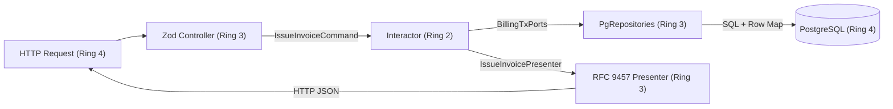
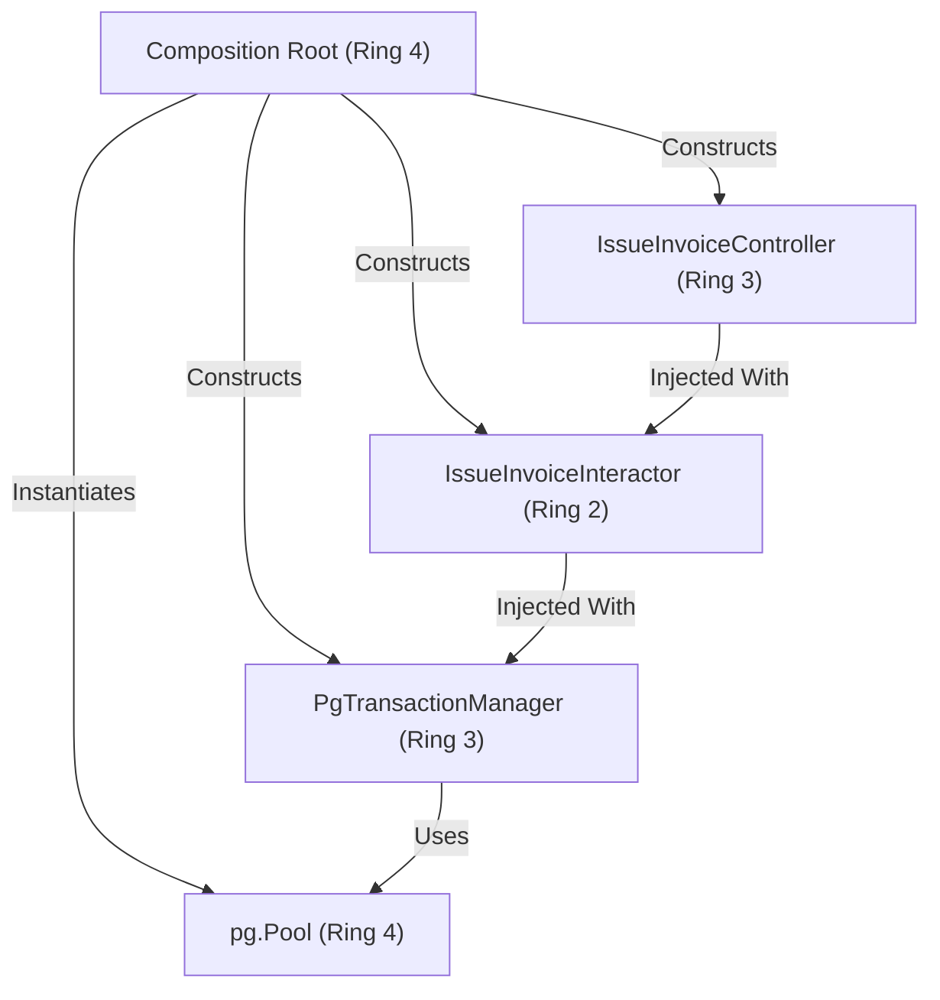

---
tags:
  - software-engineering
  - clean-architecture
  - interface-adapters
  - composition-root
  - nestjs
  - postgresql
  - typescript
created: 2026-11-13
updated: 2026-11-13
status: 🟢
level: mid-to-senior
---
# Interface Adapters & Frameworks

> [!abstract] Hub Context
> Part of [[Programming/Software Engineering/Clean Architecture/Clean Architecture Complete Guide|Clean Architecture Complete Guide]]. Implements the outer boundary defined in [[Programming/Software Engineering/Clean Architecture/Dependency Rule|Dependency Rule]] around the inner core built in [[Programming/Software Engineering/Clean Architecture/Entities & Use Cases|Entities & Use Cases]]. Connects to [[Programming/Backend/NestJS Complete Guide|NestJS Complete Guide]], [[Programming/Backend/Backend Core (Node, Event Loop, Auth & Concurrency)|Backend Core (Node, Event Loop, Auth & Concurrency)]], and [[Programming/Software Engineering/Testing/Integration Testing|Integration Testing]].

Rings 3 (**Interface Adapters**) and 4 (**Frameworks & Drivers**) form the protective translation shell and runtime assembly around the application core. Interface Adapters convert untrusted external transport payloads, SQL rows, and third-party HTTP responses into pure domain contracts, while Frameworks & Drivers supply web servers, connection pools, and the **Composition Root** that constructs the dependency graph at startup.

---

## 1. First-Principles Mechanics & Complete Outer-Ring Architecture

### 1.1 Anatomy of Ring 3 Anti-Corruption Boundaries

No external wire protocol (HTTP JSON, gRPC protobuf, CLI flags) and no storage engine (PostgreSQL tuples, Redis hashes, ORM entities) matches the pure domain structures of Ring 1 and Ring 2. Ring 3 Interface Adapters act as **bidirectional translators** ensuring neither delivery frameworks nor persistence engines leak across port boundaries:

| Adapter Component | Direction | Exact Translation Duty | Hard Boundary Constraint |
|---|---|---|---|
| **Controller / Resolver** | Driving (Inbound) | Parses raw HTTP/GraphQL/CLI input via schema validation (`zod`), extracts verified auth claims (`AuthenticatedActor`), assembles flat `Command` DTO, calls `InputPort` | Zero business conditionals (`if balance > limit`); never executes SQL or instantiates Domain Entities |
| **Presenter / ViewModel** | Driven (Outbound Presentation) | Converts raw Use Case Output DTOs and typed errors into **RFC 9457** `application/problem+json`, REST HATEOAS `_links`, localized `Intl.NumberFormat` strings, GraphQL errors, or CLI exit codes | Never triggers follow-up Use Cases or database reads; purely deterministic output formatting |
| **Repository / Gateway** | Driven (Outbound Persistence & External APIs) | Implements `CreditAccountRepository`, `InvoiceRepository`, or external payment ports; runs SQL/SDK calls; translates `Row <-> Entity` (`toDomain` / `toPersistence`) and maps vendor exceptions | Never leaks `pg` errors, ORM lazy proxies, active-record dirty tracking, or Axios errors across the port |
| **Humble Glue Wrapper** | Ring 3/4 Edge | Isolates thin framework lifecycle entrypoints (Fastify route handlers, Express middleware, NestJS `@Cron` hooks) delegating logic into framework-free classes | Kept minimal so unit and integration tests exercise 95%+ of adapter code without booting server loops |



### 1.2 Controllers: Input Parsing, Auth Extraction, and Zero Domain Policy

A Controller's lifecycle terminates the moment it converts untrusted bytes into a validated Command DTO and delegates execution to an Input Port. Specifically, a clean HTTP Controller performs four mechanical steps:

1. **Header & Parameter Extraction**: Reads protocol headers such as `Idempotency-Key`, `X-Request-Id` (`traceId`), and path parameters (`/v1/accounts/:accountId/invoices`).
2. **Untrusted Wire Validation (`zod`)**: Validates structural types, UUID syntax, integer bounds, and non-empty strings before inner rings execute. Structural parsing failures short-circuit immediately to `400 Bad Request` in RFC 9457 format.
3. **Claims Mapping**: Reads the `AuthenticatedActor` already verified by the outer JWT/session middleware without importing `jsonwebtoken` or JWKS key stores into the Controller or Use Case.
4. **Input Port Invocation**: Passes `(cmd, presenter)` into `IssueInvoiceInputPort.execute(...)`.

### 1.3 Presenters & ViewModels: Formatting Outside the Core

Returning an `IssueInvoiceResponse` containing `netTotalCents: 38000` and `issuedAtIso: "2026-11-13T12:00:00.000Z"` from `IssueInvoiceInteractor` keeps Ring 2 completely unaware of HTTP status codes (`201`, `409`, `422`), hypermedia `_links`, currency formatting (`"$380.00"`), or CLI table spacing.

When the **Presenter Output Port** (`IssueInvoicePresenter<TView>`) lives behind an interface owned by Ring 2, the identical unmodified `IssueInvoiceInteractor` drives:
- **`HttpIssueInvoicePresenter`**: Produces `201 Created` / `200 OK` HATEOAS JSON responses and **RFC 9457** `application/problem+json` error payloads.
- **`CliIssueInvoicePresenter`**: Emits ANSI tables or JSON lines on stdout alongside POSIX exit codes (`0` success, `2` domain validation rejection, `3` conflict, `4` unauthorized).
- **`GraphqlIssueInvoicePresenter`**: Returns strongly typed GraphQL Union objects (`IssueInvoiceSuccess | InsufficientCreditProblem`).

### 1.4 Gateways, Mappers, and Shielding Against ORM Leakage

Passing a TypeORM `@Entity()` class or Prisma model directly into a Use Case breaks encapsulation through three runtime mechanisms:

1. **Implicit Lazy-Loading Side Effects**: Accessing an ORM relation proxy (`account.invoices`) executes hidden SQL inside Ring 1/2, crashing pure unit tests and producing $N+1$ query amplification in production.
2. **Active-Record Dirty Tracking & Auto-Flush**: ORMs using Identity Map / Unit of Work dirty tracking automatically flush *all* mutated properties on tracked objects when a transaction commits—even if a subsequent domain step returned a typed failure and assumed changes were discarded.
3. **Bypassed Domain Constructors**: Reflection-based ORMs instantiate domain classes with `Object.create(Entity.prototype)` and assign properties directly, bypassing constructor invariant checks and `Money` Value Object wrappers.

**Gateway Isolation Pattern**: Keep ORM classes (`InvoiceOrmEntity`) or SQL row interfaces (`InvoiceRow`) private inside `src/billing/adapters/postgres/`. Convert explicitly via `toDomain(row)` (invoking `Entity.reconstitute(...)`) and `toPersistence(entity)`.

### 1.5 The Humble Object Pattern

Untestable framework boundaries—such as Express/Fastify route registration callbacks, NestJS `@Cron()` scheduler loops, React DOM lifecycle effects, or Kafka consumer `eachMessage` loops—should contain **zero conditional branching**. Split every boundary object into two parts:
- **Humble Shell (Ring 4)**: 5–10 lines registering the route, reading `req.rawBody` / headers, or invoking `setInterval`, forwarding straight into the testable class.
- **Testable Adapter Core (Ring 3)**: Pure TypeScript class accepting injected dependencies (`IssueInvoiceController`, `OutboxRelayProcessor`) whose branching, error translation, and batching behavior run deterministically in tests without starting network servers or cron timers.

### 1.6 Frameworks & Drivers and the Composition Root

Ring 4 contains web server frameworks, SQL connection pools, external SDK clients, configuration loaders, and the **Composition Root**—the single outermost bootstrap location (`src/billing/infra/fastify/bootstrap.ts` or `BillingModule`) permitted to import both concrete Ring 3 adapters and Ring 2 interactors.



**Critical Law**: Neither Ring 1, Ring 2, nor Ring 3 business adapters may ever import the Composition Root or invoke a global `Container.get(...)` (**Service Locator anti-pattern**). Dependencies flow exclusively downward through constructor injection assembled once at startup.

---

## 2. Real-World Use Cases & Decision Matrix

### 2.1 NestJS DI Container vs Pure Manual Composition Root

| Dimension | Pure Manual Composition Root (`bootstrap.ts`) | NestJS IoC Module Wiring (`@Module`) |
|---|---|---|
| **Boot & Cold-Start Latency** | 2–10 ms; zero `reflect-metadata` scanning | 80–400 ms (`DependenciesScanner` + topological init) |
| **Compile-Time Safety** | 100% TypeScript compiler verified; missing arg fails `tsc` | Interface injection requires `Symbol` tokens; missing binding fails only at boot |
| **Boilerplate Beyond 50 Modules** | Manual factory files grow verbose without module grouping | `@Module({ imports, exports })` enforces strict cross-team visibility boundaries |
| **Inner-Ring Contamination Risk** | Zero—pure TypeScript constructors need zero framework imports | High if developers scatter `@Injectable()` on Ring 1/2 classes instead of `useFactory` |
| **Best Fit** | Microservices (<40 endpoints), AWS Lambda/Cloudflare Workers, ultra-fast CLI tools | Large multi-team modular monoliths (>40 endpoints) sharing auth/queues/OpenAPI |

### 2.2 Persistence Adapter Technology Matrix Inside Ring 3

| Gateway Implementation | Runtime Overhead | SQL Control & Locking (`FOR UPDATE`) | Recommended Usage Inside Clean Adapters |
|---|---|---|---|
| **Raw `pg` / `PoolClient` + Explicit SQL** | Minimal; zero query-builder AST cost | Complete control over `SERIALIZABLE`, `FOR UPDATE`, CTEs, `RETURNING` | Transactional financial cores (`CreditAccount`, `Invoice`, `Idempotency`, `Outbox`) |
| **Kysely / Drizzle (Type-Safe SQL)** | Near-zero (`<0.1 ms`) | Explicit joins and row locks with typed column bindings | General relational backends wanting typed SQL without active-record magic |
| **Prisma** | Moderate (Rust engine / WASM driver) | Requires `$queryRaw` for `SELECT ... FOR UPDATE`; interactive `$transaction` | Rapid product teams keeping strict `toDomain()` mappers at repository boundaries |
| **TypeORM** | High (reflection + identity map) | Built-in pessimistic locks, but high active-record leakage risk | Avoid inside pure Domain models; isolate `@Entity()` rows strictly inside `adapters/` |

### 2.3 Real-World Architectural Scenarios

1. **Multi-Channel Invoice Issuance (HTTP API + Nightly Batch CLI)**: One `IssueInvoiceInteractor` wired in two Composition Roots—Fastify HTTP with `HttpIssueInvoicePresenter`, and a CLI script with `CliJsonPresenter`—sharing 100% of Ring 1 and Ring 2 invariants.
2. **Unstable External Tax / Payment Gateway Resilience**: A third-party payment or tax HTTP provider spikes `429 Too Many Requests` and `503`. The Ring 3 `Gateway` wraps timeouts (`AbortSignal.timeout(2000)`), parses `Retry-After`, redacts secret headers, and returns a neutral port union `{ ok: false, code: 'UPSTREAM_RATE_LIMITED', retryAfterSec }` so Ring 2 never inspects `AxiosError` or `fetch` status codes.
3. **NestJS Modular Monolith Without Framework Coupling**: `src/billing/domain/` and `src/billing/application/` contain zero `@nestjs/*` imports. `src/billing/infra/nestjs/billing.module.ts` binds `Symbol` tokens via `useFactory`, letting the team extract `src/billing/` to a standalone Fastify service without editing a single line of domain or use-case code.
4. **High-Throughput Edge Webhook Ingestor**: Built with a manual Fastify Composition Root and raw `pg` connection pooling, avoiding decorator reflection overhead and supporting deterministic `app.inject()` integration testing in `< 15 ms` per test.
5. **Humble Object Cron Outbox Relay**: A NestJS `@Cron('*/5 * * * * *')` or `setInterval` loop calls `outboxRelayProcessor.pollAndPublishOnce()`, keeping lease acquisition, exponential retry backoff, and dead-letter thresholding cleanly testable in memory.

---

## 3. Step-by-Step Practical Application: End-to-End Outer Ring & Dual Composition Roots

This section completes the **B2B Credit Line & Invoice Issuance Vertical** from [[Programming/Software Engineering/Clean Architecture/Entities & Use Cases|Entities & Use Cases]], connecting `IssueInvoiceInteractor` to PostgreSQL, Zod validation, an RFC 9457 + HATEOAS Presenter, a third-party gateway error translator, a Humble Object outbox worker, **both** a Pure Fastify Composition Root and a NestJS Composition Root, plus integration tests.

### 3.1 Outer-Ring Directory Layout

```text
src/billing/
  domain/                         # Ring 1 (zero external dependencies)
  application/                    # Ring 2 (Interactor + Ports)
  adapters/
    postgres/
      schema.sql
      PgErrorMapper.ts
      PgTransactionManager.ts
      PgBillingRepositories.ts
    gateways/
      HttpCreditBureauGateway.ts
    presenters/
      HttpIssueInvoicePresenter.ts
    http/
      IssueInvoiceController.ts
      ExpressIssueInvoiceRouter.ts
    workers/
      OutboxRelayProcessor.ts
  infra/
    fastify/
      bootstrap.ts
    nestjs/
      billing.tokens.ts
      billing.module.ts
      nestjs-invoice.controller.ts
tests/billing/
  integration/
    IssueInvoiceHttp.spec.ts
    PgErrorTranslation.spec.ts
```

### 3.2 PostgreSQL Schema (`schema.sql`)

Notice the optimistic concurrency `version` columns, `NUMERIC`/integer minor-unit `BIGINT` storage (never `FLOAT`), composite primary key `(tenant_id, idempotency_key)`, and transactional `outbox_events` table.

```sql
-- src/billing/adapters/postgres/schema.sql
CREATE TABLE IF NOT EXISTS credit_accounts (
  id TEXT PRIMARY KEY,
  tenant_id TEXT NOT NULL,
  currency VARCHAR(3) NOT NULL,
  credit_limit_cents BIGINT NOT NULL CHECK (credit_limit_cents >= 0),
  reserved_balance_cents BIGINT NOT NULL CHECK (reserved_balance_cents >= 0),
  buyer_tier VARCHAR(16) NOT NULL DEFAULT 'STANDARD',
  status VARCHAR(16) NOT NULL,
  version INTEGER NOT NULL DEFAULT 0,
  CONSTRAINT chk_reserved_le_limit CHECK (reserved_balance_cents <= credit_limit_cents)
);

CREATE TABLE IF NOT EXISTS invoices (
  id TEXT PRIMARY KEY,
  tenant_id TEXT NOT NULL,
  account_id TEXT NOT NULL REFERENCES credit_accounts(id),
  currency VARCHAR(3) NOT NULL,
  discount_bps INTEGER NOT NULL DEFAULT 0,
  status VARCHAR(16) NOT NULL,
  issued_at TIMESTAMPTZ NULL,
  version INTEGER NOT NULL DEFAULT 0
);

CREATE TABLE IF NOT EXISTS invoice_lines (
  invoice_id TEXT NOT NULL REFERENCES invoices(id) ON DELETE CASCADE,
  line_index INTEGER NOT NULL,
  sku TEXT NOT NULL,
  description TEXT NOT NULL,
  quantity INTEGER NOT NULL CHECK (quantity > 0),
  unit_price_cents BIGINT NOT NULL CHECK (unit_price_cents > 0),
  PRIMARY KEY (invoice_id, line_index)
);

CREATE TABLE IF NOT EXISTS idempotency_keys (
  tenant_id TEXT NOT NULL,
  idempotency_key TEXT NOT NULL,
  request_hash TEXT NOT NULL,
  state VARCHAR(16) NOT NULL,
  response_json JSONB NULL,
  created_at TIMESTAMPTZ NOT NULL DEFAULT NOW(),
  PRIMARY KEY (tenant_id, idempotency_key)
);

CREATE TABLE IF NOT EXISTS outbox_events (
  event_id TEXT PRIMARY KEY,
  event_type TEXT NOT NULL,
  aggregate_id TEXT NOT NULL,
  aggregate_type TEXT NOT NULL,
  occurred_at TIMESTAMPTZ NOT NULL,
  payload_json JSONB NOT NULL,
  published_at TIMESTAMPTZ NULL,
  attempt_count INTEGER NOT NULL DEFAULT 0
);

CREATE INDEX IF NOT EXISTS idx_outbox_unpublished
  ON outbox_events (occurred_at)
  WHERE published_at IS NULL;
```

### 3.3 Vendor Error Translation (`PgErrorMapper.ts`)

Never allow raw `pg` `DatabaseError` instances containing table names, constraint IDs, or SQL fragments to cross into Ring 2 or HTTP payloads. Translate vendor codes cleanly at the Gateway edge:

```typescript
// src/billing/adapters/postgres/PgErrorMapper.ts
export interface PgLikeError {
  readonly code?: string;
  readonly constraint?: string;
  readonly detail?: string;
  readonly message: string;
}

export class PortPersistenceError extends Error {
  constructor(
    public readonly kind:
      | 'DUPLICATE_KEY'
      | 'SERIALIZATION_CONFLICT'
      | 'DEADLOCK_DETECTED'
      | 'LOCK_TIMEOUT'
      | 'INFRASTRUCTURE_UNAVAILABLE',
    message: string,
    public readonly causeError?: unknown,
  ) {
    super(message);
    this.name = 'PortPersistenceError';
  }
}

export function isPgError(error: unknown): error is PgLikeError {
  return (
    typeof error === 'object' &&
    error !== null &&
    'code' in error &&
    typeof (error as { code?: unknown }).code === 'string'
  );
}

export function translatePgError(error: unknown): PortPersistenceError {
  if (!isPgError(error)) {
    return new PortPersistenceError('INFRASTRUCTURE_UNAVAILABLE', 'Unexpected persistence failure', error);
  }

  switch (error.code) {
    case '23505': // unique_violation
      return new PortPersistenceError('DUPLICATE_KEY', `Unique constraint violated (${error.constraint ?? 'unknown'})`, error);
    case '40001': // serialization_failure
      return new PortPersistenceError('SERIALIZATION_CONFLICT', 'Concurrent transaction conflict; retry safe', error);
    case '40P01': // deadlock_detected
      return new PortPersistenceError('DEADLOCK_DETECTED', 'Database deadlock detected; retry safe', error);
    case '55P03': // lock_not_available
    case '57014': // query_canceled / statement_timeout
      return new PortPersistenceError('LOCK_TIMEOUT', 'Persistence lock or statement timeout exceeded', error);
    default:
      return new PortPersistenceError('INFRASTRUCTURE_UNAVAILABLE', `Database failure SQLSTATE ${error.code}`, error);
  }
}
```

### 3.4 PostgreSQL Repositories, Mappers & `PgTransactionManager` (`PgBillingRepositories.ts` & `PgTransactionManager.ts`)

Notice how `PgCreditAccountRepository` and `PgInvoiceRepository` isolate all SQL strings, perform explicit `toDomain()` via `reconstitute()`, enforce optimistic concurrency via `WHERE id = $1 AND version = $2`, and execute strictly inside a single `PoolClient` transaction handle.

```typescript
// src/billing/adapters/postgres/PgBillingRepositories.ts
import { PoolClient } from 'pg';
import {
  BuyerTierPort,
  CreditAccountRepository,
  IdempotencyLookupResult,
  IdempotencyPort,
  InvoiceRepository,
  IssueInvoiceResponse,
  OutboxPort,
} from '../../application/ports/IssueInvoicePorts';
import { CreditAccount, CreditAccountStatus } from '../../domain/entities/CreditAccount';
import { Invoice, InvoiceLineProps, InvoiceStatus } from '../../domain/entities/Invoice';
import { DomainEvent } from '../../domain/shared/DomainEvent';
import { BuyerTierCode } from '../../domain/value-objects/BuyerTier';
import { CurrencyCode } from '../../domain/value-objects/Money';
import { translatePgError } from './PgErrorMapper';

interface CreditAccountRow {
  id: string;
  tenant_id: string;
  currency: CurrencyCode;
  credit_limit_cents: string;
  reserved_balance_cents: string;
  status: CreditAccountStatus;
  version: number;
}

interface InvoiceRow {
  id: string;
  tenant_id: string;
  account_id: string;
  currency: CurrencyCode;
  discount_bps: number;
  status: InvoiceStatus;
  issued_at: Date | null;
  version: number;
}

interface InvoiceLineRow {
  sku: string;
  description: string;
  quantity: number;
  unit_price_cents: string;
}

export class PgCreditAccountRepository implements CreditAccountRepository {
  constructor(private readonly client: PoolClient) {}

  async findByIdForUpdate(accountId: string): Promise<CreditAccount | null> {
    try {
      const res = await this.client.query<CreditAccountRow>(
        `SELECT id, tenant_id, currency, credit_limit_cents, reserved_balance_cents, status, version
         FROM credit_accounts
         WHERE id = $1
         FOR UPDATE`,
        [accountId],
      );
      if (res.rows.length === 0) return null;
      return this.toDomain(res.rows[0]);
    } catch (error) {
      throw translatePgError(error);
    }
  }

  async save(
    account: CreditAccount,
  ): Promise<{ ok: true } | { ok: false; reason: 'OPTIMISTIC_LOCK_CONFLICT' }> {
    try {
      const res = await this.client.query(
        `UPDATE credit_accounts
         SET reserved_balance_cents = $1,
             status = $2,
             version = version + 1
         WHERE id = $3 AND version = $4`,
        [
          account.reservedBalance.cents.toString(),
          account.status,
          account.id,
          account.version,
        ],
      );
      if (res.rowCount === 0) {
        return { ok: false, reason: 'OPTIMISTIC_LOCK_CONFLICT' };
      }
      return { ok: true };
    } catch (error) {
      throw translatePgError(error);
    }
  }

  private toDomain(row: CreditAccountRow): CreditAccount {
    return CreditAccount.reconstitute({
      id: row.id,
      tenantId: row.tenant_id,
      currency: row.currency,
      creditLimitCents: Number(row.credit_limit_cents),
      reservedBalanceCents: Number(row.reserved_balance_cents),
      status: row.status,
      version: row.version,
    });
  }
}

export class PgInvoiceRepository implements InvoiceRepository {
  constructor(private readonly client: PoolClient) {}

  async findById(invoiceId: string): Promise<Invoice | null> {
    try {
      const invRes = await this.client.query<InvoiceRow>(
        `SELECT id, tenant_id, account_id, currency, discount_bps, status, issued_at, version
         FROM invoices
         WHERE id = $1
         FOR UPDATE`,
        [invoiceId],
      );
      if (invRes.rows.length === 0) return null;

      const linesRes = await this.client.query<InvoiceLineRow>(
        `SELECT sku, description, quantity, unit_price_cents
         FROM invoice_lines
         WHERE invoice_id = $1
         ORDER BY line_index ASC`,
        [invoiceId],
      );

      return this.toDomain(invRes.rows[0], linesRes.rows);
    } catch (error) {
      throw translatePgError(error);
    }
  }

  async save(
    invoice: Invoice,
  ): Promise<{ ok: true } | { ok: false; reason: 'OPTIMISTIC_LOCK_CONFLICT' | 'DUPLICATE_ID' }> {
    try {
      if (invoice.version === 0) {
        await this.client.query(
          `INSERT INTO invoices (id, tenant_id, account_id, currency, discount_bps, status, issued_at, version)
           VALUES ($1, $2, $3, $4, $5, $6, $7, 1)`,
          [
            invoice.id,
            invoice.tenantId,
            invoice.accountId,
            invoice.currency,
            invoice.discountBps,
            invoice.status,
            invoice.issuedAt,
          ],
        );

        for (let idx = 0; idx < invoice.lines.length; idx += 1) {
          const line = invoice.lines[idx];
          await this.client.query(
            `INSERT INTO invoice_lines (invoice_id, line_index, sku, description, quantity, unit_price_cents)
             VALUES ($1, $2, $3, $4, $5, $6)`,
            [
              invoice.id,
              idx,
              line.sku,
              line.description,
              line.quantity,
              line.unitPrice.cents.toString(),
            ],
          );
        }
        return { ok: true };
      }

      const updateRes = await this.client.query(
        `UPDATE invoices
         SET discount_bps = $1,
             status = $2,
             issued_at = $3,
             version = version + 1
         WHERE id = $4 AND version = $5`,
        [
          invoice.discountBps,
          invoice.status,
          invoice.issuedAt,
          invoice.id,
          invoice.version,
        ],
      );
      if (updateRes.rowCount === 0) {
        return { ok: false, reason: 'OPTIMISTIC_LOCK_CONFLICT' };
      }
      return { ok: true };
    } catch (error) {
      const mapped = translatePgError(error);
      if (mapped.kind === 'DUPLICATE_KEY') {
        return { ok: false, reason: 'DUPLICATE_ID' };
      }
      throw mapped;
    }
  }

  private toDomain(row: InvoiceRow, lineRows: readonly InvoiceLineRow[]): Invoice {
    const lines: InvoiceLineProps[] = lineRows.map((l) => ({
      sku: l.sku,
      description: l.description,
      quantity: l.quantity,
      unitPriceCents: Number(l.unit_price_cents),
    }));

    return Invoice.reconstitute({
      id: row.id,
      tenantId: row.tenant_id,
      accountId: row.account_id,
      currency: row.currency,
      lines,
      discountBps: row.discount_bps,
      status: row.status,
      issuedAtIso: row.issued_at ? row.issued_at.toISOString() : null,
      version: row.version,
    });
  }
}

export class PgBuyerTierAdapter implements BuyerTierPort {
  constructor(private readonly client: PoolClient) {}

  async getTierForAccount(tenantId: string, accountId: string): Promise<BuyerTierCode> {
    try {
      const res = await this.client.query<{ buyer_tier: BuyerTierCode }>(
        `SELECT buyer_tier FROM credit_accounts WHERE id = $1 AND tenant_id = $2`,
        [accountId, tenantId],
      );
      return res.rows[0]?.buyer_tier ?? 'STANDARD';
    } catch (error) {
      throw translatePgError(error);
    }
  }
}

export class PgIdempotencyAdapter implements IdempotencyPort {
  constructor(private readonly client: PoolClient) {}

  async claimOrInspect(
    tenantId: string,
    idempotencyKey: string,
    requestHash: string,
  ): Promise<IdempotencyLookupResult> {
    try {
      const inserted = await this.client.query(
        `INSERT INTO idempotency_keys (tenant_id, idempotency_key, request_hash, state)
         VALUES ($1, $2, $3, 'IN_PROGRESS')
         ON CONFLICT (tenant_id, idempotency_key) DO NOTHING`,
        [tenantId, idempotencyKey, requestHash],
      );

      if ((inserted.rowCount ?? 0) > 0) {
        return { state: 'NEW' };
      }

      const existingRes = await this.client.query<{
        request_hash: string;
        state: 'IN_PROGRESS' | 'COMPLETED';
        response_json: IssueInvoiceResponse | null;
      }>(
        `SELECT request_hash, state, response_json
         FROM idempotency_keys
         WHERE tenant_id = $1 AND idempotency_key = $2
         FOR UPDATE`,
        [tenantId, idempotencyKey],
      );

      const existing = existingRes.rows[0];
      if (!existing) {
        return { state: 'IN_PROGRESS' };
      }
      if (existing.request_hash !== requestHash) {
        return { state: 'HASH_MISMATCH' };
      }
      if (existing.state === 'IN_PROGRESS' || !existing.response_json) {
        return { state: 'IN_PROGRESS' };
      }
      return { state: 'COMPLETED', response: existing.response_json };
    } catch (error) {
      throw translatePgError(error);
    }
  }

  async markCompleted(
    tenantId: string,
    idempotencyKey: string,
    response: IssueInvoiceResponse,
  ): Promise<void> {
    try {
      await this.client.query(
        `UPDATE idempotency_keys
         SET state = 'COMPLETED', response_json = $1::jsonb
         WHERE tenant_id = $2 AND idempotency_key = $3`,
        [JSON.stringify(response), tenantId, idempotencyKey],
      );
    } catch (error) {
      throw translatePgError(error);
    }
  }
}

export class PgOutboxAdapter implements OutboxPort {
  constructor(private readonly client: PoolClient) {}

  async appendBatch(events: readonly DomainEvent[]): Promise<void> {
    try {
      for (const evt of events) {
        await this.client.query(
          `INSERT INTO outbox_events (event_id, event_type, aggregate_id, aggregate_type, occurred_at, payload_json)
           VALUES ($1, $2, $3, $4, $5, $6::jsonb)`,
          [
            evt.eventId,
            evt.eventType,
            evt.aggregateId,
            evt.aggregateType,
            evt.occurredAtIso,
            JSON.stringify(evt.payload),
          ],
        );
      }
    } catch (error) {
      throw translatePgError(error);
    }
  }
}
```

```typescript
// src/billing/adapters/postgres/PgTransactionManager.ts
import { Pool } from 'pg';
import { BillingTxPorts, TransactionManagerPort } from '../../application/ports/IssueInvoicePorts';
import {
  PgBuyerTierAdapter,
  PgCreditAccountRepository,
  PgIdempotencyAdapter,
  PgInvoiceRepository,
  PgOutboxAdapter,
} from './PgBillingRepositories';
import { translatePgError } from './PgErrorMapper';

export class PgTransactionManager implements TransactionManagerPort {
  constructor(private readonly pool: Pool) {}

  async runInTransaction<T>(work: (txPorts: BillingTxPorts) => Promise<T>): Promise<T> {
    const client = await this.pool.connect();
    let rollbackRequested = false;

    const txPorts: BillingTxPorts = {
      creditAccounts: new PgCreditAccountRepository(client),
      invoices: new PgInvoiceRepository(client),
      buyerTiers: new PgBuyerTierAdapter(client),
      outbox: new PgOutboxAdapter(client),
      idempotency: new PgIdempotencyAdapter(client),
      rollback: () => {
        rollbackRequested = true;
      },
    };

    try {
      await client.query('BEGIN');
      await client.query("SET LOCAL lock_timeout = '3000ms'");
      const result = await work(txPorts);

      if (rollbackRequested) {
        await client.query('ROLLBACK');
      } else {
        await client.query('COMMIT');
      }
      return result;
    } catch (error) {
      try {
        await client.query('ROLLBACK');
      } catch {
        // Preserve original root failure if ROLLBACK fails on broken TCP socket
      }
      if (error instanceof Error && error.name === 'PortPersistenceError') {
        throw error;
      }
      throw translatePgError(error);
    } finally {
      client.release();
    }
  }
}
```

### 3.5 External HTTP Gateway Error Translation (`HttpCreditBureauGateway.ts`)

Even external REST dependencies obey the exact same Gateway isolation rules: enforce strict `AbortSignal` timeouts, parse rate-limit headers (`Retry-After`), never pass raw `Response` or `AxiosError` upward, and return typed domain-neutral outcomes.

```typescript
// src/billing/adapters/gateways/HttpCreditBureauGateway.ts
export type CreditBureauCheckOutcome =
  | { readonly ok: true; readonly approvedLimitCents: number; readonly riskBand: 'LOW' | 'MEDIUM' | 'HIGH' }
  | { readonly ok: false; readonly reason: 'APPLICANT_NOT_FOUND' }
  | { readonly ok: false; readonly reason: 'UPSTREAM_RATE_LIMITED'; readonly retryAfterSec: number }
  | { readonly ok: false; readonly reason: 'UPSTREAM_UNAVAILABLE' };

export interface CreditBureauPort {
  fetchCreditStanding(taxId: string, traceId: string): Promise<CreditBureauCheckOutcome>;
}

export class HttpCreditBureauGateway implements CreditBureauPort {
  constructor(
    private readonly baseUrl: string,
    private readonly apiKey: string,
    private readonly timeoutMs = 2000,
    private readonly fetchImpl: typeof fetch = fetch,
  ) {}

  async fetchCreditStanding(taxId: string, traceId: string): Promise<CreditBureauCheckOutcome> {
    try {
      const response = await this.fetchImpl(`${this.baseUrl}/v2/entities/${encodeURIComponent(taxId)}`, {
        method: 'GET',
        headers: {
          Authorization: `Bearer ${this.apiKey}`,
          'X-Correlation-Id': traceId,
          Accept: 'application/json',
        },
        signal: AbortSignal.timeout(this.timeoutMs),
      });

      if (response.status === 404) {
        return { ok: false, reason: 'APPLICANT_NOT_FOUND' };
      }

      if (response.status === 429) {
        const retryHeader = response.headers.get('Retry-After');
        const parsed = retryHeader ? Number.parseInt(retryHeader, 10) : 30;
        const retryAfterSec = Number.isFinite(parsed) && parsed > 0 ? parsed : 30;
        return { ok: false, reason: 'UPSTREAM_RATE_LIMITED', retryAfterSec };
      }

      if (response.status >= 500) {
        return { ok: false, reason: 'UPSTREAM_UNAVAILABLE' };
      }

      if (!response.ok) {
        return { ok: false, reason: 'UPSTREAM_UNAVAILABLE' };
      }

      const body = (await response.json()) as {
        approved_limit_cents?: unknown;
        risk_tier?: unknown;
      };

      if (typeof body.approved_limit_cents !== 'number' || !Number.isInteger(body.approved_limit_cents)) {
        return { ok: false, reason: 'UPSTREAM_UNAVAILABLE' };
      }

      const riskBand =
        body.risk_tier === 'LOW' || body.risk_tier === 'MEDIUM' || body.risk_tier === 'HIGH'
          ? body.risk_tier
          : 'MEDIUM';

      return {
        ok: true,
        approvedLimitCents: body.approved_limit_cents,
        riskBand,
      };
    } catch {
      return { ok: false, reason: 'UPSTREAM_UNAVAILABLE' };
    }
  }
}
```

### 3.6 RFC 9457 Problem Details & HATEOAS Presenter (`HttpIssueInvoicePresenter.ts`)

Notice how **RFC 9457** (`application/problem+json`), HTTP status codes (`201`, `200`, `403`, `404`, `409`, `422`), `Idempotent-Replayed` headers, `_links` hypermedia URIs, and localized currency formatting (`Intl.NumberFormat`) live strictly inside Ring 3:

```typescript
// src/billing/adapters/presenters/HttpIssueInvoicePresenter.ts
import {
  IssueInvoiceError,
  IssueInvoicePresenter,
  IssueInvoiceResponse,
} from '../../application/ports/IssueInvoicePorts';
import { assertNever } from '../../domain/shared/Result';

export interface Rfc9457ProblemDetails {
  readonly type: string;
  readonly title: string;
  readonly status: number;
  readonly detail: string;
  readonly instance: string;
  readonly traceId: string;
  readonly errorCode: string;
  readonly extensions?: Record<string, unknown>;
}

export interface InvoiceCreatedViewModel {
  readonly invoiceId: string;
  readonly accountId: string;
  readonly grossTotalCents: number;
  readonly netTotalCents: number;
  readonly formattedNetTotal: string;
  readonly remainingCreditCents: number;
  readonly currency: string;
  readonly issuedAtIso: string;
  readonly _links: {
    readonly self: { readonly href: string };
    readonly account: { readonly href: string };
    readonly void: { readonly href: string; readonly method: 'POST' };
  };
}

export interface HttpPresentationResult {
  readonly statusCode: number;
  readonly headers: Record<string, string>;
  readonly body: InvoiceCreatedViewModel | Rfc9457ProblemDetails;
}

export class HttpIssueInvoicePresenter implements IssueInvoicePresenter<HttpPresentationResult> {
  constructor(
    private readonly instanceUri: string,
    private readonly traceId: string,
    private readonly locale = 'en-US',
  ) {}

  presentSuccess(output: IssueInvoiceResponse): HttpPresentationResult {
    return {
      statusCode: 201,
      headers: {
        'Content-Type': 'application/json; charset=utf-8',
        Location: `/v1/invoices/${output.invoiceId}`,
        'X-Trace-Id': this.traceId,
      },
      body: this.toSuccessViewModel(output),
    };
  }

  presentIdempotentReplay(output: IssueInvoiceResponse): HttpPresentationResult {
    return {
      statusCode: 200,
      headers: {
        'Content-Type': 'application/json; charset=utf-8',
        Location: `/v1/invoices/${output.invoiceId}`,
        'Idempotent-Replayed': 'true',
        'X-Trace-Id': this.traceId,
      },
      body: this.toSuccessViewModel(output),
    };
  }

  presentFailure(error: IssueInvoiceError): HttpPresentationResult {
    const mapped = this.mapErrorToProblem(error);
    return {
      statusCode: mapped.status,
      headers: {
        'Content-Type': 'application/problem+json; charset=utf-8',
        'X-Trace-Id': this.traceId,
      },
      body: mapped,
    };
  }

  static validationFailure(
    instanceUri: string,
    traceId: string,
    fieldErrors: readonly { readonly path: string; readonly message: string }[],
  ): HttpPresentationResult {
    return {
      statusCode: 400,
      headers: {
        'Content-Type': 'application/problem+json; charset=utf-8',
        'X-Trace-Id': traceId,
      },
      body: {
        type: 'https://errors.billing.internal/problems/validation-failed',
        title: 'Request Validation Failed',
        status: 400,
        detail: 'One or more HTTP request fields failed schema validation.',
        instance: instanceUri,
        traceId,
        errorCode: 'VALIDATION_FAILED',
        extensions: { fieldErrors },
      },
    };
  }

  private toSuccessViewModel(output: IssueInvoiceResponse): InvoiceCreatedViewModel {
    const formattedNetTotal = new Intl.NumberFormat(this.locale, {
      style: 'currency',
      currency: output.currency,
    }).format(output.netTotalCents / 100);

    return {
      invoiceId: output.invoiceId,
      accountId: output.accountId,
      grossTotalCents: output.grossTotalCents,
      netTotalCents: output.netTotalCents,
      formattedNetTotal,
      remainingCreditCents: output.remainingCreditCents,
      currency: output.currency,
      issuedAtIso: output.issuedAtIso,
      _links: {
        self: { href: `/v1/invoices/${output.invoiceId}` },
        account: { href: `/v1/credit-accounts/${output.accountId}` },
        void: { href: `/v1/invoices/${output.invoiceId}/void`, method: 'POST' },
      },
    };
  }

  private mapErrorToProblem(error: IssueInvoiceError): Rfc9457ProblemDetails {
    switch (error.code) {
      case 'FORBIDDEN_ACTION':
      case 'FORBIDDEN_TENANT_ACCESS':
        return {
          type: 'https://errors.billing.internal/problems/forbidden',
          title: 'Forbidden',
          status: 403,
          detail: 'The authenticated actor lacks permission to issue invoices on this account.',
          instance: this.instanceUri,
          traceId: this.traceId,
          errorCode: error.code,
        };
      case 'ACCOUNT_NOT_FOUND':
        return {
          type: 'https://errors.billing.internal/problems/account-not-found',
          title: 'Credit Account Not Found',
          status: 404,
          detail: `Credit account ${error.accountId} does not exist.`,
          instance: this.instanceUri,
          traceId: this.traceId,
          errorCode: error.code,
        };
      case 'INSUFFICIENT_CREDIT':
        return {
          type: 'https://errors.billing.internal/problems/insufficient-credit',
          title: 'Insufficient Available Credit',
          status: 422,
          detail: `Requested ${error.requestedCents} minor units exceeds available ${error.availableCents}.`,
          instance: this.instanceUri,
          traceId: this.traceId,
          errorCode: error.code,
          extensions: {
            availableCents: error.availableCents,
            requestedCents: error.requestedCents,
          },
        };
      case 'ACCOUNT_NOT_ACTIVE':
      case 'CURRENCY_MISMATCH':
      case 'INVALID_INVOICE_DATA':
      case 'INVOICE_VOIDED':
        return {
          type: 'https://errors.billing.internal/problems/unprocessable-invoice',
          title: 'Unprocessable Invoice Request',
          status: 422,
          detail: 'The invoice or credit account state prohibits issuance.',
          instance: this.instanceUri,
          traceId: this.traceId,
          errorCode: error.code,
        };
      case 'INVOICE_ALREADY_ISSUED':
      case 'IDEMPOTENCY_CONFLICT':
      case 'IDEMPOTENCY_IN_FLIGHT':
      case 'CONCURRENCY_CONFLICT':
        return {
          type: 'https://errors.billing.internal/problems/state-conflict',
          title: 'Resource State Conflict',
          status: 409,
          detail: `Operation conflicted with existing resource or idempotency state (${error.code}).`,
          instance: this.instanceUri,
          traceId: this.traceId,
          errorCode: error.code,
        };
      default:
        return assertNever(error);
    }
  }
}
```

### 3.7 Zod Validation Controller & Express Humble Router (`IssueInvoiceController.ts` & `ExpressIssueInvoiceRouter.ts`)

Notice how `IssueInvoiceController` depends only on `zod`, Ring 2 Input Port, and Ring 3 Presenter—zero Express or Fastify request/response types appear inside `IssueInvoiceController.ts`, letting the exact same controller run identically under Fastify, Express, NestJS, or AWS Lambda!

```typescript
// src/billing/adapters/http/IssueInvoiceController.ts
import { z } from 'zod';
import {
  AuthenticatedActor,
  IssueInvoiceInputPort,
} from '../../application/ports/IssueInvoicePorts';
import {
  HttpIssueInvoicePresenter,
  HttpPresentationResult,
} from '../presenters/HttpIssueInvoicePresenter';

const IssueInvoiceBodySchema = z.object({
  invoiceId: z.string().trim().min(3).max(64),
  accountId: z.string().trim().min(3).max(64),
  currency: z.enum(['USD', 'EUR', 'GBP']),
  lines: z
    .array(
      z.object({
        sku: z.string().trim().min(1).max(64),
        description: z.string().trim().min(1).max(200),
        quantity: z.number().int().positive().max(100_000),
        unitPriceCents: z.number().int().positive().max(100_000_000),
      }),
    )
    .min(1)
    .max(500),
});

const IdempotencyHeaderSchema = z.string().trim().min(8).max(128);

export interface RawHttpInvoiceRequest {
  readonly path: string;
  readonly traceId: string;
  readonly locale?: string;
  readonly idempotencyKeyHeader: string | undefined;
  readonly actor: AuthenticatedActor;
  readonly body: unknown;
}

export class IssueInvoiceController {
  constructor(private readonly issueInvoiceUseCase: IssueInvoiceInputPort) {}

  async handle(req: RawHttpInvoiceRequest): Promise<HttpPresentationResult> {
    const keyParse = IdempotencyHeaderSchema.safeParse(req.idempotencyKeyHeader);
    const bodyParse = IssueInvoiceBodySchema.safeParse(req.body);

    const fieldErrors: { path: string; message: string }[] = [];
    if (!keyParse.success) {
      fieldErrors.push({
        path: 'headers.idempotency-key',
        message: 'Idempotency-Key header is required (8-128 chars)',
      });
    }
    if (!bodyParse.success) {
      for (const issue of bodyParse.error.issues) {
        fieldErrors.push({
          path: `body.${issue.path.join('.')}`,
          message: issue.message,
        });
      }
    }

    if (fieldErrors.length > 0 || !keyParse.success || !bodyParse.success) {
      return HttpIssueInvoicePresenter.validationFailure(req.path, req.traceId, fieldErrors);
    }

    const presenter = new HttpIssueInvoicePresenter(req.path, req.traceId, req.locale ?? 'en-US');

    return this.issueInvoiceUseCase.execute(
      {
        actor: req.actor,
        idempotencyKey: keyParse.data,
        invoiceId: bodyParse.data.invoiceId,
        accountId: bodyParse.data.accountId,
        currency: bodyParse.data.currency,
        lines: bodyParse.data.lines,
      },
      presenter,
    );
  }
}
```

```typescript
// src/billing/adapters/http/ExpressIssueInvoiceRouter.ts — Humble Express Glue
import express, { NextFunction, Request, Response, Router } from 'express';
import { AuthenticatedActor } from '../../application/ports/IssueInvoicePorts';
import { IssueInvoiceController } from './IssueInvoiceController';

export interface AuthenticatedExpressRequest extends Request {
  actor?: AuthenticatedActor;
  traceId?: string;
}

export function createExpressBillingRouter(controller: IssueInvoiceController): Router {
  const router = express.Router();

  router.post(
    '/v1/invoices',
    async (req: AuthenticatedExpressRequest, res: Response, next: NextFunction) => {
      try {
        if (!req.actor) {
          return res.status(401).type('application/problem+json').json({
            type: 'https://errors.billing.internal/problems/unauthenticated',
            title: 'Unauthorized',
            status: 401,
            detail: 'Missing authenticated security context.',
            instance: req.originalUrl,
            traceId: req.traceId ?? 'unknown',
            errorCode: 'UNAUTHENTICATED',
          });
        }

        const result = await controller.handle({
          path: req.originalUrl,
          traceId: req.traceId ?? 'req-untraced',
          locale: req.header('accept-language')?.split(',')[0]?.trim(),
          idempotencyKeyHeader: req.header('idempotency-key'),
          actor: req.actor,
          body: req.body,
        });

        for (const [headerName, headerValue] of Object.entries(result.headers)) {
          res.setHeader(headerName, headerValue);
        }
        return res.status(result.statusCode).json(result.body);
      } catch (err) {
        return next(err);
      }
    },
  );

  return router;
}
```

### 3.8 Humble Object Worker (`OutboxRelayProcessor.ts`)

Notice how `OutboxRelayProcessor` owns polling batch selection (`FOR UPDATE SKIP LOCKED`), publishing via a neutral broker port, and marking `published_at`—while the framework timer or NestJS `@Cron()` wrapper remains a 4-line Humble Object.

```typescript
// src/billing/adapters/workers/OutboxRelayProcessor.ts
import { Pool } from 'pg';

export interface OutboxMessageBrokerPort {
  publish(topic: string, eventId: string, payloadJson: unknown): Promise<void>;
}

export class OutboxRelayProcessor {
  constructor(
    private readonly pool: Pool,
    private readonly broker: OutboxMessageBrokerPort,
    private readonly batchSize = 50,
  ) {}

  async pollAndPublishOnce(): Promise<number> {
    const client = await this.pool.connect();
    try {
      await client.query('BEGIN');
      const rowsRes = await client.query<{
        event_id: string;
        event_type: string;
        payload_json: unknown;
      }>(
        `SELECT event_id, event_type, payload_json
         FROM outbox_events
         WHERE published_at IS NULL
         ORDER BY occurred_at ASC
         LIMIT $1
         FOR UPDATE SKIP LOCKED`,
        [this.batchSize],
      );

      let publishedCount = 0;
      for (const row of rowsRes.rows) {
        await this.broker.publish(`billing.${row.event_type}`, row.event_id, row.payload_json);
        await client.query(
          `UPDATE outbox_events
           SET published_at = NOW(), attempt_count = attempt_count + 1
           WHERE event_id = $1`,
          [row.event_id],
        );
        publishedCount += 1;
      }

      await client.query('COMMIT');
      return publishedCount;
    } catch (error) {
      await client.query('ROLLBACK');
      throw error;
    } finally {
      client.release();
    }
  }
}
```

### 3.9 Composition Root A: Pure Manual Fastify Bootstrap (`infra/fastify/bootstrap.ts`)

Zero reflection, zero DI decorators, instant startup, explicit factory function allowing both production startup and zero-TCP `fastify.inject()` integration testing:

```typescript
// src/billing/infra/fastify/bootstrap.ts
import crypto from 'node:crypto';
import Fastify, { FastifyInstance } from 'fastify';
import { Pool } from 'pg';
import { IssueInvoiceController } from '../../adapters/http/IssueInvoiceController';
import { PgTransactionManager } from '../../adapters/postgres/PgTransactionManager';
import {
  AuthenticatedActor,
  IssueInvoiceInputPort,
} from '../../application/ports/IssueInvoicePorts';
import { IssueInvoiceInteractor } from '../../application/use-cases/IssueInvoiceInteractor';

export interface FastifyAppDeps {
  readonly issueInvoiceUseCase: IssueInvoiceInputPort;
  readonly authenticateToken: (authHeader: string | undefined) => Promise<AuthenticatedActor | null>;
}

export function buildFastifyApp(deps: FastifyAppDeps): FastifyInstance {
  const app = Fastify({ logger: false });
  const controller = new IssueInvoiceController(deps.issueInvoiceUseCase);

  app.post('/v1/invoices', async (request, reply) => {
    const traceId =
      typeof request.headers['x-request-id'] === 'string'
        ? request.headers['x-request-id']
        : crypto.randomUUID();

    const actor = await deps.authenticateToken(request.headers.authorization);
    if (!actor) {
      return reply
        .code(401)
        .header('Content-Type', 'application/problem+json; charset=utf-8')
        .send({
          type: 'https://errors.billing.internal/problems/unauthenticated',
          title: 'Unauthorized',
          status: 401,
          detail: 'Bearer token is missing or invalid.',
          instance: request.url,
          traceId,
          errorCode: 'UNAUTHENTICATED',
        });
    }

    const rawIdempotency = request.headers['idempotency-key'];
    const idempotencyKeyHeader = Array.isArray(rawIdempotency)
      ? rawIdempotency[0]
      : rawIdempotency;

    const localeHeader = request.headers['accept-language'];
    const locale = typeof localeHeader === 'string' ? localeHeader.split(',')[0]?.trim() : 'en-US';

    const presentation = await controller.handle({
      path: request.url,
      traceId,
      locale,
      idempotencyKeyHeader,
      actor,
      body: request.body,
    });

    for (const [key, val] of Object.entries(presentation.headers)) {
      reply.header(key, val);
    }
    return reply.code(presentation.statusCode).send(presentation.body);
  });

  app.setErrorHandler((error, request, reply) => {
    const traceId = crypto.randomUUID();
    return reply
      .code(500)
      .header('Content-Type', 'application/problem+json; charset=utf-8')
      .send({
        type: 'https://errors.billing.internal/problems/internal-error',
        title: 'Internal Server Error',
        status: 500,
        detail: 'An unexpected error occurred while processing the request.',
        instance: request.url,
        traceId,
        errorCode: 'INTERNAL_SERVER_ERROR',
      });
  });

  return app;
}

export async function startProductionFastifyServer(): Promise<void> {
  const pool = new Pool({
    connectionString: process.env.DATABASE_URL,
    max: 25,
    idleTimeoutMillis: 30_000,
    connectionTimeoutMillis: 3_000,
  });

  const txManager = new PgTransactionManager(pool);
  const issueInvoiceUseCase = new IssueInvoiceInteractor(
    txManager,
    { nowUtc: () => new Date() },
    { nextEventId: () => crypto.randomUUID() },
  );

  const app = buildFastifyApp({
    issueInvoiceUseCase,
    authenticateToken: async (header) => {
      if (!header?.startsWith('Bearer ')) return null;
      const token = header.slice(7).trim();
      if (!token) return null;
      return {
        userId: 'jwt_sub_placeholder',
        tenantId: 'tenant_alpha',
        permissions: ['invoice:issue'],
      };
    },
  });

  const shutdown = async (): Promise<void> => {
    await app.close();
    await pool.end();
  };
  process.once('SIGTERM', () => void shutdown());
  process.once('SIGINT', () => void shutdown());

  await app.listen({
    port: Number(process.env.PORT ?? 3000),
    host: '0.0.0.0',
  });
}
```

### 3.10 Composition Root B: NestJS Module Wiring Without Inner-Ring Decorators

Because `IssueInvoiceInteractor` sits in Ring 2 with zero `@Injectable()` decorators, NestJS cannot rely on `emitDecoratorMetadata` `design:paramtypes` reflection for it. Instead, `BillingModule` defines explicit `Symbol` injection tokens (`billing.tokens.ts`) and wires `useFactory` providers in Ring 4:

```typescript
// src/billing/infra/nestjs/billing.tokens.ts
export const BILLING_TOKENS = {
  PG_POOL: Symbol('PG_POOL'),
  TX_MANAGER: Symbol('TX_MANAGER'),
  CLOCK_PORT: Symbol('CLOCK_PORT'),
  ID_GEN_PORT: Symbol('ID_GEN_PORT'),
  ISSUE_INVOICE_INPUT_PORT: Symbol('ISSUE_INVOICE_INPUT_PORT'),
  ISSUE_INVOICE_CONTROLLER: Symbol('ISSUE_INVOICE_CONTROLLER'),
} as const;
```

```typescript
// src/billing/infra/nestjs/billing.module.ts
import crypto from 'node:crypto';
import { Inject, Module, OnModuleDestroy } from '@nestjs/common';
import { Pool } from 'pg';
import { IssueInvoiceController } from '../../adapters/http/IssueInvoiceController';
import { PgTransactionManager } from '../../adapters/postgres/PgTransactionManager';
import {
  ClockPort,
  IdGeneratorPort,
  TransactionManagerPort,
} from '../../application/ports/IssueInvoicePorts';
import { IssueInvoiceInteractor } from '../../application/use-cases/IssueInvoiceInteractor';
import { BILLING_TOKENS } from './billing.tokens';
import { NestBillingInvoicesController } from './nestjs-invoice.controller';

@Module({
  controllers: [NestBillingInvoicesController],
  providers: [
    {
      provide: BILLING_TOKENS.PG_POOL,
      useFactory: () =>
        new Pool({
          connectionString: process.env.DATABASE_URL,
          max: 25,
        }),
    },
    {
      provide: BILLING_TOKENS.TX_MANAGER,
      inject: [BILLING_TOKENS.PG_POOL],
      useFactory: (pool: Pool) => new PgTransactionManager(pool),
    },
    {
      provide: BILLING_TOKENS.CLOCK_PORT,
      useValue: { nowUtc: () => new Date() } satisfies ClockPort,
    },
    {
      provide: BILLING_TOKENS.ID_GEN_PORT,
      useValue: { nextEventId: () => crypto.randomUUID() } satisfies IdGeneratorPort,
    },
    {
      provide: BILLING_TOKENS.ISSUE_INVOICE_INPUT_PORT,
      inject: [
        BILLING_TOKENS.TX_MANAGER,
        BILLING_TOKENS.CLOCK_PORT,
        BILLING_TOKENS.ID_GEN_PORT,
      ],
      useFactory: (
        txManager: TransactionManagerPort,
        clock: ClockPort,
        idGen: IdGeneratorPort,
      ) => new IssueInvoiceInteractor(txManager, clock, idGen),
    },
    {
      provide: BILLING_TOKENS.ISSUE_INVOICE_CONTROLLER,
      inject: [BILLING_TOKENS.ISSUE_INVOICE_INPUT_PORT],
      useFactory: (interactor: IssueInvoiceInteractor) => new IssueInvoiceController(interactor),
    },
  ],
  exports: [BILLING_TOKENS.ISSUE_INVOICE_INPUT_PORT],
})
export class BillingModule implements OnModuleDestroy {
  constructor(@Inject(BILLING_TOKENS.PG_POOL) private readonly pool: Pool) {}

  async onModuleDestroy(): Promise<void> {
    await this.pool.end();
  }
}
```

```typescript
// src/billing/infra/nestjs/nestjs-invoice.controller.ts — Thin Humble NestJS Controller
import crypto from 'node:crypto';
import { Body, Controller, Headers, Inject, Post, Req, Res } from '@nestjs/common';
import type { Request, Response } from 'express';
import { IssueInvoiceController } from '../../adapters/http/IssueInvoiceController';
import { AuthenticatedActor } from '../../application/ports/IssueInvoicePorts';
import { BILLING_TOKENS } from './billing.tokens';

interface NestAuthedRequest extends Request {
  user?: AuthenticatedActor;
}

@Controller('v1/invoices')
export class NestBillingInvoicesController {
  constructor(
    @Inject(BILLING_TOKENS.ISSUE_INVOICE_CONTROLLER)
    private readonly controller: IssueInvoiceController,
  ) {}

  @Post()
  async issueInvoice(
    @Req() req: NestAuthedRequest,
    @Res() res: Response,
    @Headers('idempotency-key') idempotencyKey: string | undefined,
    @Headers('x-request-id') traceHeader: string | undefined,
    @Headers('accept-language') acceptLang: string | undefined,
    @Body() body: unknown,
  ): Promise<Response> {
    const traceId = traceHeader ?? crypto.randomUUID();
    if (!req.user) {
      return res.status(401).type('application/problem+json').json({
        type: 'https://errors.billing.internal/problems/unauthenticated',
        title: 'Unauthorized',
        status: 401,
        detail: 'Missing verified JWT security principal.',
        instance: req.originalUrl,
        traceId,
        errorCode: 'UNAUTHENTICATED',
      });
    }

    const result = await this.controller.handle({
      path: req.originalUrl,
      traceId,
      locale: acceptLang?.split(',')[0]?.trim(),
      idempotencyKeyHeader: idempotencyKey,
      actor: req.user,
      body,
    });

    for (const [k, v] of Object.entries(result.headers)) {
      res.setHeader(k, v);
    }
    return res.status(result.statusCode).json(result.body);
  }
}
```

### 3.11 Adapter Integration Test Suites (Fastify `.inject()`, Supertest + Express, and Postgres Error Translation)

These integration tests verify the complete HTTP controller, Zod validation, RFC 9457 formatting, HATEOAS links, Express router glue, and `PgCreditAccountRepository` SQLSTATE translation without needing production PostgreSQL servers running during CI fast-feedback checks:

```typescript
// tests/billing/integration/IssueInvoiceHttp.spec.ts
import express from 'express';
import request from 'supertest';
import { beforeEach, describe, expect, it } from 'vitest';
import {
  AuthenticatedExpressRequest,
  createExpressBillingRouter,
} from '../../../src/billing/adapters/http/ExpressIssueInvoiceRouter';
import { IssueInvoiceController } from '../../../src/billing/adapters/http/IssueInvoiceController';
import { IssueInvoiceInteractor } from '../../../src/billing/application/use-cases/IssueInvoiceInteractor';
import { buildFastifyApp } from '../../../src/billing/infra/fastify/bootstrap';
import {
  FixedClock,
  InMemoryBillingDatabase,
  InMemoryTransactionManager,
  SequentialIdGenerator,
} from '../fakes/InMemoryBillingFakes';

describe('Adapter Integration: HTTP Controller + RFC 9457 Presenter + Composition Roots', () => {
  let db: InMemoryBillingDatabase;
  let interactor: IssueInvoiceInteractor;

  beforeEach(() => {
    db = new InMemoryBillingDatabase();
    db.accounts.set('acc_corp', {
      id: 'acc_corp',
      tenantId: 'tenant_alpha',
      currency: 'USD',
      creditLimitCents: 100_000,
      reservedBalanceCents: 10_000,
      status: 'ACTIVE',
      version: 1,
    });
    db.buyerTiers.set('tenant_alpha:acc_corp', 'ENTERPRISE'); // 12% discount

    interactor = new IssueInvoiceInteractor(
      new InMemoryTransactionManager(db),
      new FixedClock(new Date('2026-11-13T15:30:00.000Z')),
      new SequentialIdGenerator(),
    );
  });

  it('returns 201 Created with HATEOAS _links and formatted currency via Fastify inject()', async () => {
    const app = buildFastifyApp({
      issueInvoiceUseCase: interactor,
      authenticateToken: async () => ({
        userId: 'usr_admin',
        tenantId: 'tenant_alpha',
        permissions: ['invoice:issue'],
      }),
    });

    const response = await app.inject({
      method: 'POST',
      url: '/v1/invoices',
      headers: {
        authorization: 'Bearer valid-jwt',
        'idempotency-key': 'idem-http-001',
        'x-request-id': 'trace-xyz',
      },
      payload: {
        invoiceId: 'inv_fast_1',
        accountId: 'acc_corp',
        currency: 'USD',
        lines: [{ sku: 'ENT-SEAT', description: 'Enterprise License', quantity: 1, unitPriceCents: 50_000 }],
      },
    });

    expect(response.statusCode).toBe(201);
    expect(response.headers.location).toBe('/v1/invoices/inv_fast_1');
    const body = response.json();
    expect(body).toEqual({
      invoiceId: 'inv_fast_1',
      accountId: 'acc_corp',
      grossTotalCents: 50_000,
      netTotalCents: 44_000,
      formattedNetTotal: '$440.00',
      remainingCreditCents: 46_000,
      currency: 'USD',
      issuedAtIso: '2026-11-13T15:30:00.000Z',
      _links: {
        self: { href: '/v1/invoices/inv_fast_1' },
        account: { href: '/v1/credit-accounts/acc_corp' },
        void: { href: '/v1/invoices/inv_fast_1/void', method: 'POST' },
      },
    });
  });

  it('returns RFC 9457 400 validation problem when Idempotency-Key or lines fail Zod', async () => {
    const app = buildFastifyApp({
      issueInvoiceUseCase: interactor,
      authenticateToken: async () => ({
        userId: 'usr_admin',
        tenantId: 'tenant_alpha',
        permissions: ['invoice:issue'],
      }),
    });

    const res = await app.inject({
      method: 'POST',
      url: '/v1/invoices',
      headers: { authorization: 'Bearer valid', 'x-request-id': 'trace-bad' },
      payload: {
        invoiceId: 'inv_bad',
        accountId: 'acc_corp',
        currency: 'USD',
        lines: [],
      },
    });

    expect(res.statusCode).toBe(400);
    expect(res.headers['content-type']).toContain('application/problem+json');
    expect(res.json()).toMatchObject({
      status: 400,
      errorCode: 'VALIDATION_FAILED',
      traceId: 'trace-bad',
      extensions: {
        fieldErrors: expect.arrayContaining([
          expect.objectContaining({ path: 'headers.idempotency-key' }),
          expect.objectContaining({ path: 'body.lines' }),
        ]),
      },
    });
  });

  it('returns RFC 9457 422 Insufficient Credit and 200 Idempotent-Replayed via Express + Supertest', async () => {
    const app = express();
    app.use(express.json());
    app.use((req: AuthenticatedExpressRequest, _res, next) => {
      req.actor = { userId: 'usr_1', tenantId: 'tenant_alpha', permissions: ['invoice:issue'] };
      req.traceId = 'trace-express-1';
      next();
    });
    app.use(createExpressBillingRouter(new IssueInvoiceController(interactor)));

    const overLimit = await request(app)
      .post('/v1/invoices')
      .set('Idempotency-Key', 'idem-over-123')
      .send({
        invoiceId: 'inv_over',
        accountId: 'acc_corp',
        currency: 'USD',
        lines: [{ sku: 'SKU-1', description: 'Big Cluster', quantity: 1, unitPriceCents: 200_000 }],
      });

    expect(overLimit.status).toBe(422);
    expect(overLimit.headers['content-type']).toContain('application/problem+json');
    expect(overLimit.body.errorCode).toBe('INSUFFICIENT_CREDIT');

    const firstOk = await request(app)
      .post('/v1/invoices')
      .set('Idempotency-Key', 'idem-exp-ok')
      .send({
        invoiceId: 'inv_exp_1',
        accountId: 'acc_corp',
        currency: 'USD',
        lines: [{ sku: 'SKU-1', description: 'Seat', quantity: 1, unitPriceCents: 10_000 }],
      });
    expect(firstOk.status).toBe(201);

    const replay = await request(app)
      .post('/v1/invoices')
      .set('Idempotency-Key', 'idem-exp-ok')
      .send({
        invoiceId: 'inv_exp_1',
        accountId: 'acc_corp',
        currency: 'USD',
        lines: [{ sku: 'SKU-1', description: 'Seat', quantity: 1, unitPriceCents: 10_000 }],
      });
    expect(replay.status).toBe(200);
    expect(replay.headers['idempotent-replayed']).toBe('true');
  });
});
```

```typescript
// tests/billing/integration/PgErrorTranslation.spec.ts
import { PoolClient } from 'pg';
import { describe, expect, it } from 'vitest';
import { translatePgError } from '../../../src/billing/adapters/postgres/PgErrorMapper';
import {
  PgCreditAccountRepository,
  PgInvoiceRepository,
} from '../../../src/billing/adapters/postgres/PgBillingRepositories';
import { Invoice } from '../../../src/billing/domain/entities/Invoice';
import { CreditAccount } from '../../../src/billing/domain/entities/CreditAccount';
import { Money } from '../../../src/billing/domain/value-objects/Money';

describe('Postgres Gateway Error Translation & Optimistic Locking', () => {
  it('translates SQLSTATE 23505 to DUPLICATE_ID without leaking pg DatabaseError', async () => {
    const fakeClient = {
      query: async () => {
        const pgErr = new Error('duplicate key value violates unique constraint "invoices_pkey"') as Error & {
          code: string;
          constraint: string;
        };
        pgErr.code = '23505';
        pgErr.constraint = 'invoices_pkey';
        throw pgErr;
      },
    } as unknown as PoolClient;

    const repo = new PgInvoiceRepository(fakeClient);
    const draft = Invoice.createDraft({
      id: 'inv_dup',
      tenantId: 't1',
      accountId: 'acc_1',
      currency: 'USD',
      lines: [{ sku: 'A', description: 'Item', quantity: 1, unitPriceCents: 1000 }],
    });
    if (!draft.ok) throw new Error('Expected valid draft');

    const saveResult = await repo.save(draft.value);
    expect(saveResult).toEqual({ ok: false, reason: 'DUPLICATE_ID' });
  });

  it('translates SQLSTATE 40001 into neutral PortPersistenceError(SERIALIZATION_CONFLICT)', () => {
    const err = Object.assign(new Error('could not serialize access due to concurrent update'), {
      code: '40001',
    });
    const translated = translatePgError(err);
    expect(translated.kind).toBe('SERIALIZATION_CONFLICT');
    expect(translated.name).toBe('PortPersistenceError');
  });

  it('returns OPTIMISTIC_LOCK_CONFLICT when CreditAccount UPDATE matches 0 rows', async () => {
    const fakeClient = {
      query: async () => ({ rowCount: 0, rows: [] }),
    } as unknown as PoolClient;

    const repo = new PgCreditAccountRepository(fakeClient);
    const acc = CreditAccount.open({
      id: 'acc_stale',
      tenantId: 't1',
      creditLimit: Money.reconstitute(50_000, 'USD'),
    });

    const saveResult = await repo.save(acc);
    expect(saveResult).toEqual({ ok: false, reason: 'OPTIMISTIC_LOCK_CONFLICT' });
  });
});
```

---

## 4. Complete Adapter Reference, Lifecycle Scoping & Security Edge Cases

### 4.1 DI Container Lifetime Scoping Matrix

Misconfiguring object lifetimes in NestJS (`Scope.DEFAULT`, `Scope.REQUEST`, `Scope.TRANSIENT`) or manual Composition Roots causes severe concurrency defects under asynchronous Node.js execution:

| Lifetime Scope | Safe Components | Deadly Failure Mode When Misconfigured |
|---|---|---|
| **Singleton (Process-Wide)** | `pg.Pool`, Redis client, stateless Interactors, `IssueInvoiceController`, `HttpCreditBureauGateway`, immutable Config | Storing mutable per-request state (`tenantId`, `userId`, or an active `PoolClient`) on a Singleton creates **cross-tenant data leaks** under interleaved `await` points |
| **Scoped (Per-Request / Per-Tx)** | `PoolClient` inside `PgTransactionManager`, `HttpIssueInvoicePresenter(url, traceId)`, `AuthenticatedActor` DTO | Creating a `pg.Pool` per request exhausts Postgres `max_connections` in seconds; forgetting `client.release()` deadlocks the pool |
| **Transient (Per-Resolution)** | Single-use stream buffers or request-scoped formatters | Allocating TLS/HTTP connection pools transiently leaves sockets stuck in `TIME_WAIT` and hits `EMFILE` file descriptor limits |

> [!warning] The `AsyncLocalStorage` Scope Trap
> Node's `AsyncLocalStorage` safely propagates read-only observability metadata (`traceId`, OpenTelemetry spans) across `await` boundaries without passing extra parameters everywhere. Never store `AuthenticatedActor`, `tenantId`, or an active `PoolClient` inside `AsyncLocalStorage` for security or transactional boundaries: explicit `actor` parameters on `IssueInvoiceCommand` and explicit `BillingTxPorts` callbacks guarantee compile-time visibility and eliminate silent context loss across `EventEmitter` or timer boundaries.

### 4.2 Complete Vendor Error Translation Reference

| Infrastructure Source | Native Error / Code | Neutral Port / Domain Outcome | HTTP RFC 9457 Mapping |
|---|---|---|---|
| **PostgreSQL** | `23505` (`unique_violation`) | `DUPLICATE_ID` or `IDEMPOTENCY_CONFLICT` | `409 Conflict` |
| **PostgreSQL** | `40001` (`serialization_failure`) / `40P01` | `SERIALIZATION_CONFLICT` / bounded retry | `409 Conflict` or `503` |
| **PostgreSQL** | `55P03` / `57014` (`lock_timeout`) | `LOCK_TIMEOUT` | `503 Service Unavailable` |
| **Prisma** | `P2002` / `P2025` / `P2034` | `DUPLICATE_KEY` / `OPTIMISTIC_LOCK_CONFLICT` | `409 Conflict` |
| **External HTTP Gateway** | `429 Too Many Requests` (`Retry-After`) | `UPSTREAM_RATE_LIMITED` | `503 Service Unavailable` + `Retry-After` |
| **External HTTP Gateway** | `AbortError` / `ECONNRESET` / `502..504` | `UPSTREAM_UNAVAILABLE` | `502` or async Outbox retry |

### 4.3 Security Hardening at Adapter Boundaries

1. **Zero Stack Trace or SQL Constraint Leakage**: Never echo `error.message` directly from `DatabaseError` or external HTTP SDKs into RFC 9457 `detail` strings. Return sanitized problem messages paired with `traceId` so support engineers correlate client errors to structured server logs.
2. **DTO Mass-Assignment Protection**: Explicitly construct `IssueInvoiceCommand` field-by-field from `bodyParse.data` rather than spreading `{ ...req.body, actor }`. Spreading raw JSON allows attackers to overwrite `tenantId`, `status`, or `discountBps` if extra fields slip past unstripped schemas.
3. **NestJS `Scope.REQUEST` Viral Propagation**: Marking one NestJS provider `@Injectable({ scope: Scope.REQUEST })` forces *every* downstream controller and service injecting it to become request-scoped, re-instantiating entire dependency subtrees on every HTTP request and inflating memory allocations. Keep NestJS controllers and Ring 2 interactors strictly Singleton; pass per-request `AuthenticatedActor` and `HttpIssueInvoicePresenter` explicitly as method arguments.

---

## 5. Production Debugging, Profiling & Operations Playbook

| Production Symptom | Underlying Architectural / Adapter Root Cause | Diagnostic Inspection | Exact Remediation |
|---|---|---|---|
| **API hangs after 25 concurrent invoice requests (`TimeoutError: timeout exceeded when trying to connect`)** | `PgTransactionManager` threw before `finally { client.release() }` or long external HTTP call occurred inside open SQL transaction | Query `SELECT state, wait_event, query_start FROM pg_stat_activity WHERE state = 'idle in transaction'` | Move HTTP gateway calls outside `runInTransaction`, enforce `SET LOCAL lock_timeout`, and guarantee `client.release()` in `finally` |
| **Intermittent cross-tenant data leakage under high concurrency** | Mutable `RequestContext` injected as process-wide Singleton into Repository adapter and mutated by middleware | Reproduce with concurrent Vitest `Promise.all` for Tenant A and Tenant B; inspect shared fields on Repository/Service instances | Delete mutable `RequestContext`; pass immutable `actor: AuthenticatedActor` explicitly inside every Command DTO |
| **NestJS fails at startup: `Nest can't resolve dependencies of IssueInvoiceInteractor (?, ...)`** | Pure TypeScript interfaces (`TransactionManagerPort`) are erased at compile time; `emitDecoratorMetadata` emits `Object` | Run `tsc` and inspect emitted `__metadata("design:paramtypes", [Object, ...])` | Bind pure Ring 2 classes in Ring 4 `BillingModule` via `Symbol` tokens and `useFactory` |
| **Client receives `500` containing `"duplicate key value violates unique constraint"`** | Repository adapter caught nothing, letting raw `pg` `DatabaseError` escape to global exception handler | Search logs for unhandled `DatabaseError` SQLSTATE codes reaching Express/Fastify error middleware | Wrap all SQL queries inside `try/catch` calling `translatePgError()`, returning typed Port errors |
| **Serialized HTTP response breaks clients after internal Entity refactor** | Controller returned Domain Entity directly instead of Presenter DTO (`_reservedBalance` appeared in JSON) | Inspect controller return paths and `JSON.stringify` payloads against OpenAPI schema | Enforce Presenter Output Port returning dedicated `InvoiceCreatedViewModel` decoupled from private entity fields |

---

## 6. Worked Exercises

### Exercise 1: Diagnosing a Cross-Tenant Data Leak in a Singleton Context

An engineering team reports that under concurrent traffic, Tenant B occasionally views or modifies Tenant A's invoices. Inspect the Ring 3/4 wiring below, trace the exact Node.js event-loop interleaving that causes the leak, and write the boundary-safe fix.

```typescript
class RequestContext {
  public tenantId!: string;
  public userId!: string;
}

const requestContext = new RequestContext();
const invoiceRepo = new PgInvoiceReadRepo(dbPool, requestContext);
const listInvoicesUseCase = new ListInvoicesUseCase(invoiceRepo);

app.use((req, _res, next) => {
  requestContext.tenantId = req.user.tenantId;
  requestContext.userId = req.user.id;
  next();
});

app.get('/invoices', async (_req, res) => {
  res.json(await listInvoicesUseCase.execute());
});
```

### Solution 1

#### Root Cause Trace
`requestContext` is allocated once at boot as a **mutable process-wide Singleton**. Under Node's single-threaded asynchronous event loop:
1. Request 1 (Tenant A) runs middleware: `requestContext.tenantId = 'tenant_A'`, invokes `listInvoicesUseCase.execute()`, and awaits an initial async call (or connection checkout from `dbPool.connect()`).
2. While Request 1 yields at `await`, Request 2 (Tenant B) runs middleware and overwrites the exact same object property: `requestContext.tenantId = 'tenant_B'`.
3. Request 1 resumes and reads `this.requestContext.tenantId` inside `PgInvoiceReadRepo`, executing `WHERE tenant_id = 'tenant_B'` and returning Tenant B's financial records to Tenant A.

#### Boundary-Safe Fix (Explicit Parameter Passing)
Eliminate mutable `RequestContext` completely. Pass immutable `AuthenticatedActor` or `tenantId` explicitly through the Query/Command DTO from the Controller:

```typescript
app.get('/invoices', async (req, res) => {
  const invoices = await listInvoicesUseCase.execute({
    tenantId: req.user.tenantId,
    actorId: req.user.id,
  });
  return res.json(invoices);
});
```

---

### Exercise 2: Eliminating `ServiceLocator` and Wiring Pure Use Cases in NestJS

Refactor this NestJS-coupled Use Case so Ring 2 contains zero `@nestjs/*` imports or `ServiceLocator` calls, and wire it cleanly inside a NestJS `@Module` using `Symbol` tokens and `useFactory`:

```typescript
import { ServiceLocator } from '../../infra/container';
import { CreditAccountRepository } from './ports';

export class FreezeCreditAccountUseCase {
  async execute(accountId: string): Promise<void> {
    const repo = ServiceLocator.get<CreditAccountRepository>('CreditRepo');
    const account = await repo.findByIdForUpdate(accountId);
    if (!account) throw new Error('Not found');
    account.suspend();
    await repo.save(account);
  }
}
```

### Solution 2

#### Failures in Original Code
1. **Hidden Dependencies**: `new FreezeCreditAccountUseCase()` compiles cleanly with zero arguments yet crashes at runtime if `'CreditRepo'` is absent from the container.
2. **Global Test Contention**: Concurrent Vitest suites swapping `'CreditRepo'` on a global `ServiceLocator` race against each other.
3. **Outward Dependency Violation**: Ring 2 imports `../../infra/container` (Ring 4).

#### Clean Ring 2 Class + Ring 4 NestJS `BillingModule` Wiring

```typescript
// Ring 2: src/billing/application/use-cases/FreezeCreditAccountUseCase.ts
export class FreezeCreditAccountUseCase {
  constructor(private readonly accountRepo: CreditAccountRepository) {}

  async execute(accountId: string): Promise<void> {
    const account = await this.accountRepo.findByIdForUpdate(accountId);
    if (!account) throw new Error(`Account ${accountId} missing`);
    account.suspend();
    await this.accountRepo.save(account);
  }
}

// Ring 4: src/billing/infra/nestjs/freeze.module.ts
const TOKENS = {
  ACCOUNT_REPO: Symbol('ACCOUNT_REPO'),
  FREEZE_USE_CASE: Symbol('FREEZE_USE_CASE'),
} as const;

@Module({
  providers: [
    {
      provide: TOKENS.ACCOUNT_REPO,
      inject: [BILLING_TOKENS.PG_POOL],
      useFactory: (pool: Pool) => new PgStandaloneCreditAccountRepo(pool),
    },
    {
      provide: TOKENS.FREEZE_USE_CASE,
      inject: [TOKENS.ACCOUNT_REPO],
      useFactory: (repo: CreditAccountRepository) => new FreezeCreditAccountUseCase(repo),
    },
  ],
  exports: [TOKENS.FREEZE_USE_CASE],
})
export class FreezeAccountModule {}
```

---

### Exercise 3: Translating Postgres `23505` and External HTTP `429` Across Gateways

An adapter `FedExShippingGateway` lets raw Axios errors escape into `CreateShipmentUseCase`, and `PgShipmentRepository` lets Postgres `23505` (duplicate tracking number) bubble straight into Express's default error handler returning HTTP `500` with SQL table names. Design the neutral Port contract and Ring 3 Gateway error translation for both.

### Solution 3

#### Neutral Port Contract (Ring 2)
```typescript
export type CreateLabelOutcome =
  | { readonly ok: true; readonly trackingNumber: string }
  | { readonly ok: false; readonly reason: 'INVALID_ADDRESS'; readonly field: string }
  | { readonly ok: false; readonly reason: 'CARRIER_UNAVAILABLE'; readonly retryAfterSec: number };

export interface ShippingGatewayPort {
  createLabel(input: CreateLabelInput): Promise<CreateLabelOutcome>;
}
```

#### Ring 3 Adapter Translations
1. **`FedExShippingGateway`**: Wrap HTTP call in `AbortSignal.timeout(2500)` inside `try/catch`. Translate `400` (`POSTAL.INVALID`) -> `{ ok: false, reason: 'INVALID_ADDRESS', field: 'postalCode' }`; `429`/`503`/timeouts -> parse `Retry-After` header (fallback `30`), emit structured telemetry with correlation ID, return `{ ok: false, reason: 'CARRIER_UNAVAILABLE', retryAfterSec }`.
2. **`PgShipmentRepository`**: Catch `isPgError(err)` inside `save()`, map `err.code === '23505'` -> return `{ ok: false, reason: 'DUPLICATE_TRACKING_NUMBER' }`, and map `40001`/`57014` via `translatePgError(err)`—never leaking `DatabaseError` messages to HTTP controllers.

---

### Exercise 4: Applying the Humble Object Pattern to a Coupled Webhook + Cron Runner

An Express webhook handler verifies an HMAC signature, queries Postgres directly inside the route callback, parses payload items, and executes `setInterval` retries inside the same file. Explain why this violates the Humble Object pattern and refactor it into a thin framework shell plus a 100% unit-testable Adapter core.

### Solution 4

#### Refactoring Plan
1. **Humble Framework Shells (5–10 lines each)**: Express route extracts raw body bytes + `X-Signature` header and calls `WebhookReceiverAdapter.process(rawBody, signature)`. A minimal `setInterval` entrypoint calls `OutboxRelayProcessor.pollAndPublishOnce()`.
2. **Testable Adapter Cores**: `WebhookReceiverAdapter` encapsulates HMAC constant-time verification (`crypto.timingSafeEqual`), JSON Zod schema validation, and Use Case invocation—running in `< 2 ms` under Vitest with pure string inputs and an in-memory fake Input Port, zero Express server startup required.

```typescript
// Ring 3 Testable Adapter (zero Express imports)
export class WebhookReceiverAdapter {
  constructor(
    private readonly secret: string,
    private readonly handler: { handleEvent(event: ParsedWebhook): Promise<void> },
  ) {}

  async process(rawBody: Buffer, signatureHeader: string | undefined): Promise<{ status: number }> {
    if (!signatureHeader) return { status: 401 };
    const expected = crypto.createHmac('sha256', this.secret).update(rawBody).digest('hex');
    const left = Buffer.from(signatureHeader);
    const right = Buffer.from(expected);
    if (left.length !== right.length || !crypto.timingSafeEqual(left, right)) {
      return { status: 401 };
    }
    const parsed = WebhookSchema.safeParse(JSON.parse(rawBody.toString('utf8')));
    if (!parsed.success) return { status: 400 };
    await this.handler.handleEvent(parsed.data);
    return { status: 202 };
  }
}
```

---

### Exercise 5: Stopping TypeORM Active-Record & Dirty-Checking Leakage

A team uses TypeORM `@Entity()` classes directly inside Ring 1 & Ring 2. During `IssueInvoiceInteractor`, `invoice.applyDiscount()` mutates `invoice.totalCents`, then `account.reserveCredit()` returns an `INSUFFICIENT_CREDIT` failure, yet TypeORM's managed `EntityManager` transaction auto-flushes the mutated `invoice` row or fails unit tests with `Cannot read properties of undefined (reading 'lines')` lazy proxy errors. Show the clean Ring 3 ORM isolation fix.

### Solution 5

#### Structural Fix
1. Strip every TypeORM decorator (`@Entity`, `@Column`, `@OneToMany`) and lazy `Promise<T[]>` field from `domain/Invoice.ts` and `domain/CreditAccount.ts`.
2. Define `InvoiceOrmEntity` and `InvoiceLineOrmEntity` strictly inside `src/billing/adapters/postgres/typeorm/`.
3. Implement explicit `TypeOrmInvoiceMapper.toDomain(ormRow)` (calling `Invoice.reconstitute(...)` with eagerly joined lines) and `TypeOrmInvoiceMapper.toOrm(domainEntity)` using detached plain queries or `save()` with explicit version checks only after all domain transitions succeed.

---

### Exercise 6: Adding a CLI Presenter Over the Unmodified `IssueInvoiceInteractor`

A finance operations engineer needs a CLI command (`billing issue-invoice --file batch.json`) that calls the exact same `IssueInvoiceInteractor` built for HTTP, outputting JSON lines on stdout and returning exit code `0` on `CREATED`/`REPLAYED`, `2` on validation/credit rejections, and `3` on conflicts—without touching a single character of `IssueInvoiceInteractor.ts`. Implement `CliIssueInvoicePresenter` and the CLI Composition Root entrypoint.

### Solution 6

```typescript
// src/billing/adapters/presenters/CliIssueInvoicePresenter.ts
import {
  IssueInvoiceError,
  IssueInvoicePresenter,
  IssueInvoiceResponse,
} from '../../application/ports/IssueInvoicePorts';

export interface CliExecutionOutput {
  readonly exitCode: number;
  readonly stdoutLine: string;
}

export class CliIssueInvoicePresenter implements IssueInvoicePresenter<CliExecutionOutput> {
  presentSuccess(output: IssueInvoiceResponse): CliExecutionOutput {
    return {
      exitCode: 0,
      stdoutLine: JSON.stringify({ status: 'CREATED', ...output }),
    };
  }

  presentIdempotentReplay(output: IssueInvoiceResponse): CliExecutionOutput {
    return {
      exitCode: 0,
      stdoutLine: JSON.stringify({ status: 'REPLAYED', ...output }),
    };
  }

  presentFailure(error: IssueInvoiceError): CliExecutionOutput {
    const exitCode =
      error.code === 'IDEMPOTENCY_CONFLICT' ||
      error.code === 'CONCURRENCY_CONFLICT' ||
      error.code === 'INVOICE_ALREADY_ISSUED'
        ? 3
        : 2;

    return {
      exitCode,
      stdoutLine: JSON.stringify({ status: 'FAILED', error }),
    };
  }
}

// Ring 4 CLI Composition Root: src/billing/infra/cli/issue-invoice-cli.ts
export async function runIssueInvoiceCli(
  interactor: IssueInvoiceInputPort,
  cmd: IssueInvoiceCommand,
): Promise<number> {
  const presenter = new CliIssueInvoicePresenter();
  const output = await interactor.execute(cmd, presenter);
  process.stdout.write(`${output.stdoutLine}\n`);
  return output.exitCode;
}
```

Because `IssueInvoiceInteractor.execute(cmd, presenter)` depends strictly on the generic `IssueInvoicePresenter<TView>` Output Port, the CLI adapter swaps out RFC 9457 HTTP formatting for POSIX exit codes and stdout serialization while reusing 100% of transaction, idempotency, authorization, and domain logic.
