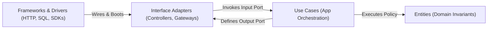
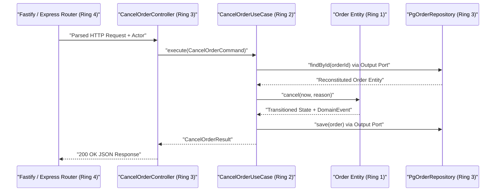
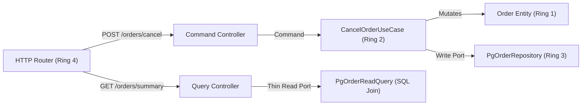

---
tags:
  - software-engineering
  - clean-architecture
  - architecture-principles
  - screaming-architecture
created: 2026-01-02
updated: 2026-11-13
status: 🟢
level: mid-to-senior
---
# Clean Architecture Overview

> [!abstract] Hub Context
> Part of [[Programming/Software Engineering/Clean Architecture/Clean Architecture Complete Guide|Clean Architecture Complete Guide]]. Continues into [[Programming/Software Engineering/Clean Architecture/Dependency Rule|Dependency Rule]], [[Programming/Software Engineering/Clean Architecture/Entities & Use Cases|Entities & Use Cases]], and [[Programming/Software Engineering/Clean Architecture/Interface Adapters & Frameworks|Interface Adapters & Frameworks]]. Shares its inward isolation model with [[Programming/Software Engineering/Architectural Patterns/Hexagonal Architecture|Hexagonal Architecture]].

Clean Architecture is a structural decomposition strategy designed to reduce the long-term engineering cost of modifying, testing, and scaling a software system over multi-year lifecycles. Rather than organizing code around web frameworks or database schemas, it partitions the codebase along **rates of change and business policy stability**: slow-changing, high-value enterprise rules sit at the center, completely isolated from fast-changing delivery protocols, storage engines, and third-party vendor SDKs.

---

## 1. First-Principles Mechanics & Complete Architecture

### 1.1 Maximizing Architectural Optionality

Robert C. Martin states the core engineering objective of architecture explicitly: **good architecture maximizes the number of decisions not yet made**. Early in a product lifecycle, teams possess the least empirical evidence about actual query distributions, read/write ratios, regulatory edge cases, and scaling bottlenecks. Locking a codebase prematurely into MongoDB document shapes, Next.js Server Actions, Prisma ORM models, or Stripe SDK objects converts an uncertain technical guess into a multi-month rewrite liability when production constraints shift.

From a systems economics perspective, Clean Architecture lowers the **Change Amplification Factor** across three orthogonal axes:

1. **Storage Volatility**: A startup ships v1 on a single PostgreSQL instance and later discovers that append-only audit streams require ClickHouse, session state requires Redis, or a multi-tenant ledger requires sharded Postgres. When domain rules only invoke narrow repository ports, swapping or composing storage engines modifies only outer adapter packages.
2. **Transport & Trigger Volatility**: A domain workflow initially exposed as a synchronous REST endpoint frequently gains secondary callers within 12–24 months—an asynchronous message queue consumer, a scheduled reconciliation cron job, a gRPC internal endpoint, or an administrative CLI tool. If business rules live inside HTTP controllers, every new trigger forces either logic duplication or fragile internal HTTP loopback calls.
3. **Vendor & SDK Volatility**: Third-party providers deprecate API versions, change webhook payload schemas, or get replaced for unit-economics reasons (switching payment processors, transactional email vendors, or LLM providers). Isolating vendor SDKs behind Anti-Corruption Adapters prevents third-party breaking changes from rippling through application workflows.

Architectural optionality is achieved through **compile-time boundary separation**. By isolating business policy from concrete I/O details, the system retains the option to defer database engine selection, caching topology, and transport protocols until real telemetry justifies an optimization.

### 1.2 The Concentric 4-Ring Topology

Clean Architecture models a software system as four concentric policy rings. Moving from the outermost ring inward, **abstraction and policy stability increase** while **volatile implementation detail decreases**.



Each ring owns a strict responsibility boundary and operates under non-overlapping change triggers:

| Ring | Primary Artifacts | Rate of Change | Allowed Dependencies | Forbidden Dependencies |
|---|---|---|---|---|
| **1. Entities** | Enterprise domain objects, Value Objects (`Money`, `Percentage`), state machines, domain invariants, domain exceptions | Lowest (changes only when universal business rules change) | Language standard library & pure shared value primitives | Use cases, repositories, HTTP types, ORMs, DI containers, `process.env` |
| **2. Use Cases** | Application interactors (`CancelOrderUseCase`), Input/Output Ports, boundary Command/Result DTOs | Low-to-Moderate (changes when automated app workflows change) | Ring 1 Entities + own Port interfaces | Controllers, SQL dialects, Express/Fastify, Prisma/TypeORM models, vendor SDKs |
| **3. Interface Adapters** | HTTP/gRPC/Queue controllers, Presenters, Repository & Gateway implementations, SQL/ORM mappers | Moderate-to-High (changes when API contracts, DB schemas, or SDKs change) | Ring 2 Use Cases/Ports + Ring 1 Entities | Process startup scripts, global server instances, business policy branching |
| **4. Frameworks & Drivers** | Web server (`Fastify`, `Express`, `net/http`), DB pools (`pg`, `pgx`), broker SDKs, **Composition Root** | Highest (upgrades, infra migrations, runtime config) | All inner rings (solely for startup wiring in Composition Root) | Business calculations, domain state transitions, validation policy |

The concentric rings are **logical dependency boundaries**, not a mandatory rule dictating four physical microservices or four top-level npm packages per feature. A compact module may contain only two physical layers (`core/` combining Entities + Use Cases + Ports, and `adapters/`), provided the inward compile-time dependency direction holds.

### 1.3 Flow of Control vs Compile-Time Dependency Direction

A frequent point of confusion is why runtime execution enters and exits all four rings while source-code dependencies remain strictly inward. Consider a single write transaction: a client sends `POST /v1/orders/ord_123/cancel`.



Trace the runtime call stack versus the static `import` graph across those seven hops:

1. **Inbound Boundary Crossing (Ring 4 $\rightarrow$ Ring 3 $\rightarrow$ Ring 2)**: The HTTP router invokes `CancelOrderController`. The controller parses route parameters, verifies request JSON syntax with a schema validator (e.g., Zod), builds a plain `CancelOrderCommand` object containing no HTTP headers or `Request` references, and calls `CancelOrderUseCase.execute(command)`. Here, both control flow and source-code `import` point **inward**.
2. **Domain Policy Execution (Ring 2 $\rightarrow$ Ring 1)**: `CancelOrderUseCase` loads the `Order` entity through an abstract `OrderRepository` interface and invokes `order.cancel(clock.now(), command.reason)`. All state-machine transitions, refund percentages, and time-window checks execute inside pure memory on `Order`. Control and imports both point **inward**.
3. **Outbound Boundary Crossing via Dependency Inversion (Ring 2 $\rightarrow$ Ring 3 at runtime, Ring 3 $\rightarrow$ Ring 2 at compile time)**: `CancelOrderUseCase` calls `this.orders.save(order)` and `this.refunds.issueRefund(...)`. At runtime, execution enters `PgOrderRepository` and `StripeRefundGateway` (Ring 3). At compile time, `CancelOrderUseCase` only imports the abstract `OrderRepository` and `RefundGateway` TypeScript interfaces defined inside Ring 2. `PgOrderRepository` implements `OrderRepository`, meaning its `import` statement points **inward** toward Ring 2. The **Composition Root** in Ring 4 injected the concrete instances at boot time.

This mechanical separation between **runtime control flow** and **compile-time import vectors** is detailed formally in [[Programming/Software Engineering/Clean Architecture/Dependency Rule|Dependency Rule]] and [[Programming/Software Engineering/SOLID/Dependency Inversion|Dependency Inversion]].

### 1.4 The Five Decoupling Invariants

Clean Architecture establishes five concrete, testable engineering properties on the inner rings (Entities + Use Cases):

1. **Independent of Frameworks**: Frameworks (`NestJS`, `Spring Boot`, `Next.js`, `Gin`, `Fastify`) are runtime orchestration shells, not architectural foundations. Business classes never extend framework base classes (`extends BaseEntity`, `extends Model`), never import framework DI decorators into domain entities (`@Injectable()`), and never depend on framework lifecycle hooks (`OnModuleInit`). If NestJS or Express is replaced by a raw AWS Lambda handler or a gRPC server, `domain/` and `application/` compile without changing a single line.
2. **Testable Without Runtime Infrastructure**: Domain Entities and Use Cases run purely in-memory using deterministic fake adapters (`InMemoryOrderRepository`, `FixedClock`, `StubRefundGateway`). Executing 500 domain and interactor unit tests requires zero Docker containers, zero TCP sockets, zero disk writes, and zero HTTP servers—completing in milliseconds in CI and local watch loops.
3. **Independent of UI**: Presentation formats (REST JSON, GraphQL types, Server-Rendered HTML, CLI stdout exit codes, Slack interactive payloads) live inside Controllers and Presenters in Ring 3. Switching an endpoint from synchronous REST JSON to asynchronous webhook delivery or adding an admin GraphQL mutation requires zero changes inside Use Cases.
4. **Independent of Database**: PostgreSQL, MySQL, DynamoDB, MongoDB, and Redis sit behind secondary Output Ports. Business rules cannot reference SQL `Result` rows, ORM lazy-loading proxies (`Promise<LineItem[]>`), column naming conventions (`snake_case` vs `camelCase`), or connection pools. Data translation between normalized SQL tables and rich Domain Entities occurs strictly inside Repository Adapters.
5. **Independent of External Agency**: Payment processors (`Stripe`, `Adyen`), email relays (`SES`, `Postmark`), identity providers (`Auth0`, `Cognito`), and LLM APIs interact through narrow domain-defined ports. Those ports express business semantics (`RefundResult`), never third-party HTTP status codes, pagination cursors, or vendor error hierarchies (`StripeCardError`).

### 1.5 Screaming Architecture & Vertical Capability Packaging

Inspection of a repository's top-level directory tree immediately reveals what architectural axis a team optimized around. Traditional framework-first templates scatter a single business capability across horizontal technical buckets:

| Anti-Pattern: Layer-First / Framework-First Tree | Clean Architecture: Screaming Domain Tree |
|---|---|
| `src/controllers/OrderController.ts` | `src/ordering/domain/Order.ts` |
| `src/controllers/BillingController.ts` | `src/ordering/application/CancelOrderUseCase.ts` |
| `src/models/OrderModel.ts` | `src/ordering/application/ports/OrderRepository.ts` |
| `src/models/InvoiceModel.ts` | `src/ordering/adapters/http/CancelOrderController.ts` |
| `src/services/OrderService.ts` | `src/ordering/adapters/postgres/PgOrderRepository.ts` |
| `src/services/BillingService.ts` | `src/billing/domain/Invoice.ts` |
| `src/repositories/OrderRepository.ts` | `src/billing/application/IssueInvoiceUseCase.ts` |
| `src/middlewares/StripeMiddleware.ts` | `src/fulfillment/domain/Shipment.ts` |

Notice the top-level directories in the right-hand layout: `ordering/`, `billing/`, `fulfillment/`. The directory tree **screams the domain capabilities** of an e-commerce platform rather than screaming "Express MVC app."

#### Concrete Engineering Consequences of Capability-First Packaging
- **Cognitive Locality & Reduced Context Switching**: Modifying order cancellation rules keeps the engineer inside `src/ordering/`, rather than jumping across `src/controllers/`, `src/dtos/`, `src/services/`, `src/models/`, and `src/repositories/` mixed with 60 unrelated files.
- **Bounded Blast Radius & Merge-Conflict Isolation**: Parallel feature teams working on `billing/` and `fulfillment/` rarely touch the same files or barrel exports, eliminating cross-team merge conflicts and accidental coupling.
- **Modular Extraction Readiness**: When `fulfillment/` experiences $10\times$ traffic growth or regulatory isolation demands deploying `billing/` into a separate VPC, its internal domain rules, ports, and adapters already live inside a self-contained directory tree. Exposing a public `index.ts` boundary per module converts extraction from a multi-quarter untangling project into swapping an in-process port call for an HTTP/gRPC/Queue adapter.
- **Alignment with Bounded Contexts**: Capability modules map 1:1 to Bounded Contexts in [[Programming/Software Engineering/DDD/Strategic Design|Strategic Design]] and feature cohesive boundaries in [[Programming/Software Engineering/Architectural Patterns/Vertical Slice Architecture|Vertical Slice Architecture]].

---

## 2. Real-World Use Cases, Pragmatic Trade-Offs & Anti-Pattern Analysis

Clean Architecture carries an explicit structural cost: interfaces, boundary DTOs, mappers, and Composition Root wiring increase upfront code volume and indirection. Senior architects apply Clean Architecture selectively where domain complexity and multi-year change probability exceed the cost of indirection.

### 2.1 Architectural Decision Matrix

| Production System Archetype | Recommended Architecture Depth | Engineering Justification |
|---|---|---|
| **Core Fintech, Billing, Inventory & Booking Write Engines** | **Full Clean / Hexagonal Isolation** on Commands & State Transitions | High invariant density (idempotency, double-entry ledger math, proration, regulatory audit), high cost of bugs, multi-channel triggers (API + webhooks + cron). |
| **Multi-Tenant B2B SaaS (Mixed Complex Writes + Rich Dashboards)** | **Hybrid Clean Commands + CQRS-Lite Read Bypass** | Write commands protect complex state transitions cleanly; read endpoints bypass Entities and Output Port adapters to execute fast SQL projections directly. |
| **Simple Admin CRUD / Internal Metadata Backoffice** | **Vertical Slice or Thin Framework MVC** (Zod + Drizzle/Prisma directly) | Zero complex invariants; separating Domain Entities from Persistence Models duplicates identical properties across 5 files with zero return on investment. |
| **Early-Stage Throwaway MVP / 90-Day Market Validation** | **Modular Monolith with Thin Transaction Scripts** | Requirements change faster than domain boundaries stabilize; keeping modules cleanly separated by folder suffices until core invariants emerge. |
| **High-Throughput Streaming / ETL / Real-Time Telemetry (>100k msg/s)** | **Functional Pipeline / Zero-Allocation Buffers** | Creating Domain Entity instances and copying Boundary DTOs across 4 layers per event allocates excessive heap objects and spikes p99 GC pause latency. |
| **Large Enterprise Platform Splitting Teams Across Modules** | **Screaming Architecture Modules + Enforced Module Index + Selective Clean Core** | Screaming boundaries prevent cross-team coupling immediately while allowing individual modules to pick Clean vs Vertical Slice internal depth. |

### 2.2 Anti-Pattern Analysis: Cargo-Cult Boilerplate & The 5-File Mapping Tax

The most widespread failure when adopting Clean Architecture is treating all four rings as mandatory boilerplate for every endpoint regardless of invariant complexity.

Consider an innocent requirement: `GET /v1/tags` returning a paginated list of product tags `{ id, slug, displayName }`. A dogmatic Clean Architecture implementation generates:

1. `GetTagsHttpRequest.ts` (extracts query params)
2. `GetTagsController.ts` (converts HTTP params to `GetTagsInputDto`)
3. `GetTagsInputPort.ts` (interface with one method `execute`)
4. `GetTagsInteractor.ts` (calls `TagRepository.findAll()`)
5. `Tag.ts` (anemic entity class with getters for `id`, `slug`, `displayName`)
6. `TagOrmEntity.ts` + `TagMapper.ts` (copies `row.id -> entity.id`, `row.slug -> entity.slug`, `row.displayName -> entity.displayName`)
7. `GetTagsOutputPort.ts` + `GetTagsPresenter.ts` + `GetTagsViewModel.ts` (copies `entity.id -> vm.id`, etc.)

That is **8–10 files and 4 object allocations per row** to execute `SELECT id, slug, display_name FROM tags LIMIT 50`.

#### Concrete Failure Modes of Dogmatic Over-Engineering
- **The Mapping Tax**: Adding one column (`colorHex`) forces edits across 7 files, 3 interfaces, and 4 mappers, turning trivial feature work into slow ceremony.
- **False Decoupling via 1:1 Mirror Ports**: Teams frequently create `TagRepository` methods like `findActiveTagsSortedByNameWithPaginationAndCount(...)`. That method signature is tightly coupled to a specific UI table's SQL query—abstracting it behind an interface provides zero architectural optionality while obscuring SQL performance tuning.
- **ORM Projection Starvation**: Hydrating full `Order` Domain Entities (including 1:N `lineItems`, `payments`, `shipments`) purely to display `{ orderId, customerEmail, totalCents }` in an admin table triggers catastrophic $N+1$ queries or over-fetching memory spikes.

### 2.3 The Pragmatic Hybrid: CQRS-Lite Read Bypass + Selective Ring Isolation

Senior production teams resolve the boilerplate vs purity tension using a **two-path architectural split** inside each Screaming capability module, building on [[Programming/Software Engineering/Architectural Patterns/CQRS|CQRS]]:



- **Command / Write Path (Strict Clean Isolation)**: Commands mutate state, enforce domain invariants, acquire optimistic locks, talk to payment gateways, and emit outbox events. They pass through **Controller $\rightarrow$ Use Case Interactor $\rightarrow$ Domain Entity $\rightarrow$ Output Ports**.
- **Query / Read Path (CQRS-Lite Bypass)**: Read endpoints never modify domain state and require zero invariant enforcement. A Query Controller invokes a thin read-only query interface (`OrderSummaryQuery`) defined in `application/queries/` and implemented in `adapters/postgres/` via a single indexed SQL `SELECT ... JOIN ...` that returns flat JSON-serializable view DTOs directly. Zero Domain Entities are instantiated, zero Output Port Presenters are involved, and the Dependency Rule (`adapters -> application`) remains 100% intact.

---

## 3. Step-by-Step Practical Application: Production Before/After Trace

To ground these mechanics in real code, examine an e-commerce **Order Cancellation & Partial Refund** workflow with non-trivial business rules:

1. An order in `PAID` status receives a 100% refund if cancelled.
2. An order in `PACKING` status (warehouse already picked items) incurs a **15% restocking fee** (rounded down to integer minor units).
3. Orders in `SHIPPED`, `DELIVERED`, or `CANCELLED` status cannot be cancelled.
4. Paid orders placed more than **30 days** before the cancellation timestamp cannot be self-cancelled.
5. Refund side effects must not permanently diverge from database state if the payment gateway succeeds and the database crashes mid-request.

### 3.1 The "Before": Coupled Express/Prisma/Stripe Endpoint

```typescript
// src/routes/cancelOrder.ts — Anti-Pattern: Coupled Transport, Policy, DB, Clock, and Vendor SDK
import { Request, Response } from 'express';
import { PrismaClient, OrderStatus } from '@prisma/client';
import Stripe from 'stripe';

const prisma = new PrismaClient();
const stripe = new Stripe(process.env.STRIPE_SECRET_KEY!);

export async function cancelOrderHandler(req: Request, res: Response) {
  try {
    const order = await prisma.order.findUnique({
      where: { id: req.params.id },
      include: { items: true },
    });

    if (!order) {
      return res.status(404).json({ error: 'Order not found' });
    }

    if (order.customerId !== req.headers['x-customer-id']) {
      return res.status(403).json({ error: 'Forbidden' });
    }

    if (order.status === OrderStatus.SHIPPED || order.status === OrderStatus.DELIVERED) {
      return res.status(409).json({ error: 'Order already shipped' });
    }

    if (order.status === OrderStatus.CANCELLED) {
      return res.status(409).json({ error: 'Order already cancelled' });
    }

    const msElapsed = Date.now() - order.paidAt.getTime();
    if (msElapsed > 30 * 86_400_000) {
      return res.status(422).json({ error: '30-day cancellation window expired' });
    }

    let refundCents = order.totalCents;
    if (order.status === OrderStatus.PACKING) {
      refundCents = Math.floor(order.totalCents * 0.85);
    }

    // CRITICAL BUG: If Stripe succeeds and Prisma fails below, money is refunded
    // while DB still shows PAID/PACKING -> retry triggers a SECOND refund!
    const refund = await stripe.refunds.create({
      payment_intent: order.stripePaymentIntentId,
      amount: refundCents,
    });

    await prisma.order.update({
      where: { id: order.id },
      data: {
        status: OrderStatus.CANCELLED,
        refundedCents: refundCents,
        stripeRefundId: refund.id,
        cancelledAt: new Date(),
      },
    });

    return res.status(200).json({
      orderId: order.id,
      status: 'CANCELLED',
      refundedCents: refundCents,
    });
  } catch (err) {
    console.error(err);
    return res.status(500).json({ error: 'Internal server error' });
  }
}
```

#### Five Concrete Engineering Defects in the Coupled Version
1. **Import-Time Crash & Zero In-Memory Testing**: Importing `cancelOrder.ts` inside Vitest evaluates `new PrismaClient()` and `new Stripe(process.env.STRIPE_SECRET_KEY!)`, throwing immediately if `STRIPE_SECRET_KEY` is unset and dragging Prisma/Stripe clients into the test module graph.
2. **Non-Deterministic Clock (`Date.now()`)**: Testing the exact 30-day boundary (`29d 23h 59m` vs `30d 00h 01m`) requires monkeypatching global timers (`vi.useFakeTimers()`).
3. **Transport Lock-In**: Moving this cancellation capability to an admin CLI, a Kafka consumer, or a Next.js Server Action forces duplicating the restocking fee math and 30-day policy.
4. **Vendor & Schema Coupling**: Business rules inspect Prisma's `OrderStatus` enum and `stripePaymentIntentId` directly. Migrating to Adyen or renaming `totalCents` breaks domain eligibility checks.
5. **Distributed Partial Failure & Lost Update Race**: Two concurrent `POST` requests both read `status = PAID` under `READ COMMITTED`, both execute `stripe.refunds.create(...)`, and both overwrite the order row—issuing **double money** to the user.

### 3.2 The "After": Screaming Architecture Feature Module (`src/ordering/`)

```text
src/
├── shared/
│   └── kernel/
│       └── Money.ts
├── ordering/
│   ├── index.ts
│   ├── domain/
│   │   ├── Order.ts
│   │   └── OrderErrors.ts
│   ├── application/
│   │   ├── ports/
│   │   │   ├── Clock.ts
│   │   │   ├── OrderRepository.ts
│   │   │   └── RefundGateway.ts
│   │   ├── queries/
│   │   │   └── GetOrderSummaryQuery.ts
│   │   └── CancelOrderUseCase.ts
│   └── adapters/
│       ├── http/
│       │   └── CancelOrderController.ts
│       ├── postgres/
│       │   ├── PgOrderRepository.ts
│       │   └── PgOrderSummaryQuery.ts
│       └── stripe/
│           └── StripeRefundGateway.ts
└── main.ts
test/
└── ordering/
    └── CancelOrderUseCase.spec.ts
```

#### Step 1: Shared Domain Value Object (`src/shared/kernel/Money.ts`)

```typescript
// src/shared/kernel/Money.ts — Ring 1 Shared Primitive (Zero external imports)
export class Money {
  private constructor(
    public readonly cents: number,
    public readonly currency: string,
  ) {
    if (!Number.isInteger(cents) || cents < 0) {
      throw new RangeError(`Money cents must be a non-negative integer, got ${cents}`);
    }
    if (!/^[A-Z]{3}$/.test(currency)) {
      throw new RangeError(`Invalid ISO currency code: ${currency}`);
    }
  }

  static ofCents(cents: number, currency: string): Money {
    return new Money(cents, currency);
  }

  static zero(currency: string): Money {
    return new Money(0, currency);
  }

  percentageFloor(bps: number): Money {
    if (!Number.isInteger(bps) || bps < 0 || bps > 10_000) {
      throw new RangeError(`Basis points must be between 0 and 10000, got ${bps}`);
    }
    return new Money(Math.floor((this.cents * bps) / 10_000), this.currency);
  }

  subtract(other: Money): Money {
    if (this.currency !== other.currency) {
      throw new Error(`Currency mismatch: ${this.currency} vs ${other.currency}`);
    }
    if (other.cents > this.cents) {
      throw new Error(`Insufficient amount: ${this.cents} < ${other.cents}`);
    }
    return new Money(this.cents - other.cents, this.currency);
  }
}
```

#### Step 2: Domain Errors & Entity (`src/ordering/domain/`)

```typescript
// src/ordering/domain/OrderErrors.ts — Ring 1 Pure Domain Errors
export abstract class DomainError extends Error {
  abstract readonly code: string;
}

export class OrderNotFoundError extends DomainError {
  readonly code = 'ORDER_NOT_FOUND';
  constructor(orderId: string) {
    super(`Order ${orderId} does not exist`);
  }
}

export class OrderOwnershipError extends DomainError {
  readonly code = 'ORDER_FORBIDDEN';
  constructor(orderId: string) {
    super(`Actor does not own order ${orderId}`);
  }
}

export class InvalidOrderCancellationStateError extends DomainError {
  readonly code = 'INVALID_CANCELLATION_STATE';
  constructor(status: string) {
    super(`Order in status ${status} cannot be cancelled`);
  }
}

export class CancellationWindowExpiredError extends DomainError {
  readonly code = 'CANCELLATION_WINDOW_EXPIRED';
  constructor(daysElapsed: number) {
    super(`Order cancellation window (30 days) expired (${daysElapsed.toFixed(1)} days elapsed)`);
  }
}

export class OptimisticConcurrencyError extends DomainError {
  readonly code = 'CONCURRENT_MODIFICATION';
  constructor(orderId: string) {
    super(`Order ${orderId} was modified concurrently; retry safe`);
  }
}
```

```typescript
// src/ordering/domain/Order.ts — Ring 1 Entity (Zero framework/DB/HTTP imports)
import { Money } from '../../shared/kernel/Money';
import {
  CancellationWindowExpiredError,
  InvalidOrderCancellationStateError,
  OrderOwnershipError,
} from './OrderErrors';

export type OrderStatus =
  | 'PAID'
  | 'PACKING'
  | 'CANCELLING'
  | 'CANCELLED'
  | 'SHIPPED'
  | 'DELIVERED';

export interface CancellationQuote {
  readonly refundAmount: Money;
  readonly restockingFee: Money;
}

export interface OrderSnapshot {
  readonly id: string;
  readonly customerId: string;
  readonly paymentRef: string;
  readonly total: Money;
  readonly status: OrderStatus;
  readonly paidAt: Date;
  readonly cancelledAt: Date | null;
  readonly refundedAmount: Money | null;
  readonly externalRefundId: string | null;
  readonly version: number;
}

const CANCELLATION_WINDOW_MS = 30 * 86_400_000;
const PACKING_RESTOCK_FEE_BPS = 1500; // 15.00%

export class Order {
  private constructor(private props: OrderSnapshot) {}

  static reconstitute(snapshot: OrderSnapshot): Order {
    return new Order({ ...snapshot });
  }

  get id(): string {
    return this.props.id;
  }

  get paymentRef(): string {
    return this.props.paymentRef;
  }

  get status(): OrderStatus {
    return this.props.status;
  }

  get version(): number {
    return this.props.version;
  }

  snapshot(): OrderSnapshot {
    return { ...this.props };
  }

  /**
   * Phase 1 of idempotent cancellation: validates ownership, state machine,
   * 30-day eligibility window, and transitions to CANCELLING before external PSP I/O.
   */
  beginCancellation(actorCustomerId: string, now: Date): CancellationQuote {
    if (this.props.customerId !== actorCustomerId) {
      throw new OrderOwnershipError(this.props.id);
    }

    if (this.props.status !== 'PAID' && this.props.status !== 'PACKING') {
      throw new InvalidOrderCancellationStateError(this.props.status);
    }

    const elapsedMs = now.getTime() - this.props.paidAt.getTime();
    if (elapsedMs > CANCELLATION_WINDOW_MS) {
      throw new CancellationWindowExpiredError(elapsedMs / 86_400_000);
    }

    const restockingFee =
      this.props.status === 'PACKING'
        ? this.props.total.percentageFloor(PACKING_RESTOCK_FEE_BPS)
        : Money.zero(this.props.total.currency);

    const refundAmount = this.props.total.subtract(restockingFee);

    this.props = {
      ...this.props,
      status: 'CANCELLING',
    };

    return { refundAmount, restockingFee };
  }

  /**
   * Phase 2: records confirmed external refund and finalizes CANCELLED state.
   */
  completeCancellation(refundAmount: Money, externalRefundId: string, now: Date): void {
    if (this.props.status !== 'CANCELLING') {
      throw new InvalidOrderCancellationStateError(this.props.status);
    }
    this.props = {
      ...this.props,
      status: 'CANCELLED',
      refundedAmount: refundAmount,
      externalRefundId,
      cancelledAt: now,
    };
  }
}
```

Notice how moving to an explicit `CANCELLING` intermediate state combined with optimistic concurrency (`version`) resolves both the double-refund race and partial-failure window: two concurrent calls cannot both win the DB update from `PAID` to `CANCELLING`!

#### Step 3: Driven Output Ports & CQRS-Lite Query Port (`src/ordering/application/`)

```typescript
// src/ordering/application/ports/Clock.ts — Ring 2 Driven Port
export interface Clock {
  now(): Date;
}
```

```typescript
// src/ordering/application/ports/OrderRepository.ts — Ring 2 Driven Port
import { Order } from '../../domain/Order';

export interface OrderRepository {
  findById(orderId: string): Promise<Order | null>;
  /**
   * Persists state only if stored version matches expectedVersion;
   * throws OptimisticConcurrencyError on mismatch.
   */
  save(order: Order, expectedVersion: number): Promise<void>;
}
```

```typescript
// src/ordering/application/ports/RefundGateway.ts — Ring 2 Driven Port
import { Money } from '../../../shared/kernel/Money';

export interface RefundExecutionResult {
  readonly externalRefundId: string;
}

export interface RefundGateway {
  issueRefund(params: {
    paymentRef: string;
    amount: Money;
    idempotencyKey: string;
  }): Promise<RefundExecutionResult>;
}
```

```typescript
// src/ordering/application/queries/GetOrderSummaryQuery.ts — CQRS-Lite Read Port
export interface OrderSummaryView {
  readonly orderId: string;
  readonly customerName: string;
  readonly status: string;
  readonly totalCents: number;
  readonly currency: string;
  readonly lineItemCount: number;
}

export interface GetOrderSummaryQuery {
  findById(orderId: string, customerId: string): Promise<OrderSummaryView | null>;
}
```

#### Step 4: Use Case Interactor (`src/ordering/application/CancelOrderUseCase.ts`)

```typescript
// src/ordering/application/CancelOrderUseCase.ts — Ring 2 Application Orchestration
import { OrderNotFoundError } from '../domain/OrderErrors';
import { Clock } from './ports/Clock';
import { OrderRepository } from './ports/OrderRepository';
import { RefundGateway } from './ports/RefundGateway';

export interface CancelOrderCommand {
  readonly orderId: string;
  readonly actorCustomerId: string;
  readonly reason: string;
}

export interface CancelOrderResult {
  readonly orderId: string;
  readonly status: 'CANCELLED';
  readonly refundedCents: number;
  readonly restockingFeeCents: number;
  readonly currency: string;
  readonly externalRefundId: string;
}

export class CancelOrderUseCase {
  constructor(
    private readonly orders: OrderRepository,
    private readonly refunds: RefundGateway,
    private readonly clock: Clock,
  ) {}

  async execute(command: CancelOrderCommand): Promise<CancelOrderResult> {
    const order = await this.orders.findById(command.orderId);
    if (!order) {
      throw new OrderNotFoundError(command.orderId);
    }

    const now = this.clock.now();
    const initialVersion = order.version;
    const quote = order.beginCancellation(command.actorCustomerId, now);

    // Lock the state transition in DB BEFORE calling the external payment processor.
    // Concurrent requests fail immediately with OptimisticConcurrencyError.
    await this.orders.save(order, initialVersion);

    const { externalRefundId } = await this.refunds.issueRefund({
      paymentRef: order.paymentRef,
      amount: quote.refundAmount,
      idempotencyKey: `cancel-order:${order.id}`,
    });

    order.completeCancellation(quote.refundAmount, externalRefundId, this.clock.now());
    await this.orders.save(order, initialVersion + 1);

    return {
      orderId: order.id,
      status: 'CANCELLED',
      refundedCents: quote.refundAmount.cents,
      restockingFeeCents: quote.restockingFee.cents,
      currency: quote.refundAmount.currency,
      externalRefundId,
    };
  }
}
```

#### Step 5: Interface Adapters (`src/ordering/adapters/`)

```typescript
// src/ordering/adapters/http/CancelOrderController.ts — Ring 3 Inbound HTTP Adapter
import { FastifyReply, FastifyRequest } from 'fastify';
import { z } from 'zod';
import { CancelOrderUseCase } from '../../application/CancelOrderUseCase';
import { GetOrderSummaryQuery } from '../../application/queries/GetOrderSummaryQuery';
import {
  CancellationWindowExpiredError,
  DomainError,
  InvalidOrderCancellationStateError,
  OptimisticConcurrencyError,
  OrderNotFoundError,
  OrderOwnershipError,
} from '../../domain/OrderErrors';

const CancelBodySchema = z.object({
  reason: z.string().trim().min(3).max(200),
});

export class OrderHttpController {
  constructor(
    private readonly cancelOrder: CancelOrderUseCase,
    private readonly summaryQuery: GetOrderSummaryQuery,
  ) {}

  async handleCancel(
    req: FastifyRequest<{ Params: { id: string } }>,
    reply: FastifyReply,
  ) {
    const customerId = req.headers['x-customer-id'];
    if (typeof customerId !== 'string' || customerId.length === 0) {
      return reply.code(401).send({ error: 'Missing authenticated customer identity' });
    }

    const parsed = CancelBodySchema.safeParse(req.body);
    if (!parsed.success) {
      return reply.code(400).send({ error: 'Invalid payload', details: parsed.error.flatten() });
    }

    try {
      const result = await this.cancelOrder.execute({
        orderId: req.params.id,
        actorCustomerId: customerId,
        reason: parsed.data.reason,
      });
      return reply.code(200).send(result);
    } catch (err) {
      if (err instanceof DomainError) {
        return reply.code(this.mapDomainErrorToStatus(err)).send({
          code: err.code,
          message: err.message,
        });
      }
      throw err;
    }
  }

  async handleGetSummary(
    req: FastifyRequest<{ Params: { id: string } }>,
    reply: FastifyReply,
  ) {
    const customerId = req.headers['x-customer-id'];
    if (typeof customerId !== 'string' || customerId.length === 0) {
      return reply.code(401).send({ error: 'Missing authenticated customer identity' });
    }
    const view = await this.summaryQuery.findById(req.params.id, customerId);
    if (!view) {
      return reply.code(404).send({ error: 'Order not found' });
    }
    return reply.code(200).send(view);
  }

  private mapDomainErrorToStatus(err: DomainError): number {
    if (err instanceof OrderNotFoundError) return 404;
    if (err instanceof OrderOwnershipError) return 403;
    if (err instanceof CancellationWindowExpiredError) return 422;
    if (err instanceof InvalidOrderCancellationStateError) return 409;
    if (err instanceof OptimisticConcurrencyError) return 409;
    return 400;
  }
}
```

```typescript
// src/ordering/adapters/postgres/PgOrderRepository.ts — Ring 3 Persistence Adapter
import { Pool } from 'pg';
import { Money } from '../../../shared/kernel/Money';
import { Order, OrderStatus } from '../../domain/Order';
import { OptimisticConcurrencyError } from '../../domain/OrderErrors';
import { OrderRepository } from '../../application/ports/OrderRepository';

interface OrderDbRow {
  id: string;
  customer_id: string;
  stripe_payment_intent_id: string;
  total_cents: number;
  currency: string;
  status: OrderStatus;
  paid_at: Date;
  cancelled_at: Date | null;
  refunded_cents: number | null;
  external_refund_id: string | null;
  version: number;
}

export class PgOrderRepository implements OrderRepository {
  constructor(private readonly pool: Pool) {}

  async findById(orderId: string): Promise<Order | null> {
    const { rows } = await this.pool.query<OrderDbRow>(
      `SELECT id, customer_id, stripe_payment_intent_id, total_cents, currency,
              status, paid_at, cancelled_at, refunded_cents, external_refund_id, version
       FROM orders
       WHERE id = $1`,
      [orderId],
    );
    const row = rows[0];
    if (!row) return null;

    return Order.reconstitute({
      id: row.id,
      customerId: row.customer_id,
      paymentRef: row.stripe_payment_intent_id,
      total: Money.ofCents(row.total_cents, row.currency),
      status: row.status,
      paidAt: row.paid_at,
      cancelledAt: row.cancelled_at,
      refundedAmount:
        row.refunded_cents !== null ? Money.ofCents(row.refunded_cents, row.currency) : null,
      externalRefundId: row.external_refund_id,
      version: row.version,
    });
  }

  async save(order: Order, expectedVersion: number): Promise<void> {
    const snap = order.snapshot();
    const res = await this.pool.query(
      `UPDATE orders
       SET status = $1,
           cancelled_at = $2,
           refunded_cents = $3,
           external_refund_id = $4,
           version = version + 1
       WHERE id = $5 AND version = $6`,
      [
        snap.status,
        snap.cancelledAt,
        snap.refundedAmount?.cents ?? null,
        snap.externalRefundId,
        snap.id,
        expectedVersion,
      ],
    );

    if (res.rowCount === 0) {
      throw new OptimisticConcurrencyError(snap.id);
    }
  }
}
```

```typescript
// src/ordering/adapters/postgres/PgOrderSummaryQuery.ts — Ring 3 CQRS-Lite Read Adapter
import { Pool } from 'pg';
import {
  GetOrderSummaryQuery,
  OrderSummaryView,
} from '../../application/queries/GetOrderSummaryQuery';

export class PgOrderSummaryQuery implements GetOrderSummaryQuery {
  constructor(private readonly pool: Pool) {}

  async findById(orderId: string, customerId: string): Promise<OrderSummaryView | null> {
    const { rows } = await this.pool.query<{
      order_id: string;
      customer_name: string;
      status: string;
      total_cents: number;
      currency: string;
      line_item_count: string;
    }>(
      `SELECT o.id AS order_id,
              c.full_name AS customer_name,
              o.status,
              o.total_cents,
              o.currency,
              COUNT(li.id)::text AS line_item_count
       FROM orders o
       JOIN customers c ON c.id = o.customer_id
       LEFT JOIN order_line_items li ON li.order_id = o.id
       WHERE o.id = $1 AND o.customer_id = $2
       GROUP BY o.id, c.full_name`,
      [orderId, customerId],
    );

    const r = rows[0];
    if (!r) return null;
    return {
      orderId: r.order_id,
      customerName: r.customer_name,
      status: r.status,
      totalCents: r.total_cents,
      currency: r.currency,
      lineItemCount: Number(r.line_item_count),
    };
  }
}
```

```typescript
// src/ordering/adapters/stripe/StripeRefundGateway.ts — Ring 3 Vendor Adapter
import Stripe from 'stripe';
import {
  RefundExecutionResult,
  RefundGateway,
} from '../../application/ports/RefundGateway';
import { Money } from '../../../shared/kernel/Money';

export class StripeRefundGateway implements RefundGateway {
  constructor(private readonly stripe: Stripe) {}

  async issueRefund(params: {
    paymentRef: string;
    amount: Money;
    idempotencyKey: string;
  }): Promise<RefundExecutionResult> {
    const refund = await this.stripe.refunds.create(
      {
        payment_intent: params.paymentRef,
        amount: params.amount.cents,
      },
      { idempotencyKey: params.idempotencyKey },
    );

    return { externalRefundId: refund.id };
  }
}
```

#### Step 6: Public Module Surface & Composition Root (`src/ordering/index.ts`, `src/main.ts`)

```typescript
// src/ordering/index.ts — Public Capability Facade for Ring 4 Wiring & Cross-Module Ports
export { CancelOrderUseCase } from './application/CancelOrderUseCase';
export type { CancelOrderCommand, CancelOrderResult } from './application/CancelOrderUseCase';
export type { GetOrderSummaryQuery, OrderSummaryView } from './application/queries/GetOrderSummaryQuery';
export { OrderHttpController } from './adapters/http/CancelOrderController';
export { PgOrderRepository } from './adapters/postgres/PgOrderRepository';
export { PgOrderSummaryQuery } from './adapters/postgres/PgOrderSummaryQuery';
export { StripeRefundGateway } from './adapters/stripe/StripeRefundGateway';
```

```typescript
// src/main.ts — Ring 4 Composition Root (Sole location aware of concrete runtime bindings)
import Fastify from 'fastify';
import { Pool } from 'pg';
import Stripe from 'stripe';
import {
  CancelOrderUseCase,
  OrderHttpController,
  PgOrderRepository,
  PgOrderSummaryQuery,
  StripeRefundGateway,
} from './ordering';

export async function bootstrap(): Promise<void> {
  const pool = new Pool({ connectionString: process.env.DATABASE_URL, max: 20 });
  const stripe = new Stripe(process.env.STRIPE_SECRET_KEY!);
  const systemClock = { now: () => new Date() };

  const orderRepo = new PgOrderRepository(pool);
  const orderSummaryQuery = new PgOrderSummaryQuery(pool);
  const refundGateway = new StripeRefundGateway(stripe);

  const cancelOrderUseCase = new CancelOrderUseCase(orderRepo, refundGateway, systemClock);
  const controller = new OrderHttpController(cancelOrderUseCase, orderSummaryQuery);

  const app = Fastify({ logger: true });
  app.post('/v1/orders/:id/cancel', (req, reply) => controller.handleCancel(req as never, reply));
  app.get('/v1/orders/:id/summary', (req, reply) => controller.handleGetSummary(req as never, reply));

  const shutdown = async () => {
    await app.close();
    await pool.end();
  };
  process.on('SIGTERM', shutdown);

  await app.listen({ port: Number(process.env.PORT ?? 3000), host: '0.0.0.0' });
}
```

### 3.3 Sub-10ms Vitest Domain & Use-Case Test Suite

Notice what happens in `test/ordering/CancelOrderUseCase.spec.ts`: **zero PostgreSQL, zero Stripe, zero Fastify, zero environment variables**. Every invariant executes directly in Node V8 memory in single-digit milliseconds.

```typescript
// test/ordering/CancelOrderUseCase.spec.ts — Sub-10ms In-Memory Verification
import { describe, expect, it } from 'vitest';
import { Money } from '../../src/shared/kernel/Money';
import { Order, OrderStatus } from '../../src/ordering/domain/Order';
import {
  CancellationWindowExpiredError,
  InvalidOrderCancellationStateError,
  OptimisticConcurrencyError,
} from '../../src/ordering/domain/OrderErrors';
import { CancelOrderUseCase } from '../../src/ordering/application/CancelOrderUseCase';
import { OrderRepository } from '../../src/ordering/application/ports/OrderRepository';
import { RefundGateway } from '../../src/ordering/application/ports/RefundGateway';

class InMemoryOrderRepository implements OrderRepository {
  private readonly store = new Map<string, Order>();

  seed(order: Order): void {
    this.store.set(order.id, order);
  }

  async findById(orderId: string): Promise<Order | null> {
    const found = this.store.get(orderId);
    return found ? Order.reconstitute(found.snapshot()) : null;
  }

  async save(order: Order, expectedVersion: number): Promise<void> {
    const current = this.store.get(order.id);
    if (!current || current.version !== expectedVersion) {
      throw new OptimisticConcurrencyError(order.id);
    }
    const snap = order.snapshot();
    this.store.set(order.id, Order.reconstitute({ ...snap, version: snap.version + 1 }));
  }
}

class FakeRefundGateway implements RefundGateway {
  public readonly calls: Array<{ paymentRef: string; cents: number; idempotencyKey: string }> = [];

  async issueRefund(params: {
    paymentRef: string;
    amount: Money;
    idempotencyKey: string;
  }) {
    this.calls.push({
      paymentRef: params.paymentRef,
      cents: params.amount.cents,
      idempotencyKey: params.idempotencyKey,
    });
    return { externalRefundId: `re_fake_${this.calls.length}` };
  }
}

function makeOrder(status: OrderStatus, paidDaysAgo: number, totalCents = 10_000): Order {
  const now = new Date('2026-11-13T12:00:00.000Z');
  const paidAt = new Date(now.getTime() - paidDaysAgo * 86_400_000);
  return Order.reconstitute({
    id: 'ord_1',
    customerId: 'cust_1',
    paymentRef: 'pi_123',
    total: Money.ofCents(totalCents, 'USD'),
    status,
    paidAt,
    cancelledAt: null,
    refundedAmount: null,
    externalRefundId: null,
    version: 1,
  });
}

describe('CancelOrderUseCase', () => {
  const fixedClock = { now: () => new Date('2026-11-13T12:00:00.000Z') };

  it('refunds 100% for PAID order within 30 days', async () => {
    const repo = new InMemoryOrderRepository();
    const gateway = new FakeRefundGateway();
    repo.seed(makeOrder('PAID', 5, 10_000));
    const useCase = new CancelOrderUseCase(repo, gateway, fixedClock);

    const result = await useCase.execute({
      orderId: 'ord_1',
      actorCustomerId: 'cust_1',
      reason: 'Changed mind',
    });

    expect(result.refundedCents).toBe(10_000);
    expect(result.restockingFeeCents).toBe(0);
    expect(gateway.calls).toHaveLength(1);
    expect(gateway.calls[0].idempotencyKey).toBe('cancel-order:ord_1');
  });

  it('deducts 15% restocking fee when status is PACKING', async () => {
    const repo = new InMemoryOrderRepository();
    const gateway = new FakeRefundGateway();
    repo.seed(makeOrder('PACKING', 2, 10_000));
    const useCase = new CancelOrderUseCase(repo, gateway, fixedClock);

    const result = await useCase.execute({
      orderId: 'ord_1',
      actorCustomerId: 'cust_1',
      reason: 'Ordered duplicate',
    });

    expect(result.refundedCents).toBe(8_500);
    expect(result.restockingFeeCents).toBe(1_500);
  });

  it('rejects SHIPPED orders without invoking payment gateway', async () => {
    const repo = new InMemoryOrderRepository();
    const gateway = new FakeRefundGateway();
    repo.seed(makeOrder('SHIPPED', 1, 10_000));
    const useCase = new CancelOrderUseCase(repo, gateway, fixedClock);

    await expect(
      useCase.execute({ orderId: 'ord_1', actorCustomerId: 'cust_1', reason: 'Too late' }),
    ).rejects.toThrow(InvalidOrderCancellationStateError);

    expect(gateway.calls).toHaveLength(0);
  });

  it('rejects cancellation past 30-day window without side effects', async () => {
    const repo = new InMemoryOrderRepository();
    const gateway = new FakeRefundGateway();
    repo.seed(makeOrder('PAID', 31, 10_000));
    const useCase = new CancelOrderUseCase(repo, gateway, fixedClock);

    await expect(
      useCase.execute({ orderId: 'ord_1', actorCustomerId: 'cust_1', reason: 'Late request' }),
    ).rejects.toThrow(CancellationWindowExpiredError);

    expect(gateway.calls).toHaveLength(0);
  });
});
```

---

## 4. Complete Architectural Reference, Edge Cases & Security Hardening

### 4.1 Exact Ring Placement Matrix for Cross-Cutting Concerns

Teams routinely violate Clean Architecture not in business logic, but when placing cross-cutting infrastructure concerns:

| Concern | Correct Ring Placement | Why Misplacement Breaks Architecture |
|---|---|---|
| **JWT Verification & Cookie Parsing** | Ring 3/4 Middleware $\rightarrow$ passes plain `AuthenticatedActor { userId, tenantId, roles }` to Controller | Importing `jsonwebtoken` or JWKS key caches in Use Cases ties unit tests to crypto keys and HTTP headers. |
| **Resource Ownership / Business Authorization** | Ring 1/2 (`order.beginCancellation(actorId)`) | Checking `customerId === order.customerId` depends on persisted entity state; keeping it in domain protects CLI/Worker paths too. |
| **Transport Syntax Validation (Zod / Class-Validator)** | Ring 3 Controller (payload shape, max string length, UUID syntax) | Domain Entities enforce semantic business invariants (`Money >= 0`, state transitions), not HTTP JSON field coercions. |
| **Structured Logging & OpenTelemetry Spans** | Ring 3/4 Decorators around Use Case or Middleware + optional `LoggerPort` | Littering `pino.info` calls across Entity methods breaks purity; decorate Use Cases at the outer boundary instead. |
| **Database Transactions (`BEGIN`/`COMMIT`)** | Ring 2 `UnitOfWork` Port + Ring 3 Postgres Implementation | Entities never hold `PoolClient` or `Prisma.TransactionClient`; Use Case wraps multi-repo writes via `uow.run(async (repos) => ...)`. See [[Programming/Software Engineering/Database Design/Transactions\|Transactions]]. |
| **Environment Configuration (`process.env`)** | Ring 4 Composition Root (`config.ts` parsed once at startup) | Reading `process.env.RESTOCK_BPS` inside an Entity makes tests mutate global `process.env` state and causes race conditions. |

### 4.2 Concurrency, Memory & Boundary Failure Modes

1. **Lost-Update Race Under `READ COMMITTED`**: Without optimistic versioning (`WHERE version = $expected`) or pessimistic locking inside a `UnitOfWork`, two concurrent requests loading the same `Order` entity both observe `status = PAID`, execute two refunds, and overwrite one another. Always enforce optimistic concurrency inside the Repository Adapter (`save(entity, expectedVersion)`).
2. **Distributed Split-Brain Between DB & External HTTP**: Calling `Stripe.refunds.create()` inside an open PostgreSQL `BEGIN ... COMMIT` transaction holds DB connection pool slots idle for 500–2,000ms during network latency—exhausting pool limits under traffic spikes. Conversely, calling Stripe before DB commit creates orphan refunds if DB fails. Resolve this with either a **two-phase state machine (`CANCELLING -> CANCELLED`)** plus background reconciliation sweep, or the **Transactional Outbox Pattern** persisting an outbox event atomically with the state change.
3. **Anemic Entity Drift Across PRs**: Over months, engineers add new `if (order.status === ...)` rules inside `CancelOrderUseCase` instead of `Order.ts`. Guard against drift by keeping `Order` properties private and exposing `OrderSnapshot` as a read-only copy, forcing state mutations through entity domain methods.
4. **Shared Kernel Bloat**: Treating `src/shared/kernel/` as a global dumping ground containing `User`, `Customer`, and `Product` entities collapses Screaming modules back into a tightly coupled ball of mud. Restrict `shared/kernel/` strictly to universal primitives (`Money`, `Clock`, `Result`, `DomainError` base class).

### 4.3 Security Hardening at Clean Boundaries

- **Tenant Isolation at the Repository Boundary**: Never rely solely on controller middleware to enforce multi-tenancy. Require `tenantId` explicitly on repository signatures (`findById(tenantId, orderId)`) and include `AND tenant_id = $2` in SQL `WHERE` predicates so BOLA/IDOR bugs become structurally impossible.
- **Mass Assignment Immunity**: Controllers explicitly map validated Zod schemas into positional or typed `Command` objects (`{ orderId, reason }`), discarding unexpected properties (`isAdmin`, `refundedCents`, `status`) at the Ring 3 boundary before reaching Use Cases.
- **PII-Safe Adapter Error Translation**: Catch raw database constraint errors (`23505`, `23503`) and vendor SDK failures inside Ring 3 adapters, mapping them to opaque domain errors before returning JSON responses so SQL table names and stack traces never reach HTTP clients.

---

## 5. Production Debugging, Profiling & Operations Playbook

| Production / CI Symptom | Diagnostic Command / Telemetry Signal | Root Cause | Concrete Engineering Fix |
|---|---|---|---|
| **Domain unit tests take >10s or crash without `.env`** | Run `npx vitest run --reporter=verbose` or `npx madge --circular src/` and inspect module import tree via `npx depcruise --output-type dot src/` | `domain/` or `application/` transitively imports a barrel `index.ts` that instantiates `PrismaClient`, `Pool`, or `dotenv` | Remove concrete adapter re-exports from domain barrels; move concrete instantiations strictly into `main.ts` Composition Root |
| **Circular `ReferenceError` / `undefined` class at runtime** | Run `npx madge --circular --extensions ts src/` (or `go build ./...` showing `import cycle not allowed`) | `ordering/application` imports `billing/application` while `billing` imports `ordering` directly | Communicate across modules solely via exported narrow ports in `index.ts` or asynchronous domain events |
| **p99 latency spike (>800ms) on `GET /orders` list endpoints** | Inspect SQL query count in `pg_stat_statements` or OpenTelemetry trace spans (`db.statement`) | List endpoint hydrates full `Order` entities with 1:N joins + Mapper copies instead of reading a projection | Replace aggregate repository hydration on read endpoints with a **CQRS-Lite** `OrderListQuery` SQL projection |
| **Duplicate external Stripe charges or refunds under retries** | Search logs by `orderId` + `idempotencyKey`; inspect `orders.version` increments and HTTP `409` counts | Use Case lacks optimistic locking (`WHERE version = $expected`) or lacks intermediate `CANCELLING` transition | Add `version` CAS guard in `PgOrderRepository.save` and pass deterministic `idempotencyKey` to payment gateway |
| **DB connection pool exhaustion (`timeout exceeded`) during PSP slowness** | Monitor `pg_stat_activity` `state = 'idle in transaction'` duration vs Stripe HTTP latency histogram | External HTTPS call executed inside an active Postgres `BEGIN ... COMMIT` transaction block | Commit `CANCELLING` state first (or persist Outbox row), release DB connection, then execute external HTTP I/O |

---

## 6. Worked Exercises

### Exercise 1: Diagnosing Framework Lock-In and Partial Failure in an Express/Prisma Handler
Inspect the production handler below and identify **4 distinct Clean Architecture boundary violations**, detailing the exact failure mode each causes under real production load or requirement changes:

```typescript
import { Request, Response } from 'express';
import { PrismaClient, OrderStatus } from '@prisma/client';
import Stripe from 'stripe';

const prisma = new PrismaClient();
const stripe = new Stripe(process.env.STRIPE_SECRET!);

export async function refundOrder(req: Request, res: Response) {
  const order = await prisma.order.findUnique({ where: { id: req.params.id } });
  if (!order) return res.status(404).json({ error: 'Not found' });
  if (order.status !== OrderStatus.PAID) {
    return res.status(400).json({ error: 'Only paid orders can be refunded' });
  }
  const daysSincePurchase = (Date.now() - order.paidAt!.getTime()) / 86_400_000;
  if (daysSincePurchase > 30) {
    return res.status(422).json({ error: 'Refund window expired' });
  }
  await stripe.refunds.create({ payment_intent: order.stripePaymentIntentId! });
  await prisma.order.update({
    where: { id: order.id },
    data: { status: OrderStatus.REFUNDED },
  });
  return res.status(200).json({ refunded: true });
}
```

### Solution 1

#### Four Violations & Concrete Failure Modes
1. **Business Policy Coupled to HTTP Transport (`req`/`res`, status codes)**: The 30-day eligibility check and `PAID` status guard live directly inside an Express controller emitting `400`/`422`. Triggering refunds from a Kafka chargeback worker, an admin CLI, or a GraphQL resolver forces duplicating business rules or fabricating fake Express request/response mocks.
2. **Import-Time Global Singletons (`PrismaClient`, `Stripe`, `process.env`)**: Evaluating `new PrismaClient()` and `new Stripe(process.env.STRIPE_SECRET!)` at module load binds business rules to environment secrets and network drivers at import time, blocking sub-10ms unit testing and crashing test boots when secrets are absent.
3. **Domain State Coupled to Generated ORM Schema (`OrderStatus`, `stripePaymentIntentId`)**: Business policy reads Prisma-generated enums and vendor-specific column names directly. Switching payment providers to Adyen or normalizing payments into a separate table forces invasive edits to eligibility rules.
4. **Non-Deterministic Clock (`Date.now()`) + Unprotected Split-Brain Failure**: `Date.now()` cannot be controlled cleanly in unit tests without global timer patching. Worse, if `stripe.refunds.create` succeeds and `prisma.order.update` crashes (or two requests race concurrently), the customer receives money while the database still records `PAID`—enabling duplicate refunds on retry.

#### Boundary-Safe Target Refactor
- Extract `Order.beginRefund(now)` into a pure Ring 1 **Entity** enforcing the 30-day window and transitioning into `REFUND_PENDING` before external I/O.
- Define `RefundOrderUseCase` (Ring 2) accepting `OrderRepository`, `PaymentGateway` (passing `idempotencyKey`), and `Clock` ports, returning typed domain results.
- Restrict Express `req`/`res` validation and HTTP status translation strictly to `RefundOrderController` (Ring 3), wiring `PrismaClient` and `Stripe` inside `src/main.ts` (Ring 4).

---

### Exercise 2: Deciding Architecture Depth Across Four Production Endpoints
A SaaS billing team proposes enforcing mandatory 4-ring Clean Architecture (`Controller -> RequestDTO -> InputPort -> Interactor -> OutputPort -> Presenter -> ViewModel` plus separate Domain Entity and Prisma Mapper) across every endpoint in their service. Evaluate each of the four endpoints below and specify whether full Clean isolation, CQRS-Lite read bypass, or thin framework code is optimal, with exact technical reasoning:
1. `GET /v1/invoices?tenantId=X&page=2&limit=50` (paginated list with joined customer name and total amount).
2. `POST /v1/subscriptions/:id/upgrade` (prorates remaining billing cycle days, validates seat quotas, evaluates legacy coupon stacking rules, writes double-entry ledger rows, and schedules an invoice PDF job).
3. `GET /healthz` (verifies `SELECT 1` on PostgreSQL pool and `PING` on Redis within a 500ms timeout).
4. `POST /v1/webhooks/stripe` (verifies HMAC signature, deduplicates webhook `event.id`, and triggers downstream subscription activation).

### Solution 2

1. **`GET /v1/invoices` — Reject 4-Ring Clean Ceremony; Use CQRS-Lite Read Bypass**:
   - *Technical Reason*: Paginated reporting joins mutate zero invariants. Hydrating `Invoice` aggregates and passing rows through `OutputPort` and `Presenter` layers wastes heap allocations, invites $N+1$ joins, and forces 6 files per field added to the dashboard.
   - *Target Pattern*: Define a thin `ListInvoicesQuery` interface in `application/queries/` implemented by `PgListInvoicesQuery` running one indexed SQL `SELECT ... JOIN ... LIMIT/OFFSET` returning `InvoiceSummaryView[]` directly to the HTTP controller.
2. **`POST /v1/subscriptions/:id/upgrade` — Enforce Full Clean / Hexagonal Isolation**:
   - *Technical Reason*: High invariant density (day-count proration math, leap-year edge cases, seat quotas, coupon compatibility, ledger double-entry balance) plus transactional side effects. Isolating `Subscription` Entity math and `UpgradeSubscriptionUseCase` behind ports makes complex financial scenarios 100% deterministic and testable in <5ms.
3. **`GET /healthz` — Reject Clean Architecture Completely; Keep in Ring 4 Ops Layer**:
   - *Technical Reason*: Readiness probing inspects live infrastructure sockets (`pg.Pool`, `ioredis`), not business rules. Wrapping `SELECT 1` inside an Entity, Use Case, and Repository Port creates zero architectural value and obscures timeout tuning.
4. **`POST /v1/webhooks/stripe` — Split Into Ring 3 Anti-Corruption Adapter + Ring 2 Use Case**:
   - *Technical Reason*: HTTP raw-body capture and `stripe.webhooks.constructEvent` HMAC signature verification belong strictly in the Ring 3 Webhook Controller/Adapter. Once verified, the controller extracts `{ eventId, subscriptionRef, occurredAt }` into a plain `ActivateSubscriptionCommand` and calls a Ring 2 Use Case that checks idempotency and executes domain transitions cleanly.

---

### Exercise 3: Refactoring a Layer-First Monolith into Screaming Architecture
A Node/TypeScript backend currently contains 42 files organized into horizontal framework directories:
- `src/controllers/` (11 files)
- `src/services/` (14 files)
- `src/repositories/` (10 files)
- `src/dtos/` (7 files)

Implementing one feature ("Apply Gift Card to Cart") requires modifying files across all 4 root directories, and circular imports regularly appear between `CartService`, `OrderService`, and `InventoryService`. Design a Screaming Architecture directory layout and specify 2 automated architectural fitness rules to prevent circular cross-module coupling.

### Solution 3

#### Target Screaming Domain Layout

```text
src/
├── shared/
│   └── kernel/                 # Money, Currency, Clock, Result, DomainError
├── catalog/
│   ├── index.ts                # Public module surface only
│   ├── domain/
│   ├── application/
│   └── adapters/
├── cart/
│   ├── index.ts                # Exported Use Cases, Queries & Controller factory
│   ├── domain/                 # Cart Entity, GiftCardRedemption invariant
│   ├── application/            # ApplyGiftCardUseCase, CartRepository port
│   └── adapters/               # ApplyGiftCardController, PgCartRepository
├── inventory/
│   ├── index.ts
│   ├── domain/
│   ├── application/
│   └── adapters/
└── ordering/
    ├── index.ts
    ├── domain/
    ├── application/
    └── adapters/
```

#### Two Automated CI Fitness Rules
1. **Module Encapsulation Rule (`eslint-plugin-boundaries` / `dependency-cruiser`)**: Forbid any file inside module `A` (`src/ordering/**`) from importing internal paths inside module `B` (`src/cart/domain/**`, `src/cart/application/**`, `src/cart/adapters/**`). Cross-module collaboration must pass strictly through `src/cart/index.ts` or via an asynchronous domain event port.
2. **Strict Inward Layer Rule**: Fail CI if any file matching `src/*/domain/**` imports from `application/`, `adapters/`, `main.ts`, or external infrastructure packages (`@prisma/client`, `pg`, `fastify`, `express`, `stripe`), and fail if `src/*/application/**` imports from `adapters/**` or `main.ts`.

---

### Exercise 4: Fixing a Lost-Update Concurrency Bug Without Leaking SQL Locks
An engineer reports that two concurrent `POST /v1/coupons/:code/redeem` calls for a single-use promotional coupon (`maxRedemptions = 1`) both succeed under load testing, granting two free orders. Below is the existing clean domain and use-case code:

```typescript
// domain/Coupon.ts
export class Coupon {
  constructor(
    public readonly code: string,
    private redemptionsCount: number,
    private readonly maxRedemptions: number,
  ) {}

  redeem(): void {
    if (this.redemptionsCount >= this.maxRedemptions) {
      throw new Error('Coupon exhausted');
    }
    this.redemptionsCount += 1;
  }
}

// application/RedeemCouponUseCase.ts
export class RedeemCouponUseCase {
  constructor(private readonly coupons: CouponRepository) {}

  async execute(code: string): Promise<void> {
    const coupon = await this.coupons.findByCode(code);
    if (!coupon) throw new Error('Not found');
    coupon.redeem();
    await this.coupons.save(coupon); // Executes: UPDATE coupons SET redemptions_count = $1 WHERE code = $2
  }
}
```

Fix the race condition while preserving the Dependency Rule (no SQL syntax, `FOR UPDATE`, or `PoolClient` inside `Coupon.ts` or `RedeemCouponUseCase.ts`).

### Solution 4

#### Root Cause
Under PostgreSQL default `READ COMMITTED`, Request A and Request B both execute `findByCode` concurrently, both read `redemptions_count = 0`, both pass `coupon.redeem()` in memory (`0 < 1`), and both issue unconditional `UPDATE coupons SET redemptions_count = 1 WHERE code = $2`.

#### Dependency-Rule-Compliant Fix (Optimistic Compare-And-Swap Inside Entity + Adapter)
Track a monotonic `version` field on the Domain `Coupon` snapshot (or pass `expectedVersion` explicitly via `CouponRepository.save(coupon, expectedVersion)`), and enforce the atomic compare-and-swap predicate in the outer Postgres Adapter:

```typescript
// domain/Coupon.ts (Ring 1)
export class Coupon {
  constructor(
    public readonly code: string,
    private redemptionsCount: number,
    private readonly maxRedemptions: number,
    public readonly version: number,
  ) {}

  redeem(): void {
    if (this.redemptionsCount >= this.maxRedemptions) {
      throw new CouponExhaustedError(this.code);
    }
    this.redemptionsCount += 1;
  }

  get currentRedemptions(): number {
    return this.redemptionsCount;
  }
}

// application/ports/CouponRepository.ts (Ring 2)
export interface CouponRepository {
  findByCode(code: string): Promise<Coupon | null>;
  save(coupon: Coupon, expectedVersion: number): Promise<void>;
}

// application/RedeemCouponUseCase.ts (Ring 2)
export class RedeemCouponUseCase {
  constructor(private readonly coupons: CouponRepository) {}

  async execute(code: string): Promise<void> {
    const coupon = await this.coupons.findByCode(code);
    if (!coupon) throw new CouponNotFoundError(code);
    const expectedVersion = coupon.version;
    coupon.redeem();
    await this.coupons.save(coupon, expectedVersion);
  }
}

// adapters/postgres/PgCouponRepository.ts (Ring 3)
export class PgCouponRepository implements CouponRepository {
  constructor(private readonly pool: Pool) {}

  async findByCode(code: string): Promise<Coupon | null> {
    const { rows } = await this.pool.query(
      'SELECT code, redemptions_count, max_redemptions, version FROM coupons WHERE code = $1',
      [code],
    );
    const row = rows[0];
    return row ? new Coupon(row.code, row.redemptions_count, row.max_redemptions, row.version) : null;
  }

  async save(coupon: Coupon, expectedVersion: number): Promise<void> {
    const res = await this.pool.query(
      `UPDATE coupons
       SET redemptions_count = $1, version = version + 1
       WHERE code = $2 AND version = $3`,
      [coupon.currentRedemptions, coupon.code, expectedVersion],
    );
    if (res.rowCount === 0) {
      throw new ConcurrentCouponRedemptionError(coupon.code);
    }
  }
}
```

PostgreSQL row-level locking on `UPDATE ... WHERE code = $2 AND version = $3` serializes the two concurrent writers: Request A commits `version = 2` (`rowCount = 1`), and Request B immediately gets `rowCount = 0` and fails safely with `ConcurrentCouponRedemptionError` (`409 Conflict`), without leaking any SQL lock primitives into Ring 1 or Ring 2.

---

### Exercise 5: Eliminating Mapping Tax on a Multi-Table Dashboard Without Breaking Boundaries
A logistics dashboard endpoint `GET /v1/shipments/overview` currently uses a full Clean Architecture command stack: `ShipmentRepository.findAllWithPackagesAndCarriers()` hydrates 200 `Shipment` aggregates (each containing nested `Package` entities and `Carrier` objects), passes them through `ShipmentPresenter`, and projects just 4 scalar fields `{ trackingNumber, carrierName, packageCount, status }`—consuming 420ms and 65MB heap per request. Show how to refactor this using CQRS-Lite while keeping SQL completely out of controllers and domain entities.

### Solution 5

#### Architectural Diagnosis
Aggregates exist to enforce transactional write invariants across child entities (`Shipment` + `Package`), not to serve tabular read dashboards. Hydrating full object graphs across 3 joined tables only to discard 90% of fields creates unnecessary SQL I/O, GC pressure, and mapper boilerplate.

#### CQRS-Lite Implementation (3 Clean Artifacts)

```typescript
// 1. src/fulfillment/application/queries/GetShipmentsOverviewQuery.ts (Ring 2 Read Port)
export interface ShipmentOverviewRow {
  readonly trackingNumber: string;
  readonly carrierName: string;
  readonly packageCount: number;
  readonly status: string;
}

export interface GetShipmentsOverviewQuery {
  listByTenant(tenantId: string, limit: number): Promise<ShipmentOverviewRow[]>;
}
```

```typescript
// 2. src/fulfillment/adapters/postgres/PgShipmentsOverviewQuery.ts (Ring 3 SQL Projection)
import { Pool } from 'pg';
import {
  GetShipmentsOverviewQuery,
  ShipmentOverviewRow,
} from '../../application/queries/GetShipmentsOverviewQuery';

export class PgShipmentsOverviewQuery implements GetShipmentsOverviewQuery {
  constructor(private readonly pool: Pool) {}

  async listByTenant(tenantId: string, limit: number): Promise<ShipmentOverviewRow[]> {
    const safeLimit = Math.min(Math.max(limit, 1), 100);
    const { rows } = await this.pool.query<{
      tracking_number: string;
      carrier_name: string;
      package_count: number;
      status: string;
    }>(
      `SELECT s.tracking_number,
              c.name AS carrier_name,
              COUNT(p.id)::int AS package_count,
              s.status
       FROM shipments s
       JOIN carriers c ON c.id = s.carrier_id
       LEFT JOIN packages p ON p.shipment_id = s.id
       WHERE s.tenant_id = $1
       GROUP BY s.id, s.tracking_number, c.name, s.status, s.created_at
       ORDER BY s.created_at DESC
       LIMIT $2`,
      [tenantId, safeLimit],
    );

    return rows.map((r) => ({
      trackingNumber: r.tracking_number,
      carrierName: r.carrier_name,
      packageCount: r.package_count,
      status: r.status,
    }));
  }
}
```

```typescript
// 3. src/fulfillment/adapters/http/ShipmentsController.ts (Ring 3 Inbound Adapter)
import { FastifyReply, FastifyRequest } from 'fastify';
import { GetShipmentsOverviewQuery } from '../../application/queries/GetShipmentsOverviewQuery';

export class ShipmentsController {
  constructor(private readonly overviewQuery: GetShipmentsOverviewQuery) {}

  async listOverview(
    req: FastifyRequest<{ Querystring: { limit?: string } }>,
    reply: FastifyReply,
  ) {
    const tenantId = req.headers['x-tenant-id'];
    if (typeof tenantId !== 'string' || tenantId.length === 0) {
      return reply.code(401).send({ error: 'Missing tenant identity' });
    }
    const limit = Number(req.query.limit ?? 50);
    const rows = await this.overviewQuery.listByTenant(tenantId, Number.isFinite(limit) ? limit : 50);
    return reply.code(200).send({ items: rows });
  }
}
```

Dependency arrows point strictly inward (`PgShipmentsOverviewQuery -> GetShipmentsOverviewQuery` and `ShipmentsController -> GetShipmentsOverviewQuery`), zero domain entities are hydrated, heap allocation drops by an order of magnitude, and 4 redundant mapper/presenter files disappear.
