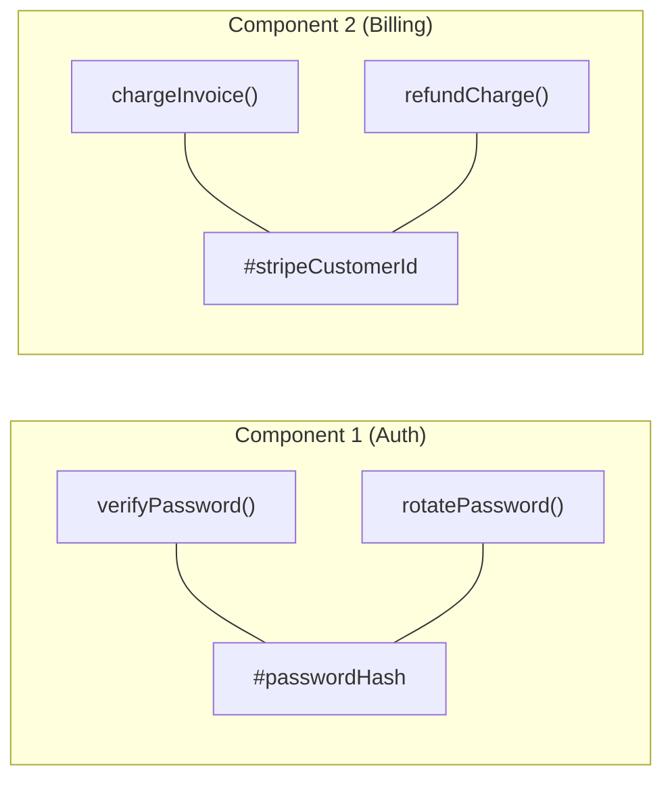
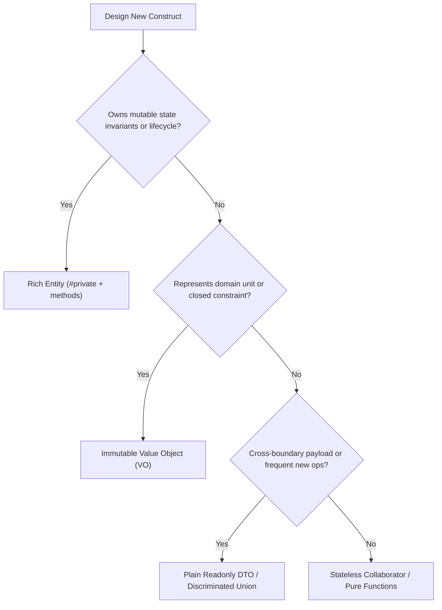

---
tags:
  - software-engineering
  - clean-code
  - oop
  - cohesion
  - formatting
created: 2026-11-13
updated: 2026-11-13
status: 🟢
level: mid-to-senior
---
# Classes, Objects & Formatting

> [!abstract] Vault Navigation
> Encapsulation boundaries, object-versus-data asymmetry, intra-class cohesion, composition mechanics, and deterministic source formatting within [[Programming/Software Engineering/Clean Code/Clean Code Complete Guide|Clean Code Complete Guide]]. Bridges [[Programming/Software Engineering/SOLID/Single Responsibility|Single Responsibility]], [[Programming/Software Engineering/SOLID/Liskov Substitution Principle|Liskov Substitution Principle]], [[Programming/Software Engineering/SOLID/Open-Closed Principle|Open-Closed Principle]], [[Programming/Software Engineering/DDD/Domain-Driven Design Complete Guide|Domain-Driven Design Complete Guide]], [[Programming/Software Engineering/DDD/Tactical Design & Building Blocks|Tactical Design & Building Blocks]], [[Programming/Software Engineering/Clean Code/Code Smells|Code Smells]], and [[Programming/Backend/NestJS Complete Guide|NestJS Complete Guide]].

Module boundaries collapse when engineers blur two structurally incompatible constructs: **Objects**, which hide mutable representation behind invariant-enforcing behavior, and **Data Structures (DTOs)**, which expose transparent immutable fields with zero hidden side effects. Combining both into getter/setter hybrids destroys invariant integrity while preserving coupling—turning domain models into sprawling 800-line `*Service` bags with low cohesion (`LCOM4 >= 3`) and brittle Train-Wreck chains.

---

## 1. First-Principles Mechanics: Objects, Data Structures, LoD & Cohesion

### 1.1 The Object / Data Structure Asymmetry (Wadler's Expression Problem)

Object-oriented encapsulation and procedural data structures sit on orthogonal axes of extensibility (Robert C. Martin, *Clean Code*; Philip Wadler's Expression Problem):

- **Objects** hide internal representation (`#private` fields) and expose behavioral operations (`invoice.issue()`, `wallet.debit(amount)`). Callers cannot inspect or mutate fields directly; the object owns its state invariants.
- **Data Structures (DTOs, Plain Records, Discriminated Unions)** expose immutable public data (`readonly` properties) and carry **no behavioral methods**. External pure functions operate over their shapes.

| Architectural Dimension | Procedural Code (Data Structures) | Object-Oriented Code (Objects) | Hybrid Anti-Pattern (Getters + Setters + Logic) |
|---|---|---|---|
| **Add a new function / operation** | **Easy**: write one pure function switching on existing record types | **Hard**: every concrete class implementing the interface must add the method | **Hard**: invariants are split between callers and class methods |
| **Add a new concrete type / variant** | **Hard**: every existing `switch` statement across the codebase must add a case | **Easy**: write one new class implementing the shared interface | **Hard**: callers inspect concrete getters and break on new subtypes |
| **State Invariant Enforcement** | Structural validation at construction (`zod` parse + `readonly` fields) | Private fields guarded strictly by behavioral state transitions | **None**: external `setBalance(-50)` bypasses domain rules silently |
| **Optimal Production Fit** | HTTP JSON contracts, Kafka event payloads, AST nodes, SQL projection rows | Domain Entities, Aggregate Roots, stateful adapters, Strategy implementations | **Never use**: worst of both paradigms |

> [!danger] The Hybrid Confusion Anti-Pattern
> A **Hybrid** exposes public getters and setters (`getItems()`, `setTotalCents()`, `setStatus()`) for its internal fields while simultaneously placing business rules inside *some* class methods and *some* external `*Service` functions. Hybrids forfeit OOP encapsulation—because any caller can mutate fields directly—while still suffering OOP's rigidity when adding operations.

### 1.2 Law of Demeter (Principle of Least Knowledge) & Tell, Don't Ask

The **Law of Demeter (LoD)** bounds the structural coupling radius of every method `m` belonging to class `O`. Inside `m`, invoke methods **only** on:

1. `O` itself (`this`)
2. Arguments passed directly into `m`
3. Objects instantiated locally within `m`
4. Direct instance components (fields) owned by `O`

Reaching *through* an object returned by a collaborator produces a **Train Wreck**: the caller depends transitively on the intermediate object graph (`Order -> Customer -> BillingProfile -> TaxRegion`), breaking whenever any intermediate relationship changes or returns `undefined`.

```typescript
// ❌ Train Wreck + Ask-then-Act violation
const taxRateBps = order.getCustomer().getBillingProfile().getTaxRegion().getRateBps();
if (wallet.getBalanceCents() >= order.getTotalCents()) {
  wallet.setBalanceCents(wallet.getBalanceCents() - order.getTotalCents());
}

// ✅ Tell, Don't Ask: delegate the decision to the object that owns the state
const taxCents = order.calculateTaxCents();
wallet.debit(order.totalCents()); // Throws or returns Result err if insufficient funds
```

#### Exact Boundary Nuance: Valid Chains vs Train Wrecks

Syntactic dot-count (`a.b.c.d`) alone does not determine an LoD violation. Chaining is structurally clean in three cases:

1. **Traversing Pure Immutable Data Structures / DTOs**: `req.body.shippingAddress.postalCode` navigates transparent JSON data records with zero hidden behavior.
2. **Collection Transformation Pipelines**: `lines.filter(l => l.quantity > 0).map(l => l.subtotal()).reduce(...)` returns the same logical container abstraction (`ReadonlyArray`) at each step.
3. **Fluent Builders / Query DSLs**: `db.select().from(orders).where(eq(orders.status, 'PAID'))` returns the builder context itself rather than traversing foreign domain aggregates.

### 1.3 Cohesion Mechanics & `LCOM4` Graph Analysis

**Cohesion** measures how tightly the methods and instance fields inside a single class belong together. **LCOM4 (Lack of Cohesion of Methods v4)** models a class as an undirected graph $G = (V, E)$:

- Vertices $V$ are the non-constructor methods of the class.
- An edge $(m_i, m_j) \in E$ exists if methods $m_i$ and $m_j$ read or write at least one common instance field, **or** if $m_i$ calls $m_j$.

The value of $\text{LCOM4}$ equals the **number of connected components** in $G$:

- **$\text{LCOM4} = 1$**: All methods participate in one connected state graph—the class is cohesive.
- **$\text{LCOM4} = 0$**: The class has zero methods or fields (typically an interface or empty DTO).
- **$\text{LCOM4} \ge 2$**: The class contains $\text{LCOM4}$ independent sub-clusters sharing no state and should be decomposed into $\text{LCOM4}$ focused classes (or pure module functions for field-less utilities).



Why do small cohesive classes (`LCOM4 = 1`, 50–150 lines) consistently outperform 800-line `*Service` or `*Manager` bags? Because in an 800-line service holding 9 injected repositories and 24 methods, any engineer editing one billing method must keep all 9 dependencies and unrelated caches in working memory to guarantee zero side-effect collisions. Splitting along `LCOM4` boundaries limits constructor dependencies to 1–3 collaborators and shrinks unit test fixture setup proportionally.

### 1.4 Value Objects vs Entities & Defensive Runtime Encapsulation

| Construct | Identity Rule | Mutability | Equality | Runtime Protection Strategy |
|---|---|---|---|---|
| **Value Object (`Money`, `TaxRate`, `DateRange`)** | No identity; defined entirely by attribute values | **Strictly immutable**; operations return new instances | Structural equality (`a.equals(b)`) | Validate in private constructor/static factory; `Object.freeze(this)` |
| **Entity (`Invoice`, `BankAccount`)** | Persistent `id` across lifecycle mutations | Mutates **only** via invariant-checking methods | Identifier equality (`a.id === b.id`) | ECMAScript `#private` fields; defensive copy arrays/sets on ingress & egress |
| **DTO / Record (`InvoiceSummaryDto`)** | Transfer snapshot only | Immutable `readonly` properties | Structural / JSON equality | `zod` parse at boundary; plain object with zero methods |

#### ECMAScript `#private` vs TypeScript `private`

TypeScript's `private items: Item[]` keyword exists **only at compile time**. At runtime in Node.js, `this.items` remains a standard enumerable JavaScript property: `Object.keys(entity)` and `JSON.stringify(entity)` expose private fields (including `#passwordHash` or internal buffers if accidentally passed to a logger or HTTP response!), and untyped callers can mutate `entity['items']`.

ECMAScript **`#items`** native private fields enforce true VM-level encapsulation: `#items` is completely invisible to `JSON.stringify`, `Object.keys`, `for...in`, and external property access, throwing a `TypeError` on illegal runtime reads. Pair `#private` fields with **defensive copies on both constructor ingress and getter egress** so external arrays/Maps/Dates cannot alias internal state:

```typescript
export class AccessPolicy {
  readonly #permissions: Set<string>;

  constructor(permissions: Iterable<string>) {
    this.#permissions = new Set(permissions); // Defensive copy on ingress
  }

  hasPermission(permission: string): boolean {
    return this.#permissions.has(permission);
  }

  listPermissions(): ReadonlyArray<string> {
    return Array.from(this.#permissions); // Fresh array copy on egress
  }
}
```

---

## 2. Real-World Use Cases & Decision Matrix



| Scenario | Optimal Construct | Rationale & Alternative Failure Mode |
|---|---|---|
| **1. Monetary Calculations, Tax Rates & Date Windows** | **Immutable Value Object** (`Money`, `TaxRate`, `DateRange`) | Raw `number` / `string` causes float drift (`0.1 + 0.2`), currency mix-ups, and duplicate validation across 10 files |
| **2. Financial Ledger / Order Lifecycle (`DRAFT -> ISSUED -> PAID`)** | **Rich Encapsulated Entity** (`Invoice`) | Anemic DTO + scattered mutator services allow illegal state transitions (e.g., adding lines to a `VOIDED` invoice) |
| **3. REST API Response / Event Bus Payload** | **Plain Immutable DTO** (`readonly` interface + `zod`) | Serializing rich entities leaks `#private`/internal fields and breaks JSON schema stability when internal fields refactor |
| **4. Multi-Feature HTTP Transport (`Retry` + `CircuitBreaker` + `Metrics`)** | **Composition / Decorator** | Implementation inheritance (`RetryingCircuitLoggedClient extends ...`) creates $2^K$ combinatorial subclasses |
| **5. Expression Evaluator / Discount Rule Discriminator** | **Discriminated Union Data Structure + Pure Functions** | OOP hierarchy makes adding new cross-cutting passes (`render`, `evaluate`, `validate`) require touching every node class |

---

## 3. Step-by-Step Practical Application: Production Invoice Refactor & Team Formatting Suite

### 3.1 BEFORE: Leaky Anemic DTO + Train-Wreck Invoice Engine (`LCOM4 = 3`)

Inspect this common production anti-pattern in a NestJS/TypeScript codebase. Notice how `InvoiceModel` behaves as a Hybrid (exposing mutable getters/setters), while `InvoiceProcessorService` reaches across object graphs, leaks mutable arrays, performs raw float math, and mixes PDF formatting, tax calculation, and email dispatch inside one uncohesive class.

```typescript
// ❌ BEFORE: Leaky Hybrid + Train Wreck + LCOM4 = 3 + Float Rounding Bug
export interface CustomerBillingProfile {
  taxRegion: { countryCode: string; ratePercent: number };
}

export interface CustomerEntity {
  id: string;
  email: string;
  billingProfile: CustomerBillingProfile;
}

export class InvoiceDto {
  public id!: string;
  public status: 'DRAFT' | 'ISSUED' | 'VOIDED' = 'DRAFT';
  public customer!: CustomerEntity;
  public items: Array<{ sku: string; unitPriceDollars: number; qty: number }> = [];
  public totalDollars = 0;

  getCustomer(): CustomerEntity { return this.customer; }
  getItems() { return this.items; } // Leaks internal mutable array!
  setTotalDollars(v: number) { this.totalDollars = v; }
}

export class InvoiceProcessorService {
  constructor(
    private readonly db: { saveInvoice(inv: InvoiceDto): Promise<void>; findInvoice(id: string): Promise<InvoiceDto> },
    private readonly mailer: { send(to: string, subject: string, body: string): Promise<void> },
    private readonly smtpFromAddress: string
  ) {}

  // Method cluster 1 uses this.db
  async finalizeAndSend(invoiceId: string): Promise<InvoiceDto> {
    const inv = await this.db.findInvoice(invoiceId);
    // Train Wreck reaching 4 levels deep + Ask-then-Act mutation:
    const rate = inv.getCustomer().getBillingProfile().taxRegion.ratePercent;
    let subtotal = 0;
    for (const item of inv.getItems()) {
      // Float drift: 19.99 * 3 = 59.97000000000001! And negative qty is never blocked!
      subtotal += item.unitPriceDollars * item.qty;
    }
    const total = subtotal + subtotal * (rate / 100);
    inv.setTotalDollars(Number(total.toFixed(2)));
    inv.status = 'ISSUED'; // Any caller can set status without invariant checks!
    await this.db.saveInvoice(inv);

    const html = this.renderHtmlSummary(inv);
    await this.sendNotification(inv.customer.email, inv.id, html);
    return inv;
  }

  // Method cluster 2 uses ZERO instance fields!
  renderHtmlSummary(inv: InvoiceDto): string {
    return `<h1>Invoice ${inv.id}</h1><p>Total: $${inv.totalDollars}</p>`;
  }

  // Method cluster 3 uses only this.mailer and this.smtpFromAddress
  async sendNotification(to: string, invoiceId: string, body: string): Promise<void> {
    await this.mailer.send(to, `From ${this.smtpFromAddress}: Invoice ${invoiceId}`, body);
  }
}
```

### 3.2 Structural Diagnosis

1. **Hybrid Confusion & Encapsulation Leak**: `InvoiceDto` exposes public `items` and `status` directly. External callers can call `inv.getItems().push({ sku: 'X', unitPriceDollars: -500, qty: 1 })` *after* `inv.status = 'ISSUED'`.
2. **Train Wreck (LoD Violation)**: `inv.getCustomer().getBillingProfile().taxRegion.ratePercent` couples `InvoiceProcessorService` to `CustomerEntity` and `CustomerBillingProfile` schemas.
3. **Primitive Obsession & Floating-Point Drift**: `unitPriceDollars * qty` accumulates IEEE-754 binary float representation drift instead of exact integer minor units (`cents`).
4. **Low Cohesion (`LCOM4 = 3`)**: `InvoiceProcessorService` groups three disjoint components: persistence/orchestration (`db`), pure HTML string formatting (0 fields), and email transport (`mailer`, `smtpFromAddress`).

### 3.3 AFTER: Encapsulated Value Objects, Rich Entity, Ports & Tests

```text
invoice-engine/
├── .editorconfig
├── .prettierrc.json
├── eslint.config.mjs
├── src/
│   ├── domain/
│   │   ├── money.ts
│   │   ├── tax-rate.ts
│   │   └── invoice.ts
│   └── application/
│       ├── invoice.ports.ts
│       └── issue-invoice.use-case.ts
└── tests/
    └── invoice.spec.ts
```

#### Value Objects: `Money` & `TaxRate` (`src/domain/money.ts`, `src/domain/tax-rate.ts`)

```typescript
// src/domain/money.ts
export type CurrencyCode = 'USD' | 'EUR' | 'GBP';

export class Money {
  readonly #minorUnits: number;
  readonly #currency: CurrencyCode;

  private constructor(minorUnits: number, currency: CurrencyCode) {
    this.#minorUnits = minorUnits;
    this.#currency = currency;
    Object.freeze(this);
  }

  static ofMinorUnits(minorUnits: number, currency: CurrencyCode): Money {
    if (!Number.isSafeInteger(minorUnits) || minorUnits < 0) {
      throw new RangeError(`Money minorUnits must be a non-negative safe integer, got ${minorUnits}`);
    }
    return new Money(minorUnits, currency);
  }

  static zero(currency: CurrencyCode): Money {
    return new Money(0, currency);
  }

  get minorUnits(): number {
    return this.#minorUnits;
  }

  get currency(): CurrencyCode {
    return this.#currency;
  }

  add(other: Money): Money {
    this.#assertSameCurrency(other);
    return Money.ofMinorUnits(this.#minorUnits + other.#minorUnits, this.#currency);
  }

  multiplyByQuantity(quantity: number): Money {
    if (!Number.isSafeInteger(quantity) || quantity <= 0) {
      throw new RangeError(`Quantity must be a positive safe integer, got ${quantity}`);
    }
    return Money.ofMinorUnits(this.#minorUnits * quantity, this.#currency);
  }

  percentageByBps(basisPoints: number): Money {
    if (!Number.isSafeInteger(basisPoints) || basisPoints < 0) {
      throw new RangeError(`Basis points must be a non-negative safe integer, got ${basisPoints}`);
    }
    // Round half-up cleanly on integer arithmetic before division
    const rounded = Math.round((this.#minorUnits * basisPoints) / 10_000);
    return Money.ofMinorUnits(rounded, this.#currency);
  }

  equals(other: Money): boolean {
    return this.#minorUnits === other.#minorUnits && this.#currency === other.#currency;
  }

  format(): string {
    const major = (this.#minorUnits / 100).toFixed(2);
    return `${this.#currency} ${major}`;
  }

  #assertSameCurrency(other: Money): void {
    if (this.#currency !== other.#currency) {
      throw new Error(`Currency mismatch: cannot combine ${this.#currency} with ${other.#currency}`);
    }
  }
}
```

```typescript
// src/domain/tax-rate.ts
export class TaxRate {
  readonly #basisPoints: number;

  private constructor(basisPoints: number) {
    this.#basisPoints = basisPoints;
    Object.freeze(this);
  }

  static fromBasisPoints(basisPoints: number): TaxRate {
    if (!Number.isSafeInteger(basisPoints) || basisPoints < 0 || basisPoints > 10_000) {
      throw new RangeError(`TaxRate basisPoints must be within [0, 10000], got ${basisPoints}`);
    }
    return new TaxRate(basisPoints);
  }

  get basisPoints(): number {
    return this.#basisPoints;
  }
}
```

#### Rich Encapsulated Entity (`src/domain/invoice.ts`)

```typescript
// src/domain/invoice.ts
import { CurrencyCode, Money } from './money.js';
import { TaxRate } from './tax-rate.js';

export type InvoiceStatus = 'DRAFT' | 'ISSUED' | 'VOIDED';

export interface InvoiceLineSnapshot {
  readonly sku: string;
  readonly unitPriceMinorUnits: number;
  readonly quantity: number;
}

export interface InvoiceTotals {
  readonly subtotal: Money;
  readonly tax: Money;
  readonly grandTotal: Money;
}

export interface InvoiceDto {
  readonly id: string;
  readonly customerId: string;
  readonly currency: CurrencyCode;
  readonly status: InvoiceStatus;
  readonly taxRateBps: number;
  readonly lines: ReadonlyArray<InvoiceLineSnapshot>;
  readonly subtotalMinorUnits: number;
  readonly taxMinorUnits: number;
  readonly totalMinorUnits: number;
}

export class Invoice {
  readonly #id: string;
  readonly #customerId: string;
  readonly #currency: CurrencyCode;
  readonly #taxRate: TaxRate;
  readonly #lines: Array<{ sku: string; unitPrice: Money; quantity: number }>;
  #status: InvoiceStatus;

  private constructor(params: {
    id: string;
    customerId: string;
    currency: CurrencyCode;
    taxRate: TaxRate;
    status: InvoiceStatus;
    lines: Array<{ sku: string; unitPrice: Money; quantity: number }>;
  }) {
    this.#id = params.id;
    this.#customerId = params.customerId;
    this.#currency = params.currency;
    this.#taxRate = params.taxRate;
    this.#status = params.status;
    this.#lines = params.lines.map((l) => ({ ...l }));
  }

  static createDraft(params: {
    id: string;
    customerId: string;
    currency: CurrencyCode;
    taxRate: TaxRate;
  }): Invoice {
    return new Invoice({
      ...params,
      status: 'DRAFT',
      lines: [],
    });
  }

  static rehydrate(record: InvoiceDto): Invoice {
    const currency = record.currency;
    return new Invoice({
      id: record.id,
      customerId: record.customerId,
      currency,
      taxRate: TaxRate.fromBasisPoints(record.taxRateBps),
      status: record.status,
      lines: record.lines.map((line) => ({
        sku: line.sku,
        unitPrice: Money.ofMinorUnits(line.unitPriceMinorUnits, currency),
        quantity: line.quantity,
      })),
    });
  }

  get id(): string {
    return this.#id;
  }

  get status(): InvoiceStatus {
    return this.#status;
  }

  addLine(sku: string, unitPrice: Money, quantity: number): void {
    if (this.#status !== 'DRAFT') {
      throw new Error(`Cannot modify invoice ${this.#id} while status is ${this.#status}`);
    }
    if (!sku.trim()) {
      throw new Error('SKU cannot be blank');
    }
    if (unitPrice.currency !== this.#currency) {
      throw new Error(`Line currency ${unitPrice.currency} does not match invoice currency ${this.#currency}`);
    }
    if (!Number.isSafeInteger(quantity) || quantity <= 0) {
      throw new RangeError(`Quantity must be positive integer, got ${quantity}`);
    }
    this.#lines.push({ sku: sku.trim(), unitPrice, quantity });
  }

  issue(): InvoiceTotals {
    if (this.#status !== 'DRAFT') {
      throw new Error(`Only DRAFT invoices can be issued; current status is ${this.#status}`);
    }
    if (this.#lines.length === 0) {
      throw new Error(`Cannot issue empty invoice ${this.#id}`);
    }
    this.#status = 'ISSUED';
    return this.calculateTotals();
  }

  voidInvoice(): void {
    if (this.#status !== 'ISSUED') {
      throw new Error(`Only ISSUED invoices can be voided; current status is ${this.#status}`);
    }
    this.#status = 'VOIDED';
  }

  calculateTotals(): InvoiceTotals {
    const subtotal = this.#lines.reduce(
      (sum, line) => sum.add(line.unitPrice.multiplyByQuantity(line.quantity)),
      Money.zero(this.#currency)
    );
    const tax = subtotal.percentageByBps(this.#taxRate.basisPoints);
    const grandTotal = subtotal.add(tax);
    return { subtotal, tax, grandTotal };
  }

  toDto(): InvoiceDto {
    const totals = this.calculateTotals();
    return Object.freeze({
      id: this.#id,
      customerId: this.#customerId,
      currency: this.#currency,
      status: this.#status,
      taxRateBps: this.#taxRate.basisPoints,
      lines: Object.freeze(
        this.#lines.map((l) =>
          Object.freeze({
            sku: l.sku,
            unitPriceMinorUnits: l.unitPrice.minorUnits,
            quantity: l.quantity,
          })
        )
      ),
      subtotalMinorUnits: totals.subtotal.minorUnits,
      taxMinorUnits: totals.tax.minorUnits,
      totalMinorUnits: totals.grandTotal.minorUnits,
    });
  }
}
```

#### Clean Cohesive Boundary Ports & NestJS Use Case (`src/application/invoice.ports.ts`, `src/application/issue-invoice.use-case.ts`)

```typescript
// src/application/invoice.ports.ts
import { Invoice, InvoiceDto } from '../domain/invoice.js';

export abstract class InvoiceRepository {
  abstract findById(invoiceId: string): Promise<Invoice | undefined>;
  abstract save(invoice: Invoice): Promise<void>;
}

export abstract class InvoiceNotifier {
  abstract sendIssuedNotice(customerId: string, invoiceSummary: InvoiceDto): Promise<void>;
}
```

```typescript
// src/application/issue-invoice.use-case.ts
import { Injectable } from '@nestjs/common';
import { InvoiceDto } from '../domain/invoice.js';
import { InvoiceNotifier, InvoiceRepository } from './invoice.ports.js';

@Injectable()
export class IssueInvoiceUseCase {
  constructor(
    private readonly invoiceRepo: InvoiceRepository,
    private readonly notifier: InvoiceNotifier
  ) {}

  async execute(invoiceId: string): Promise<InvoiceDto> {
    const invoice = await this.invoiceRepo.findById(invoiceId);
    if (!invoice) {
      throw new Error(`Invoice ${invoiceId} not found`);
    }

    invoice.issue(); // Tell, Don't Ask: Entity validates non-empty & DRAFT state and computes totals
    await this.invoiceRepo.save(invoice);

    const dto = invoice.toDto();
    await this.notifier.sendIssuedNotice(dto.customerId, dto);
    return dto;
  }
}
```

Notice `IssueInvoiceUseCase` has **$\text{LCOM4} = 1$** (one `execute` method coordinating both injected abstract ports) and zero knowledge of SMTP, HTML rendering, SQL dialects, or tax arithmetic.

#### Vitest Behavioral Verification Suite (`tests/invoice.spec.ts`)

```typescript
// tests/invoice.spec.ts
import { describe, it, expect, vi } from 'vitest';
import { Invoice } from '../src/domain/invoice.js';
import { Money } from '../src/domain/money.js';
import { TaxRate } from '../src/domain/tax-rate.js';
import { IssueInvoiceUseCase } from '../src/application/issue-invoice.use-case.js';
import { InvoiceNotifier, InvoiceRepository } from '../src/application/invoice.ports.js';

describe('Invoice Encapsulation, Value Objects & Use Case', () => {
  it('computes exact minor-unit totals without floating-point drift', () => {
    const invoice = Invoice.createDraft({
      id: 'inv-1',
      customerId: 'cust-1',
      currency: 'USD',
      taxRate: TaxRate.fromBasisPoints(825), // 8.25%
    });
    invoice.addLine('SKU-1999', Money.ofMinorUnits(1999, 'USD'), 3); // $59.97 exact

    const totals = invoice.issue();
    expect(totals.subtotal.minorUnits).toBe(5997);
    expect(totals.tax.minorUnits).toBe(495); // Math.round(5997 * 825 / 10000) = 495 ($4.95)
    expect(totals.grandTotal.minorUnits).toBe(6492);
    expect(totals.grandTotal.format()).toBe('USD 64.92');
  });

  it('prevents mutating lines or JSON-leaking #private state after issue()', () => {
    const invoice = Invoice.createDraft({
      id: 'inv-2',
      customerId: 'cust-2',
      currency: 'EUR',
      taxRate: TaxRate.fromBasisPoints(2000),
    });
    invoice.addLine('SKU-A', Money.ofMinorUnits(1000, 'EUR'), 2);
    const dto = invoice.toDto();

    expect(() => (dto.lines as unknown as Array<unknown>).push({ sku: 'HACK' })).toThrow();
    expect(JSON.stringify(invoice)).toBe('{}'); // True runtime privacy via #private fields!

    invoice.issue();
    expect(() => invoice.addLine('SKU-B', Money.ofMinorUnits(500, 'EUR'), 1)).toThrow(
      'Cannot modify invoice inv-2 while status is ISSUED'
    );
  });

  it('orchestrates persistence and notification cleanly in IssueInvoiceUseCase', async () => {
    const invoice = Invoice.createDraft({
      id: 'inv-3',
      customerId: 'cust-9',
      currency: 'USD',
      taxRate: TaxRate.fromBasisPoints(1000),
    });
    invoice.addLine('SKU-PRO', Money.ofMinorUnits(5000, 'USD'), 1);

    const repo: InvoiceRepository = {
      findById: vi.fn().mockResolvedValue(invoice),
      save: vi.fn().mockResolvedValue(undefined),
    };
    const notifier: InvoiceNotifier = {
      sendIssuedNotice: vi.fn().mockResolvedValue(undefined),
    };

    const useCase = new IssueInvoiceUseCase(repo, notifier);
    const summary = await useCase.execute('inv-3');

    expect(summary.status).toBe('ISSUED');
    expect(summary.totalMinorUnits).toBe(5500);
    expect(repo.save).toHaveBeenCalledWith(invoice);
    expect(notifier.sendIssuedNotice).toHaveBeenCalledWith('cust-9', summary);
  });
});
```

### 3.4 Team-Level Deterministic Formatting & Static Analysis Configs

Never waste human code-review cycles debating semicolons, quotes, indentation, or import order. Enforce identical AST formatting across IDEs and CI runners:

```ini
# .editorconfig
root = true

[*]
charset = utf-8
end_of_line = lf
insert_final_newline = true
trim_trailing_whitespace = true
indent_style = space
indent_size = 2

[*.md]
trim_trailing_whitespace = false
```

```json
{
  "$schema": "https://json.schemastore.org/prettierrc",
  "printWidth": 100,
  "tabWidth": 2,
  "useTabs": false,
  "semi": true,
  "singleQuote": true,
  "trailingComma": "es5",
  "arrowParens": "always",
  "endOfLine": "lf"
}
```

```javascript
// eslint.config.mjs (ESLint v9 Flat Config)
import tseslint from 'typescript-eslint';
import prettierConfig from 'eslint-config-prettier';

export default tseslint.config(
  ...tseslint.configs.recommendedTypeChecked,
  prettierConfig,
  {
    languageOptions: {
      parserOptions: {
        projectService: true,
        tsconfigRootDir: import.meta.dirname,
      },
    },
    rules: {
      'complexity': ['error', { max: 10 }],
      'max-depth': ['error', 2],
      'max-params': ['error', 3],
      'max-lines-per-function': ['warn', { max: 50, skipBlankLines: true, skipComments: true }],
      'no-param-reassign': ['error', { props: true }],
      '@typescript-eslint/no-floating-promises': 'error',
      '@typescript-eslint/explicit-member-accessibility': ['error', { accessibility: 'no-public' }],
      '@typescript-eslint/consistent-type-definitions': ['error', 'interface'],
    },
  }
);
```

```yaml
# .github/workflows/ci-quality.yml
name: Code Quality Gate
on: [pull_request, push]

jobs:
  verify:
    runs-on: ubuntu-latest
    steps:
      - uses: actions/checkout@v4
      - uses: pnpm/action-setup@v4
      - uses: actions/setup-node@v4
        with:
          node-version: 22
          cache: pnpm
      - run: pnpm install --frozen-lockfile
      - run: pnpm prettier --check "src/**/*.ts" "tests/**/*.ts"
      - run: pnpm eslint "src/**/*.ts" "tests/**/*.ts"
      - run: pnpm tsc --noEmit
      - run: pnpm vitest run
```

---

## 4. Complete Reference: Composition vs Inheritance & Vertical Formatting Mechanics

### 4.1 The Fragile Base Class Problem & Combinatorial Explosion

Implementation inheritance (`extends`) couples the subclass tightly to the superclass's internal call sequence. Consider a base repository or HTTP client calling an overridable hook inside its constructor or template method:

```typescript
// ❌ Fragile Base Class: parent constructor triggers override BEFORE subclass fields initialize
abstract class BaseAuditModel {
  constructor() {
    this.validateInvariants(); // Runs BEFORE subclass property initializers!
  }
  protected abstract validateInvariants(): void;
}

class TenantOrder extends BaseAuditModel {
  private readonly requiredPrefix = 'ORD-'; // Undefined during super()!
  constructor(private readonly code: string) {
    super(); // Crashes or evaluates against undefined!
  }
  protected override validateInvariants(): void {
    // At runtime during super(), this.requiredPrefix is undefined!
    if (!this.code.startsWith(this.requiredPrefix)) {
      throw new Error('Invalid order code prefix');
    }
  }
}
```

Furthermore, modeling $K$ orthogonal cross-cutting features (`Retrying`, `CircuitBreaking`, `MetricsRecording`, `AuthSigning`) over $M$ base transports (`FetchTransport`, `UndiciTransport`) via inheritance forces $M \times 2^K$ concrete classes. Wrapping collaborators through **Composition + Decorator** reduces complexity linearly to $M + K$ independent, single-purpose classes:

```typescript
export interface HttpTransport {
  send(req: { url: string; method: string; body?: string; signal?: AbortSignal }): Promise<{ status: number; body: string }>;
}

export class TimedTransport implements HttpTransport {
  constructor(
    private readonly inner: HttpTransport,
    private readonly metrics: { observeLatencyMs(url: string, ms: number): void }
  ) {}

  async send(req: { url: string; method: string; body?: string; signal?: AbortSignal }) {
    const start = performance.now();
    try {
      return await this.inner.send(req);
    } finally {
      this.metrics.observeLatencyMs(req.url, performance.now() - start);
    }
  }
}
```

### 4.2 Vertical Formatting & Reading Ergonomics

Source files are read top-to-bottom like technical specifications:

1. **Newspaper / Stepdown Ordering**: Exported types, primary class/function entry points, and public methods belong at the **top** of the module; private helpers sit directly below their first caller in descending order of abstraction. A reader verifying a public workflow never has to scroll past 200 lines of private parsing helpers to locate the entry contract.
2. **Vertical Density vs Vertical Openness**: Group tightly coupled statements (such as configuring three headers on one request) consecutively without blank lines; insert a single blank line between conceptually distinct stages (guard clauses, domain computation, persistence emit).
3. **Variable Proximity**: Declare every local constant immediately above its first consumption rather than hoarding declarations at the top of a 40-line block. Minimizing live-variable span prevents accidental shadowing and shrinks cognitive working-memory load.
4. **Prohibit Manual Horizontal Alignment**: Padding colons or `=` signs into aligned columns (`const a    = 1;\nconst longName = 2;`) breaks on every rename and generates noisy multi-line `git diff` / `git blame` churn. Let Prettier own horizontal whitespace exclusively.
5. **Line Width Ceiling (80–100 Characters)**: Narrow lines render cleanly in side-by-side GitHub/GitLab diff panes and split IDE editors without horizontal scrolling.

---

## 5. Production Debugging, Profiling & Operations Playbook

| Symptom | Root Cause | Diagnostic Inspection | Fix |
|---|---|---|---|
| **Random `undefined` or wrong permissions inside singleton NestJS/Node services** | Mutable array/Set/Date passed into class constructor without defensive copy, then mutated externally | Search for `this.items = items` and `getItems(): Item[]` returning raw internal references | Copy collections on ingress (`new Set(input)`) and return frozen/cloned projections (`Array.from(...)`) |
| **Sensitive `#passwordHash` or internal token leaked in API response / Pino logs** | Using compile-time TS `private passwordHash: string` and passing entity instance to `res.json(user)` | Run `JSON.stringify(new User(...))` in unit test or inspect HTTP response payload | Convert secrets to runtime ECMAScript `#passwordHash` and map explicitly via `toDto()` |
| **`TypeError: Cannot read properties of undefined` inside subclass initialization** | Superclass constructor invokes virtual method before subclass field initializers run | Inspect stack trace rooted inside `super()` call frame | Replace inheritance template hook with static factory or composed Strategy object |
| **V8 deoptimization & elevated GC latency on hot model arrays** | `Temporary Field` pattern adding/deleting properties dynamically after constructor exits (causes V8 Hidden Class transitions) | Run `node --trace-opt --trace-deopt` or Chrome DevTools Allocation Timeline | Initialize all fields deterministically inside constructor; use `undefined` instead of `delete obj.prop` |
| **Chronic merge conflicts and 500-line PR diffs hiding logic bugs** | Unenforced formatting (`quotes`, trailing commas) + 800-line God Services (`LCOM4 >= 3`) | Check `git log --stat` hotspot churn alongside ESLint `--max-warnings=0` | Enforce Prettier + ESLint in CI pre-merge check and split God Services along `LCOM4` components |

---

## 6. Worked Exercises & Step-by-Step Solutions

### Exercise 1: Computing `LCOM4` & Splitting a Low-Cohesion Class

Analyze the method-to-field graph of `ReportExporter`, calculate its exact **$\text{LCOM4}$** score, and refactor it into cohesive units:

```typescript
class ReportExporter {
  constructor(
    private readonly dbPool: DbPool,
    private readonly sqlDialect: string,
    private readonly smtpHost: string,
    private readonly smtpPort: number
  ) {}

  fetchRows(query: string) { return this.dbPool.exec(this.sqlDialect, query); }
  buildCsv(rows: string[][]) { return rows.map((r) => r.join(',')).join('\n'); }
  sendEmail(to: string, body: string) { return sendSmtp(this.smtpHost, this.smtpPort, to, body); }
  verifySmtp() { return pingSmtp(this.smtpHost, this.smtpPort); }
}
```

### Solution 1

1. **$\text{LCOM4}$ Connected Components**:
   - Component 1: `{fetchRows}` connects to `{dbPool, sqlDialect}` (isolated component).
   - Component 2: `{buildCsv}` accesses **zero** instance fields and calls no sibling methods (isolated component).
   - Component 3: `{sendEmail, verifySmtp}` both share `{smtpHost, smtpPort}` (one connected component).
   - Total disjoint components: **$\text{LCOM4} = 3$**.
2. **Cohesive Refactoring**:

```typescript
export class SqlQueryRunner {
  constructor(private readonly dbPool: DbPool, private readonly dialect: string) {}
  fetchRows(query: string) { return this.dbPool.exec(this.dialect, query); }
}

export function formatRowsAsCsv(rows: ReadonlyArray<ReadonlyArray<string>>): string {
  return rows.map((row) => row.join(',')).join('\n');
}

export class SmtpMailer {
  constructor(private readonly host: string, private readonly port: number) {}
  sendEmail(to: string, body: string) { return sendSmtp(this.host, this.port, to, body); }
  verifyConnection() { return pingSmtp(this.host, this.port); }
}
```

Each resulting class achieves $\text{LCOM4} = 1$, and `formatRowsAsCsv` requires zero mock dependencies in unit tests.

---

### Exercise 2: Distinguishing Law of Demeter Train Wrecks from Valid Chains

Classify each expression below as either a **Law of Demeter Violation** or a **Valid Idiomatic Chain**, and rewrite any violation:

1. `const zip = req.body.customer.billingAddress.postalCode;` (where `req.body` is a `zod`-parsed immutable DTO)
2. `const tax = order.getLineItems()[0].getProduct().getCategory().getTaxPolicy().compute(100);`
3. `const activeEmails = users.filter((u) => u.isActive).sort((a, b) => a.email.localeCompare(b.email)).map((u) => u.email);`

### Solution 2

1. **Valid**: `req.body` is a pure **Data Structure (DTO)** with no behavioral encapsulation; traversing nested properties on immutable data records is expected and normal.
2. **LoD Violation (Train Wreck)**: The caller reaches through five distinct domain objects (`Order -> LineItem -> Product -> Category -> TaxPolicy`) to ask for a policy and invoke `compute`. **Fix via Tell, Don't Ask**: `const tax = order.calculateLineTaxCents(0);` (or `order.calculateTaxCents()`).
3. **Valid**: Each array pipeline operator returns a standard `Array` abstraction; the caller interacts with one homogeneous collection interface rather than navigating hidden domain relationships.

---

### Exercise 3: Hardening an Encapsulation Leak & Aliasing Bug

In production, `TenantPermissions` occasionally drops all permissions mid-request even though `revokeAll()` is never called. Diagnose both constructor and getter bugs and harden the class with ECMAScript `#private` fields and defensive copies:

```typescript
export class TenantPermissions {
  constructor(private permissions: Set<string>) {}
  getPermissions(): Set<string> { return this.permissions; }
  has(perm: string): boolean { return this.permissions.has(perm); }
}

// Middleware bug:
const callerSet = new Set(['read', 'write']);
const perms = new TenantPermissions(callerSet);
perms.getPermissions().clear(); // Wipes internal state!
```

### Solution 3

1. **Root Cause**: `TenantPermissions` holds a direct reference alias to `callerSet` in the constructor and returns the live internal `Set` instance from `getPermissions()`. Even typing the return value as `ReadonlySet<string>` only guards TypeScript compilation; a JS caller or cast still mutates the shared `Set`.
2. **Hardened Implementation**:

```typescript
export class TenantPermissions {
  readonly #permissions: Set<string>;

  constructor(permissions: Iterable<string>) {
    this.#permissions = new Set(permissions); // Defensive copy on ingress
  }

  has(perm: string): boolean {
    return this.#permissions.has(perm);
  }

  listPermissions(): ReadonlySet<string> {
    return new Set(this.#permissions); // Fresh isolated copy on egress
  }
}
```

---

### Exercise 4: Choosing Data Structure Union vs Polymorphic Object Interface

You are designing a CAD geometry engine with a public plugin SDK. Third-party developers frequently ship new custom geometry primitives (`Torus`, `BezierPatch`, `ExtrudedMesh`), whereas the core engine operations (`area()`, `boundingBox()`, `serialize()`) remain fixed for years. Should `Shape` be modeled as a **Polymorphic Object Interface** or a **Discriminated Union Data Structure**? Justify using the Expression Problem.

### Solution 4

Model `Shape` as a **Polymorphic Object Interface**:

- Because the **set of types is open** (plugin authors add shapes externally without access to core source) and the **set of operations is closed**, OOP interfaces satisfy the Open-Closed Principle cleanly: each plugin implements `Shape` without editing any central `switch` statement.
- Conversely, if the shape set were closed (`Circle | Rect | Triangle`) and internal engineers added new operations every sprint (`toSvg()`, `toDxf()`, `tessellate()`, `intersectRay()`), a **Discriminated Union + pure switching functions** would be superior because each new operation stays self-contained in one file instead of modifying every concrete shape class.

---

### Exercise 5: Fixing a Fragile Base Class Crash & Refactoring to Composition

Diagnose why `CsvExportJob` crashes with `TypeError: Cannot read properties of undefined (reading 'includes')` at instantiation, then eliminate the inheritance hierarchy entirely using Composition:

```typescript
abstract class BaseExportJob {
  constructor(protected readonly destination: string) {
    this.assertAllowedDestination();
  }
  protected abstract assertAllowedDestination(): void;
}

class CsvExportJob extends BaseExportJob {
  private readonly allowedHosts = ['s3.internal', 'gcs.internal'];
  protected override assertAllowedDestination(): void {
    if (!this.allowedHosts.includes(new URL(this.destination).hostname)) {
      throw new Error('Blocked export host');
    }
  }
}
```

### Solution 5

1. **Root Cause**: JavaScript/TypeScript executes `super()` **before** subclass field initializers (`allowedHosts = [...]`). When `BaseExportJob`'s constructor calls `this.assertAllowedDestination()`, `this.allowedHosts` is still `undefined`, crashing at runtime.
2. **Composition Rewrite**:

```typescript
export interface DestinationPolicy {
  assertAllowed(destinationUrl: string): void;
}

export class AllowlistDestinationPolicy implements DestinationPolicy {
  readonly #allowedHosts: ReadonlySet<string>;

  constructor(hosts: Iterable<string>) {
    this.#allowedHosts = new Set(hosts);
  }

  assertAllowed(destinationUrl: string): void {
    const hostname = new URL(destinationUrl).hostname;
    if (!this.#allowedHosts.has(hostname)) {
      throw new Error(`Blocked export host: ${hostname}`);
    }
  }
}

export class CsvExportJob {
  readonly #destination: string;

  constructor(destination: string, policy: DestinationPolicy) {
    policy.assertAllowed(destination);
    this.#destination = destination;
  }

  get destination(): string {
    return this.#destination;
  }
}
```

---

### Exercise 6: Eliminating a Hybrid Anemic `SubscriptionDto` + External Mutator Functions

Refactor this hybrid class and external helper into an immutable `DateRange` Value Object and encapsulated `Subscription` Entity:

```typescript
export class SubscriptionDto {
  constructor(
    public id: string,
    public status: 'TRIAL' | 'ACTIVE' | 'CANCELLED',
    public trialEndsAt: Date,
    public seats: number
  ) {}
}

export function addSeats(sub: SubscriptionDto, delta: number): void {
  if (sub.status === 'CANCELLED') throw new Error('Cancelled');
  sub.seats += delta; // Negative delta can set seats = -5!
}
```

### Solution 6

```typescript
export class Subscription {
  readonly #id: string;
  #status: 'TRIAL' | 'ACTIVE' | 'CANCELLED';
  readonly #trialEndsAtMs: number;
  #seats: number;

  private constructor(id: string, status: 'TRIAL' | 'ACTIVE' | 'CANCELLED', trialEndsAtMs: number, seats: number) {
    if (!Number.isSafeInteger(seats) || seats < 1) {
      throw new RangeError(`Subscription must have at least 1 seat, got ${seats}`);
    }
    this.#id = id;
    this.#status = status;
    this.#trialEndsAtMs = trialEndsAtMs;
    this.#seats = seats;
  }

  static startTrial(id: string, trialEndsAt: Date, seats: number): Subscription {
    return new Subscription(id, 'TRIAL', trialEndsAt.getTime(), seats);
  }

  addSeats(delta: number): void {
    if (this.#status === 'CANCELLED') {
      throw new Error(`Cannot add seats to cancelled subscription ${this.#id}`);
    }
    if (!Number.isSafeInteger(delta) || delta <= 0) {
      throw new RangeError(`Seat increment must be a positive integer, got ${delta}`);
    }
    this.#seats += delta;
  }

  cancel(): void {
    this.#status = 'CANCELLED';
  }

  snapshot(): { readonly id: string; readonly status: string; readonly trialEndsAtIso: string; readonly seats: number } {
    return Object.freeze({
      id: this.#id,
      status: this.#status,
      trialEndsAtIso: new Date(this.#trialEndsAtMs).toISOString(),
      seats: this.#seats,
    });
  }
}
```

Notice storing `#trialEndsAtMs: number` instead of a mutable `Date` reference also eliminates accidental external `sub.trialEndsAt.setFullYear(2099)` tampering.

---

← [[Programming/Software Engineering/Clean Code/Clean Code Complete Guide|Back to Clean Code]]
