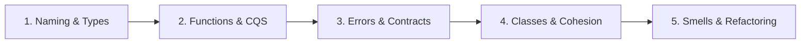

---
tags:
  - software-engineering
  - clean-code
  - dashboard
created: 2026-01-02
updated: 2026-11-13
status: 🟢
level: mid-to-senior
---
# Clean Code Complete Guide

> [!abstract] Vault Navigation
> Core code-craft hub within [[Programming/Software Engineering/Software Engineering Roadmap|Software Engineering Roadmap]]. Connects directly to [[Programming/Software Engineering/SOLID/SOLID Principles Complete Guide|SOLID Principles Complete Guide]], [[Programming/Software Engineering/Refactoring/Refactoring Complete Guide|Refactoring Complete Guide]], and [[Programming/Software Engineering/Testing/Testing Complete Guide|Testing Complete Guide]].

Clean code minimizes **cognitive load per unit of change**. Because production code is read roughly an order of magnitude more often than it is written, every naming choice, function boundary, error contract, and module boundary either compounds engineering velocity or accrues interest as maintenance drag.

---

## Topic Index

| Topic | Engineering Focus | Status |
|---|---|---|
| [[Programming/Software Engineering/Clean Code/Meaningful Names\|Meaningful Names]] | Scope-length rule, ubiquitous domain language, branded units, avoiding disinformation | 🟢 |
| [[Programming/Software Engineering/Clean Code/Functions\|Functions]] | CQS, cyclomatic vs cognitive complexity, guard clauses, boolean-flag elimination | 🟢 |
| [[Programming/Software Engineering/Clean Code/Comments\|Comments]] | Invariants & rationale over syntax narration, TSDoc contracts, TODO hygiene | 🟢 |
| [[Programming/Software Engineering/Clean Code/Error Handling\|Error Handling]] | Exceptions vs `Result<T, E>`, boundary parsing, `cause` wrapping, zero swallowing | 🟢 |
| [[Programming/Software Engineering/Clean Code/Classes, Objects & Formatting\|Classes, Objects & Formatting]] | Objects vs DTOs, Law of Demeter, LCOM cohesion, composition, immutability | 🟢 |
| [[Programming/Software Engineering/Clean Code/Code Smells\|Code Smells]] | Fowler taxonomy, Divergent Change vs Shotgun Surgery, modern async/concurrency smells | 🟢 |
| [[Programming/Software Engineering/Testing/Unit Testing\|Unit Testing]] | F.I.R.S.T. invariants, isolation seams, deterministic test suites | 🟢 |

---

## Core Engineering Invariants

| Principle | Operational Rule | Failure Mode When Ignored |
|---|---|---|
| **Readability Optimization** | Optimize for the reader debugging an incident at 03:00, not keystroke minimization | High mean time to recovery (MTTR) and accidental regressions |
| **Rule of Three (Balanced DRY)** | Duplicate small local logic twice before abstracting; deduplicate *knowledge*, not coincidental syntax | Premature coupled abstractions that diverge awkwardly under requirement shifts |
| **Pure Core, Imperative Shell** | Isolate deterministic business logic from I/O, clocks, network, and persistence side effects | Flaky tests requiring heavy mock setups and slow integration harnesses |
| **Fail Fast at Boundaries** | Parse and validate untrusted inputs once at entry points into strict domain types | Defensive null checks scattered across every internal layer |
| **Scoped Boy Scout Rule** | Leave touched modules slightly cleaner without smuggling unrelated rewrites into feature PRs | Unreviewable diffs that hide behavioral regressions or break `git bisect` |

> [!warning] The Over-Abstraction Trap
> Clean code is not synonymous with micro-fragmented one-line functions or speculative interfaces everywhere. Excessive indirection inflates jump distance across files—trading local complexity for **distributed cognitive load**. Split abstractions only along genuine behavioral or change boundaries.

---

## Cross-Cutting Review Checklist

- **Identifiers**: Does every exported symbol express domain intent, units (`Ms`, `Cents`), and side-effect cost without requiring callers to inspect the implementation?
- **Control Flow**: Is nesting capped ($\le 2$ levels) via guard clauses, and are functions split along consistent abstraction layers?
- **Failure Paths**: Are expected domain errors typed (`Result<T, E>`) or wrapped with `{ cause }` rather than silently returning `null` or empty defaults?
- **Boundaries**: Are objects enforcing invariants via private state while DTOs remain immutable, plain data records?
- **Concurrency**: Are all `Promise`s awaited or bounded, cancellations wired via `AbortSignal`, and shared state free of check-then-act races?

---

## Related Notes

- [[Programming/Software Engineering/SOLID/SOLID Principles Complete Guide|SOLID Principles Complete Guide]]
- [[Programming/Software Engineering/Design Patterns/Design Patterns Complete Guide|Design Patterns Complete Guide]]
- [[Programming/Software Engineering/Refactoring/Refactoring Complete Guide|Refactoring Complete Guide]]
- [[Programming/Software Engineering/Clean Architecture/Clean Architecture Complete Guide|Clean Architecture Complete Guide]]
- [[Programming/Software Engineering/Testing/TDD|TDD]]

---

← [[Programming/Software Engineering/Software Engineering Roadmap|Back to Software Engineering]]
