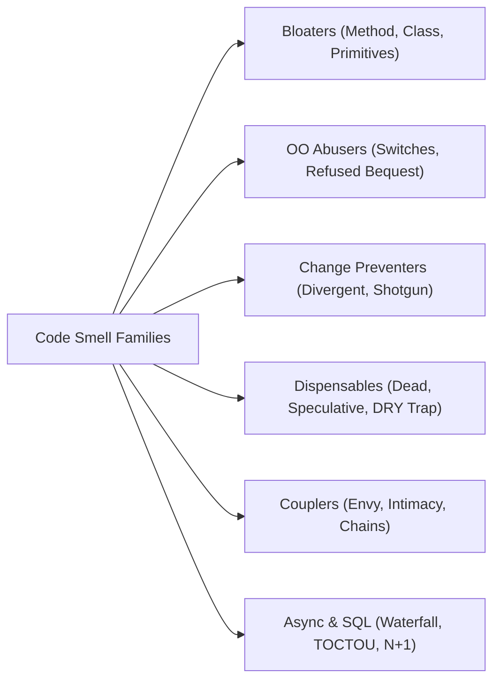
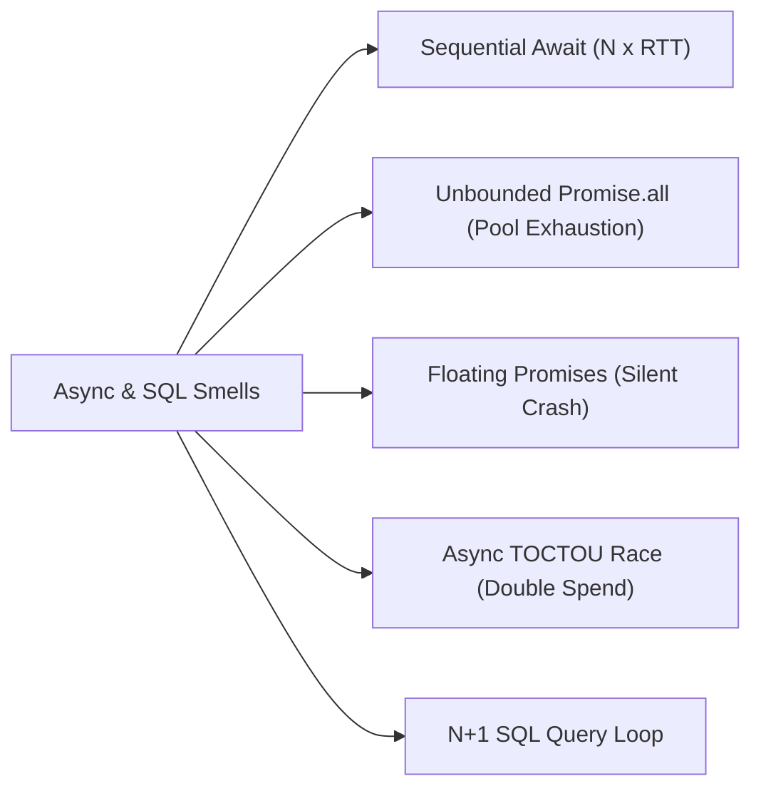

---
tags:
  - software-engineering
  - clean-code
  - code-smells
  - refactoring
created: 2026-01-02
updated: 2026-11-13
status: 🟢
level: mid-to-senior
---
# Code Smells

> [!abstract] Vault Navigation
> Diagnostic smell catalog, static AST detection thresholds, and concrete refactoring mechanics within [[Programming/Software Engineering/Clean Code/Clean Code Complete Guide|Clean Code Complete Guide]]. Directly informs [[Programming/Software Engineering/Refactoring/Refactoring Complete Guide|Refactoring Complete Guide]], [[Programming/Software Engineering/SOLID/SOLID Principles Complete Guide|SOLID Principles Complete Guide]], [[Programming/Software Engineering/Clean Code/Classes, Objects & Formatting|Classes, Objects & Formatting]], [[Programming/Software Engineering/Clean Code/Functions|Functions]], [[Programming/Software Engineering/Clean Code/Error Handling|Error Handling]], [[Programming/Software Engineering/Design Patterns/Behavioral/Strategy|Strategy]], and [[Programming/Software Engineering/Testing/Unit Testing|Unit Testing]].

A **code smell** is an observable structural or control-flow symptom that indicates design decay, excessive coupling, or latent runtime hazards. Smelly modules typically compile cleanly and pass happy-path tests, yet degrade engineering velocity by amplifying blast radius across edits and failing silently under production concurrency, partial failures, or requirement drift.

---

## 1. First-Principles Mechanics & Complete Smell Taxonomy

Code smells matter operationally because they map directly to three measurable failure dimensions:

1. **Change Amplification (Coupling Fan-Out)**: Editing one business rule requires coordinated modifications across multiple files (**Shotgun Surgery**), or editing one file risks breaking unrelated business capabilities (**Divergent Change**).
2. **Working-Memory Saturation (Cognitive Load)**: Deep nesting, 100-line methods, primitive parameter lists, and temporary instance flags force engineers to simulate dozens of state combinations mentally before making a one-line fix.
3. **Runtime & Concurrency Hazards**: Modern asynchronous event loops (`async/await`) and ORM abstraction layers introduce smells—unbounded `Promise.all`, async check-then-act races, missing `AbortSignal` propagation, and N+1 SQL loops—that manifest directly as latency spikes, connection-pool exhaustion, and double-spend bugs.



### 1.1 Master Diagnostic Matrix (Fowler Taxonomy + Modern Async/SQL Extensions)

| Family | Smell | Objective Detection Signal | Primary Refactoring Mechanic |
|---|---|---|---|
| **Bloaters** | **Long Method** | $>35$ non-blank lines, Cognitive Complexity $>15$, section banner comments (`// Step 2: Calculate tax`) | Extract Function, Split Phase, Replace Nested Conditional with Guard Clauses |
| | **Large Class (God Class)** | $\text{LCOM4} \ge 2$, $>250$ LOC, $>5$ constructor dependencies, edited by multiple actors | Extract Class along actor & state cohesion boundaries |
| | **Primitive Obsession** | Raw `string`/`number` for money, currency, percentages, email, IDs, or state flags | Replace Primitive with Value Object / Branded Type |
| | **Long Parameter List** | $\ge 4$ positional arguments or boolean control-mode flags (`isAdmin, skipAudit`) | Introduce Parameter Object, Split Function |
| | **Data Clumps** | Identical tuple of 3–4 fields (`startDate, endDate`, `lat, lng`) repeated across signatures | Extract Value Object / Parameter Object (`DateRange`, `GeoPoint`) |
| **OO Abusers** | **Switch / If-Else Type Codes** | Identical `switch (record.kind)` or `if/else` chain duplicated across $\ge 2$ modules | Replace Conditional with Polymorphism / Strategy Map + `assertNever` |
| | **Refused Bequest** | Subclass overrides inherited method to throw `NotSupportedError` or return no-op | Replace Inheritance with Delegation; split via Interface Segregation |
| | **Temporary Field** | Instance property set inside one method and `undefined` / stale during all other calls | Extract Method Object or pass local state explicitly as parameters |
| | **Alternative Classes** | Two classes perform identical roles (`S3Uploader` / `GcsStorageClient`) with incompatible signatures | Rename/adapt behind common Port interface |
| **Change Preventers** | **Divergent Change** | **1 module** modified in git for $N$ orthogonal business reasons (DB + Tax + Email) | Split Phase; Extract Class per actor responsibility |
| | **Shotgun Surgery** | **1 business change** requires small synchronized edits across $N$ separate files | Move Function / Field into one cohesive domain module |
| | **Parallel Inheritance** | Adding a subclass to hierarchy `A` always forces adding a matching subclass to `B` | Merge hierarchies or delegate via Strategy composition |
| **Dispensables** | **Speculative Generality** | `AbstractGenericProvider` or plugin hook with 1 implementation built for hypothetical future reuse | Collapse Hierarchy, Inline Class (YAGNI) |
| | **Dead Code** | Unreachable branches, unused exports, dormant feature flags past rollout | Delete immediately (rely on Git history) |
| | **Duplicate Knowledge** | Same business invariant copied across handlers (past Rule of Three) | Extract shared domain helper or Value Object |
| **Couplers** | **Feature Envy** | Method accesses $4+$ properties/getters of another object vs $0$–$1$ of `this` | Move Function to the envied object |
| | **Inappropriate Intimacy** | Two classes mutate each other's fields or form circular imports | Hide Delegate, invert dependency via Domain Events |
| | **Message Chains** | `order.getCustomer().getAddress().getCountry().getVatRate()` | Hide Delegate (`order.shippingVatRate()`) |
| | **Middle Man** | Service class forwards $>70\%$ of methods 1:1 to a single delegate without adding logic | Remove Middle Man; inject delegate directly |
| **Async & SQL** | **Async Waterfall / Herd / TOCTOU / N+1** | `await` inside `for`, unbounded `Promise.all`, floating promises, read-await-write races, queries in loops | `mapWithConcurrency`, `AbortSignal`, singleflight / atomic SQL `UPDATE ... RETURNING`, `WHERE id = ANY($1)` |

### 1.2 Divergent Change vs Shotgun Surgery Invariance

These two Change Preventers represent exact structural inverses along the coupling matrix:

- **Divergent Change ($N \text{ actors} \rightarrow 1 \text{ file}$)**: One bloated module handles schema serialization, tax computation, Stripe retries, and email formatting. Every team touches the same file and introduces merge conflicts and cross-domain regressions. **Fix**: split by actor.
- **Shotgun Surgery ($1 \text{ actor} \rightarrow N \text{ files}$)**: A single domain invariant—such as currency decimal formatting (`amount / 100` hardcoded inline) or admin authorization checks—lives duplicated across 9 controllers and workers. Adding `JPY` (zero minor decimals) misses 2 files and corrupts invoices by $100\times$. **Fix**: consolidate into one owner (`Money.format()`).

### 1.3 Duplicate Knowledge vs Coincidental AST Similarity (Rule of Three & Sandi Metz)

Not all syntactically identical code constitutes harmful duplication. Extracting a shared helper prematurely creates **the wrong abstraction**, which Sandi Metz summarizes cleanly: *"Duplication is far cheaper than the wrong abstraction."*

1. **Duplicate Domain Knowledge (Unify Immediately)**: Two functions enforce the exact same authoritative business rule (such as VAT calculation or password complexity policy). When tax policy changes, both must change identically. Unifying prevents drift.
2. **Coincidental AST Similarity (Keep Separate Until Proven)**: Two endpoints happen to contain identical 6-line structural checks today (e.g., validating a `ShippingAddress` max length vs a `BillingAddress` max length, or retry backoff for two unrelated partners). They belong to **different business actors** and will diverge independently.
3. **The Rule of Three & Wrong-Abstraction Collapse**: Allow a small local pattern to exist twice before extracting a shared abstraction on the third occurrence. If an existing shared abstraction accumulates boolean flags (`formatReport(rows, isCsv, includeHeader, useLegacyDates, stripTimezone)`) to serve diverging callers, **do not add a sixth flag**—inline the shared helper back into each caller and let each branch evolve cleanly.

---

## 2. Real-World Use Cases, Triage Rubric & AST Thresholds

Refactoring smells blindly without business prioritization wastes sprint capacity on stable code that never changes. Combine **code-review triage severity** with **git-churn hotspot analysis** to focus engineering effort where defect density actually lives.

### 2.1 Code-Review Smell Triage Rubric

| Priority Tier | Smell Examples | PR Action | Engineering Justification |
|---|---|---|---|
| **P0 (Merge Blocker)** | Floating promises, async TOCTOU race, unbounded `Promise.all` over user/DB rows, N+1 SQL inside hot list endpoint, missing `AbortSignal`/timeout, leaked mutable internals | **Request Changes** | Direct production outage, connection starvation, or data corruption vector |
| **P1 (Architectural Gate)** | Repeated `switch` type codes across files, Divergent Change in active hotspot, Primitive Obsession on money/auth tokens, circular dependency | **Fix in PR or Scoped Prep Commit** | Multiplies future bug rate across every upcoming feature touching this boundary |
| **P2 (Local Readability)** | Long method (>40 lines) with clear phases, negative boolean flags, moderate Data Clump inside private helper | **Refactor Inline if Touched (Boy Scout Rule)** | Low immediate outage risk; fast to clean without expanding PR diff scope |
| **Intentional Trade-Off** | Minor coincidental similarity across two bounded contexts; thin facade providing stable HTTP/SDK contract | **Approve as Written** | Premature deduplication or inlining would introduce worse cross-domain coupling |

### 2.2 Concrete AST & Lint Enforcement Thresholds

| Metric / Smell Signal | Recommended Threshold | Enforcement Rule / Tool |
|---|---|---|
| **Cyclomatic Complexity** | $\le 10$ per function | ESLint `complexity: ['error', 10]` |
| **Cognitive Complexity** | $\le 15$ per function | `sonarjs/cognitive-complexity` |
| **Max Nesting Depth** | $\le 2$ blocks | ESLint `max-depth: ['error', 2]` |
| **Function Body Length** | $\le 50$ statements/lines (excluding blanks/comments) | ESLint `max-lines-per-function` |
| **Parameter Arity** | $\le 3$ parameters | ESLint `max-params: ['error', 3]` |
| **Unawaited Promises** | $0$ floating promises | `@typescript-eslint/no-floating-promises` |
| **Circular Dependencies** | $0$ import cycles | `npx madge --circular --extensions ts src/` |
| **Copy-Paste Clones** | Flag blocks $\ge 50$ tokens | `npx jscpd --min-tokens 50 src/` |

---

## 3. Complete Diagnostic & Refactoring Catalog (Before $\rightarrow$ Diagnosis $\rightarrow$ After + Tests)

### 3.1 Cluster A: Bloaters (Long Method, Primitive Obsession, Data Clumps, Long Parameter List)

#### BEFORE: Multi-Bloater `createQuote` Function

```typescript
// ❌ BEFORE: Long Method + Primitive Obsession + Data Clump + Long Parameter List + Flag Argument
export function createShippingQuote(
  originLat: number,
  originLng: number,
  destLat: number,
  destLng: number,
  startDateIso: string,
  endDateIso: string,
  baseRateDollars: number,
  currency: string,
  isExpress: boolean,
  applyVipDiscount: boolean
): { totalDollars: number; currency: string; transitDays: number } {
  if (originLat < -90 || originLat > 90 || destLat < -90 || destLat > 90) {
    throw new Error('Invalid latitude');
  }
  if (originLng < -180 || originLng > 180 || destLng < -180 || destLng > 180) {
    throw new Error('Invalid longitude');
  }
  const start = Date.parse(startDateIso);
  const end = Date.parse(endDateIso);
  if (Number.isNaN(start) || Number.isNaN(end) || end <= start) {
    throw new Error('Invalid date window');
  }
  // Haversine calculation mixed inline with currency float arithmetic:
  const toRad = (deg: number) => (deg * Math.PI) / 180;
  const dLat = toRad(destLat - originLat);
  const dLng = toRad(destLng - originLng);
  const a =
    Math.sin(dLat / 2) ** 2 +
    Math.cos(toRad(originLat)) * Math.cos(toRad(destLat)) * Math.sin(dLng / 2) ** 2;
  const distanceKm = 6371 * 2 * Math.atan2(Math.sqrt(a), Math.sqrt(1 - a));

  let price = distanceKm * baseRateDollars;
  if (isExpress) price *= 1.45;
  if (applyVipDiscount) price *= 0.85;
  const transitDays = Math.ceil((end - start) / 86_400_000);
  return { totalDollars: Number(price.toFixed(2)), currency, transitDays };
}
```

#### DIAGNOSIS
1. **Long Parameter List (10 positional args)** invites silent coordinate swaps (`originLat, originLng` vs `destLat, destLng`) and flag proliferation (`isExpress, applyVipDiscount`).
2. **Data Clumps**: `(lat, lng)` appears twice; `(startDateIso, endDateIso)` travels as an unvalidated pair.
3. **Primitive Obsession**: Raw floats (`baseRateDollars`, `currency: string`) allow invalid currencies (`"USDD"`), negative rates, and IEEE-754 drift.
4. **Long Mixed-Abstraction Method**: Input validation, spherical trigonometry, pricing rules, and day computation all sit in one procedural block.

#### AFTER: Value Objects (`GeoPoint`, `DateRange`, `Money`) + Cohesive Service + Tests

```typescript
// ✅ AFTER: Self-validating Value Objects eliminate parameter clumps, swaps & float drift
export class GeoPoint {
  private constructor(public readonly lat: number, public readonly lng: number) {
    Object.freeze(this);
  }

  static create(lat: number, lng: number): GeoPoint {
    if (!Number.isFinite(lat) || lat < -90 || lat > 90) {
      throw new RangeError(`Latitude out of bounds [-90, 90]: ${lat}`);
    }
    if (!Number.isFinite(lng) || lng < -180 || lng > 180) {
      throw new RangeError(`Longitude out of bounds [-180, 180]: ${lng}`);
    }
    return new GeoPoint(lat, lng);
  }

  distanceKmTo(other: GeoPoint): number {
    const toRad = (deg: number) => (deg * Math.PI) / 180;
    const dLat = toRad(other.lat - this.lat);
    const dLng = toRad(other.lng - this.lng);
    const a =
      Math.sin(dLat / 2) ** 2 +
      Math.cos(toRad(this.lat)) * Math.cos(toRad(other.lat)) * Math.sin(dLng / 2) ** 2;
    return 6371 * 2 * Math.atan2(Math.sqrt(a), Math.sqrt(1 - a));
  }
}

export class DateRange {
  private constructor(public readonly startMs: number, public readonly endMs: number) {
    Object.freeze(this);
  }

  static fromIso(startIso: string, endIso: string): DateRange {
    const startMs = Date.parse(startIso);
    const endMs = Date.parse(endIso);
    if (Number.isNaN(startMs) || Number.isNaN(endMs) || endMs <= startMs) {
      throw new RangeError(`Invalid date range: ${startIso} -> ${endIso}`);
    }
    return new DateRange(startMs, endMs);
  }

  durationDaysCeil(): number {
    return Math.ceil((this.endMs - this.startMs) / 86_400_000);
  }
}

export type Currency = 'USD' | 'EUR';

export class MoneyCents {
  private constructor(public readonly cents: number, public readonly currency: Currency) {
    Object.freeze(this);
  }

  static of(cents: number, currency: Currency): MoneyCents {
    if (!Number.isSafeInteger(cents) || cents < 0) {
      throw new RangeError(`Invalid cents: ${cents}`);
    }
    return new MoneyCents(cents, currency);
  }

  scaleBps(basisPoints: number): MoneyCents {
    return MoneyCents.of(Math.round((this.cents * basisPoints) / 10_000), this.currency);
  }
}

export type ShippingSpeed = 'STANDARD' | 'EXPRESS';

export interface QuoteInput {
  readonly origin: GeoPoint;
  readonly destination: GeoPoint;
  readonly window: DateRange;
  readonly ratePerKm: MoneyCents;
  readonly speed: ShippingSpeed;
  readonly isVipCustomer: boolean;
}

export function calculateShippingQuote(input: QuoteInput): { readonly total: MoneyCents; readonly transitDays: number } {
  const distanceKm = input.origin.distanceKmTo(input.destination);
  const rawCents = Math.round(distanceKm * input.ratePerKm.cents);
  let total = MoneyCents.of(rawCents, input.ratePerKm.currency);

  if (input.speed === 'EXPRESS') {
    total = total.scaleBps(14_500);
  }
  if (input.isVipCustomer) {
    total = total.scaleBps(8_500);
  }
  return { total, transitDays: input.window.durationDaysCeil() };
}
```

---

### 3.2 Cluster B: OO Abusers (Repeated Type Switches, Refused Bequest, Temporary Field)

#### BEFORE: Repeated Switches + Refused Bequest + Temporary Field

```typescript
// ❌ BEFORE: Refused Bequest (throws on ReadOnlyStorage) + Repeated Switches + Temporary Field
abstract class FileStorageBackend {
  protected tempAuthToken?: string; // Temporary Field: only populated during signed upload!

  abstract upload(key: string, data: Buffer): Promise<void>;
  abstract delete(key: string): Promise<void>;
}

class ReadOnlyArchiveStorage extends FileStorageBackend {
  async upload(): Promise<void> {
    throw new Error('NotImplementedError: archive storage is read-only'); // Refused Bequest!
  }
  async delete(): Promise<void> {
    throw new Error('NotImplementedError: archive storage is immutable'); // Breaks LSP!
  }
}

// Repeated switch #1 in billing.ts
function computeStorageCostCents(kind: 'S3' | 'GCS' | 'ARCHIVE', bytes: number): number {
  switch (kind) {
    case 'S3': return Math.ceil(bytes / 1e9) * 230;
    case 'GCS': return Math.ceil(bytes / 1e9) * 200;
    case 'ARCHIVE': return Math.ceil(bytes / 1e9) * 40;
  }
}

// Repeated switch #2 in retention.ts (breaks silently if a 4th tier is added!)
function maxRetentionDays(kind: 'S3' | 'GCS' | 'ARCHIVE'): number {
  switch (kind) {
    case 'S3': return 90;
    case 'GCS': return 180;
    case 'ARCHIVE': return 2555;
  }
}
```

#### DIAGNOSIS
1. **Refused Bequest**: `ReadOnlyArchiveStorage` extends `FileStorageBackend` only to throw `NotImplementedError` on `upload` and `delete`, violating Liskov Substitution.
2. **Repeated Switches**: Switching on `kind` in `billing.ts`, `retention.ts`, and `uploader.ts` forces Shotgun Surgery whenever `'R2'` is introduced.
3. **Temporary Field**: `tempAuthToken` remains `undefined` outside a narrow upload phase, forcing null checks across sibling methods.

#### AFTER: Segregated Capability Interfaces + Strategy Registry + Tests

```typescript
// ✅ AFTER: Interface Segregation eliminates Refused Bequest; Strategy Registry eliminates repeated switches
export interface ReadableStorage {
  read(key: string): Promise<Buffer>;
}

export interface WritableStorage extends ReadableStorage {
  upload(key: string, data: Buffer): Promise<void>;
  delete(key: string): Promise<void>;
}

export interface StorageTierPolicy {
  readonly kind: StorageTierKind;
  readonly centsPerGbMonth: number;
  readonly maxRetentionDays: number;
}

export type StorageTierKind = 'S3' | 'GCS' | 'ARCHIVE';

export const STORAGE_TIER_POLICIES: Record<StorageTierKind, StorageTierPolicy> = {
  S3: { kind: 'S3', centsPerGbMonth: 230, maxRetentionDays: 90 },
  GCS: { kind: 'GCS', centsPerGbMonth: 200, maxRetentionDays: 180 },
  ARCHIVE: { kind: 'ARCHIVE', centsPerGbMonth: 40, maxRetentionDays: 2555 },
};

export function computeMonthlyCostCents(kind: StorageTierKind, bytes: number): number {
  const policy = STORAGE_TIER_POLICIES[kind];
  return Math.ceil(bytes / 1_000_000_000) * policy.centsPerGbMonth;
}

// Temporary field eliminated: auth token passed explicitly via scoped parameter object
export class SignedS3Uploader implements WritableStorage {
  constructor(private readonly fetchAuthToken: () => Promise<string>) {}

  async read(key: string): Promise<Buffer> {
    const token = await this.fetchAuthToken();
    return Buffer.from(`read:${key}:${token}`);
  }

  async upload(key: string, data: Buffer): Promise<void> {
    const token = await this.fetchAuthToken();
    if (!token || data.byteLength === 0) throw new Error(`Upload rejected for ${key}`);
  }

  async delete(key: string): Promise<void> {
    const token = await this.fetchAuthToken();
    if (!token) throw new Error(`Delete rejected for ${key}`);
  }
}

export class ImmutableArchiveReader implements ReadableStorage {
  async read(key: string): Promise<Buffer> {
    return Buffer.from(`archive:${key}`);
  }
}
```

Because `STORAGE_TIER_POLICIES` uses `Record<StorageTierKind, StorageTierPolicy>`, adding `'R2'` to `StorageTierKind` creates an immediate TypeScript compile error until every policy attribute is populated in one authoritative table.

---

### 3.3 Cluster C: Change Preventers & Couplers (Divergent Change, Feature Envy, Message Chains, Middle Man)

#### BEFORE: God Order Service with Divergent Change + Feature Envy + Message Chains + Middle Man

```typescript
// ❌ BEFORE: 1 bloated class owned by 3 actors + Feature Envy + Message Chain + Middle Man
export class CustomerAccount {
  constructor(
    public readonly tier: 'FREE' | 'PRO',
    public readonly annualSpendCents: number,
    public readonly isSuspended: boolean,
    public readonly billingAddress: { country: string; vatExempt: boolean }
  ) {}
}

export class OrderRecord {
  constructor(
    public readonly id: string,
    public readonly subtotalCents: number,
    public readonly customer: CustomerAccount
  ) {}
  getCustomer(): CustomerAccount { return this.customer; }
}

export class OrderMiddleManFacade {
  constructor(private readonly repo: { findById(id: string): Promise<OrderRecord> }) {}
  findById(id: string) { return this.repo.findById(id); } // Middle Man: zero added behavior!
}

export class MonolithOrderManager {
  // Feature Envy + Message Chain + Divergent Change (Discount rules + Tax rules + Audit formatting)
  computeFinalTotalCents(order: OrderRecord): number {
    const cust = order.getCustomer();
    let total = order.subtotalCents;
    // Feature Envy: inspecting 3 fields of CustomerAccount externally
    if (cust.tier === 'PRO' && cust.annualSpendCents >= 100_000 && !cust.isSuspended) {
      total = Math.round(total * 0.9);
    }
    // Message Chain reaching into customer.billingAddress.vatExempt
    if (cust.billingAddress.country === 'DE' && !cust.billingAddress.vatExempt) {
      total = Math.round(total * 1.19);
    }
    return total;
  }
}
```

#### AFTER: Move Methods to Data Owners + Remove Middle Man + Split Tax Collaborator + Vitest Suite

```typescript
// ✅ AFTER: Behavior moved onto owners (cures Feature Envy & Message Chains), Middle Man deleted
export class Customer {
  constructor(
    private readonly tier: 'FREE' | 'PRO',
    private readonly annualSpendCents: number,
    private readonly isSuspended: boolean,
    private readonly countryCode: string,
    private readonly vatExempt: boolean
  ) {}

  qualifiesForProDiscount(): boolean {
    return this.tier === 'PRO' && this.annualSpendCents >= 100_000 && !this.isSuspended;
  }

  applicableVatBasisPoints(): number {
    if (this.vatExempt) return 0;
    return this.countryCode === 'DE' ? 1900 : 0;
  }
}

export class PricedOrder {
  constructor(
    public readonly id: string,
    private readonly subtotalCents: number,
    private readonly customer: Customer
  ) {}

  calculateNetTotalCents(): number {
    return this.customer.qualifiesForProDiscount()
      ? Math.round(this.subtotalCents * 0.9)
      : this.subtotalCents;
  }

  calculateGrossTotalCents(): number {
    const net = this.calculateNetTotalCents();
    const vatBps = this.customer.applicableVatBasisPoints();
    return net + Math.round((net * vatBps) / 10_000);
  }
}
```

```typescript
// tests/smells-refactor.spec.ts
import { describe, it, expect } from 'vitest';
import { Customer, PricedOrder } from '../src/domain/priced-order.js';
import { DateRange, GeoPoint, MoneyCents, calculateShippingQuote } from '../src/domain/shipping-quote.js';
import { computeMonthlyCostCents } from '../src/domain/storage-policy.js';

describe('Refactored Domain Objects & Smell Eliminations', () => {
  it('applies Pro discount and German VAT cleanly via Tell, Don\'t Ask', () => {
    const proGerman = new Customer('PRO', 150_000, false, 'DE', false);
    const order = new PricedOrder('ord-1', 10_000, proGerman);
    expect(order.calculateNetTotalCents()).toBe(9_000);
    expect(order.calculateGrossTotalCents()).toBe(10_710);
  });

  it('prevents invalid coordinates and calculates deterministic minor-unit shipping quotes', () => {
    expect(() => GeoPoint.create(95, 0)).toThrow(RangeError);
    const origin = GeoPoint.create(40.7128, -74.006);
    const dest = GeoPoint.create(40.7306, -73.9352);
    const quote = calculateShippingQuote({
      origin,
      destination: dest,
      window: DateRange.fromIso('2026-11-01T00:00:00Z', '2026-11-03T12:00:00Z'),
      ratePerKm: MoneyCents.of(250, 'USD'),
      speed: 'EXPRESS',
      isVipCustomer: false,
    });
    expect(quote.transitDays).toBe(3);
    expect(quote.total.cents).toBeGreaterThan(0);
  });

  it('computes storage tier pricing directly from policy table without repeated switches', () => {
    expect(computeMonthlyCostCents('ARCHIVE', 2_000_000_000)).toBe(80);
  });
});
```

---

### 3.4 Cluster D: Dispensables & The Wrong-Abstraction Anti-Pattern

Consider how premature DRY turns two coincidentally similar flows into an unmaintainable boolean-flag monster:

```typescript
// ❌ Wrong Abstraction: two unrelated actors forced into one flagged function
function validateAddressFields(
  addr: { line1: string; postalCode: string; country: string },
  allowPoBox: boolean,
  requireVatId: boolean,
  vatId?: string
): string[] {
  const errors: string[] = [];
  if (!addr.line1.trim()) errors.push('line1 required');
  if (!allowPoBox && /p\.?o\.?\s*box/i.test(addr.line1)) errors.push('no PO box');
  if (requireVatId && addr.country === 'DE' && !vatId) errors.push('VAT ID required');
  return errors;
}

// ✅ Right Fix: Split independent actor policies; share only pure invariant helpers if stable
export function validateShippingAddress(addr: { line1: string; postalCode: string }): string[] {
  const errors: string[] = [];
  if (!addr.line1.trim()) errors.push('Shipping street address is required');
  if (/p\.?o\.?\s*box/i.test(addr.line1)) errors.push('Carriers cannot deliver parcels to PO Boxes');
  return errors;
}

export function validateBillingTaxProfile(addr: { line1: string; country: string; vatId?: string }): string[] {
  const errors: string[] = [];
  if (!addr.line1.trim()) errors.push('Billing address line 1 is required');
  if (addr.country === 'DE' && !addr.vatId) errors.push('EU German corporate billing requires VAT ID');
  return errors;
}
```

Meanwhile, **Speculative Generality** (`interface IAbstractReportMapperFactory<TIn, TOut>` wrapping one `CsvReportMapper`) and **Dead Code** (commented-out legacy functions or unreachable feature-flag branches) should be deleted outright. Git retains deleted code safely if ever needed again; keeping dead symbols forces every reader and search query to sift through obsolete paths.

---

### 3.5 Cluster E: Modern Async, Concurrency & SQL Persistence Smells

Classical OOP catalogs predate non-blocking event loops and ORMs. In production Node.js, Python `asyncio`, and Go services, five async/SQL smells drive the majority of severe incidents:



1. **Sequential `await` Waterfall vs Unbounded `Promise.all`**: Awaiting independent network calls in a `for` loop turns parallel latency into $O(N \cdot \text{RTT})$. Replacing it blindly with `Promise.all(items.map(...))` fires 10,000 simultaneous requests, exhausting PostgreSQL connection pools (`max_connections`), OS file descriptors (`EMFILE`), or upstream `429` limits. **Fix**: bounded concurrency worker pool (`mapWithConcurrency`).
2. **Floating (Fire-and-Forget) Promises**: Calling an `async` function without `await`, `return`, or `.catch()` triggers `unhandledRejection` crashes in Node 15+ or silently drops background writes during container `SIGTERM` shutdown.
3. **Async Check-Then-Act (TOCTOU) Interleaving**: Even in single-threaded JavaScript, **every `await` yields control to the event loop**. Reading `cache.get(key)` or `wallet.balance` before `await` and writing afterward allows concurrent overlapping requests to pass validation simultaneously (causing duplicate upstream calls or negative balances). **Fix**: in-flight singleflight deduplication in memory, or atomic SQL `UPDATE wallets SET balance_cents = balance_cents - $1 WHERE id = $2 AND balance_cents >= $1 RETURNING balance_cents`.
4. **Missing `AbortSignal` & Async Constructors**: Neglecting `AbortSignal` leaves aborted HTTP requests consuming DB CPU; calling unawaited `this.connect()` inside `constructor()` exposes half-initialized objects. Use `static async create(...)` factories instead.
5. **N+1 SQL Query Loop**: Executing `SELECT * FROM line_items WHERE order_id = $1` inside `for (const order of orders)` fires $N+1$ round trips instead of one batched `JOIN` or `WHERE order_id = ANY($1::uuid[])`.

```typescript
// ✅ Production Bounded Worker Pool + Singleflight Cache + Batched SQL
export async function mapWithConcurrency<T, R>(
  items: ReadonlyArray<T>,
  concurrency: number,
  worker: (item: T, signal?: AbortSignal) => Promise<R>,
  signal?: AbortSignal
): Promise<R[]> {
  if (items.length === 0) return [];
  const limit = Math.max(1, Math.min(concurrency, items.length));
  const results = new Array<R>(items.length);
  let cursor = 0;

  async function runSlot(): Promise<void> {
    while (cursor < items.length) {
      signal?.throwIfAborted();
      const index = cursor++;
      results[index] = await worker(items[index], signal);
    }
  }

  await Promise.all(Array.from({ length: limit }, runSlot));
  return results;
}

export class SingleflightTokenCache {
  private readonly cache = new Map<string, { token: string; expiresAtMs: number }>();
  private readonly inFlight = new Map<string, Promise<string>>();

  constructor(private readonly mintToken: (key: string) => Promise<string>) {}

  async getOrMint(key: string, nowMs = Date.now()): Promise<string> {
    const hit = this.cache.get(key);
    if (hit && hit.expiresAtMs > nowMs) return hit.token;

    const activePromise = this.inFlight.get(key);
    if (activePromise) return activePromise;

    const minted = this.mintToken(key)
      .then((token) => {
        this.cache.set(key, { token, expiresAtMs: nowMs + 300_000 });
        return token;
      })
      .finally(() => {
        this.inFlight.delete(key);
      });

    this.inFlight.set(key, minted);
    return minted;
  }
}
```

```sql
-- ❌ N+1 Smell: executed inside application loop per order ID
SELECT id, sku, qty FROM order_items WHERE order_id = $1;

-- ✅ Batched Set Query: 1 network round trip for 500 orders
SELECT order_id, id, sku, qty
FROM order_items
WHERE order_id = ANY($1::uuid[]);
```

---

## 4. Mechanical Detection, Git Churn Hotspots & CI Guardrails

Never schedule refactoring sprints by intuition alone. A 600-line God Class that has been modified twice in three years carries far less maintenance tax than a 300-line file modified 45 times in the last 90 days (**Adam Tornhill's Behavioral Code Analysis**: $\text{Hotspot Score} = \text{Change Frequency} \times \text{Complexity / LOC}$).

Run these deterministic commands in any repository to identify refactoring priorities and structural cycles immediately:

```bash
# 1. Identify top 15 Git Churn Hotspots over the last 6 months (Frequency x File Size)
git log --since="6 months ago" --name-only --pretty=format: \
  | grep -E '\.(ts|tsx|py|go)$' \
  | sort | uniq -c | sort -rn | head -n 15

# 2. Detect circular dependencies across TypeScript modules (Inappropriate Intimacy)
npx madge --circular --extensions ts src/

# 3. Detect non-trivial duplicate token sequences (>= 50 tokens)
npx jscpd --min-tokens 50 --reporters console src/

# 4. Enforce complexity, parameter count, and floating promise checks in CI
npx eslint "src/**/*.ts" --rule 'complexity: [error, 10]' --rule 'max-params: [error, 3]'
```

---

## 5. Production Debugging, Profiling & Operations Playbook

| Production Symptom | Underlying Code Smell | Exact Diagnostic Step | Remediation |
|---|---|---|---|
| **API latency jumps linearly ($250\text{ ms} \to 4.5\text{ s}$) as page size grows** | **Sequential `await` waterfall** or **N+1 SQL query loop** | Capture OpenTelemetry trace span waterfall or PostgreSQL `pg_stat_statements` `calls` vs `rows` ratio | Batch with `WHERE id = ANY($1)` / `JOIN`, or parallelize I/O via `mapWithConcurrency(..., 8)` |
| **DB `PoolExhausted` / `ETIMEDOUT` errors on batch webhook jobs** | **Unbounded `Promise.all`** launching thousands of concurrent transactions | Inspect active pool waiters + `SELECT count(*), state FROM pg_stat_activity GROUP BY 1, 2;` | Cap concurrency (`limit <= poolMax * 0.5`) and enforce `AbortSignal.timeout(...)` |
| **Account balance turns negative under double-click requests** | **Async Check-Then-Act (TOCTOU)** across `await` boundary | Reproduce with `Promise.all([withdraw(100), withdraw(100)])` in Vitest concurrency test | Replace read-modify-write with atomic SQL predicate `UPDATE ... WHERE balance >= $1` or optimistic `version` lock |
| **`TypeError: Class extends value undefined` on NestJS/Node boot** | **Inappropriate Intimacy** / bidirectional circular barrel imports (`index.ts`) | Run `npx madge --circular --extensions ts src/` | Break cycle by moving shared DTO/interfaces to leaf module or inverting via Domain Events |
| **Every PR touching pricing breaks shipping or invoice PDF tests** | **Divergent Change** + **Repeated Switches** in 1,000-line service | Inspect `git log --stat` hotspot co-change matrix | Split along actor axes (`PricingCalculator`, `TaxPolicy`, `InvoiceRenderer`) behind clean boundaries |

---

## 6. Worked Multi-Smell Code-Review Exercises & Solutions

### Exercise 1: Diagnosing Divergent Change vs Shotgun Surgery from Postmortem Logs

Examine two postmortem findings from consecutive quarters:
- **Finding A**: Adding support for zero-decimal currency `JPY` required modifying 11 separate files (`CartController`, `PdfGenerator`, `TaxEngine`, `RefundService`, `SlackAlertFormatter`, etc.) because `amountCents / 100` and `.toFixed(2)` were hardcoded inline everywhere.
- **Finding B**: A single 950-line `OrderProcessor` class was modified in 15 out of 20 sprints: 5 times by the Tax compliance team, 5 times by the Stripe integration team, and 5 times by the Marketing email team.

Classify each smell accurately and prescribe the exact refactoring transformation.

### Solution 1

- **Finding A = Shotgun Surgery + Primitive Obsession**: One domain rule (currency exponent formatting and minor-unit scaling) is scattered across 11 files over raw `number` primitives. **Fix**: Consolidate into an immutable `Money` Value Object encapsulating `(minorUnits: bigint, currency: CurrencyMeta)` with a single `format()` and `toMajorUnits()` method so adding new currencies requires editing 1 registry entry.
- **Finding B = Divergent Change (Large God Class)**: One module couples three orthogonal change actors (Tax, Payments, Email Notifications). **Fix**: Extract cohesive single-actor collaborators (`TaxCalculator`, `PaymentGateway`, `OrderEmailNotifier`) orchestrated by a slim `CheckoutOrderUseCase`.

---

### Exercise 2: Fixing Four Concurrent Async Smells in a Webhook Retry Worker

Review this PR for a production webhook dispatcher, identify all **four** async/concurrency smells, and write the hardened replacement:

```typescript
class WebhookRetryWorker {
  private activeJobs = new Set<string>();

  async processBatch(jobIds: string[]): Promise<void> {
    await Promise.all(
      jobIds.map(async (id) => {
        if (this.activeJobs.has(id)) return;
        this.activeJobs.add(id);
        const job = await db.jobs.find(id);
        fetch(job.url, { method: 'POST', body: job.payload });
        await db.jobs.markDone(id);
        this.activeJobs.delete(id);
      })
    );
  }
}
```

### Solution 2

1. **Four Production Defects**:
   - **Unbounded `Promise.all`**: If `jobIds` holds 5,000 entries, 5,000 concurrent DB queries and HTTP POSTs exhaust pools and file descriptors simultaneously.
   - **Floating Promise (`fetch(...)` unawaited)**: `markDone(id)` executes *before* the HTTP POST completes or fails, silently dropping failed deliveries and leaking unhandled promise rejections.
   - **State Leak on Exception (`activeJobs.delete(id)` missing `finally`)**: Any DB or HTTP error leaves `id` permanently trapped inside `activeJobs`, deadlocking future retries for that job until process restart.
   - **Missing `AbortSignal.timeout`**: A hanging webhook receiver stalls the worker slot indefinitely.
2. **Production Rewrite**:

```typescript
export class WebhookRetryWorker {
  private readonly activeJobs = new Set<string>();

  async processBatch(
    jobIds: ReadonlyArray<string>,
    maxConcurrency = 10,
    batchSignal?: AbortSignal
  ): Promise<void> {
    await mapWithConcurrency(
      jobIds,
      maxConcurrency,
      async (id, slotSignal) => {
        if (this.activeJobs.has(id)) return;
        this.activeJobs.add(id);
        try {
          const job = await db.jobs.find(id);
          const timeoutSignal = AbortSignal.timeout(5000);
          const reqSignal = slotSignal ? AbortSignal.any([slotSignal, timeoutSignal]) : timeoutSignal;
          const res = await fetch(job.url, {
            method: 'POST',
            body: job.payload,
            signal: reqSignal,
          });
          if (!res.ok) {
            throw new Error(`Webhook ${id} failed with HTTP ${res.status}`);
          }
          await db.jobs.markDone(id);
        } finally {
          this.activeJobs.delete(id);
        }
      },
      batchSignal
    );
  }
}
```

---

### Exercise 3: Curing Feature Envy, Data Clumps & Primitive Obsession in a Controller

Identify all smells in this controller method and refactor cleanly:

```typescript
class ShippingController {
  calculateQuote(
    originLat: number,
    originLng: number,
    destLat: number,
    destLng: number,
    customer: { tier: string; yearlySpendCents: number; isSuspended: boolean }
  ): number {
    const baseCents = Math.round(haversineKm(originLat, originLng, destLat, destLng) * 150);
    if (customer.tier === 'GOLD' && customer.yearlySpendCents > 500_000 && !customer.isSuspended) {
      return Math.round(baseCents * 0.5);
    }
    return baseCents;
  }
}
```

### Solution 3

1. **Smells Detected**:
   - **Data Clump + Long Parameter List**: `(originLat, originLng)` and `(destLat, destLng)` repeat raw coordinate pairs across 5 parameters.
   - **Feature Envy**: `ShippingController` inspects three internal properties of `customer` to evaluate Gold-shipping eligibility rather than asking `Customer`.
   - **Primitive Obsession**: Raw `number` return type omits currency/unit semantics (`MoneyCents`).
2. **Refactored Design**:

```typescript
export class ShippingCustomer {
  constructor(
    private readonly tier: 'STANDARD' | 'GOLD',
    private readonly yearlySpendCents: number,
    private readonly isSuspended: boolean
  ) {}

  qualifiesForHalfPriceShipping(): boolean {
    return this.tier === 'GOLD' && this.yearlySpendCents > 500_000 && !this.isSuspended;
  }
}

export class ShippingQuoteService {
  calculateQuote(origin: GeoPoint, destination: GeoPoint, customer: ShippingCustomer): MoneyCents {
    const baseCents = Math.round(origin.distanceKmTo(destination) * 150);
    const baseMoney = MoneyCents.of(baseCents, 'USD');
    return customer.qualifiesForHalfPriceShipping() ? baseMoney.scaleBps(5_000) : baseMoney;
  }
}
```

---

### Exercise 4: Eliminating Speculative Generality, Middle Man & Wrong-Abstraction Flags

During a codebase audit you find:
1. `interface IGenericEntityMapper<TIn, TOut>` with one concrete class `UserRowMapper`.
2. `class UserFacadeService` whose 5 methods solely invoke `return this.userRepo.<method>(...)` with zero orchestration, caching, or authorization logic.
3. A shared `formatTimestamp(date, includeTime, useUtc, isoFormat, stripMillis)` helper called in 3 places with different flag combinations.

Diagnose each smell and specify the exact fix.

### Solution 4

1. **Speculative Generality (`IGenericEntityMapper`)**: Collapse hierarchy—delete the unused generic interface and export pure typed mapping functions (`toUserDto(row: UserRow): UserDto`) until genuine multiple implementations exist.
2. **Middle Man (`UserFacadeService`)**: Remove Middle Man—delete the pass-through wrapper and inject `UserRepository` directly into controllers/use-cases.
3. **Wrong Abstraction (`formatTimestamp` boolean flags)**: Five callers diverged while sharing one bloated helper. Inline or split into focused explicit functions (`formatAuditIsoUtc(date)`, `formatInvoiceDateLocal(date)`) instead of maintaining 5 boolean flags.

---

### Exercise 5: Refactoring Repeated Type-Code Switches & Refused Bequest (`NotImplementedError`)

Identify the OO Abuser smells in this payment processor hierarchy and refactor it using Segregated Ports + Strategy Map:

```typescript
abstract class PaymentInstrument {
  abstract authorize(cents: number): Promise<string>;
  abstract refund(txId: string, cents: number): Promise<void>;
}

class CryptoTransferInstrument extends PaymentInstrument {
  async authorize(cents: number): Promise<string> { return `chain:${cents}`; }
  async refund(): Promise<void> {
    throw new Error('NotImplementedError: on-chain crypto transfers cannot be refunded');
  }
}

function getSettlementDays(type: 'CARD' | 'ACH' | 'CRYPTO'): number {
  switch (type) {
    case 'CARD': return 2;
    case 'ACH': return 5;
    case 'CRYPTO': return 0;
  }
}
```

### Solution 5

1. **Smells**: **Refused Bequest / LSP Violation** (`CryptoTransferInstrument.refund` throws `NotImplementedError`) and **Type-Code Switch** (`getSettlementDays`).
2. **Refactored Solution**:

```typescript
export interface AuthorizableInstrument {
  readonly settlementDays: number;
  authorize(cents: number): Promise<string>;
}

export interface RefundableInstrument extends AuthorizableInstrument {
  refund(txId: string, cents: number): Promise<void>;
}

export class CardInstrument implements RefundableInstrument {
  readonly settlementDays = 2;
  async authorize(cents: number): Promise<string> { return `card-auth:${cents}`; }
  async refund(txId: string, cents: number): Promise<void> {
    if (cents <= 0) throw new RangeError(`Invalid refund amount for ${txId}`);
  }
}

export class CryptoTransferInstrument implements AuthorizableInstrument {
  readonly settlementDays = 0;
  async authorize(cents: number): Promise<string> { return `chain:${cents}`; }
}
```

Callers requiring refunds accept `RefundableInstrument`, catching unsupported instruments like `CryptoTransferInstrument` at compile time instead of crashing in production.

---

### Exercise 6: Fixing N+1 SQL + Async TOCTOU Double-Spend + Temporary Field in Settlement

Inspect this wallet payout processor and identify all **three** severe production smells, then write the fixed version:

```typescript
class PayoutService {
  private currentBatchCurrency?: string; // Temporary Field

  async processPayouts(requests: Array<{ walletId: string; amountCents: number }>, currency: string) {
    this.currentBatchCurrency = currency;
    for (const req of requests) {
      const wallet = await db.query('SELECT balance_cents FROM wallets WHERE id = $1', [req.walletId]);
      if (wallet.balance_cents >= req.amountCents) {
        await gateway.payout(req.walletId, req.amountCents, this.currentBatchCurrency); // Yield point!
        await db.query('UPDATE wallets SET balance_cents = balance_cents - $1 WHERE id = $2', [
          req.amountCents,
          req.walletId,
        ]);
      }
    }
    this.currentBatchCurrency = undefined;
  }
}
```

### Solution 6

1. **Three Production Smells**:
   - **Async Check-Then-Act (TOCTOU Double-Spend)**: Between reading `balance_cents` and running `UPDATE`, `await gateway.payout(...)` yields to the event loop. Two concurrent `processPayouts` calls for the same `walletId` both observe sufficient balance, both trigger `gateway.payout`, and drive `balance_cents` negative!
   - **Temporary Field (`this.currentBatchCurrency`)**: Concurrent calls to `processPayouts(..., 'USD')` and `processPayouts(..., 'EUR')` on the singleton `PayoutService` overwrite each other's `this.currentBatchCurrency` mid-loop!
   - **N+1 Sequential SQL + Unbounded Serial Loop**: Each payout waits sequentially for a `SELECT`, an HTTP call, and an `UPDATE`.
2. **Atomic, Race-Free Rewrite**:

```typescript
export interface PayoutRequest {
  readonly walletId: string;
  readonly amountCents: number;
  readonly currency: 'USD' | 'EUR';
}

export class SafePayoutService {
  async processPayouts(requests: ReadonlyArray<PayoutRequest>, signal?: AbortSignal): Promise<void> {
    await mapWithConcurrency(
      requests,
      5,
      async (req) => {
        // Atomic debit reservation BEFORE external side effect eliminates TOCTOU double-spend
        const reserved = await db.query(
          `UPDATE wallets
           SET balance_cents = balance_cents - $1
           WHERE id = $2 AND currency = $3 AND balance_cents >= $1
           RETURNING id`,
          [req.amountCents, req.walletId, req.currency]
        );
        if (reserved.rowCount === 0) {
          throw new Error(`Insufficient balance or missing wallet ${req.walletId}`);
        }

        try {
          await gateway.payout(req.walletId, req.amountCents, req.currency, { signal });
        } catch (cause) {
          // Compensate balance atomically if upstream payout definitively failed before dispatch
          await db.query('UPDATE wallets SET balance_cents = balance_cents + $1 WHERE id = $2', [
            req.amountCents,
            req.walletId,
          ]);
          throw new Error(`Payout failed for wallet ${req.walletId}`, { cause });
        }
      },
      signal
    );
  }
}
```

---

← [[Programming/Software Engineering/Clean Code/Clean Code Complete Guide|Back to Clean Code]]
