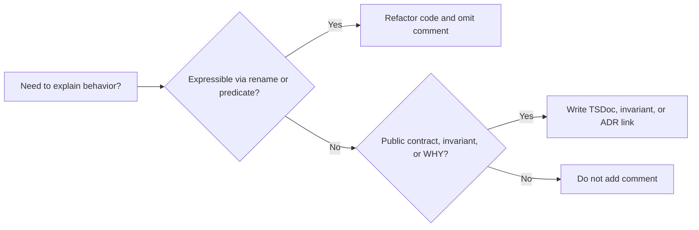

---
tags:
  - software-engineering
  - clean-code
  - comments
  - documentation
  - adr
created: 2026-01-02
updated: 2026-11-13
status: 🟢
level: mid-to-senior
---
# Comments

> [!abstract] Vault Navigation
> Part of [[Programming/Software Engineering/Clean Code/Clean Code Complete Guide|Clean Code Complete Guide]]. Complements [[Programming/Software Engineering/Clean Code/Meaningful Names|Meaningful Names]], [[Programming/Software Engineering/Clean Code/Functions|Functions]], [[Programming/Software Engineering/System Design/API Design|API Design]], and [[Programming/Software Engineering/DevOps/CI-CD|CI-CD]].

Source code expresses **what** executes and **how** data transforms via static types, domain identifiers, and control flow. Comments exist strictly to encode information that programming syntax cannot verify or represent: **why** a constraint exists, non-obvious **concurrency and ordering invariants**, **external regulatory or upstream vendor workarounds**, **performance trade-offs**, and **public API contracts**.

---

## 1. First-Principles Mechanics: Compiler Blindness & Comment Rot

Understanding why most comments degrade software maintainability starts at the compiler frontend and ends in human visual attention economics.

### 1.1 Lexer Trivia & Asymmetric Verification Physics

During compilation or interpretation (`tsc`, ESLint parser, V8), comments are categorized as **lexer trivia** and stripped prior to abstract syntax tree (AST) semantic checking, type inference, and dead-code elimination:

- **Code obeys continuous mechanical verification**: Renaming a symbol, changing a return type, or flipping a condition triggers immediate compiler diagnostics, IDE warnings, or unit-test failures.
- **Comments obey zero automated verification**: When an engineer updates `timeoutMs` from `5_000` to `15_000` or removes a fallback branch, an adjacent explanatory comment (`// Retry after 5s timeout`) compiles with zero warnings.

> [!warning] The Comment Rot Invariant
> Every comment that duplicates behavior already expressed in syntax creates two independent artifacts representing the same fact. Under deadline pressure or cross-team edits, code evolves while comments remain frozen—turning passive redundancy into active disinformation during future incidents.

### 1.2 Signal-to-Noise Filtering in Code Review

When a codebase wraps every getter, constructor, and `if` branch in narrative comments (`// Check if user exists`, `// Increment counter`), engineers subconsciously learn to ignore comment syntax highlighting altogether. High-noise files bury genuinely critical safety warnings (`// Acquire locks in ascending accountId order to prevent PostgreSQL AB-BA deadlocks`) inside visual clutter, dramatically raising incident mean time to recovery (MTTR).



---

## 2. Real-World Use Cases & Decision Matrix

### 2.1 High-Leverage Scenarios Where Comments Are Mandatory

1. **Lock Ordering & Concurrency Serialization Invariants**: Explaining why a loop runs sequentially rather than via `Promise.all`, or why two account locks are sorted lexicographically prior to `SELECT ... FOR UPDATE`, prevents well-intentioned performance refactors from reintroducing production deadlocks.
2. **Algorithmic & Hardware Cache-Locality Trade-Offs**: When profiling dictates choosing a linear scan over a `Set` allocation for arrays of size $N \le 6$ (avoiding heap allocation and keeping data in L1 cache), a 1-line rationale stops future reviewers from "optimizing" it backward.
3. **External Protocol Clauses, RFC Requirements & Vendor Bug Workarounds**: Upstream browser quirks, payment-processor eventual consistency windows, and RFC clock-skew tolerances cannot be inferred from domain types. Documenting the exact issue ID or RFC section preserves institutional memory across team turnover.
4. **Complex Regular Expressions, Bitmasks & Binary Layouts**: Explaining the structure of a non-trivial regex (`/^v1=([a-f0-9]{64}),t=(\d{10})$/`) alongside a concrete matching sample saves minutes of decoding during security audits.
5. **Public SDKs, HTTP OpenAPI Boundaries & Legal Licenses**: Published packages and controller boundaries require machine-readable TSDoc/JSDoc or OpenAPI decorators documenting units, failure cases, and deprecation schedules, while files distributed externally require SPDX license headers.
6. **When NOT to Comment**: Never write inline comments explaining straightforward TypeScript/SQL operations, never leave commented-out code blocks in source files (Git history retains deleted code permanently), never paste changelog attribution headers (`// Edited by Jordan 2026-05-12`), and never mandate JSDoc blocks on private internal helpers whose signatures are self-explanatory.

### 2.2 High-Value vs Harmful Comment Decision Matrix

| Category | Keep or Delete | Concrete Example | Engineering Rationale |
|---|---|---|---|
| **Concurrency / Ordering Invariant** | **Keep (Mandatory)** | `// Sort lock keys ascending to prevent PostgreSQL AB-BA deadlocks.` | Syntax shows `.sort()`, never the distributed deadlock failure mode |
| **Trade-Off / Benchmark Rationale** | **Keep** | `// Linear scan beats Set here: N <= 6 fits inside one cache line.` | Protects intentional micro-optimization from naive refactor |
| **Upstream Bug / RFC Reference** | **Keep** | `// Safari <17.4 omits close code 1000 on sleep (WebKit #261490).` | Explains defensive branch with verifiable external link |
| **Regex / Grammar Sample** | **Keep** | `// Matches Slack signature header: "t=1700000000,v1=<64-hex>"` | Accelerates correctness review without rewriting parser |
| **Public API Contract (TSDoc)** | **Keep (Contractual)** | `@throws {RangeError} When ttlMs <= 0.` | Appears in IDE tooltips; captures constraints outside TS types |
| **Syntax Narration** | **Delete** | `count += 1; // increment count` | Zero information entropy; pure visual clutter |
| **Mumbling / Vague Hint** | **Refactor Code** | `// Check eligibility` above 6 inline boolean clauses | Extract `isEligibleForDiscount(order)` and delete comment |
| **Commented-Out Legacy Code** | **Delete Immediately** | `// const legacyFee = Math.round(amount * 0.03);` | Creates ambiguity over deletion safety; use `git log` |
| **Attribution / Journal Header** | **Delete Immediately** | `// 2026-03-11 Alex: fixed JPY rounding` | Inferior duplicate of `git blame` and commit messages |
| **Brace Closing / Section Banners** | **Refactor Code** | `} // end while` or `// === HELPERS ===` | Symptom of bloated functions/files; split modules instead |

---

## 3. Complete Reference: Doc Contracts, Suppressions, Hygiene & ADRs

### 3.1 TSDoc / JSDoc & OpenAPI Boundary Contracts

At **exported library boundaries**, **domain ports**, and **HTTP controller endpoints**, doc comments generate IDE IntelliSense tooltips, TypeDoc manuals, and OpenAPI specifications. Follow one strict invariant: **never restate information TypeScript already proves**.

- **Omit redundant type annotations**: Never write `@param amount {number} The amount`. TypeScript already displays `amount: number`.
- **Document what types omit**: Measurement units (`milliseconds`, `minor currency units`), inclusive/exclusive bounds, idempotency guarantees, lock/concurrency assumptions, thrown exception classes (`@throws`), edge return behavior (`@returns`), and architectural notes (`@remarks`).

```typescript
/**
 * Acquires a fenced distributed lease for an idempotency key.
 *
 * @param key - Globally unique idempotency key (1-128 printable ASCII chars).
 * @param ttlMs - Lease lifetime in milliseconds; must be strictly positive.
 * @returns Acquired lease with monotonic fencing token, or `null` when held by another worker.
 * @throws {RangeError} If `ttlMs <= 0` or `key` length is outside [1, 128].
 * @throws {StorageQuorumError} If Redis consensus cannot be reached before timeout.
 *
 * @remarks
 * Leases are NOT auto-renewed. Operations exceeding `ttlMs` must call
 * `renewFencedLease()` before issuing irreversible downstream side effects.
 */
export async function acquireFencedLease(
  key: string,
  ttlMs: number
): Promise<FencedLease | null> {
  if (key.length === 0 || key.length > 128) {
    throw new RangeError(`Idempotency key length must be in [1, 128], got ${String(key.length)}`);
  }
  if (!Number.isSafeInteger(ttlMs) || ttlMs <= 0) {
    throw new RangeError(`Lease ttlMs must be positive integer, got ${String(ttlMs)}`);
  }
  return { key, fencingToken: 1n, expiresAtMs: Date.now() + ttlMs };
}

export interface FencedLease {
  readonly key: string;
  readonly fencingToken: bigint;
  readonly expiresAtMs: number;
}
```

At **HTTP / REST API boundaries** (such as NestJS with `@nestjs/swagger`), OpenAPI decorators serve the same contractual role for external API consumers—keep them focused on status codes, idempotency headers, and semantic failure meanings while leaving internal service methods clean:

```typescript
// Controller boundary OpenAPI contract (no duplicate prose inside service body)
@ApiOperation({
  summary: 'Settles an open merchant invoice',
  description: 'Idempotent per Idempotency-Key header. Returns 409 if already voided.',
})
@ApiResponse({ status: 200, description: 'Settlement receipt created or replayed' })
@ApiResponse({ status: 409, description: 'Invoice is in non-settleable terminal state' })
```

### 3.2 Structured Deprecation Lifecycle (`@deprecated`)

A bare `@deprecated` tag leaves consumers stranded without a migration path and guarantees the legacy API stays alive indefinitely. Every deprecation notice must specify three facts:
1. **Replacement Symbol**: `{@link newTarget}` for clickable IDE navigation.
2. **Behavioral / Migration Delta**: Any semantic difference callers must adapt (e.g., fencing token parameter or unit change).
3. **Removal Horizon**: Exact major version (`v4.0.0`) or sunset date (`2027-03-01`).

```typescript
/**
 * Acquires an unfenced lease for backward compatibility.
 *
 * @deprecated Migrate to {@link acquireFencedLease} and pass `lease.fencingToken`
 * to downstream ledger writes to prevent split-brain overwrites during GC pauses.
 * Scheduled for removal in v4.0.0.
 */
export async function acquireLegacyLease(key: string, ttlMs: number): Promise<boolean> {
  const lease = await acquireFencedLease(key, ttlMs);
  return lease !== null;
}
```

Enable `@typescript-eslint/no-deprecated` in CI across consumer services so deprecated call sites surface as warnings or errors before the removal release.

### 3.3 Type-Suppression & Linter-Disable Hygiene

Never silence static analysis blindly:
- **`// @ts-ignore` is forbidden**: It suppresses *all* errors on the following line permanently, masking genuine regressions years later if types change.
- **`// @ts-expect-error -- <reason>` is mandatory**: TypeScript fails the build automatically (`Unused '@ts-expect-error' directive`) the moment the underlying type bug is fixed, forcing removal of the suppression!
- **Bare `// eslint-disable-next-line` is forbidden**: Always append `-- <justification>` (`// eslint-disable-next-line no-bitwise -- CRC32 polynomial mask requires unsigned 32-bit shifts`).

Configure `@typescript-eslint/ban-ts-comment` so bare suppressions fail CI immediately:

```javascript
'@typescript-eslint/ban-ts-comment': [
  'error',
  {
    'ts-expect-error': 'allow-with-description',
    'ts-ignore': true,
    'ts-nocheck': true,
    minimumDescriptionLength: 12,
  },
]
```

### 3.4 Actionable `TODO` / `FIXME` / `HACK` Taxonomy

Unqualified `// TODO: clean this up later` comments become permanent fossils in production repositories. Enforce a strict tag schema via `no-warning-comments` and `eslint-plugin-unicorn` (`unicorn/expiring-todo-comments`):

| Tag | Meaning | Merge / CI Policy | Required Format |
|---|---|---|---|
| **`TODO`** | Planned improvement or sunset cleanup with explicit trigger | Allowed only with ticket ID + owner + removal condition | `// TODO(PAY-4821, @billing-core): Remove v1 payload shim once legacy clients drop below 1%.` |
| **`FIXME`** | Known defect or broken edge case | **Block PR merge** if affecting correctness/security; fix now or file P1 | `// FIXME(PAY-4910, @payments): Reject negative minor-unit adjustments before batch export.` |
| **`HACK`** | Intentional non-ideal workaround for upstream library/vendor bug | Must cite external bug report URL or vendor ticket ID | `// HACK(INFRA-812, @platform): Buffer 64KB chunks explicitly due to undici #2941 backpressure bug.` |

### 3.5 Architecture Decision Records (ADRs) vs Inline Prose

When a design decision spans multiple modules, involves rejected architectural alternatives, or requires 25+ lines of explanation (for instance, why a payment reconciler dispatches sequentially instead of concurrently, or why double-entry ledger entries are append-only), **do not embed a 40-line essay inside source code**. Store the complete rationale in a versioned ADR file (`docs/adr/NNNN-short-title.md`) and link to it from code with a concise 2-line invariant comment (`// Sequential per-tenant dispatch prevents ERP deadlock; see docs/adr/0012-sequential-erp-reconciliation.md`).

### 3.6 Legal, SPDX License & Generated-Code Headers

- **Open-Source / Distributed Libraries**: Use machine-parseable SPDX identifiers (`// SPDX-License-Identifier: Apache-2.0`) rather than multi-page copyright walls unless corporate legal counsel mandates a verbatim notice block.
- **Generated Artifacts**: Place standardized markers (`// Code generated by openapi-typescript. DO NOT EDIT.`) at line 1 so editors, ESLint ignore rules, and GitHub diff viewers automatically skip manual review noise.

---

## 4. Step-by-Step Practical Application: Payment Reconciliation Module

This walkthrough transforms a comment-polluted, defect-prone payment reconciliation module into clean self-documenting code paired with surgical invariant comments, a filled ADR, strict ESLint comment rules, and Vitest verification.

### 4.1 Production Project Layout

```text
reconciliation-service/
├── eslint.config.mjs
├── docs/
│   └── adr/
│       └── 0012-sequential-erp-reconciliation.md
├── src/
│   └── reconciliation/
│       ├── legacy-reconciler.ts
│       └── reconcile-settlements.ts
└── tests/
    └── reconciliation/
        └── reconcile-settlements.test.ts
```

### 4.2 ESLint Comment & JSDoc Enforcement (`eslint.config.mjs`)

```javascript
// eslint.config.mjs
import tseslint from 'typescript-eslint';
import jsdoc from 'eslint-plugin-jsdoc';

export default tseslint.config(
  ...tseslint.configs.strictTypeChecked,
  {
    plugins: { jsdoc },
    rules: {
      'spaced-comment': ['error', 'always', { markers: ['/'] }],
      'no-warning-comments': [
        'error',
        { terms: ['fixme', 'xxx'], location: 'start' },
      ],
      '@typescript-eslint/ban-ts-comment': [
        'error',
        {
          'ts-expect-error': 'allow-with-description',
          'ts-ignore': true,
          'ts-nocheck': true,
          minimumDescriptionLength: 12,
        },
      ],
      '@typescript-eslint/no-deprecated': 'error',
      'jsdoc/require-jsdoc': [
        'warn',
        {
          publicOnly: true,
          require: { FunctionDeclaration: true, MethodDefinition: true },
        },
      ],
      'jsdoc/no-types': 'error',
      'jsdoc/check-tag-names': 'error',
      'jsdoc/require-description': 'warn',
    },
  }
);
```

Notice `jsdoc/no-types: 'error'` prevents redundant `{number}` annotations in TypeScript docblocks while `publicOnly: true` ensures private helper methods remain free of docblock boilerplate.

### 4.3 Terrible Redundant & Misleading Before Code (`src/reconciliation/legacy-reconciler.ts`)

```typescript
// Modified 2026-04-18 by Jordan - added JPY check and retry fix
// Updated 2026-06-02 by Alex - removed parallel loop

export interface LegacySettlement {
  id: string;
  debitAccountId: string;
  creditAccountId: string;
  amountMinor: number;
  currency: string;
  settledAtMs: number;
  status: string;
}

// === RECONCILIATION SERVICE ===
export class LegacyReconciler {
  // Constructor
  constructor(
    private readonly ledgerDb: { lockAccount(id: string): Promise<void>; post(entry: unknown): Promise<void> },
    private readonly erpSoap: { sendBatch(payload: unknown): Promise<void> }
  ) {}

  /**
   * Reconciles settlements
   * @param items {LegacySettlement[]} array of settlements
   * @returns {Promise<number>} number reconciled
   */
  public async reconcile(items: LegacySettlement[]): Promise<number> {
    // Counter for processed items
    let count = 0;

    // Filter items
    const valid = items.filter(
      (s) => s.status === 'CLEARED' && Date.now() - s.settledAtMs > 86400000
    );

    // TODO: optimize this with Promise.all later
    for (const s of valid) {
      // Lock debit and credit accounts
      await this.ledgerDb.lockAccount(s.debitAccountId);
      await this.ledgerDb.lockAccount(s.creditAccountId);

      // const legacyScale = s.amountMinor / 100;
      // if (s.currency === 'JPY') legacyScale = s.amountMinor;
      // FIXME: JPY fails downstream if divided by 100
      const majorAmount = s.amountMinor / 100;

      // @ts-ignore
      await this.erpSoap.sendBatch({ id: s.id, amount: majorAmount, idempotencyKey: s.id });

      await this.ledgerDb.post({ settlementId: s.id, amount: majorAmount });

      // Increment count
      count++;
    } // end for

    // Return count
    return count;
  }
}
```

Analyze every comment failure in `legacy-reconciler.ts`:
1. Attribution headers (`Modified 2026-04-18...`), `// === RECONCILIATION SERVICE ===`, `// Constructor`, `// Counter for processed items`, `// Increment count`, `} // end for`, and `// Return count` are pure noise duplicating syntax and `git log`.
2. `@param items {LegacySettlement[]}` repeats TypeScript types without documenting locking behavior or thrown exceptions.
3. `// TODO: optimize this with Promise.all later` is actively dangerous! If an engineer follows that naive `TODO`, concurrent requests deadlock the legacy ERP SOAP server.
4. `// FIXME: JPY fails downstream if divided by 100` documents a known 100x financial corruption bug instead of fixing it!
5. `// @ts-ignore` hides the missing `idempotencyKey` type property on the legacy SOAP SDK without explanation or ticket tracking.
6. Locking `debitAccountId` before `creditAccountId` without canonical ordering causes **AB-BA deadlocks** when two opposite transfers (`A -> B` and `B -> A`) reconcile concurrently.

### 4.4 Refactored Module with Surgical Invariant Comments (`src/reconciliation/reconcile-settlements.ts`)

```typescript
// src/reconciliation/reconcile-settlements.ts
export type CurrencyCode = 'USD' | 'EUR' | 'JPY' | 'KRW';

export interface ClearedSettlement {
  readonly settlementId: string;
  readonly debitAccountId: string;
  readonly creditAccountId: string;
  readonly amountMinorUnits: number;
  readonly currency: CurrencyCode;
  readonly settledAtMs: number;
  readonly status: 'PENDING' | 'CLEARED' | 'RECONCILED';
}

export interface LedgerLockPort {
  acquireAccountRowLock(accountId: string, signal: AbortSignal): Promise<void>;
  postReconciledJournal(
    journal: { readonly settlementId: string; readonly majorAmount: number },
    signal: AbortSignal
  ): Promise<void>;
}

export interface LegacyErpSoapPayload {
  readonly id: string;
  readonly amount: number;
}

export interface LegacyErpSoapClient {
  sendBatch(payload: LegacyErpSoapPayload, signal: AbortSignal): Promise<void>;
}

const ZERO_DECIMAL_CURRENCIES: ReadonlySet<CurrencyCode> = new Set(['JPY', 'KRW']);
const TWENTY_FOUR_HOURS_MS = 24 * 60 * 60 * 1_000;

export function isEligibleForSettlementReconciliation(
  settlement: ClearedSettlement,
  nowMs: number
): boolean {
  const hasPassedBankCutoffWindow = nowMs - settlement.settledAtMs >= TWENTY_FOUR_HOURS_MS;
  return settlement.status === 'CLEARED' && hasPassedBankCutoffWindow;
}

export function normalizeToMajorCurrencyUnits(
  amountMinorUnits: number,
  currency: CurrencyCode
): number {
  if (!Number.isSafeInteger(amountMinorUnits) || amountMinorUnits < 0) {
    throw new RangeError(`Expected non-negative integer minor units, got ${String(amountMinorUnits)}`);
  }

  // ISO-4217 zero-decimal currencies (JPY, KRW) have minor_unit = 1; dividing by 100 underreports 100x.
  if (ZERO_DECIMAL_CURRENCIES.has(currency)) {
    return amountMinorUnits;
  }

  return amountMinorUnits / 100;
}

export function resolveCanonicalLockOrder(
  firstAccountId: string,
  secondAccountId: string
): readonly [string] | readonly [string, string] {
  if (firstAccountId === secondAccountId) {
    return [firstAccountId];
  }
  // Always acquire row locks in ascending lexicographical ID order to prevent AB-BA deadlocks
  // when opposing transfers (A->B and B->A) execute concurrently across workers.
  return firstAccountId < secondAccountId
    ? [firstAccountId, secondAccountId]
    : [secondAccountId, firstAccountId];
}

export class SettlementReconciliationService {
  constructor(
    private readonly ledgerPort: LedgerLockPort,
    private readonly erpSoapClient: LegacyErpSoapClient,
    private readonly clockMs: () => number = () => Date.now()
  ) {}

  /**
   * Reconciles eligible cleared settlements against the external ERP and internal ledger.
   *
   * @param settlements - Candidate settlements fetched from the clearing table.
   * @param signal - Cancellation token checked prior to each external ERP dispatch.
   * @returns Number of settlements reconciled during this execution.
   * @throws {RangeError} If any eligible settlement contains negative or non-integer minor units.
   *
   * @remarks
   * Settlements are dispatched strictly sequentially rather than concurrently.
   * See `docs/adr/0012-sequential-erp-reconciliation.md` for ERP lock-contention constraints.
   */
  public async reconcileClearedSettlements(
    settlements: ReadonlyArray<ClearedSettlement>,
    signal: AbortSignal
  ): Promise<number> {
    const nowMs = this.clockMs();
    const eligibleSettlements = settlements.filter((s) =>
      isEligibleForSettlementReconciliation(s, nowMs)
    );

    let reconciledCount = 0;

    // Sequential execution is intentional: legacy ERP SOAP acquires table-wide customer ledger
    // locks and deadlocks under concurrent Promise.all calls (INFRA-904, ADR-0012).
    for (const settlement of eligibleSettlements) {
      if (signal.aborted) {
        break;
      }
      await this.reconcileSingleSettlement(settlement, signal);
      reconciledCount += 1;
    }

    return reconciledCount;
  }

  private async reconcileSingleSettlement(
    settlement: ClearedSettlement,
    signal: AbortSignal
  ): Promise<void> {
    const lockIds = resolveCanonicalLockOrder(
      settlement.debitAccountId,
      settlement.creditAccountId
    );
    for (const accountId of lockIds) {
      await this.ledgerPort.acquireAccountRowLock(accountId, signal);
    }

    const majorAmount = normalizeToMajorCurrencyUnits(
      settlement.amountMinorUnits,
      settlement.currency
    );

    const soapPayload: LegacyErpSoapPayload = {
      id: settlement.settlementId,
      amount: majorAmount,
      // @ts-expect-error -- Legacy ERP SOAP SDK v2.4 types omit optional idempotencyKey field (VENDOR-812)
      idempotencyKey: settlement.settlementId,
    };

    await this.erpSoapClient.sendBatch(soapPayload, signal);
    await this.ledgerPort.postReconciledJournal(
      { settlementId: settlement.settlementId, majorAmount },
      signal
    );
  }
}
```

### 4.5 Complete Production ADR (`docs/adr/0012-sequential-erp-reconciliation.md`)

Instead of bloating `reconcile-settlements.ts` with 40 lines of architectural history, capture the full rationale in a standard ADR linked directly from code:

````markdown
# ADR-0012: Sequential Dispatch for ERP Settlement Reconciliation

- **Status**: Accepted (2026-06-02)
- **Owners**: `@billing-core`, `@platform-infra`
- **Related Incidents / Tickets**: `INFRA-904`, `VENDOR-812`

## Context

Daily settlement reconciliation transmits cleared merchant batches to an on-premise legacy ERP SOAP gateway (`v2.4`). During Q2 2026, converting the reconciliation loop from sequential `for...of` to `Promise.all` (concurrency 16) reduced batch runtime from 4 minutes to 35 seconds in staging, but triggered repeatable SQL Server deadlocks (`Error 1205`) inside the ERP vendor's internal `sp_PostMerchantJournal` stored procedure in production.

## Decision

Keep settlement dispatch strictly sequential per worker process (`for...of` with `AbortSignal` checks) inside `SettlementReconciliationService.reconcileClearedSettlements`. Do not introduce bounded `Promise.all` concurrency against the SOAP endpoint until the ERP migration to REST v3 completes.

## Alternatives Considered

1. **Bounded Worker Pool (`concurrency = 4`)**: Still deadlocks when two settlements in the same batch reference the same parent merchant ledger group because the ERP locks the entire summary table page.
2. **Per-Merchant Partitioned Queues + Retries**: Adds operational queue complexity for a batch job averaging 600 settlements/day (< 5 minutes sequentially), well inside our 30-minute SLA window.

## Consequences

- Batch reconciliation scales linearly at ~400 ms per settlement (~4 minutes per 600 items).
- Any PR introducing `Promise.all` inside `reconcileClearedSettlements` must fail code review unless `ADR-0012` is formally superseded.

## Revisit Trigger

Supersede once ERP REST v3 (`PAY-5201`) achieves 100% production traffic cutover and supports optimistic row versioning.
````

### 4.6 Vitest Invariant Verification (`tests/reconciliation/reconcile-settlements.test.ts`)

```typescript
// tests/reconciliation/reconcile-settlements.test.ts
import { describe, expect, it, vi } from 'vitest';
import {
  SettlementReconciliationService,
  normalizeToMajorCurrencyUnits,
  resolveCanonicalLockOrder,
  type ClearedSettlement,
} from '../../src/reconciliation/reconcile-settlements.js';

describe('Settlement reconciliation invariants', () => {
  it('orders account locks canonically regardless of debit/credit direction', () => {
    expect(resolveCanonicalLockOrder('acc_z', 'acc_a')).toEqual(['acc_a', 'acc_z']);
    expect(resolveCanonicalLockOrder('acc_a', 'acc_z')).toEqual(['acc_a', 'acc_z']);
    expect(resolveCanonicalLockOrder('acc_m', 'acc_m')).toEqual(['acc_m']);
  });

  it('preserves ISO-4217 zero-decimal scaling for JPY and KRW', () => {
    expect(normalizeToMajorCurrencyUnits(15_000, 'JPY')).toBe(15_000);
    expect(normalizeToMajorCurrencyUnits(15_000, 'USD')).toBe(150);
  });

  it('dispatches eligible settlements strictly sequentially and locks canonically', async () => {
    const executionOrder: string[] = [];
    const ledgerPort = {
      acquireAccountRowLock: vi.fn(async (accountId: string) => {
        executionOrder.push(`lock:${accountId}`);
      }),
      postReconciledJournal: vi.fn(async (journal: { readonly settlementId: string }) => {
        executionOrder.push(`post:${journal.settlementId}`);
      }),
    };
    const erpSoapClient = {
      sendBatch: vi.fn(async (payload: { readonly id: string; readonly amount: number }) => {
        executionOrder.push(`soap:${payload.id}:${String(payload.amount)}`);
      }),
    };

    const nowMs = 1_700_200_000_000;
    const oldSettledAtMs = nowMs - 25 * 60 * 60 * 1_000;
    const settlements: ClearedSettlement[] = [
      {
        settlementId: 'stl_1',
        debitAccountId: 'acc_9',
        creditAccountId: 'acc_2',
        amountMinorUnits: 5_000,
        currency: 'JPY',
        settledAtMs: oldSettledAtMs,
        status: 'CLEARED',
      },
      {
        settlementId: 'stl_2_too_fresh',
        debitAccountId: 'acc_1',
        creditAccountId: 'acc_3',
        amountMinorUnits: 2_500,
        currency: 'USD',
        settledAtMs: nowMs - 1_000,
        status: 'CLEARED',
      },
    ];

    const service = new SettlementReconciliationService(ledgerPort, erpSoapClient, () => nowMs);
    const reconciled = await service.reconcileClearedSettlements(
      settlements,
      new AbortController().signal
    );

    expect(reconciled).toBe(1);
    expect(executionOrder).toEqual([
      'lock:acc_2',
      'lock:acc_9',
      'soap:stl_1:5000',
      'post:stl_1',
    ]);
  });
});
```

---

## 5. Production Debugging, Profiling & Operations Playbook

### 5.1 Symptom-to-Remediation Playbook

| Incident / Operational Failure | Comment-Related Root Cause | Diagnostic Command / Audit | Exact Remediation |
|---|---|---|---|
| **Hotfix reintroduces production deadlock or race condition** | Missing `WHY` / concurrency invariant comment led engineer to parallelize sequential loop | `git log -S "Promise.all" -p src/` to inspect deleted concurrency warnings | Restore sequential dispatch + concise invariant comment + ADR reference + regression test |
| **Runtime `TypeError` on refactored SDK call** | Bare `// @ts-ignore` hid mismatched payload signature across dependency upgrade | `rg -n -e "@ts-ignore" -e "@ts-nocheck" src/` | Convert to `@ts-expect-error -- <reason>` or update type definition; enable `ban-ts-comment` |
| **Known rounding/security bug ships to production** | Defect deferred behind `// FIXME:` instead of blocking PR merge | `rg -n -e "\bFIXME\b" -e "\bXXX\b" src/` | Block `FIXME` in CI via `no-warning-comments`; fix immediately or gate behind explicit validation |
| **External partner integration breaks unexpectedly** | Undocumented `@deprecated` endpoint removed without migration link or telemetry | `rg -n "@deprecated" src/ -A 3` | Require `{@link replacement}` + sunset version in every `@deprecated` block; enable `no-deprecated` |
| **Engineer misled during 03:00 incident triage** | Stale comment contradicted actual updated threshold/unit in code | Compare `git log -L <start>,<end>:<file>` history of code vs adjacent comments | Delete redundant narration comments; replace magic literals with named domain constants |

### 5.2 Repository Comment Hygiene Audit

Run these two checks in pre-merge CI to prevent comment rot and suppression debt from accumulating silently:

```bash
# 1. Fail on bare @ts-ignore / @ts-nocheck or unqualified eslint-disable comments
rg -n "@ts-ignore|@ts-nocheck|eslint-disable(-next-line)?\s*$" src/

# 2. Audit all TODO/HACK tags lacking ticket references
rg -n "//\s*(TODO|FIXME|HACK)(?!\([A-Z]+-[0-9]+)" -P src/
```

---

## 6. Worked Exercises

### Exercise 1: Reviewing & Pruning a Noisy PR Diff

Audit the submitted class below, identify every harmful or inaccurate comment, detect the subtle implementation mismatch exposed by one genuine invariant note, and rewrite the module cleanly:

```typescript
// Modified by Sam 2026-04-02 - added cache bypass
export class TokenValidator {
  // Constructor
  constructor(private readonly cache: Map<string, number>) {}

  /**
   * Validates token
   * @param token string token
   * @returns boolean
   */
  public validate(token: string): boolean {
    // Check if token length is less than 32
    if (token.length < 32) {
      return false;
    }

    // Check cache
    const expiresAt = this.cache.get(token);
    // const legacyCheck = oldValidate(token);
    // if (!legacyCheck) return false;
    if (expiresAt !== undefined && expiresAt > Date.now()) {
      // Clock skew tolerance of 5s required by IdP RFC 7519 section 4.1.4 drift policy
      return true;
    }

    // Return false
    return false;
  }
}
```

### Solution 1

1. **Audit Findings**:
   - **Delete noise/journal comments**: `// Modified by Sam...`, `// Constructor`, `// Check if token length...`, `// Check cache`, `// Return false`.
   - **Delete dead commented code**: `legacyCheck` block.
   - **Fix redundant JSDoc**: Remove `{string}`/`boolean` noise; document unit (`ms`) and skew behavior.
   - **Critical Bug Caught**: The comment states a **5-second clock skew tolerance**, yet `expiresAt > Date.now()` implements zero tolerance! Code and comment diverged silently.

2. **Rewritten Implementation**:

```typescript
export class TokenValidator {
  private static readonly MIN_TOKEN_LENGTH = 32;
  private static readonly CLOCK_SKEW_TOLERANCE_MS = 5_000;

  constructor(private readonly expiresAtMsByToken: ReadonlyMap<string, number>) {}

  /**
   * Verifies structural minimum length and cached expiration for an opaque bearer token.
   * Applies a 5-second clock-skew grace window per IdP RFC 7519 section 4.1.4.
   *
   * @param token - Opaque bearer token string.
   * @param nowMs - Current UTC epoch timestamp in milliseconds.
   * @returns `true` if token meets minimum length and has not expired past skew grace.
   */
  public isValid(token: string, nowMs: number = Date.now()): boolean {
    if (token.length < TokenValidator.MIN_TOKEN_LENGTH) {
      return false;
    }

    const expiresAtMs = this.expiresAtMsByToken.get(token);
    if (expiresAtMs === undefined) {
      return false;
    }

    // Grant 5s skew tolerance because regional auth nodes drift up to 3s behind UTC.
    return expiresAtMs + TokenValidator.CLOCK_SKEW_TOLERANCE_MS > nowMs;
  }
}
```

---

### Exercise 2: Replacing Explanatory Comments with Expressive Code

Refactor `reconcileInvoices` to eliminate all redundant inline comments while strictly preserving the concurrency invariant that code syntax cannot communicate:

```typescript
async function reconcileInvoices(invoices: Invoice[]): Promise<void> {
  // Filter to only unpaid invoices older than 7 days that haven't been disputed
  const targets = invoices.filter(
    (inv) =>
      inv.status === 'UNPAID' &&
      Date.now() - inv.issuedAtMs > 604_800_000 &&
      !inv.disputed
  );

  // Process sequentially instead of Promise.all because the legacy ERP SOAP endpoint
  // deadlocks on concurrent updates for the same customer ledger row.
  for (const invoice of targets) {
    // Send reminder and mark reminded
    await erpClient.sendDunningNotice(invoice.id);
    await invoiceRepo.markDunningSent(invoice.id);
  }
}
```

### Solution 2

Extract `isEligibleForDunning` and bind `604_800_000` to `SEVEN_DAYS_MS`, eliminating the filter and reminder narration comments while keeping the ERP deadlock comment verbatim (with ticket reference):

```typescript
const SEVEN_DAYS_MS = 7 * 24 * 60 * 60 * 1_000;

export function isEligibleForDunning(invoice: Invoice, nowMs: number): boolean {
  const isPastGracePeriod = nowMs - invoice.issuedAtMs > SEVEN_DAYS_MS;
  return invoice.status === 'UNPAID' && isPastGracePeriod && !invoice.disputed;
}

export async function reconcileOverdueInvoices(
  invoices: ReadonlyArray<Invoice>,
  deps: {
    readonly erpClient: { sendDunningNotice(invoiceId: string): Promise<void> };
    readonly invoiceRepo: { markDunningSent(invoiceId: string): Promise<void> };
  },
  nowMs: number = Date.now()
): Promise<void> {
  const dunningTargets = invoices.filter((inv) => isEligibleForDunning(inv, nowMs));

  // Sequential execution is mandatory: legacy ERP SOAP locks entire customer ledger rows
  // and deadlocks under concurrent Promise.all calls (INFRA-904).
  for (const invoice of dunningTargets) {
    await deps.erpClient.sendDunningNotice(invoice.id);
    await deps.invoiceRepo.markDunningSent(invoice.id);
  }
}
```

---

### Exercise 3: Triaging `TODO`, `FIXME`, and `HACK` Debt in a Payment PR

During code review on a payment checkout PR, you encounter these three inline comments:
1. `// TODO: maybe cache this later`
2. `// FIXME: fails when currency is JPY because zero-decimal`
3. `// HACK: sleep 200ms`

Determine the exact merge-gate decision and remediation for each comment.

### Solution 3

1. `// TODO: maybe cache this later` -> **Delete**. Speculative optimization lacking profiling evidence, owner, ticket ID, or measurable threshold.
2. `// FIXME: fails when currency is JPY because zero-decimal` -> **Block PR merge / Fix immediately**. Shipping a known $100\times$ financial calculation defect hidden behind a comment violates correctness invariants; fix minor-unit scaling (`ZERO_DECIMAL_CURRENCIES`) and add a unit test before merging.
3. `// HACK: sleep 200ms` -> **Reject as-is**. Arbitrary timing sleeps mask race conditions and flake under CPU load. Replace with deterministic acknowledgment polling/webhook await; only if forced by an unpatched external vendor eventual-consistency delay, rewrite with explicit root cause, ticket, and bounded retry (`// HACK(PAY-1132 | @payments): Gateway read replica lags ~150ms after capture; poll max 3x with 100ms backoff until v3 sync API ships.`).

---

### Exercise 4: Writing a Deprecation Contract & Safe Type Suppression

A legacy `chargeCard(cardToken, amountDollars)` helper must be deprecated in favor of `createPaymentIntent(params)` (which takes integer cents and an `idempotencyKey`), and a downstream vendor SDK call currently suppresses a missing property using `// @ts-ignore`. Rewrite both cleanly to satisfy `@typescript-eslint/ban-ts-comment` and `@typescript-eslint/no-deprecated`.

### Solution 4

```typescript
export interface PaymentIntentRequest {
  readonly cardToken: string;
  readonly amountCents: number;
  readonly idempotencyKey: string;
}

export async function createPaymentIntent(
  request: PaymentIntentRequest
): Promise<{ readonly intentId: string }> {
  const payload = {
    source: request.cardToken,
    amountMinorUnits: request.amountCents,
    // @ts-expect-error -- Legacy Gateway SDK v1.8 types omit idempotencyKey despite runtime support (PAY-310)
    idempotencyKey: request.idempotencyKey,
  };
  return legacyGatewaySdk.postCharge(payload);
}

/**
 * Charges a payment card using major-unit dollar decimals.
 *
 * @deprecated Migrate to {@link createPaymentIntent}, which accepts integer `amountCents`
 * to avoid IEEE-754 floating-point drift and enforces an explicit `idempotencyKey`.
 * Scheduled for removal in v4.0.0.
 */
export async function chargeCard(
  cardToken: string,
  amountDollars: number
): Promise<{ readonly intentId: string }> {
  return createPaymentIntent({
    cardToken,
    amountCents: Math.round(amountDollars * 100),
    idempotencyKey: `legacy:${cardToken}:${String(Math.round(amountDollars * 100))}`,
  });
}
```

Notice the `@deprecated` tag supplies a clickable `{@link createPaymentIntent}`, explains the exact behavioral migration (`amountDollars` float -> `amountCents` integer + `idempotencyKey`), and sets a removal horizon (`v4.0.0`), while `@ts-expect-error -- ...` carries an explicit ticket justification and self-invalidates once the vendor SDK upgrades.

---

### Exercise 5: Converting Inline Architecture Bloat & Undocumented Regex into Clean Documentation

Refactor the following webhook verification function: remove the 12-line inline architectural essay (replace with a concise ADR reference), extract self-documenting code, and add concise grammar documentation for the signature regex:

```typescript
export function verifyWebhookHeader(header: string, rawBody: string, secret: string): boolean {
  // We switched from X-Hub-Signature-SHA1 to timestamped HMAC-SHA256 headers in March
  // because replay attacks were possible when attackers re-sent captured payloads within
  // the CDN retry window. We rejected storing every seen signature in Redis because Redis
  // outages would block all incoming webhooks, and a 5-minute timestamp window + HMAC
  // stops replays while staying stateless. Also we split on comma and match v1 hex.
  const m = header.match(/^t=(\d{10}),v1=([a-f0-9]{64})$/);
  if (!m) return false;
  // Check timestamp within 300s
  if (Math.abs(Math.floor(Date.now() / 1000) - Number(m[1])) > 300) return false;
  const expected = computeHmacSha256Hex(secret, `${m[1]}.${rawBody}`);
  return timingSafeEqualHex(expected, m[2]);
}
```

### Solution 5

Move the multi-option architectural trade-off discussion (Redis replay cache vs stateless timestamp window) into `docs/adr/0009-stateless-webhook-replay-window.md`, bind magic numbers and regexes to expressive domain identifiers, and preserve only a concise regex sample + ADR link:

```typescript
// Matches Stripe-style signature header: e.g. "t=1700000000,v1=9f86d081884c7d65..."
const SIGNATURE_HEADER_PATTERN = /^t=(\d{10}),v1=([a-f0-9]{64})$/;
const MAX_SIGNATURE_AGE_SECONDS = 300;

/**
 * Verifies a timestamped HMAC-SHA256 webhook signature header against the raw body.
 * Enforces a stateless 300-second replay window per ADR-0009.
 */
export function verifyWebhookSignatureHeader(
  header: string,
  rawBody: string,
  signingSecret: string,
  nowEpochSeconds: number = Math.floor(Date.now() / 1_000)
): boolean {
  const match = header.match(SIGNATURE_HEADER_PATTERN);
  if (match === null) {
    return false;
  }

  const [, timestampStr, receivedSignatureHex] = match;
  const timestampSeconds = Number(timestampStr);
  const isWithinReplayWindow =
    Math.abs(nowEpochSeconds - timestampSeconds) <= MAX_SIGNATURE_AGE_SECONDS;

  if (!isWithinReplayWindow) {
    return false;
  }

  const expectedSignatureHex = computeHmacSha256Hex(
    signingSecret,
    `${timestampStr}.${rawBody}`
  );
  return timingSafeEqualHex(expectedSignatureHex, receivedSignatureHex);
}
```

Notice how `isWithinReplayWindow`, `MAX_SIGNATURE_AGE_SECONDS`, destructured `[ , timestampStr, receivedSignatureHex ]`, and `nowEpochSeconds` injection eliminate all inline narration while keeping the sample header format immediately readable above the regex.

---

← [[Programming/Software Engineering/Clean Code/Clean Code Complete Guide|Back to Clean Code]]
