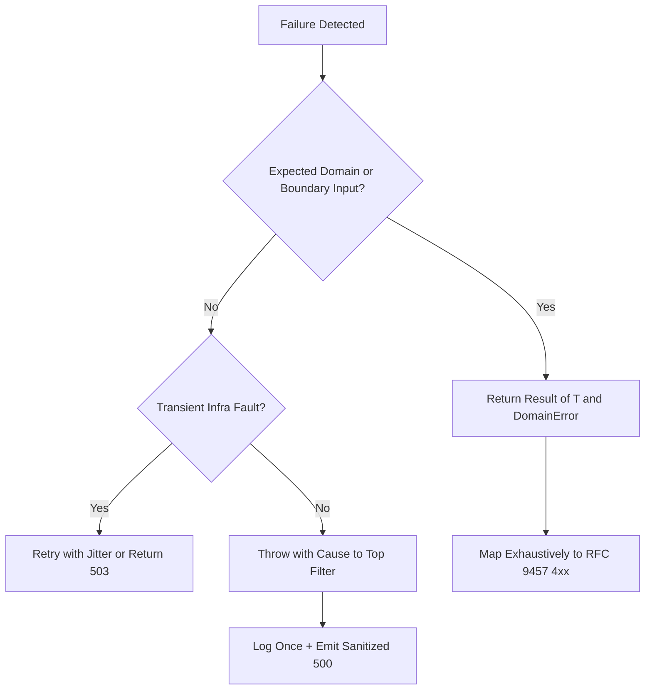

---
tags:
  - software-engineering
  - clean-code
  - error-handling
created: 2026-01-02
updated: 2026-11-13
status: 🟢
level: mid-to-senior
---
# Error Handling

> [!abstract] Vault Navigation
> Failure semantics, typed control flow, boundary validation, and observability within [[Programming/Software Engineering/Clean Code/Clean Code Complete Guide|Clean Code Complete Guide]]. Integrates directly with [[Programming/Software Engineering/Clean Code/Functions|Functions]], [[Programming/Software Engineering/Design Patterns/Structural/Adapter|Adapter]], [[Programming/Software Engineering/DevOps/Observability|Observability]], [[Programming/Software Engineering/DevOps/Logging|Logging]], [[Programming/Software Engineering/System Design/API Design|API Design]], [[Programming/Backend/NestJS Complete Guide|NestJS Complete Guide]], and [[Programming/Software Engineering/Testing/Unit Testing|Unit Testing]].

Production software fails continuously across network sockets, database constraints, third-party APIs, user payloads, and expired state invariants. Disciplined error handling enforces three structural boundaries: separating **expected domain and transient failures** from **unexpected programmer defects**, validating untrusted inputs once at process ingress, and preserving full causal chains (`cause`) across architectural layers without leaking internals to callers or polluting high-cardinality telemetry.

---

## 1. First-Principles Mechanics & Complete Failure Architecture

### 1.1 The Four-Tier Failure Taxonomy

Treating every failure uniformly through ad-hoc `try/catch` blocks turns expected user mistakes into false pager alerts while letting silent invariant corruption slip through unnoticed. Every runtime error falls into one of four mechanical categories based on **caller recoverability**, **ownership**, and **retryability**:

| Failure Class | Concrete Examples | Caller Recoverable? | Control-Flow Mechanism | HTTP Mapping | Alert / Log Level |
|---|---|---|---|---|---|
| **1. Boundary Input Error** | Malformed JSON, missing UUID, negative quantity, invalid JWT format | Yes (client fixes input) | Parse via schema (`zod` `safeParse`) into `Result` | `400` / `422` (`application/problem+json`) | `info` / `debug` (no pager) |
| **2. Domain / Business Rule Failure** | `INSUFFICIENT_FUNDS`, `COUPON_EXPIRED`, `ORDER_ALREADY_SHIPPED` | Yes (explicit branch in caller) | Discriminated `Result<T, DomainError>` union | `403` / `404` / `409` / `422` | `info` / `warn` (business metric) |
| **3. Infrastructure / Transient Fault** | `ECONNRESET`, PostgreSQL `40001` serialization conflict, upstream `429` / `503` | Partially (retry with jitter / circuit break) | Wrapped `InfrastructureError` (`retryable: true`) or `Result` | `502` / `503` / `504` | `warn` on retry; `error` if exhausted |
| **4. Programmer Defect / Fatal Config** | Null dereference, `assertNever` hit, missing `DATABASE_URL`, out-of-bounds invariant | **No** (bug or corrupted state) | Throw `Error` / panic; crash process or unwind to top boundary | `500` (sanitized RFC 9457 body) | `error` / `fatal` + immediate page |



### 1.2 Runtime Mechanics: Exceptions vs Algebraic `Result<T, E>`

In TypeScript, JavaScript, and Python, `throw` initiates **unchecked stack unwinding**:

1. **Invisible Function Contracts**: A signature `chargeCard(orderId: string): Promise<Receipt>` reveals zero information about failure modes. Callers cannot tell whether `chargeCard` can fail with `CardDeclined`, `GatewayTimeout`, or `DuplicateCharge` without reading transitive source code across five files.
2. **Non-Local Jump Semantics**: `throw` behaves like a dynamic `goto` across arbitrary stack frames. If an intermediate module holds an uncommitted database transaction, an unreleased mutex, or a dirty in-memory map, unwinding past it without explicit `finally` or resource-disposal hooks corrupts state.
3. **V8 Stack-Trace Allocation Cost**: Constructing `new Error(...)` invokes V8 `Error.captureStackTrace`, walking stack frames to collect call-site pointers (`CallSite` objects) and attaching `stack` getter metadata. On a hot parsing or ingestion loop processing 20,000 malformed records per second, throwing exceptions increases CPU time and garbage-collection pressure by an order of magnitude compared to allocating a plain object `{ ok: false, error }`.
4. **Lost Type Narrowing in `catch`**: Because JavaScript allows throwing any runtime value (`throw "timeout"`, `throw 404`, `throw new Error()`), TypeScript forces `catch (err: unknown)`. Exhaustiveness checking disappears across layers unless errors are re-parsed with fragile `instanceof` chains (which themselves fail across Node VM contexts or duplicated package versions).

Algebraic **`Result<T, E>` (or `Either<E, T>`)** solves these four failure modes by turning failure into an explicit return value inside a **discriminated union**:

| Dimension | Unchecked Exceptions (`throw` / `try-catch`) | Algebraic `Result<T, E>` |
|---|---|---|
| **Signature Visibility** | Hidden from compiler and IDE autocomplete | Explicit in return type (`Promise<Result<Receipt, BillingError>>`) |
| **Exhaustive Branching** | None; callers omit `catch` silently | Enforced at compile time via `switch` + `assertNever(error)` |
| **Hot-Path Allocation** | Captures stack frames per thrown instance | $O(1)$ plain `{ ok, value }` / `{ ok, error }` object |
| **Deep Propagation** | Implicitly bubbles across $N$ intermediate callers | Explicit early return (`if (!res.ok) return res`) or `.andThen()` |
| **Stack Trace Availability** | Built-in via `.stack` | Omit for expected 4xx domain paths; attach `cause` or `Error` only for unexpected faults |

> [!important] Hybrid Rule: Use Both Mechanisms Where Each Excels
> Do not turn every array index check or missing environment variable into a `Result`, and do not throw unchecked exceptions for ordinary business rejections like expired coupons. Use `Result<T, E>` for expected domain, validation, and upstream-status outcomes; use `throw` for violated internal invariants, unrecoverable startup faults, and unexpected infrastructure failures that must abort the current unit of work.

### 1.3 Eliminating `null`, `undefined`, and Shotgun Checks

Returning `null` or `undefined` to signal failure collapses **why** an operation failed (not found vs permission denied vs database timeout) and forces every downstream caller to write defensive checks. Apply three strict boundary rules:

1. **Collections Never Return `null`**: Queries returning multiple records (`findOrdersByUser`) must return `readonly Order[]` (`[]` when empty), never `Order[] | null`.
2. **Distinguish `find*` vs `get*` Lookups**:
   - `findById(id): Promise<Order | undefined>`: Missing record is normal; caller expects optionality.
   - `getById(id): Promise<Result<Order, NotFoundError>>` (or throws `NotFoundError` in exception-first frameworks): Missing record violates workflow preconditions.
3. **Special Case / Null Object Pattern**: When absence has uniform non-branching behavior—such as disabled telemetry (`NoopMetricsRecorder`), an unauthenticated visitor (`AnonymousPricingPolicy` granting zero discount), or empty stream sinks—return a conforming implementation object instead of forcing `if (metrics !== null)` at 40 call sites.

### 1.4 Fail-Fast Boundary Parsing ("Parse, Don't Validate")

Boolean validation functions (`validateEmail(str): boolean`) verify a constraint and immediately throw away the proof, leaving downstream functions accepting raw `string` and repeating checks ("shotgun validation"). **Parsing** transforms untrusted `unknown` data at the ingress boundary into **opaque or branded domain types** whose existence proves validity inward:

```typescript
import { z } from 'zod';

declare const BrandSymbol: unique symbol;
type Brand<T, B extends string> = T & { readonly [BrandSymbol]: B };

export type CustomerId = Brand<string, 'CustomerId'>;
export type PositiveCents = Brand<number, 'PositiveCents'>;

const CreateChargeSchema = z.object({
  customerId: z.string().uuid(),
  amountCents: z.number().int().positive().max(10_000_000),
  currency: z.enum(['USD', 'EUR', 'GBP']),
  idempotencyKey: z.string().min(8).max(128),
});

export interface CreateChargeCommand {
  readonly customerId: CustomerId;
  readonly amountCents: PositiveCents;
  readonly currency: 'USD' | 'EUR' | 'GBP';
  readonly idempotencyKey: string;
}

export type ValidationIssue = { readonly path: string; readonly message: string };

export function parseCreateCharge(
  rawBody: unknown
): { readonly ok: true; readonly value: CreateChargeCommand } | { readonly ok: false; readonly error: ValidationIssue[] } {
  const parsed = CreateChargeSchema.safeParse(rawBody);
  if (!parsed.success) {
    return {
      ok: false,
      error: parsed.error.issues.map((issue) => ({
        path: issue.path.join('.') || '$root',
        message: issue.message,
      })),
    };
  }
  return {
    ok: true,
    value: {
      customerId: parsed.data.customerId as CustomerId,
      amountCents: parsed.data.amountCents as PositiveCents,
      currency: parsed.data.currency,
      idempotencyKey: parsed.data.idempotencyKey,
    },
  };
}
```

### 1.5 Error Wrapping & Causal Chains (`cause`)

When an infrastructure adapter catches a low-level error (a PostgreSQL `DatabaseError`, a `SocketTimeout`, or a `StripeCardError`), re-throwing `new Error(err.message)` destroys the original stack trace, vendor error code (`err.code`), constraint name (`err.constraint`), and driver metadata. Formatting only strings prevents structured postmortem filtering.

Always preserve the underlying failure object across layers:

- **JavaScript / TypeScript (ES2022+ / Node 16.9+)**: Pass `{ cause }` in `new Error(message, { cause })`.
- **Go**: Wrap with `%w` (`fmt.Errorf("persist ledger entry %s: %w", entryId, err)`), inspectable via `errors.Is` and `errors.As`.
- **Python**: Re-raise with explicit chaining (`raise PersistenceError(msg) from err`), setting `__cause__`.

When multiple parallel tasks fail (for example `Promise.any` or batch teardown), JavaScript emits `AggregateError`, exposing `.errors: unknown[]`. Observability serializers must walk both `err.cause` (with cycle detection via a `WeakSet` and a max-depth cap) and `AggregateError.errors` so root causes never disappear in production logs.

---

## 2. Real-World Use Cases & Decision Matrix

Choosing an error propagation strategy depends on **call frequency**, **boundary type**, **recovery semantics**, and **framework integration**.

| Engineering Scenario | Recommended Strategy | Why Alternatives Fail |
|---|---|---|
| **1. Payment / Order State Transitions** | `Result<T, DomainError>` union + `assertNever` | Unchecked `throw` hides decline/insufficient-balance paths; callers forget `402`/`409`/`422` mapping and fire 500 alerts |
| **2. Server Startup Env & Secret Validation** | Fail-fast `zod.parse(process.env)` $\rightarrow$ `throw` + `process.exit(1)` | Returning `Result` or falling back to defaults lets broken pods bind TCP ports and corrupt production data or fail Kubernetes readiness quietly |
| **3. Bulk CSV / Telemetry Ingestion (50k rows/file)** | `Result<Row, RowParseError>` per row | Throwing exceptions per malformed row captures 50,000 V8 stack traces, stalling the event loop with GC pauses |
| **4. Third-Party Gateway / SQL Repository Adapters** | Catch vendor exceptions at adapter edge; translate expected states to `Result` or wrap unexpected faults with `{ cause }` | Letting `PrismaClientKnownRequestError` or `AxiosError` leak into domain services couples business logic to vendor SDK versions |
| **5. Internal Mathematical / Algorithm Assertions** | `throw new Error(...)` / `assertNever` | Wrapping internal invariant bugs in `Result` pollutes pure call signatures and hides programmer defects behind recovery code |

### Comparing Error Libraries and Native Unions in TypeScript

| Approach | Zero Runtime Deps | Async Ergonomics | Stack / Cause Interop | Best Ecosystem Fit |
|---|---|---|---|---|
| **Hand-Rolled `Result<T, E>` (~60 lines)** | Yes | Clean `async/await` with early returns (`if (!r.ok) return r`) | Full control; trivial JSON serialization | Teams preferring explicit `async/await` debugging and zero dependency lock-in |
| **`neverthrow` (`Result` / `ResultAsync`)** | Small external lib | Fluent `.andThen()` / `.mapErr()` railway chaining across async boundaries | `ResultAsync.fromPromise(p, mapErr)` eliminates repetitive `try/catch` | Codebases heavily committed to functional composition pipelines |
| **NestJS / Express Custom `Error` Subclasses + Global Filter** | Built-in | Native `throw` bubbles across Nest guards, pipes, and services automatically | Native `.stack` and `{ cause }` | Standard CRUD NestJS/Express apps where domain errors map cleanly via `AppException` base classes |

---

## 3. Step-by-Step Practical Application (Production TypeScript Suite)

Below is a complete, runnable production reference architecture combining a **typed `Result` core**, **fail-fast `zod` environment validation**, **domain error unions + PostgreSQL SQLSTATE error mapping**, **retryability with exponential backoff + full jitter**, **RFC 9457 (`application/problem+json`) HTTP mapping for Express, Fastify, and NestJS**, and **Vitest unit tests**.

### Production Project Layout

```text
billing-service/
├── package.json
├── src/
│   ├── config/
│   │   └── env.ts
│   ├── shared/
│   │   ├── result.ts
│   │   └── retry.ts
│   ├── domain/
│   │   ├── errors.ts
│   │   └── transfer.service.ts
│   ├── infra/
│   │   └── pg-error-mapper.ts
│   └── http/
│       ├── problem-details.ts
│       ├── express-error-middleware.ts
│       └── nestjs-problem.filter.ts
└── tests/
    └── transfer.spec.ts
```

### 3.1 Core `Result<T, E>` & Exhaustiveness Module (`src/shared/result.ts`)

```typescript
// src/shared/result.ts
export type Ok<T> = { readonly ok: true; readonly value: T };
export type Err<E> = { readonly ok: false; readonly error: E };
export type Result<T, E> = Ok<T> | Err<E>;

export const ok = <T>(value: T): Ok<T> => ({ ok: true, value });
export const err = <E>(error: E): Err<E> => ({ ok: false, error });

export function isOk<T, E>(res: Result<T, E>): res is Ok<T> {
  return res.ok;
}

export function map<T, U, E>(res: Result<T, E>, fn: (value: T) => U): Result<U, E> {
  return res.ok ? ok(fn(res.value)) : res;
}

export function mapErr<T, E, F>(res: Result<T, E>, fn: (error: E) => F): Result<T, F> {
  return res.ok ? res : err(fn(res.error));
}

export function andThen<T, U, E1, E2>(
  res: Result<T, E1>,
  fn: (value: T) => Result<U, E2>
): Result<U, E1 | E2> {
  return res.ok ? fn(res.value) : res;
}

export async function andThenAsync<T, U, E1, E2>(
  res: Result<T, E1>,
  fn: (value: T) => Promise<Result<U, E2>>
): Promise<Result<U, E1 | E2>> {
  return res.ok ? fn(res.value) : res;
}

export function match<T, E, R>(
  res: Result<T, E>,
  handlers: { readonly ok: (value: T) => R; readonly err: (error: E) => R }
): R {
  return res.ok ? handlers.ok(res.value) : handlers.err(res.error);
}

export function unwrapOr<T, E>(res: Result<T, E>, fallback: T): T {
  return res.ok ? res.value : fallback;
}

export async function fromPromise<T, E>(
  promise: Promise<T>,
  mapThrown: (cause: unknown) => E
): Promise<Result<T, E>> {
  try {
    return ok(await promise);
  } catch (cause) {
    return err(mapThrown(cause));
  }
}

export function assertNever(value: never, context = 'discriminated union'): never {
  throw new Error(`Unhandled ${context} variant: ${JSON.stringify(value)}`);
}
```

When teams adopt `neverthrow`, the identical boundary translation uses `ResultAsync.fromPromise` and `.andThen()`, avoiding repetitive `try/catch` blocks while preserving the same discriminated `TransferError` union:

```typescript
import { ResultAsync, errAsync } from 'neverthrow';
import { TransferError } from '../domain/errors.js';

export function chargeWithNeverthrow(
  fetchBalance: () => Promise<number>,
  debitAccount: (amountCents: number) => Promise<string>,
  amountCents: number
): ResultAsync<string, TransferError> {
  return ResultAsync.fromPromise(fetchBalance(), () => ({
    kind: 'ACCOUNT_NOT_FOUND' as const,
    code: 'ACCOUNT_NOT_FOUND' as const,
    accountId: 'unknown',
  })).andThen((balance) =>
    balance < amountCents
      ? errAsync({
          kind: 'INSUFFICIENT_FUNDS' as const,
          code: 'INSUFFICIENT_FUNDS' as const,
          accountId: 'acc-1',
          requiredCents: amountCents,
          availableCents: balance,
        })
      : ResultAsync.fromPromise(debitAccount(amountCents), () => ({
          kind: 'RATE_LIMITED' as const,
          code: 'RATE_LIMITED' as const,
          retryAfterSec: 5,
        }))
  );
}
```

### 3.2 Fail-Fast Startup Environment Validation (`src/config/env.ts`)

```typescript
// src/config/env.ts
import { z } from 'zod';

const EnvSchema = z.object({
  NODE_ENV: z.enum(['development', 'test', 'production']).default('development'),
  PORT: z.coerce.number().int().min(1).max(65_535).default(3000),
  DATABASE_URL: z.string().url().startsWith('postgres'),
  STRIPE_WEBHOOK_SECRET: z.string().min(20),
  HTTP_TIMEOUT_MS: z.coerce.number().int().min(100).max(60_000).default(3000),
});

export type AppEnv = Readonly<z.infer<typeof EnvSchema>>;

export function loadEnvOrFail(source: Record<string, string | undefined> = process.env): AppEnv {
  const parsed = EnvSchema.safeParse(source);
  if (!parsed.success) {
    const details = parsed.error.issues
      .map((issue) => `${issue.path.join('.')}: ${issue.message}`)
      .join('; ');
    throw new Error(`Invalid startup environment configuration: ${details}`);
  }
  return Object.freeze(parsed.data);
}
```

### 3.3 Domain Error Union & Infrastructure Wrapper Hierarchy (`src/domain/errors.ts`)

```typescript
// src/domain/errors.ts
export type DomainErrorCode =
  | 'VALIDATION_FAILED'
  | 'ACCOUNT_NOT_FOUND'
  | 'ACCOUNT_FROZEN'
  | 'INSUFFICIENT_FUNDS'
  | 'DUPLICATE_IDEMPOTENCY_KEY'
  | 'RATE_LIMITED';

export type TransferError =
  | {
      readonly kind: 'ACCOUNT_NOT_FOUND';
      readonly code: 'ACCOUNT_NOT_FOUND';
      readonly accountId: string;
    }
  | {
      readonly kind: 'ACCOUNT_FROZEN';
      readonly code: 'ACCOUNT_FROZEN';
      readonly accountId: string;
      readonly reason: string;
    }
  | {
      readonly kind: 'INSUFFICIENT_FUNDS';
      readonly code: 'INSUFFICIENT_FUNDS';
      readonly accountId: string;
      readonly requiredCents: number;
      readonly availableCents: number;
    }
  | {
      readonly kind: 'DUPLICATE_IDEMPOTENCY_KEY';
      readonly code: 'DUPLICATE_IDEMPOTENCY_KEY';
      readonly idempotencyKey: string;
    }
  | {
      readonly kind: 'RATE_LIMITED';
      readonly code: 'RATE_LIMITED';
      readonly retryAfterSec: number;
    };

export type InfraErrorCode =
  | 'DB_SERIALIZATION_CONFLICT'
  | 'DB_UNAVAILABLE'
  | 'UPSTREAM_TIMEOUT'
  | 'UPSTREAM_BAD_GATEWAY';

export class InfrastructureError extends Error {
  constructor(
    message: string,
    public readonly code: InfraErrorCode,
    public readonly retryable: boolean,
    public readonly dependency: string,
    options?: ErrorOptions
  ) {
    super(message, options);
    this.name = 'InfrastructureError';
  }
}
```

### 3.4 PostgreSQL Error Mapper & Transfer Service (`src/infra/pg-error-mapper.ts`, `src/domain/transfer.service.ts`)

```typescript
// src/infra/pg-error-mapper.ts
import { InfrastructureError } from '../domain/errors.js';

interface PgDriverError {
  readonly code?: string;
  readonly constraint?: string;
  readonly detail?: string;
}

const TRANSIENT_PG_CODES = new Set(['40001', '40P01', '53300', '57P01', '08006']);

export type MappedPersistenceError =
  | { readonly kind: 'UNIQUE_VIOLATION'; readonly constraint: string; readonly cause: unknown }
  | { readonly kind: 'FOREIGN_KEY_VIOLATION'; readonly constraint: string; readonly cause: unknown };

export function classifyPgError(rawError: unknown): MappedPersistenceError | InfrastructureError {
  const pg = rawError as PgDriverError | null;
  const code = pg?.code;

  if (code === '23505') {
    return {
      kind: 'UNIQUE_VIOLATION',
      constraint: pg?.constraint ?? 'unknown_unique_constraint',
      cause: rawError,
    };
  }

  if (code === '23503') {
    return {
      kind: 'FOREIGN_KEY_VIOLATION',
      constraint: pg?.constraint ?? 'unknown_fk_constraint',
      cause: rawError,
    };
  }

  if (code && TRANSIENT_PG_CODES.has(code)) {
    return new InfrastructureError(
      `Transient PostgreSQL failure (${code})`,
      code === '40001' || code === '40P01' ? 'DB_SERIALIZATION_CONFLICT' : 'DB_UNAVAILABLE',
      true,
      'postgresql',
      { cause: rawError }
    );
  }

  return new InfrastructureError(
    `Non-retryable PostgreSQL persistence error (${code ?? 'UNKNOWN'})`,
    'DB_UNAVAILABLE',
    false,
    'postgresql',
    { cause: rawError }
  );
}
```

```typescript
// src/domain/transfer.service.ts
import { Result, err, ok } from '../shared/result.js';
import { TransferError } from './errors.js';
import { classifyPgError } from '../infra/pg-error-mapper.js';

export interface AccountSnapshot {
  readonly id: string;
  readonly balanceCents: number;
  readonly frozenReason: string | null;
}

export interface TransferReceipt {
  readonly transferId: string;
  readonly debitedAccountId: string;
  readonly creditedAccountId: string;
  readonly amountCents: number;
}

export interface TransferRepository {
  findAccount(accountId: string): Promise<AccountSnapshot | undefined>;
  insertAtomicTransfer(input: {
    fromAccountId: string;
    toAccountId: string;
    amountCents: number;
    idempotencyKey: string;
  }): Promise<TransferReceipt>;
}

export class TransferService {
  constructor(private readonly repo: TransferRepository) {}

  async execute(input: {
    fromAccountId: string;
    toAccountId: string;
    amountCents: number;
    idempotencyKey: string;
  }): Promise<Result<TransferReceipt, TransferError>> {
    const source = await this.repo.findAccount(input.fromAccountId);
    if (!source) {
      return err({ kind: 'ACCOUNT_NOT_FOUND', code: 'ACCOUNT_NOT_FOUND', accountId: input.fromAccountId });
    }
    if (source.frozenReason !== null) {
      return err({
        kind: 'ACCOUNT_FROZEN',
        code: 'ACCOUNT_FROZEN',
        accountId: source.id,
        reason: source.frozenReason,
      });
    }
    if (source.balanceCents < input.amountCents) {
      return err({
        kind: 'INSUFFICIENT_FUNDS',
        code: 'INSUFFICIENT_FUNDS',
        accountId: source.id,
        requiredCents: input.amountCents,
        availableCents: source.balanceCents,
      });
    }

    try {
      const receipt = await this.repo.insertAtomicTransfer(input);
      return ok(receipt);
    } catch (rawError) {
      const mapped = classifyPgError(rawError);
      if ('kind' in mapped && mapped.kind === 'UNIQUE_VIOLATION' && mapped.constraint === 'transfers_idempotency_key_uidx') {
        return err({
          kind: 'DUPLICATE_IDEMPOTENCY_KEY',
          code: 'DUPLICATE_IDEMPOTENCY_KEY',
          idempotencyKey: input.idempotencyKey,
        });
      }
      if ('kind' in mapped && mapped.kind === 'FOREIGN_KEY_VIOLATION') {
        return err({ kind: 'ACCOUNT_NOT_FOUND', code: 'ACCOUNT_NOT_FOUND', accountId: input.toAccountId });
      }
      throw mapped; // InfrastructureError preserves original cause for retry or 5xx boundary
    }
  }
}
```

### 3.5 Retryability Classifier with Exponential Backoff, Full Jitter & `AbortSignal` (`src/shared/retry.ts`)

Retrying non-idempotent writes or terminal client errors (`400`, `401`, `404`, `422`) wastes capacity and corrupts state; retrying transient faults without jitter synchronizes retries across pods into thundering herds.

```typescript
// src/shared/retry.ts
import { InfrastructureError } from '../domain/errors.js';

export interface RetryPolicyOptions {
  readonly maxAttempts: number;
  readonly baseDelayMs: number;
  readonly maxDelayMs: number;
  readonly signal?: AbortSignal;
  readonly randomFn?: () => number;
}

export function isRetryableFailure(error: unknown): boolean {
  if (error instanceof InfrastructureError) {
    return error.retryable;
  }
  if (error instanceof DOMException && error.name === 'AbortError') {
    return false;
  }
  if (typeof error === 'object' && error !== null && 'status' in error) {
    const status = (error as { status: unknown }).status;
    return status === 429 || status === 502 || status === 503 || status === 504;
  }
  return false;
}

export function computeFullJitterDelayMs(
  attemptIndex: number,
  baseDelayMs: number,
  maxDelayMs: number,
  randomFn: () => number = Math.random
): number {
  const exponentialCeiling = Math.min(maxDelayMs, baseDelayMs * 2 ** attemptIndex);
  return Math.floor(randomFn() * exponentialCeiling);
}

export function sleepWithAbort(delayMs: number, signal?: AbortSignal): Promise<void> {
  if (signal?.aborted) {
    return Promise.reject(new DOMException('Retry aborted before sleep', 'AbortError'));
  }
  return new Promise((resolve, reject) => {
    const timer = setTimeout(() => {
      signal?.removeEventListener('abort', onAbort);
      resolve();
    }, delayMs);

    const onAbort = () => {
      clearTimeout(timer);
      reject(new DOMException('Retry aborted during backoff', 'AbortError'));
    };

    signal?.addEventListener('abort', onAbort, { once: true });
  });
}

export async function withRetry<T>(
  operation: (attempt: number) => Promise<T>,
  options: RetryPolicyOptions
): Promise<T> {
  let lastError: unknown;
  for (let attempt = 0; attempt < options.maxAttempts; attempt++) {
    options.signal?.throwIfAborted();
    try {
      return await operation(attempt);
    } catch (error) {
      lastError = error;
      const isLastAttempt = attempt === options.maxAttempts - 1;
      if (isLastAttempt || !isRetryableFailure(error)) {
        throw error;
      }
      const delayMs = computeFullJitterDelayMs(
        attempt,
        options.baseDelayMs,
        options.maxDelayMs,
        options.randomFn
      );
      await sleepWithAbort(delayMs, options.signal);
    }
  }
  throw lastError;
}
```

### 3.6 RFC 9457 Problem Details Mapper & Boundary Filters (`src/http/problem-details.ts`, Express, NestJS)

RFC 9457 (replacing RFC 7807) defines the standard HTTP error envelope (`Content-Type: application/problem+json`) with stable machine-readable `type` URIs, human-readable `title` and `detail`, `status`, request-specific `instance`, and extension members (`errorCode`, `traceId`, `errors`). **Critical security rule**: never expose `.stack`, SQL fragments, internal IP addresses, or `err.cause` messages in `5xx` responses to external clients.

```typescript
// src/http/problem-details.ts
import { InfrastructureError, TransferError } from '../domain/errors.js';
import { assertNever } from '../shared/result.js';

export interface ValidationIssue {
  readonly path: string;
  readonly message: string;
}

export interface ProblemDetails {
  readonly type: string;
  readonly title: string;
  readonly status: number;
  readonly detail: string;
  readonly instance: string;
  readonly errorCode: string;
  readonly traceId: string;
  readonly errors?: ReadonlyArray<ValidationIssue>;
}

const PROBLEM_BASE_URI = 'https://api.example.com/problems';

export function mapValidationToProblem(
  issues: ReadonlyArray<ValidationIssue>,
  instance: string,
  traceId: string
): ProblemDetails {
  return {
    type: `${PROBLEM_BASE_URI}/validation-failed`,
    title: 'Request Validation Failed',
    status: 400,
    detail: 'One or more request fields failed schema validation.',
    instance,
    errorCode: 'VALIDATION_FAILED',
    traceId,
    errors: issues,
  };
}

export function mapTransferErrorToProblem(
  error: TransferError,
  instance: string,
  traceId: string
): ProblemDetails {
  switch (error.kind) {
    case 'ACCOUNT_NOT_FOUND':
      return {
        type: `${PROBLEM_BASE_URI}/account-not-found`,
        title: 'Account Not Found',
        status: 404,
        detail: `Target account ${error.accountId} does not exist.`,
        instance,
        errorCode: error.code,
        traceId,
      };
    case 'ACCOUNT_FROZEN':
      return {
        type: `${PROBLEM_BASE_URI}/account-frozen`,
        title: 'Account Frozen',
        status: 403,
        detail: `Account ${error.accountId} cannot execute transfers (${error.reason}).`,
        instance,
        errorCode: error.code,
        traceId,
      };
    case 'INSUFFICIENT_FUNDS':
      return {
        type: `${PROBLEM_BASE_URI}/insufficient-funds`,
        title: 'Insufficient Funds',
        status: 422,
        detail: `Account requires ${error.requiredCents} cents; ${error.availableCents} available.`,
        instance,
        errorCode: error.code,
        traceId,
      };
    case 'DUPLICATE_IDEMPOTENCY_KEY':
      return {
        type: `${PROBLEM_BASE_URI}/duplicate-idempotency-key`,
        title: 'Duplicate Transfer Request',
        status: 409,
        detail: `Transfer for idempotency key ${error.idempotencyKey} already exists.`,
        instance,
        errorCode: error.code,
        traceId,
      };
    case 'RATE_LIMITED':
      return {
        type: `${PROBLEM_BASE_URI}/rate-limited`,
        title: 'Too Many Requests',
        status: 429,
        detail: `Rate limit exceeded; retry after ${error.retryAfterSec} seconds.`,
        instance,
        errorCode: error.code,
        traceId,
      };
    default:
      return assertNever(error, 'TransferError');
  }
}

export function mapUnexpectedToProblem(
  error: unknown,
  instance: string,
  traceId: string
): { readonly problem: ProblemDetails; readonly status: number } {
  if (error instanceof InfrastructureError && error.retryable) {
    return {
      status: 503,
      problem: {
        type: `${PROBLEM_BASE_URI}/service-unavailable`,
        title: 'Service Temporarily Unavailable',
        status: 503,
        detail: 'A temporary downstream dependency failure occurred. Please retry.',
        instance,
        errorCode: error.code,
        traceId,
      },
    };
  }

  // Strictly redact raw error messages, stack traces, and cause metadata on 500
  return {
    status: 500,
    problem: {
      type: `${PROBLEM_BASE_URI}/internal-error`,
      title: 'Internal Server Error',
      status: 500,
      detail: 'An unexpected internal error occurred. Quote traceId to support.',
      instance,
      errorCode: 'INTERNAL_SERVER_ERROR',
      traceId,
    },
  };
}
```

#### Express Global Error Middleware & NestJS Exception Filter

```typescript
// src/http/express-error-middleware.ts
import type { Request, Response, NextFunction } from 'express';
import { mapUnexpectedToProblem } from './problem-details.js';

export interface StructuredLogger {
  error(msg: string, meta: Record<string, unknown>): void;
}

export function serializeCauseChain(err: unknown, maxDepth = 5): unknown[] {
  const chain: unknown[] = [];
  const seen = new WeakSet<object>();
  let current: unknown = err;

  for (let depth = 0; depth < maxDepth && current !== undefined; depth++) {
    if (typeof current === 'object' && current !== null) {
      if (seen.has(current)) {
        chain.push({ note: 'circular_cause_detected' });
        break;
      }
      seen.add(current);
    }
    if (current instanceof Error) {
      chain.push({
        name: current.name,
        message: current.message,
        stack: current.stack,
        code: (current as { code?: unknown }).code,
      });
      current = current.cause;
    } else {
      chain.push({ nonErrorValue: String(current) });
      break;
    }
  }
  return chain;
}

export function createExpressErrorMiddleware(logger: StructuredLogger) {
  return (err: unknown, req: Request, res: Response, next: NextFunction): void => {
    if (res.headersSent) {
      next(err);
      return;
    }
    const traceId = req.header('x-trace-id') ?? 'untraced';
    const { status, problem } = mapUnexpectedToProblem(err, req.originalUrl, traceId);

    logger.error('Unhandled request exception', {
      traceId,
      method: req.method,
      path: req.originalUrl,
      status,
      errorCode: problem.errorCode,
      causeChain: serializeCauseChain(err),
    });

    res.status(status).setHeader('Content-Type', 'application/problem+json').json(problem);
  };
}
```

```typescript
// src/http/nestjs-problem.filter.ts
import { ArgumentsHost, Catch, ExceptionFilter, HttpException, Logger } from '@nestjs/common';
import type { Request, Response } from 'express';
import { mapUnexpectedToProblem } from './problem-details.js';
import { serializeCauseChain } from './express-error-middleware.js';

@Catch()
export class Rfc9457ExceptionFilter implements ExceptionFilter {
  private readonly logger = new Logger(Rfc9457ExceptionFilter.name);

  catch(exception: unknown, host: ArgumentsHost): void {
    const ctx = host.switchToHttp();
    const req = ctx.getRequest<Request>();
    const res = ctx.getResponse<Response>();
    const traceId = req.header('x-trace-id') ?? 'untraced';

    if (exception instanceof HttpException) {
      const status = exception.getStatus();
      const raw = exception.getResponse();
      const detail = typeof raw === 'string' ? raw : (raw as { message?: string }).message ?? exception.message;
      res.status(status).setHeader('Content-Type', 'application/problem+json').json({
        type: `https://api.example.com/problems/http-${status}`,
        title: exception.name,
        status,
        detail: Array.isArray(detail) ? detail.join('; ') : String(detail),
        instance: req.originalUrl,
        errorCode: `HTTP_${status}`,
        traceId,
      });
      return;
    }

    const { status, problem } = mapUnexpectedToProblem(exception, req.originalUrl, traceId);
    this.logger.error({
      msg: 'Unhandled NestJS exception',
      traceId,
      errorCode: problem.errorCode,
      causeChain: serializeCauseChain(exception),
    });

    res.status(status).setHeader('Content-Type', 'application/problem+json').json(problem);
  }
}
```

#### Fastify RFC 9457 `setErrorHandler`

```typescript
// src/http/fastify-error-handler.ts
import type { FastifyInstance } from 'fastify';
import { mapUnexpectedToProblem } from './problem-details.js';
import { serializeCauseChain, StructuredLogger } from './express-error-middleware.js';

export function registerFastifyProblemHandler(app: FastifyInstance, logger: StructuredLogger): void {
  app.setErrorHandler((err, request, reply) => {
    const traceId = String(request.headers['x-trace-id'] ?? request.id);
    if (typeof err === 'object' && err !== null && 'validation' in err) {
      const validation = (err as { validation: Array<{ instancePath?: string; message?: string }> }).validation;
      void reply.status(400).header('content-type', 'application/problem+json').send({
        type: 'https://api.example.com/problems/validation-failed',
        title: 'Request Validation Failed',
        status: 400,
        detail: 'One or more request fields failed schema validation.',
        instance: request.url,
        errorCode: 'VALIDATION_FAILED',
        traceId,
        errors: validation.map((v) => ({
          path: v.instancePath || '$root',
          message: v.message ?? 'Invalid value',
        })),
      });
      return;
    }

    const { status, problem } = mapUnexpectedToProblem(err, request.url, traceId);
    logger.error('Unhandled Fastify exception', {
      traceId,
      method: request.method,
      url: request.url,
      status,
      errorCode: problem.errorCode,
      causeChain: serializeCauseChain(err),
    });
    void reply.status(status).header('content-type', 'application/problem+json').send(problem);
  });
}
```

### 3.7 Complete Vitest Verification Suite (`tests/transfer.spec.ts`)

```typescript
// tests/transfer.spec.ts
import { describe, it, expect, vi } from 'vitest';
import { TransferService, TransferRepository } from '../src/domain/transfer.service.js';
import { InfrastructureError } from '../src/domain/errors.js';
import { mapTransferErrorToProblem, mapUnexpectedToProblem } from '../src/http/problem-details.js';
import { serializeCauseChain } from '../src/http/express-error-middleware.js';
import { withRetry } from '../src/shared/retry.js';

describe('TransferService & RFC 9457 Error Contracts', () => {
  it('returns typed INSUFFICIENT_FUNDS Result without touching DB insert', async () => {
    const repo: TransferRepository = {
      findAccount: vi.fn().mockResolvedValue({ id: 'acc-1', balanceCents: 200, frozenReason: null }),
      insertAtomicTransfer: vi.fn(),
    };
    const svc = new TransferService(repo);
    const res = await svc.execute({
      fromAccountId: 'acc-1',
      toAccountId: 'acc-2',
      amountCents: 500,
      idempotencyKey: 'idem-12345678',
    });

    expect(res.ok).toBe(false);
    if (!res.ok) {
      expect(res.error.kind).toBe('INSUFFICIENT_FUNDS');
      const problem = mapTransferErrorToProblem(res.error, '/transfers', 'trace-99');
      expect(problem.status).toBe(422);
      expect(problem.errorCode).toBe('INSUFFICIENT_FUNDS');
    }
    expect(repo.insertAtomicTransfer).not.toHaveBeenCalled();
  });

  it('maps PostgreSQL 23505 on transfers_idempotency_key_uidx to DUPLICATE_IDEMPOTENCY_KEY', async () => {
    const pgErr = Object.assign(new Error('duplicate key value'), {
      code: '23505',
      constraint: 'transfers_idempotency_key_uidx',
    });
    const repo: TransferRepository = {
      findAccount: vi.fn().mockResolvedValue({ id: 'acc-1', balanceCents: 1000, frozenReason: null }),
      insertAtomicTransfer: vi.fn().mockRejectedValue(pgErr),
    };
    const svc = new TransferService(repo);
    const res = await svc.execute({
      fromAccountId: 'acc-1',
      toAccountId: 'acc-2',
      amountCents: 500,
      idempotencyKey: 'idem-dup-001',
    });

    expect(res).toEqual({
      ok: false,
      error: {
        kind: 'DUPLICATE_IDEMPOTENCY_KEY',
        code: 'DUPLICATE_IDEMPOTENCY_KEY',
        idempotencyKey: 'idem-dup-001',
      },
    });
  });

  it('preserves full cause chain in InfrastructureError while redacting 500 HTTP body', async () => {
    const rootCause = Object.assign(new Error('SSL handshake failed against 10.2.4.18:5432'), { code: '08006' });
    const repo: TransferRepository = {
      findAccount: vi.fn().mockResolvedValue({ id: 'acc-1', balanceCents: 1000, frozenReason: null }),
      insertAtomicTransfer: vi.fn().mockRejectedValue(rootCause),
    };
    const svc = new TransferService(repo);

    await expect(
      svc.execute({
        fromAccountId: 'acc-1',
        toAccountId: 'acc-2',
        amountCents: 500,
        idempotencyKey: 'idem-001',
      })
    ).rejects.toMatchObject({
      name: 'InfrastructureError',
      retryable: true,
      cause: rootCause,
    });

    const unexpected = new Error('SELECT secret_token FROM internal_keys failed', { cause: rootCause });
    const { status, problem } = mapUnexpectedToProblem(unexpected, '/transfers', 'trace-500');
    expect(status).toBe(500);
    expect(problem.detail).not.toContain('secret_token');
    expect(problem.detail).not.toContain('10.2.4.18');
    expect(serializeCauseChain(unexpected)).toHaveLength(2);
  });

  it('retries transient InfrastructureError up to maxAttempts and stops immediately on AbortSignal', async () => {
    const op = vi
      .fn<() => Promise<string>>()
      .mockRejectedValueOnce(new InfrastructureError('conflict', 'DB_SERIALIZATION_CONFLICT', true, 'postgresql'))
      .mockResolvedValueOnce('OK');

    const result = await withRetry(op, {
      maxAttempts: 3,
      baseDelayMs: 1,
      maxDelayMs: 5,
      randomFn: () => 0.1,
    });
    expect(result).toBe('OK');
    expect(op).toHaveBeenCalledTimes(2);
  });
});
```

---

## 4. Resource Cleanup, Observability & Edge-Case Reference

### 4.1 `try/finally` Traps vs Node `using` Explicit Resource Management

Every acquired database connection, file handle, mutex lease, or open HTTP stream must release deterministically across both happy paths and exceptions. Naive `try/finally` implementations introduce two subtle bugs:

1. **Exception Masking in `finally`**: If `try` throws `DatabaseTimeoutError` and `finally` calls `client.release()` which itself throws `PoolClosedError`, JavaScript discards `DatabaseTimeoutError` completely and propagates only `PoolClosedError`.
2. **Pre-Acquisition Leaks**: Placing `await pool.connect()` *inside* `try` without checking initialization state risks calling `release()` on `undefined` or skipping cleanup if acquisition throws halfway through setting up two resources.

TypeScript 5.2+ and Node.js 20+/22+ support ECMAScript **Explicit Resource Management (`using` / `await using`)** using `Symbol.dispose` and `Symbol.asyncDispose`. When execution exits the lexical block—either normally or via `throw`—the runtime invokes `[Symbol.asyncDispose]()` in reverse declaration order (LIFO). Crucially, if both the block body and the disposer throw, the runtime preserves **both** exceptions inside a standard **`SuppressedError`** (`err.error` = cleanup failure, `err.suppressed` = original body error)!

```typescript
// Resource-safe transactional lease using Explicit Resource Management (TS 5.2+ / Node 22+)
export interface DbClient {
  query(sql: string, params?: unknown[]): Promise<unknown>;
  release(destroy?: boolean): void;
}

export async function acquireTransactionScope(pool: { connect(): Promise<DbClient> }) {
  const client = await pool.connect();
  await client.query('BEGIN');
  let committed = false;
  let hasError = false;

  return {
    client,
    markError(): void {
      hasError = true;
    },
    async commit(): Promise<void> {
      await client.query('COMMIT');
      committed = true;
    },
    async [Symbol.asyncDispose](): Promise<void> {
      try {
        if (!committed) {
          await client.query('ROLLBACK');
        }
      } finally {
        client.release(hasError);
      }
    },
  };
}

// Usage guarantees ROLLBACK + pool release even on early return or throw:
async function transferWithLease(pool: { connect(): Promise<DbClient> }): Promise<void> {
  await using tx = await acquireTransactionScope(pool);
  try {
    await tx.client.query('UPDATE accounts SET balance = balance - 100 WHERE id = $1', ['a1']);
    await tx.commit();
  } catch (error) {
    tx.markError();
    throw error;
  }
}
```

### 4.2 Single-Point Structured Telemetry & Metric Cardinality Safety

Never log-and-rethrow inside inner layers: logging the same failed query inside Repository, Service, Use Case, and HTTP Controller emits four duplicate stack traces per incident, inflating log ingestion spend and burying root events. Apply the **Log Once at the Boundary** invariant:

- Inner layers enrich errors with `{ cause }` and domain identifiers (`orderId`, `constraint`) and propagate upward.
- Only the top-level boundary (HTTP filter, queue worker loop, cron runner) logs the structured JSON record once, attaching OpenTelemetry `traceId`/`spanId` from `AsyncLocalStorage`.
- **Redact sensitive fields** (`authorization`, `cookie`, `password`, `token`, `ssn`) before serializing `cause` chains or request bodies.
- **Keep Prometheus / OpenTelemetry metric labels bounded**: Metric labels must come strictly from finite enums (`error_code`, `status_class`, `dependency`, `retryable`). Putting `userId`, `requestId`, `email`, or raw `err.message` into a metric label creates unbounded time-series growth (**metric cardinality explosion**), exhausting Prometheus/TSDB RAM and crashing monitoring nodes.

```typescript
// ✅ Bounded Prometheus error counter: at most ~15 enum values x 3 deps x 2 flags
errorCounter.inc({
  error_code: problem.errorCode, // e.g., 'DB_UNAVAILABLE'
  status_class: `${Math.floor(problem.status / 100)}xx`, // '4xx' or '5xx'
  retryable: String(isRetryable),
});
```

### 4.3 Critical Edge Cases Across Async Boundaries

| Edge Case | Failure Mechanism | Production Safeguard |
|---|---|---|
| **`fetch()` on `4xx`/`5xx`** | `fetch()` resolves normally on HTTP `404`/`500`/`503`; calling `await res.json()` on HTML error bodies throws misleading `SyntaxError` | Check `res.status` and `!res.ok` before parsing JSON; pass `AbortSignal.timeout(...)` |
| **`neverthrow` `throw` inside `.map()`** | Throwing inside `result.map(x => JSON.parse(x))` bypasses `Result` and turns back into an unchecked Promise rejection | Only run pure non-throwing transforms inside `.map()`, or wrap throwing functions with `Result.fromThrowable` |
| **Parallel batch partial failure** | `Promise.all` rejects on the first failure while remaining in-flight promises continue running unobserved (potential unhandled rejection) | Use `Promise.allSettled` when partial results matter, or pass a shared `AbortController` to cancel siblings on fail-fast |
| **EventEmitter / Node Streams `'error'` event** | An emitted `'error'` event with zero attached listeners crashes the Node.js process immediately (`ERR_UNHANDLED_ERROR`) | Attach `.on('error', ...)` or use `stream/promises` `pipeline(...)` which cleans up all upstream/downstream streams automatically |

---

## 5. Production Debugging, Profiling & Operations Playbook

| Production Symptom | Underlying Root Cause | Exact Diagnostic Command / Query | Permanent Fix |
|---|---|---|---|
| **On-call pager fires on client `400`/`422` validation or expired coupon requests** | Domain errors thrown as generic `Error` hitting global `500` catch-all | Inspect `rate(http_requests_total{status="500"}[5m])` alongside RFC 9457 `errorCode` logs | Return typed `Result<T, DomainError>` or explicit `4xx` domain mapping; only `5xx` should trigger pages |
| **PostgreSQL `idle in transaction` locks piling up until connection pool starves** | Missing `finally` / `await using` around manual `BEGIN`/`COMMIT` when business check throws | `SELECT pid, state, now() - xact_start AS age, query FROM pg_stat_activity WHERE state = 'idle in transaction';` | Wrap transaction scope in `await using` or `try/finally` with `ROLLBACK`, and enforce `idle_in_transaction_session_timeout = '10s'` |
| **Prometheus / VictoriaMetrics OOMKill during traffic spikes** | Unbounded error strings, UUIDs, or stack fragments stored in metric `labelNames` | Check `/metrics` cardinality: `curl -s localhost:9090/metrics \| wc -l` or TSDB `topk(10, count by (__name__) ({__name__=~".+"}))` | Restrict metric labels exclusively to closed TypeScript union codes (`DomainErrorCode \| InfraErrorCode`) |
| **High Node.js CPU & GC pause time during malformed payload floods** | Throwing and catching `new Error()` inside per-item validation loops | Capture V8 profile (`node --cpu-prof server.js`) and verify `Error.captureStackTrace` hot frames | Parse untrusted batches with `zod` `safeParse` returning plain `{ ok: false, error }` objects |
| **Upstream service brownout escalates into full cascading outage** | Aggressive retries without jitter, retrying terminal `4xx`, or retrying without idempotency keys | Compare ingress RPS vs upstream outbound RPS during incident window (`retry_amplification = outbound / ingress`) | Retry only `isRetryableFailure(err)`, apply full jitter + `maxAttempts <= 3`, enforce circuit breaker + `AbortSignal` propagation |

---

## 6. Worked Exercises & Step-by-Step Solutions

### Exercise 1: Diagnosing Silent `fetch` Swallowing & Downgrade Corruption

Identify every error-handling, concurrency, and domain bug in this customer-tier lookup function and rewrite it using typed `Result` and `zod`:

```typescript
async function syncCustomerTier(customerId: string): Promise<string> {
  try {
    const res = await fetch(`https://crm.internal/customers/${customerId}`);
    const data = await res.json();
    return data.tier;
  } catch (err: any) {
    console.log('CRM failed');
    return 'BRONZE';
  }
}
```

### Solution 1

1. **Five Production Defects**:
   - **Silent HTTP Status Blindness**: `fetch()` resolves cleanly on `404`, `429`, and `500`. Reading `res.json()` on an HTML 502 gateway page throws an unhelpful `SyntaxError`, while a JSON `{ error: "rate limited" }` payload leaves `data.tier === undefined`, returning `undefined` typed unsafely as `string`.
   - **Silent Privilege / Tier Downgrade**: Catching every transient network timeout or upstream `503` and defaulting to `'BRONZE'` strips paying `'PLATINUM'` customers of entitlements during CRM brownouts.
   - **Swallowed Root Cause**: `console.log('CRM failed')` discards HTTP status, `customerId`, latency, and `err`.
   - **Unvalidated External JSON**: Trusting `data.tier` directly violates boundary parsing.
   - **Unbounded Hang Risk**: Missing `AbortSignal.timeout(...)` lets half-open TCP sockets stall worker slots indefinitely.
2. **Hardened Implementation**:

```typescript
import { z } from 'zod';
import { Result, ok, err } from '../src/shared/result.js';

const CrmCustomerSchema = z.object({
  tier: z.enum(['BRONZE', 'SILVER', 'GOLD', 'PLATINUM']),
});

export type CustomerTier = z.infer<typeof CrmCustomerSchema>['tier'];

export type CrmLookupError =
  | { readonly kind: 'CUSTOMER_NOT_FOUND'; readonly customerId: string }
  | { readonly kind: 'UPSTREAM_HTTP_ERROR'; readonly status: number; readonly retryable: boolean }
  | { readonly kind: 'INVALID_CRM_PAYLOAD'; readonly issues: string }
  | { readonly kind: 'UPSTREAM_TRANSPORT_ERROR'; readonly cause: unknown };

export async function fetchCustomerTier(
  customerId: string,
  signal?: AbortSignal
): Promise<Result<CustomerTier, CrmLookupError>> {
  const timeoutSignal = AbortSignal.timeout(3000);
  const combinedSignal = signal ? AbortSignal.any([signal, timeoutSignal]) : timeoutSignal;

  let res: Response;
  try {
    res = await fetch(`https://crm.internal/customers/${encodeURIComponent(customerId)}`, {
      signal: combinedSignal,
    });
  } catch (cause) {
    return err({ kind: 'UPSTREAM_TRANSPORT_ERROR', cause });
  }

  if (res.status === 404) {
    return err({ kind: 'CUSTOMER_NOT_FOUND', customerId });
  }
  if (!res.ok) {
    return err({
      kind: 'UPSTREAM_HTTP_ERROR',
      status: res.status,
      retryable: res.status === 429 || res.status >= 500,
    });
  }

  let jsonBody: unknown;
  try {
    jsonBody = await res.json();
  } catch (cause) {
    return err({ kind: 'INVALID_CRM_PAYLOAD', issues: `Malformed JSON: ${String(cause)}` });
  }

  const parsed = CrmCustomerSchema.safeParse(jsonBody);
  if (!parsed.success) {
    return err({
      kind: 'INVALID_CRM_PAYLOAD',
      issues: parsed.error.issues.map((i) => `${i.path.join('.')}: ${i.message}`).join('; '),
    });
  }
  return ok(parsed.data.tier);
}
```

---

### Exercise 2: Replacing Unchecked Exception Soup with `Result` & RFC 9457 Mapping

A checkout service currently throws generic `new Error(...)` strings for expired or already-redeemed coupons. The global middleware catches `Error`, sends `500 Internal Server Error`, and wakes the on-call engineer. Refactor the service and HTTP handler cleanly so business rejections emit accurate `4xx` RFC 9457 Problem Details while database failures still surface as sanitized `500`/`503`.

### Solution 2

```typescript
import { Result, ok, err, assertNever } from '../src/shared/result.js';
import { ProblemDetails } from '../src/http/problem-details.js';

export type CouponRedemptionError =
  | { readonly kind: 'COUPON_NOT_FOUND'; readonly code: string }
  | { readonly kind: 'COUPON_EXPIRED'; readonly expiredAtIso: string }
  | { readonly kind: 'ALREADY_REDEEMED'; readonly couponId: string };

export interface AppliedDiscount {
  readonly couponId: string;
  readonly discountCents: number;
}

export interface CouponRepository {
  findByCode(code: string): Promise<{ id: string; expiresAtMs: number; discountCents: number } | undefined>;
  hasUserRedeemed(userId: string, couponId: string): Promise<boolean>;
  applyToUser(userId: string, couponId: string): Promise<AppliedDiscount>;
}

export async function redeemCoupon(
  repo: CouponRepository,
  userId: string,
  code: string,
  nowMs: number = Date.now()
): Promise<Result<AppliedDiscount, CouponRedemptionError>> {
  const coupon = await repo.findByCode(code);
  if (!coupon) {
    return err({ kind: 'COUPON_NOT_FOUND', code });
  }
  if (coupon.expiresAtMs <= nowMs) {
    return err({ kind: 'COUPON_EXPIRED', expiredAtIso: new Date(coupon.expiresAtMs).toISOString() });
  }
  if (await repo.hasUserRedeemed(userId, coupon.id)) {
    return err({ kind: 'ALREADY_REDEEMED', couponId: coupon.id });
  }
  return ok(await repo.applyToUser(userId, coupon.id));
}

export function couponErrorToProblem(
  error: CouponRedemptionError,
  instance: string,
  traceId: string
): ProblemDetails {
  switch (error.kind) {
    case 'COUPON_NOT_FOUND':
      return {
        type: 'https://api.example.com/problems/coupon-not-found',
        title: 'Coupon Not Found',
        status: 404,
        detail: `No coupon found matching code ${error.code}.`,
        instance,
        errorCode: 'COUPON_NOT_FOUND',
        traceId,
      };
    case 'COUPON_EXPIRED':
      return {
        type: 'https://api.example.com/problems/coupon-expired',
        title: 'Coupon Expired',
        status: 422,
        detail: `Coupon expired at ${error.expiredAtIso}.`,
        instance,
        errorCode: 'COUPON_EXPIRED',
        traceId,
      };
    case 'ALREADY_REDEEMED':
      return {
        type: 'https://api.example.com/problems/coupon-already-redeemed',
        title: 'Coupon Already Redeemed',
        status: 409,
        detail: `Coupon ${error.couponId} has already been redeemed by this account.`,
        instance,
        errorCode: 'COUPON_ALREADY_REDEEMED',
        traceId,
      };
    default:
      return assertNever(error, 'CouponRedemptionError');
  }
}
```

Unexpected PostgreSQL disconnects still reject `redeemCoupon`, pass straight to `Rfc9457ExceptionFilter` / Express error middleware, trigger real `500`/`503` alerting, and never leak stack traces to the client.

---

### Exercise 3: Preserving Cause & Constraint Accuracy Across PostgreSQL Adapter Boundaries

A user repository catches PostgreSQL error code `'23505'` (`unique_violation`) and throws `new Error('Duplicate email')`. Later, a migration adds a second unique constraint `users_phone_unique` on `phone_number`. Registration requests failing with duplicate phone numbers now misreport `'Duplicate email'` and drop the SQLSTATE constraint metadata. Fix both domain accuracy and root-cause preservation.

### Solution 3

Inspect `pgErr.constraint` explicitly against an authoritative map, distinguish unknown constraints instead of guessing `'email'`, and pass `{ cause: rawErr }` into a domain-neutral `ConflictError` or `Result`:

```typescript
export class UniqueConstraintConflictError extends Error {
  constructor(
    public readonly resource: string,
    public readonly field: string,
    options?: ErrorOptions
  ) {
    super(`Conflict on ${resource}.${field}`, options);
    this.name = 'UniqueConstraintConflictError';
  }
}

const USER_UNIQUE_CONSTRAINTS: Record<string, string> = {
  users_email_unique: 'email',
  users_phone_unique: 'phoneNumber',
};

export function translateUserInsertError(rawErr: unknown): Error {
  const pgErr = rawErr as { code?: string; constraint?: string } | null;
  if (pgErr?.code === '23505') {
    const field = USER_UNIQUE_CONSTRAINTS[pgErr.constraint ?? ''] ?? 'unique_identifier';
    return new UniqueConstraintConflictError('User', field, { cause: rawErr });
  }
  return new Error('Unexpected failure inserting User row', { cause: rawErr });
}
```

Inspecting `err.cause` during incident debugging retains the raw PostgreSQL `detail` (`Key (phone_number)=(+15550199) already exists.`) while the API safely emits `409 Conflict` pointing at `phoneNumber`.

---

### Exercise 4: Selecting `throw` vs `Result<T, E>` vs Fail-Fast Crash Across 4 Subsystems

Choose the optimal mechanism for each component and justify technically:
1. Loading required `DATABASE_URL` and `JWT_PUBLIC_KEY` at microservice bootstrap.
2. Parsing 100,000 uploaded CSV transaction rows inside a bulk-import worker where partial success is allowed.
3. Computing internal binary-search partition bounds inside a core pricing tier lookup.
4. Checking whether a user's requested withdrawal exceeds daily velocity limits.

### Solution 4

1. **Startup Secrets (`throw` / Fail-Fast Process Exit)**: Missing `DATABASE_URL` or invalid `JWT_PUBLIC_KEY` makes the service non-functional. Crashing immediately before `app.listen()` prevents Kubernetes from routing live traffic to an unauthenticated or broken pod.
2. **100k-Row CSV Parser (`Result<ParsedTx, RowValidationError>`)**: Malformed lines are expected input data. Collecting `Result` records per row avoids 100,000 stack-trace allocations and lets the worker commit valid rows while generating a downloadable per-row error report.
3. **Internal Binary-Search Bounds (`throw` / Assertion)**: Out-of-bounds indices signal a programmer defect inside internal invariants, not recoverable external input. Crash loudly in unit tests and canary deployments.
4. **Daily Velocity Limit (`Result<WithdrawalReceipt, WithdrawalError>`)**: Exceeding daily withdrawal limits is an expected business rule outcome; `Result` forces the HTTP/gRPC boundary to map `VELOCITY_LIMIT_EXCEEDED` explicitly to `422` without generating `500` alerts.

---

### Exercise 5: Eliminating Connection Leaks & Masked Exceptions During Cleanup

Inspect this manual transaction wrapper and identify the two critical failure bugs, then fix it using `await using` (or safe `try/finally`):

```typescript
async function runInTx<T>(pool: Pool, fn: (client: PoolClient) => Promise<T>): Promise<T> {
  const client = await pool.connect();
  try {
    await client.query('BEGIN');
    const out = await fn(client);
    await client.query('COMMIT');
    return out;
  } catch (err) {
    await client.query('ROLLBACK'); // Bug 1 & Bug 2 live here!
    throw err;
  } finally {
    client.release();
  }
}
```

### Solution 5

1. **Two Subtle Bugs**:
   - **Masked Root Exception on `ROLLBACK` Failure**: If `fn(client)` fails because the database socket dropped (`ECONNRESET`), `await client.query('ROLLBACK')` inside `catch` also rejects with `Client has encountered a connection error`, throwing away the original business or SQL failure (`err`) completely!
   - **Destroyed vs Healthy Pool Slot Poisoning**: Releasing a broken TCP socket back to the pool without passing `destroy = true` (`client.release(true)`) leaves a dead or half-open connection in the pool for the next caller.
2. **Fixed Implementation**:

```typescript
export interface SafePoolClient {
  query(sql: string, params?: unknown[]): Promise<unknown>;
  release(destroy?: boolean): void;
}

export async function runInTxSafe<T>(
  pool: { connect(): Promise<SafePoolClient> },
  fn: (client: SafePoolClient) => Promise<T>
): Promise<T> {
  const client = await pool.connect();
  let rollbackFailed = false;
  let primaryError: unknown;

  try {
    await client.query('BEGIN');
    const out = await fn(client);
    await client.query('COMMIT');
    return out;
  } catch (err) {
    primaryError = err;
    try {
      await client.query('ROLLBACK');
    } catch (rollbackErr) {
      rollbackFailed = true;
      // Preserve both original error and rollback failure using SuppressedError / AggregateError
      throw new AggregateError([err, rollbackErr], 'Transaction failed and ROLLBACK also failed');
    }
    throw err;
  } finally {
    client.release(primaryError !== undefined || rollbackFailed);
  }
}
```

---

### Exercise 6: Fixing a Retry Storm & Prometheus Cardinality Explosion

During a downstream webhook provider outage, an endpoint dispatcher experienced 100% CPU saturation and crashed the Prometheus scraper. Inspect the dispatcher code, list all three error-handling defects, and write the fixed dispatcher:

```typescript
async function dispatchWebhook(url: string, body: string, webhookId: string): Promise<void> {
  for (let i = 0; i < 6; i++) {
    try {
      const res = await fetch(url, { method: 'POST', body });
      if (res.status === 200) return;
      throw new Error(`HTTP ${res.status} from ${url}`);
    } catch (err: any) {
      metrics.inc('webhook_failures', { url, webhookId, errorMessage: err.message });
      await new Promise((r) => setTimeout(r, 1000 * 2 ** i)); // synchronous synchronized backoff
    }
  }
}
```

### Solution 6

1. **Three Critical Defects**:
   - **Prometheus Cardinality Explosion**: Labeling `webhook_failures` with unbounded `url`, `webhookId`, and `errorMessage` generates millions of unique time series under load, crashing monitoring storage.
   - **Retrying Terminal `4xx` & Non-200 `2xx` Responses**: Treating `201 Created`, `202 Accepted`, `400 Bad Request`, `401 Unauthorized`, and `404 Not Found` as identical retryable errors retries permanent client failures 6 times (up to 63 seconds per request!).
   - **Unjittered Backoff + Missing Timeout/Abort**: Deterministic `1000 * 2 ** i` synchronizes all worker retries simultaneously against the recovering target, and `fetch()` has zero timeout or `AbortSignal`.
2. **Production Fix**:

```typescript
import { withRetry } from '../src/shared/retry.js';
import { InfrastructureError } from '../src/domain/errors.js';

type WebhookFailureCode = 'CLIENT_REJECTED' | 'RATE_LIMITED' | 'UPSTREAM_5XX' | 'NETWORK_TIMEOUT';

interface Metrics {
  inc(name: string, labels: { code: WebhookFailureCode; attemptClass: 'retry' | 'terminal' }): void;
}

export async function dispatchWebhookSafe(
  url: string,
  body: string,
  metrics: Metrics,
  signal?: AbortSignal
): Promise<void> {
  await withRetry(
    async () => {
      const reqSignal = signal
        ? AbortSignal.any([signal, AbortSignal.timeout(4000)])
        : AbortSignal.timeout(4000);

      let res: Response;
      try {
        res = await fetch(url, { method: 'POST', body, signal: reqSignal });
      } catch (cause) {
        metrics.inc('webhook_failures', { code: 'NETWORK_TIMEOUT', attemptClass: 'retry' });
        throw new InfrastructureError('Webhook transport failure', 'UPSTREAM_TIMEOUT', true, 'webhook', { cause });
      }

      if (res.ok) return;

      const retryable = res.status === 429 || res.status >= 500;
      const code: WebhookFailureCode =
        res.status === 429 ? 'RATE_LIMITED' : res.status >= 500 ? 'UPSTREAM_5XX' : 'CLIENT_REJECTED';

      metrics.inc('webhook_failures', {
        code,
        attemptClass: retryable ? 'retry' : 'terminal',
      });

      throw new InfrastructureError(
        `Webhook failed with HTTP ${res.status}`,
        retryable ? 'UPSTREAM_BAD_GATEWAY' : 'UPSTREAM_TIMEOUT',
        retryable,
        'webhook'
      );
    },
    { maxAttempts: 4, baseDelayMs: 250, maxDelayMs: 5000, signal }
  );
}
```

---

← [[Programming/Software Engineering/Clean Code/Clean Code Complete Guide|Back to Clean Code]]
