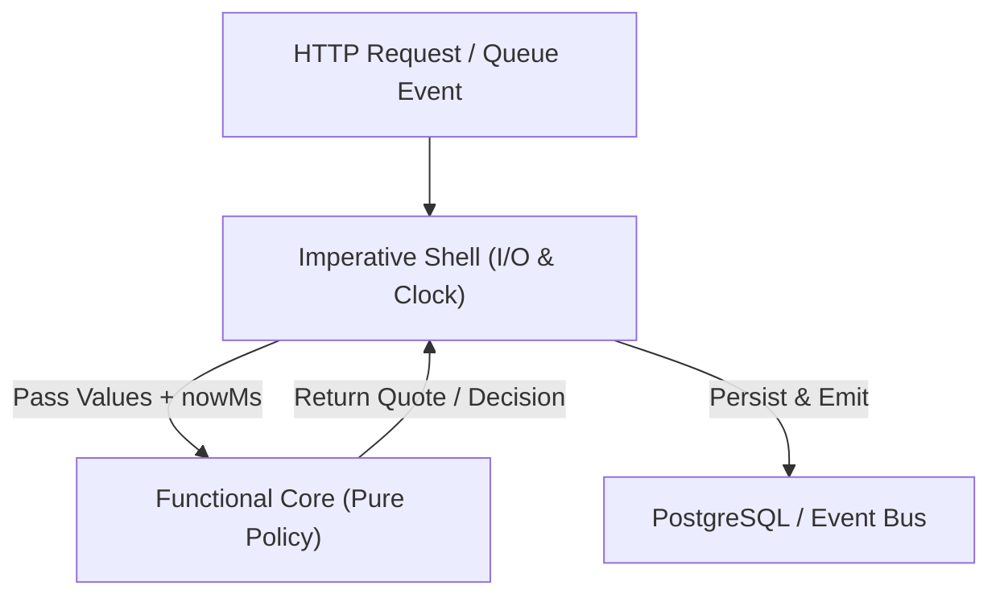

---
tags:
  - software-engineering
  - clean-code
  - functions
  - functional-core
  - complexity
created: 2026-01-02
updated: 2026-11-13
status: 🟢
level: mid-to-senior
---
# Functions

> [!abstract] Vault Navigation
> Part of [[Programming/Software Engineering/Clean Code/Clean Code Complete Guide|Clean Code Complete Guide]]. Reinforces [[Programming/Software Engineering/Clean Code/Meaningful Names|Meaningful Names]], [[Programming/Software Engineering/SOLID/Single Responsibility|Single Responsibility]], [[Programming/Software Engineering/Clean Code/Error Handling|Error Handling]], and [[Programming/Software Engineering/Testing/Unit Testing|Unit Testing]].

Functions define the executable boundaries of a software system. Properly factored functions constrain **execution-frame cognitive load**, separate **referentially transparent calculations** from **state mutations**, bound **control-flow complexity**, and isolate **I/O side effects** behind deterministic interfaces.

---

## 1. First-Principles Mechanics of Function Decomposition

Function design sits at the intersection of human working-memory limits, runtime stack frame mechanics, and formal control-flow graph theory. Treating function extraction purely as a line-count rule ("every function must be under 10 lines") produces fractured codebases; understanding the underlying mechanics produces cohesive modules.

### 1.1 Execution-Frame Cognitive Cost vs Jump Distance

When an engineer traces code manually, each nested control branch and active mutable variable occupies working-memory slots, while each function call pushes a **mental execution frame** onto the reader's call stack:

- **Monolithic Multi-Abstraction Functions (Under-Decomposition)**: A 120-line function that simultaneously validates HTTP payloads, opens database transactions, computes tax percentages, formats currency strings, and triggers external webhooks forces the reader to hold high-level business policy, mid-level transformation steps, and low-level error handling in active memory simultaneously.
- **Micro-Fragmented One-Line Wrappers (Over-Decomposition / Yo-Yo Anti-Pattern)**: Splitting a sequential 18-line function into twelve 1-to-2-line private helpers (`incrementCounter()`, `checkIsPositive()`, `buildKey()`) forces constant vertical or cross-file jumping without hiding algorithmic complexity or naming a reusable invariant. Every call jump incurs non-zero **context-switch cost**; extraction is justified only when it isolates a genuine conceptual boundary, flattens nesting, enforces Command-Query Separation, or eliminates non-trivial duplication.

### 1.2 Single Level of Abstraction (SLAP) & The Stepdown Rule

Every statement inside a function body must operate at a consistent **conceptual altitude**. Interleaving high-level domain workflow steps with low-level regular expressions, cryptographic salt derivation, or raw SQL parameter binding destroys narrative flow.

The **Stepdown Rule** organizes a module top-to-bottom as a hierarchical outline:
1. **Top**: High-level orchestrator (`registerAccount`) expressing the policy sequence (`parseEmail`, `derivePasswordHash`, `persistAccount`).
2. **Middle**: Policy and transformation steps (`derivePasswordHash`, `evaluateEligibility`) expressing domain rules.
3. **Bottom**: Low-level primitives and adapters (`computeScryptDigest`, `formatPostgresTimestamp`) encapsulating mechanism details.

```typescript
// Mixed abstraction levels: high-level registration interleaved with crypto and SQL
async function registerUserLegacy(rawEmail: string, rawPassword: string): Promise<void> {
  const email = rawEmail.trim().toLowerCase();
  if (!/^[^\s@]+@[^\s@]+\.[^\s@]+$/.test(email)) {
    throw new Error('Invalid email');
  }
  const salt = crypto.randomBytes(16).toString('hex');
  const hash = crypto.scryptSync(rawPassword, salt, 64).toString('hex');
  await db.query(
    'INSERT INTO users (email, password_hash) VALUES ($1, $2)',
    [email, `${salt}:${hash}`]
  );
}

// Uniform abstraction level following the Stepdown Rule
export async function registerUser(
  rawEmail: string,
  rawPassword: string,
  userRepo: UserRepository
): Promise<User> {
  const email = parseNormalizedEmail(rawEmail);
  const passwordHash = await hashPasswordWithSalt(rawPassword);
  return userRepo.createUser({ email, passwordHash });
}
```

### 1.3 Command-Query Separation (CQS) & Atomic Concurrency Exceptions

Formulated by Bertrand Meyer, **Command-Query Separation** mandates that every operation falls strictly into one of two disjoint categories:

- **Query**: Computes and returns a value with **zero observable side effects**. Queries are idempotent, safe to invoke inside assertions, logging statements, retries, or parallel calls, and preserve referential transparency.
- **Command**: Mutates observable state (database rows, cache entries, metrics, outbound messages) and returns `void` (or a strict operation acknowledgment / `Result<Receipt, Error>`, never arbitrary domain state masquerading as a read).

```typescript
// CQS Violation: boolean predicate secretly extends TTL in shared store
function checkSessionValidLegacy(
  token: string,
  sessionStore: SessionStore,
  nowMs: number
): boolean {
  const session = sessionStore.get(token);
  if (!session || session.expiresAtMs < nowMs) {
    return false;
  }
  session.expiresAtMs = nowMs + 1_800_000; // Hidden mutation on read path!
  return true;
}

// Strict CQS: read predicate separated from explicit mutation command
export function isSessionActive(session: Session, nowMs: number): boolean {
  return session.expiresAtMs > nowMs;
}

export function extendSessionTtl(
  token: string,
  sessionStore: SessionStore,
  nowMs: number,
  ttlMs: number
): void {
  sessionStore.updateExpiry(token, nowMs + ttlMs);
}
```

> [!info] Legitimate Atomic Exceptions to Strict CQS
> Pure CQS breaks down whenever separating a read from a write introduces a **Time-of-Check to Time-of-Use (TOCTOU)** race condition under concurrent access:
> - **Thread-safe collections**: `queue.dequeue()` and `stack.pop()` must atomically remove and return the element; splitting `peek()` + `remove()` allows two workers to claim the same item.
> - **Atomic cache/map deletion**: `map.delete(key)` returning `boolean` reveals whether this caller won the deletion race.
> - **Compare-And-Swap & SQL `RETURNING`**: Redis `INCR` / Lua token consumption, atomic `compareAndSwap(expected, next)`, and PostgreSQL `UPDATE jobs SET status = 'CLAIMED' ... RETURNING *` intentionally combine state mutation with return values to guarantee atomicity.
> - **Immutable / Fluent Builders**: Methods returning a new object or `this` (`queryBuilder.where(...).limit(10)`) support pipeline composition cleanly.

### 1.4 Functional Core, Imperative Shell

Combining SLAP and CQS at module architecture scale yields the **Functional Core, Imperative Shell** boundary:



- **Functional Core**: Contains 100% of business calculations, validation rules, pricing formulas, and state-transition checks. Functions accept immutable values (including injected `nowMs: number`), perform zero I/O, never read `process.env` or `Date.now()`, never mutate inputs, and return deterministic values or discriminated `Result<T, E>` structures. Unit testing requires **zero mocks**.
- **Imperative Shell**: Thin orchestration layer that reads external state via repositories/HTTP clients, acquires clocks/UUIDs/cancellation tokens, invokes pure core functions, and commits returned decisions atomically to storage or external gateways.

---

## 2. Real-World Use Cases & Decision Matrix

### 2.1 Concrete Production Scenarios

1. **Multi-Rule Pricing, Tax, and Eligibility Engines**: Checkout calculators, insurance underwriting, and RBAC permission evaluators combine dozens of conditional rules. Implementing them as pure pipeline functions keeps every rounding boundary, promotion cap, and jurisdiction rule testable in milliseconds without spinning up Postgres or Stripe sandboxes.
2. **HTTP Controllers & Queue Consumers**: Controllers and message handlers often bloat into 300-line procedures mixing Zod parsing, domain decisions, and SQL queries. Constraining controllers to a thin Imperative Shell delegates domain transitions to cohesive core functions.
3. **Concurrent Resource Claims & Rate Limiters**: When multiple Node.js worker pods or threads compete for limited inventory, job leases, or rate-limit buckets, intentionally apply the **atomic CQS exception** (`claimNextPendingJob()` returning `Job | null` via `FOR UPDATE SKIP LOCKED` or Redis Lua scripts) rather than separate `isAvailable()` + `reserve()` calls.
4. **Configurable Report & Export Pipelines**: Systems supporting multiple scopes, output formats (`CSV`, `Parquet`, `PDF`), and delivery destinations often accumulate 4–6 boolean parameters. Replacing flags with split render-vs-deliver functions and discriminated option unions eliminates impossible state combinations.
5. **When NOT to Extract or Over-Split**: Do not extract a single-use 2-line transformation (`const fullName = `${user.firstName} ${user.lastName}``) into its own function just to shrink line count, and do not break tight numerical inner loops (e.g., hot pixel/vector dot-product loops) into indirect dynamic callbacks when inline linear code is clearer and avoids allocation overhead.

### 2.2 Decision Matrix

| Scenario | Recommended Function Architecture | Rationale | Trade-Off / Watchout |
|---|---|---|---|
| **Complex Domain Logic** | Functional Core pure pipeline + Stepdown helpers | Deterministic, zero-mock unit testing, parallelizable | Requires explicit passing of timestamps and lookup tables |
| **Database / Network Orchestration** | Imperative Shell (`async` use case) with injected ports | Isolates I/O latency, retries, and `AbortSignal` | Thin shell must be covered by integration tests |
| **High-Contention Mutation** | Atomic command returning decision (`claim*`, `consume*`) | Eliminates TOCTOU race conditions | Document clearly as atomic state-transition command |
| **Multi-Mode Feature Behavior** | Split functions OR discriminated union options | Removes opaque boolean flags at call sites | Avoids $2^N$ combinatorial testing burden |
| **Flat 10+ Case Dispatch** | Strategy `Record<Key, HandlerFn>` lookup table | Reduces nesting and isolates each branch independently | Overkill for 2–3 trivial branches inside one module |

---

## 3. Complete Reference: Control Flow, Arity, Complexity & Side Effects

### 3.1 Guard Clauses & Shallow Nesting

Deeply nested `if ... else` pyramids ("arrow anti-pattern") force readers to hold every enclosing positive condition in working memory while reading the leaf block. **Guard clauses** invert preconditions into flat early returns at the top of the function, leaving the primary happy path unindented at the bottom.

```typescript
// Arrow anti-pattern: nesting depth 4, Cognitive Complexity 10
function calculateLoyaltyDiscountCentsLegacy(
  order: { readonly items: ReadonlyArray<unknown>; readonly subtotalCents: number },
  user: { readonly isActive: boolean } | null
): number {
  if (user !== null) {
    if (user.isActive) {
      if (order.items.length > 0) {
        if (order.subtotalCents >= 10_000) {
          return Math.round(order.subtotalCents * 0.15);
        } else {
          return 0;
        }
      } else {
        return 0;
      }
    } else {
      return 0;
    }
  } else {
    return 0;
  }
}

// Guard clauses: depth 0, Cognitive Complexity 4, instant linear scan
export function calculateLoyaltyDiscountCents(
  order: { readonly items: ReadonlyArray<unknown>; readonly subtotalCents: number },
  user: { readonly isActive: boolean } | null
): number {
  if (!user || !user.isActive) {
    return 0;
  }
  if (order.items.length === 0 || order.subtotalCents < 10_000) {
    return 0;
  }
  return Math.round(order.subtotalCents * 0.15);
}
```

### 3.2 Eliminating Boolean Flag Combinatorial Explosion

Every boolean flag parameter doubles the number of possible execution modes ($2^N$) and obscures intent at call sites (`syncInventory(true, false, true)`). Furthermore, boolean flags frequently create invalid runtime states (for example, `sendEmail = false` paired with a required `recipientEmail`).

Eliminate flag parameters via three deterministic refactorings:
1. **Split Function**: When a flag toggles two distinct operations (`renderReport(true)` vs `renderReport(false)`), expose two explicit functions (`renderCsvReport`, `renderPdfReport`).
2. **Discriminated Union Options**: When modes share common orchestration with variant-specific data, use a tagged union so invalid flag-data pairs fail compilation.
3. **Strategy Map**: Replace `switch (tier)` or multi-branch flag chains with a typed `Record<Tier, CalculatorFn>` dictionary.

```typescript
// Discriminated union eliminates impossible combinations between mode and cursor
export type SyncRequest =
  | { readonly mode: 'full'; readonly tenantId: string }
  | { readonly mode: 'incremental'; readonly tenantId: string; readonly sinceCursor: string };

export async function synchronizeCatalog(
  request: SyncRequest,
  catalogPort: CatalogPort
): Promise<SyncSummary> {
  if (request.mode === 'full') {
    return catalogPort.reimportAllProducts(request.tenantId);
  }
  return catalogPort.applyDeltaSince(request.tenantId, request.sinceCursor);
}
```

### 3.3 Parameter Arity, Parameter Objects & Typed Options with Defaults

| Arity | Assessment | Production Rule |
|---|---|---|
| **0–2 positional params** | Ideal | Acceptable when types differ or order is mathematically symmetric (`clamp(val, min, max)`). |
| **3+ positional params** | Structural smell | Replace with a named **Parameter Object** interface (`CreateInvoiceInput`). |
| **2+ same-type primitives** | High transposition hazard | Even at arity 2 (`transfer(fromId: string, toId: string)`), prefer `{ fromAccountId, toAccountId, amountCents }` or nominal branded types. |

When providing optional configuration, use **destructured typed options with explicit defaults** and `Readonly<T>` annotations so callers cannot accidentally share mutable option objects:

```typescript
export interface RetryPolicyOptions {
  readonly maxAttempts?: number;
  readonly initialBackoffMs?: number;
  readonly jitterRatio?: number;
}

export function computeRetryDelayMs(
  attemptIndex: number,
  options: Readonly<RetryPolicyOptions> = {}
): number {
  const {
    maxAttempts = 4,
    initialBackoffMs = 250,
    jitterRatio = 0.1,
  } = options;

  if (attemptIndex < 0 || attemptIndex >= maxAttempts) {
    throw new RangeError(`Attempt index ${String(attemptIndex)} out of bounds [0, ${String(maxAttempts)})`);
  }

  const exponentialMs = initialBackoffMs * 2 ** attemptIndex;
  const boundedJitterMs = exponentialMs * jitterRatio;
  return Math.round(exponentialMs + boundedJitterMs);
}
```

### 3.4 Cyclomatic Complexity vs Cognitive Complexity

Understanding the exact scoring mechanics of both metrics prevents gaming one while hurting the other:

- **Cyclomatic Complexity ($M$)**: Defined by McCabe on a function's control-flow graph with $E$ edges, $N$ nodes, and $P$ connected components as $M = E - N + 2P$ (equivalently, $1 + \text{count of decision predicates}$). It measures the **minimum number of linearly independent paths** required for full branch coverage in tests. Its blind spot: a flat 10-case `switch` yields $M = 11$, scoring worse than 4 nested loops/conditionals ($M = 5$) despite being far easier to verify visually.
- **Cognitive Complexity** (SonarSource): Measures human effort to trace control flow:
  - $+1$ for each break in linear flow (`if`, `else if`, `else`, ternary `? :`, `for`, `while`, `catch`, `switch`, recursion, and each change in boolean operator sequence like `&&` followed by `||`).
  - **$+d$ nesting penalty** added to `if`, loops, ternary, and `catch` sitting at nesting depth $d$.
  - Multiple cases inside a single `switch` incur **only $+1$ total** (no per-case increment), while deeply nested `if` chains escalate rapidly ($+1 + 2 + 3 + \dots$).


**Production Lint Thresholds**:
- **Cyclomatic Complexity**: $\le 10$ per function (`complexity: ['error', 10]`).
- **Cognitive Complexity**: $\le 15$ per function (`sonarjs/cognitive-complexity: ['error', 15]`).
- **Maximum Nesting Depth**: $\le 2$ (`max-depth: ['error', 2]`).
- **Maximum Positional Parameters**: $\le 3$ (`max-params: ['error', 3]`).

### 3.5 Side-Effect Containment, Input Immutability, Idempotency & Cancellation

1. **Zero Input Mutation (`no-param-reassign`)**: Mutating a passed `cart` or `items` array inside a calculation function breaks React state diffing, corrupts cached objects, and creates order-dependent bugs across callers. Return new immutable structures instead (`ReadonlyArray`, `{ ...state, updatedField }`).
2. **Explicit Clock & Randomness Injection**: Functions reading `Date.now()` or `Math.random()` directly inside domain logic cannot be deterministically tested across midnight, month-end, or DST boundaries. Pass `nowMs: number` or `clock: () => number` explicitly.
3. **Cancellation & Timeout Propagation (`AbortSignal`)**: Every async orchestration function performing network or database I/O must accept an `AbortSignal` (or `signal?: AbortSignal`) and pass it down to downstream `fetch` / DB calls so client disconnects abort in-flight work cleanly instead of leaking promises.
4. **Idempotent Command Boundaries**: State-mutating shell commands (`chargeOrder`, `issueRefund`) must accept an explicit `idempotencyKey` and remain safe under duplicate queue delivery or network retries.

---

## 4. Step-by-Step Practical Application: Order Pricing & Tax Calculation Pipeline

This section refactors a realistic 120-line legacy checkout monolith into a clean, Stepdown-ordered Functional Core + Imperative Shell pipeline enforced by ESLint and verified with Vitest.

### 4.1 Production Project Layout

```text
checkout-engine/
├── eslint.config.mjs
├── src/
│   └── pricing/
│       ├── domain/
│       │   ├── types.ts
│       │   └── pricing-pipeline.ts
│       └── application/
│           └── checkout-quote-service.ts
└── tests/
    └── pricing/
        └── pricing-pipeline.test.ts
```

### 4.2 Legacy Monolith Before Code (`src/pricing/legacy-calculate-order.ts`)

Examine this realistic legacy function combining 4 boolean flags ($2^4 = 16$ modes), hidden input mutations, `Date.now()`, direct DB/Stripe calls inside `if (!dryRun)`, and depth-4 nesting:

```typescript
// BEFORE: Flag-riddled 115-line monolith violating SLAP, CQS, and Functional Core
export async function calculateAndCommitOrder(
  cart: any,
  user: any,
  applyPromo: boolean,
  isTaxExempt: boolean,
  rushShipping: boolean,
  dryRun: boolean,
  promoCode?: string
): Promise<any> {
  if (!cart || !cart.items || cart.items.length === 0) {
    throw new Error('Empty cart');
  }

  let subtotal = 0;
  for (let i = 0; i < cart.items.length; i++) {
    const item = cart.items[i];
    if (item.qty <= 0) {
      throw new Error('Invalid quantity');
    }
    subtotal += item.unitPriceCents * item.qty;
    if (item.discountable === undefined) {
      item.discountable = true; // Mutates caller's input object!
    }
  }

  let discount = 0;
  if (applyPromo) {
    if (promoCode) {
      const promo = await db.query('SELECT * FROM promos WHERE code = $1', [promoCode]);
      if (promo && promo.expiresAtMs > Date.now()) {
        if (promo.type === 'PERCENT') {
          let eligibleSum = 0;
          for (const item of cart.items) {
            if (item.discountable) {
              eligibleSum += item.unitPriceCents * item.qty;
            }
          }
          discount = Math.round((eligibleSum * promo.percent) / 100);
        } else if (promo.type === 'FLAT') {
          discount = Math.min(subtotal, promo.flatCents);
        }
      }
    } else if (user && user.tier === 'VIP') {
      discount = Math.round(subtotal * 0.1);
    }
  }

  const discountedSubtotal = Math.max(0, subtotal - discount);

  let shipping = 0;
  if (rushShipping) {
    shipping = 2500;
  } else {
    if (user && user.country === 'US') {
      if (discountedSubtotal >= 7500) {
        shipping = 0;
      } else {
        shipping = 795;
      }
    } else {
      shipping = 1995;
    }
  }

  let tax = 0;
  if (!isTaxExempt) {
    let rate = 0;
    if (user.state === 'CA') {
      rate = 0.0825;
    } else if (user.state === 'NY') {
      rate = 0.08875;
    } else if (user.state === 'TX') {
      rate = 0.0625;
    } else {
      rate = 0.05;
    }
    tax = Math.round((discountedSubtotal + shipping) * rate);
  }

  const total = discountedSubtotal + shipping + tax;
  cart.lastQuotedTotalCents = total; // Mutates input cart!

  if (!dryRun) {
    if (!user.stripeCustomerId) {
      throw new Error('Missing billing customer');
    }
    await stripeClient.charges.create({
      amount: total,
      customer: user.stripeCustomerId,
    });
    await db.query('INSERT INTO orders (user_id, total_cents) VALUES ($1, $2)', [
      user.id,
      total,
    ]);
  }

  return {
    subtotalCents: subtotal,
    discountCents: discount,
    shippingCents: shipping,
    taxCents: tax,
    totalCents: total,
  };
}
```

**Complexity Audit of Legacy Function**:
- **Cyclomatic Complexity**: $23$ (far above the $10$ ceiling).
- **Cognitive Complexity**: $37$ (depth-3 loops and nested `if`/`else` blocks inside `applyPromo`).
- **Flag & CQS Defects**: Calling `calculateAndCommitOrder(..., false)` reads like a calculation yet mutates `cart` in place; passing `dryRun = false` charges Stripe without an idempotency key; unit testing `PERCENT` promos requires mocking SQL and `Date.now()`.

### 4.3 Domain Contracts (`src/pricing/domain/types.ts`)

```typescript
// src/pricing/domain/types.ts
export type CustomerTier = 'STANDARD' | 'VIP';
export type ShippingSpeed = 'STANDARD' | 'RUSH';
export type TaxRegionCode = 'CA' | 'NY' | 'TX' | 'OTHER';

export interface OrderLineItem {
  readonly sku: string;
  readonly unitPriceCents: number;
  readonly quantity: number;
  readonly isDiscountable: boolean;
}

export type PromotionRule =
  | {
      readonly kind: 'PERCENT';
      readonly code: string;
      readonly percentageWhole: number;
      readonly expiresAtMs: number;
    }
  | {
      readonly kind: 'FLAT';
      readonly code: string;
      readonly flatAmountCents: number;
      readonly expiresAtMs: number;
    };

export type TaxTreatment =
  | { readonly mode: 'TAXABLE'; readonly region: TaxRegionCode }
  | { readonly mode: 'EXEMPT'; readonly certificateId: string };

export interface OrderPricingInput {
  readonly items: ReadonlyArray<OrderLineItem>;
  readonly customerTier: CustomerTier;
  readonly destinationCountry: string;
  readonly shippingSpeed: ShippingSpeed;
  readonly taxTreatment: TaxTreatment;
  readonly promotion: PromotionRule | null;
  readonly nowMs: number;
}

export interface OrderQuote {
  readonly subtotalCents: number;
  readonly discountCents: number;
  readonly shippingCents: number;
  readonly taxCents: number;
  readonly totalCents: number;
}

export type PricingError =
  | { readonly kind: 'EMPTY_CART' }
  | { readonly kind: 'INVALID_LINE_ITEM'; readonly sku: string; readonly reason: string }
  | { readonly kind: 'INVALID_TAX_CERTIFICATE' };

export type Result<TValue, TError> =
  | { readonly ok: true; readonly value: TValue }
  | { readonly ok: false; readonly error: TError };
```

### 4.4 Refactored Pure Functional Core (`src/pricing/domain/pricing-pipeline.ts`)

Notice strict **Stepdown ordering**: top-level `priceOrder` reads like a declarative outline, delegating cleanly to cohesive single-responsibility stages with shallow guard clauses, Strategy maps, and zero side effects.

```typescript
// src/pricing/domain/pricing-pipeline.ts
import type {
  CustomerTier,
  OrderLineItem,
  OrderPricingInput,
  OrderQuote,
  PricingError,
  PromotionRule,
  Result,
  ShippingSpeed,
  TaxRegionCode,
  TaxTreatment,
} from './types.js';

const VIP_DISCOUNT_RATIO = 0.1;
const RUSH_SHIPPING_CENTS = 2_500;
const DOMESTIC_FREE_SHIPPING_THRESHOLD_CENTS = 7_500;
const DOMESTIC_STANDARD_SHIPPING_CENTS = 795;
const INTERNATIONAL_STANDARD_SHIPPING_CENTS = 1_995;

const TAX_RATE_BY_REGION: Readonly<Record<TaxRegionCode, number>> = {
  CA: 0.0825,
  NY: 0.08875,
  TX: 0.0625,
  OTHER: 0.05,
};

export function priceOrder(input: OrderPricingInput): Result<OrderQuote, PricingError> {
  const validationError = validatePricingInput(input);
  if (validationError !== null) {
    return { ok: false, error: validationError };
  }

  const subtotalCents = calculateSubtotalCents(input.items);
  const discountCents = resolvePromotionDiscountCents({
    items: input.items,
    subtotalCents,
    customerTier: input.customerTier,
    promotion: input.promotion,
    nowMs: input.nowMs,
  });

  const discountedSubtotalCents = Math.max(0, subtotalCents - discountCents);
  const shippingCents = resolveShippingFeeCents({
    discountedSubtotalCents,
    destinationCountry: input.destinationCountry,
    shippingSpeed: input.shippingSpeed,
  });

  const taxCents = calculateJurisdictionTaxCents(
    discountedSubtotalCents + shippingCents,
    input.taxTreatment
  );

  return {
    ok: true,
    value: {
      subtotalCents,
      discountCents,
      shippingCents,
      taxCents,
      totalCents: discountedSubtotalCents + shippingCents + taxCents,
    },
  };
}

export function validatePricingInput(input: OrderPricingInput): PricingError | null {
  if (input.items.length === 0) {
    return { kind: 'EMPTY_CART' };
  }

  if (input.taxTreatment.mode === 'EXEMPT' && input.taxTreatment.certificateId.trim() === '') {
    return { kind: 'INVALID_TAX_CERTIFICATE' };
  }

  for (const item of input.items) {
    if (!Number.isInteger(item.quantity) || item.quantity <= 0) {
      return { kind: 'INVALID_LINE_ITEM', sku: item.sku, reason: 'Quantity must be positive integer' };
    }
    if (!Number.isInteger(item.unitPriceCents) || item.unitPriceCents < 0) {
      return { kind: 'INVALID_LINE_ITEM', sku: item.sku, reason: 'Unit price cannot be negative' };
    }
  }

  return null;
}

export function calculateSubtotalCents(items: ReadonlyArray<OrderLineItem>): number {
  return items.reduce((sum, item) => sum + item.unitPriceCents * item.quantity, 0);
}

export function resolvePromotionDiscountCents(params: {
  readonly items: ReadonlyArray<OrderLineItem>;
  readonly subtotalCents: number;
  readonly customerTier: CustomerTier;
  readonly promotion: PromotionRule | null;
  readonly nowMs: number;
}): number {
  const { items, subtotalCents, customerTier, promotion, nowMs } = params;

  if (promotion !== null && promotion.expiresAtMs > nowMs) {
    return applyActivePromotionRule(items, subtotalCents, promotion);
  }

  if (customerTier === 'VIP') {
    return Math.round(subtotalCents * VIP_DISCOUNT_RATIO);
  }

  return 0;
}

function applyActivePromotionRule(
  items: ReadonlyArray<OrderLineItem>,
  subtotalCents: number,
  promotion: PromotionRule
): number {
  if (promotion.kind === 'FLAT') {
    return Math.min(subtotalCents, promotion.flatAmountCents);
  }

  const eligibleCents = items
    .filter((item) => item.isDiscountable)
    .reduce((sum, item) => sum + item.unitPriceCents * item.quantity, 0);

  return Math.round((eligibleCents * promotion.percentageWhole) / 100);
}

export function resolveShippingFeeCents(params: {
  readonly discountedSubtotalCents: number;
  readonly destinationCountry: string;
  readonly shippingSpeed: ShippingSpeed;
}): number {
  if (params.shippingSpeed === 'RUSH') {
    return RUSH_SHIPPING_CENTS;
  }
  if (params.destinationCountry !== 'US') {
    return INTERNATIONAL_STANDARD_SHIPPING_CENTS;
  }
  return params.discountedSubtotalCents >= DOMESTIC_FREE_SHIPPING_THRESHOLD_CENTS
    ? 0
    : DOMESTIC_STANDARD_SHIPPING_CENTS;
}

export function calculateJurisdictionTaxCents(
  taxableAmountCents: number,
  taxTreatment: TaxTreatment
): number {
  if (taxTreatment.mode === 'EXEMPT') {
    return 0;
  }
  const taxRate = TAX_RATE_BY_REGION[taxTreatment.region];
  return Math.round(taxableAmountCents * taxRate);
}
```

Every single function in `pricing-pipeline.ts` now maintains **Cyclomatic Complexity $\le 5$** and **Cognitive Complexity $\le 4$**.

### 4.5 Thin Imperative Shell (`src/pricing/application/checkout-quote-service.ts`)

```typescript
// src/pricing/application/checkout-quote-service.ts
import { priceOrder } from '../domain/pricing-pipeline.js';
import type {
  CustomerTier,
  OrderLineItem,
  OrderQuote,
  PricingError,
  PromotionRule,
  Result,
  ShippingSpeed,
  TaxTreatment,
} from '../domain/types.js';

export interface PromotionRepository {
  findByCode(code: string, signal: AbortSignal): Promise<PromotionRule | null>;
}

export interface PaymentGateway {
  chargeWithIdempotencyKey(params: {
    readonly customerId: string;
    readonly amountCents: number;
    readonly idempotencyKey: string;
    readonly signal: AbortSignal;
  }): Promise<{ readonly chargeId: string }>;
}

export interface OrderLedgerRepository {
  recordPaidOrder(params: {
    readonly userId: string;
    readonly quote: OrderQuote;
    readonly chargeId: string;
    readonly idempotencyKey: string;
    readonly signal: AbortSignal;
  }): Promise<{ readonly orderId: string }>;
}

export interface CheckoutCustomer {
  readonly userId: string;
  readonly stripeCustomerId: string;
  readonly tier: CustomerTier;
  readonly country: string;
}

export interface QuoteCheckoutCommand {
  readonly customer: CheckoutCustomer;
  readonly items: ReadonlyArray<OrderLineItem>;
  readonly shippingSpeed: ShippingSpeed;
  readonly taxTreatment: TaxTreatment;
  readonly promoCode: string | null;
  readonly idempotencyKey: string;
}

export class CheckoutService {
  constructor(
    private readonly promoRepo: PromotionRepository,
    private readonly paymentGateway: PaymentGateway,
    private readonly orderLedger: OrderLedgerRepository,
    private readonly clockMs: () => number = () => Date.now()
  ) {}

  public async quoteOrder(
    command: Omit<QuoteCheckoutCommand, 'idempotencyKey'>,
    signal: AbortSignal
  ): Promise<Result<OrderQuote, PricingError>> {
    const promotion = command.promoCode
      ? await this.promoRepo.findByCode(command.promoCode, signal)
      : null;

    return priceOrder({
      items: command.items,
      customerTier: command.customer.tier,
      destinationCountry: command.customer.country,
      shippingSpeed: command.shippingSpeed,
      taxTreatment: command.taxTreatment,
      promotion,
      nowMs: this.clockMs(),
    });
  }

  public async commitOrderCheckout(
    command: QuoteCheckoutCommand,
    signal: AbortSignal
  ): Promise<Result<{ readonly orderId: string; readonly quote: OrderQuote }, PricingError>> {
    const quoteResult = await this.quoteOrder(command, signal);
    if (!quoteResult.ok) {
      return quoteResult;
    }

    const { chargeId } = await this.paymentGateway.chargeWithIdempotencyKey({
      customerId: command.customer.stripeCustomerId,
      amountCents: quoteResult.value.totalCents,
      idempotencyKey: command.idempotencyKey,
      signal,
    });

    const { orderId } = await this.orderLedger.recordPaidOrder({
      userId: command.customer.userId,
      quote: quoteResult.value,
      chargeId,
      idempotencyKey: command.idempotencyKey,
      signal,
    });

    return { ok: true, value: { orderId, quote: quoteResult.value } };
  }
}
```

Notice how `quoteOrder` (pure query pipeline + DB lookup) and `commitOrderCheckout` (explicit idempotent command) cleanly separate preview quotes from Stripe charges without any `dryRun` flag!

### 4.6 Automated Complexity Gate (`eslint.config.mjs`)

```javascript
// eslint.config.mjs
import tseslint from 'typescript-eslint';
import sonarjs from 'eslint-plugin-sonarjs';

export default tseslint.config(
  ...tseslint.configs.strictTypeChecked,
  {
    plugins: { sonarjs },
    rules: {
      complexity: ['error', { max: 10 }],
      'max-depth': ['error', 2],
      'max-params': ['error', 3],
      'no-param-reassign': ['error', { props: true }],
      'sonarjs/cognitive-complexity': ['error', 15],
    },
  }
);
```

### 4.7 Zero-Mock Pure Core & Shell Tests (`tests/pricing/pricing-pipeline.test.ts`)

```typescript
// tests/pricing/pricing-pipeline.test.ts
import { describe, expect, it, vi } from 'vitest';
import { priceOrder } from '../../src/pricing/domain/pricing-pipeline.js';
import type { OrderPricingInput } from '../../src/pricing/domain/types.js';
import { CheckoutService } from '../../src/pricing/application/checkout-quote-service.js';

function createBaseInput(overrides: Partial<OrderPricingInput> = {}): OrderPricingInput {
  return {
    items: [
      { sku: 'SKU-A', unitPriceCents: 4_000, quantity: 2, isDiscountable: true },
      { sku: 'SKU-GIFT', unitPriceCents: 1_000, quantity: 1, isDiscountable: false },
    ],
    customerTier: 'STANDARD',
    destinationCountry: 'US',
    shippingSpeed: 'STANDARD',
    taxTreatment: { mode: 'TAXABLE', region: 'CA' },
    promotion: null,
    nowMs: 1_700_000_000_000,
    ...overrides,
  };
}

describe('priceOrder Functional Core', () => {
  it('computes subtotal, percentage promo only on discountable items, free shipping, and CA tax', () => {
    const input = createBaseInput({
      promotion: {
        kind: 'PERCENT',
        code: 'SAVE20',
        percentageWhole: 20,
        expiresAtMs: 1_700_000_100_000,
      },
    });

    // Freeze input deeply to verify zero input mutation
    Object.freeze(input);
    Object.freeze(input.items);

    const result = priceOrder(input);
    expect(result).toEqual({
      ok: true,
      value: {
        subtotalCents: 9_000,
        discountCents: 1_600,
        shippingCents: 795, // discountedSubtotal is 7400 < 7500 threshold
        taxCents: 676, // Math.round((7400 + 795) * 0.0825)
        totalCents: 8_871,
      },
    });
  });

  it('falls back to VIP 10% discount when promotion is expired', () => {
    const result = priceOrder(
      createBaseInput({
        customerTier: 'VIP',
        promotion: {
          kind: 'FLAT',
          code: 'EXPIRED50',
          flatAmountCents: 5_000,
          expiresAtMs: 1_699_999_999_999,
        },
      })
    );

    expect(result.ok).toBe(true);
    if (result.ok) {
      expect(result.value.discountCents).toBe(900);
    }
  });

  it('rejects exempt orders with blank tax certificates', () => {
    const result = priceOrder(
      createBaseInput({
        taxTreatment: { mode: 'EXEMPT', certificateId: '   ' },
      })
    );
    expect(result).toEqual({ ok: false, error: { kind: 'INVALID_TAX_CERTIFICATE' } });
  });
});

describe('CheckoutService Imperative Shell', () => {
  it('propagates AbortSignal and idempotencyKey without mutating quote on dry preview', async () => {
    const promoRepo = { findByCode: vi.fn(async () => null) };
    const paymentGateway = {
      chargeWithIdempotencyKey: vi.fn(async () => ({ chargeId: 'ch_123' })),
    };
    const orderLedger = {
      recordPaidOrder: vi.fn(async () => ({ orderId: 'ord_456' })),
    };

    const service = new CheckoutService(
      promoRepo,
      paymentGateway,
      orderLedger,
      () => 1_700_000_000_000
    );
    const controller = new AbortController();

    const quote = await service.quoteOrder(
      {
        customer: {
          userId: 'usr_1',
          stripeCustomerId: 'cus_1',
          tier: 'VIP',
          country: 'US',
        },
        items: [{ sku: 'SKU-1', unitPriceCents: 10_000, quantity: 1, isDiscountable: true }],
        shippingSpeed: 'STANDARD',
        taxTreatment: { mode: 'EXEMPT', certificateId: 'CERT-99' },
        promoCode: null,
      },
      controller.signal
    );

    expect(quote.ok).toBe(true);
    expect(paymentGateway.chargeWithIdempotencyKey).not.toHaveBeenCalled();
  });
});
```

---

## 5. Production Debugging, Profiling & Operations Playbook

### 5.1 Symptom-to-Remediation Playbook

| Production Symptom | Underlying Function Design Root Cause | Diagnostic Command / Trace Inspection | Remediation |
|---|---|---|---|
| **Duplicate charges or double-counted metrics under logging/retries** | CQS violation: query method mutates DB/Redis state | Inspect call graph for `is*` / `get*` / `check*` calling `.incr`, `.save`, `INSERT`, `UPDATE` | Split query from command, or convert to idempotent atomic command (`consume*`) |
| **Intermittent race corruption under high concurrency** | Non-atomic `read()` then `write()` across async boundary (TOCTOU) | Load test with `autocannon` + inspect SQL logs for non-transactional read-modify-write | Wrap in `UPDATE ... WHERE ... RETURNING *`, optimistic version check, or Redis Lua script |
| **React/Redux/Cache state corruption across requests** | Function mutates object/array argument (`no-param-reassign` disabled) | Enable `Object.freeze()` in dev tests or run `npx eslint --rule 'no-param-reassign: error'` | Return copied immutable structures; type inputs as `Readonly<T>` / `ReadonlyArray<T>` |
| **Orphaned DB queries / connection pool exhaustion on timeout** | Async shell omits `AbortSignal` propagation | Check slow-query telemetry after HTTP `499` client-abort bursts | Thread `signal: AbortSignal` through all repository and `fetch` parameters |
| **Silent regressions in edge branches during hotfixes** | High cognitive complexity ($>20$) and deep nesting hiding branch interactions | `npx eslint --format json src/ > eslint-report.json` to inspect complexity hotspots | Flatten via guard clauses, extract pure Functional Core helpers, enforce CI ceiling |

### 5.2 Complexity Hotspot Audit Command

Run a quick AST complexity scan across a TypeScript repository to identify refactoring candidates ranked by violation density:

```bash
npx eslint --rule 'sonarjs/cognitive-complexity: ["warn", 12]' --rule 'complexity: ["warn", 8]' --format json src/ | \
  node -e "const r=JSON.parse(require('fs').readFileSync(0,'utf8')); for(const f of r) if(f.messages.length) console.log(f.messages.length, f.filePath);" | \
  sort -rn | head -n 20
```

Target files with both high complexity counts and high Git churn (`git log --since="90 days ago" --name-only --pretty=format: | sort | uniq -c | sort -rn`) first—complex files that never change have zero carrying cost, whereas complex high-churn files directly multiply outage risk.

---

## 6. Worked Exercises

### Exercise 1: Complexity Scoring & Flattening

Compute exact **Cyclomatic Complexity** and **Cognitive Complexity** for the function below, then refactor it to **Cognitive Complexity $\le 4$** with nesting depth $0$:

```typescript
function resolveShippingCost(cart: Cart, region: string): number {
  let cost = 0;
  if (cart.items.length > 0) {
    if (!cart.hasFreeShippingCoupon) {
      if (region === 'DOMESTIC') {
        if (cart.totalCents > 5000) {
          cost = 0;
        } else {
          cost = 500;
        }
      } else {
        cost = 2500;
      }
    }
  }
  return cost;
}
```

### Solution 1

1. **Pre-Refactor Metric Breakdown**:
   - **Cyclomatic Complexity ($M$)**: $1 \text{ (base)} + 4 \text{ (`if` conditions)} = 5$. (`else` blocks do not introduce extra predicates.)
   - **Cognitive Complexity**:
     - `if (cart.items.length > 0)` (depth 0): $+1$
     - `if (!cart.hasFreeShippingCoupon)` (depth 1): $+1 + 1 = +2$
     - `if (region === 'DOMESTIC')` (depth 2): $+1 + 2 = +3$
     - `if (cart.totalCents > 5000)` (depth 3): $+1 + 3 = +4$
     - `else` on `totalCents`: $+1$
     - `else` on `region`: $+1$
     - **Total Cognitive Complexity = $12$**.

2. **Refactored Guard-Clause Implementation**:

```typescript
function resolveShippingCost(cart: Cart, region: string): number {
  if (cart.items.length === 0 || cart.hasFreeShippingCoupon) {
    return 0;
  }
  if (region !== 'DOMESTIC') {
    return 2500;
  }
  return cart.totalCents > 5000 ? 0 : 500;
}
```

- **Post-Refactor Metrics**: Cyclomatic Complexity = $5$, **Cognitive Complexity = $4$** ($+1$ for first `if`, $+1$ for `||` sequence? Note: in SonarSource Cognitive Complexity, a single `||` sequence inside `if` adds $+1$, second `if` adds $+1$, ternary adds $+1$, giving $4$ total with zero nesting penalty!).

---

### Exercise 2: Fixing a CQS + TOCTOU Violation

A rate-limiting utility implements:

```typescript
async function isWithinRateLimit(userId: string): Promise<boolean> {
  const count = await redis.get(`rl:${userId}`);
  if (Number(count) >= 100) return false;
  await redis.incr(`rl:${userId}`);
  return true;
}
```

Identify both distinct engineering failures (one CQS violation, one distributed concurrency race) and implement the production-safe fix.

### Solution 2

1. **Diagnosed Failures**:
   - **CQS Violation**: Naming the function `isWithinRateLimit` presents it as a pure boolean query. If an auth middleware and an audit logger both check `isWithinRateLimit(userId)`, every incoming request consumes 2 quota units.
   - **TOCTOU Race Condition**: Between `await redis.get(...)` and `await redis.incr(...)`, 40 concurrent requests for a user at `count = 99` all observe `99 < 100` and all pass, bursting well above the 100-request cap. Furthermore, the key lacks an expiration TTL, causing permanent lockout once `100` is reached.

2. **Production Atomic Fix**:

```typescript
export interface RateLimitDecision {
  readonly allowed: boolean;
  readonly remaining: number;
}

const CONSUME_TOKEN_LUA = `
  local current = tonumber(redis.call("GET", KEYS[1]) or "0")
  local limit = tonumber(ARGV[1])
  if current >= limit then
    return { 0, 0 }
  end
  local nextVal = redis.call("INCR", KEYS[1])
  if nextVal == 1 then
    redis.call("PEXPIRE", KEYS[1], ARGV[2])
  end
  return { 1, limit - nextVal }
`;

export async function consumeRateLimitToken(
  userId: string,
  limit: number,
  windowMs: number,
  redis: { eval(script: string, keys: string[], args: string[]): Promise<[number, number]> }
): Promise<RateLimitDecision> {
  const [allowedInt, remaining] = await redis.eval(
    CONSUME_TOKEN_LUA,
    [`rl:${userId}`],
    [String(limit), String(windowMs)]
  );
  return { allowed: allowedInt === 1, remaining };
}
```

Renaming to `consumeRateLimitToken` makes state mutation explicit, while executing check + increment + TTL initialization inside a single-threaded Redis Lua script prevents TOCTOU races.

---

### Exercise 3: Eliminating Boolean Flag Soup

Refactor the following report API without losing any domain capability:

```typescript
export async function generateReport(
  tenantId: string,
  includeArchived: boolean,
  formatAsCsv: boolean,
  sendEmail: boolean,
  recipientEmail?: string
): Promise<Buffer | void> {
  const rows = await reportRepo.fetchRows(tenantId, includeArchived);
  const content = formatAsCsv ? toCsvBuffer(rows) : toPdfBuffer(rows);
  if (sendEmail) {
    if (!recipientEmail) throw new Error('Missing recipient');
    await mailer.send(recipientEmail, content);
    return;
  }
  return content;
}
```

### Solution 3

1. **Defects**: 3 boolean flags ($2^3 = 8$ opaque combinations), invalid state allowed (`sendEmail = true` with `recipientEmail = undefined`), and a union return type `Promise<Buffer | void>` dictated by a flag—forcing callers to cast or narrow unnecessarily.
2. **Refactored Design (Separated Query + Command + Strategy Map)**:

```typescript
export type ReportFormat = 'csv' | 'pdf';
export type ReportScope = 'active-only' | 'include-archived';

export interface ReportQuery {
  readonly tenantId: string;
  readonly scope: ReportScope;
  readonly format: ReportFormat;
}

export interface ReportDeps {
  readonly reportRepo: {
    fetchRows(tenantId: string, scope: ReportScope): Promise<ReadonlyArray<ReportRow>>;
  };
  readonly formatters: Readonly<Record<ReportFormat, (rows: ReadonlyArray<ReportRow>) => Uint8Array>>;
  readonly mailer: {
    sendAttachment(email: string, bytes: Uint8Array, format: ReportFormat): Promise<void>;
  };
}

export async function renderTenantReport(
  query: ReportQuery,
  deps: Pick<ReportDeps, 'reportRepo' | 'formatters'>
): Promise<Uint8Array> {
  const rows = await deps.reportRepo.fetchRows(query.tenantId, query.scope);
  return deps.formatters[query.format](rows);
}

export async function emailTenantReport(
  query: ReportQuery,
  recipientEmail: string,
  deps: ReportDeps
): Promise<void> {
  const artifact = await renderTenantReport(query, deps);
  await deps.mailer.sendAttachment(recipientEmail, artifact, query.format);
}
```

Call sites are self-explanatory, `renderTenantReport` strictly returns `Promise<Uint8Array>`, and `emailTenantReport` requires `recipientEmail` structurally at compile time.

---

### Exercise 4: Isolating Impurity from Business Logic

Refactor `cancelOrder` so 100% of cancellation eligibility policy can be unit-tested synchronously with zero database or clock mocks:

```typescript
async function cancelOrder(orderId: string): Promise<void> {
  const order = await db.orders.findUniqueOrThrow({ where: { id: orderId } });
  const hoursSinceOrder = (Date.now() - order.createdAt.getTime()) / 3_600_000;
  if (order.status === 'SHIPPED' || hoursSinceOrder > 24) {
    throw new Error('Cancellation window expired');
  }
  await stripe.refunds.create({ paymentIntent: order.paymentIntentId });
  await db.orders.update({ where: { id: orderId }, data: { status: 'CANCELLED' } });
}
```

### Solution 4

Extract the pure time-window and status predicate into a Functional Core decision returning a typed discriminated union, keeping I/O and idempotent Stripe refund coordination in the Imperative Shell:

```typescript
export type CancellationEligibility =
  | { readonly eligible: true }
  | { readonly eligible: false; readonly reason: 'ALREADY_SHIPPED' | 'ALREADY_CANCELLED' | 'WINDOW_EXPIRED' };

const CANCELLATION_WINDOW_MS = 24 * 3_600_000;

export function evaluateCancellationEligibility(
  order: { readonly status: 'PAID' | 'SHIPPED' | 'CANCELLED'; readonly createdAtMs: number },
  nowMs: number
): CancellationEligibility {
  if (order.status === 'SHIPPED') {
    return { eligible: false, reason: 'ALREADY_SHIPPED' };
  }
  if (order.status === 'CANCELLED') {
    return { eligible: false, reason: 'ALREADY_CANCELLED' };
  }
  if (nowMs - order.createdAtMs > CANCELLATION_WINDOW_MS) {
    return { eligible: false, reason: 'WINDOW_EXPIRED' };
  }
  return { eligible: true };
}

export async function cancelOrder(
  orderId: string,
  deps: {
    readonly orders: {
      requireById(id: string, signal: AbortSignal): Promise<{
        readonly id: string;
        readonly status: 'PAID' | 'SHIPPED' | 'CANCELLED';
        readonly createdAtMs: number;
        readonly paymentIntentId: string;
      }>;
      markCancelled(id: string, signal: AbortSignal): Promise<void>;
    };
    readonly payments: {
      refundIdempotently(paymentIntentId: string, idempotencyKey: string, signal: AbortSignal): Promise<void>;
    };
    readonly nowMs: () => number;
  },
  signal: AbortSignal
): Promise<CancellationEligibility> {
  const order = await deps.orders.requireById(orderId, signal);
  const decision = evaluateCancellationEligibility(order, deps.nowMs());
  if (!decision.eligible) {
    return decision;
  }

  await deps.payments.refundIdempotently(order.paymentIntentId, `cancel:${orderId}`, signal);
  await deps.orders.markCancelled(orderId, signal);
  return decision;
}
```

Notice also the subtle edge case fixed: the original code threw `'Cancellation window expired'` when `order.status === 'SHIPPED'`, conflating two distinct business rejection reasons!

---

### Exercise 5: Enforcing Stepdown Rule & Eliminating Input Mutation in a Batch Worker

Refactor this webhook retry dispatcher so it obeys the Stepdown Rule, stops mutating input records in place, respects `AbortSignal`, and cleanly isolates pure next-state calculation from HTTP delivery:

```typescript
export async function processRetries(jobs: any[], maxAttempts: number): Promise<number> {
  let delivered = 0;
  for (const job of jobs) {
    if (job.attempts >= maxAttempts) {
      job.status = 'DEAD_LETTER';
      continue;
    }
    try {
      const res = await fetch(job.url, { method: 'POST', body: JSON.stringify(job.payload) });
      if (res.ok) {
        job.status = 'DELIVERED';
        delivered++;
      } else {
        job.attempts++;
        job.nextRetryAt = Date.now() + 1000 * 2 ** job.attempts;
      }
    } catch {
      job.attempts++;
      job.nextRetryAt = Date.now() + 1000 * 2 ** job.attempts;
    }
  }
  return delivered;
}
```

### Solution 5

Split the pure state-transition function (`computeNextJobState`) from the single-job delivery adapter (`deliverWebhookAttempt`) and the top-level Stepdown orchestrator (`processRetryBatch`):

```typescript
export interface WebhookJob {
  readonly id: string;
  readonly url: string;
  readonly payload: Readonly<Record<string, unknown>>;
  readonly attempts: number;
  readonly status: 'PENDING' | 'DELIVERED' | 'DEAD_LETTER';
  readonly nextRetryAtMs: number;
}

export function computeNextJobState(
  job: WebhookJob,
  outcome: 'SUCCEEDED' | 'FAILED',
  maxAttempts: number,
  nowMs: number
): WebhookJob {
  if (outcome === 'SUCCEEDED') {
    return { ...job, status: 'DELIVERED' };
  }

  const nextAttempts = job.attempts + 1;
  if (nextAttempts >= maxAttempts) {
    return { ...job, attempts: nextAttempts, status: 'DEAD_LETTER' };
  }

  const backoffMs = 1_000 * 2 ** nextAttempts;
  return {
    ...job,
    attempts: nextAttempts,
    status: 'PENDING',
    nextRetryAtMs: nowMs + backoffMs,
  };
}

export async function processRetryBatch(
  jobs: ReadonlyArray<WebhookJob>,
  options: {
    readonly maxAttempts: number;
    readonly nowMs: () => number;
    readonly signal: AbortSignal;
    readonly sendPost: (url: string, body: string, signal: AbortSignal) => Promise<boolean>;
  }
): Promise<{ readonly updatedJobs: ReadonlyArray<WebhookJob>; readonly deliveredCount: number }> {
  const updatedJobs: WebhookJob[] = [];
  let deliveredCount = 0;

  for (const job of jobs) {
    if (options.signal.aborted) {
      break;
    }
    const nextJob = await processSingleJob(job, options);
    if (nextJob.status === 'DELIVERED') {
      deliveredCount += 1;
    }
    updatedJobs.push(nextJob);
  }

  return { updatedJobs, deliveredCount };
}

async function processSingleJob(
  job: WebhookJob,
  options: {
    readonly maxAttempts: number;
    readonly nowMs: () => number;
    readonly signal: AbortSignal;
    readonly sendPost: (url: string, body: string, signal: AbortSignal) => Promise<boolean>;
  }
): Promise<WebhookJob> {
  if (job.attempts >= options.maxAttempts) {
    return { ...job, status: 'DEAD_LETTER' };
  }

  const succeeded = await attemptHttpDelivery(job, options.sendPost, options.signal);
  return computeNextJobState(
    job,
    succeeded ? 'SUCCEEDED' : 'FAILED',
    options.maxAttempts,
    options.nowMs()
  );
}

async function attemptHttpDelivery(
  job: WebhookJob,
  sendPost: (url: string, body: string, signal: AbortSignal) => Promise<boolean>,
  signal: AbortSignal
): Promise<boolean> {
  try {
    return await sendPost(job.url, JSON.stringify(job.payload), signal);
  } catch {
    return false;
  }
}
```

Notice how `processRetryBatch` -> `processSingleJob` -> `attemptHttpDelivery` + `computeNextJobState` implements clean top-to-bottom Stepdown reading, respects cancellation (`options.signal.aborted`), removes duplicate backoff calculation between non-2xx and thrown exceptions, and preserves strict immutability.

---

### Exercise 6: Refactoring High-Arity Positional Parameters & Repeated Branching into Options + Strategy

Refactor this cloud billing calculator to eliminate high positional arity, same-type argument transposition risks, and repeated conditional pricing checks:

```typescript
export function computeCloudComputeInvoice(
  cpuHours: number,
  gpuHours: number,
  egressGb: number,
  storageGb: number,
  tier: 'FREE' | 'PRO' | 'ENTERPRISE',
  annualCommit: boolean
): number {
  let base = 0;
  if (tier === 'FREE') {
    base = Math.max(0, cpuHours - 50) * 5 + gpuHours * 90 + Math.max(0, egressGb - 10) * 12 + storageGb * 2;
  } else if (tier === 'PRO') {
    base = cpuHours * 4 + gpuHours * 75 + Math.max(0, egressGb - 100) * 9 + storageGb * 1.5;
  } else {
    base = cpuHours * 3 + gpuHours * 60 + egressGb * 6 + storageGb * 1;
  }
  return annualCommit ? Math.round(base * 0.85) : Math.round(base);
}
```

### Solution 6

Replace 6 positional primitives with a named `Readonly` **Parameter Object**, replace `annualCommit: boolean` with an explicit `billingCommitment: 'ON_DEMAND' | 'ANNUAL_COMMIT'`, and replace the `if/else if` pricing logic with a declarative **Tier Rate Table** (Strategy data structure):

```typescript
export type BillingTier = 'FREE' | 'PRO' | 'ENTERPRISE';
export type BillingCommitment = 'ON_DEMAND' | 'ANNUAL_COMMIT';

export interface ComputeUsageInput {
  readonly cpuHours: number;
  readonly gpuHours: number;
  readonly egressGb: number;
  readonly storageGb: number;
  readonly tier: BillingTier;
  readonly commitment: BillingCommitment;
}

interface TierRateSchedule {
  readonly includedCpuHours: number;
  readonly cpuHourlyCents: number;
  readonly gpuHourlyCents: number;
  readonly includedEgressGb: number;
  readonly egressPerGbCents: number;
  readonly storagePerGbCents: number;
}

const RATE_SCHEDULE_BY_TIER: Readonly<Record<BillingTier, TierRateSchedule>> = {
  FREE: {
    includedCpuHours: 50,
    cpuHourlyCents: 5,
    gpuHourlyCents: 90,
    includedEgressGb: 10,
    egressPerGbCents: 12,
    storagePerGbCents: 2,
  },
  PRO: {
    includedCpuHours: 0,
    cpuHourlyCents: 4,
    gpuHourlyCents: 75,
    includedEgressGb: 100,
    egressPerGbCents: 9,
    storagePerGbCents: 1.5,
  },
  ENTERPRISE: {
    includedCpuHours: 0,
    cpuHourlyCents: 3,
    gpuHourlyCents: 60,
    includedEgressGb: 0,
    egressPerGbCents: 6,
    storagePerGbCents: 1,
  },
};

const ANNUAL_COMMITMENT_MULTIPLIER = 0.85;

export function computeCloudComputeInvoiceCents(usage: ComputeUsageInput): number {
  const rates = RATE_SCHEDULE_BY_TIER[usage.tier];

  const billableCpuHours = Math.max(0, usage.cpuHours - rates.includedCpuHours);
  const billableEgressGb = Math.max(0, usage.egressGb - rates.includedEgressGb);

  const rawTotalCents =
    billableCpuHours * rates.cpuHourlyCents +
    usage.gpuHours * rates.gpuHourlyCents +
    billableEgressGb * rates.egressPerGbCents +
    usage.storageGb * rates.storagePerGbCents;

  const multiplier = usage.commitment === 'ANNUAL_COMMIT' ? ANNUAL_COMMITMENT_MULTIPLIER : 1;
  return Math.round(rawTotalCents * multiplier);
}
```

Notice how adding a new tier (`STARTUP`) now requires adding one declarative record to `RATE_SCHEDULE_BY_TIER` ([[Programming/Software Engineering/SOLID/Open-Closed Principle|Open-Closed Principle]]), callers cannot accidentally swap `cpuHours` with `gpuHours` or `egressGb` with `storageGb`, and Cyclomatic/Cognitive Complexity both drop to `2`.

---

← [[Programming/Software Engineering/Clean Code/Clean Code Complete Guide|Back to Clean Code]]
