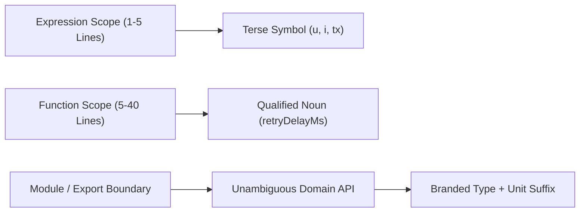
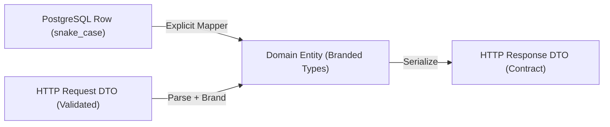

---
tags:
  - software-engineering
  - clean-code
  - naming
  - typescript
  - domain-driven-design
created: 2026-01-02
updated: 2026-11-13
status: 🟢
level: mid-to-senior
---
# Meaningful Names

> [!abstract] Vault Navigation
> Part of [[Programming/Software Engineering/Clean Code/Clean Code Complete Guide|Clean Code Complete Guide]]. Connects directly to [[Programming/Software Engineering/Clean Code/Functions|Functions]], [[Programming/Software Engineering/DDD/Strategic Design|Ubiquitous Language]], [[Programming/Software Engineering/Clean Code/Error Handling|Error Handling]], and [[Programming/Software Engineering/Clean Code/Code Smells|Code Smells]].

Identifiers constitute the primary semantic index of a software system. When an engineer reads an unfamiliar module during an outage or code review, every variable, function, type, column, and endpoint name either collapses multiple invariants into a single cognitive chunk or forces manual jumps across files to verify units, side-effect cost, nullability, and domain ownership.

---

## 1. First-Principles Mechanics of Identifier Naming

Identifier quality directly governs **working-memory saturation**, **static symbol resolution**, and **compile-time defect detection**. Poor naming is not a stylistic preference; it introduces measurable cognitive friction and runtime failure modes across the software lifecycle.

### 1.1 Cognitive Chunking and Working-Memory Constraints

Empirical cognitive science (Cowan's working-memory capacity model) establishes that human short-term working memory reliably holds roughly **4 independent chunks** of active information simultaneously while tracing control flow. When an engineer inspects a 20-line function, each active identifier competes for one of those 4 slots:

- **High-entropy opaque identifiers** (`d`, `tmp2`, `flag`, `res`, `mgr`) carry zero intrinsic semantics. To verify correctness, the reader must occupy one slot for the variable name, a second slot for its inferred runtime type, a third slot for its unit or scale, and a fourth slot for whether mutating it affects external state—leaving zero capacity to reason about business logic or concurrency races.
- **High-signal domain identifiers** (`settlementDelayMs`, `eligibleInvoiceIds`, `uncommittedLedgerEntries`) bind **concept**, **collection shape**, and **measurement unit** into a single cognitive chunk. The reader immediately reasons about boundaries (`settlementDelayMs > MAX_DELAY_MS`) without jumping to declaration sites.

### 1.2 The Scope-Length Proportionality Law

Formulated across Unix/C engineering (Kernighan and Pike) and formalized in Go and Clean Code practice, identifier length must scale monotonically with **lexical scope size** and **export reach**:

| Scope Tier | Typical Span | Naming Rule | Concrete Examples |
|---|---|---|---|
| **Expression / Micro-Scope** | 1–5 lines (lambdas, loop indices, destructuring) | Terse 1–3 char names; type and intent are visible on the same screen | `i`, `k`, `v`, `tx`, `users.map((u) => u.id)` |
| **Function / Block Scope** | 5–45 lines (local policy variables, accumulators) | Specific noun phrases encoding state and units | `overdueDays`, `retryBackoffMs`, `activeTenants` |
| **Module / Package Boundary** | Cross-file internal exports | Context-independent nouns/verbs distinguishing module role | `LedgerEntryMapper`, `computeTaxBasisPoints` |
| **Public API / Published SDK** | Cross-service or external consumers | Globally unambiguous domain terms + error/unit cues | `IdempotencyLeaseStore`, `calculateProratedRefundCents` |

Two symmetric violations break readability:
1. **Short names in wide scopes** (`export function proc(d: number, f: boolean): number`): forces every downstream caller across 30 files to jump to definition to discover units and flag meaning.
2. **Verbose names in tiny scopes** (`for (let indexOfWebhookDeliveryEndpoint = 0; ...)`): saturates line length and obscures the loop invariant when `i` or `for (const endpoint of endpoints)` conveys identical meaning with zero noise.



### 1.3 AST Searchability, Symbol Resolution, and Magic Literals

Modern navigation relies on AST-aware symbol resolution (`tsserver` Rename Symbol, Find All References) and lexical text search (`rg`). Generic identifiers (`data`, `info`, `handle`, `process`, `item`, `value`) create massive false-positive search results across unrelated bounded contexts, turning routine impact analysis into manual auditing.

Equally damaging are **unsearchable magic literals** embedded directly inside expressions:
- `if (response.status === 429 && attempt < 5)` leaves downstream maintainers guessing whether `5` represents total attempts, retries after initial failure, or circuit-breaker thresholds, and makes locating all rate-limit policies via `rg` impossible.
- Binding literals to domain-scoped constants (`HTTP_TOO_MANY_REQUESTS = 429`, `MAX_RATE_LIMIT_RETRIES = 5`, `RATE_LIMIT_BACKOFF_MS = 30_000`) creates an explicit AST node that static analysis tools can rename, trace, and verify across modules.

```typescript
const HTTP_TOO_MANY_REQUESTS = 429;
const MAX_RATE_LIMIT_RETRIES = 5;
const RATE_LIMIT_BACKOFF_MS = 30_000;

export function shouldRetryRateLimitedResponse(
  statusCode: number,
  completedRetries: number
): boolean {
  return (
    statusCode === HTTP_TOO_MANY_REQUESTS &&
    completedRetries < MAX_RATE_LIMIT_RETRIES
  );
}

export function getRateLimitBackoffMs(): number {
  return RATE_LIMIT_BACKOFF_MS;
}
```

---

## 2. Real-World Use Cases & Decision Matrix

Applying naming discipline consistently requires knowing where strict nominal encoding pays high dividends and where excessive ceremony creates noise.

### 2.1 Concrete Engineering Scenarios

1. **Financial Ledgers & Telemetry Pipelines**: Passing raw `number` across functions taking both `amountCents` and `feeBasisPoints` or `timeoutSeconds` and `timeoutMs` causes silent $100\times$ or $1000\times$ arithmetic defects that unit tests with small numbers often miss. Encoding units in suffixes **and** enforcing branded types converts argument transposition into a compiler error.
2. **Multi-Team Bounded Contexts**: In an e-commerce platform, `Order`, `Account`, and `User` carry distinct state machines in Checkout, Fulfillment, and Accounting. Adopting [[Programming/Software Engineering/DDD/Strategic Design|Ubiquitous Language]] separates `CheckoutCart`, `FulfillmentShipment`, and `ReceivableInvoice` rather than overloading a single ambiguous `OrderData` bag.
3. **High-Throughput Microservices (Cost & Latency Transparency)**: Naming a synchronous-looking RPC call `getExchangeRate()` invites engineers to call it inside a `for` loop over 500 line items, triggering 500 sequential network round-trips. Standardizing on `fetch*` for I/O-bound calls and `get*` / `calculate*` for in-memory operations communicates latency cost directly at the call site.
4. **Database-to-HTTP-to-Domain Translation Boundaries**: Preventing SQL column names (`usr_acct_flg`, `amt_val`) or generic REST payloads from leaking into business rules preserves clean [[Programming/Software Engineering/Clean Architecture/Dependency Rule|Dependency Rule]] isolation and allows schema refactors without rewriting core domain code.
5. **When NOT to Over-Qualify Identifiers**: Inside a 2-line array transformation (`const activeIds = users.filter((u) => u.isActive).map((u) => u.id)`), expanding `u` to `currentRegisteredPlatformUserRecord` adds visual clutter without clarifying anything. Similarly, generic data-structure algorithms (`swap(a, i, j)`, `clamp(value, min, max)`) should use standard mathematical/domain-neutral symbols rather than inventing verbose abstractions.

### 2.2 Decision Matrix

| Context | Naming Mechanism | Primary Benefit | When to Avoid / Relax |
|---|---|---|---|
| **Money, Time, Rates, Dimensions** | Unit suffix (`*Cents`, `*Ms`, `*Bps`) + Branded types | Compile-time prevention of $100\times$/$1000\times$ scaling bugs | Local dimensionless loop counters or normalized ratios $[0, 1]$ documented by type |
| **Cross-Service Domain Terms** | Strict DDD Ubiquitous Language glossary | Eliminates synonym drift (`fetch` vs `load` vs `retrieve`) | Throwaway prototypes or exploratory scripts deleted within days |
| **Network / DB Queries** | `fetch*` / `find*` / `persist*` verb taxonomy | Exposes I/O latency and nullability at call sites | Pure in-memory `Map` lookups (`getById`) with $O(1)$ cost |
| **Boolean Flags & Predicates** | Affirmative `is*`, `has*`, `can*`, `should*` | Prevents double-negation bugs (`!isNotDisabled`) | Never relax—negative boolean identifiers are universally harmful |
| **Local Lambdas (1–3 lines)** | 1–2 char variables (`u`, `k`, `v`, `el`) | Preserves visual focus on transformation operators | Multi-line callbacks (>5 lines) where context scrolls off-screen |

---

## 3. Complete Reference: Conventions, Type Encoding & Boundary Consistency

### 3.1 Ubiquitous Language & One-Verb-Per-Concept

Across a bounded context, establish a strict **one-verb-per-concept** dictionary documented in code review checklists and reinforced by lint rules. Mixing `fetchUser`, `retrieveOrder`, `loadInvoice`, and `getCustomer` for identical repository operations fragments team mental models and breaks codebase discoverability.

| Verb Prefix | Return & Nullability Contract | Side-Effect / Cost Contract | Concrete Example |
|---|---|---|---|
| **`find*`** | `Promise` resolving to `T` or `null` (absence is normal) | Async DB/index lookup; read-only | `findInvoiceById(id)` |
| **`get*` (sync)** | `T` (in-memory lookup) | $O(1)$ / $O(\log N)$ zero-I/O accessor | `getConfigEntry(key)` |
| **`get*OrThrow` / `require*`** | `Promise<T>` (throws `NotFoundError` if missing) | Async lookup enforcing existence invariant | `requireActiveTenant(tenantId)` |
| **`fetch*`** | `Promise<Result<T, RemoteError>>` or `Promise<T>` | Explicit network/HTTP RPC cost | `fetchFxRate(pair, signal)` |
| **`calculate*` / `compute*`** | Deterministic value `T` | Pure CPU computation; zero I/O, zero mutation | `calculateTaxCents(subtotal, bps)` |
| **`parse*` / `tryParse*`** | `T` (throws) / `Result<T, ParseError>` | Boundary validation from `unknown` | `parseWebhookPayload(rawBody)` |
| **`create*` / `from*`** | Validated instance `T` | Pure factory or domain construction | `Money.fromCents(500)` |
| **`persist*` / `save*` / `record*`** | `Promise<void>` or persisted receipt | Mutates storage; non-idempotent unless keyed | `persistSettlementReceipt(receipt)` |
| **`issue*` / `publish*` / `dispatch*`** | `Promise<void>` or event receipt | External side effect (email, queue, webhook) | `publishOrderConfirmedEvent(order)` |

> [!warning] Never Hide Writes Inside `find*` or `get*`
> Calling a method `getOrCreateSession` or hiding an `INSERT` inside `getAccount()` violates [[Programming/Software Engineering/Clean Code/Functions|Command-Query Separation]]. Callers invoke read methods inside retries, conditional guards, and diagnostic endpoints assuming safety. Name mutating provisioning explicitly (`provisionSession`, `ensureLedgerAccountExists`).

### 3.2 Boolean Variables, Predicates, and Affirmative Polarity

Every boolean identifier—parameter, property, local variable, or predicate function—must read as an **affirmative grammatical assertion** prefixed with `is`, `has`, `can`, `should`, `was`, or `will`:

- **Variables & Properties**: `isEligible`, `hasActiveSubscription`, `canRetry`, `shouldIncludeArchived`.
- **Negative Booleans (Prohibited)**: `noRetry`, `isNotDisabled`, `skipValidation`, `disableCache = false`. When evaluated inside conditionals (`if (!noRetry)` or `if (!user.isNotSuspended)`), engineers regularly invert polarity errors during edits. State the invariant affirmatively (`shouldRetry`, `isSuspended`, `shouldValidate`, `isCacheEnabled`) and negate explicitly at the call site (`!user.isSuspended`).

```typescript
// Problematic negative polarity forces double-negation decoding
interface LegacyFeatureConfig {
  readonly disableRateLimiting: boolean;
  readonly noAuditLog: boolean;
}

function shouldSkipChecks(cfg: LegacyFeatureConfig): boolean {
  return !cfg.disableRateLimiting === false || !cfg.noAuditLog === false;
}

// Affirmative polarity reads unambiguously left-to-right
interface FeaturePolicy {
  readonly isRateLimitingEnabled: boolean;
  readonly isAuditLoggingEnabled: boolean;
}

function isRequestAuditedAndThrottled(policy: FeaturePolicy): boolean {
  return policy.isRateLimitingEnabled && policy.isAuditLoggingEnabled;
}
```

### 3.3 Factory Functions, Async Operations & Event Naming

- **Factories & Named Constructors**: In languages without named constructors, static factories (`Money.fromMinorUnits(500, 'USD')`, `Money.zero('EUR')`) eliminate ambiguous constructor overloads and express unit scaling explicitly. Use `tryParse*` when failure is expected on malformed inputs, and `create*` when assembling valid domain objects.
- **Async Operations**: Avoid redundant `Async` suffixes (`fetchUserAsync`) when the return type is already `Promise<User>`. Reserve `Async` only when a module legitimately exposes both synchronous and asynchronous variants (`readFileSync` vs `readFile`). Prefer action verbs (`fetch*`, `acquire*`, `publish*`, `dispatch*`) that imply I/O coordination.
- **Events vs Event Handlers**:
  - **Domain Events** are immutable past-tense facts: `OrderConfirmed`, `PaymentCaptured`, `InvoiceVoided` (never `ConfirmOrderEvent`, which reads like a command).
  - **Commands / Intent Messages** are imperative verbs: `ConfirmOrderCommand`, `CapturePayment`.
  - **Handlers / Listeners** reflect reaction: `onPaymentCaptured`, `handlePaymentCaptured` (specifically scoped to event bus adapters, never generic business classes named `PaymentHandler`).

### 3.4 Type-System Encoding: Branded Types & Discriminants vs Hungarian Notation

Classic **Systems Hungarian Notation** (`strEmail`, `bIsActive`, `arrItems`, `iCount`) encoded primitive representation types into variable names during the C/VB era when IDE tooling and static type checking were absent. In TypeScript, Go, Rust, or Java, encoding storage types into identifiers creates **redundant noise that decays into disinformation**: changing `arrItems` from `Item[]` to `ReadonlySet<Item>` leaves `arrItems` actively lying unless every reference is renamed.

Instead, encode **semantic invariants and nominal distinctions** directly into the type system using **Branded Types** and **Discriminated Unions**:

```typescript
declare const BRAND: unique symbol;

export type Branded<TBase, TBrand extends string> = TBase & {
  readonly [BRAND]: TBrand;
};

// Nominal domain primitives prevent structural substitution bugs
export type UserId = Branded<string, 'UserId'>;
export type InvoiceId = Branded<string, 'InvoiceId'>;
export type Cents = Branded<number, 'Cents'>;
export type BasisPoints = Branded<number, 'BasisPoints'>;
export type Milliseconds = Branded<number, 'Milliseconds'>;
export type VerifiedEmail = Branded<string, 'VerifiedEmail'>;

// Discriminated Result avoids boolean-success + nullable-error ambiguity
export type Result<TValue, TError> =
  | { readonly ok: true; readonly value: TValue }
  | { readonly ok: false; readonly error: TError };
```

With branded types:
- Swapping `UserId` and `InvoiceId` in `assignInvoiceOwner(invoiceId, userId)` is a **compile-time type error**, even though both are runtime `string`s.
- Passing a raw `number` into `calculateFeeCents(amountCents, feeBps)` fails compilation; callers must construct validated values through boundary constructors (`asCents`, `asBasisPoints`), centralizing range and integer validation at module ingress.
- Notice zero runtime memory overhead: the `unique symbol` property exists strictly in TypeScript's type checker and compiles away completely in emitted JavaScript.

### 3.5 Anti-Patterns: Disinformation, Noise Suffixes, and Container Misrepresentation

| Anti-Pattern | Problematic Code | Exact Failure Mode | Clean Replacement |
|---|---|---|---|
| **Container Misrepresentation** | `const userList = new Map<string, User>()` | Implies sequential indexed `Array` (`.map`, `.length`, ordering) when actual contract is hash map lookup | `usersById` or `userById` |
| **Noise Suffixes** | `UserData`, `OrderInfo`, `CustomerObject` | Adds zero information distinguishing two representations; breeds parallel ambiguous DTOs | `User`, `Order`, `Customer` (or role-specific `OrderSummary`, `AuthCredentials`) |
| **Vague Architecture Buckets** | `BillingManager`, `AuthHelper`, `OrderProcessor`, `DateUtil` | Masks violation of [[Programming/Software Engineering/SOLID/Single Responsibility\|Single Responsibility]]; becomes a dumping ground for unrelated functions | `InvoiceSettlementService`, `JwtTokenVerifier`, `OrderPricingPolicy`, `formatIsoUtcDate` |
| **Numeric / Arbitrary Series** | `a1`, `a2`, `processOrder2`, `tempNew` | Hides behavioral delta between versions; forces callers to inspect both implementations | `sourceAccount`, `destinationAccount`, `processOrderWithIdempotency` |
| **Leaking Storage Technology** | `PostgresRedisUserCacheHashMap` | Couples domain layer to infrastructure choices (violates [[Programming/Software Engineering/SOLID/Dependency Inversion\|Dependency Inversion]]) | `UserDirectory` or `SessionStore` |

### 3.6 API, Database, and DTO Boundary Naming Consistency

Real production services span at least three naming conventions: **SQL/Database (`snake_case`)**, **External HTTP/OpenAPI DTOs (`camelCase` or `snake_case` per API standard)**, and **Internal TypeScript Domain Models (`camelCase` + Branded Types)**. Trying to force identical physical casing everywhere causes either `snake_case` pollution inside TypeScript domain logic or brittle runtime reflection hacks. Instead, enforce **semantic consistency across explicit mapper boundaries**:



- **PostgreSQL / SQL Layer**: Consistently suffix physical units and temporal semantics (`amount_cents BIGINT`, `fee_bps INTEGER`, `created_at_utc TIMESTAMPTZ`, `idempotency_key VARCHAR(128)`). Never name columns ambiguously (`amount`, `date`, `flag`, `status_val`).
- **DTO Layer**: Prefix/suffix transport payloads strictly at the boundary (`CreateSettlementRequestDto`, `SettlementResponseDto`) so internal domain models (`Settlement`, `SettlementReceipt`) never inherit transport-specific validation fields or optional PATCH semantics.
- **Mapping Layer**: Write explicit, compiler-checked mapper functions (`toDomainInvoice(row: InvoiceDbRow): Invoice`) rather than `Object.assign` or `{ ...row }` spreads, ensuring column renames or unit changes fail `tsc` immediately.

---

## 4. Step-by-Step Practical Application: Refactoring a Legacy Billing Module

This section demonstrates upgrading a production TypeScript billing module from ambiguous, weakly typed legacy code to an ESLint-enforced, domain-typed architecture with full unit and compile-time verification.

### 4.1 Production Project Layout

```text
billing-service/
├── eslint.config.mjs
├── package.json
├── tsconfig.json
└── src/
    └── billing/
        ├── domain/
        │   ├── money.ts
        │   └── invoice-types.ts
        ├── adapters/
        │   └── postgres-invoice-mapper.ts
        └── application/
            └── invoice-settlement-service.ts
└── tests/
    └── billing/
        └── invoice-settlement-service.test.ts
```

### 4.2 Automated Naming Enforcement (`eslint.config.mjs`)

Enforce consistent naming conventions in CI before code review using `@typescript-eslint/naming-convention`, `id-denylist`, and `no-shadow`:

```javascript
// eslint.config.mjs
import tseslint from 'typescript-eslint';

export default tseslint.config(
  ...tseslint.configs.strictTypeChecked,
  {
    languageOptions: {
      parserOptions: {
        projectService: true,
        tsconfigRootDir: import.meta.dirname,
      },
    },
    rules: {
      '@typescript-eslint/no-shadow': 'error',
      'id-denylist': [
        'error',
        'data',
        'info',
        'tmp',
        'temp',
        'mgr',
        'proc',
        'cb',
        'res2',
        'val',
      ],
      '@typescript-eslint/naming-convention': [
        'error',
        {
          selector: 'default',
          format: ['camelCase'],
          leadingUnderscore: 'forbid',
        },
        {
          selector: 'variable',
          modifiers: ['const', 'global'],
          format: ['UPPER_CASE', 'camelCase'],
        },
        {
          selector: 'variable',
          types: ['boolean'],
          format: ['PascalCase'],
          prefix: ['is', 'should', 'has', 'can', 'did', 'will'],
        },
        {
          selector: 'parameter',
          types: ['boolean'],
          format: ['PascalCase'],
          prefix: ['is', 'should', 'has', 'can', 'did', 'will'],
        },
        {
          selector: 'typeProperty',
          types: ['boolean'],
          format: ['PascalCase'],
          prefix: ['is', 'should', 'has', 'can', 'did', 'will'],
        },
        {
          selector: 'typeLike',
          format: ['PascalCase'],
        },
        {
          selector: 'interface',
          format: ['PascalCase'],
          custom: {
            regex: '^I[A-Z]',
            match: false,
          },
        },
      ],
    },
  }
);
```

Notice how the `types: ['boolean']` rule forces `isEligible` or `shouldRetry` rather than `noFee` or `disableCheck` at compile/lint time, while `custom.regex: '^I[A-Z]'` (`match: false`) bans legacy Hungarian `IInvoiceRepository` prefixes.

### 4.3 Legacy Before Code (`src/billing/mgr.ts`)

Consider the following legacy module exhibiting real production defects: unit confusion, container disinformation (`list` is a `Map`), negative booleans (`noFee`), magic constants, hidden I/O inside `getRate`, and vague identifiers (`mgr`, `tmp`, `procData2`).

```typescript
// BEFORE: Legacy module exhibiting naming defects and silent scaling bugs
export interface InvData {
  id: string;
  m_id: string;
  amt: number;
  curr: string;
  paid: boolean;
}

export class BillingMgr {
  private list = new Map<string, number>();

  constructor(private readonly fxApi: { getRate(c: string): Promise<number> }) {}

  public async procData2(
    d: InvData,
    rate: number,
    noFee: boolean,
    cb?: (msg: string) => void
  ): Promise<number> {
    if (d.paid) return 0;

    let tmp = d.amt;
    if (d.curr !== 'USD') {
      const r = this.list.get(d.curr) ?? (await this.fxApi.getRate(d.curr));
      this.list.set(d.curr, r);
      tmp = d.amt * r;
    }

    if (!noFee) {
      const f = tmp * rate + 30;
      tmp = tmp - f;
    }

    if (cb) cb(`done:${d.id}`);
    return tmp;
  }
}
```

Inspect the latent bugs hidden by those names:
1. Does `d.amt` represent dollars or cents? When `curr` is `'JPY'` (zero decimal places), `30` cents subtracts 30 yen instead of scaling correctly.
2. Callers frequently pass `rate = 2.9` (percentage) instead of `0.029` (decimal fraction), turning a 2.9% fee into a 290% deduction!
3. `this.list` claims to be a list/array while actually caching FX rates in a `Map` with unbounded memory growth and zero TTL.
4. `fxApi.getRate` hides an HTTP network request behind `get*`.
5. `m_id` leaks database snake_case into the domain interface.

### 4.4 Refactored Domain Types (`src/billing/domain/money.ts` & `invoice-types.ts`)

```typescript
// src/billing/domain/money.ts
declare const BRAND: unique symbol;

export type Branded<TBase, TBrand extends string> = TBase & {
  readonly [BRAND]: TBrand;
};

export type Cents = Branded<number, 'Cents'>;
export type BasisPoints = Branded<number, 'BasisPoints'>;
export type ExchangeRateMillionths = Branded<number, 'ExchangeRateMillionths'>;
export type SupportedCurrency = 'USD' | 'EUR' | 'JPY';

export const CURRENCY_MINOR_UNIT_DECIMALS: Readonly<Record<SupportedCurrency, number>> = {
  USD: 2,
  EUR: 2,
  JPY: 0,
};

export function asCents(value: number): Cents {
  if (!Number.isSafeInteger(value)) {
    throw new RangeError(`Expected safe integer minor units, received ${String(value)}`);
  }
  return value as Cents;
}

export function asBasisPoints(value: number): BasisPoints {
  if (!Number.isInteger(value) || value < 0 || value > 10_000) {
    throw new RangeError(`Basis points must be an integer between 0 and 10000, received ${String(value)}`);
  }
  return value as BasisPoints;
}

export function asExchangeRateMillionths(value: number): ExchangeRateMillionths {
  if (!Number.isSafeInteger(value) || value <= 0) {
    throw new RangeError(`Exchange rate millionths must be positive integer, received ${String(value)}`);
  }
  return value as ExchangeRateMillionths;
}

export function addCents(left: Cents, right: Cents): Cents {
  return asCents(left + right);
}

export function subtractCents(minuend: Cents, subtrahend: Cents): Cents {
  return asCents(minuend - subtrahend);
}

export function applyBasisPointsFee(principalCents: Cents, feeRateBps: BasisPoints): Cents {
  const BASIS_POINTS_DIVISOR = 10_000;
  return asCents(Math.round((principalCents * feeRateBps) / BASIS_POINTS_DIVISOR));
}
```

```typescript
// src/billing/domain/invoice-types.ts
import type { Branded, Cents, SupportedCurrency } from './money.js';

export type InvoiceId = Branded<string, 'InvoiceId'>;
export type MerchantId = Branded<string, 'MerchantId'>;
export type Milliseconds = Branded<number, 'Milliseconds'>;

export function parseInvoiceId(raw: string): InvoiceId {
  const trimmed = raw.trim();
  if (trimmed.length === 0) {
    throw new RangeError('InvoiceId cannot be empty');
  }
  return trimmed as InvoiceId;
}

export function parseMerchantId(raw: string): MerchantId {
  const trimmed = raw.trim();
  if (trimmed.length === 0) {
    throw new RangeError('MerchantId cannot be empty');
  }
  return trimmed as MerchantId;
}

export type InvoiceStatus = 'OPEN' | 'SETTLED' | 'VOID';

export interface Invoice {
  readonly invoiceId: InvoiceId;
  readonly merchantId: MerchantId;
  readonly grossMinorUnits: number;
  readonly currency: SupportedCurrency;
  readonly status: InvoiceStatus;
}

export type SettlementResult =
  | {
      readonly ok: true;
      readonly invoiceId: InvoiceId;
      readonly grossUsdCents: Cents;
      readonly feeUsdCents: Cents;
      readonly netPayoutUsdCents: Cents;
    }
  | {
      readonly ok: false;
      readonly reason: 'INVOICE_NOT_OPEN' | 'EXCHANGE_RATE_UNAVAILABLE';
    };
```

### 4.5 Explicit Boundary Mapper (`src/billing/adapters/postgres-invoice-mapper.ts`)

```typescript
// src/billing/adapters/postgres-invoice-mapper.ts
import {
  parseInvoiceId,
  parseMerchantId,
  type Invoice,
  type InvoiceStatus,
} from '../domain/invoice-types.js';
import type { SupportedCurrency } from '../domain/money.js';

export interface InvoiceDbRow {
  readonly invoice_id: string;
  readonly merchant_id: string;
  readonly gross_minor_units: number;
  readonly currency_code: SupportedCurrency;
  readonly status: InvoiceStatus;
}

export function mapDbRowToInvoice(row: InvoiceDbRow): Invoice {
  return {
    invoiceId: parseInvoiceId(row.invoice_id),
    merchantId: parseMerchantId(row.merchant_id),
    grossMinorUnits: row.gross_minor_units,
    currency: row.currency_code,
    status: row.status,
  };
}
```

### 4.6 Refactored Domain Service (`src/billing/application/invoice-settlement-service.ts`)

```typescript
// src/billing/application/invoice-settlement-service.ts
import {
  CURRENCY_MINOR_UNIT_DECIMALS,
  applyBasisPointsFee,
  asCents,
  subtractCents,
  type BasisPoints,
  type Cents,
  type ExchangeRateMillionths,
  type SupportedCurrency,
} from '../domain/money.js';
import type {
  Invoice,
  InvoiceId,
  Milliseconds,
  SettlementResult,
} from '../domain/invoice-types.js';

export interface ExchangeRateClient {
  fetchUsdConversionMillionths(
    sourceCurrency: SupportedCurrency
  ): Promise<ExchangeRateMillionths | null>;
}

export interface SettlementObserver {
  onInvoiceSettled(invoiceId: InvoiceId, netPayoutUsdCents: Cents): void;
}

export interface SettlementPolicy {
  readonly shouldChargeProcessingFee: boolean;
  readonly processingFeeRateBps: BasisPoints;
  readonly fixedTransactionFeeUsdCents: Cents;
  readonly rateCacheTtlMs: Milliseconds;
}

interface CachedFxRateEntry {
  readonly rateMillionths: ExchangeRateMillionths;
  readonly cachedAtMs: number;
}

const RATE_MILLIONTHS_DIVISOR = 1_000_000;
const USD_DECIMALS = 2;

export function convertToUsdCents(
  grossMinorUnits: number,
  sourceCurrency: SupportedCurrency,
  usdRateMillionths: ExchangeRateMillionths
): Cents {
  const sourceDecimals = CURRENCY_MINOR_UNIT_DECIMALS[sourceCurrency];
  const scaleFactor = 10 ** (USD_DECIMALS - sourceDecimals);
  const converted = (grossMinorUnits * scaleFactor * usdRateMillionths) / RATE_MILLIONTHS_DIVISOR;
  return asCents(Math.round(converted));
}

export class InvoiceSettlementService {
  private readonly fxRateEntryByCurrency = new Map<SupportedCurrency, CachedFxRateEntry>();

  constructor(
    private readonly exchangeRateClient: ExchangeRateClient,
    private readonly clockMs: () => number = () => Date.now()
  ) {}

  public async settleInvoice(
    invoice: Invoice,
    policy: SettlementPolicy,
    observer?: SettlementObserver
  ): Promise<SettlementResult> {
    if (invoice.status !== 'OPEN') {
      return { ok: false, reason: 'INVOICE_NOT_OPEN' };
    }

    const grossUsdCents = await this.resolveGrossUsdCents(
      invoice.grossMinorUnits,
      invoice.currency
    );
    if (grossUsdCents === null) {
      return { ok: false, reason: 'EXCHANGE_RATE_UNAVAILABLE' };
    }

    const feeUsdCents = this.calculateTotalFeeUsdCents(grossUsdCents, policy);
    const netPayoutUsdCents = subtractCents(grossUsdCents, feeUsdCents);

    observer?.onInvoiceSettled(invoice.invoiceId, netPayoutUsdCents);

    return {
      ok: true,
      invoiceId: invoice.invoiceId,
      grossUsdCents,
      feeUsdCents,
      netPayoutUsdCents,
    };
  }

  private calculateTotalFeeUsdCents(grossUsdCents: Cents, policy: SettlementPolicy): Cents {
    if (!policy.shouldChargeProcessingFee) {
      return asCents(0);
    }
    const percentageFee = applyBasisPointsFee(grossUsdCents, policy.processingFeeRateBps);
    return asCents(percentageFee + policy.fixedTransactionFeeUsdCents);
  }

  private async resolveGrossUsdCents(
    grossMinorUnits: number,
    currency: SupportedCurrency
  ): Promise<Cents | null> {
    if (currency === 'USD') {
      return asCents(grossMinorUnits);
    }
    const usdRateMillionths = await this.fetchCachedUsdRateMillionths(currency);
    if (usdRateMillionths === null) {
      return null;
    }
    return convertToUsdCents(grossMinorUnits, currency, usdRateMillionths);
  }

  private async fetchCachedUsdRateMillionths(
    currency: SupportedCurrency
  ): Promise<ExchangeRateMillionths | null> {
    const existing = this.fxRateEntryByCurrency.get(currency);
    const nowMs = this.clockMs();
    const ONE_MINUTE_MS = 60_000;
    if (existing && nowMs - existing.cachedAtMs < ONE_MINUTE_MS) {
      return existing.rateMillionths;
    }

    const freshRate = await this.exchangeRateClient.fetchUsdConversionMillionths(currency);
    if (freshRate === null) {
      return null;
    }
    this.fxRateEntryByCurrency.set(currency, {
      rateMillionths: freshRate,
      cachedAtMs: nowMs,
    });
    return freshRate;
  }
}
```

### 4.7 Verification Suite (`tests/billing/invoice-settlement-service.test.ts`)

```typescript
// tests/billing/invoice-settlement-service.test.ts
import { describe, expect, it, vi } from 'vitest';
import {
  InvoiceSettlementService,
  type ExchangeRateClient,
  type SettlementPolicy,
} from '../../src/billing/application/invoice-settlement-service.js';
import { mapDbRowToInvoice } from '../../src/billing/adapters/postgres-invoice-mapper.js';
import {
  asBasisPoints,
  asCents,
  asExchangeRateMillionths,
  applyBasisPointsFee,
  type Milliseconds,
} from '../../src/billing/domain/money.js';

describe('InvoiceSettlementService naming and unit invariants', () => {
  const standardPolicy: SettlementPolicy = {
    shouldChargeProcessingFee: true,
    processingFeeRateBps: asBasisPoints(290),
    fixedTransactionFeeUsdCents: asCents(30),
    rateCacheTtlMs: 60_000 as Milliseconds,
  };

  it('prevents accidental substitution of Cents and BasisPoints at compile time', () => {
    const principal = asCents(10_000);
    const feeBps = asBasisPoints(290);

    // @ts-expect-error -- Swapping BasisPoints and Cents must fail compilation
    applyBasisPointsFee(feeBps, principal);

    expect(applyBasisPointsFee(principal, feeBps)).toBe(290);
  });

  it('converts zero-decimal JPY minor units cleanly to USD cents', async () => {
    const fxClient: ExchangeRateClient = {
      fetchUsdConversionMillionths: vi.fn(async () => asExchangeRateMillionths(6_600)),
    };
    const service = new InvoiceSettlementService(fxClient, () => 1_700_000_000_000);
    const invoice = mapDbRowToInvoice({
      invoice_id: 'inv_jp_100',
      merchant_id: 'merch_88',
      gross_minor_units: 10_000,
      currency_code: 'JPY',
      status: 'OPEN',
    });

    const result = await service.settleInvoice(invoice, standardPolicy);
    expect(result).toEqual({
      ok: true,
      invoiceId: 'inv_jp_100',
      grossUsdCents: 6600,
      feeUsdCents: 221,
      netPayoutUsdCents: 6379,
    });
  });

  it('skips fee computation when shouldChargeProcessingFee is false', async () => {
    const fxClient: ExchangeRateClient = {
      fetchUsdConversionMillionths: vi.fn(),
    };
    const service = new InvoiceSettlementService(fxClient);
    const invoice = mapDbRowToInvoice({
      invoice_id: 'inv_usd_1',
      merchant_id: 'merch_12',
      gross_minor_units: 5_000,
      currency_code: 'USD',
      status: 'OPEN',
    });

    const result = await service.settleInvoice(invoice, {
      ...standardPolicy,
      shouldChargeProcessingFee: false,
    });

    expect(result).toEqual({
      ok: true,
      invoiceId: 'inv_usd_1',
      grossUsdCents: 5_000,
      feeUsdCents: 0,
      netPayoutUsdCents: 5_000,
    });
  });
});
```

---

## 5. Production Debugging, Profiling & Operations Playbook

Naming defects rarely trigger immediate syntax errors; instead they surface as subtle latency spikes, silent scale mismatches, and broken searchability during incident triage.

### 5.1 Symptom-to-Remediation Playbook

| Production Symptom | Underlying Naming Root Cause | Diagnostic Command / Inspection | Concrete Fix |
|---|---|---|---|
| **p99 latency spikes inside collection loops** | External network/DB call disguised as `get*` (`getTaxRate`, `getUser`) | `rg -n "\.get[A-Z]\w*\(" src/` followed by inspecting call sites inside `for` / `.map` loops | Rename I/O queries to `fetch*`, introduce batch lookup `fetchByIds()`, and enforce async naming checks |
| **Silent $100\times$ / $1000\times$ billing or timeout errors** | Unqualified primitive parameters (`amount: number`, `timeout: number`) swapped or passed in wrong units | `rg -n -e "amount\s*:\s*number" -e "timeout\s*:\s*number" src/` | Replace primitives with unit-suffixed identifiers (`amountCents`, `timeoutMs`) and `Branded<number, ...>` types |
| **Boolean logic flips in feature flags / auth checks** | Negative boolean names (`isNotActive`, `disableAuth`) combined with `!` negation | `rg -n -e "disable[A-Z]\w*:\s*boolean" -e "no[A-Z]\w*:\s*boolean" src/` | Invert to affirmative naming (`isActive`, `isAuthEnabled`) and configure ESLint boolean prefix rules |
| **Unexpected database writes from health or audit paths** | Mutating upsert disguised under read prefix (`getOrCreate*` or hidden write inside `find*`) | Inspect SQL/ORM trace logs triggered during read-only GET endpoints | Split strictly per [[Programming/Software Engineering/Clean Code/Functions\|Command-Query Separation]] into `find*` and `provision*` |
| **Merge conflicts / missed call sites during refactor** | Shadowed variables or overly generic names (`data`, `item`, `res`) breaking `rg` | `npx eslint --rule '@typescript-eslint/no-shadow: error' src/` | Enforce `id-denylist` and `no-shadow`; apply TypeScript Language Service AST rename |

### 5.2 Zero-Downtime Monorepo Symbol & Boundary Renaming

Renaming an exported symbol, DTO property, or SQL column in an active production system requires coordinating **compile-time**, **wire-format**, and **storage** compatibility:

1. **Internal TypeScript Modules (Single Repo)**: Use AST-aware rename (`F2` in IDE / `ts-morph` script) rather than regex find-and-replace so comments, object destructuring aliases (`{ amt: amountCents }`), and identically named symbols in separate bounded contexts are handled safely. Run `npx tsc --noEmit` immediately to catch missed dynamic lookups.
2. **Public SDK / Library Exports**: Add the new symbol (`fetchExchangeRate`), re-export the old symbol with `@deprecated Use fetchExchangeRate. Scheduled for removal in v5.0.`, and enable `@typescript-eslint/no-deprecated` in downstream workspaces to measure migration completion.
3. **HTTP JSON & PostgreSQL Boundaries**: Never rename a JSON property or SQL column in place while mixed client/server versions are deployed. Apply **Expand-and-Contract**: accept/dual-write both `amt` and `amount_cents` during deployment window $N$, backfill legacy rows, switch readers to `amount_cents`, and drop `amt` in deployment $N+1$.

---

## 6. Worked Exercises

### Exercise 1: Negative Booleans, Disinformation, and Scope Violations

Audit every naming defect in the following webhook dispatcher and rewrite it cleanly:

```typescript
export async function handle(d: any, list: Map<string, string>, noRetry: boolean) {
  if (!noRetry) {
    const arr = Array.from(list.values());
    for (
      let indexOfWebhookTargetEndpoint = 0;
      indexOfWebhookTargetEndpoint < arr.length;
      indexOfWebhookTargetEndpoint++
    ) {
      await send(arr[indexOfWebhookTargetEndpoint], d);
    }
  }
}
```

### Solution 1

1. **Diagnosis of Defects**:
   - `handle` and `d: any` violate the **Scope-Length Proportionality Law**: at an exported module boundary, neither the domain action nor the payload contract is visible.
   - `list` is **container disinformation**: the parameter type is `Map<string, string>`, not an ordered `Array`.
   - `arr` is an empty noise variable created solely to perform index iteration.
   - `noRetry` is a **negative boolean**, forcing `!noRetry` double-negation reasoning—and worse, when `noRetry` is `true`, the function silently skips sending the webhook altogether rather than merely disabling retries!
   - `indexOfWebhookTargetEndpoint` inverts the Scope-Length Law by placing a 28-character identifier inside a 3-line loop.
   - `send` fails to indicate whether delivery uses HTTP POST, queues a message, or throws on non-2xx responses.

2. **Refactored Production Code**:

```typescript
export interface WebhookEventPayload {
  readonly eventId: string;
  readonly eventType: string;
  readonly occurredAtIsoUtc: string;
  readonly body: Readonly<Record<string, unknown>>;
}

export interface WebhookDeliveryOptions {
  readonly shouldRetryOnTransientFailure: boolean;
}

export async function dispatchWebhookToSubscribers(
  payload: WebhookEventPayload,
  endpointUrlsBySubscriberId: ReadonlyMap<string, string>,
  options: WebhookDeliveryOptions,
  postEvent: (
    endpointUrl: string,
    payload: WebhookEventPayload,
    options: WebhookDeliveryOptions
  ) => Promise<void>
): Promise<void> {
  for (const endpointUrl of endpointUrlsBySubscriberId.values()) {
    await postEvent(endpointUrl, payload, options);
  }
}
```

Notice `for...of` removes the loop index completely, `endpointUrlsBySubscriberId` accurately describes the map key-value relationship, and `shouldRetryOnTransientFailure` separates delivery from retry policy without negative polarity.

---

### Exercise 2: Cost & Side-Effect Dishonesty in Function Names

During a peak traffic spike, an API endpoint's p99 latency jumps from 45 ms to 2.4 seconds while processing a 40-item order. Investigation points to two calls inside a loop:

```typescript
const rate = billingService.getExchangeRate('USD', 'EUR');
const invoice = invoiceService.getInvoice(orderId);
```

Code inspection shows `getExchangeRate` executes an uncached HTTP request to an external FX vendor, and `getInvoice` runs `INSERT ... ON CONFLICT DO UPDATE` whenever an invoice row is missing. Diagnose both naming failures and design a safe, honest API.

### Solution 2

1. **Root Cause Analysis**:
   - `getExchangeRate` violates **cost honesty**: `get*` signals an $O(1)$ in-memory read, misleading endpoint authors into calling it inside tight loops without batching, timeouts, or `AbortSignal`.
   - `getInvoice` violates **side-effect honesty** and [[Programming/Software Engineering/Clean Code/Functions|Command-Query Separation]]: under a read-only `get*` name, it mutates PostgreSQL state on a miss. Under concurrent retries or read-only diagnostic calls, it creates unexpected database locks and phantom invoice rows.

2. **Corrected API Design**:

```typescript
export interface ExchangeRateQuote {
  readonly baseCurrency: 'USD';
  readonly quoteCurrency: 'EUR';
  readonly rateMillionths: number;
}

export interface BillingExchangeClient {
  fetchExchangeRate(
    baseCurrency: string,
    quoteCurrency: string,
    signal: AbortSignal
  ): Promise<ExchangeRateQuote>;
}

export interface InvoiceRepository {
  findInvoiceByOrderId(orderId: string): Promise<Invoice | null>;
  issueInvoiceForOrder(orderId: string): Promise<Invoice>;
}
```

At every call site, `await billingClient.fetchExchangeRate(..., signal)` communicates network I/O latency and cancellation requirements, while separating `findInvoiceByOrderId` (safe read returning `null`) from `issueInvoiceForOrder` (explicit write command) eliminates accidental mutations.

---

### Exercise 3: Unit Ambiguity & Argument Transposition Bug

A payment fee calculation function has the signature:

```typescript
function applyFee(balance: number, fee: number, rate: number): number {
  return balance - fee - balance * rate;
}
```

In production, one microservice passes `(balanceDollars, feeCents, percentageWholeNumber)` while the spec expects `(balanceCents, fixedFeeCents, decimalFractionRate)`, silently undercharging or overcharging merchants by $100\times$. Refactor this using naming conventions and TypeScript branded types so both unit confusion and parameter swapping become impossible.

### Solution 3

Encode units in both parameter names and nominal branded types, constraining values inside validated boundary constructors:

```typescript
declare const UNIT_BRAND: unique symbol;
type UnitBrand<T extends string> = number & { readonly [UNIT_BRAND]: T };

export type Cents = UnitBrand<'Cents'>;
export type BasisPoints = UnitBrand<'BasisPoints'>;

export function centsFromInteger(minorUnits: number): Cents {
  if (!Number.isSafeInteger(minorUnits)) {
    throw new RangeError(`Expected integer cents, received ${String(minorUnits)}`);
  }
  return minorUnits as Cents;
}

export function basisPointsFromInteger(bps: number): BasisPoints {
  if (!Number.isInteger(bps) || bps < 0 || bps > 10_000) {
    throw new RangeError(`Expected basis points in [0, 10000], received ${String(bps)}`);
  }
  return bps as BasisPoints;
}

export function applyTransactionFeeCents(options: {
  readonly balanceCents: Cents;
  readonly fixedFeeCents: Cents;
  readonly percentageFeeBps: BasisPoints;
}): Cents {
  const variableFeeCents = Math.round(
    (options.balanceCents * options.percentageFeeBps) / 10_000
  );
  return centsFromInteger(
    options.balanceCents - options.fixedFeeCents - variableFeeCents
  );
}
```

Using both **nominal types** (`Cents` vs `BasisPoints`) and a **named options object** (`balanceCents` vs `fixedFeeCents`) stops both cross-unit confusion (`BasisPoints` passed as `Cents`) and same-type positional transposition (`fixedFeeCents` swapped with `balanceCents`).

---

### Exercise 4: Eliminating Synonym Drift Across Services

A mid-sized TypeScript backend contains four separate methods in four files, all querying the same `users` table and returning slightly different slices:
- `UserManager.retrieveUserById(id: string)`
- `AuthHelper.fetchAccountInfo(userId: string)`
- `BillingDataProcessor.loadCustomerRecord(uid: string)`
- `ProfileUtil.getUserDetails(u: string)`

Consolidate the naming architecture so roles, return contracts, and bounded contexts are unambiguous.

### Solution 4

1. **Eliminate Meaningless Suffixes**: Remove `Manager`, `Helper`, `DataProcessor`, `Util`, `Info`, `Record`, and `Details`. Remove inconsistent parameter names (`id`, `userId`, `uid`, `u`) in favor of `userId: UserId`.
2. **Standardize Repository / Query Verbs**:
   - Use `find*` when absence returns `null`.
   - Use `require*` when missing rows throw `EntityNotFoundError`.
   - Use `fetch*` only when crossing a network/HTTP service boundary.
3. **Name Projections Explicitly by Bounded Context Role**:

```typescript
export interface UserRepository {
  findById(userId: UserId): Promise<User | null>;
  requireById(userId: UserId): Promise<User>;
}

export interface AuthCredentialsReader {
  findCredentialsByUserId(userId: UserId): Promise<AuthCredentials | null>;
}

export interface BillingCustomerDirectory {
  requireBillingProfile(userId: UserId): Promise<BillingCustomerProfile>;
}

export interface UserProfileQueryService {
  findPublicProfile(userId: UserId): Promise<PublicUserProfile | null>;
}
```

Each interface now communicates its exact architectural layer, nullability guarantee, and bounded-context projection without overlap or synonym drift.

---

### Exercise 5: Boundary Translation & ESLint Naming Enforcement

A feature-flag module accepts raw PostgreSQL rows and passes them directly to UI/API consumers:

```typescript
export interface FlagInfo {
  flag_id: string;
  is_not_disabled: boolean;
  rollout_val: number;
  target_list: Map<string, boolean>;
}

export function checkFlag(info: FlagInfo, u_id: string): boolean {
  if (!info.is_not_disabled) return false;
  return info.target_list.get(u_id) ?? info.rollout_val > 50;
}
```

Identify every naming and boundary violation, explain which ESLint rules catch them automatically, and provide the complete refactored TypeScript module.

### Solution 5

1. **Violations Identified**:
   - **Boundary Leakage**: `flag_id`, `is_not_disabled`, `rollout_val`, `target_list`, `u_id` inject SQL `snake_case` directly into domain TypeScript functions.
   - **Noise Words**: `FlagInfo` and `info` parameter trigger `id-denylist` (`info` conveys zero specificity).
   - **Negative Boolean**: `is_not_disabled` forces `!info.is_not_disabled` double negation.
   - **Unit Ambiguity**: `rollout_val` omits whether rollout percentage is `0–1`, `0–100`, or `0–10000` bps.
   - **Container Disinformation**: `target_list` holds a `Map<string, boolean>`, not a list.
   - **ESLint Automated Detection**: `@typescript-eslint/naming-convention` flags `snake_case` identifiers (`flag_id`, `u_id`) via `format: ['camelCase']`, while `id-denylist` blocks `info`.

2. **Refactored Boundary + Domain Implementation**:

```typescript
declare const FLAG_BRAND: unique symbol;
export type FeatureFlagKey = string & { readonly [FLAG_BRAND]: 'FeatureFlagKey' };
export type PercentageInt = number & { readonly [FLAG_BRAND]: 'PercentageInt' };

export interface FeatureFlagDbRow {
  readonly flag_key: string;
  readonly is_enabled: boolean;
  readonly rollout_percentage: number;
  readonly overrides_by_user_id: Readonly<Record<string, boolean>>;
}

export interface FeatureFlagPolicy {
  readonly flagKey: FeatureFlagKey;
  readonly isEnabled: boolean;
  readonly rolloutPercentage: PercentageInt;
  readonly overrideByUserId: ReadonlyMap<string, boolean>;
}

export function asPercentageInt(value: number): PercentageInt {
  if (!Number.isInteger(value) || value < 0 || value > 100) {
    throw new RangeError(`Percentage must be integer in [0, 100], got ${String(value)}`);
  }
  return value as PercentageInt;
}

export function mapDbRowToFeatureFlagPolicy(row: FeatureFlagDbRow): FeatureFlagPolicy {
  return {
    flagKey: row.flag_key as FeatureFlagKey,
    isEnabled: row.is_enabled,
    rolloutPercentage: asPercentageInt(row.rollout_percentage),
    overrideByUserId: new Map(Object.entries(row.overrides_by_user_id)),
  };
}

export function isFeatureEnabledForUser(
  policy: FeatureFlagPolicy,
  userId: string,
  userBucketPercentage: PercentageInt
): boolean {
  if (!policy.isEnabled) {
    return false;
  }

  const userOverride = policy.overrideByUserId.get(userId);
  if (userOverride !== undefined) {
    return userOverride;
  }

  return userBucketPercentage < policy.rolloutPercentage;
}
```

Notice how `mapDbRowToFeatureFlagPolicy` isolates `snake_case` SQL columns at the adapter boundary, `overrideByUserId` clarifies `ReadonlyMap` key/value semantics, `isEnabled` removes double negation, and `rolloutPercentage` + `PercentageInt` clarify both scale and domain meaning.

---

← [[Programming/Software Engineering/Clean Code/Clean Code Complete Guide|Back to Clean Code]]
