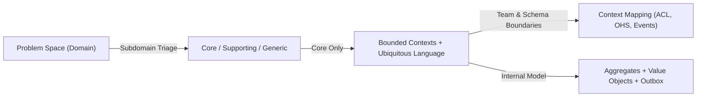

---
tags:
  - software-engineering
  - ddd
  - dashboard
created: 2026-01-02
updated: 2026-11-13
status: 🟢
level: mid-to-senior
---
# Domain-Driven Design (DDD) Complete Guide

> [!abstract] Vault Navigation
> Domain modeling hub within [[Programming/Software Engineering/Software Engineering Roadmap|Software Engineering Roadmap]]. Pairs directly with [[Programming/Software Engineering/Clean Architecture/Clean Architecture Complete Guide|Clean Architecture Complete Guide]], [[Programming/Software Engineering/Architectural Patterns/Event-Driven Architecture|Event-Driven Architecture]], and [[Programming/Software Engineering/Architectural Patterns/Event Sourcing|Event Sourcing]].

Domain-Driven Design (DDD) aligns software module boundaries, team ownership, and runtime consistency models directly with business problem spaces. At senior levels, **Strategic Design** takes precedence over tactical patterns: partitioning the system into clean Bounded Contexts prevents tangled enterprise models far more effectively than perfecting Entity/Repository syntax inside a broken boundary.

---

## 1. Core Curriculum

| Module | Engineering Scope | Status |
|---|---|---|
| [[Programming/Software Engineering/DDD/Strategic Design\|Strategic Design]] | Core/Supporting/Generic Subdomains, Build vs Buy, Bounded Contexts, Ubiquitous Language, 9 Context Mapping Patterns, EventStorming | 🟢 |
| [[Programming/Software Engineering/DDD/Tactical Design & Building Blocks\|Tactical Design & Building Blocks]] | Entities vs Value Objects, Vaughn Vernon's 4 Aggregate Rules, Domain Events + Outbox, Repositories vs DAOs, Domain vs App Services | 🟢 |

---

## 2. Strategic vs Tactical Decision Flow

---

## 3. When to Invest in Full DDD

| Subdomain Type | Strategic Investment | Tactical Pattern Choice |
|---|---|---|
| **Core Subdomain** (Competitive differentiator) | Highest seniority engineers; bespoke in-house build; EventStorming | Full DDD Tactical Model (Aggregates, Value Objects, Domain Events, optional Event Sourcing) |
| **Supporting Subdomain** (Necessary but non-differentiating) | Moderate investment; keep maintainable and decoupled | Transaction Script or Active Record / Vertical Slices; avoid complex Aggregate ceremony |
| **Generic Subdomain** (Solved commodity: Auth, Email, Billing Ledger) | Buy SaaS / adopt OSS (Auth0, Stripe, SendGrid) behind a thin ACL | Zero custom domain modeling; wrap external provider behind a minimal interface |

> [!warning] The Tactical-First Anti-Pattern
> Applying Aggregates, Value Objects, and Domain Event buses across a **Generic** or simple CRUD **Supporting** subdomain creates massive structural bloat while leaving Core domain boundaries muddy. Always classify subdomains and draw Bounded Contexts before choosing tactical patterns.

---

## 4. Cross-Cutting Architecture Links

- [[Programming/Software Engineering/Architectural Patterns/Microservices|Microservices]] — Why 1 Bounded Context does not automatically require 1 deployed microservice (Modular Monolith vs Service boundaries)
- [[Programming/Software Engineering/Architectural Patterns/Hexagonal Architecture|Hexagonal Architecture]] — Ports & Adapters shielding a Bounded Context's tactical domain core
- [[Programming/Software Engineering/Architectural Patterns/CQRS|CQRS]] — Separating Aggregate command consistency from cross-context read projections
