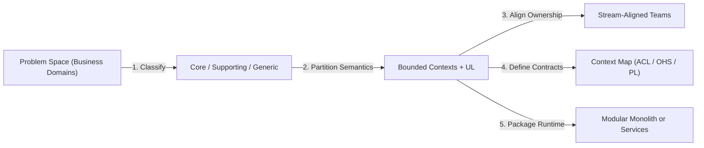
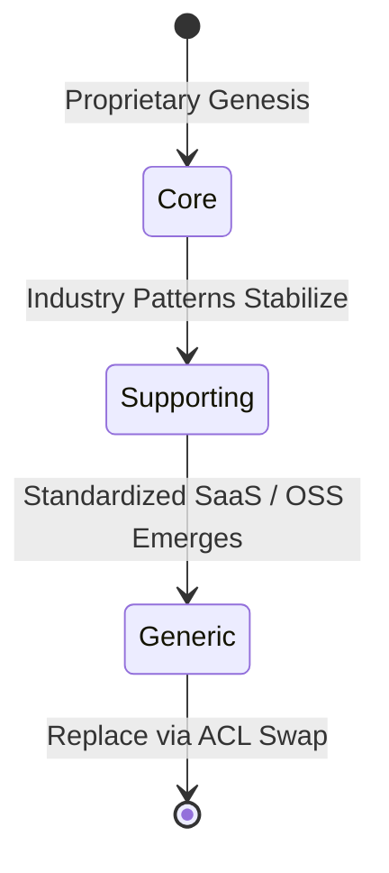
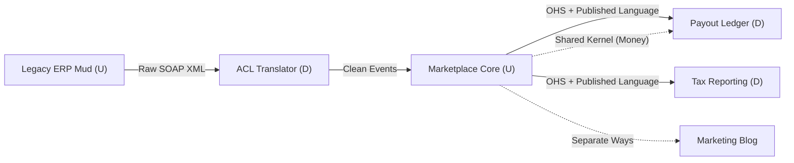
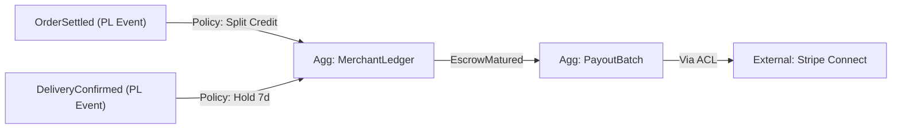
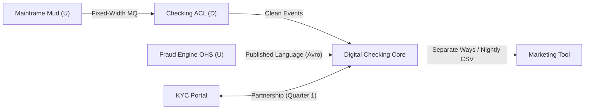

---
tags:
  - software-engineering
  - ddd
  - strategic-design
  - bounded-contexts
created: 2026-11-13
updated: 2026-11-13
status: 🟢
level: mid-to-senior
---
# Strategic Design (DDD)

> [!abstract] Hub Context
> Part of [[Programming/Software Engineering/DDD/Domain-Driven Design Complete Guide|Domain-Driven Design Complete Guide]]. Pairs with [[Programming/Software Engineering/DDD/Tactical Design & Building Blocks|Tactical Design & Building Blocks]], [[Programming/Software Engineering/Architectural Patterns/Microservices|Microservices]], [[Programming/Software Engineering/Architectural Patterns/Event-Driven Architecture|Event-Driven Architecture]], and [[Programming/Software Engineering/Clean Architecture/Clean Architecture Complete Guide|Clean Architecture Complete Guide]].

**Strategic Design** partitions an enterprise's **Problem Space** (business capabilities, competitive differentiators, regulatory rules, and domain complexity) into well-defined **Solution Space** boundaries (Bounded Contexts, Ubiquitous Languages, database schemas, team ownership seams, and integration contracts). Tactical elegance inside a broken strategic boundary accelerates technical debt: writing clean Aggregates and Value Objects inside a tangled 90-table shared database still couples deployment pipelines, cross-team sprints, and failure blast radii across the entire organization.

---

## 1. First-Principles Mechanics & Complete Architecture

Strategic Design resolves three structural failure modes that emerge as software organizations scale past a single team:

1. **Semantic Drift & Polysemy Collisions**: Identical nouns (`Order`, `Account`, `Product`, `Merchant`) accumulate contradictory validation rules across departments. Unifying them in one global schema produces nullable columns, conditional flag explosion (`isBillingVerifiedForFulfillment`), and silent invariant corruption when Team A updates a field Team B relies on.
2. **Coordination Coupling (Conway Bottlenecks)**: When multiple teams mutate the same tables or import shared mutable entities, shipping any feature requires cross-team synchronization, synchronized database migrations, and shared regression freezes.
3. **Misallocated Engineering Capital**: Organizations routinely invest senior engineering time building custom commodity software (authentication portals, PDF invoice renderers, email dispatchers) using heavy DDD Aggregates while neglecting the proprietary pricing, risk, or matching engine that actually drives revenue.



### Problem Space vs. Solution Space Mechanics

| Dimension | Problem Space | Solution Space |
|---|---|---|
| **Primary Artifact** | Business capabilities, Subdomains (**Core**, **Supporting**, **Generic**), business events, invariants | **Bounded Contexts**, code modules, database schemas, API/event contracts, deployment units |
| **Governing Question** | *"What does the business do, where does competitive advantage live, and which rules change together?"* | *"Where do models, teams, transactions, and wire schemas isolate from one another?"* |
| **Discovery Tool** | Big Picture & Process Modeling EventStorming, Domain Storytelling, Wardley Mapping | Context Mapping, Design-Level EventStorming, Schema Registries, Architecture Decision Records |
| **Ownership Mapping** | Business stakeholders, domain experts, product strategy | Engineering squads, `CODEOWNERS`, CI/CD boundaries, SLO contracts |

### Subdomain Classification & Capital Allocation Matrix

Every capability in the Problem Space falls into one of three Subdomain types. Subdomain classification dictates **Build vs. Buy vs. Wrap**, engineering seniority allocation, and whether full Tactical DDD is justified.

| Dimension | Core Subdomain | Supporting Subdomain | Generic Subdomain |
|---|---|---|---|
| **Strategic Value** | Direct competitive moat, pricing edge, proprietary algorithm, or unique customer workflow | Necessary operational glue specific to the firm's workflow, but creates zero market differentiation | Solved commodity problem identical across industries (AuthN, SMTP, PDF, billing gateway, ledger tax tables) |
| **Rule Volatility** | High; domain experts refine heuristics weekly based on market feedback | Low-to-moderate; tracks internal policy updates quarterly | Low internally; external compliance or vendor standards evolve independently |
| **Build vs. Buy** | **Build In-House** (never outsource your differentiator) | **Build Simply** or adopt customizable low-code/OSS; outsource non-critical tooling | **Buy SaaS or Adopt Battle-Tested OSS** (`Auth0`, `Stripe`, `Temporal`, `SendGrid`) |
| **Team Allocation** | Highest-leverage senior engineers paired directly with domain experts | Mid-level / generalist squad or rotating maintenance allocation | Minimal engineering time; platform or integration wrapper only |
| **Tactical Architecture** | Full DDD Tactical Model (Aggregates, Value Objects, Domain Events, optional [[Programming/Software Engineering/Architectural Patterns/Event Sourcing\|Event Sourcing]]) | [[Programming/Software Engineering/Architectural Patterns/Vertical Slice Architecture\|Vertical Slice Architecture]] / Transaction Script / Active Record | Zero domain model; wrap third-party SDK behind an **Anti-Corruption Layer (ACL)** or thin port |
| **Concrete Examples** | Uber dynamic surge dispatch; Stripe Radar ML risk engine; hedge-fund execution router | Internal vendor onboarding admin portal; warehouse asset tagging dashboard | OAuth2/OIDC SSO, transactional email delivery, invoice PDF generation, credit card vaulting |

### Build vs. Buy vs. Wrap Decision Framework

When evaluating a capability, compute total cost of ownership across three horizons rather than initial sprint velocity:

1. **Build Pure (Core Only)**: Justified when off-the-shelf software forces your differentiating workflow into generic lowest-common-denominator rules, or when vendor lock-in threatens proprietary IP.
2. **Buy & Wrap Behind ACL (Generic / Commoditized Supporting)**: Buying `Stripe` or `Clerk` eliminates PCI DSS / cryptographic rotation liability. Always wrap the vendor SDK behind a narrow domain interface (Adapter/ACL) so switching providers (`Stripe` $\rightarrow$ `Adyen`) impacts one adapter module rather than 40 controllers.
3. **Build-to-Wrap / Hybrid (Regulated Core + Generic Engine)**: Example: A logistics company uses Google Maps / OSRM (Generic routing kernel) but wraps it inside a custom Core Subdomain (`RouteOptimizationContext`) that layers proprietary cold-chain detention penalties, union driver shift rules, and border-customs dwell heuristics on top.

### Temporal Subdomain Evolution (Commoditization Drift)

Subdomain classification is **not static**. As industries mature, yesterday's **Core** differentiator commoditizes into **Supporting**, and eventually into **Generic** SaaS:



- **2011 Payment Tokenization**: Building custom PCI Level-1 card vaults and bank retry heuristics was **Core** for early marketplaces.
- **2026 Payment Tokenization**: `Stripe`, `Adyen`, and `Braintree` turned tokenization, 3DS2 challenge orchestration, and Apple Pay into **Generic** infrastructure. Any startup rebuilding raw card vaulting today burns Core capital on solved commodity plumbing.
- **Architectural Consequence**: Isolate even today's Core capabilities behind clean Bounded Context interfaces and Published Languages. When a capability inevitably shifts from Core $\rightarrow$ Supporting $\rightarrow$ Generic, you can decommission the internal module and swap in a vendor behind an ACL without destabilizing downstream consumers.

---

## 2. Bounded Contexts, Ubiquitous Language & Decision Matrix

### Ubiquitous Language (UL) as Executable Specification

The **Ubiquitous Language** is a rigorous, context-scoped vocabulary shared identically across domain experts, product specifications, automated tests, TypeScript class/method names, PostgreSQL tables, and Kafka event payloads.

- **Anti-Translation Tax**: If a product manager says *"Reserve inventory allocation on holdback"* while the codebase names the method `InventoryService.lockTempRowFlag(id, 2)`, engineers incur constant mental translation overhead. Bugs cluster inside those translation gaps.
- **Boundary Detection via Language Friction**:
  - **Polysemy (Same Word, Different Meaning)**: `Order` in Checkout means cart discounts, promo rules, and tax estimates. `Order` in Warehouse means pick-waves, SKU bin coordinates, and carton weight. `Order` in Billing means tax invoices, payment captures, and credit memos.
  - **Synonymy (Different Words, Same Concept inside One Context)**: One module calls an entity `Client`, another calls it `Customer`, and a third calls it `BuyerAccount`. Inside a single Bounded Context, choose **one canonical term** and refactor all code and SQL columns to match; if they genuinely carry distinct invariants, split them into distinct Bounded Contexts.

### Semantic Polysemy Across Four Production Contexts

Attempting to model `Order`, `Customer`, and `Product` inside one company-wide shared entity guarantees a coupled monster table. The table below traces how four distinct Bounded Contexts model those exact same nouns with completely separate invariants and lifecycles:

| Noun | Sales / Checkout BC | Billing / Ledger BC | Fulfillment / Warehouse BC | Customer Support BC |
|---|---|---|---|---|
| **`Order`** | `ShoppingOrder`: line items, coupon eligibility, tax calculation, quote expiration (`15m` TTL) | `SalesReceivable`: ledger balance, captured vs authorized cents, refund credit notes | `FulfillmentOrder`: pick-list tasks, warehouse bin routing, carrier tracking numbers, carton dimensions | `SupportCaseOrder`: SLA tier, dispute status, return merchandise authorization (`RMA`) reason |
| **`Customer`** | `Shopper`: loyalty tier, active cart, promo eligibility, shipping preferences | `BillingAccount`: tax exemption ID, payment tokens, billing address, dunning delinquent flag | `Recipient`: gate access code, delivery signature requirement, drop-off coordinates | `CaseRequester`: CSAT history, VIP escalation flag, prior refund abuse score |
| **`Product`** | `CatalogListing`: marketing title, rich media URLs, bundle discount rules, MSRP | `TaxableSku`: tax category code (`SaaS`, `Food`, `Digital`), revenue recognition schedule (`ASC 606`) | `PhysicalItem`: weight in grams, LxWxH mm, hazmat class, cold-chain storage zone | `SupportedAsset`: warranty expiration window, replacement part compatibility matrix |
| **Shared Key** | `orderId` (UUIDv7) | `orderId` (UUIDv7) | `orderId` (UUIDv7) | `orderId` (UUIDv7) |

Notice the critical invariant: **only the opaque identifier (`orderId`, `customerId`, `sku`) crosses Bounded Contexts**. Each Bounded Context stores only the projections and attributes required to enforce its own local invariants.

### Three Axes Governing Bounded Context Boundaries

1. **Linguistic / Semantic Axis**: Split whenever a term carries irreconcilable state machines or definitions across workflows.
2. **Team-Ownership & Cognitive Load Axis (Conway's Law & Team Topologies)**:
   - **Conway's Law**: *"Organizations design systems whose communication structures mirror their own organizational communication structures."* If you have a separate Frontend team, Backend team, and DBA team, every feature becomes a 3-team handoff with anemic layered DTOs.
   - **Inverse Conway Maneuver**: Deliberately structure engineering teams as **Stream-Aligned Teams** (from *Team Topologies*), where each squad owns **1 to 3 closely related Bounded Contexts** end-to-end (API/UI, domain logic, Postgres schema, CI/CD, production on-call).
   - **Platform Team**: Owns golden-path self-service capabilities (Kafka clusters, Outbox CDC connectors, OpenTelemetry instrumentation, Kubernetes base templates) so Stream-Aligned teams focus on Core Ubiquitous Language.
   - **Enabling Team**: Principal architects or domain specialists who temporarily pair with Stream-Aligned teams to run EventStorming workshops or introduce Anti-Corruption Layers before moving on.
3. **Transactional & Data Ownership Axis**:
   - **Zero Shared Mutable Tables**: Context A must never execute `INSERT`, `UPDATE`, or `JOIN` queries against tables owned by Context B. Every Context accesses external data exclusively via Context B's published API or replicated local read projection populated by domain events.

### Modular Monolith vs. Physical Microservice Criterion

A **Bounded Context is a logical boundary, NOT automatically a network-deployed microservice**. Creating 15 HTTP/Kafka microservices on day one introduces distributed serialization latency, split-brain debugging, independent release orchestration, and network partial-failure modes before Ubiquitous Language boundaries have even stabilized.

Start with a **Modular Monolith** (single deployable artifact containing physically isolated Bounded Context directories, separate PostgreSQL schemas, strict compile-time import rules, and async outbox/in-memory event contracts), and extract a Bounded Context into a physical microservice **only** when concrete operational criteria demand the network hop.

| Boundary Criterion | Keep as Module in Modular Monolith | Extract to Physical Microservice |
|---|---|---|
| **Domain Maturity** | Boundaries and Ubiquitous Language still shifting during product discovery | Context semantics and Published Language stable for 2+ quarters |
| **Team Count & Coordination** | 1–4 squads (< 25 engineers) sharing a single fast CI pipeline (< 8 min) | 5+ independent squads experiencing merge queue bottlenecks and release train contention |
| **Scaling Asymmetry** | Uniform traffic/CPU profile across modules | One Core module needs GPU inference, burst autoscaling (50x traffic spikes), or isolated memory bounds |
| **Fault & Security Isolation** | Standard failure blast radius; homogeneous trust tier | PCI/HIPAA compliance isolation, untrusted third-party webhook ingestion, or noisy-neighbor OOM risk |
| **Runtime Language / Store** | Uniform TypeScript/Go stack sharing ACID Postgres | Specialized stack needed (Rust solver, Python ML pipeline, ClickHouse analytics store) |

> [!important] The Migration Rule of Thumb
> A properly bounded Modular Monolith where Context A talks to Context B **strictly through explicit Published Language interfaces and Domain Events** (never cross-module SQL joins or private Entity imports) can be extracted into a standalone microservice in days simply by swapping the in-process transport adapter for an HTTP/gRPC/Kafka adapter.

### Real-World Use Cases & Decision Scenarios

| Scenario | Recommended Strategic Choice | Trade-Off & Justification |
|---|---|---|
| **1. Fintech Card Authorization & Fraud Scoring** | Separate **Authorization BC** (Core, ultra-low latency `< 25ms`) and **Fraud ML BC** (Core, Python feature pipeline) deployed as separate services | Distinct scaling/runtime profiles (`Go/Rust` vs `Python/ONNX`); fault isolation guarantees fraud-model slowdowns fall back to deterministic heuristic rules without halting card swipes |
| **2. Seed-Stage B2B SaaS (8 Engineers)** | **Modular Monolith** with 3 logical modules (`Identity` [Generic wrapper], `Billing` [Generic Stripe ACL], `WorkflowCore` [Core]) | Avoids distributed tracing, Kubernetes mesh overhead, and wrong premature service splits while enforcing strict folder/schema boundaries for future scale |
| **3. Post-M&A Acquisition Integration** | Keep acquired platform quarantined as **Big Ball of Mud** behind an **Anti-Corruption Layer (ACL)**; sync via CDC/Webhook into Core **OHS** | Rewriting the acquired system immediately freezes revenue; ACL prevents cryptic legacy schemas from infecting core engineering velocity |
| **4. Internal Logistics Fleet Compliance Portal** | Single **Supporting** module using **Vertical Slice Architecture** + **Conformist** consumption of upstream `Dispatch` OHS events | Full Aggregates and Event Sourcing waste engineering cycles on straightforward audit-form CRUD |
| **5. Multi-Region EU/US Medical Claims Engine** | Physically split `PatientIdentity` & `ClaimsAdjudication` per jurisdiction with strict **Published Language** tokenization | GDPR / HIPAA data-residency boundaries forbid cross-region DB replication; tokenized opaque IDs allow anonymized analytics |

---

## 3. All 9 Context Mapping Patterns in Production Detail

A **Context Map** visualizes both **technical integration data flow** and **organizational team power dynamics** between **Upstream (`U`)** contexts (the supplier/influencer whose changes affect the consumer) and **Downstream (`D`)** contexts (the consumer/dependent).



### Summary Comparison of All 9 Patterns

| # | Pattern | Topology (`U`/`D`) | Power Dynamic | Primary Implementation Mechanism | Fatal Failure Mode |
|---|---|---|---|---|---|
| **1** | **Partnership** | `U` $\leftrightarrow$ `D` | Symmetric mutual dependency | Co-scheduled sprint goals; joint schema PRs; mutual Pact tests | Collapses past 2 teams or across distant time zones |
| **2** | **Shared Kernel** | `U` $\leftrightarrow$ `D` | Symmetric tight coupling | Strictly scoped shared package (`@org/money-kernel`) with dual `CODEOWNERS` | Silent expansion turns two Contexts back into one monolith |
| **3** | **Customer-Supplier** | `U` $\to$ `D` | Asymmetric, cooperative | Downstream consumer-driven contract tests running in Upstream CI | Upstream product manager deprioritizes Downstream backlog |
| **4** | **Conformist** | `U` $\to$ `D` | Asymmetric, zero Downstream leverage | Downstream uses Upstream DTOs/enums directly without translation | Corrupts Core Ubiquitous Language with vendor jargon |
| **5** | **Anti-Corruption Layer (ACL)** | `U` $\to$ `D` | Defensive Downstream firewall | Adapter + Facade + Translator mapping external payloads to pure domain types | Omitting strict boundary runtime validation lets upstream nulls leak |
| **6** | **Open Host Service (OHS)** | `U` $\to$ many `D` | One Upstream, many Downstream | Standardized, documented versioned REST/gRPC/Event API hub | Unversioned breaking field changes trigger cascading outages |
| **7** | **Published Language (PL)** | `U` $\to$ many `D` | Canonical shared contract | Avro / Protobuf / JSON Schema / AsyncAPI governed by `BACKWARD` compatibility | Treating internal DB row dumps as the "Published Language" |
| **8** | **Separate Ways** | No link | Complete independence | Zero runtime link; manual reconciliation or localized duplication | Building expensive distributed sagas for $500/month edge cases |
| **9** | **Big Ball of Mud (BBM)** | Quarantined `U` | Legacy entropy containment | Explicit boundary fence + Strangler Fig + ACL + CDC | Adding new Core features directly inside the legacy mud |

---

### Pattern 1: Partnership
- **Mechanics & Team Dynamics**: Two Stream-Aligned teams have coupled business deliverables that succeed or fail together (e.g., *Search Ranking* and *Merchandising Promotions* launching a unified holiday pricing badge). Neither team dominates; both align sprint planning, feature flags, and schema rollouts simultaneously.
- **Implementation**: Joint contract tests live in CI; changes to integration payloads require approval from tech leads in both contexts before merge.
- **Exit Trigger**: The instant a third team needs the integration or schedules diverge, replace Partnership with **Open Host Service + Published Language** or **Customer-Supplier**.

### Pattern 2: Shared Kernel
- **Mechanics & Team Dynamics**: Two closely aligned contexts explicitly share a small, tightly guarded subset of domain code or database value types (typically immutable Value Objects like `Money`, `CurrencyCode`, `TenantId`, or cryptographic signature verification utilities).
- **Guardrails**: Keep the Shared Kernel tiny, stateless, and immutable. Enforce via `CODEOWNERS` so **both** teams must approve any commit touching `packages/shared-kernel/`. Never place stateful Entities, Repositories, or ORM models inside a Shared Kernel.

```json
// .github/CODEOWNERS enforcement for Shared Kernel
// /packages/shared-kernel/   @team-checkout-leads @team-ledger-leads
// package.json inside /packages/shared-kernel
{
  "name": "@marketplace/money-kernel",
  "version": "2.1.0",
  "private": true,
  "exports": {
    ".": "./dist/index.js"
  },
  "dependencies": {}
}
```

### Pattern 3: Customer-Supplier
- **Mechanics & Team Dynamics**: Upstream (`Supplier`) feeds Downstream (`Customer`), but both operate inside the same engineering org where Downstream has formal scheduling influence. Upstream allocates capacity each sprint to support Downstream contract extensions and runs Downstream's consumer-driven contract tests (Pact or OpenAPI response validators) in Upstream's PR gate.
- **Concrete Safeguard**: Upstream exposes versioned endpoints/events and maintains deprecated fields for a contractual deprecation window (e.g., 90 days) tracked via API telemetry before removal.

### Pattern 4: Conformist
- **Mechanics & Team Dynamics**: Downstream has zero leverage over Upstream (e.g., IRS e-filing specification, Apple App Store receipt verification webhook, or an entrenched 20-year SAP ERP) and chooses to adopt Upstream's schema directly rather than maintaining translation logic.
- **Strict Applicability Constraint**: Use Conformist **only** in **Generic** or thin **Supporting** contexts (e.g., a reporting export pipeline conforming directly to `Stripe` webhook event shapes). **Never** allow a Core Subdomain to act as a Conformist—external terminology drift will fracture your Core Ubiquitous Language.

### Pattern 5: Anti-Corruption Layer (ACL) — Complete TypeScript Implementation
- **Mechanics**: Downstream constructs an explicit defensive boundary composed of an **Adapter** (transport protocol isolation), **Translator** (pure deterministic schema/semantics mapping), and optional **Facade** (simplifying multi-call legacy endpoints into one coherent operation). Upstream anomalies—cryptic error codes (`ERR_4091`), sentinel strings (`"9999-12-31"`), float dollar strings (`"142.50"`), legacy tax assumptions—stop completely at the ACL gate.

Below is a complete, runnable TypeScript ACL insulating a Core **Fulfillment Bounded Context** from a chaotic upstream Legacy Logistics Vendor API (`MegaFreight SOAP/JSON Bridge`):

```typescript
// src/modules/fulfillment/infrastructure/acl/mega-freight.types.ts
// Exact noisy schema owned by the external MegaFreight vendor (never imported by Domain!)
import { z } from 'zod';

export const MegaFreightWebhookSchema = z.object({
  HDR_REC: z.object({
    SHP_REF_NO: z.string().min(1),
    TX_CD: z.enum(['100', '205', '402', '999']),
    EVT_TS_EPOCH_MS: z.union([z.number(), z.string()]),
    CARRIER_FACILITY_CD: z.string().nullable(),
  }),
  FIN_ADJ: z
    .object({
      SURCHARGE_AMT_STR: z.string().optional(), // e.g. "14.95" or ""
      CURR_ISO: z.string().optional(),
      VOID_DT: z.string().optional(), // Vendor sends "9999-12-31" for non-voided items!
    })
    .optional(),
});

export type MegaFreightRawPayload = z.infer<typeof MegaFreightWebhookSchema>;
```

```typescript
// src/modules/fulfillment/domain/shipment-checkpoint.ts
// Pure Core Ubiquitous Language types — zero vendor terminology
export type CheckpointStatus =
  | 'IN_TRANSIT'
  | 'CUSTOMS_HELD'
  | 'EXCEPTION_RETURNED'
  | 'DELIVERED';

export interface Money {
  readonly minorUnits: number;
  readonly currency: 'USD' | 'EUR' | 'GBP';
}

export interface ShipmentCheckpoint {
  readonly trackingReference: string;
  readonly status: CheckpointStatus;
  readonly occurredAt: Date;
  readonly hubCode: string | null;
  readonly customsAdjustment: Money | null;
}

export class UnrecognizedUpstreamContractError extends Error {
  constructor(message: string, public readonly rawContext: unknown) {
    super(message);
    this.name = 'UnrecognizedUpstreamContractError';
  }
}
```

```typescript
// src/modules/fulfillment/infrastructure/acl/mega-freight.acl.ts
import {
  CheckpointStatus,
  Money,
  ShipmentCheckpoint,
  UnrecognizedUpstreamContractError,
} from '../../domain/shipment-checkpoint';
import {
  MegaFreightRawPayload,
  MegaFreightWebhookSchema,
} from './mega-freight.types';

const TX_CODE_TO_DOMAIN_STATUS: Record<
  MegaFreightRawPayload['HDR_REC']['TX_CD'],
  CheckpointStatus
> = {
  '100': 'IN_TRANSIT',
  '205': 'CUSTOMS_HELD',
  '402': 'EXCEPTION_RETURNED',
  '999': 'DELIVERED',
};

const SUPPORTED_CURRENCIES = new Set(['USD', 'EUR', 'GBP'] as const);

export class MegaFreightAntiCorruptionTranslator {
  /**
   * Parses untrusted external JSON and translates into pure Core Domain concepts.
   * Rejects malformed contracts early at the context perimeter.
   */
  public translateWebhook(rawInput: unknown): ShipmentCheckpoint {
    const parsed = MegaFreightWebhookSchema.safeParse(rawInput);
    if (!parsed.success) {
      throw new UnrecognizedUpstreamContractError(
        `MegaFreight contract validation failed: ${parsed.error.message}`,
        rawInput,
      );
    }

    const raw = parsed.data;
    const occurredAtMs = Number(raw.HDR_REC.EVT_TS_EPOCH_MS);
    if (!Number.isFinite(occurredAtMs) || occurredAtMs <= 0) {
      throw new UnrecognizedUpstreamContractError(
        `Invalid upstream epoch timestamp: ${String(raw.HDR_REC.EVT_TS_EPOCH_MS)}`,
        rawInput,
      );
    }

    const customsAdjustment = this.translateAdjustment(raw.FIN_ADJ, rawInput);
    const facilityCode = raw.HDR_REC.CARRIER_FACILITY_CD?.trim() || null;

    return {
      trackingReference: raw.HDR_REC.SHP_REF_NO.trim(),
      status: TX_CODE_TO_DOMAIN_STATUS[raw.HDR_REC.TX_CD],
      occurredAt: new Date(occurredAtMs),
      hubCode: facilityCode,
      customsAdjustment,
    };
  }

  private translateAdjustment(
    finAdj: MegaFreightRawPayload['FIN_ADJ'],
    rawInput: unknown,
  ): Money | null {
    if (!finAdj) return null;

    // Vendor encodes non-voided/active adjustments using sentinel date "9999-12-31".
    // If VOID_DT is a real historical date, the surcharge was cancelled and ignored.
    if (finAdj.VOID_DT && finAdj.VOID_DT !== '9999-12-31') {
      return null;
    }

    const rawAmt = finAdj.SURCHARGE_AMT_STR?.trim();
    if (!rawAmt || rawAmt === '0' || rawAmt === '0.00') {
      return null;
    }

    const minorUnits = this.decimalStringToMinorUnits(rawAmt, rawInput);
    const iso = (finAdj.CURR_ISO ?? 'USD').toUpperCase();
    if (!this.isSupportedCurrency(iso)) {
      throw new UnrecognizedUpstreamContractError(
        `Unsupported currency from MegaFreight: ${iso}`,
        rawInput,
      );
    }

    return { minorUnits, currency: iso };
  }

  private decimalStringToMinorUnits(decimalStr: string, rawInput: unknown): number {
    // Strictly parse string money without IEEE-754 floating point drift
    const match = /^(\d+)(?:\.(\d{1,2}))?$/.exec(decimalStr);
    if (!match) {
      throw new UnrecognizedUpstreamContractError(
        `Malformed vendor currency string: "${decimalStr}"`,
        rawInput,
      );
    }
    const major = Number(match[1]);
    const minorPadded = (match[2] ?? '').padEnd(2, '0');
    const minor = Number(minorPadded);
    const total = major * 100 + minor;
    if (!Number.isSafeInteger(total)) {
      throw new UnrecognizedUpstreamContractError(
        `Surcharge exceeds safe integer range: "${decimalStr}"`,
        rawInput,
      );
    }
    return total;
  }

  private isSupportedCurrency(code: string): code is Money['currency'] {
    return SUPPORTED_CURRENCIES.has(code as Money['currency']);
  }
}
```

Notice how **zero** occurrences of `HDR_REC`, `TX_CD`, `9999-12-31`, or floating-point string amounts ever escape `mega-freight.acl.ts`. If MegaFreight releases v4 XML tomorrow, only the ACL changes; every domain Aggregate and test inside Fulfillment remains untouched.

### Pattern 6 & Pattern 7: Open Host Service (OHS) + Published Language (PL)
- **Mechanics**: When one Upstream Bounded Context serves **three or more Downstream Contexts** (e.g., *Payments / Checkout* broadcasting settlement completions to *Payout Ledger*, *Fraud*, *Tax*, *Notifications*, and *Merchant Analytics*), building bespoke point-to-point webhooks creates $O(N)$ maintenance collapse.
  - **Open Host Service (OHS)** is the clean, documented, standardized public endpoint/event gateway exposed by Upstream.
  - **Published Language (PL)** is the canonical, versioned schema format (`Protobuf`, `Avro`, `JSON Schema`, `AsyncAPI`) decoupled from Upstream's internal database tables.
- **Golden Rule**: **Never leak internal database schemas or Aggregate internals directly onto your OHS/PL wire format.** Always run an explicit outbound mapper (`Aggregate -> PublishedLanguageEvent`).

Below are production Published Language contracts expressed in **Protobuf (`proto3`)**, **JSON Schema (2020-12)**, and **AsyncAPI 3.0**, followed by the TypeScript outbound OHS mapper:

```protobuf
// contracts/marketplace/checkout/v1/order_settled.proto
syntax = "proto3";
package marketplace.checkout.v1;

import "google/protobuf/timestamp.proto";

message Money {
  int64 minor_units = 1;
  string currency_iso = 2; // ISO-4217 e.g. "USD"
}

message MerchantSplit {
  string merchant_id = 1;
  Money gross_amount = 2;
  Money platform_fee = 3;
}

// Published Language event emitted after payment capture settles
message OrderSettledEvent {
  string event_id = 1;            // UUIDv7 idempotency key
  string schema_version = 2;      // "1.1.0"
  string order_id = 3;
  string buyer_id = 4;
  google.protobuf.Timestamp settled_at = 5;
  Money total_captured = 6;
  repeated MerchantSplit merchant_splits = 7;
  // Added in v1.1.0 (BACKWARD-compatible optional field)
  optional string settlement_batch_ref = 8;
}
```

```json
{
  "$schema": "https://json-schema.org/draft/2020-12/schema",
  "$id": "https://schemas.marketplace.internal/checkout/order-settled.v1.json",
  "title": "OrderSettledEventV1",
  "type": "object",
  "additionalProperties": false,
  "required": [
    "eventId",
    "schemaVersion",
    "orderId",
    "settledAt",
    "totalCaptured",
    "merchantSplits"
  ],
  "properties": {
    "eventId": { "type": "string", "format": "uuid" },
    "schemaVersion": { "type": "string", "const": "1.1.0" },
    "orderId": { "type": "string", "format": "uuid" },
    "settledAt": { "type": "string", "format": "date-time" },
    "settlementBatchRef": { "type": "string" },
    "totalCaptured": { "$ref": "#/$defs/Money" },
    "merchantSplits": {
      "type": "array",
      "minItems": 1,
      "items": {
        "type": "object",
        "additionalProperties": false,
        "required": ["merchantId", "grossAmount", "platformFee"],
        "properties": {
          "merchantId": { "type": "string", "format": "uuid" },
          "grossAmount": { "$ref": "#/$defs/Money" },
          "platformFee": { "$ref": "#/$defs/Money" }
        }
      }
    }
  },
  "$defs": {
    "Money": {
      "type": "object",
      "additionalProperties": false,
      "required": ["minorUnits", "currency"],
      "properties": {
        "minorUnits": { "type": "integer", "minimum": 0 },
        "currency": { "type": "string", "pattern": "^[A-Z]{3}$" }
      }
    }
  }
}
```

```yaml
# contracts/asyncapi-checkout.yaml
asyncapi: 3.0.0
info:
  title: Checkout Open Host Service Events
  version: 1.1.0
  description: Published Language domain integration stream for settled marketplace orders.
channels:
  orderSettled:
    address: checkout.order.settled.v1
    messages:
      OrderSettledEventV1:
        contentType: application/json
        payload:
          $ref: "./marketplace/checkout/v1/order-settled.v1.json"
operations:
  publishOrderSettled:
    action: send
    channel:
      $ref: "#/channels/orderSettled"
```

```typescript
// src/modules/checkout/infrastructure/ohs/order-settled.publisher-mapper.ts
import { randomUUID } from 'node:crypto';

// Internal Checkout Aggregate shape (can refactor freely without breaking PL!)
export interface InternalSettledOrderSnapshot {
  id: string;
  buyerAccountId: string;
  internalPromoCodeApplied: string | null; // Private internal detail: NOT published
  capturedMinorUnits: number;
  currencyCode: 'USD' | 'EUR' | 'GBP';
  settledTimestamp: Date;
  lines: ReadonlyArray<{
    sellerId: string;
    subtotalMinor: number;
    marketplaceCommissionMinor: number;
  }>;
}

export interface PublishedOrderSettledV1 {
  readonly eventId: string;
  readonly schemaVersion: '1.1.0';
  readonly orderId: string;
  readonly settledAt: string;
  readonly totalCaptured: { readonly minorUnits: number; readonly currency: string };
  readonly merchantSplits: ReadonlyArray<{
    readonly merchantId: string;
    readonly grossAmount: { readonly minorUnits: number; readonly currency: string };
    readonly platformFee: { readonly minorUnits: number; readonly currency: string };
  }>;
}

export function mapToPublishedOrderSettledV1(
  snapshot: InternalSettledOrderSnapshot,
): PublishedOrderSettledV1 {
  // Group internal order line items into clean per-merchant financial splits
  const splitsByMerchant = new Map<
    string,
    { grossMinor: number; feeMinor: number }
  >();

  for (const line of snapshot.lines) {
    const current = splitsByMerchant.get(line.sellerId) ?? {
      grossMinor: 0,
      feeMinor: 0,
    };
    splitsByMerchant.set(line.sellerId, {
      grossMinor: current.grossMinor + line.subtotalMinor,
      feeMinor: current.feeMinor + line.marketplaceCommissionMinor,
    });
  }

  return {
    eventId: randomUUID(),
    schemaVersion: '1.1.0',
    orderId: snapshot.id,
    settledAt: snapshot.settledTimestamp.toISOString(),
    totalCaptured: {
      minorUnits: snapshot.capturedMinorUnits,
      currency: snapshot.currencyCode,
    },
    merchantSplits: [...splitsByMerchant.entries()].map(([merchantId, totals]) => ({
      merchantId,
      grossAmount: { minorUnits: totals.grossMinor, currency: snapshot.currencyCode },
      platformFee: { minorUnits: totals.feeMinor, currency: snapshot.currencyCode },
    })),
  };
}
```

### Pattern 8: Separate Ways
- **Mechanics**: Deliberately declare **zero runtime integration** between two Bounded Contexts. Example: A corporate B2B Procurement Context and an annual Employee HR Swag Store share zero real-time inventory synchronization. Keeping them completely separate saves weeks of saga maintenance, retry queues, and schema governance for an edge case cheaper to solve via weekly CSV reconciliation or duplicate 30-line lookup helpers.

### Pattern 9: Big Ball of Mud (BBM) Containment
- **Mechanics**: Legacy monoliths lacking modular seams, saturated with circular dependencies and unguarded direct table writes, must be **explicitly drawn on the Context Map as a quarantined boundary**.
- **Strangler Fig Containment Strategy**:
  1. Declare an absolute freeze: **Zero new Core features may be coded inside the Big Ball of Mud.**
  2. Expose legacy data read-only via **Change Data Capture (CDC)** (Debezium tailing Postgres/MySQL binlog) or read-only views translated immediately through an **ACL** into new Core contexts.
  3. Route incoming requests via an API Gateway / edge router (**Strangler Proxy**) progressively shifting endpoints from the legacy Mud into clean new Bounded Contexts.

---

## 4. Step-by-Step Practical Application: EventStorming to Modular Monolith

**EventStorming** (Alberto Brandolini) is a rapid discovery protocol aligning business experts and engineers around timeline causality before designing code or database tables. Below is the end-to-end execution on a real **Multi-Merchant Marketplace & Payout System**.

### Phase 1: Big Picture EventStorming (Domain Discovery)

Gather product owners, finance/compliance leads, support leads, and engineers on an unconstrained horizontal timeline (Miro/wallboard).

1. **Unconstrained Event Dump (Orange Sticky Notes)**: Write past-tense business facts left-to-right in chronological order:
   - `MerchantApplicationSubmitted` $\rightarrow$ `KycVerificationPassed` $\rightarrow$ `CatalogItemPublished` $\rightarrow$ `BuyerCartCheckedOut` $\rightarrow$ `CardPaymentCaptured` $\rightarrow$ `MerchantEscrowCredited` $\rightarrow$ `ShipmentDispatched` $\rightarrow$ `DeliveryConfirmed` $\rightarrow$ `EscrowHoldReleased` $\rightarrow$ `PayoutBatchInitiated` $\rightarrow$ `BankAchSettled` $\rightarrow$ `BuyerChargebackOpened` $\rightarrow$ `MerchantBalanceClawedBack`.
2. **Surface Red Hotspots (Ambiguities & Risks)**:
   - *Hotspot #1*: Finance calls a seller a **`PayeeLedger`** with tax TIN/1099 limits; Compliance calls them a **`SanctionedEntity`** under AML rules; Checkout calls them a **`StorefrontDisplay`**.
   - *Hotspot #2*: *"When does Seller Escrow release—immediately on `DeliveryConfirmed`, or 7 days post-delivery unless a `BuyerChargebackOpened` exists?"*
   - *Hotspot #3*: *"Stripe Express takes 2 business days to settle bank funds—what happens if we issue payouts before Stripe actually settles?"*
3. **Draw Pivotal Events & Bounded Context Boundaries**:
   - Notice natural choke points (**Pivotal Events**) separating different cadences, actors, and state lifecycles:
     - **Onboarding & Compliance BC**: Ends at `MerchantClearedForTrading`.
     - **Checkout & Order Capture BC**: Ends at `OrderPaymentCaptured`.
     - **Fulfillment Tracking BC**: Tracks carrier checkpoints up to `OrderDeliveryConfirmed`.
     - **Merchant Ledger & Payouts BC** (**Core Subdomain**): Owns double-entry escrow holds, maturity windows, reserve clawbacks, and ACH payout batching.

### Phase 2: Process Modeling EventStorming (Escrow Release Flow)

Zoom into the critical **Escrow Release & Seller Payout** workflow using strict EventStorming grammar:
- **Actor (Small Yellow)**: Initiator (`Scheduler`, `ComplianceOfficer`, `CarrierWebhook`).
- **Command (Blue)**: Imperative intent (`CreditMerchantEscrow`, `ScheduleEscrowRelease`, `ExecutePayoutBatch`).
- **Aggregate (Large Yellow)**: Transactional consistency unit (`MerchantLedger`, `PayoutBatch`).
- **Domain Event (Orange)**: Immutable fact (`EscrowFundsMatured`, `PayoutDispatched`).
- **Read Model (Green)**: Query projection enabling decision (`MatureEscrowBalancesView`, `MerchantBankStatusView`).
- **Policy (Lilac)**: Reactive automation (`"Whenever OrderSettled -> CreditEscrow"`, `"Whenever DeliveryConfirmed -> Schedule7DayHoldRelease"`, `"Whenever ChargebackOpened -> FreezeMerchantPayouts"`).
- **External System (Pink)**: `StripeConnect` / `FedACH`.



### Phase 3: Concrete Modular Monolith Folder Structure & Enforced Boundaries

Translate the EventStorming boundaries directly into an isolated **Modular Monolith** TypeScript workspace. Each Bounded Context owns:
1. A strict top-level directory (`src/modules/<context>/`) split cleanly into `domain/`, `application/`, `infrastructure/`, and `contracts/` (Published Language).
2. A dedicated PostgreSQL schema (`onboarding.*`, `checkout.*`, `fulfillment.*`, `payouts.*`) preventing accidental cross-context SQL joins.
3. Compile/lint boundary enforcement (`eslint-plugin-boundaries`) blocking any import reaching inside another context's `domain/` or `infrastructure/`.

```text
marketplace-platform/
├── packages/
│   └── money-kernel/                    # Pattern 2: Strictly minimal Shared Kernel
│       └── src/money.ts
├── src/
│   ├── shared-infra/                    # Platform capability (Outbox relay, EventBus, Postgres pool)
│   │   ├── outbox-publisher.ts
│   │   └── pg-unit-of-work.ts
│   └── modules/
│       ├── checkout/                    # Bounded Context 1
│       │   ├── contracts/               # Pattern 7: Published Language (OrderSettledV1)
│       │   ├── domain/
│       │   ├── application/
│       │   └── infrastructure/
│       ├── fulfillment/                 # Bounded Context 2
│       │   ├── contracts/               # Published Language (OrderDeliveredV1)
│       │   ├── domain/
│       │   ├── application/
│       │   └── infrastructure/          # Pattern 5: MegaFreight ACL
│       └── payouts/                     # Bounded Context 3 (Core Subdomain)
│           ├── contracts/               # Payouts OHS + Published Language
│           ├── domain/
│           │   ├── merchant-ledger.aggregate.ts
│           │   ├── payout-batch.aggregate.ts
│           │   └── ports.ts
│           ├── application/
│           │   └── handle-order-settled.use-case.ts
│           └── infrastructure/
│               ├── acl/
│               │   └── stripe-connect.acl.ts
│               └── pg-ledger.repository.ts
└── eslint.boundaries.config.mjs
```

Below are complete, runnable boundary configuration, Published Language consumer, ACL gateway, and automated boundary/contract verification code for the **Payouts Bounded Context**:

```javascript
// eslint.boundaries.config.mjs — Enforces Bounded Context isolation at CI lint time
import boundaries from 'eslint-plugin-boundaries';

export default [
  {
    plugins: { boundaries },
    settings: {
      'boundaries/elements': [
        { type: 'kernel', pattern: 'packages/money-kernel/*' },
        { type: 'platform', pattern: 'src/shared-infra/*' },
        {
          type: 'bc-contracts',
          pattern: 'src/modules/*/contracts/*',
          capture: ['module'],
        },
        {
          type: 'bc-internals',
          pattern: 'src/modules/*/(domain|application|infrastructure)/*',
          capture: ['module'],
        },
      ],
    },
    rules: {
      'boundaries/element-types': [
        'error',
        {
          default: 'disallow',
          rules: [
            // A module's internals may import its own internals, shared kernel, platform,
            // AND ONLY the `contracts/` (Published Language) of OTHER Bounded Contexts.
            {
              from: ['bc-internals'],
              allow: [
                ['bc-internals', { module: '${from.module}' }],
                ['bc-contracts'],
                'kernel',
                'platform',
              ],
            },
            // Published Language contracts remain pure (zero infrastructure/internal imports)
            {
              from: ['bc-contracts'],
              allow: ['kernel'],
            },
          ],
        },
      ],
    },
  },
];
```

```typescript
// src/modules/checkout/contracts/events.v1.ts
// Published Language exposed by Checkout Context (OHS)
export interface MoneyDto {
  readonly minorUnits: number;
  readonly currency: 'USD' | 'EUR' | 'GBP';
}

export interface OrderSettledIntegrationEventV1 {
  readonly eventId: string;
  readonly eventType: 'checkout.order.settled.v1';
  readonly occurredAtIso: string;
  readonly orderId: string;
  readonly merchantSplits: ReadonlyArray<{
    readonly merchantId: string;
    readonly grossAmount: MoneyDto;
    readonly platformFee: MoneyDto;
  }>;
}
```

```typescript
// src/modules/payouts/infrastructure/acl/stripe-connect.acl.ts
// Pattern 5: Outbound/Inbound ACL insulating Payouts Core from Stripe Connect SDK jargon
export interface StripeTransferApiPayload {
  readonly amount: number;
  readonly currency: string;
  readonly destination: string;
  readonly transfer_group: string;
  readonly metadata: Record<string, string>;
}

export interface StripeTransferApiResponse {
  readonly id: string;
  readonly amount: number;
  readonly reversed: boolean;
  readonly status?: 'paid' | 'pending' | 'in_transit' | 'failed';
}

export interface PayoutTransferCommand {
  readonly payoutBatchId: string;
  readonly merchantId: string;
  readonly connectedAccountToken: string;
  readonly netMinorUnits: number;
  readonly currency: 'USD' | 'EUR' | 'GBP';
}

export interface PayoutReceipt {
  readonly providerTransferId: string;
  readonly settledMinorUnits: number;
  readonly providerState: 'ACCEPTED' | 'REJECTED';
}

export interface ExternalPayoutGateway {
  dispatchTransfer(
    cmd: PayoutTransferCommand,
    idempotencyKey: string,
  ): Promise<PayoutReceipt>;
}

export interface StripeHttpTransport {
  createTransfer(
    payload: StripeTransferApiPayload,
    idempotencyKey: string,
  ): Promise<StripeTransferApiResponse>;
}

export class StripeConnectPayoutAcl implements ExternalPayoutGateway {
  constructor(private readonly transport: StripeHttpTransport) {}

  async dispatchTransfer(
    cmd: PayoutTransferCommand,
    idempotencyKey: string,
  ): Promise<PayoutReceipt> {
    if (!Number.isSafeInteger(cmd.netMinorUnits) || cmd.netMinorUnits <= 0) {
      throw new Error(`Invalid payout minor units: ${cmd.netMinorUnits}`);
    }

    const stripePayload: StripeTransferApiPayload = {
      amount: cmd.netMinorUnits,
      currency: cmd.currency.toLowerCase(), // Stripe expects lowercase ISO ("usd")
      destination: cmd.connectedAccountToken,
      transfer_group: `batch_${cmd.payoutBatchId}`,
      metadata: {
        marketplace_merchant_id: cmd.merchantId,
        payout_batch_id: cmd.payoutBatchId,
      },
    };

    const response = await this.transport.createTransfer(
      stripePayload,
      idempotencyKey,
    );

    return {
      providerTransferId: response.id,
      settledMinorUnits: response.amount,
      providerState:
        response.reversed || response.status === 'failed'
          ? 'REJECTED'
          : 'ACCEPTED',
    };
  }
}
```

```typescript
// src/modules/payouts/application/handle-order-settled.use-case.ts
// Downstream consumer translating Checkout's Published Language into Payouts Core commands
import { OrderSettledIntegrationEventV1 } from '../../checkout/contracts/events.v1';

export interface EscrowLedgerPort {
  recordIdempotentEscrowCredits(input: {
    eventId: string;
    orderId: string;
    occurredAt: Date;
    entries: ReadonlyArray<{
      merchantId: string;
      netEscrowMinorUnits: number;
      currency: 'USD' | 'EUR' | 'GBP';
    }>;
  }): Promise<'APPLIED' | 'ALREADY_PROCESSED'>;
}

export class HandleOrderSettledHandler {
  constructor(private readonly ledgerPort: EscrowLedgerPort) {}

  async execute(event: OrderSettledIntegrationEventV1): Promise<'APPLIED' | 'ALREADY_PROCESSED'> {
    // Inbound ACL translation: compute net payable escrow inside Payouts terminology
    const entries = event.merchantSplits.map((split) => {
      if (split.grossAmount.currency !== split.platformFee.currency) {
        throw new Error(
          `Currency mismatch in OrderSettled ${event.orderId} for merchant ${split.merchantId}`,
        );
      }
      const netMinor = split.grossAmount.minorUnits - split.platformFee.minorUnits;
      if (netMinor < 0) {
        throw new Error(
          `Platform fee exceeds gross amount on order ${event.orderId}`,
        );
      }
      return {
        merchantId: split.merchantId,
        netEscrowMinorUnits: netMinor,
        currency: split.grossAmount.currency,
      };
    });

    return this.ledgerPort.recordIdempotentEscrowCredits({
      eventId: event.eventId,
      orderId: event.orderId,
      occurredAt: new Date(event.occurredAtIso),
      entries,
    });
  }
}
```

```typescript
// src/modules/payouts/infrastructure/boundaries.spec.ts
import { describe, it, expect, vi } from 'vitest';
import { StripeConnectPayoutAcl } from './acl/stripe-connect.acl';
import { HandleOrderSettledHandler } from '../application/handle-order-settled.use-case';

describe('Strategic Boundary Contracts: ACL & Published Language', () => {
  it('StripeConnectPayoutAcl translates Core uppercase currency and metadata cleanly', async () => {
    const createTransfer = vi.fn().mockResolvedValue({
      id: 'tr_99123',
      amount: 8500,
      reversed: false,
      status: 'paid',
    });

    const acl = new StripeConnectPayoutAcl({ createTransfer });
    const receipt = await acl.dispatchTransfer(
      {
        payoutBatchId: 'batch-01',
        merchantId: 'merch-77',
        connectedAccountToken: 'acct_stripe_44',
        netMinorUnits: 8500,
        currency: 'USD',
      },
      'idem-batch-01-merch-77',
    );

    expect(createTransfer).toHaveBeenCalledWith(
      {
        amount: 8500,
        currency: 'usd',
        destination: 'acct_stripe_44',
        transfer_group: 'batch_batch-01',
        metadata: {
          marketplace_merchant_id: 'merch-77',
          payout_batch_id: 'batch-01',
        },
      },
      'idem-batch-01-merch-77',
    );
    expect(receipt).toEqual({
      providerTransferId: 'tr_99123',
      settledMinorUnits: 8500,
      providerState: 'ACCEPTED',
    });
  });

  it('HandleOrderSettledHandler enforces Payouts net escrow invariants on PL event', async () => {
    const recordIdempotentEscrowCredits = vi.fn().mockResolvedValue('APPLIED');
    const handler = new HandleOrderSettledHandler({ recordIdempotentEscrowCredits });

    await handler.execute({
      eventId: '018f4b20-1111-7000-8000-000000000001',
      eventType: 'checkout.order.settled.v1',
      occurredAtIso: '2026-11-13T10:00:00.000Z',
      orderId: 'ord-55',
      merchantSplits: [
        {
          merchantId: 'merch-1',
          grossAmount: { minorUnits: 10000, currency: 'USD' },
          platformFee: { minorUnits: 1200, currency: 'USD' },
        },
      ],
    });

    expect(recordIdempotentEscrowCredits).toHaveBeenCalledWith({
      eventId: '018f4b20-1111-7000-8000-000000000001',
      orderId: 'ord-55',
      occurredAt: new Date('2026-11-13T10:00:00.000Z'),
      entries: [
        {
          merchantId: 'merch-1',
          netEscrowMinorUnits: 8800,
          currency: 'USD',
        },
      ],
    });
  });
});
```

---

## 5. Strategic Anti-Patterns & Production Operations Playbook

### Common Strategic Anti-Patterns

1. **Entity-Service / CRUD Microservices (Nano-Services)**: Creating `UserService`, `OrderService`, `OrderItemService`, and `AddressService` as separate network services sharing one database or performing 6 synchronous RPC calls to assemble one page. **Fix**: Group entities sharing immediate transactional invariants into one cohesive Bounded Context module.
2. **The Canonical Enterprise Data Model**: A central architecture committee forcing all departments to share `@company/enterprise-models` containing a unified 70-field `Customer` class. Every field addition breaks CI across 12 teams. **Fix**: Limit shared packages strictly to immutable primitives (`Money`, `Uuid`), and exchange scoped Published Language events per context.
3. **Distributed Big Ball of Mud**: Splitting teams into microservices while retaining synchronous bi-directional REST dependencies and cross-schema SQL reads. A single downstream timeout cascades upstream across all thread pools. **Fix**: Enforce asynchronous Domain Events via Outbox for cross-context notifications, plus Read Models owned locally by each consumer.
4. **Conway Blindness**: Organizing engineering into horizontal silos (`Backend API Team`, `Frontend Team`, `Data Team`) while expecting clean vertical Bounded Contexts. Every domain change stalls across three backlogs. **Fix**: Apply the **Inverse Conway Maneuver**—assign Stream-Aligned squads owning vertical Bounded Context slices.

### Production Operations & Boundary Diagnostics Playbook

| Symptom | Root Cause | Diagnostic Commands / Telemetry | Remediation |
|---|---|---|---|
| **Every PR modifies 3+ directories and requires 2+ squad sign-offs** | Misdrawn Bounded Contexts or bloated Shared Kernel creating temporal coupling | Analyze co-change commit clustering via `git log --name-only` across 90 days; check `CODEOWNERS` overlap | Run Process-Modeling EventStorming on coupled workflows; either merge erroneously split nano-modules or extract an async Published Language seam |
| **Checkout P99 latency spikes whenever Reporting or Notifications slows down** | Synchronous HTTP calls from Core Context into Downstream/Supporting contexts instead of OHS + Events | Inspect OpenTelemetry distributed trace waterfalls (`span_count` > 4 synchronous hops on write path) | Replace synchronous Downstream notifications with Transactional Outbox events; isolate Core write path to 1 local DB commit |
| **Migration in Context A breaks Context B integration tests or production queries** | Cross-context SQL joins / shared table access bypassing Published Language | Query Postgres `pg_stat_statements` and `information_schema.role_table_grants` for cross-schema `SELECT`/`JOIN` queries | Revoke cross-schema DB privileges; expose read projection tables updated via Domain Events or versioned OHS read API |
| **Third-party vendor API deprecation requires modifying 40+ domain files** | Missing Anti-Corruption Layer (`Conformist` accidentally applied to Core domain) | `grep -rn "vendor_field\|Stripe"` inside `domain/` and `application/` layers | Introduce `infrastructure/acl/` translator + domain interface; refactor Core progressively using adapter tests |
| **Schema Registry rejects PR with `BACKWARD_INCOMPATIBLE` error** | Engineer renamed, deleted, or tightened type on a Published Language event field | Run Avro/Protobuf/JSON Schema diff check in CI (`buf breaking --against '.git#branch=main'`) | Restore old field as `deprecated`, add new optional field (`v1.1.0`), emit both until consumer telemetry hits 0, or publish `v2` topic |

#### Concrete Git Coupling & Postgres Boundary Audit Commands

```bash
# 1. Detect hidden coupling: files frequently modified together across recent 200 commits
git log -n 200 --pretty=format: --name-only \
  | grep -E '^src/modules/' \
  | sort | uniq -c | sort -nr | head -n 30

# 2. Enforce Protobuf backward compatibility in CI before merge
buf breaking contracts/ --against 'https://github.com/org/repo.git#branch=main'
```

```sql
-- 3. Audit PostgreSQL to confirm zero cross-schema role privileges exist between contexts
SELECT grantee, table_schema, privilege_type, table_name
FROM information_schema.role_table_grants
WHERE grantee IN ('svc_checkout', 'svc_payouts', 'svc_fulfillment')
  AND table_schema NOT IN ('public')
ORDER BY grantee, table_schema;
```

---

## 6. Worked Exercises

### Exercise 1: Subdomain Triage, Build vs. Buy & 3-Year Commoditization Roadmap
A B2B cross-border freight startup (24 engineers across 4 squads) plans five Q1 engineering investments:
- **A**: Building a custom enterprise SAML/OIDC SSO & RBAC policy console from scratch.
- **B**: Building a multi-leg ocean/air customs-duty optimizer and dynamic container consolidation engine (sole product feature driving 18% shipper savings).
- **C**: Building an internal compliance clerk UI to inspect uploaded Bills of Lading PDFs stored in S3.
- **D**: Integrating an upstream port-congestion AIS satellite vendor whose webhook schema changes quarterly and nests coordinates inside `VESSEL_POS_ARRAY[0].LAT_DEC_STR`.
- **E**: Maintaining a custom in-house PDF invoice generator written 3 years ago that regularly crashes Node workers with OOM errors.

Classify **A–E** by subdomain type, assign **Build vs. Buy vs. Wrap**, prescribe engineering staffing and tactical rigor, and note how **B** or **E** evolves across a 3-year horizon.

---

### Solution 1

| Initiative | Subdomain | Build / Buy / Wrap & Staffing | Tactical & Context Mapping Architecture |
|---|---|---|---|
| **A. SAML/OIDC SSO** | **Generic** | **Buy SaaS / OSS** (`WorkOS`, `Auth0`, `Keycloak`); 1 engineer for 1 week | Wrap OIDC claims (`sub`, `org_id`, `roles`) behind a tiny Edge ACL; zero custom Aggregate model |
| **B. Customs & Consolidation Engine** | **Core** | **Build In-House**; assign 10–12 senior engineers + logistics domain experts | Full EventStorming + rich Tactical Aggregates, immutable Value Objects (`TariffRate`, `ContainerVolume`), extensive property-based test suites |
| **C. Bill of Lading Inspector** | **Supporting** | **Build Minimally** (2 engineers, thin CRUD Vertical Slices + S3 pre-signed URLs) | Separate Supporting module; zero Aggregate/Event Sourcing ceremony |
| **D. Satellite AIS Feed** | External Upstream (`U`) $\to$ Core (`D`) | **Wrap via ACL**; assign 1 engineer to adapter firewall | **Anti-Corruption Layer (ACL)** validating coordinates with Zod and converting `VESSEL_POS_ARRAY` into clean Core `VesselPosition` Value Objects |
| **E. Custom PDF Generator** | **Generic** (historical drift) | **Replace with SaaS / Isolated OSS** (`Gotenberg` container or `DocRaptor`) | Extract behind an async worker/ACL consuming `InvoiceIssued` Published Language events; decommission in-house renderer |

- **3-Year Commoditization Forecast**: Over 3 years, basic tariff lookups inside **B** will likely commoditize into government/SaaS APIs (**Generic**), so keep tariff-table lookups behind an ACL port while keeping the **multi-leg container consolidation solver** pure **Core** in-house IP.

---

### Exercise 2: Resolving Semantic Polysemy in an Ambiguous Telemedicine & Claims Domain
An expanding digital health platform suffers constant merge conflicts and regression outages around a single 62-column `PatientVisit` SQL table shared across four product teams:
1. **Clinical Intake & Triage** tracks chief complaint, vitals, allergy alerts, and physician license checks.
2. **e-Prescribing & Pharmacy** tracks DEA controlled-substance validations, NDC drug codes, dosage schedules, and pharmacy routing.
3. **Insurance Adjudication** tracks CPT/ICD-10 billing codes, payer pre-authorization tokens, deductible split, and claim denial appeals.
4. **Patient Billing** tracks copay card capture, payment plans, and delinquency statements.

Yesterday, an Insurance Adjudication validation rule requiring `payerGroupNumber != null` crashed Emergency Walk-In Triage for uninsured cash patients. Partition the problem space into **Bounded Contexts**, define the **shared identifier rule**, and trace the asynchronous coordination flow when a physician finalizes a visit.

---

### Solution 2

#### Bounded Context Partitioning
Replace the monolithic `PatientVisit` entity with **four independent Bounded Contexts** linked strictly by immutable opaque identifiers (`encounterId`, `patientId`):

1. **Clinical Care BC** (`ClinicalEncounter` Aggregate): owns vitals, allergies, clinician notes, and `EncounterSignedOff` pivotal event. Zero insurance or payment fields exist here, guaranteeing cash walk-in triage never fails on payer validation.
2. **Pharmacy Fulfillment BC** (`PrescriptionOrder` Aggregate): owns NDC codes, DEA schedule rules, and pharmacy transmission state.
3. **Claims Adjudication BC** (`InsuranceClaim` Aggregate): owns ICD-10/CPT medical coding, payer EDI 837/835 state machines, and denial appeals.
4. **Patient Billing BC** (`PatientReceivable` Aggregate): owns self-pay balances, copay charges, and installment plans.

#### Event-Driven Coordination Trace
1. Clinician executes `SignOffEncounter(encounterId)` inside **Clinical Care BC**.
2. Clinical Care commits `ClinicalEncounter` (`SIGNED_OFF`) + writes `EncounterCompletedV1` (Published Language) to its Transactional Outbox in 1 ACID commit.
3. **Pharmacy BC** subscribes to `EncounterCompletedV1` (if prescriptions were authored) and initiates DEA checks independently.
4. **Claims Adjudication BC** subscribes to `EncounterCompletedV1`; if `coverageType === 'INSURED'`, creates an `InsuranceClaim`; if `coverageType === 'SELF_PAY'`, emits nothing to payers and forwards straight to **Patient Billing BC** (`SelfPayChargeAssessedV1`).

---

### Exercise 3: Designing an Enterprise Context Map Across 5 Asymmetric Teams
Design the exact **Context Map** (specifying `U`/`D`, pattern #1–#9, and technical contract mechanism) for a retail bank's new **Instant Digital Checking** initiative integrating five systems:
1. **Digital Checking Core** (new greenfield Stream-Aligned squad, Core Subdomain).
2. **Mainframe Core Ledger** (40-year COBOL batch system owned by an external vendor with zero roadmap cooperation; speaks fixed-width EBCDIC/COBOL copybooks over MQ).
3. **Enterprise Fraud Engine** (internal cooperative squad whose events are consumed by Digital Checking, Credit Cards, Mortgage, and Wire Transfers).
4. **Customer KYC/AML Portal** (internal regulatory team co-delivering a shared instant-verification milestone with Digital Checking this quarter).
5. **Corporate Marketing Newsletter Tool** (HubSpot SaaS syncing weekly opt-in emails via scheduled nightly export).

---

### Solution 3



- **Mainframe Core Ledger (`U`, BBM) $\to$ Digital Checking Core (`D`)**: **Big Ball of Mud Containment + Anti-Corruption Layer (ACL)**. Quarantine the mainframe completely; deploy a dedicated MQ-to-Domain ACL adapter parsing COBOL copybook offsets into clean Value Objects (`PostedLedgerEntry`) without letting mainframe jargon touch Checking Core.
- **Enterprise Fraud Engine (`U`) $\to$ Digital Checking + 3 Others (`D`)**: **Open Host Service (OHS) + Published Language (PL)**. Fraud exposes a versioned Kafka topic (`fraud.assessment.completed.v1`) governed by Avro `BACKWARD` compatibility inside a Schema Registry rather than maintaining 4 custom integrations.
- **Customer KYC Portal $\leftrightarrow$ Digital Checking Core**: **Partnership** for Q1 synchronized milestone delivery (joint Pact contract verification in CI), scheduled to transition into **Customer-Supplier** or **OHS** once KYC stabilizes and serves other banking verticals.
- **Digital Checking $\leftrightarrow$ Corporate Marketing Newsletter**: **Separate Ways** (or minimal nightly read-replica export). Marketing campaigns require zero real-time domain integration with Core checking balances.

---

### Exercise 4: Implementing a Production TypeScript Anti-Corruption Layer
A logistics platform integrates an upstream legacy carrier webhook emitting unpredictable JSON:
- `EVT_TP` (`"PU"` = picked up, `"OD"` = out for delivery, `"DL"` = delivered, `"EX"` = exception)
- `WT_G` (parcel weight as string `"1250"` grams or `null` when unweighed)
- `FEE_USD_FLOAT` (unsafe float such as `19.990000000002`)
- `DELIVERY_WINDOW` (`"0000-00-00"` sentinel when unknown, otherwise `"2026-11-18"`)

Write a complete TypeScript ACL (`LegacyCarrierTranslator` + Zod schema + clean Domain types + Vitest unit tests) preventing any raw sentinel string, null, or IEEE-754 float from leaking into Core.

---

### Solution 4

```typescript
// carrier-acl.ts
import { z } from 'zod';

const LegacyCarrierEventSchema = z.object({
  PARCEL_ID: z.string().min(1),
  EVT_TP: z.enum(['PU', 'OD', 'DL', 'EX']),
  WT_G: z.string().nullable(),
  FEE_USD_FLOAT: z.number().nonnegative(),
  DELIVERY_WINDOW: z.string(),
});

export type ParcelMilestone =
  | 'PICKED_UP'
  | 'OUT_FOR_DELIVERY'
  | 'DELIVERED'
  | 'DELIVERY_EXCEPTION';

export interface ParcelTelemetryUpdate {
  readonly parcelId: string;
  readonly milestone: ParcelMilestone;
  readonly weightGrams: number | null;
  readonly carrierFeeCents: number;
  readonly estimatedDeliveryDate: string | null;
}

const MILESTONE_MAP: Record<
  z.infer<typeof LegacyCarrierEventSchema>['EVT_TP'],
  ParcelMilestone
> = {
  PU: 'PICKED_UP',
  OD: 'OUT_FOR_DELIVERY',
  DL: 'DELIVERED',
  EX: 'DELIVERY_EXCEPTION',
};

export class CarrierContractError extends Error {
  constructor(message: string) {
    super(message);
    this.name = 'CarrierContractError';
  }
}

export class LegacyCarrierTranslator {
  translate(rawPayload: unknown): ParcelTelemetryUpdate {
    const parsed = LegacyCarrierEventSchema.safeParse(rawPayload);
    if (!parsed.success) {
      throw new CarrierContractError(
        `Invalid carrier webhook shape: ${parsed.error.message}`,
      );
    }

    const raw = parsed.data;
    const weightGrams = this.parseWeightGrams(raw.WT_G);
    const carrierFeeCents = Math.round(raw.FEE_USD_FLOAT * 100);
    if (!Number.isSafeInteger(carrierFeeCents)) {
      throw new CarrierContractError(`Invalid fee value: ${raw.FEE_USD_FLOAT}`);
    }

    const estimatedDeliveryDate = this.parseDeliveryWindow(raw.DELIVERY_WINDOW);

    return {
      parcelId: raw.PARCEL_ID.trim(),
      milestone: MILESTONE_MAP[raw.EVT_TP],
      weightGrams,
      carrierFeeCents,
      estimatedDeliveryDate,
    };
  }

  private parseWeightGrams(rawWeight: string | null): number | null {
    if (rawWeight === null || rawWeight.trim() === '') return null;
    const grams = Number.parseInt(rawWeight.trim(), 10);
    if (!Number.isSafeInteger(grams) || grams < 0) {
      throw new CarrierContractError(`Invalid parcel weight string: "${rawWeight}"`);
    }
    return grams;
  }

  private parseDeliveryWindow(rawDate: string): string | null {
    const trimmed = rawDate.trim();
    if (trimmed === '0000-00-00' || trimmed === '') return null;
    if (!/^\d{4}-\d{2}-\d{2}$/.test(trimmed)) {
      throw new CarrierContractError(`Malformed carrier delivery window: "${rawDate}"`);
    }
    return trimmed;
  }
}
```

```typescript
// carrier-acl.spec.ts
import { describe, it, expect } from 'vitest';
import { CarrierContractError, LegacyCarrierTranslator } from './carrier-acl';

describe('LegacyCarrierTranslator ACL', () => {
  const translator = new LegacyCarrierTranslator();

  it('sanitizes sentinel dates, IEEE-754 floats, and string weights into Domain types', () => {
    const update = translator.translate({
      PARCEL_ID: ' PCL-8821 ',
      EVT_TP: 'EX',
      WT_G: '1250',
      FEE_USD_FLOAT: 19.990000000002,
      DELIVERY_WINDOW: '0000-00-00',
    });

    expect(update).toEqual({
      parcelId: 'PCL-8821',
      milestone: 'DELIVERY_EXCEPTION',
      weightGrams: 1250,
      carrierFeeCents: 1999,
      estimatedDeliveryDate: null,
    });
  });

  it('rejects unknown event codes before reaching Core domain', () => {
    expect(() =>
      translator.translate({
        PARCEL_ID: 'PCL-1',
        EVT_TP: 'ZZ',
        WT_G: null,
        FEE_USD_FLOAT: 5.0,
        DELIVERY_WINDOW: '2026-11-18',
      }),
    ).toThrow(CarrierContractError);
  });
});
```

---

### Exercise 5: Evolving a Published Language Schema Safely (`v1` $\to$ `v1.1` vs `v2`)
Your **Checkout OHS** publishes `OrderSettledV1` consumed by 5 downstream squads. Product now demands two changes:
1. Add optional `taxJurisdictionCode` (e.g., `"US-NY"`) needed only by the Tax Context.
2. Replace scalar `platformFeeCents: number` with a breakdown object `feeBreakdown: { processingCents, marketplaceCents, totalCents }` while renaming `orderId` to `checkoutOrderUuid`.

Evaluate which change is `BACKWARD`-compatible under `v1.1` vs. requiring a breaking `v2` contract strategy, and write the safe schema + dual-emit transition plan.

---

### Solution 5

1. **Change #1 (`taxJurisdictionCode`)**: **Non-breaking `BACKWARD`-compatible extension (`v1.1.0`)**. Adding an *optional* property (never adding it to JSON Schema `required[]` and keeping `additionalProperties` / Protobuf field numbering safe) allows all 5 existing consumers to ignore the new field while Tax Context consumes it once upgraded.
2. **Change #2 (Replacing scalar with nested object + renaming `orderId`)**: **Breaking structural change**. Removing `platformFeeCents` or renaming `orderId` immediately breaks old consumers' deserializers.

#### Zero-Downtime Expand-Contract Evolution Plan
1. **Expand (`v1.1` additive phase)**: Keep `orderId` and `platformFeeCents` populated in `OrderSettledV1`, and add `feeBreakdown` alongside them as an optional field (`"schemaVersion": "1.1.0"`).
2. **Migrate Consumers**: Update downstream consumers independently over 1–2 sprints to read `feeBreakdown` instead of `platformFeeCents`, tracking consumer version metrics (`event_consumer_version` metric/header).
3. **Contract (`v2` cutover)**: Only if you truly must drop deprecated fields or rename `orderId`, publish a separate channel/topic `checkout.order.settled.v2` during a bounded deprecation window, dual-publishing `v1` and `v2` from the Outbox mapper until `v1` consumer lag and active offset counts drop to zero.

```typescript
// Additive BACKWARD-compatible outbound mapper (Phase 1 Expand)
export interface OrderSettledV1_1 {
  readonly eventId: string;
  readonly schemaVersion: '1.1.0';
  readonly orderId: string;
  readonly platformFeeCents: number; // Retained for existing consumers
  readonly taxJurisdictionCode?: string; // Safe optional addition
  readonly feeBreakdown?: {
    readonly processingCents: number;
    readonly marketplaceCents: number;
    readonly totalCents: number;
  };
}
```

---

### Exercise 6: Diagnosing & Re-Architecting a Distributed Big Ball of Mud
A 16-engineer marketplace team migrated from a monolith to 6 microservices (`Users`, `Cart`, `Catalog`, `Pricing`, `Orders`, `Promotions`). Symptoms after launch:
- Checkout `POST /orders` makes 11 synchronous REST calls across all 6 services (`P99 = 1,950ms`).
- All 6 services connect to the **same single Postgres database**, and `Orders` executes SQL `JOIN`s against `pricing_rules` and `users` tables directly.
- Adding a promotional tier requires coordinated deploys across 4 repositories.

Diagnose every strategic anti-pattern present and write the concrete remediation roadmap back to clean Bounded Contexts.

---

### Solution 6

#### Root-Cause Diagnosis
1. **Distributed Big Ball of Mud (Worst of Both Worlds)**: The team paid the full latency, serialization, and multi-repo CI cost of 6 physical network services *without* achieving semantic, schema, or deployment autonomy because all 6 share one database and call each other synchronously.
2. **Nano-Service Over-Partitioning**: `Cart`, `Pricing`, `Promotions`, and `Orders` share tightly coupled immediate checkout invariants (`apply promo -> calculate authoritative price -> lock order total`). Splitting them across HTTP boundaries forced 11 synchronous RPC round-trips.
3. **Zero Data Ownership**: Direct cross-context SQL `JOIN`s violate Bounded Context encapsulation, making independent schema migrations impossible.

#### 3-Step Remediation Architecture
1. **Consolidate Into 3 Cohesive Modules in a Modular Monolith**:
   - Merge `Cart`, `Pricing`, `Promotions`, and `Orders` into one cohesive **Sales & Checkout BC** (preserving immediate pricing invariants inside a single process and local ACID commit).
   - Keep **Catalog BC** and **Identity BC** as separate logical modules with dedicated Postgres schemas (`catalog.*`, `identity.*`, `checkout.*`).
2. **Sever Cross-Schema SQL Joins**:
   - Revoke cross-schema DB permissions immediately (`REVOKE ALL ON SCHEMA catalog FROM svc_checkout`).
   - **Checkout BC** maintains a tiny local read projection `checkout.sellable_skus(sku, unit_price_cents, tax_code)` updated asynchronously whenever **Catalog BC** emits `CatalogPriceChangedV1` (Published Language via Outbox).
3. **Resulting Checkout Critical Path**: `POST /orders` executes **1 local process call + 1 ACID PostgreSQL transaction** against `checkout.*` (`P99 < 35ms`), cutting cross-team deploy locks and eliminating 10 network failure points.
