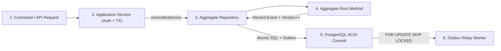
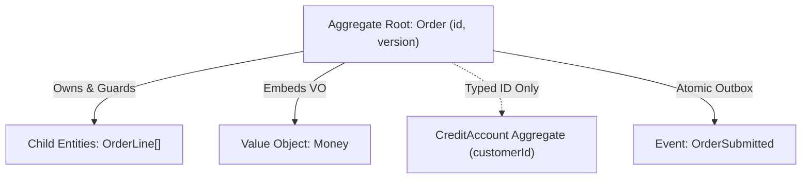
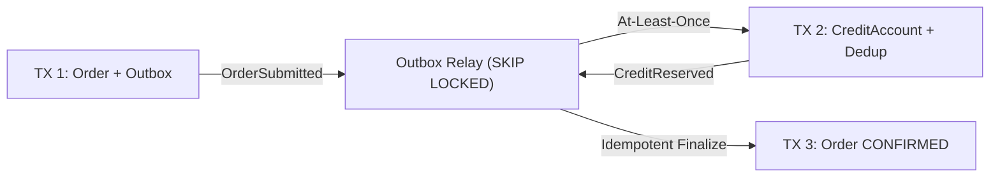

---
tags:
  - software-engineering
  - ddd
  - tactical-design
  - aggregates
created: 2026-11-13
updated: 2026-11-13
status: 🟢
level: mid-to-senior
---
# Tactical Design & Building Blocks

> [!abstract] Hub Context
> Part of [[Programming/Software Engineering/DDD/Domain-Driven Design Complete Guide|Domain-Driven Design Complete Guide]]. Implements the internal domain models inside Bounded Contexts defined in [[Programming/Software Engineering/DDD/Strategic Design|Strategic Design]]. Pairs directly with [[Programming/Software Engineering/Architectural Patterns/Hexagonal Architecture|Hexagonal Architecture]], [[Programming/Software Engineering/Architectural Patterns/CQRS|CQRS]], [[Programming/Software Engineering/Architectural Patterns/Event-Driven Architecture|Event-Driven Architecture]], and [[Programming/Software Engineering/Database Design/Transactions|Transactions]].

**Tactical Design** provides the code-level primitives—**Value Objects**, **Entities**, **Aggregates**, **Domain Events**, **Repositories**, **Domain Services**, **Application Services**, **Factories**, and **Specifications**—for enforcing strict business invariants inside a **Core Bounded Context** without coupling domain logic to HTTP frameworks, ORM internals, or distributed lock hazards.

---

## 1. First-Principles Mechanics & Complete Architecture

Tactical patterns exist to solve one engineering problem: **preserving non-trivial business invariants under concurrent execution and continuous requirement change**. When applied blindly to simple CRUD forms inside a Supporting Subdomain, Aggregates and Domain Events add indirection without ROI. When omitted from a Core Subdomain, business rules scatter across controllers, database triggers, and batch jobs—producing race conditions, negative balances, and silent state corruption.

### Pattern Complexity Decision Matrix

Select tactical depth per Bounded Context based on invariant density and concurrency contention rather than team dogma:

| Architectural Pattern | Complexity Threshold | Consistency & Validation Model | When to Choose | When to Reject |
|---|---|---|---|---|
| **Transaction Script** | Simple linear workflow; 0–2 invariants per request | Procedural SQL inside service function (`BEGIN ... UPDATE ... COMMIT`) | Supporting CRUD portals, webhooks, admin config tools | Complex state transitions (`Order` cancellation vs partial refund vs credit hold) |
| **Active Record** | Moderate data-centric validations; 1:1 table mapping | Model class wraps SQL row (`user.save()`) with field validators | Early MVPs, straightforward SaaS billing wrappers | Multi-entity Aggregate invariants, rich policy rules, non-trivial tests |
| **Rich Domain Model (DDD Tactical)** | High invariant density; multi-step state machines; concurrent mutations | **Aggregates** guard consistency boundaries; **VOs** eliminate invalid primitives; **Outbox** handles cross-aggregate effects | **Core Subdomains** (order fulfillment, credit ledgers, risk engines, booking allocations) | Simple read/write catalogs or low-value internal forms |
| **Event-Sourced Aggregate** | Complete temporal auditability, deterministic replay, or bitemporal history required | State derived by folding immutable Domain Events (`apply(events)`) with optimistic stream versioning | Financial double-entry ledgers, regulatory audit trails, collaborative workflows | Standard state-oriented Core domains where snapshots suffice (adds schema-upcasting cost) |

### Runtime Execution Lifecycle Inside a Tactical Bounded Context

Every mutating command inside a Core Bounded Context executes through a deterministic hexagonal request pipeline isolating pure domain invariants from database commits and message brokers:



1. **Application Service** authenticates the caller, checks idempotency keys, opens **one local ACID database transaction**, and asks the **Repository** to load **one Aggregate Root**.
2. **Repository** queries relational tables and invokes `Aggregate.reconstitute(snapshot)`—hydrating existing state **without** firing new creation Domain Events.
3. **Aggregate Root** validates preconditions, mutates internal Entities/Value Objects atomically, increments its internal `version` expectation, and buffers **Domain Events** in memory (`this.recordEvent(...)`).
4. **Repository** persists the Aggregate using optimistic concurrency (`UPDATE ... SET version = version + 1 WHERE id = $1 AND version = $2`), atomically inserts buffered Domain Events into `outbox_events` **inside the same SQL transaction**, and commits.
5. **Outbox Relay** asynchronously reads committed `outbox_events` (`FOR UPDATE SKIP LOCKED` or Debezium WAL CDC) and publishes them to the message broker, where downstream consumers update other Aggregates under **eventual consistency**.

---

## 2. Tactical Building Blocks: Deep Mechanics & Design Rules

### 2.1 Value Objects (VOs)

A **Value Object** models a descriptive domain measurement, identifier, or conceptual quantity defined **purely by its attributes** rather than a lifecycle identity.

- **Structural Equality**: Two `Money(500, 'USD')` instances are completely interchangeable (`a.equals(b) === true`), regardless of memory reference.
- **Strict Immutability**: Operations never mutate fields in place; `moneyA.add(moneyB)` returns a **new** `Money` instance (`Object.freeze(this)` in TypeScript prevents accidental mutation).
- **Self-Validating Construction ("Parse, Don't Validate")**: Private constructors paired with static `of()` / `create()` factories guarantee invalid Value Objects (`Money(-50, 'XYZ')`, `DateRange(end < start)`, `Email('not-an-email')`) cannot exist anywhere in memory.
- **Eliminating Primitive Obsession**: Raw `string` and `number` parameters invite parameter-swapping bugs (`reserveCredit(sku, customerId)` compiles silently if both are `string`), floating-point rounding drift (`0.1 + 0.2 === 0.30000000000000004`), and duplicated regex validation across 20 services.

#### Persistence Strategies for Value Objects in PostgreSQL
Never create separate relational tables with foreign keys for simple Value Objects like `Money` or `ShippingAddress`:
1. **Inline Flat Columns (Preferred for Indexed/Numeric VOs)**: Map `total: Money` directly into `total_minor_units BIGINT NOT NULL` and `total_currency CHAR(3) NOT NULL` inside `orders`. This enables native SQL `SUM()`, `CHECK (total_minor_units >= 0)`, and B-tree indexes without joins.
2. **JSONB Columns (Ideal for Composite Unindexed VOs)**: Store `shipping_address: Address` as a structured `JSONB` column when queried as a single document.
3. **ORM Value Transformers**: Inside TypeORM/MikroORM/Prisma mappers, translate flat columns directly to/from immutable Value Object instances inside Repository reconstitution.

### 2.2 Entities & The `create()` vs. `reconstitute()` Split

An **Entity** carries continuous identity (`OrderId`, `OrderLineId`, `CreditAccountId`) that persists across arbitrary state changes over time. Even if every attribute of an `Order` changes (`status`, `total`, `lines`), it remains the exact same `Order` because `orderA.id.equals(orderB.id)`.

**Critical Production Rule — Separate `create()` from `reconstitute()`**:
- **`Order.create(params)`** represents a **new domain occurrence**: generates a monotonic `UUIDv7` ID, initializes `version = 0`, enforces brand-new creation invariants (e.g., *"order must contain at least 1 line item"*, *"cannot submit order in the past"*), and records an `OrderSubmitted` Domain Event.
- **`Order.reconstitute(persistedState)`** rebuilds an already-persisted Aggregate from PostgreSQL rows: **must NOT emit any Domain Events** (otherwise loading an order would re-publish `OrderSubmitted`!) and **must NOT re-run creation-only policies** that may have evolved since the historical order was placed (e.g., an old order placed under a retired minimum threshold must still load cleanly for shipping or refund!).

### 2.3 Aggregates & Vaughn Vernon's 4 Design Rules

An **Aggregate** is a cluster of domain Entities and Value Objects treated as **one atomic transactional consistency boundary**, shielded behind a single **Aggregate Root** Entity. External objects may hold references **only** to the Aggregate Root and execute mutations **only** through methods on that Root—never directly mutating child entities (`order.lines[0].quantity = 99` is strictly forbidden!).



#### Vaughn Vernon's 4 Rules of Aggregate Design

1. **Rule 1: Protect True Business Invariants Inside Small Consistency Boundaries**
   - Group Entities into the same Aggregate *only* when a domain invariant **must** hold immediately upon transaction commit.
   - *Example*: An `Order` caps total line count at `50` and ensures `order.total === sum(lines.subtotal)`. Thus `OrderLine` belongs inside `Order`. Conversely, `Customer`'s lifetime loyalty tier or `Warehouse`'s global stock count should **not** live inside `Order`—including them loads thousands of rows per checkout and causes lock contention across unrelated operations.
2. **Rule 2: Reference Other Aggregates by Identity Only**
   - `Order` stores `customerId: CustomerId`, **never** `customer: Customer`.
   - Object graph references across Aggregate boundaries tempt engineers into mutating two Aggregates inside one transaction and trigger ORM lazy-loading N+1 cascades (`order.customer.orders.length`).
3. **Rule 3: Update Other Aggregates Using Eventual Consistency**
   - When `Order.submit()` requires reserving funds on `CreditAccount`, emit `OrderSubmitted` into the **Transactional Outbox** and reserve funds asynchronously inside `CreditAccount`'s own transaction.
   - When immediate capacity guarantees are required before shipment, model an explicit **Reservation / Pending State** (`OrderStatus = PENDING_CREDIT` $\rightarrow$ `CreditReserved` $\rightarrow$ `CONFIRMED`) rather than locking two Aggregates simultaneously.
4. **Rule 4: Modify Only One Aggregate Per Local ACID Transaction**
   - One request $\rightarrow$ load **1 Aggregate** $\rightarrow$ mutate $\rightarrow$ commit Aggregate + Outbox **with optimistic concurrency (`version = expectedVersion`)**.
   - Single-aggregate transactions minimize Postgres row-lock hold times, eliminate cyclic multi-row deadlocks (`Order` $\leftrightarrow$ `CreditAccount`), and remain seamlessly compatible if `Orders` and `CreditAccounts` later move to separate database shards or microservices.

### 2.4 Domain Events & The Transactional Outbox Pattern

Directly publishing to Kafka or RabbitMQ inside an Application Service (`await repo.save(order); await kafka.publish(evt);`) introduces a fatal **dual-write split-brain race**:
- If the database commits and Kafka times out or the Node process crashes 1 millisecond later, the `Order` exists in PostgreSQL with **zero downstream events** (`CreditAccount` never reserves credit, leaving the order stuck in `PENDING_CREDIT` forever).
- Publishing *before* `COMMIT` creates **phantom events** when a Postgres `CHECK` constraint or concurrency conflict rolls the transaction back.

**The Transactional Outbox Eliminates Dual-Writes Atomically**:
1. The Aggregate appends immutable Domain Events to an internal array (`this.domainEvents.push(...)`).
2. Inside `OrderRepository.save(order, tx)`, the repository updates `orders` **and** inserts serialized events into `outbox_events` using the **same PostgreSQL transaction handle (`tx`)**. Either both commit together or both roll back together.
3. An out-of-band **Outbox Relay** (either a polling worker using `SELECT ... FOR UPDATE SKIP LOCKED` or Debezium reading PostgreSQL WAL logical replication) delivers events with **at-least-once** semantics.
4. Downstream consumers achieve **effectively-once** business execution by inserting `(event_id, consumer_name)` into a `processed_events` table inside the same transaction that mutates the downstream Aggregate (`INSERT ... ON CONFLICT DO NOTHING`).



### 2.5 Repositories vs. DAOs & The CQRS Read Bypass

| Dimension | DDD Aggregate Repository | DAO / Table Data Gateway | CQRS Read Query Service |
|---|---|---|---|
| **Granularity** | **Strictly 1 per Aggregate Root** (`OrderRepository`) | 1 per SQL table (`OrderLineDao`) | Per UI view / endpoint (`OrderSummaryQuery`) |
| **Contract** | Collection semantics: `findById(id)`, `save(order)` | Raw CRUD row wrappers | Parameterized flat DTO projections (`listOrdersForDashboard()`) |
| **Return Type** | Fully reconstituted valid `Order` Aggregate Root | Mutable record bags | Immutable read-only JSON/DTO structs |
| **Why It Matters** | Prevents bypassing Aggregate invariants via partial column updates | Leaks SQL structure into business services | Eliminates N+1 Aggregate hydration on read/search screens |

**Golden Rule**: Never pollute `OrderRepository` with 25 `findOrdersByStatusAndDateRangeWithCustomerName()` methods. Keep `OrderRepository` strictly for the **Write/Command consistency path** (`findById`, `save`). Route search tables, pagination, and cross-table joins straight to a thin SQL **Read Query Service** returning flat read DTOs ([[Programming/Software Engineering/Architectural Patterns/CQRS|CQRS]]).

### 2.6 Domain Services, Application Services, Factories & Specifications

- **Domain Service**: Pure, stateless domain logic coordinating multiple concepts or Aggregates where forcing the method onto one Entity distorts Ubiquitous Language (e.g., `CreditTermPolicy.evaluateExpediteEligibility(order, customerTier)`). Depends strictly on domain types—**zero SQL, HTTP, or logger imports**.
- **Application Service (Use Case)**: Thin imperative shell orchestrating infrastructure: validates caller authorization, verifies request idempotency, acquires DB transaction, loads Aggregate via Repository, calls Aggregate/Domain Service behavior, persists Aggregate + Outbox, and maps domain exceptions to HTTP/gRPC statuses. Contains **zero business calculations**.
- **Factory**: Encapsulates complex multi-step Aggregate instantiation when creation depends on pricing schedules, sequence lookups, or multi-VO assembly (`OrderFactory.createFromCart(...)`).
- **Specification (`Specification<T>`)**: Composable boolean predicate (`isSatisfiedBy(candidate): boolean`) chaining business rules via `.and()`, `.or()`, `.not()`. **Critical SQL Caveat**: Never evaluate an in-memory `Specification<T>` by loading 100,000 rows from `repository.findAll()` into Node heap! Use in-memory Specifications for validating hydrated Aggregates/candidates, or pair them with an explicit SQL predicate compiler (`toSqlWhere()`) for database filtering.

---

## 3. Step-by-Step Practical Application: Order Fulfillment & Credit Reservation Context

Below is a complete, cohesive, copy-pasteable TypeScript + PostgreSQL production implementation of the **Order Fulfillment & Credit Reservation Bounded Context**, demonstrating every tactical block working together end-to-end without stubs.

### Production Directory Layout

```text
fulfillment-service/
├── db/
│   └── migrations/
│       └── 001_fulfillment_schema.sql
└── src/
    └── contexts/
        └── fulfillment/
            ├── domain/
            │   ├── value-objects.ts
            │   ├── events.ts
            │   ├── errors.ts
            │   ├── order.aggregate.ts
            │   ├── credit-account.aggregate.ts
            │   ├── specifications.ts
            │   ├── domain-services.ts
            │   └── ports.ts
            ├── application/
            │   ├── submit-order.use-case.ts
            │   └── reserve-credit.handler.ts
            ├── infrastructure/
            │   ├── pg-order.repository.ts
            │   ├── pg-credit-account.repository.ts
            │   ├── pg-order-queries.ts
            │   └── outbox-relay.worker.ts
            └── tests/
                └── order-credit.spec.ts
```

### Step 1: PostgreSQL Schema With Defense-in-Depth Constraints

```sql
-- db/migrations/001_fulfillment_schema.sql
CREATE SCHEMA IF NOT EXISTS fulfillment;

-- 1. Orders Aggregate Root Table
CREATE TABLE fulfillment.orders (
    id                  UUID PRIMARY KEY,
    customer_id         UUID NOT NULL,
    status              VARCHAR(32) NOT NULL CHECK (
                            status IN ('DRAFT', 'PENDING_CREDIT', 'CONFIRMED', 'CANCELLED')
                        ),
    total_minor_units   BIGINT NOT NULL CHECK (total_minor_units >= 0),
    currency            CHAR(3) NOT NULL CHECK (currency IN ('USD', 'EUR', 'GBP')),
    expedite_requested  BOOLEAN NOT NULL DEFAULT FALSE,
    cancellation_reason TEXT NULL,
    version             INTEGER NOT NULL CHECK (version >= 0),
    created_at          TIMESTAMPTZ NOT NULL DEFAULT NOW(),
    updated_at          TIMESTAMPTZ NOT NULL DEFAULT NOW()
);

CREATE INDEX idx_orders_customer_status
    ON fulfillment.orders (customer_id, status);

-- 2. Order Lines Child Entity Table (owned strictly by Order Aggregate)
CREATE TABLE fulfillment.order_lines (
    order_id                UUID NOT NULL REFERENCES fulfillment.orders(id) ON DELETE CASCADE,
    line_id                 UUID NOT NULL,
    sku                     VARCHAR(64) NOT NULL,
    quantity                INTEGER NOT NULL CHECK (quantity > 0),
    unit_price_minor_units  BIGINT NOT NULL CHECK (unit_price_minor_units >= 0),
    currency                CHAR(3) NOT NULL CHECK (currency IN ('USD', 'EUR', 'GBP')),
    PRIMARY KEY (order_id, line_id)
);

-- 3. Credit Accounts Aggregate Root Table (independent consistency boundary!)
CREATE TABLE fulfillment.credit_accounts (
    customer_id             UUID PRIMARY KEY,
    credit_limit_minor      BIGINT NOT NULL CHECK (credit_limit_minor >= 0),
    reserved_minor          BIGINT NOT NULL CHECK (reserved_minor >= 0),
    currency                CHAR(3) NOT NULL CHECK (currency IN ('USD', 'EUR', 'GBP')),
    version                 INTEGER NOT NULL CHECK (version >= 0),
    updated_at              TIMESTAMPTZ NOT NULL DEFAULT NOW(),
    CONSTRAINT chk_credit_never_oversubscribed CHECK (reserved_minor <= credit_limit_minor)
);

-- Child reservations inside CreditAccount enforcing idempotency per orderId
CREATE TABLE fulfillment.credit_reservations (
    customer_id             UUID NOT NULL REFERENCES fulfillment.credit_accounts(customer_id) ON DELETE CASCADE,
    order_id                UUID NOT NULL,
    amount_minor            BIGINT NOT NULL CHECK (amount_minor > 0),
    currency                CHAR(3) NOT NULL CHECK (currency IN ('USD', 'EUR', 'GBP')),
    status                  VARCHAR(24) NOT NULL CHECK (status IN ('ACTIVE', 'RELEASED', 'CAPTURED')),
    created_at              TIMESTAMPTZ NOT NULL DEFAULT NOW(),
    PRIMARY KEY (customer_id, order_id)
);

-- 4. Transactional Outbox Table
CREATE TABLE fulfillment.outbox_events (
    event_id            UUID PRIMARY KEY,
    aggregate_type      VARCHAR(64) NOT NULL,
    aggregate_id        UUID NOT NULL,
    event_type          VARCHAR(128) NOT NULL,
    payload             JSONB NOT NULL,
    occurred_at         TIMESTAMPTZ NOT NULL,
    published_at        TIMESTAMPTZ NULL,
    attempts            INTEGER NOT NULL DEFAULT 0,
    next_retry_at       TIMESTAMPTZ NOT NULL DEFAULT NOW(),
    last_error          TEXT NULL
);

-- Partial index keeps outbox relay scans O(unpublished) regardless of historical volume
CREATE INDEX idx_outbox_unpublished_ready
    ON fulfillment.outbox_events (next_retry_at, occurred_at)
    WHERE published_at IS NULL;

-- 5. Consumer Idempotency Deduplication Table
CREATE TABLE fulfillment.processed_events (
    consumer_name       VARCHAR(128) NOT NULL,
    event_id            UUID NOT NULL,
    processed_at        TIMESTAMPTZ NOT NULL DEFAULT NOW(),
    PRIMARY KEY (consumer_name, event_id)
);
```

### Step 2: Immutable Self-Validating Value Objects & Typed Errors

```typescript
// src/contexts/fulfillment/domain/errors.ts
export class DomainValidationError extends Error {
  constructor(message: string) {
    super(message);
    this.name = 'DomainValidationError';
  }
}

export class DomainInvariantError extends Error {
  constructor(message: string) {
    super(message);
    this.name = 'DomainInvariantError';
  }
}

export class ConcurrencyConflictError extends Error {
  constructor(aggregateType: string, aggregateId: string, expectedVersion: number) {
    super(
      `Optimistic concurrency conflict on ${aggregateType}(${aggregateId}) at expected version ${expectedVersion}`,
    );
    this.name = 'ConcurrencyConflictError';
  }
}
```

```typescript
// src/contexts/fulfillment/domain/value-objects.ts
import { randomUUID } from 'node:crypto';
import { DomainValidationError } from './errors';

const UUID_REGEX =
  /^[0-9a-f]{8}-[0-9a-f]{4}-[0-9a-f]{4}-[0-9a-f]{4}-[0-9a-f]{12}$/i;

export type Currency = 'USD' | 'EUR' | 'GBP';

export class TypedId<TBrand extends string> {
  private readonly _brand!: TBrand;

  protected constructor(public readonly value: string) {
    if (!UUID_REGEX.test(value)) {
      throw new DomainValidationError(`Invalid UUID format: "${value}"`);
    }
    Object.freeze(this);
  }

  equals(other: TypedId<TBrand>): boolean {
    return this.value.toLowerCase() === other.value.toLowerCase();
  }

  toString(): string {
    return this.value;
  }
}

export class OrderId extends TypedId<'OrderId'> {
  static generate(): OrderId {
    return new OrderId(randomUUID());
  }
  static from(raw: string): OrderId {
    return new OrderId(raw);
  }
}

export class CustomerId extends TypedId<'CustomerId'> {
  static from(raw: string): CustomerId {
    return new CustomerId(raw);
  }
}

export class OrderLineId extends TypedId<'OrderLineId'> {
  static generate(): OrderLineId {
    return new OrderLineId(randomUUID());
  }
  static from(raw: string): OrderLineId {
    return new OrderLineId(raw);
  }
}

export class Sku {
  private constructor(public readonly code: string) {
    Object.freeze(this);
  }

  static of(raw: string): Sku {
    const normalized = raw.trim().toUpperCase();
    if (!/^[A-Z0-9-]{3,64}$/.test(normalized)) {
      throw new DomainValidationError(`Invalid SKU code: "${raw}"`);
    }
    return new Sku(normalized);
  }

  equals(other: Sku): boolean {
    return this.code === other.code;
  }
}

export class Quantity {
  private constructor(public readonly value: number) {
    Object.freeze(this);
  }

  static of(units: number): Quantity {
    if (!Number.isSafeInteger(units) || units <= 0 || units > 10_000) {
      throw new DomainValidationError(
        `Quantity must be an integer between 1 and 10,000; received ${units}`,
      );
    }
    return new Quantity(units);
  }

  equals(other: Quantity): boolean {
    return this.value === other.value;
  }
}

export class Money {
  private constructor(
    public readonly minorUnits: number,
    public readonly currency: Currency,
  ) {
    Object.freeze(this);
  }

  static zero(currency: Currency): Money {
    return new Money(0, currency);
  }

  static of(minorUnits: number, currency: Currency): Money {
    if (!Number.isSafeInteger(minorUnits) || minorUnits < 0) {
      throw new DomainValidationError(
        `Money minorUnits must be a non-negative safe integer; received ${minorUnits}`,
      );
    }
    return new Money(minorUnits, currency);
  }

  add(other: Money): Money {
    this.assertSameCurrency(other);
    const sum = this.minorUnits + other.minorUnits;
    if (!Number.isSafeInteger(sum)) {
      throw new DomainValidationError('Money arithmetic overflow');
    }
    return new Money(sum, this.currency);
  }

  subtract(other: Money): Money {
    this.assertSameCurrency(other);
    if (other.minorUnits > this.minorUnits) {
      throw new DomainValidationError(
        `Cannot subtract ${other.minorUnits} from ${this.minorUnits} ${this.currency}`,
      );
    }
    return new Money(this.minorUnits - other.minorUnits, this.currency);
  }

  multiply(quantity: Quantity): Money {
    const product = this.minorUnits * quantity.value;
    if (!Number.isSafeInteger(product)) {
      throw new DomainValidationError('Money multiplication overflow');
    }
    return new Money(product, this.currency);
  }

  isGreaterThan(other: Money): boolean {
    this.assertSameCurrency(other);
    return this.minorUnits > other.minorUnits;
  }

  isGreaterThanOrEqual(other: Money): boolean {
    this.assertSameCurrency(other);
    return this.minorUnits >= other.minorUnits;
  }

  equals(other: Money): boolean {
    return this.minorUnits === other.minorUnits && this.currency === other.currency;
  }

  /**
   * Distributes Money cleanly across proportional weights using the Largest Remainder
   * Method so sum(allocated) === this.minorUnits with zero lost pennies.
   */
  allocate(weights: ReadonlyArray<number>): Money[] {
    if (weights.length === 0) {
      throw new DomainValidationError('Allocation weights cannot be empty');
    }
    const totalWeight = weights.reduce((acc, w) => {
      if (!Number.isFinite(w) || w < 0) {
        throw new DomainValidationError(`Invalid allocation weight: ${w}`);
      }
      return acc + w;
    }, 0);
    if (totalWeight <= 0) {
      throw new DomainValidationError('Sum of allocation weights must exceed 0');
    }

    let allocatedSum = 0;
    const shares = weights.map((weight, index) => {
      const exact = (this.minorUnits * weight) / totalWeight;
      const floored = Math.floor(exact);
      allocatedSum += floored;
      return { index, floored, remainder: exact - floored };
    });

    let remainingPennies = this.minorUnits - allocatedSum;
    const rankedByRemainder = [...shares].sort(
      (a, b) => b.remainder - a.remainder || a.index - b.index,
    );

    for (let i = 0; i < rankedByRemainder.length && remainingPennies > 0; i++) {
      shares[rankedByRemainder[i].index].floored += 1;
      remainingPennies -= 1;
    }

    return shares.map((s) => new Money(s.floored, this.currency));
  }

  private assertSameCurrency(other: Money): void {
    if (this.currency !== other.currency) {
      throw new DomainValidationError(
        `Currency mismatch: cannot combine ${this.currency} with ${other.currency}`,
      );
    }
  }
}

export class EmailAddress {
  private static readonly EMAIL_REGEX = /^[^\s@]+@[^\s@]+\.[^\s@]+$/;

  private constructor(public readonly value: string) {
    Object.freeze(this);
  }

  static of(raw: string): EmailAddress {
    const normalized = raw.trim().toLowerCase();
    if (normalized.length > 254 || !EmailAddress.EMAIL_REGEX.test(normalized)) {
      throw new DomainValidationError(`Invalid email address: "${raw}"`);
    }
    return new EmailAddress(normalized);
  }

  equals(other: EmailAddress): boolean {
    return this.value === other.value;
  }
}

export class DateRange {
  private constructor(
    public readonly startInclusive: Date,
    public readonly endExclusive: Date,
  ) {
    Object.freeze(this);
  }

  static between(startInclusive: Date, endExclusive: Date): DateRange {
    if (startInclusive.getTime() >= endExclusive.getTime()) {
      throw new DomainValidationError(
        'DateRange requires startInclusive strictly before endExclusive',
      );
    }
    return new DateRange(new Date(startInclusive.getTime()), new Date(endExclusive.getTime()));
  }

  contains(instant: Date): boolean {
    const ms = instant.getTime();
    return ms >= this.startInclusive.getTime() && ms < this.endExclusive.getTime();
  }

  overlaps(other: DateRange): boolean {
    return (
      this.startInclusive.getTime() < other.endExclusive.getTime() &&
      other.startInclusive.getTime() < this.endExclusive.getTime()
    );
  }

  equals(other: DateRange): boolean {
    return (
      this.startInclusive.getTime() === other.startInclusive.getTime() &&
      this.endExclusive.getTime() === other.endExclusive.getTime()
    );
  }
}
```

### Step 3: Domain Events, Aggregates (`Order` & `CreditAccount`), and Specifications

```typescript
// src/contexts/fulfillment/domain/events.ts
import { Currency } from './value-objects';

export interface BaseDomainEvent {
  readonly eventId: string;
  readonly aggregateType: 'Order' | 'CreditAccount';
  readonly aggregateId: string;
  readonly eventType: string;
  readonly occurredAt: string;
}

export interface OrderSubmittedEvent extends BaseDomainEvent {
  readonly aggregateType: 'Order';
  readonly eventType: 'fulfillment.order.submitted.v1';
  readonly payload: {
    readonly orderId: string;
    readonly customerId: string;
    readonly totalMinorUnits: number;
    readonly currency: Currency;
  };
}

export interface OrderConfirmedEvent extends BaseDomainEvent {
  readonly aggregateType: 'Order';
  readonly eventType: 'fulfillment.order.confirmed.v1';
  readonly payload: {
    readonly orderId: string;
    readonly customerId: string;
  };
}

export interface OrderCancelledEvent extends BaseDomainEvent {
  readonly aggregateType: 'Order';
  readonly eventType: 'fulfillment.order.cancelled.v1';
  readonly payload: {
    readonly orderId: string;
    readonly customerId: string;
    readonly reason: string;
  };
}

export interface CreditReservedEvent extends BaseDomainEvent {
  readonly aggregateType: 'CreditAccount';
  readonly eventType: 'fulfillment.credit.reserved.v1';
  readonly payload: {
    readonly customerId: string;
    readonly orderId: string;
    readonly reservedMinorUnits: number;
    readonly currency: Currency;
  };
}

export interface CreditReservationRejectedEvent extends BaseDomainEvent {
  readonly aggregateType: 'CreditAccount';
  readonly eventType: 'fulfillment.credit.reservation_rejected.v1';
  readonly payload: {
    readonly customerId: string;
    readonly orderId: string;
    readonly requestedMinorUnits: number;
    readonly availableMinorUnits: number;
    readonly currency: Currency;
  };
}

export type FulfillmentDomainEvent =
  | OrderSubmittedEvent
  | OrderConfirmedEvent
  | OrderCancelledEvent
  | CreditReservedEvent
  | CreditReservationRejectedEvent;
```

```typescript
// src/contexts/fulfillment/domain/order.aggregate.ts
import { randomUUID } from 'node:crypto';
import { DomainInvariantError } from './errors';
import { FulfillmentDomainEvent } from './events';
import {
  Currency,
  CustomerId,
  Money,
  OrderId,
  OrderLineId,
  Quantity,
  Sku,
} from './value-objects';

export type OrderStatus = 'DRAFT' | 'PENDING_CREDIT' | 'CONFIRMED' | 'CANCELLED';

const MAX_LINES_PER_ORDER = 50;

export class OrderLine {
  private constructor(
    public readonly lineId: OrderLineId,
    public readonly sku: Sku,
    private _quantity: Quantity,
    public readonly unitPrice: Money,
  ) {}

  static create(sku: Sku, quantity: Quantity, unitPrice: Money): OrderLine {
    return new OrderLine(OrderLineId.generate(), sku, quantity, unitPrice);
  }

  static reconstitute(props: {
    lineId: OrderLineId;
    sku: Sku;
    quantity: Quantity;
    unitPrice: Money;
  }): OrderLine {
    return new OrderLine(props.lineId, props.sku, props.quantity, props.unitPrice);
  }

  get quantity(): Quantity {
    return this._quantity;
  }

  subtotal(): Money {
    return this.unitPrice.multiply(this._quantity);
  }

  increaseQuantity(delta: Quantity): void {
    this._quantity = Quantity.of(this._quantity.value + delta.value);
  }
}

export class Order {
  private readonly domainEvents: FulfillmentDomainEvent[] = [];

  private constructor(
    public readonly id: OrderId,
    public readonly customerId: CustomerId, // Rule 2: Reference CreditAccount strictly by ID
    public readonly currency: Currency,
    private _status: OrderStatus,
    private _lines: OrderLine[],
    private _expediteRequested: boolean,
    private _cancellationReason: string | null,
    public readonly persistedVersion: number,
  ) {}

  /**
   * Factory for creating a brand-new draft order. Enforces creation invariants
   * and starts version at 0.
   */
  static createDraft(
    customerId: CustomerId,
    currency: Currency,
    expediteRequested = false,
  ): Order {
    return new Order(
      OrderId.generate(),
      customerId,
      currency,
      'DRAFT',
      [],
      expediteRequested,
      null,
      0,
    );
  }

  /**
   * Factory strictly for database reconstitution. Emits ZERO Domain Events.
   */
  static reconstitute(snapshot: {
    id: OrderId;
    customerId: CustomerId;
    currency: Currency;
    status: OrderStatus;
    lines: OrderLine[];
    expediteRequested: boolean;
    cancellationReason: string | null;
    version: number;
  }): Order {
    return new Order(
      snapshot.id,
      snapshot.customerId,
      snapshot.currency,
      snapshot.status,
      [...snapshot.lines],
      snapshot.expediteRequested,
      snapshot.cancellationReason,
      snapshot.version,
    );
  }

  get status(): OrderStatus {
    return this._status;
  }

  get lines(): ReadonlyArray<OrderLine> {
    return [...this._lines];
  }

  get expediteRequested(): boolean {
    return this._expediteRequested;
  }

  get cancellationReason(): string | null {
    return this._cancellationReason;
  }

  calculateTotal(): Money {
    return this._lines.reduce(
      (sum, line) => sum.add(line.subtotal()),
      Money.zero(this.currency),
    );
  }

  addLine(sku: Sku, quantity: Quantity, unitPrice: Money): void {
    if (this._status !== 'DRAFT') {
      throw new DomainInvariantError(
        `Cannot add line items when order is ${this._status}`,
      );
    }
    if (unitPrice.currency !== this.currency) {
      throw new DomainInvariantError(
        `Line currency ${unitPrice.currency} does not match Order currency ${this.currency}`,
      );
    }

    const existing = this._lines.find((l) => l.sku.equals(sku));
    if (existing) {
      existing.increaseQuantity(quantity);
      return;
    }

    if (this._lines.length >= MAX_LINES_PER_ORDER) {
      throw new DomainInvariantError(
        `Order cannot exceed ${MAX_LINES_PER_ORDER} distinct SKU lines`,
      );
    }

    this._lines.push(OrderLine.create(sku, quantity, unitPrice));
  }

  submit(now: Date): void {
    if (this._status !== 'DRAFT') {
      throw new DomainInvariantError(
        `Only DRAFT orders can be submitted; current status is ${this._status}`,
      );
    }
    if (this._lines.length === 0) {
      throw new DomainInvariantError('Cannot submit an empty order without line items');
    }

    const total = this.calculateTotal();
    if (total.minorUnits === 0) {
      throw new DomainInvariantError('Submitted order total must exceed 0');
    }

    this._status = 'PENDING_CREDIT';
    this.domainEvents.push({
      eventId: randomUUID(),
      aggregateType: 'Order',
      aggregateId: this.id.value,
      eventType: 'fulfillment.order.submitted.v1',
      occurredAt: now.toISOString(),
      payload: {
        orderId: this.id.value,
        customerId: this.customerId.value,
        totalMinorUnits: total.minorUnits,
        currency: total.currency,
      },
    });
  }

  markCreditReserved(now: Date): void {
    if (this._status === 'CONFIRMED') return; // Idempotent transition
    if (this._status !== 'PENDING_CREDIT') {
      throw new DomainInvariantError(
        `Cannot confirm order from status ${this._status}`,
      );
    }

    this._status = 'CONFIRMED';
    this.domainEvents.push({
      eventId: randomUUID(),
      aggregateType: 'Order',
      aggregateId: this.id.value,
      eventType: 'fulfillment.order.confirmed.v1',
      occurredAt: now.toISOString(),
      payload: {
        orderId: this.id.value,
        customerId: this.customerId.value,
      },
    });
  }

  cancel(reason: string, now: Date): void {
    if (this._status === 'CANCELLED') return; // Idempotent transition
    if (this._status === 'CONFIRMED') {
      throw new DomainInvariantError(
        'Cannot auto-cancel a CONFIRMED order; initiate formal refund workflow',
      );
    }

    this._status = 'CANCELLED';
    this._cancellationReason = reason;
    this.domainEvents.push({
      eventId: randomUUID(),
      aggregateType: 'Order',
      aggregateId: this.id.value,
      eventType: 'fulfillment.order.cancelled.v1',
      occurredAt: now.toISOString(),
      payload: {
        orderId: this.id.value,
        customerId: this.customerId.value,
        reason,
      },
    });
  }

  pullDomainEvents(): FulfillmentDomainEvent[] {
    const events = [...this.domainEvents];
    this.domainEvents.length = 0;
    return events;
  }
}
```

```typescript
// src/contexts/fulfillment/domain/credit-account.aggregate.ts
import { randomUUID } from 'node:crypto';
import { DomainInvariantError } from './errors';
import { FulfillmentDomainEvent } from './events';
import { Currency, CustomerId, Money, OrderId } from './value-objects';

export interface CreditReservationEntry {
  readonly orderId: string;
  readonly amount: Money;
  readonly status: 'ACTIVE' | 'RELEASED' | 'CAPTURED';
}

export class CreditAccount {
  private readonly domainEvents: FulfillmentDomainEvent[] = [];

  private constructor(
    public readonly customerId: CustomerId,
    public readonly creditLimit: Money,
    private _reservedTotal: Money,
    private readonly reservations: Map<string, CreditReservationEntry>,
    public readonly persistedVersion: number,
  ) {}

  static open(customerId: CustomerId, creditLimit: Money): CreditAccount {
    return new CreditAccount(
      customerId,
      creditLimit,
      Money.zero(creditLimit.currency),
      new Map(),
      0,
    );
  }

  static reconstitute(snapshot: {
    customerId: CustomerId;
    creditLimit: Money;
    reservedTotal: Money;
    reservations: ReadonlyArray<CreditReservationEntry>;
    version: number;
  }): CreditAccount {
    const map = new Map<string, CreditReservationEntry>();
    for (const r of snapshot.reservations) {
      map.set(r.orderId, r);
    }
    return new CreditAccount(
      snapshot.customerId,
      snapshot.creditLimit,
      snapshot.reservedTotal,
      map,
      snapshot.version,
    );
  }

  get currency(): Currency {
    return this.creditLimit.currency;
  }

  get reservedTotal(): Money {
    return this._reservedTotal;
  }

  availableCredit(): Money {
    return this.creditLimit.subtract(this._reservedTotal);
  }

  activeReservations(): ReadonlyArray<CreditReservationEntry> {
    return [...this.reservations.values()];
  }

  /**
   * Enforces the true invariant: total active reservations <= creditLimit.
   * Deduplicates by orderId so duplicate event deliveries are completely safe.
   */
  reserveForOrder(orderId: OrderId, requested: Money, now: Date): void {
    if (requested.currency !== this.creditLimit.currency) {
      throw new DomainInvariantError(
        `Credit currency mismatch: account=${this.creditLimit.currency}, order=${requested.currency}`,
      );
    }

    const existing = this.reservations.get(orderId.value);
    if (existing) {
      return; // Idempotent: reservation already evaluated for this orderId
    }

    const available = this.availableCredit();
    if (requested.isGreaterThan(available)) {
      this.domainEvents.push({
        eventId: randomUUID(),
        aggregateType: 'CreditAccount',
        aggregateId: this.customerId.value,
        eventType: 'fulfillment.credit.reservation_rejected.v1',
        occurredAt: now.toISOString(),
        payload: {
          customerId: this.customerId.value,
          orderId: orderId.value,
          requestedMinorUnits: requested.minorUnits,
          availableMinorUnits: available.minorUnits,
          currency: this.currency,
        },
      });
      return;
    }

    this._reservedTotal = this._reservedTotal.add(requested);
    this.reservations.set(orderId.value, {
      orderId: orderId.value,
      amount: requested,
      status: 'ACTIVE',
    });

    this.domainEvents.push({
      eventId: randomUUID(),
      aggregateType: 'CreditAccount',
      aggregateId: this.customerId.value,
      eventType: 'fulfillment.credit.reserved.v1',
      occurredAt: now.toISOString(),
      payload: {
        customerId: this.customerId.value,
        orderId: orderId.value,
        reservedMinorUnits: requested.minorUnits,
        currency: this.currency,
      },
    });
  }

  releaseReservation(orderId: OrderId): void {
    const existing = this.reservations.get(orderId.value);
    if (!existing || existing.status !== 'ACTIVE') return;

    this._reservedTotal = this._reservedTotal.subtract(existing.amount);
    this.reservations.set(orderId.value, {
      ...existing,
      status: 'RELEASED',
    });
  }

  pullDomainEvents(): FulfillmentDomainEvent[] {
    const events = [...this.domainEvents];
    this.domainEvents.length = 0;
    return events;
  }
}
```

```typescript
// src/contexts/fulfillment/domain/specifications.ts
import { Order } from './order.aggregate';
import { Money } from './value-objects';

export interface Specification<T> {
  isSatisfiedBy(candidate: T): boolean;
  and(other: Specification<T>): Specification<T>;
  or(other: Specification<T>): Specification<T>;
  not(): Specification<T>;
}

export abstract class CompositeSpecification<T> implements Specification<T> {
  abstract isSatisfiedBy(candidate: T): boolean;

  and(other: Specification<T>): Specification<T> {
    return new AndSpecification(this, other);
  }
  or(other: Specification<T>): Specification<T> {
    return new OrSpecification(this, other);
  }
  not(): Specification<T> {
    return new NotSpecification(this);
  }
}

class AndSpecification<T> extends CompositeSpecification<T> {
  constructor(private readonly left: Specification<T>, private readonly right: Specification<T>) {
    super();
  }
  isSatisfiedBy(candidate: T): boolean {
    return this.left.isSatisfiedBy(candidate) && this.right.isSatisfiedBy(candidate);
  }
}

class OrSpecification<T> extends CompositeSpecification<T> {
  constructor(private readonly left: Specification<T>, private readonly right: Specification<T>) {
    super();
  }
  isSatisfiedBy(candidate: T): boolean {
    return this.left.isSatisfiedBy(candidate) || this.right.isSatisfiedBy(candidate);
  }
}

class NotSpecification<T> extends CompositeSpecification<T> {
  constructor(private readonly inner: Specification<T>) {
    super();
  }
  isSatisfiedBy(candidate: T): boolean {
    return !this.inner.isSatisfiedBy(candidate);
  }
}

export class ConfirmedOrderSpec extends CompositeSpecification<Order> {
  isSatisfiedBy(order: Order): boolean {
    return order.status === 'CONFIRMED';
  }
}

export class MinimumOrderValueSpec extends CompositeSpecification<Order> {
  constructor(private readonly threshold: Money) {
    super();
  }
  isSatisfiedBy(order: Order): boolean {
    return (
      order.currency === this.threshold.currency &&
      order.calculateTotal().isGreaterThanOrEqual(this.threshold)
    );
  }
}

export class ExpediteFlaggedSpec extends CompositeSpecification<Order> {
  isSatisfiedBy(order: Order): boolean {
    return order.expediteRequested;
  }
}

// Usage inside domain policies: evaluates on already-hydrated Order instances ONLY
export const PriorityDispatchEligibilitySpec = new ConfirmedOrderSpec()
  .and(new ExpediteFlaggedSpec())
  .and(new MinimumOrderValueSpec(Money.of(10_000, 'USD')));
```

```typescript
// src/contexts/fulfillment/domain/domain-services.ts
// Stateless Domain Service coordinating multi-Aggregate policy without DB/HTTP imports
import { CreditAccount } from './credit-account.aggregate';
import { Order } from './order.aggregate';
import { PriorityDispatchEligibilitySpec } from './specifications';
import { Money } from './value-objects';

export type DispatchPriority = 'EXPEDITE_GUARANTEED' | 'STANDARD';

export class CreditAndDispatchPolicy {
  /**
   * Evaluates combined Order eligibility and CreditAccount cushion purely in memory
   * without leaking business rules into an Application Service.
   */
  evaluateDispatchPriority(
    order: Order,
    creditAccount: CreditAccount,
    minimumPostOrderCushion: Money,
  ): DispatchPriority {
    if (!PriorityDispatchEligibilitySpec.isSatisfiedBy(order)) {
      return 'STANDARD';
    }

    const available = creditAccount.availableCredit();
    if (available.currency !== minimumPostOrderCushion.currency) {
      return 'STANDARD';
    }

    return available.isGreaterThanOrEqual(minimumPostOrderCushion)
      ? 'EXPEDITE_GUARANTEED'
      : 'STANDARD';
  }
}
```

```typescript
// src/contexts/fulfillment/domain/ports.ts
import { CreditAccount } from './credit-account.aggregate';
import { Order } from './order.aggregate';
import { CustomerId, OrderId } from './value-objects';

export interface DbTransaction {
  query<T = Record<string, unknown>>(sql: string, params?: ReadonlyArray<unknown>): Promise<{
    rows: T[];
    rowCount: number | null;
  }>;
}

export interface TransactionManager {
  runInTransaction<T>(work: (tx: DbTransaction) => Promise<T>): Promise<T>;
}

export interface OrderRepository {
  findById(orderId: OrderId, tx: DbTransaction): Promise<Order | null>;
  save(order: Order, tx: DbTransaction): Promise<void>;
}

export interface CreditAccountRepository {
  findByCustomerId(customerId: CustomerId, tx: DbTransaction): Promise<CreditAccount | null>;
  save(account: CreditAccount, tx: DbTransaction): Promise<void>;
}

export interface Clock {
  now(): Date;
}
```

### Step 4: PostgreSQL Repositories, Outbox Persistence, CQRS Queries & Relay

```typescript
// src/contexts/fulfillment/infrastructure/pg-order.repository.ts
import { ConcurrencyConflictError } from '../domain/errors';
import { FulfillmentDomainEvent } from '../domain/events';
import { Order, OrderLine, OrderStatus } from '../domain/order.aggregate';
import { DbTransaction, OrderRepository } from '../domain/ports';
import {
  Currency,
  CustomerId,
  Money,
  OrderId,
  OrderLineId,
  Quantity,
  Sku,
} from '../domain/value-objects';

interface OrderRow {
  id: string;
  customer_id: string;
  status: OrderStatus;
  currency: Currency;
  expedite_requested: boolean;
  cancellation_reason: string | null;
  version: number;
}

interface OrderLineRow {
  line_id: string;
  sku: string;
  quantity: number;
  unit_price_minor_units: string; // node-postgres returns BIGINT as string
  currency: Currency;
}

export async function insertOutboxEvents(
  events: ReadonlyArray<FulfillmentDomainEvent>,
  tx: DbTransaction,
): Promise<void> {
  for (const evt of events) {
    await tx.query(
      `INSERT INTO fulfillment.outbox_events
         (event_id, aggregate_type, aggregate_id, event_type, payload, occurred_at)
       VALUES ($1, $2, $3, $4, $5::jsonb, $6)`,
      [
        evt.eventId,
        evt.aggregateType,
        evt.aggregateId,
        evt.eventType,
        JSON.stringify(evt.payload),
        evt.occurredAt,
      ],
    );
  }
}

export class PgOrderRepository implements OrderRepository {
  async findById(orderId: OrderId, tx: DbTransaction): Promise<Order | null> {
    const orderRes = await tx.query<OrderRow>(
      `SELECT id, customer_id, status, currency, expedite_requested, cancellation_reason, version
       FROM fulfillment.orders
       WHERE id = $1`,
      [orderId.value],
    );

    if (orderRes.rows.length === 0) return null;
    const row = orderRes.rows[0];

    const linesRes = await tx.query<OrderLineRow>(
      `SELECT line_id, sku, quantity, unit_price_minor_units, currency
       FROM fulfillment.order_lines
       WHERE order_id = $1
       ORDER BY line_id ASC`,
      [orderId.value],
    );

    const lines = linesRes.rows.map((lr) =>
      OrderLine.reconstitute({
        lineId: OrderLineId.from(lr.line_id),
        sku: Sku.of(lr.sku),
        quantity: Quantity.of(lr.quantity),
        unitPrice: Money.of(Number(lr.unit_price_minor_units), lr.currency),
      }),
    );

    return Order.reconstitute({
      id: OrderId.from(row.id),
      customerId: CustomerId.from(row.customer_id),
      currency: row.currency,
      status: row.status,
      lines,
      expediteRequested: row.expedite_requested,
      cancellationReason: row.cancellation_reason,
      version: row.version,
    });
  }

  async save(order: Order, tx: DbTransaction): Promise<void> {
    const total = order.calculateTotal();
    const expectedVersion = order.persistedVersion;

    if (expectedVersion === 0) {
      await tx.query(
        `INSERT INTO fulfillment.orders
           (id, customer_id, status, total_minor_units, currency, expedite_requested, cancellation_reason, version)
         VALUES ($1, $2, $3, $4, $5, $6, $7, 1)`,
        [
          order.id.value,
          order.customerId.value,
          order.status,
          total.minorUnits,
          order.currency,
          order.expediteRequested,
          order.cancellationReason,
        ],
      );
    } else {
      // Optimistic Concurrency Check: updates strictly 1 row iff persisted version matches
      const updateRes = await tx.query(
        `UPDATE fulfillment.orders
         SET status = $3,
             total_minor_units = $4,
             expedite_requested = $5,
             cancellation_reason = $6,
             version = version + 1,
             updated_at = NOW()
         WHERE id = $1 AND version = $2`,
        [
          order.id.value,
          expectedVersion,
          order.status,
          total.minorUnits,
          order.expediteRequested,
          order.cancellationReason,
        ],
      );

      if (updateRes.rowCount !== 1) {
        throw new ConcurrencyConflictError('Order', order.id.value, expectedVersion);
      }

      await tx.query(`DELETE FROM fulfillment.order_lines WHERE order_id = $1`, [
        order.id.value,
      ]);
    }

    for (const line of order.lines) {
      await tx.query(
        `INSERT INTO fulfillment.order_lines
           (order_id, line_id, sku, quantity, unit_price_minor_units, currency)
         VALUES ($1, $2, $3, $4, $5, $6)`,
        [
          order.id.value,
          line.lineId.value,
          line.sku.code,
          line.quantity.value,
          line.unitPrice.minorUnits,
          line.unitPrice.currency,
        ],
      );
    }

    // Atomic Outbox insert in the exact same transaction
    const events = order.pullDomainEvents();
    await insertOutboxEvents(events, tx);
  }
}
```

```typescript
// src/contexts/fulfillment/infrastructure/pg-credit-account.repository.ts
import {
  CreditAccount,
  CreditReservationEntry,
} from '../domain/credit-account.aggregate';
import { ConcurrencyConflictError } from '../domain/errors';
import { CreditAccountRepository, DbTransaction } from '../domain/ports';
import { Currency, CustomerId, Money } from '../domain/value-objects';
import { insertOutboxEvents } from './pg-order.repository';

interface CreditAccountRow {
  customer_id: string;
  credit_limit_minor: string;
  reserved_minor: string;
  currency: Currency;
  version: number;
}

interface ReservationRow {
  order_id: string;
  amount_minor: string;
  currency: Currency;
  status: 'ACTIVE' | 'RELEASED' | 'CAPTURED';
}

export class PgCreditAccountRepository implements CreditAccountRepository {
  async findByCustomerId(
    customerId: CustomerId,
    tx: DbTransaction,
  ): Promise<CreditAccount | null> {
    const accRes = await tx.query<CreditAccountRow>(
      `SELECT customer_id, credit_limit_minor, reserved_minor, currency, version
       FROM fulfillment.credit_accounts
       WHERE customer_id = $1`,
      [customerId.value],
    );

    if (accRes.rows.length === 0) return null;
    const row = accRes.rows[0];

    const resRows = await tx.query<ReservationRow>(
      `SELECT order_id, amount_minor, currency, status
       FROM fulfillment.credit_reservations
       WHERE customer_id = $1`,
      [customerId.value],
    );

    const reservations: CreditReservationEntry[] = resRows.rows.map((r) => ({
      orderId: r.order_id,
      amount: Money.of(Number(r.amount_minor), r.currency),
      status: r.status,
    }));

    return CreditAccount.reconstitute({
      customerId: CustomerId.from(row.customer_id),
      creditLimit: Money.of(Number(row.credit_limit_minor), row.currency),
      reservedTotal: Money.of(Number(row.reserved_minor), row.currency),
      reservations,
      version: row.version,
    });
  }

  async save(account: CreditAccount, tx: DbTransaction): Promise<void> {
    const expectedVersion = account.persistedVersion;

    if (expectedVersion === 0) {
      await tx.query(
        `INSERT INTO fulfillment.credit_accounts
           (customer_id, credit_limit_minor, reserved_minor, currency, version)
         VALUES ($1, $2, $3, $4, 1)`,
        [
          account.customerId.value,
          account.creditLimit.minorUnits,
          account.reservedTotal.minorUnits,
          account.currency,
        ],
      );
    } else {
      const res = await tx.query(
        `UPDATE fulfillment.credit_accounts
         SET credit_limit_minor = $3,
             reserved_minor = $4,
             version = version + 1,
             updated_at = NOW()
         WHERE customer_id = $1 AND version = $2`,
        [
          account.customerId.value,
          expectedVersion,
          account.creditLimit.minorUnits,
          account.reservedTotal.minorUnits,
        ],
      );
      if (res.rowCount !== 1) {
        throw new ConcurrencyConflictError(
          'CreditAccount',
          account.customerId.value,
          expectedVersion,
        );
      }
    }

    for (const r of account.activeReservations()) {
      await tx.query(
        `INSERT INTO fulfillment.credit_reservations
           (customer_id, order_id, amount_minor, currency, status)
         VALUES ($1, $2, $3, $4, $5)
         ON CONFLICT (customer_id, order_id)
         DO UPDATE SET status = EXCLUDED.status`,
        [
          account.customerId.value,
          r.orderId,
          r.amount.minorUnits,
          r.amount.currency,
          r.status,
        ],
      );
    }

    await insertOutboxEvents(account.pullDomainEvents(), tx);
  }
}
```

```typescript
// src/contexts/fulfillment/infrastructure/pg-order-queries.ts
// CQRS Read Bypass: Reads flat SQL projections without hydrating Aggregate graphs
import { DbTransaction } from '../domain/ports';

export interface CustomerOrderSummaryDto {
  readonly orderId: string;
  readonly status: string;
  readonly totalMinorUnits: number;
  readonly currency: string;
  readonly lineCount: number;
  readonly createdAtIso: string;
}

export class PgOrderReadQueryService {
  async listCustomerOrders(
    customerId: string,
    limit: number,
    offset: number,
    db: DbTransaction,
  ): Promise<CustomerOrderSummaryDto[]> {
    const res = await db.query<{
      id: string;
      status: string;
      total_minor_units: string;
      currency: string;
      line_count: string;
      created_at: Date;
    }>(
      `SELECT o.id,
              o.status,
              o.total_minor_units,
              o.currency,
              COUNT(l.line_id)::text AS line_count,
              o.created_at
       FROM fulfillment.orders o
       LEFT JOIN fulfillment.order_lines l ON l.order_id = o.id
       WHERE o.customer_id = $1
       GROUP BY o.id
       ORDER BY o.created_at DESC
       LIMIT $2 OFFSET $3`,
      [customerId, limit, offset],
    );

    return res.rows.map((r) => ({
      orderId: r.id,
      status: r.status,
      totalMinorUnits: Number(r.total_minor_units),
      currency: r.currency,
      lineCount: Number(r.line_count),
      createdAtIso: r.created_at.toISOString(),
    }));
  }
}
```

### Step 5: Application Services (Use Cases) & Idempotent Saga Event Handlers

Notice how **Rule 4** holds on every single operation:
- `SubmitOrderUseCase`: 1 transaction touching **only** `Order`.
- `ReserveCreditOnOrderSubmittedHandler`: 1 transaction touching **only** `CreditAccount` + `processed_events`.
- `FinalizeOrderCreditHandler`: 1 transaction touching **only** `Order` + `processed_events`.

```typescript
// src/contexts/fulfillment/application/submit-order.use-case.ts
import { Order } from '../domain/order.aggregate';
import { Clock, OrderRepository, TransactionManager } from '../domain/ports';
import {
  Currency,
  CustomerId,
  Money,
  Quantity,
  Sku,
} from '../domain/value-objects';

export interface SubmitOrderCommand {
  readonly customerId: string;
  readonly currency: Currency;
  readonly expediteRequested: boolean;
  readonly items: ReadonlyArray<{
    readonly sku: string;
    readonly quantity: number;
    readonly unitPriceMinorUnits: number;
  }>;
}

export class SubmitOrderUseCase {
  constructor(
    private readonly txManager: TransactionManager,
    private readonly orderRepo: OrderRepository,
    private readonly clock: Clock,
  ) {}

  async execute(cmd: SubmitOrderCommand): Promise<{ orderId: string }> {
    const customerId = CustomerId.from(cmd.customerId);
    const order = Order.createDraft(customerId, cmd.currency, cmd.expediteRequested);

    for (const item of cmd.items) {
      order.addLine(
        Sku.of(item.sku),
        Quantity.of(item.quantity),
        Money.of(item.unitPriceMinorUnits, cmd.currency),
      );
    }

    order.submit(this.clock.now());

    // Single Aggregate committed alongside Outbox OrderSubmitted event in 1 ACID TX
    await this.txManager.runInTransaction(async (tx) => {
      await this.orderRepo.save(order, tx);
    });

    return { orderId: order.id.value };
  }
}
```

```typescript
// src/contexts/fulfillment/application/reserve-credit.handler.ts
import {
  CreditReservationRejectedEvent,
  CreditReservedEvent,
  OrderSubmittedEvent,
} from '../domain/events';
import {
  Clock,
  CreditAccountRepository,
  DbTransaction,
  OrderRepository,
  TransactionManager,
} from '../domain/ports';
import { CustomerId, Money, OrderId } from '../domain/value-objects';

async function tryClaimEventIdempotency(
  consumerName: string,
  eventId: string,
  tx: DbTransaction,
): Promise<boolean> {
  const res = await tx.query(
    `INSERT INTO fulfillment.processed_events (consumer_name, event_id)
     VALUES ($1, $2)
     ON CONFLICT (consumer_name, event_id) DO NOTHING`,
    [consumerName, eventId],
  );
  return (res.rowCount ?? 0) === 1;
}

export class ReserveCreditOnOrderSubmittedHandler {
  private static readonly CONSUMER_NAME = 'fulfillment.reserve_credit_on_order_submitted';

  constructor(
    private readonly txManager: TransactionManager,
    private readonly creditRepo: CreditAccountRepository,
    private readonly clock: Clock,
  ) {}

  async handle(event: OrderSubmittedEvent): Promise<'APPLIED' | 'DUPLICATE_IGNORED'> {
    return this.txManager.runInTransaction(async (tx) => {
      const claimed = await tryClaimEventIdempotency(
        ReserveCreditOnOrderSubmittedHandler.CONSUMER_NAME,
        event.eventId,
        tx,
      );
      if (!claimed) return 'DUPLICATE_IGNORED';

      const customerId = CustomerId.from(event.payload.customerId);
      const account = await this.creditRepo.findByCustomerId(customerId, tx);
      if (!account) {
        throw new Error(`Missing CreditAccount for customer ${customerId.value}`);
      }

      account.reserveForOrder(
        OrderId.from(event.payload.orderId),
        Money.of(event.payload.totalMinorUnits, event.payload.currency),
        this.clock.now(),
      );

      await this.creditRepo.save(account, tx);
      return 'APPLIED';
    });
  }
}

export class FinalizeOrderCreditHandler {
  private static readonly CONSUMER_NAME = 'fulfillment.finalize_order_credit';

  constructor(
    private readonly txManager: TransactionManager,
    private readonly orderRepo: OrderRepository,
    private readonly clock: Clock,
  ) {}

  async handle(
    event: CreditReservedEvent | CreditReservationRejectedEvent,
  ): Promise<'APPLIED' | 'DUPLICATE_IGNORED'> {
    return this.txManager.runInTransaction(async (tx) => {
      const claimed = await tryClaimEventIdempotency(
        FinalizeOrderCreditHandler.CONSUMER_NAME,
        event.eventId,
        tx,
      );
      if (!claimed) return 'DUPLICATE_IGNORED';

      const orderId = OrderId.from(event.payload.orderId);
      const order = await this.orderRepo.findById(orderId, tx);
      if (!order) {
        throw new Error(`Order ${orderId.value} missing during credit finalization`);
      }

      if (event.eventType === 'fulfillment.credit.reserved.v1') {
        order.markCreditReserved(this.clock.now());
      } else {
        order.cancel(
          `Insufficient credit: requested ${event.payload.requestedMinorUnits}, available ${event.payload.availableMinorUnits}`,
          this.clock.now(),
        );
      }

      await this.orderRepo.save(order, tx);
      return 'APPLIED';
    });
  }
}
```

### Step 6: Production Outbox Polling Relay With `SKIP LOCKED`

```typescript
// src/contexts/fulfillment/infrastructure/outbox-relay.worker.ts
import { TransactionManager } from '../domain/ports';

export interface MessageBroker {
  publish(topic: string, key: string, payload: unknown, eventId: string): Promise<void>;
}

interface OutboxRow {
  event_id: string;
  aggregate_id: string;
  event_type: string;
  payload: unknown;
  attempts: number;
}

export class OutboxRelayWorker {
  constructor(
    private readonly txManager: TransactionManager,
    private readonly broker: MessageBroker,
    private readonly batchSize = 50,
  ) {}

  async pollAndPublishOnce(): Promise<number> {
    return this.txManager.runInTransaction(async (tx) => {
      // SKIP LOCKED prevents worker stampedes when running multiple relay pods
      const batch = await tx.query<OutboxRow>(
        `SELECT event_id, aggregate_id, event_type, payload, attempts
         FROM fulfillment.outbox_events
         WHERE published_at IS NULL
           AND next_retry_at <= NOW()
           AND attempts < 10
         ORDER BY occurred_at ASC
         LIMIT $1
         FOR UPDATE SKIP LOCKED`,
        [this.batchSize],
      );

      let publishedCount = 0;
      for (const row of batch.rows) {
        try {
          await this.broker.publish(
            row.event_type,
            row.aggregate_id,
            row.payload,
            row.event_id,
          );
          await tx.query(
            `UPDATE fulfillment.outbox_events
             SET published_at = NOW()
             WHERE event_id = $1`,
            [row.event_id],
          );
          publishedCount += 1;
        } catch (err) {
          const backoffSeconds = Math.min(300, Math.pow(2, row.attempts + 1));
          await tx.query(
            `UPDATE fulfillment.outbox_events
             SET attempts = attempts + 1,
                 next_retry_at = NOW() + ($2 || ' seconds')::INTERVAL,
                 last_error = $3
             WHERE event_id = $1`,
            [row.event_id, backoffSeconds, String(err)],
          );
        }
      }

      return publishedCount;
    });
  }
}
```

### Step 7: Unit, Optimistic Concurrency & Idempotency Tests

```typescript
// src/contexts/fulfillment/tests/order-credit.spec.ts
import { describe, it, expect } from 'vitest';
import { CreditAccount } from '../domain/credit-account.aggregate';
import { ConcurrencyConflictError, DomainInvariantError } from '../domain/errors';
import { Order, OrderLine } from '../domain/order.aggregate';
import { DbTransaction, OrderRepository, TransactionManager } from '../domain/ports';
import { CreditAndDispatchPolicy } from '../domain/domain-services';
import { PriorityDispatchEligibilitySpec } from '../domain/specifications';
import {
  CustomerId,
  EmailAddress,
  Money,
  OrderId,
  OrderLineId,
  Quantity,
  Sku,
} from '../domain/value-objects';
import {
  FinalizeOrderCreditHandler,
  ReserveCreditOnOrderSubmittedHandler,
} from '../application/reserve-credit.handler';

describe('Tactical Domain Model: Value Objects, Aggregates & Saga Invariants', () => {
  it('EmailAddress normalizes and validates structurally', () => {
    const a = EmailAddress.of('  Ops@Example.COM ');
    const b = EmailAddress.of('ops@example.com');
    expect(a.equals(b)).toBe(true);
    expect(() => EmailAddress.of('invalid-email')).toThrow();
  });

  it('CreditAndDispatchPolicy Domain Service evaluates cross-aggregate dispatch eligibility', () => {
    const customerId = CustomerId.from('018f4b20-1111-7000-8000-000000000015');
    const order = Order.reconstitute({
      id: OrderId.generate(),
      customerId,
      currency: 'USD',
      status: 'CONFIRMED',
      lines: [
        OrderLine.reconstitute({
          lineId: OrderLineId.generate(),
          sku: Sku.of('SKU-EXP'),
          quantity: Quantity.of(2),
          unitPrice: Money.of(6_000, 'USD'),
        }),
      ],
      expediteRequested: true,
      cancellationReason: null,
      version: 2,
    });
    const account = CreditAccount.open(customerId, Money.of(50_000, 'USD'));
    const policy = new CreditAndDispatchPolicy();
    expect(policy.evaluateDispatchPriority(order, account, Money.of(10_000, 'USD'))).toBe(
      'EXPEDITE_GUARANTEED',
    );
  });

  it('Money.allocate distributes indivisible pennies accurately via Largest Remainder', () => {
    const payout = Money.of(100, 'USD'); // $1.00 split 3 equal ways
    const splits = payout.allocate([1, 1, 1]);
    expect(splits.map((m) => m.minorUnits)).toEqual([34, 33, 33]);
    expect(splits.reduce((sum, m) => sum + m.minorUnits, 0)).toBe(100);
  });

  it('Order.reconstitute hydrates existing DB state with ZERO spurious Domain Events', () => {
    const order = Order.reconstitute({
      id: OrderId.generate(),
      customerId: CustomerId.from('018f4b20-1111-7000-8000-000000000010'),
      currency: 'USD',
      status: 'CONFIRMED',
      lines: [
        OrderLine.reconstitute({
          lineId: OrderLineId.generate(),
          sku: Sku.of('SKU-900'),
          quantity: Quantity.of(2),
          unitPrice: Money.of(6_000, 'USD'),
        }),
      ],
      expediteRequested: true,
      cancellationReason: null,
      version: 3,
    });

    expect(order.pullDomainEvents()).toHaveLength(0);
    expect(PriorityDispatchEligibilitySpec.isSatisfiedBy(order)).toBe(true);
    expect(() =>
      order.addLine(Sku.of('SKU-901'), Quantity.of(1), Money.of(500, 'USD')),
    ).toThrow(DomainInvariantError);
  });

  it('CreditAccount rejects oversubscription and deduplicates identical orderId reservations', () => {
    const customerId = CustomerId.from('018f4b20-1111-7000-8000-000000000020');
    const account = CreditAccount.open(customerId, Money.of(10_000, 'USD'));
    const order1 = OrderId.generate();
    const order2 = OrderId.generate();
    const now = new Date('2026-11-13T12:00:00.000Z');

    account.reserveForOrder(order1, Money.of(6_500, 'USD'), now);
    account.reserveForOrder(order1, Money.of(6_500, 'USD'), now); // Duplicate retry ignored
    expect(account.availableCredit().minorUnits).toBe(3_500);

    account.reserveForOrder(order2, Money.of(5_000, 'USD'), now); // Exceeds remaining $35
    const events = account.pullDomainEvents();
    expect(events).toHaveLength(2);
    expect(events[0].eventType).toBe('fulfillment.credit.reserved.v1');
    expect(events[1].eventType).toBe('fulfillment.credit.reservation_rejected.v1');
    expect(account.availableCredit().minorUnits).toBe(3_500);
  });

  it('ReserveCreditOnOrderSubmittedHandler ignores duplicate event deliveries via processed_events', async () => {
    const processedKeys = new Set<string>();
    const customerId = CustomerId.from('018f4b20-1111-7000-8000-000000000030');
    let storedAccount = CreditAccount.open(customerId, Money.of(20_000, 'USD'));

    const fakeTx: DbTransaction = {
      async query(sql, params) {
        if (sql.includes('INSERT INTO fulfillment.processed_events')) {
          const key = `${params?.[0]}:${params?.[1]}`;
          if (processedKeys.has(key)) return { rows: [], rowCount: 0 };
          processedKeys.add(key);
          return { rows: [], rowCount: 1 };
        }
        return { rows: [], rowCount: 0 };
      },
    };

    const txManager: TransactionManager = {
      async runInTransaction(work) {
        return work(fakeTx);
      },
    };

    const creditRepo = {
      async findByCustomerId() {
        return storedAccount;
      },
      async save(acc: CreditAccount) {
        storedAccount = acc;
      },
    };

    const handler = new ReserveCreditOnOrderSubmittedHandler(txManager, creditRepo, {
      now: () => new Date('2026-11-13T12:00:00.000Z'),
    });

    const submittedEvent = {
      eventId: '018f4b20-9999-7000-8000-000000000099',
      aggregateType: 'Order' as const,
      aggregateId: '018f4b20-aaaa-7000-8000-000000000001',
      eventType: 'fulfillment.order.submitted.v1' as const,
      occurredAt: '2026-11-13T12:00:00.000Z',
      payload: {
        orderId: '018f4b20-aaaa-7000-8000-000000000001',
        customerId: customerId.value,
        totalMinorUnits: 7_500,
        currency: 'USD' as const,
      },
    };

    expect(await handler.handle(submittedEvent)).toBe('APPLIED');
    expect(await handler.handle(submittedEvent)).toBe('DUPLICATE_IGNORED');
    expect(storedAccount.availableCredit().minorUnits).toBe(12_500);
  });

  it('FinalizeOrderCreditHandler propagates optimistic ConcurrencyConflictError on stale version', async () => {
    const order = Order.createDraft(
      CustomerId.from('018f4b20-1111-7000-8000-000000000040'),
      'USD',
    );
    order.addLine(Sku.of('SKU-1'), Quantity.of(1), Money.of(4_000, 'USD'));
    order.submit(new Date('2026-11-13T12:00:00.000Z'));

    const fakeTx: DbTransaction = {
      async query() {
        return { rows: [], rowCount: 1 };
      },
    };
    const txManager: TransactionManager = {
      async runInTransaction(work) {
        return work(fakeTx);
      },
    };
    const orderRepo: OrderRepository = {
      async findById() {
        return order;
      },
      async save(o) {
        throw new ConcurrencyConflictError('Order', o.id.value, o.persistedVersion);
      },
    };

    const handler = new FinalizeOrderCreditHandler(txManager, orderRepo, {
      now: () => new Date('2026-11-13T12:01:00.000Z'),
    });

    await expect(
      handler.handle({
        eventId: '018f4b20-8888-7000-8000-000000000001',
        aggregateType: 'CreditAccount',
        aggregateId: order.customerId.value,
        eventType: 'fulfillment.credit.reserved.v1',
        occurredAt: '2026-11-13T12:01:00.000Z',
        payload: {
          customerId: order.customerId.value,
          orderId: order.id.value,
          reservedMinorUnits: 4_000,
          currency: 'USD',
        },
      }),
    ).rejects.toThrow(ConcurrencyConflictError);
  });
});
```

---

## 4. Complete Tactical Reference, Edge Cases & Concurrency Traps

### Tactical Building Blocks Reference Table

| Building Block | Mutability | Identity | Persistence Target | Allowed Outbound Dependencies |
|---|---|---|---|---|
| **Value Object** | Immutable | None (structural) | Flat columns or JSONB on parent row | Primitive types, other Value Objects |
| **Entity (Child)** | Mutable via Root | Local ID (`lineId`) | Child table with `ON DELETE CASCADE` | Value Objects only |
| **Aggregate Root** | Mutable via commands | Global ID (`orderId`) + `version` | Root table + Outbox atomic commit | Value Objects, child Entities, external Aggregate IDs |
| **Domain Event** | Immutable past-tense | `eventId` (UUID) | `outbox_events` JSONB column | Primitives / DTO snapshots |
| **Domain Service** | Stateless | None | None | Aggregates, Value Objects, Domain Ports |
| **Application Service** | Stateless | None | Transaction boundary orchestrator | Repositories, TransactionManager, Domain Services |
| **Repository** | Stateless interface | 1 per Aggregate Root | SQL/ORM persistence implementation | Domain Aggregates, DbTransaction |
| **CQRS Read Service** | Stateless | Per UI screen | Direct SQL read projections | Read DTOs only (zero Aggregate imports) |

### Five Subtle Production Failure Modes & Traps

1. **Silent Lost Update When Mutating Child Entities Without Root Version Bump**:
   - *Trap*: Request A adds `OrderLine(A)` and executes `INSERT INTO order_lines` only; Request B adds `OrderLine(B)` simultaneously. Neither updates `orders.version`, bypassing the `MAX_LINES_PER_ORDER` invariant and leaving stale `orders.total_minor_units`.
   - *Fix*: **Every** mutation inside an Aggregate—even adding or removing a child `OrderLine`—**must** execute `UPDATE fulfillment.orders SET version = version + 1 ... WHERE id = $1 AND version = $2` on the Aggregate Root.
2. **Time-of-Check to Time-of-Use (TOCTOU) Across Two Aggregates**:
   - *Trap*: Checking `if (creditAccount.availableCredit() >= orderTotal)` before calling `orderRepo.save(order)` without reserving funds atomically. Ten parallel requests read `$100` available credit simultaneously and all create `$100` orders (`$1,000` total oversubscription).
   - *Fix*: Never enforce cross-Aggregate capacity invariants via pre-reads. Either commit `Order` as `PENDING_CREDIT` and perform atomic reservation inside `CreditAccount` (protected by `version` + `CHECK (reserved_minor <= credit_limit_minor)`), or isolate concurrent credit updates behind `SELECT ... FOR UPDATE` on that single `credit_accounts` row.
3. **ORM Lazy Loading & Detached Object Graph Overwrites**:
   - *Trap*: TypeORM/Hibernate/Prisma relations across Aggregate boundaries allow `order.customer.creditLimit = 0` inside an Order handler, causing cascading saves or N+1 SQL queries when serializing JSON.
   - *Fix*: Declare strictly ID columns (`customer_id UUID`) across Aggregate Roots—never ORM navigation objects (`@ManyToOne customer`) across boundaries.
4. **Clearing `pullDomainEvents()` Before Transaction Commit**:
   - *Trap*: Draining `this.domainEvents` into a local array, failing on DB commit, and catching/retrying on the same in-memory Aggregate instance—now the retried save emits zero Outbox events!
   - *Fix*: Never reuse mutated in-memory Aggregate instances after a failed transaction; reload cleanly on retry inside `runInTransaction()`, or only empty `domainEvents` inside a post-commit callback.
5. **Random UUIDv4 Causing B-Tree Index Fragmentation at High Throughput**:
   - *Trap*: Inserting millions of `orders` or `outbox_events` with random `UUIDv4` primary keys scatters inserts randomly across B-tree leaf pages, thrashing PostgreSQL buffer cache and WAL write amplification.
   - *Fix*: Generate time-ordered **UUIDv7** identifiers (`018f...` 48-bit millisecond timestamp prefix) for high-volume Aggregates and Outbox tables to preserve monotonic B-tree append locality.

---

## 5. Tactical Anti-Patterns & Production Operations Playbook

### Anti-Pattern 1: Anemic Domain Model vs. Over-Engineered Aggregate Bloat

| Code Smell | Anemic Domain Model | Over-Engineered Aggregate Bloat | Healthy Core DDD Balance |
|---|---|---|---|
| **Symptom** | `Order` is a pure getter/setter bag (`order.status = 'PAID'`); 600-line `OrderService` contains all validation `if/else` blocks | Simple CRUD `FaqEntry` or `Tag` wrapped in `TagAggregateRoot`, `TagFactory`, `TagCreatedEvent`, and 5 mapper interfaces | Rich Aggregates (`Order`, `CreditAccount`) strictly on **Core** invariants; thin Vertical Slices on **Supporting** CRUD |
| **Failure Mode** | Duplicate validation rules drift across 4 endpoints; invalid state transitions slip into DB | 4x boilerplate per endpoint; slows junior onboarding on trivial tables | Business invariants enforced in one testable location without ceremonial bloat |

### Production Operations, Profiling & Incident Playbook

| Production Symptom | Underlying Tactical Cause | Diagnostic Query / Profiler Command | Concrete Remediation |
|---|---|---|---|
| **Frequent `ConcurrencyConflictError` spikes (`409 Conflict`) on hot rows** | Aggregate boundary is too coarse (e.g., global `Merchant` Aggregate updated on every individual checkout) or long external HTTP calls inside DB TX | Inspect Postgres lock waits (`pg_stat_activity` + `pg_locks`) and transaction duration metrics (`db_tx_duration_ms`) | Shrink Aggregate boundary (split `Order` out of `Merchant`); move external HTTP calls strictly *outside* DB transactions; add bounded jitter retry (`3` attempts) |
| **`outbox_events` relay latency spikes > 5s and DB CPU climbs to 90%** | Full sequential scan on `outbox_events` missing partial index, OR multiple relay workers fighting over same rows without `SKIP LOCKED` | Run `EXPLAIN (ANALYZE, BUFFERS) SELECT ... FROM fulfillment.outbox_events WHERE published_at IS NULL` | Create partial index `WHERE published_at IS NULL`; add `FOR UPDATE SKIP LOCKED`; switch to Debezium WAL CDC above ~2,000 events/sec |
| **Duplicate credit deductions / double shipping notifications** | Consumer lacks transactional `processed_events` deduplication under at-least-once Outbox retry | Query duplicate `order_id` rows or compare broker delivery count vs `processed_events` counts | Enforce `PRIMARY KEY (consumer_name, event_id)` inside the consumer's local ACID transaction (`ON CONFLICT DO NOTHING`) |
| **Node.js worker OOM crashes on list/export endpoints** | Endpoint loads 5,000 full `Order` Aggregates (`orderRepo.findAllWithLines()`) just to render a CSV summary | Capture V8 heap snapshot (`node --heapsnapshot-signal=SIGUSR2`) and inspect `OrderLine` retained size | Replace Aggregate Repository call on read endpoints with a flat streaming **CQRS Read Query** (`pg-cursor` / SQL projection) |

```sql
-- Diagnostic 1: Verify Outbox Relay uses Partial Index Scan (never Seq Scan!)
EXPLAIN (ANALYZE, BUFFERS)
SELECT event_id, aggregate_id, event_type, payload
FROM fulfillment.outbox_events
WHERE published_at IS NULL
  AND next_retry_at <= NOW()
ORDER BY occurred_at ASC
LIMIT 50
FOR UPDATE SKIP LOCKED;

-- Diagnostic 2: Detect long-running write transactions holding Aggregate row locks
SELECT pid, now() - xact_start AS tx_age, wait_event_type, state, left(query, 120) AS sql_head
FROM pg_stat_activity
WHERE state <> 'idle'
  AND xact_start < NOW() - INTERVAL '500 milliseconds'
ORDER BY tx_age DESC;
```

---

## 6. Worked Exercises

### Exercise 1: Refactoring a Giant Monolithic Aggregate Violating Vernon's Rules
Inspect this multi-tenant commerce model. Identify **every violation of Vaughn Vernon's 4 Rules** and write the complete refactored TypeScript Aggregate boundaries with ID-only references and Outbox Events:

```typescript
class Organization {
  id: string;
  stores: Store[];         // up to 300 stores
  products: Product[];     // up to 80,000 SKUs!
  orders: Order[];         // up to 2,000,000 historical orders!
  customers: Customer[];   // up to 500,000 buyers

  placeOrder(storeId: string, customer: Customer, sku: string, qty: number): void {
    const product = this.products.find((p) => p.sku === sku);
    if (!product || product.stockQty < qty) throw new Error('Out of stock');
    product.stockQty -= qty;
    customer.loyaltyPoints += 10;
    this.orders.push(new Order(storeId, customer.id, sku, qty));
  }
}
```

---

### Solution 1

#### Violations Identified
1. **Rule 1 Violation (Catastrophic Aggregate Size)**: Loading `Organization` pulls 80,000 `Product`s, 2,000,000 `Order`s, and 500,000 `Customer`s into RAM per checkout and acquires one global optimistic lock across the entire tenant! Two buyers ordering completely different products in different stores collide with `ConcurrencyConflictError`.
2. **Rule 2 Violation (Direct Object Reference)**: `placeOrder` accepts a full `Customer` object and directly mutates `customer.loyaltyPoints`.
3. **Rule 4 Violation (Multi-Aggregate Transaction)**: Mutating `Product` stock, `Customer` loyalty points, and `Order` creation inside one monolithic boundary prevents independent sharding and forces lock contention across hot SKUs and buyer profiles.

#### Refactored Small ID-Referenced Aggregates

```typescript
// 1. InventoryItem Aggregate (Consistency boundary: stockQty >= 0 per SKU + Store)
export class InventoryItem {
  private readonly events: Array<{ type: string; payload: unknown }> = [];

  private constructor(
    public readonly storeId: string,
    public readonly sku: string,
    private _availableQty: number,
    public readonly version: number,
  ) {}

  reserveStock(orderId: string, qty: number): void {
    if (qty <= 0) throw new Error('Quantity must exceed 0');
    if (this._availableQty < qty) {
      this.events.push({
        type: 'StockReservationRejected',
        payload: { orderId, storeId: this.storeId, sku: this.sku },
      });
      return;
    }
    this._availableQty -= qty;
    this.events.push({
      type: 'StockReserved',
      payload: { orderId, storeId: this.storeId, sku: this.sku, qty },
    });
  }

  pullEvents() {
    return this.events.splice(0, this.events.length);
  }
}

// 2. Order Aggregate (References Store, Customer, and SKUs strictly by ID)
export class Order {
  private readonly events: Array<{ type: string; payload: unknown }> = [];

  private constructor(
    public readonly orderId: string,
    public readonly storeId: string,
    public readonly customerId: string,
    public readonly sku: string,
    public readonly qty: number,
    private _status: 'PENDING_STOCK' | 'CONFIRMED' | 'CANCELLED',
    public readonly version: number,
  ) {}

  static submit(orderId: string, storeId: string, customerId: string, sku: string, qty: number): Order {
    const order = new Order(orderId, storeId, customerId, sku, qty, 'PENDING_STOCK', 0);
    order.events.push({
      type: 'OrderSubmitted',
      payload: { orderId, storeId, customerId, sku, qty },
    });
    return order;
  }

  confirm(): void {
    if (this._status === 'CONFIRMED') return;
    this._status = 'CONFIRMED';
    this.events.push({
      type: 'OrderConfirmed',
      payload: { orderId: this.orderId, customerId: this.customerId },
    });
  }

  pullEvents() {
    return this.events.splice(0, this.events.length);
  }
}

// 3. LoyaltyAccount Aggregate consumes OrderConfirmed asynchronously in its own TX!
export class LoyaltyAccount {
  constructor(
    public readonly customerId: string,
    private _points: number,
    public readonly version: number,
  ) {}

  awardForConfirmedOrder(pointsEarned: number): void {
    if (pointsEarned <= 0) return;
    this._points += pointsEarned;
  }
}
```

---

### Exercise 2: Fixing Floating-Point, Mutability & Penny-Loss Bugs in a Payout Splitter
Review this TypeScript marketplace fee-splitting function and identify **4 critical production defects**, then implement the corrected immutable Value Object solution:

```typescript
export interface PayoutSplit {
  merchantAmount: number;
  affiliateAmount: number;
  platformFee: number;
}

export function computeSplit(grossDollars: number, feeRatePct: number): PayoutSplit {
  const platformFee = grossDollars * (feeRatePct / 100);
  const affiliateAmount = grossDollars * 0.035;
  const merchantAmount = grossDollars - platformFee - affiliateAmount;
  return { merchantAmount, affiliateAmount, platformFee };
}
```

---

### Solution 2

#### Identified Defects
1. **IEEE-754 Binary Floating-Point Drift**: `computeSplit(10.00, 12.5)` produces `1.25` + `0.35000000000000003` + `8.399999999999999`, breaking double-entry ledger reconciliation (`SUM(debits) !== SUM(credits)`).
2. **Penny-Drop Rounding Loss**: Independent rounding (`Math.round` on each share) loses or gains `1` cent on indivisible totals like `$1.00` split 3 ways (`33 + 33 + 33 = 99` cents!).
3. **Unvalidated Negative / Impossible Inputs**: Accepts `grossDollars = -500` or `feeRatePct = 140` silently creating negative merchant payouts.
4. **Missing Currency Safety**: Raw numbers allow summing `USD` and `EUR` values without compiler or runtime errors.

#### Immutable Integer Value Object Fix

```typescript
import { Currency, Money } from '../domain/value-objects';

export class BasisPoints {
  private constructor(public readonly bps: number) {
    Object.freeze(this);
  }

  static of(bps: number): BasisPoints {
    if (!Number.isSafeInteger(bps) || bps < 0 || bps > 10_000) {
      throw new Error(`Basis points must be integer 0..10000; received ${bps}`);
    }
    return new BasisPoints(bps);
  }
}

export interface ExactPayoutBreakdown {
  readonly merchantShare: Money;
  readonly affiliateShare: Money;
  readonly platformShare: Money;
}

export function computeExactPayoutSplit(
  gross: Money,
  platformRate: BasisPoints,
  affiliateRate: BasisPoints,
): ExactPayoutBreakdown {
  const merchantBps = 10_000 - platformRate.bps - affiliateRate.bps;
  if (merchantBps < 0) {
    throw new Error('Combined fee rates exceed 100.00% (10,000 bps)');
  }

  // Largest Remainder allocation guarantees merchant + affiliate + platform === gross exactly
  const [merchantShare, affiliateShare, platformShare] = gross.allocate([
    merchantBps,
    affiliateRate.bps,
    platformRate.bps,
  ]);

  return { merchantShare, affiliateShare, platformShare };
}
```

---

### Exercise 3: Eliminating a Cross-Aggregate Deadlock (`Order` + `Wallet`)
A high-traffic digital store currently executes this transaction during checkout:
1. Opens 1 PostgreSQL transaction.
2. Selects `Wallet` row for `buyerId` and deducts `amountCents`.
3. Updates `Order` row (`status = 'PAID'`).
4. Simultaneously, a background refund worker loads `Order` first (`status = 'REFUNDED'`) and then updates `Wallet` (`balance += amountCents`).

Explain why this violates Vernon's Rule 4, produces PostgreSQL `40P01 deadlock detected` crashes under concurrency, and write the Rule 4 compliant asynchronous Saga + SQL schema fix.

---

### Solution 3

#### Deadlock Root Cause
- **Lock Ordering Inversion + Multi-Aggregate Transaction**: Request 1 acquires an exclusive row lock on `wallets(buyer_1)` then requests a lock on `orders(order_9)`. Concurrently, Request 2 locks `orders(order_9)` then waits on `wallets(buyer_1)`. PostgreSQL detects the cyclic wait graph and kills one transaction with `SQLSTATE 40P01`.
- Furthermore, tying both tables into one local ACID transaction breaks immediately if `Orders` shards by `order_id` and `Wallets` shards by `user_id`.

#### Rule 4 Compliant Saga + Idempotent Outbox Resolution
1. **Transaction 1 (`Order` Aggregate Only)**: `Order.createPendingPayment()` inserts `Order (PENDING_PAYMENT)` + `OrderPaymentRequested` into `outbox_events`. Releases `orders` lock immediately.
2. **Transaction 2 (`Wallet` Aggregate Only)**: Payment worker claims `OrderPaymentRequested` via `processed_events`, loads **only** `Wallet(buyerId)`, checks `balance >= amount`, records idempotent `wallet_ledger` entry `(order_id UNIQUE)`, decrements balance, and inserts `WalletDebited` (or `WalletDebitDeclined`) into `outbox_events`.
3. **Transaction 3 (`Order` Aggregate Only)**: Order consumer claims `WalletDebited` via `processed_events`, loads **only** `Order(orderId)`, and marks `CONFIRMED` (or `CANCELLED` if declined).
- *Invariant*: Zero transactions ever hold locks on both `orders` and `wallets` simultaneously, eliminating cyclic `40P01` deadlocks completely.

---

### Exercise 4: Fixing Silent Optimistic Concurrency Corruption on Child Entities
A developer implemented `OrderRepository.save(order)` in PostgreSQL as:

```typescript
// BUGGY IMPLEMENTATION
for (const line of order.lines) {
  await tx.query(
    `INSERT INTO order_lines (order_id, line_id, sku, qty) VALUES ($1, $2, $3, $4)
     ON CONFLICT (order_id, line_id) DO UPDATE SET qty = EXCLUDED.qty`,
    [order.id, line.id, line.sku, line.qty],
  );
}
```

Two parallel requests both load `Order(version=1)` which currently has 49 lines (`MAX_LINES = 50`). Request A adds `SKU-50` and runs the loop above; Request B adds `SKU-51` and runs the loop above. Neither updates `orders.version`! Show what goes wrong in PostgreSQL and write the exact fixed `save()` SQL + concurrency test proving the second request fails with `ConcurrencyConflictError`.

---

### Solution 4

#### Why Data Corrupts Silently
Because `orders.version` is never checked or incremented, both transactions succeed independently (`INSERT INTO order_lines` for distinct `line_id`s never conflicts!). The persisted `Order` now contains **51 lines**, silently violating `MAX_LINES = 50` and leaving `orders.total_minor_units` inconsistent with `SUM(order_lines)`.

#### Fixed Repository Update & Concurrency Verification Test

```typescript
// Fixed: ALWAYS gate Aggregate mutations on the Root's optimistic lock version first
export async function saveOrderWithRootVersionGuard(
  order: {
    id: string;
    totalMinorUnits: number;
    persistedVersion: number;
    lines: ReadonlyArray<{ lineId: string; sku: string; quantity: number }>;
  },
  tx: { query: (sql: string, params: unknown[]) => Promise<{ rowCount: number | null }> },
): Promise<void> {
  const rootRes = await tx.query(
    `UPDATE fulfillment.orders
     SET total_minor_units = $3,
         version = version + 1,
         updated_at = NOW()
     WHERE id = $1 AND version = $2`,
    [order.id, order.persistedVersion, order.totalMinorUnits],
  );

  if (rootRes.rowCount !== 1) {
    throw new Error(`ConcurrencyConflictError: Order ${order.id} stale version ${order.persistedVersion}`);
  }

  await tx.query(`DELETE FROM fulfillment.order_lines WHERE order_id = $1`, [order.id]);
  for (const line of order.lines) {
    await tx.query(
      `INSERT INTO fulfillment.order_lines (order_id, line_id, sku, quantity)
       VALUES ($1, $2, $3, $4)`,
      [order.id, line.lineId, line.sku, line.quantity],
    );
  }
}
```

Because PostgreSQL acquires a row-level `FOR UPDATE` write lock on `fulfillment.orders(id)` during the `UPDATE ... WHERE id = $1 AND version = $2`:
- Request A commits first and advances `version` from `1` $\rightarrow$ `2`.
- Request B unblocks after A commits, re-evaluates `WHERE version = 1`, matches `0` rows (`rowCount === 0`), throws `ConcurrencyConflictError`, and rolls back Request B's child `order_lines` insert atomically.

---

### Exercise 5: Replacing a Bloated Repository & In-Memory Specification Scan
An `OrderRepository` interface has grown to 38 methods (`findOrdersWithCustomerNameForCsv`, `countOrdersByRegionAndMonth`, `findAllExpensiveOrders`), and `findAllExpensiveOrders()` loads 40,000 `Order` Aggregates into RAM just to filter `spec.isSatisfiedBy(order)` in Node. Refactor this into a clean **Aggregate Repository** + **CQRS Read Query Service** preserving full type safety and indexed SQL performance.

---

### Solution 5

#### Architectural Split
1. **Command Path (`OrderRepository`)**: Shrink back strictly to `findById(orderId)` and `save(order)`. Only load full Aggregates when executing state-mutating domain commands.
2. **Read Path (`OrderReportingQueryService`)**: Execute SQL filtering, pagination, and projections directly in PostgreSQL using `total_minor_units` and `expedite_requested` columns—using `0` Aggregate instantiations and `O(pageSize)` memory.

```typescript
// Clean Domain Command Repository (2 methods only)
export interface CleanOrderRepository {
  findById(orderId: string): Promise<import('../domain/order.aggregate').Order | null>;
  save(order: import('../domain/order.aggregate').Order): Promise<void>;
}

// Fast Indexed CQRS Read Query Service (bypasses Aggregate hydration completely)
export interface HighValueExpediteRow {
  readonly orderId: string;
  readonly customerId: string;
  readonly totalMinorUnits: number;
}

export class PgOrderReportingQueryService {
  constructor(
    private readonly db: {
      query<T>(sql: string, params: unknown[]): Promise<{ rows: T[] }>;
    },
  ) {}

  async findConfirmedHighValueExpeditedOrders(
    minMinorUnits: number,
    currency: 'USD' | 'EUR' | 'GBP',
    limit: number,
  ): Promise<HighValueExpediteRow[]> {
    const res = await this.db.query<{
      id: string;
      customer_id: string;
      total_minor_units: string;
    }>(
      `SELECT id, customer_id, total_minor_units
       FROM fulfillment.orders
       WHERE status = 'CONFIRMED'
         AND expedite_requested = TRUE
         AND currency = $1
         AND total_minor_units >= $2
       ORDER BY created_at DESC
       LIMIT $3`,
      [currency, minMinorUnits, limit],
    );

    return res.rows.map((r) => ({
      orderId: r.id,
      customerId: r.customer_id,
      totalMinorUnits: Number(r.total_minor_units),
    }));
  }
}
```

---

### Exercise 6: Production Incident RCA — Outbox Stampede & Double Credit Deduction
During a Black Friday flash sale, ops scales the Outbox Relay from 1 pod to 8 pods. Two incidents occur immediately:
1. PostgreSQL CPU spikes to 100%, and `OrderSubmitted` events are published **up to 6 times each** to Kafka.
2. Customers report their `CreditAccount` available credit was deducted **multiple times** for the same single `orderId`.

Identify the two missing production invariants in the Outbox Relay and Consumer, and write the exact SQL + code fixes.

---

### Solution 6

#### Root-Cause Diagnosis
1. **Relay Lock Stampede (Missing `FOR UPDATE SKIP LOCKED`)**: All 8 Outbox Relay pods queried `SELECT * FROM outbox_events WHERE published_at IS NULL LIMIT 50` concurrently without row locking (`SKIP LOCKED`), causing all 8 pods to fetch and publish the exact same 50 events simultaneously before any pod marked `published_at = NOW()`.
2. **Non-Idempotent Consumer (Missing `processed_events` + Unique Reservation Constraint)**: Because Outbox guarantees **at-least-once** delivery, duplicate `OrderSubmitted` messages reached `CreditAccount`—which lacked both a `processed_events` deduplication primary key and an `order_id` uniqueness guard inside `credit_reservations`.

#### Complete SQL + Code Remediation

```sql
-- 1. Enforce structural uniqueness per (customer_id, order_id) at the DB schema level
ALTER TABLE fulfillment.credit_reservations
  ADD CONSTRAINT uq_credit_reservation_customer_order UNIQUE (customer_id, order_id);

-- 2. Partial index + SKIP LOCKED ensures each Outbox pod claims disjoint batches
CREATE INDEX IF NOT EXISTS idx_outbox_pending_poll
  ON fulfillment.outbox_events (occurred_at)
  WHERE published_at IS NULL;
```

```typescript
// 3. Relay worker locks disjoint rows per pod via FOR UPDATE SKIP LOCKED
const claimBatchSql = `
  SELECT event_id, aggregate_id, event_type, payload
  FROM fulfillment.outbox_events
  WHERE published_at IS NULL AND next_retry_at <= NOW()
  ORDER BY occurred_at ASC
  LIMIT 50
  FOR UPDATE SKIP LOCKED
`;

// 4. Consumer combines DB processed_events deduplication + Aggregate orderId check
async function handleOrderSubmittedSafely(
  event: { eventId: string; orderId: string; customerId: string; amountMinor: number },
  tx: { query: (sql: string, params: unknown[]) => Promise<{ rowCount: number | null }> },
): Promise<void> {
  const dedup = await tx.query(
    `INSERT INTO fulfillment.processed_events (consumer_name, event_id)
     VALUES ('credit-reserver', $1)
     ON CONFLICT (consumer_name, event_id) DO NOTHING`,
    [event.eventId],
  );
  if (dedup.rowCount === 0) return; // Duplicate Kafka/Outbox delivery stopped immediately

  // Proceed to load CreditAccount and invoke account.reserveForOrder(orderId, ...)
}
```
