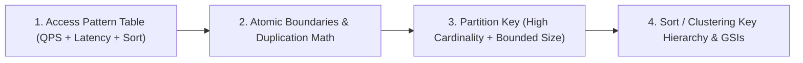

---
tags:
  - software-engineering
  - databases
  - nosql
  - data-modeling
  - dynamodb
  - mongodb
  - cassandra
  - redis
created: 2026-11-13
updated: 2026-11-13
status: 🟢
level: mid-to-senior
---
# NoSQL Data Modeling Patterns & Production Schema Design

> [!abstract] Vault Navigation
> Access-pattern-first schema engineering across Amazon DynamoDB, MongoDB, Apache Cassandra / ScyllaDB, and Redis / Valkey inside [[Programming/Software Engineering/Database Design/Database Design Complete Guide|Database Design Complete Guide]]. Builds on storage internals in [[Programming/Software Engineering/Database Design/NoSQL|NoSQL]] and pairs with [[Programming/Software Engineering/Database Design/Sharding|Sharding]], [[Programming/Software Engineering/Database Design/Indexing|Indexing]], [[Programming/Software Engineering/Database Design/Normalization|Normalization]], and [[Programming/Software Engineering/System Design/Caching|Caching]].

Relational database design starts with **entities and normalization** (`3NF`/`BCNF`) to eliminate update anomalies, deferring query shapes to ad-hoc `JOIN`s and the query optimizer. Distributed non-relational engines reject arbitrary cross-partition joins to guarantee predictable single-hop latency at massive scale. Consequently, NoSQL modeling is strictly **access-pattern-driven**: you catalog every read, write, sort order, filter, and transactional boundary *before* naming a single partition key or collection.

---

## 1. First-Principles Mechanics & Complete Architecture

### 1.1 Access-Pattern-First Methodology vs Entity-First Modeling

| Engineering Step | RDBMS (PostgreSQL / MySQL) | Distributed NoSQL (DynamoDB / Cassandra / MongoDB) |
|---|---|---|
| **1. Starting Artifact** | Entity-Relationship Diagram (ERD) modeling real-world nouns | **Access Pattern Catalog** listing every API/worker read & write with QPS and SLA |
| **2. Normalization Target** | `3NF`/`BCNF` (single source of truth per attribute) | Controlled denormalization & pre-joined item collections |
| **3. Join Execution** | Runtime `Nested Loop` / `Hash` / `Merge Join` inside database engine | **Pre-joined at write time** (embedding, item collections, or query-specific tables) |
| **4. Primary Performance Risk** | Missing indexes, lock contention, excessive multi-way join I/O | **Scatter-gather cross-partition queries**, hot partition skew, tombstone scans, 16 MB / 400 KB doc caps |



#### Access Pattern Specification Template (Required Before Schema Design)
| ID | Operation / Access Pattern | Type | Peak QPS | Consistency | Key / Predicate & Sort Order |
|---|---|---|---|---|---|
| **AP-1** | Create SKU + enforce unique SKU per tenant | Write | 50 | Strong / Tx | `(tenantId, sku)` unique invariant |
| **AP-2** | Fetch order header + all order line items | Read | 8,000 | Strong or Eventual | `tenantId` + `orderId`, sorted by line item |
| **AP-3** | List customer orders newest-first in date range | Read | 12,000 | Eventual OK | `tenantId` + `customerId` + `createdAt BETWEEN` |
| **AP-4** | Claim oldest `PENDING` warehouse fulfillment task | Read/Write | 1,500 | Strong CAS | `tenantId` + `status='PENDING'`, oldest first |
| **AP-5** | Ingest viral tenant audit events | Write | 15,000 | Async OK | Must exceed `1,000 WCU` single-partition cap |

### 1.2 Duplication Economics & Propagation Strategies
Duplicating an attribute (e.g., embedding `customerName` inside `Order` or mirroring a message into `messages_by_channel` and `messages_by_user`) shifts CPU/I/O from read-time joins to write-time fan-out. Choose propagation based on **mutability frequency**:
1. **Immutable Snapshot Copy** *(Zero Sync Needed)*: Shipping addresses, unit prices, and tax rates copied onto an `Order` at checkout **must never update** when the customer later edits their profile or the catalog price changes. Duplication here is **semantically superior** to normalization.
2. **Low-Churn Reference Copy** *(Async Streams / CDC)*: `productTitle` or `authorDisplayName` changes rarely. Store as an Extended Reference and update asynchronously via **DynamoDB Streams / Debezium CDC** background workers.
3. **High-Churn Mutable State** *(Do NOT Duplicate Widely)*: Live `inventoryStock` or `accountBalance` mutates continuously. Keep a single authoritative item/partition and guard mutations with atomic conditional expressions or single-table `TransactWriteItems`.

---

## 2. DynamoDB Single-Table Design Mastery

### 2.1 Physical Partitions, Capacity Math & Index Mechanics
Amazon DynamoDB hashes the **Partition Key (`PK`)** via MD5 to map items onto physical **10 GB SSD partitions** replicated across 3 Availability Zones via Paxos:
- **Hard Physical Partition Limits**: **3,000 RCUs** or **1,000 WCUs** (or any linear combination summing to 100% of one partition's budget, e.g., 1,500 RCUs + 500 WCUs). Exceeding this on a hot key triggers `ProvisionedThroughputExceededException` even when table-wide capacity has massive headroom!
- **Capacity Unit Math**:
  - **1 WCU** = 1 write/sec up to **1 KB** (2 WCUs for `TransactWriteItems`).
  - **1 RCU** = 1 **Strongly Consistent** read/sec up to **4 KB**, OR 2 **Eventually Consistent** reads/sec (`0.5 RCU`), OR 0.5 **Transactional** reads/sec (`2 RCU`).
  - *Critical Modeling Rule*: Fetching 100 KB across **one `Query` page** of 100 1-KB items consumes $\lceil 100\text{ KB} / 4\text{ KB} \rceil = 25\text{ RCUs}$ (Strongly Consistent), whereas fetching the exact same 100 items via 100 separate `GetItem` calls consumes **$100\text{ RCUs}$**! Packing related entities into contiguous **Item Collections** cuts both network latency and read bill by up to $4\times$.

### 2.2 Composite Keys, Item Collections & GSI Patterns

| Design Technique | Mechanism & Example | Access Patterns Unlocked |
|---|---|---|
| **Item Collection (`PK` Grouping)** | `PK = "TENANT#t1#ORD#o9"`, `SK = "META"` (Order) + `SK = "ITEM#001"` (Lines) | Single `Query(PK = ..., SK >= "ITEM#")` fetches Order + all Lines in 1 network hop |
| **Composite Sort Key Hierarchy** | `SK = "LOC#US#CA#SAN_FRANCISCO#STORE_04"` | `begins_with("LOC#US#CA")` queries state; `begins_with("LOC#US#CA#SAN_FRANCISCO")` narrows to city |
| **Adjacency List (`M:N`)** | Base: `PK="USER#u1", SK="PROJ#p7"`. `GSI1`: `GSI1PK=SK, GSI1SK=PK` | Base table answers "Projects for User"; `GSI1` answers "Members of Project" |
| **Inverse Index Overloading** | Reuse generic `GSI1PK` / `GSI1SK` strings across entity types | Supports 5–10 distinct secondary lookups within **1–2 GSIs** (avoiding 20-GSI write amplification) |
| **Sparse GSI** | Populate `GSI2PK = "TENANT#t1#OPEN"` *only* while `status = "PENDING"`, `REMOVE` when done | Index holds exclusively active rows (`0.1%` of table size); `Query` scans zero closed items! |

#### GSI Replication Lag, Projections & Backpressure Hazard
1. **Strictly Eventually Consistent**: Global Secondary Indexes (GSIs) replicate asynchronously from base-table partitions. **You cannot request `ConsistentRead: true` on a GSI**; immediate reads after a base-table write may miss the newly written item for tens of milliseconds.
2. **Projection Cost Trade-Off**:
   - `KEYS_ONLY`: Minimal storage & GSI WCU cost; requires follow-up `BatchGetItem` if extra attributes are needed.
   - `INCLUDE`: Projects only selected hot attributes (e.g., `status, totalCents, customerName`)—ideal balance avoiding double reads.
   - `ALL`: Mirrors entire item—doubles storage and WCU cost when items are large or mutated frequently.
3. **GSI Throttling Backpressure Catastrophe**: Because DynamoDB guarantees bounded GSI replication lag, if a GSI lacks enough WCUs (or suffers a hot `GSI_PK` like `STATUS#PENDING` across all tenants!), **DynamoDB throttles writes on the base table itself** once the GSI replication buffer fills! Always include `tenantId` or time buckets inside `GSI_PK` (`"TENANT#t1#PENDING"`) to prevent global GSI hot-partition backpressure.

### 2.3 Write Sharding, Uniqueness Sentinels, `TransactWriteItems` & TTL
- **Write Sharding**: When a single key (e.g., audit log or live poll counter) receives $> 1,000\text{ WCU/s}$, suffix `PK` with `#0..#(K-1)` (`PK = "AUDIT#t1#3"`). Writes distribute across $K$ partitions ($K \times 1,000\text{ WCU}$); reads execute $K$ concurrent `Query` calls and merge results in memory.
- **Multi-Attribute Uniqueness via Sentinel Items**: DynamoDB conditional checks (`attribute_not_exists(PK)`) only inspect a single item's primary key. To enforce uniqueness on *both* `productId` AND `(tenantId, sku)`, write two items inside a single **`TransactWriteItems`** call: the primary product item (`PK="TENANT#t1", SK="PROD#<id>"`) and a sentinel lock item (`PK="TENANT#t1", SK="UNIQUE#SKU#<sku>"` with `ConditionExpression: "attribute_not_exists(PK)"`).
- **TTL Expiration Caveat**: DynamoDB TTL deletes expired items asynchronously at zero WCU cost, **but expiration can lag up to 48 hours**! Every read query against TTL-enabled items **must still apply a `FilterExpression: "expiresAt > :now"`** in queries/code to guarantee expired tokens or sessions are never honored.

---

## 3. Step-by-Step Practical Application: Multi-Tenant E-Commerce & Fulfillment in DynamoDB

Below is a complete, production-grade implementation using **AWS SDK v3 (`@aws-sdk/client-dynamodb`, `@aws-sdk/lib-dynamodb`)** covering single-table schema definition, unique SKU creation via sentinel transaction, atomic multi-item checkout with optimistic stock checks, sparse GSI fulfillment queue claiming, write-sharded audit logging, and an idempotent DynamoDB Stream aggregator.

### 3.1 Table Infrastructure Definition (`CloudFormation / YAML`)
```yaml
# infra/dynamodb-table.yaml
AWSTemplateFormatVersion: "2010-09-09"
Resources:
  CommerceSingleTable:
    Type: AWS::DynamoDB::Table
    Properties:
      TableName: CommerceCore
      BillingMode: PAY_PER_REQUEST
      AttributeDefinitions:
        - AttributeName: PK
          AttributeType: S
        - AttributeName: SK
          AttributeType: S
        - AttributeName: GSI1PK
          AttributeType: S
        - AttributeName: GSI1SK
          AttributeType: S
        - AttributeName: GSI2PK
          AttributeType: S
        - AttributeName: GSI2SK
          AttributeType: S
      KeySchema:
        - AttributeName: PK
          KeyType: HASH
        - AttributeName: SK
          KeyType: RANGE
      GlobalSecondaryIndexes:
        - IndexName: GSI1
          KeySchema:
            - AttributeName: GSI1PK
              KeyType: HASH
            - AttributeName: GSI1SK
              KeyType: RANGE
          Projection:
            ProjectionType: ALL
        # Sparse Index: GSI2PK/GSI2SK exist ONLY on unfulfilled tasks!
        - IndexName: GSI2_SparseOpenTasks
          KeySchema:
            - AttributeName: GSI2PK
              KeyType: HASH
            - AttributeName: GSI2SK
              KeyType: RANGE
          Projection:
            ProjectionType: INCLUDE
            NonKeyAttributes:
              - orderId
              - warehouseId
              - priority
              - createdAt
      TimeToLiveSpecification:
        AttributeName: ttlEpoch
        Enabled: true
      StreamSpecification:
        StreamViewType: NEW_AND_OLD_IMAGES
      PointInTimeRecoverySpecification:
        PointInTimeRecoveryEnabled: true
```

### 3.2 Key Builders & Domain Repository (TypeScript + AWS SDK v3)
```typescript
// src/dynamodb/keys.ts
export const Keys = {
  tenantMeta: (tenantId: string) => ({
    PK: `TENANT#${tenantId}`,
    SK: `META`,
  }),
  product: (tenantId: string, sku: string) => ({
    PK: `TENANT#${tenantId}`,
    SK: `PROD#${sku}`,
  }),
  skuUniqueSentinel: (tenantId: string, sku: string) => ({
    PK: `TENANT#${tenantId}`,
    SK: `UNIQ#SKU#${sku}`,
  }),
  orderCollection: (tenantId: string, orderId: string) => ({
    PK: `TENANT#${tenantId}#ORD#${orderId}`,
    SK: `META`,
  }),
  orderLine: (tenantId: string, orderId: string, lineNum: number) => ({
    PK: `TENANT#${tenantId}#ORD#${orderId}`,
    SK: `LINE#${String(lineNum).padStart(4, "0")}`,
  }),
  customerOrderGsi1: (tenantId: string, customerId: string, isoCreated: string, orderId: string) => ({
    GSI1PK: `TENANT#${tenantId}#CUST#${customerId}`,
    GSI1SK: `ORD#${isoCreated}#${orderId}`,
  }),
  openTaskSparseGsi2: (tenantId: string, warehouseId: string, isoCreated: string, taskId: string) => ({
    GSI2PK: `TENANT#${tenantId}#WH#${warehouseId}#OPEN`,
    GSI2SK: `TASK#${isoCreated}#${taskId}`,
  }),
  shardedAudit: (tenantId: string, shardId: number, isoTs: string, eventId: string) => ({
    PK: `AUDIT#${tenantId}#${shardId}`,
    SK: `EVT#${isoTs}#${eventId}`,
  }),
};
```

```typescript
// src/dynamodb/ecommerceRepo.ts
import {
  DynamoDBDocumentClient,
  QueryCommand,
  TransactWriteCommand,
  UpdateCommand,
  PutCommand,
} from "@aws-sdk/lib-dynamodb";
import crypto from "node:crypto";
import { Keys } from "./keys";

export interface OrderLineInput {
  sku: string;
  qty: number;
  unitPriceCents: number;
}

export class EcommerceRepository {
  static readonly AUDIT_SHARDS = 8; // Supports up to 8,000 WCUs/sec per tenant

  constructor(
    private readonly ddb: DynamoDBDocumentClient,
    private readonly tableName = "CommerceCore"
  ) {}

  /**
   * AP-1: Creates a Product AND enforces uniqueness via a sentinel lock item inside
   * a single TransactWriteCommand (prevents duplicate SKUs or race overwrites).
   */
  async createProductWithUniqueSku(params: {
    tenantId: string;
    sku: string;
    title: string;
    priceCents: number;
    initialStock: number;
    productId: string;
  }): Promise<void> {
    const now = new Date().toISOString();
    await this.ddb.send(
      new TransactWriteCommand({
        TransactItems: [
          {
            Put: {
              TableName: this.tableName,
              Item: {
                ...Keys.product(params.tenantId, params.sku),
                entityType: "Product",
                productId: params.productId,
                tenantId: params.tenantId,
                sku: params.sku,
                title: params.title,
                priceCents: params.priceCents,
                stock: params.initialStock,
                version: 1,
                createdAt: now,
              },
              ConditionExpression: "attribute_not_exists(PK)",
            },
          },
          {
            Put: {
              TableName: this.tableName,
              Item: {
                ...Keys.skuUniqueSentinel(params.tenantId, params.sku),
                entityType: "SkuSentinel",
                productId: params.productId,
                createdAt: now,
              },
              ConditionExpression: "attribute_not_exists(PK)",
            },
          },
        ],
      })
    );
  }

  /**
   * AP-2 & Atomic Checkout: Decrements stock conditionally across all SKUs, writes Order
   * header + Order lines + initial Sparse Fulfillment Task in ONE ACID transaction (<= 100 items).
   */
  async placeOrderAtomic(params: {
    tenantId: string;
    orderId: string;
    customerId: string;
    warehouseId: string;
    lines: OrderLineInput[];
  }): Promise<void> {
    const isoNow = new Date().toISOString();
    const totalCents = params.lines.reduce((acc, l) => acc + l.qty * l.unitPriceCents, 0);
    const taskId = `TSK-${params.orderId}`;

    const stockUpdates = params.lines.map((line) => ({
      Update: {
        TableName: this.tableName,
        Key: Keys.product(params.tenantId, line.sku),
        UpdateExpression: "SET stock = stock - :qty, version = version + :one, updatedAt = :now",
        ConditionExpression: "attribute_exists(PK) AND stock >= :qty",
        ExpressionAttributeValues: {
          ":qty": line.qty,
          ":one": 1,
          ":now": isoNow,
        },
      },
    }));

    const orderHeaderPut = {
      Put: {
        TableName: this.tableName,
        Item: {
          ...Keys.orderCollection(params.tenantId, params.orderId),
          ...Keys.customerOrderGsi1(params.tenantId, params.customerId, isoNow, params.orderId),
          entityType: "Order",
          tenantId: params.tenantId,
          orderId: params.orderId,
          customerId: params.customerId,
          totalCents,
          status: "CONFIRMED",
          createdAt: isoNow,
        },
        ConditionExpression: "attribute_not_exists(PK)",
      },
    };

    const linePuts = params.lines.map((line, idx) => ({
      Put: {
        TableName: this.tableName,
        Item: {
          ...Keys.orderLine(params.tenantId, params.orderId, idx + 1),
          entityType: "OrderLine",
          sku: line.sku,
          qty: line.qty,
          unitPriceCents: line.unitPriceCents,
        },
      },
    }));

    // Sparse GSI2 attributes populated ONLY while task is OPEN
    const fulfillmentTaskPut = {
      Put: {
        TableName: this.tableName,
        Item: {
          PK: `TENANT#${params.tenantId}#ORD#${params.orderId}`,
          SK: `TASK#${taskId}`,
          ...Keys.openTaskSparseGsi2(params.tenantId, params.warehouseId, isoNow, taskId),
          entityType: "FulfillmentTask",
          orderId: params.orderId,
          warehouseId: params.warehouseId,
          status: "OPEN",
          priority: 1,
          createdAt: isoNow,
        },
      },
    };

    await this.ddb.send(
      new TransactWriteCommand({
        TransactItems: [...stockUpdates, orderHeaderPut, ...linePuts, fulfillmentTaskPut],
      })
    );
  }

  /**
   * AP-2 Read: Fetches Order header, all OrderLines, and Task in ONE Query via Item Collection!
   */
  async getOrderCollection(tenantId: string, orderId: string) {
    const res = await this.ddb.send(
      new QueryCommand({
        TableName: this.tableName,
        KeyConditionExpression: "PK = :pk",
        ExpressionAttributeValues: {
          ":pk": `TENANT#${tenantId}#ORD#${orderId}`,
        },
        ConsistentRead: true,
      })
    );
    return res.Items ?? [];
  }

  /**
   * AP-4: Queries Sparse GSI2 for open tasks, then completes task by REMOVING GSI2PK/GSI2SK
   * so completed tasks drop out of the sparse index automatically.
   */
  async listOpenFulfillmentTasks(tenantId: string, warehouseId: string, limit = 25) {
    const res = await this.ddb.send(
      new QueryCommand({
        TableName: this.tableName,
        IndexName: "GSI2_SparseOpenTasks",
        KeyConditionExpression: "GSI2PK = :pk",
        ExpressionAttributeValues: {
          ":pk": `TENANT#${tenantId}#WH#${warehouseId}#OPEN`,
        },
        Limit: limit,
        ScanIndexForward: true, // Oldest open tasks first (FIFO)
      })
    );
    return res.Items ?? [];
  }

  async completeFulfillmentTask(tenantId: string, orderId: string, taskId: string): Promise<void> {
    await this.ddb.send(
      new UpdateCommand({
        TableName: this.tableName,
        Key: {
          PK: `TENANT#${tenantId}#ORD#${orderId}`,
          SK: `TASK#${taskId}`,
        },
        UpdateExpression: "SET #st = :done, completedAt = :now REMOVE GSI2PK, GSI2SK",
        ConditionExpression: "#st = :open",
        ExpressionAttributeNames: { "#st": "status" },
        ExpressionAttributeValues: {
          ":done": "COMPLETED",
          ":open": "OPEN",
          ":now": new Date().toISOString(),
        },
      })
    );
  }

  /**
   * AP-5: Write-sharded audit ingestion (8x single-partition WCU ceiling) with 90-day TTL.
   */
  async appendShardedAuditEvent(
    tenantId: string,
    eventId: string,
    action: string,
    actorId: string
  ): Promise<number> {
    const shardId = crypto.createHash("md5").update(eventId).digest()[0] % EcommerceRepository.AUDIT_SHARDS;
    const isoNow = new Date().toISOString();
    const ttlEpoch = Math.floor(Date.now() / 1000) + 90 * 86400;

    await this.ddb.send(
      new PutCommand({
        TableName: this.tableName,
        Item: {
          ...Keys.shardedAudit(tenantId, shardId, isoNow, eventId),
          entityType: "AuditEvent",
          action,
          actorId,
          ttlEpoch,
        },
      })
    );
    return shardId;
  }

  async queryShardedAuditEvents(tenantId: string, sinceIso: string, perShardLimit = 50) {
    const nowEpoch = Math.floor(Date.now() / 1000);
    const shardQueries = Array.from({ length: EcommerceRepository.AUDIT_SHARDS }, (_, shardId) =>
      this.ddb.send(
        new QueryCommand({
          TableName: this.tableName,
          KeyConditionExpression: "PK = :pk AND SK >= :skPrefix",
          FilterExpression: "attribute_not_exists(ttlEpoch) OR ttlEpoch > :nowEpoch",
          ExpressionAttributeValues: {
            ":pk": `AUDIT#${tenantId}#${shardId}`,
            ":skPrefix": `EVT#${sinceIso}`,
            ":nowEpoch": nowEpoch,
          },
          Limit: perShardLimit,
          ScanIndexForward: false,
        })
      )
    );

    const results = await Promise.all(shardQueries);
    return results
      .flatMap((r) => r.Items ?? [])
      .sort((a, b) => String(b.SK).localeCompare(String(a.SK)));
  }
}
```

### 3.3 Idempotent DynamoDB Stream Aggregator
Updating a tenant's daily revenue counter inside every checkout transaction turns a single summary item (`PK="TENANT#t1", SK="METRICS#2026-11-13"`) into a **1,000 WCU/s serialization bottleneck** and aborts concurrent checkouts on `TransactionConflictException`. Instead, process order creations asynchronously via **DynamoDB Streams** using the stream record's `eventID` for idempotent deduplication:

```typescript
// src/dynamodb/streamAggregator.ts
import { DynamoDBDocumentClient, TransactWriteCommand } from "@aws-sdk/lib-dynamodb";

export interface StreamOrderRecord {
  eventID: string;
  eventName: "INSERT" | "MODIFY" | "REMOVE";
  newImage?: {
    entityType?: string;
    tenantId?: string;
    totalCents?: number;
    createdAt?: string;
  };
}

export class OrderMetricsStreamAggregator {
  constructor(
    private readonly ddb: DynamoDBDocumentClient,
    private readonly tableName = "CommerceCore"
  ) {}

  async processBatch(records: StreamOrderRecord[]): Promise<{ applied: number; duplicates: number }> {
    let applied = 0;
    let duplicates = 0;

    for (const rec of records) {
      if (rec.eventName !== "INSERT" || rec.newImage?.entityType !== "Order") {
        continue;
      }
      const { tenantId, totalCents = 0, createdAt } = rec.newImage;
      if (!tenantId || !createdAt) continue;

      const dayBucket = createdAt.slice(0, 10); // YYYY-MM-DD
      const dedupTtl = Math.floor(Date.now() / 1000) + 7 * 86400;

      try {
        await this.ddb.send(
          new TransactWriteCommand({
            TransactItems: [
              {
                // Dedup marker guarantees Lambda retry never double-counts GMV
                Put: {
                  TableName: this.tableName,
                  Item: {
                    PK: `DEDUP#STREAM#${rec.eventID}`,
                    SK: "MARKER",
                    ttlEpoch: dedupTtl,
                  },
                  ConditionExpression: "attribute_not_exists(PK)",
                },
              },
              {
                Update: {
                  TableName: this.tableName,
                  Key: {
                    PK: `TENANT#${tenantId}`,
                    SK: `DAILY_STATS#${dayBucket}`,
                  },
                  UpdateExpression: "ADD orderCount :one, gmvCents :gmv",
                  ExpressionAttributeValues: {
                    ":one": 1,
                    ":gmv": totalCents,
                  },
                },
              },
            ],
          })
        );
        applied++;
      } catch (err: unknown) {
        const name = (err as { name?: string })?.name;
        if (name === "TransactionCanceledException") {
          duplicates++;
          continue;
        }
        throw err;
      }
    }

    return { applied, duplicates };
  }
}
```

### 3.4 Verification Tests (`Vitest`)
```typescript
// src/dynamodb/ecommerceRepo.test.ts
import { describe, it, expect, vi } from "vitest";
import { EcommerceRepository } from "./ecommerceRepo";
import { OrderMetricsStreamAggregator } from "./streamAggregator";

describe("DynamoDB Single-Table Ecommerce & Streams", () => {
  it("constructs atomic checkout transaction with conditional stock check and sparse GSI2 task", async () => {
    const sentCommands: unknown[] = [];
    const mockDdb = {
      send: vi.fn(async (cmd) => {
        sentCommands.push(cmd);
        return {};
      }),
    };

    const repo = new EcommerceRepository(mockDdb as never, "CommerceCore");
    await repo.placeOrderAtomic({
      tenantId: "t1",
      orderId: "ord-100",
      customerId: "cust-7",
      warehouseId: "wh-east",
      lines: [{ sku: "GPU-X", qty: 2, unitPriceCents: 150000 }],
    });

    expect(sentCommands).toHaveLength(1);
    const txInput = (sentCommands[0] as { input: { TransactItems: Array<Record<string, unknown>> } }).input;
    expect(txInput.TransactItems).toHaveLength(4); // 1 stock update + 1 order + 1 line + 1 sparse task

    const stockUpdate = txInput.TransactItems[0].Update as { ConditionExpression: string };
    expect(stockUpdate.ConditionExpression).toContain("stock >= :qty");

    const taskPut = txInput.TransactItems[3].Put as { Item: Record<string, unknown> };
    expect(taskPut.Item.GSI2PK).toBe("TENANT#t1#WH#wh-east#OPEN");
  });

  it("removes GSI2PK/GSI2SK when completing a task so it leaves the sparse index", async () => {
    const sentCommands: unknown[] = [];
    const mockDdb = {
      send: vi.fn(async (cmd) => {
        sentCommands.push(cmd);
        return {};
      }),
    };

    const repo = new EcommerceRepository(mockDdb as never);
    await repo.completeFulfillmentTask("t1", "ord-100", "TSK-ord-100");
    const updInput = (sentCommands[0] as { input: { UpdateExpression: string } }).input;
    expect(updInput.UpdateExpression).toContain("REMOVE GSI2PK, GSI2SK");
  });

  it("deduplicates repeated DynamoDB Stream records cleanly via sentinel condition", async () => {
    const seenEvents = new Set<string>();
    const mockDdb = {
      send: vi.fn(async (cmd: { input: { TransactItems: Array<{ Put?: { Item: { PK: string } } }> } }) => {
        const pk = cmd.input.TransactItems[0].Put?.Item.PK ?? "";
        if (seenEvents.has(pk)) {
          const err = new Error("ConditionalCheckFailed");
          err.name = "TransactionCanceledException";
          throw err;
        }
        seenEvents.add(pk);
        return {};
      }),
    };

    const agg = new OrderMetricsStreamAggregator(mockDdb as never);
    const sampleEvent = {
      eventID: "evt-999",
      eventName: "INSERT" as const,
      newImage: { entityType: "Order", tenantId: "t1", totalCents: 4500, createdAt: "2026-11-13T18:00:00Z" },
    };

    const res = await agg.processBatch([sampleEvent, sampleEvent]);
    expect(res).toEqual({ applied: 1, duplicates: 1 });
  });
});
```

---

## 4. MongoDB Document Modeling & Anti-Patterns

### 4.1 Embedding vs Referencing & WiredTiger Amplification Math
Every MongoDB document has a strict **16 MiB BSON size ceiling**. Yet severe degradation begins long before hitting 16 MiB whenever an application stores **unbounded arrays** (`comments[]`, `logs[]`, `followers[]`) inside a parent document:
1. **Whole-Document Rewrite & Oplog Bloat**: WiredTiger compresses B+Tree leaf pages (32 KB) and logs complete delta or updated document state into the replica set `local.oplog.rs`. Appending a 100-byte reading via `$push` onto a 4 MB array forces re-serializing and dirtying multi-megabyte cache structures.
2. **Multikey Index Explosion**: Adding `createIndex({ "readings.ts": 1 })` forces MongoDB to maintain a **separate B+Tree leaf pointer for every element inside `readings[]`**. Updating a document with 50,000 array items churns B+Tree nodes continuously and bloats index RAM beyond WiredTiger's cache (`50% * (RAM - 1 GB)`).
3. **Working-Set Cache Eviction**: Loading ten 10 MB documents evicts 100 MB of hot 1 KB operational documents from WiredTiger RAM, triggering sudden disk read storms across unrelated collections.

### 4.2 Seven Production MongoDB Modeling Patterns

| Pattern | Concrete Problem Solved | Schema & Index Implementation |
|---|---|---|
| **1. Embed (`1:Few`)** | Bounded child entities (`< 50` items) always fetched with parent | Inline `shippingAddresses: [...]` inside `User`; 1 atomic write/read |
| **2. Extended Reference** | Child needs 2–3 parent display attributes (`authorName`, `avatar`) | Store `author: { _id, name, avatar }` inside `Comment`; eliminates `$lookup` on hot reads |
| **3. Subset Pattern** | `1:Many` (`Product -> 50k Reviews`) where UI renders top 10 | Keep `recentReviews: [...]` capped via `$push: { $each: [r], $slice: -10 }`; full list in `reviews` |
| **4. Bucket Pattern** | High-frequency IoT telemetry / clickstream logs | Group 60 or 1,440 readings into 1 bucket doc (`{ sensorId, day, count, sum, samples: [] }`) |
| **5. Outlier Pattern** | `99.9%` users have `< 500` followers; `0.1%` celebrities have `20M` | Embed up to 500 IDs; set `hasOverflow: true` and spill subsequent 500-item pages into `followers_overflow` |
| **6. Attribute Pattern** | Products have 400 sparse polymorphic specs (`voltage`, `ram_gb`, `fabric`) | Store `specs: [{ k: "ram_gb", v: 64 }]` + compound index `{ tenantId: 1, "specs.k": 1, "specs.v": 1 }` |
| **7. Schema Versioning** | Zero-downtime schema evolution across 100M docs | Stamp `schema_version: 2`; app reads `v1` lazily, upgrades in memory, and optionally rewrites via `$set` |

#### Attribute Pattern vs Wildcard (`$**`) Indexes
Instead of creating 150 separate sparse indexes across heterogeneous product properties (hitting MongoDB's **64 indexes per collection limit**!) or indexing every field with `{ "specs.$**": 1 }` (which increases write amplification on every attribute), the **Attribute Pattern** indexes **one compact array**:
```javascript
// Collection: catalog_products
// Query: Find tenant "t1" laptops with ram_gb >= 32
db.catalog_products.createIndex({ tenantId: 1, "specs.k": 1, "specs.v": 1 });

db.catalog_products.find({
  tenantId: "t1",
  specs: { $elemMatch: { k: "ram_gb", v: { $gte: 32 } } }
});
```
Notice the mandatory **`$elemMatch`**: without `$elemMatch`, `{ "specs.k": "ram_gb", "specs.v": { $gte: 32 } }` erroneously matches a document having `{ k: "ram_gb", v: 8 }` AND `{ k: "weight_g", v: 1200 }`!

#### `$lookup` Aggregation Pipeline & Limits
MongoDB's `$lookup` executes a left outer join inside the aggregation framework, but carries strict scaling limits:
- **100 MB Pipeline Stage RAM Limit**: By default, aggregation stages (`$sort`, `$group`, `$lookup`) fail if memory exceeds 100 MB (passing `{ allowDiskUse: true }` spills temporary files to NVMe, spiking latency).
- **Sharded Cross-Node Penalty**: Joining against a sharded `from` collection forces cross-shard network calls per input batch. Always keep `$lookup` strictly for low-QPS administrative/reporting queries (`< 50 RPS`), never high-QPS customer storefronts where Extended Reference or Subset eliminates the join altogether!

```typescript
// src/mongo/bucketAndOutlierQueries.ts (Native MongoDB Node Driver v6)
import { Collection } from "mongodb";

export interface TelemetryBucket {
  _id: string; // `${sensorId}_${YYYYMMDDHH}`
  sensorId: string;
  hourStart: Date;
  count: number;
  sumValue: number;
  maxValue: number;
  samples: Array<{ sec: number; val: number }>;
}

/**
 * Bucket Pattern ingestion: atomically appends sample, updates running rollups,
 * and ensures index size shrinks 60x-3600x compared to 1-document-per-sample.
 */
export async function ingestSensorSample(
  buckets: Collection<TelemetryBucket>,
  sensorId: string,
  ts: Date,
  value: number
): Promise<void> {
  const hourIso = ts.toISOString().slice(0, 13); // YYYY-MM-DDTHH
  const bucketId = `${sensorId}_${hourIso}`;
  const hourStart = new Date(`${hourIso}:00:00.000Z`);
  const sec = ts.getUTCMinutes() * 60 + ts.getUTCSeconds();

  await buckets.updateOne(
    { _id: bucketId },
    {
      $setOnInsert: { sensorId, hourStart },
      $inc: { count: 1, sumValue: value },
      $max: { maxValue: value },
      $push: { samples: { sec, val: value } },
    },
    { upsert: true }
  );
}
```

---

## 5. Cassandra / ScyllaDB Query-Driven Modeling

In Cassandra and ScyllaDB, **one query maps to one dedicated denormalized table**. Never normalize into separate entity tables expecting secondary indexes (`CREATE INDEX`) to rescue queries: native Cassandra secondary indexes (2i) execute **local per-node indexing**, forcing the coordinator to scatter-gather to **every node in the ring** whenever `PK` is omitted! *(Only SASI/SAI or ScyllaDB Global Secondary Indexes—which create a hidden base-table projection—mitigate this, and still incur an extra network hop).*

### 5.1 Complete CQL Schema: Multi-Tenant Messaging & Audit System
```sql
CREATE KEYSPACE IF NOT EXISTS messaging_prod
WITH replication = {
  'class': 'NetworkTopologyStrategy',
  'us_east': 3,
  'eu_west': 3
};

-- Table 1: Fetch latest 50 messages in a channel (Bounded Partition + STATIC metadata)
CREATE TABLE messaging_prod.messages_by_channel_bucket (
    tenant_id       UUID,
    channel_id      UUID,
    bucket_month    TEXT,       -- Format '2026-11' bounds partition < 100 MB / 100k cells!
    channel_title   TEXT STATIC,-- Stored ONCE per partition, zero row duplication!
    created_at      TIMEUUID,
    sender_id       UUID,
    sender_name     TEXT,       -- Extended reference copy (no cross-table join!)
    body            TEXT,
    PRIMARY KEY ((tenant_id, channel_id, bucket_month), created_at)
) WITH CLUSTERING ORDER BY (created_at DESC)
  AND compaction = { 'class': 'LeveledCompactionStrategy' }
  AND gc_grace_seconds = 864000;

-- Table 2: List all channels a user belongs to sorted by last activity
CREATE TABLE messaging_prod.channels_by_user (
    tenant_id        UUID,
    user_id          UUID,
    last_activity_at TIMESTAMP,
    channel_id       UUID,
    channel_title    TEXT,
    unread_count     INT,
    PRIMARY KEY ((tenant_id, user_id), last_activity_at, channel_id)
) WITH CLUSTERING ORDER BY (last_activity_at DESC, channel_id ASC);

-- Table 3: High-throughput time-series audit trail with TWCS + 90-day TTL (Zero tombstones!)
CREATE TABLE messaging_prod.audit_events_by_tenant_day (
    tenant_id    UUID,
    day_bucket   DATE,
    shard_id     TINYINT,      -- Write shard 0..7 protects whale tenants
    event_ts     TIMEUUID,
    actor_id     UUID,
    action       TEXT,
    metadata_json TEXT,
    PRIMARY KEY ((tenant_id, day_bucket, shard_id), event_ts)
) WITH CLUSTERING ORDER BY (event_ts DESC)
  AND default_time_to_live = 7776000 -- 90 days automatic expiration
  AND gc_grace_seconds = 86400       -- 1 day safe for immutable append-only TTL data
  AND compaction = {
    'class': 'TimeWindowCompactionStrategy',
    'compaction_window_size': 1,
    'compaction_window_unit': 'DAYS'
  };
```

### 5.2 Critical Cassandra / ScyllaDB Modeling Traps
1. **`BATCH` Misuse**: Using `LOGGED BATCH` across 500 unrelated partition keys forces the Coordinator to write a single massive batchlog entry and synchronize with 500 partitions concurrently—crashing coordinator heap and CPU. Reserve `LOGGED BATCH` **strictly** for writing 2–4 denormalized copies of the *exact same entity* (`messages_by_channel` + `messages_by_user`) atomically; use parallel asynchronous `executeAsync()` individual statements for bulk ingestion.
2. **`COUNTER` Column Caveats**: `COUNTER` columns require dedicated tables containing *only* primary keys + counter columns, cannot support `TTL` or `IF` conditional LWT checks, and are **non-idempotent on network retries** (a coordinator `WriteTimeoutException` leaves the client unaware if the increment applied, so retrying risks double-counting!). Prefer exact event-sourced append rows or Redis/PostgreSQL for strict financial/quota counters.
3. **Materialized Views (MVs)**: Apache Cassandra marked native Materialized Views experimental/deprecated after production incidents revealed silent base-to-MV drift under node failures and timeouts. Manage query tables explicitly from the application (or Debezium CDC / ScyllaDB's production-hardened synchronous MV engine with strict monitoring).

---

## 6. Redis / Valkey Advanced Data Modeling

### 6.1 Memory Internals: `listpack` Encoding Optimization
A naive Redis String key (`SET user:42:name "Ada"`) incurs ~50–70 bytes of `redisObject` + `dictEntry` + `SDS` overhead *per field*. Storing 10M user profiles with 5 attributes as separate keys wastes **~3 GB solely in key metadata**!
Instead, group small objects into **Redis Hashes** (`HSET user:42 name "Ada" plan "pro"`). As long as a Hash stays within:
- `hash-max-listpack-entries 512` (default 512 fields)
- `hash-max-listpack-value 64` (default 64 bytes per field/value)
Redis stores the entire Hash inside a **contiguous byte array (`listpack`)** rather than a pointer-heavy hash table—cutting memory usage by **$5\text{–}10\times$**! *(To maximize savings across 10M users, shard IDs into 100-item Hash buckets: `HSET users:bucket:420 42 "Ada"`).*

### 6.2 Production Structure Patterns & Atomic Lua Scripts

| Data Structure | Core Commands | Memory & Algorithmic Complexity | Concrete Production Use Case |
|---|---|---|---|
| **Sorted Set (`ZSET`)** | `ZADD`, `ZINCRBY`, `ZREVRANK`, `ZREVRANGE` | SkipList + Hash table ($O(\log N)$ insert/rank) | Real-time leaderboards (`score + (1 - ts/1e13)` tie-break), delayed job schedulers (`score = runAtEpoch`) |
| **Streams** | `XADD ... MAXLEN ~`, `XGROUP CREATE`, `XREADGROUP`, `XACK`, `XAUTOCLAIM` | Radix tree of compressed `listpack` macro-nodes | Durable consumer-group work queues recovering dead workers via Pending Entries List (`XAUTOCLAIM`) |
| **HyperLogLog** | `PFADD`, `PFCOUNT`, `PFMERGE` | **Fixed 12 KB** max per key ($O(1)$, **0.81% std error**) | Real-time unique visitors / daily unique search queries across millions of IDs |
| **Bitmaps** | `SETBIT`, `BITCOUNT`, `BITOP AND` | `1 bit / user` (100M users = **12.5 MB**!) | Cohort retention (`BITOP AND active:day1 active:day7`) & feature flag bitmasks |
| **GeoHash** | `GEOADD`, `GEOSEARCH ... BYRADIUS` | Backed by 52-bit Z-order curve inside a `ZSET` ($O(N + \log M)$) | Live driver/courier radius lookup with sub-ms updates |

```typescript
// src/redis/atomicInventoryAndStreams.ts
import type Redis from "ioredis";

/**
 * Atomic Inventory Reservation + Lease Expiration Token in ONE Lua script:
 * Eliminates TOCTOU oversells between GET stock and DECRBY without WATCH retries.
 */
const RESERVE_STOCK_LUA = `
local stockKey = KEYS[1]
local leaseKey = KEYS[2]
local qty = tonumber(ARGV[1])
local ttlSec = tonumber(ARGV[2])
local reservationId = ARGV[3]

-- Idempotency check: if reservation already exists, return current remaining stock
if redis.call("EXISTS", leaseKey) == 1 then
  return {1, tonumber(redis.call("GET", stockKey) or 0)}
end

local current = tonumber(redis.call("GET", stockKey) or -1)
if current < qty then
  return {0, current} -- Insufficient stock or missing SKU
end

local remaining = redis.call("DECRBY", stockKey, qty)
redis.call("SET", leaseKey, reservationId .. ":" .. qty, "EX", ttlSec)
return {1, remaining}
`;

export async function reserveFlashSaleInventory(
  redis: Redis,
  sku: string,
  reservationId: string,
  qty: number,
  leaseTtlSeconds = 600
): Promise<{ reserved: boolean; remaining: number }> {
  // Hash tags {sku} guarantee both keys map to the exact same Redis Cluster slot!
  const stockKey = `flash:{${sku}}:stock`;
  const leaseKey = `flash:{${sku}}:lease:${reservationId}`;

  const [ok, remaining] = (await redis.eval(
    RESERVE_STOCK_LUA,
    2,
    stockKey,
    leaseKey,
    String(qty),
    String(leaseTtlSeconds),
    reservationId
  )) as [number, number];

  return { reserved: ok === 1, remaining };
}

/**
 * Crash-safe Redis Stream consumer using XREADGROUP + XAUTOCLAIM to rescue
 * orphaned messages left behind by crashed worker pods after 30s idle time.
 */
export async function pollStreamWithDeadWorkerRecovery(
  redis: Redis,
  streamKey: string,
  groupName: string,
  consumerName: string
): Promise<Array<{ id: string; fields: string[] }>> {
  // Step 1: Reclaim messages stuck pending in dead consumers > 30,000 ms
  const reclaimed = (await redis.xautoclaim(
    streamKey,
    groupName,
    consumerName,
    30_000,
    "0-0",
    "COUNT",
    10
  )) as [string, Array<[string, string[]]>];

  const rescued = (reclaimed?.[1] ?? []).map(([id, fields]) => ({ id, fields }));
  if (rescued.length > 0) return rescued;

  // Step 2: Otherwise block briefly for new undelivered stream entries
  const fresh = (await redis.xreadgroup(
    "GROUP",
    groupName,
    consumerName,
    "COUNT",
    10,
    "BLOCK",
    2000,
    "STREAMS",
    streamKey,
    ">"
  )) as Array<[string, Array<[string, string[]]>]> | null;

  if (!fresh || fresh.length === 0) return [];
  return fresh[0][1].map(([id, fields]) => ({ id, fields }));
}
```

---

## 7. Production Debugging, Profiling & Operations Playbook

```bash
# 1. DynamoDB: Find hot partition keys via Contributor Insights & check GSI throttling
aws dynamodb describe-contributor-insights --table-name CommerceCore

# 2. MongoDB: Inspect document average size & multikey/index RAM footprint
mongosh --eval 'db.catalog_products.stats({ scale: 1048576 })'
mongosh --eval 'db.setProfilingLevel(1, { slowms: 50 })' # Capture queries > 50 ms in system.profile

# 3. Cassandra / ScyllaDB: Inspect partition byte distribution (p99/max) & tombstone cells
nodetool tablehistograms messaging_prod messages_by_channel_bucket
nodetool tablestats messaging_prod.audit_events_by_tenant_day

# 4. Redis / Valkey: Inspect encoding (listpack vs hashtable), exact byte size & pending stream PEL
redis-cli OBJECT ENCODING user:42          # Should show "listpack", NOT "hashtable" for small hashes!
redis-cli MEMORY USAGE flash:{SKU1}:stock SAMPLES 5
redis-cli XPENDING orders:stream workers_group - + 20
```

| Symptom | Diagnostic Observation | Root Cause | Remediation |
|---|---|---|---|
| **DynamoDB base table throttles despite low base WCU usage** | CloudWatch shows `ThrottledRequests` on GSI (`GSI_PENDING` hot key) | Unsharded low-cardinality `GSI_PK` saturating GSI `1,000 WCU` cap triggers base-table backpressure | Prefix `GSI_PK` with `tenantId` or shard suffix `#0..#N`; project `KEYS_ONLY`/`INCLUDE` |
| **MongoDB write latency degrades $10\times$ as collection ages** | `collStats` shows `avgObjSize > 500 KB`; `explain()` shows `totalKeysExamined >> nReturned` | Unbounded array growth + multikey index re-indexing thousands of elements per `$push` | Refactor to **Bucket** or **Outlier Pattern** + compact compound indexes |
| **Cassandra reads fail with `TombstoneOverwhelmingException`** | `TRACING ON` logs `Scanned 100,000 tombstones and 3 live rows` | Queue delete pattern, `NULL` JSON field writes, or long TTLs without `TWCS` | Remove `DELETE` queues; omit `NULL`s; switch append TTL tables to **`TWCS`** |
| **Redis Cluster throws `CROSSSLOT Keys in request don't hash to the same slot`** | Multi-key Lua script or `MGET` fails across slots | Keys lack identical `{hash_tag}` substring | Wrap shared tenant/entity shard ID in curly braces (`flash:{SKU-1}:stock`) |

---

## 8. Comprehensive Worked Exercises

### Exercise 1: Modeling a SaaS RBAC + Billing + Audit Workload in DynamoDB Single-Table
Design a single DynamoDB table (`SaaSPlatform`) with at most **2 GSIs** satisfying all 5 access patterns:
1. Create an `Organization` AND enforce **globally unique `slug`** (cannot collide across orgs).
2. List all `Users` + their RBAC roles (`admin`, `editor`, `viewer`) inside an `org_id`, AND look up a User directly by `email`.
3. Fetch all `Invoices` for `org_id` within `[start_date, end_date]` newest-first.
4. Query all **globally `OVERDUE` invoices** across an account region/shard for automated dunning emails without scanning paid invoices.
5. Ingest **6,000 audit events/sec** for a massive enterprise tenant without hitting `ProvisionedThroughputExceededException`.

Provide the exact key schema (`PK`, `SK`, `GSI1PK`, `GSI1SK`, `GSI2PK`, `GSI2SK`), write out the `TransactWriteItems` payload for Pattern 1, and explain the Pattern 5 read/write sharding mechanics.

---

### Solution 1

#### 1. Single-Table Key Schema
| Entity | `PK` | `SK` | `GSI1PK` | `GSI1SK` | `GSI2PK` *(Sparse)* | `GSI2SK` |
|---|---|---|---|---|---|---|
| **Org** | `ORG#<org_id>` | `META` | *(omitted)* | *(omitted)* | *(omitted)* | *(omitted)* |
| **Slug Lock** | `UNIQ#SLUG#<slug>` | `META` | *(omitted)* | *(omitted)* | *(omitted)* | *(omitted)* |
| **Membership / User** | `ORG#<org_id>` | `USER#<user_id>` | `EMAIL#<email>` | `ORG#<org_id>` | *(omitted)* | *(omitted)* |
| **Invoice** | `ORG#<org_id>` | `INV#<iso_date>#<inv_id>` | *(omitted)* | *(omitted)* | `DUNNING#<shard_0_3>` *(only if `OVERDUE`)* | `<due_iso>#<inv_id>` |
| **Audit Event** | `AUDIT#<org_id>#<0..7>` | `TS#<iso_ts>#<evt_id>` | *(omitted)* | *(omitted)* | *(omitted)* | *(omitted)* |

#### 2. Access Pattern Implementations
- **Pattern 1 (`TransactWriteItems` Unique Slug)**:
  Put `{ PK: "ORG#o9", SK: "META", slug: "acme" }` with `ConditionExpression: "attribute_not_exists(PK)"` AND Put sentinel `{ PK: "UNIQ#SLUG#acme", SK: "META", orgId: "o9" }` with `ConditionExpression: "attribute_not_exists(PK)"` inside one atomic `TransactWriteCommand`.
- **Pattern 2**:
  - Org users + roles: `Query(PK = "ORG#<org_id>", SK begins_with "USER#")`.
  - User by email: `Query(Index = GSI1, GSI1PK = "EMAIL#<email>")`.
- **Pattern 3**: `Query(PK = "ORG#<org_id>", SK BETWEEN "INV#2026-10-01" AND "INV#2026-11-30~", ScanIndexForward: false)`.
- **Pattern 4 (Sparse GSI2)**: Populate `GSI2PK = "DUNNING#" + (hash(org_id) % 4)` **only** on overdue invoices (sharded 0..3 so dunning updates don't hit 1,000 WCU hot key!); `REMOVE GSI2PK, GSI2SK` immediately upon payment confirmation.
- **Pattern 5 (Write Sharding)**: Append `#0..#7` to `PK = "AUDIT#<org_id>#<shard>"` ($8 \times 1,000 = 8,000\text{ WCU/s} > 6,000\text{ req/s}$). Readers execute 8 concurrent `Query` calls and merge-sort chronologically in app code.

---

### Exercise 2: Refactoring an Unbounded MongoDB E-Commerce Catalog & Social Feed
A MongoDB collection `stores` currently embeds two structures inside each `Store` document:
1. Dynamic product specs stored directly as top-level keys (`spec_cpu: "M4"`, `spec_watts: 65`, `spec_fabric: "linen"` across 900 distinct keys), where engineers tried creating 40 indexes and hit dynamic index limits.
2. An array `activityFeed: [ { ts, userId, action }, ... ]` receiving up to 2,000,000 entries for celebrity merchants, causing `DocumentTooLarge (16 MB)` crashes and multikey index stalls.

Redesign both structures using the **Attribute Pattern**, **Subset Pattern**, and **Outlier/Bucket Pattern**, providing exact document JSON and MongoDB indexes.

---

### Solution 2

1. **Dynamic Specs $\rightarrow$ Attribute Pattern**:
   Replace 900 sparse top-level keys with a uniform array + one compound index:
   ```javascript
   // Document inside `products`:
   {
     _id: "prod_88",
     storeId: "st_1",
     title: "Workstation Pro",
     specs: [
       { k: "cpu", v: "M4" },
       { k: "watts", v: 65 }
     ]
   }
   // Index (covers ALL 900 attribute types in ONE index!):
   db.products.createIndex({ storeId: 1, "specs.k": 1, "specs.v": 1 });
   ```
2. **Unbounded `activityFeed[]` $\rightarrow$ Bucket + Subset Pattern**:
   - Keep only the latest **20 activities** directly inside `stores.recentActivities` (via `$push: { $each: [evt], $slice: -20 }`) for zero-join storefront rendering (**Subset Pattern**).
   - Store full history in a separate `store_activity_buckets` collection grouping **500 events per bucket document** (`_id: "st_1_2026-11-13_b04"`, `count <= 500`, `events: [...]`), indexed on `{ storeId: 1, bucketSeq: -1 }`. Document sizes remain capped under ~100 KB (`160x` below 16 MB) with zero multikey index fanout!

---

### Exercise 3: Fixing a Hot Cassandra Partition & Counter Retry Bug
An analytics platform tracks per-tenant API usage and raw request events in Cassandra:
```sql
CREATE TABLE api_events (
    tenant_id UUID,
    event_id  TIMEUUID,
    endpoint  TEXT,
    PRIMARY KEY (tenant_id, event_id)
);
CREATE TABLE api_counters (
    tenant_id UUID PRIMARY KEY,
    total_hits COUNTER
);
```
1. Enterprise tenant `T-9` generates 200M events over 6 months—creating a **28 GB single partition** that crashes nodes with OOM during compactions. Fix `api_events` using a bounded partition key + `TWCS`.
2. When incrementing `api_counters`, occasional `WriteTimeoutException` retries cause `total_hits` to **over-count actual requests by 12%**. Explain why Cassandra `COUNTER` retries corrupt accuracy and state how to fix it cleanly.

---

### Solution 3

1. **Fixing Unbounded 28 GB Partition**:
   `PRIMARY KEY (tenant_id, event_id)` pins **all historical events for `T-9` onto one partition** forever. Add a **`day_bucket DATE`** and **`shard_id TINYINT` (`0..7`)** into the partition key alongside `TWCS` + TTL:
   ```sql
   CREATE TABLE api_events_v2 (
       tenant_id  UUID,
       day_bucket DATE,
       shard_id   TINYINT,
       event_id   TIMEUUID,
       endpoint   TEXT,
       PRIMARY KEY ((tenant_id, day_bucket, shard_id), event_id)
   ) WITH CLUSTERING ORDER BY (event_id DESC)
     AND default_time_to_live = 2592000
     AND compaction = { 'class': 'TimeWindowCompactionStrategy', 'compaction_window_size': 1, 'compaction_window_unit': 'DAYS' };
   ```
   Each `(tenant, day, shard)` partition stays bounded under ~20 MB and spreads writes evenly across all cluster nodes.
2. **Why `COUNTER` Retries Over-Count & Fix**:
   Cassandra counter mutations (`UPDATE ... SET total_hits = total_hits + 1`) are **non-idempotent deltas**. If the coordinator applies `+1` on 1 of 2 quorum replicas and times out before returning ack, an application/driver retry applies `+1` *a second time*, permanently over-counting by `+1`. **Fix**: Replace Cassandra `COUNTER` tables with either **Redis atomic `INCR` / HyperLogLog** (or batch-aggregated Kafka/Flink window counters writing idempotent absolute bucket snapshots via standard `INT/BIGINT` columns keyed by `(tenant_id, window_ts)`).

---

### Exercise 4: Redis `ZSET` Tie-Breaking & Distributed Lua Reservation Bug
1. A gaming leaderboard uses `ZADD global_lb <score> <player_id>`. Two players achieve identical integer score `1500`; player A hit `1500` at `10:00:00`, player B hit `1500` at `10:05:00`, yet Redis `ZREVRANGE` ranks **Player B ahead of Player A** (lexicographical tie-break on `"player_b" > "player_a"`!). Design a deterministic numeric encoding inside `ZSET` double score so earlier achievers always rank higher.
2. An engineer implements Redis inventory reservation in Node using `const stock = await redis.get(k); if (stock >= qty) await redis.decrby(k, qty);`. Under 200 concurrent requests for the last 1 item, **18 users check out successfully** (`stock = -17`!). Show why and provide the exact Lua fix.

---

### Solution 4

1. **Deterministic Tie-Breaking in `ZSET` Float64 Score**:
   Redis stores `ZSET` scores as IEEE-754 64-bit floats (**53 bits** of integer precision $\approx 9 \times 10^{15}$). Encode `(score, timestamp)` into a single composite score where earlier timestamps receive a **higher fractional bonus**:
   $$\text{composite\_score} = \text{int\_score} + \left(1 - \frac{\text{achieved\_epoch\_sec}}{10^{10}}\right)$$
   *(Verify precision: keep integer score `< 10^5` if preserving 10 fractional digits inside 53 bits, or pack `(int_score * 2^28) + (MAX_SEC - relative_sec)` inside the 53-bit exact integer space so zero float rounding occurs!)* For example, packing `int_score` in upper bits and `(2_000_000_000 - epoch_sec)` in lower bits guarantees Player A (`t = 1700000000`) always outranks Player B (`t = 1700000300`) at equal integer scores!
2. **TOCTOU Race & Lua Fix**:
   `GET` followed by `DECRBY` spans two separate network round-trips across the single-threaded event loop; 18 clients read `stock = 1` concurrently before any `DECRBY` executes. Move the check-and-decrement into a single atomic Lua script (`EVALSHA`):
   ```lua
   local cur = tonumber(redis.call("GET", KEYS[1]) or -1)
   local qty = tonumber(ARGV[1])
   if cur < qty then return -1 end
   return redis.call("DECRBY", KEYS[1], qty)
   ```
   Because Redis executes Lua scripts atomically from start to finish with zero interleaving, exactly 1 client receives `0` and the other 199 receive `-1`.

---

### Exercise 5: DynamoDB GSI Replication Lag & Base-Table Stall Incident
An order service uses a DynamoDB table with a GSI named `GSI_ByStatus` (`GSI_PK = status`, `GSI_SK = createdAt`, provisioned at 500 WCUs while the base table has 10,000 WCUs). Every time a user places an order (`status = "PENDING"`), two incidents occur:
1. Redirecting immediately to `/orders/pending` querying `GSI_ByStatus` misses the newly created order 5% of the time.
2. During a flash sale (`3,000 orders/sec`), **base-table `PutItem` calls fail with `ProvisionedThroughputExceededException`** even though the base table is only consuming 30% of its 10,000 WCU quota!

Diagnose **both** anomalies and redesign `GSI_ByStatus`.

---

### Solution 5

1. **Why `/orders/pending` Misses Newly Placed Orders (GSI Replication Lag)**:
   DynamoDB propagates updates from base-table partitions to GSI partitions **asynchronously**. GSIs are **strictly Eventually Consistent**. Querying `GSI_ByStatus` 5 ms after `PutItem` can hit the GSI before async replication lands. **Fix**: For Read-Your-Own-Writes immediately after checkout, query the **base table** with `ConsistentRead: true` by `PK = "TENANT#<tid>#CUST#<cid>"` or `orderId`, rather than polling a GSI.
2. **Why Base-Table `PutItem` Throttled (`GSI_PK = "PENDING"` Hot Key + Backpressure)**:
   Two compounding flaws hit `GSI_ByStatus`:
   - `GSI_PK = "PENDING"` hashes **100% of new orders onto ONE physical GSI partition** (hard ceiling: `1,000 WCU`), while `GSI_ByStatus` was also provisioned at only `500 WCU`!
   - When the GSI partition cannot keep up with `3,000 writes/sec`, DynamoDB's bounded replication buffer fills and **applies hard backpressure throttling onto the base table's `PutItem` requests**!
   - **Redesign**: Switch GSI to `PAY_PER_REQUEST` (or scale WCU >= base table WCU) AND **shard `GSI_PK` across tenants + write buckets**: `GSI_PK = "PENDING#" + (hash(orderId) % 8)` (or `TENANT#<tid>#PENDING`), and `REMOVE GSI_PK` as soon as the order leaves `PENDING` (**Sparse GSI**)!

---

### Exercise 6: MongoDB `$lookup` Collapse & `schema_version` Backfill Strategy
A SaaS reporting endpoint joins `invoices` (20M docs) against `customers` (2M docs) on every dashboard page load using `$lookup` inside an aggregation pipeline, causing 100% CPU spikes, `Exceeded memory limit for $group/$lookup (104857600 bytes)` errors, and 4-second page loads. Simultaneously, engineers must rename `amount` (float dollars) to `amountCents` (int64) across all 20M historical `invoices` without taking downtime.

Design the **Extended Reference + `schema_version` lazy-migration architecture** solving both issues.

---

### Solution 6

1. **Eliminating Hot `$lookup` Joins**:
   Stop running `$lookup` on dashboard page loads. Embed the 3 display fields (`customerName`, `customerTier`, `billingEmail`) directly inside every new `Invoice` document via the **Extended Reference Pattern** (`customer: { id, name, tier }`). Sync rare customer name renames asynchronously via a MongoDB **Change Stream** worker updating open/recent invoices in batches (`updateMany`).
2. **Zero-Downtime `schema_version` Lazy + Batch Migration**:
   - Add `schema_version: 2` alongside integer `amountCents` on all new writes.
   - Update application read mappers to normalize `v1` on read (`const cents = doc.schema_version === 2 ? doc.amountCents : Math.round(doc.amount * 100)`), ensuring instant compatibility during rolling deploys.
   - Run a rate-limited background backfill job (`batchSize = 1000`, `sleep(50ms)` between batches, filtering `{ schema_version: { $ne: 2 } }`) utilizing bulk `updateMany`/`bulkWrite` with `w: "majority"` while monitoring WiredTiger cache dirty % and secondary replication lag (`rs.printSecondaryReplicationInfo()`).

---

## Related Notes
- [[Programming/Software Engineering/Database Design/NoSQL|NoSQL]]
- [[Programming/Software Engineering/Database Design/Sharding|Sharding]]
- [[Programming/Software Engineering/Database Design/Replication|Replication]]
- [[Programming/Software Engineering/Database Design/Indexing|Indexing]]
- [[Programming/Software Engineering/Database Design/Normalization|Normalization]]
- [[Programming/Software Engineering/System Design/Caching|Caching]]
- [[Programming/Software Engineering/Database Design/Database Design Complete Guide|Back to Database Design]]
