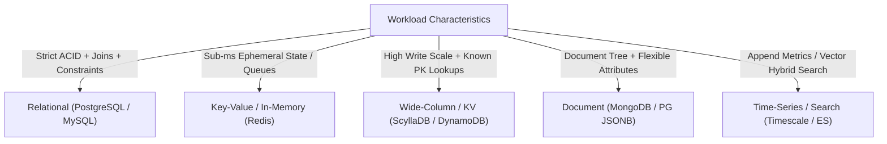
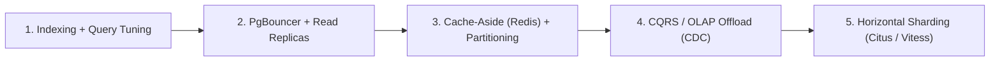

---
tags:
  - software-engineering
  - databases
  - architecture
  - guide
  - complete
created: 2026-01-02
updated: 2026-11-13
status: 🟢
level: mid-to-senior
---
# Database Design Complete Guide

> [!abstract] Vault Navigation
> Canonical entry point for Database Engineering inside [[Programming/Software Engineering/Software Engineering Roadmap|Software Engineering Roadmap]]. Bridges storage-engine internals with distributed architecture in [[Programming/Software Engineering/System Design/System Design Complete Guide|System Design Complete Guide]] and schema deployment safety in [[Programming/Software Engineering/SDLC/Release Engineering & Migrations|Release Engineering & Migrations]].

Production database engineering balances **data integrity guarantees** (ACID transactions, relational invariants, MVCC visibility) against **physical I/O efficiency** (page layout, index structures, buffer density) and **distributed scale constraints** (replication lag, quorum consensus, shard locality, cross-boundary sagas).

---

## 1. Core Engineering Curriculum

### Relational Storage & Schema Design
- [[Programming/Software Engineering/Database Design/Relational Databases|Relational Databases]] — 8 KB PostgreSQL heap pages, tuple alignment padding, TOAST out-of-line storage, physical join algorithms (Nested Loop, Hash, Merge), `MATERIALIZED` CTEs, window frame traps (`ROWS` vs `RANGE`), and PgBouncer transaction-mode pitfalls.
- [[Programming/Software Engineering/Database Design/Normalization|Normalization]] — Functional & multi-valued dependencies (`1NF -> 2NF -> 3NF -> BCNF -> 4NF`), strategic denormalization (materialized views, sharded counters, outbox/CDC, OLTP vs OLAP), and the `JSONB` vs relational threshold.
- [[Programming/Software Engineering/Database Design/Indexing|Indexing]] — B+Tree vs LSM-Tree compaction (`STCS` vs `LCS` + Bloom filters), composite leftmost-prefix ordering, `INCLUDE` covering scans & Visibility Map dependencies, `GIN`/`GiST`/`BRIN`, and `EXPLAIN (ANALYZE, BUFFERS)` diagnostics.
- [[Programming/Software Engineering/Database Design/Transactions|Transactions]] — WAL & `fsync` crash recovery, PostgreSQL `xmin`/`xmax` MVCC + HOT updates + `VACUUM` / XID wraparound vs InnoDB undo logs, Snapshot Isolation vs `SERIALIZABLE` SSI (`40001`), Write Skew, `SKIP LOCKED` queues, and deadlock prevention.

### Non-Relational Engines & Data Modeling
- [[Programming/Software Engineering/Database Design/NoSQL|NoSQL]] — WiredTiger B+Tree/journaling, Redis single-threaded event loop + `RDB`/`AOF` Copy-on-Write traps, Cassandra/ScyllaDB LSM + Gossip + Seastar, TimescaleDB chunks vs InfluxDB TSM, and Inverted Index + HNSW vector search.
- [[Programming/Software Engineering/Database Design/Data Modeling NoSQL|Data Modeling NoSQL]] — Query-first methodology, DynamoDB Single-Table Design (`PK`/`SK`, overloaded `GSI`s, write sharding), MongoDB Bucket/Subset/Outlier patterns, Cassandra bounded partitions & tombstone catastrophes, and Redis Lua rate limiters / Streams / HyperLogLog.

### Distributed Scaling & High Availability
- [[Programming/Software Engineering/Database Design/Sharding|Sharding]] — Declarative table partitioning vs shared-nothing horizontal sharding, Consistent Hashing with `vNodes`, Vitess/Citus rebalancing, co-located schemas, celebrity skew, global indexes, and `2PC` vs `Saga` orchestration.
- [[Programming/Software Engineering/Database Design/Replication|Replication]] — Sync/Semi-Sync/Async WAL shipping & logical CDC, Read-Your-Own-Writes & Monotonic Reads mitigations, Multi-Leader LWW clock-skew loss vs CRDTs, Dynamo Quorums ($W+R>N$), Merkle trees, and Raft/Patroni fencing tokens against Split-Brain.

---

## 2. Storage Paradigm Selection Decision Tree



---

## 3. Quantitative Engine Selection Matrix

| Primary Requirement | Optimal Choice | Critical Guardrail / Failure Mode to Watch |
|---|---|---|
| **Multi-entity ACID, financial ledgers, complex joins** | **PostgreSQL / MySQL** | Connection saturation (`PgBouncer` required); `VACUUM` / XID wraparound; lock-queue blocking on DDL |
| **Sub-ms cache, rate limits, leaderboards, streams** | **Redis / Valkey** | Single-threaded stall on $O(N)$ (`KEYS *`); `fork()` Copy-on-Write $2\times$ RAM OOM during `BGSAVE` |
| **Multi-TB high-throughput writes, multi-region HA** | **Cassandra / ScyllaDB / DynamoDB** | Tombstone storms on delete-heavy tables; hot partition throttling (`1,000 WCU` cap in DynamoDB) |
| **Nested self-contained catalogs, rapid schema churn** | **MongoDB** *(or PG `JSONB`)* | 16 MB doc limit & unbounded array multikey churn (apply Bucket/Subset patterns); set `w: "majority"` |
| **Append-only telemetry + relational metadata joins** | **TimescaleDB** | Avoid high-cardinality unbounded tag indexes in Influx TSM v1/v2; drop expired chunks cleanly |
| **Lexical BM25 + semantic ANN vector filtering** | **Elasticsearch / Qdrant** *(or `pgvector`)* | High HNSW RAM footprint (`float32` $\rightarrow$ apply `int8` scalar quantization when $> 5\text{M}$ vectors) |

---

## 4. Database Scaling Progression Architecture

Scale out only when simpler single-node and asynchronous layers are exhausted—distributed joins and cross-shard transactions impose steep latency and operational costs:



1. **Optimize Single Node First**: Fix non-sargable queries, composite `INCLUDE` / partial indexes, connection pooling (`PgBouncer` transaction mode), and `autovacuum` tuning (see [[Programming/Software Engineering/Database Design/Indexing|Indexing]]).
2. **Offload Reads & Caching**: Introduce Redis cache-aside (see [[Programming/Software Engineering/System Design/Caching|Caching]]) and async Read Replicas with RYOW LSN tracking + sticky routing.
3. **Partition & Offload Analytics**: Apply PostgreSQL declarative range partitioning for $O(1)$ retention drops and stream BI scans via CDC into a columnar warehouse (see [[Programming/Software Engineering/System Design/ETL|ETL]]).
4. **Shard Only When Write IOPS or Storage Hits Ceiling**: Co-locate child tables by `tenant_id`, isolate whale tenants via directory overrides, and replace distributed `2PC` with orchestrated `Saga` + Transactional Outbox workflows (see [[Programming/Software Engineering/Database Design/Sharding|Sharding]]).

---

## 5. Production Failure-Mode Quick Reference

| Symptom | Most Likely Root Cause | Target Guide |
|---|---|---|
| Sudden API `503`s during schema deploy | `ALTER TABLE` waiting in FIFO lock queue behind slow `SELECT` | [[Programming/Software Engineering/SDLC/Release Engineering & Migrations|Release Engineering & Migrations]] |
| `Index Only Scan` reading 95k heap blocks | Stale Visibility Map (`VACUUM` lagging) | [[Programming/Software Engineering/Database Design/Indexing|Indexing]] |
| Lost invariant across concurrent `REPEATABLE READ` TXs | **Write Skew** under Snapshot Isolation (needs `SERIALIZABLE` SSI or `FOR NO KEY UPDATE`) | [[Programming/Software Engineering/Database Design/Transactions|Transactions]] |
| User saves profile then immediately sees old state | **Read-Your-Own-Writes** lag against async replica | [[Programming/Software Engineering/Database Design/Replication|Replication]] |
| Cassandra read timeouts with tiny live row count | **Tombstone accumulation** from frequent `DELETE`s / `NULL`s | [[Programming/Software Engineering/Database Design/Data Modeling NoSQL|Data Modeling NoSQL]] |
| Cross-shard query `p99` degrades $10\times$ | Scatter-gather tail-latency amplification (missing co-location) | [[Programming/Software Engineering/Database Design/Sharding|Sharding]] |

---

## 6. Recommended Study Order & Progress

1. [[Programming/Software Engineering/Database Design/Relational Databases|Relational Databases]] $\rightarrow$ [[Programming/Software Engineering/Database Design/Normalization|Normalization]]
2. [[Programming/Software Engineering/Database Design/Indexing|Indexing]] $\rightarrow$ [[Programming/Software Engineering/Database Design/Transactions|Transactions]]
3. [[Programming/Software Engineering/Database Design/NoSQL|NoSQL]] $\rightarrow$ [[Programming/Software Engineering/Database Design/Data Modeling NoSQL|Data Modeling NoSQL]]
4. [[Programming/Software Engineering/Database Design/Replication|Replication]] $\rightarrow$ [[Programming/Software Engineering/Database Design/Sharding|Sharding]]

```dataview
TABLE status as "Status", level as "Level", updated as "Updated"
FROM "Programming/Software Engineering/Database Design"
WHERE file.name != "Database Design Complete Guide"
SORT created ASC
```

---

## Related Systems & Roadmaps
- [[Programming/Software Engineering/System Design/Scalability|Scalability]]
- [[Programming/Software Engineering/System Design/Caching|Caching]]
- [[Programming/Software Engineering/System Design/ETL|ETL]]
- [[Programming/Software Engineering/System Design/System Design Complete Guide|System Design Complete Guide]]
- [[Programming/Software Engineering/SDLC/Release Engineering & Migrations|Release Engineering & Migrations]]
- [[Programming/Software Engineering/Software Engineering Roadmap|Back to Software Engineering Roadmap]]
