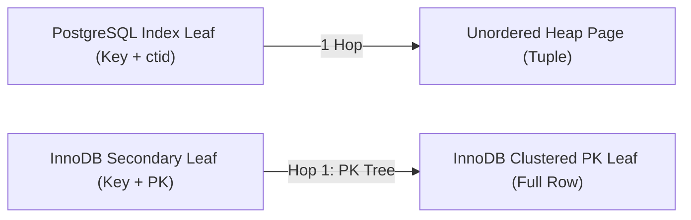
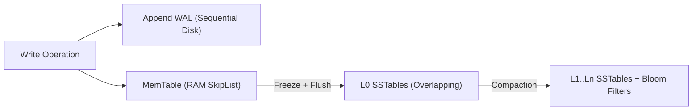
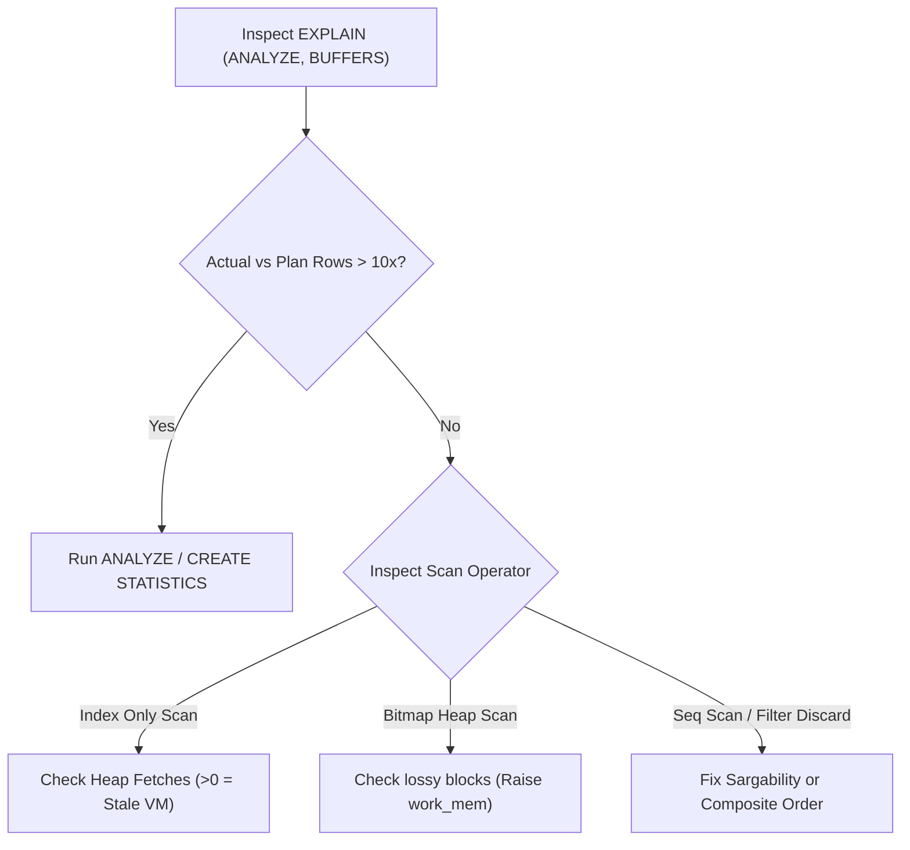

---
tags:
  - software-engineering
  - databases
  - indexing
  - btree
  - lsm-tree
  - query-optimization
  - postgresql
created: 2026-11-13
updated: 2026-11-13
status: 🟢
level: mid-to-senior
---
# Database Indexing & Query Execution Plans

> [!abstract] Vault Navigation
> Physical index page layouts, B+Tree/LSM internals, specialized PostgreSQL index types, and execution plan diagnostics inside [[Programming/Software Engineering/Database Design/Database Design Complete Guide|Database Design Complete Guide]]. Pairs directly with [[Programming/Software Engineering/Database Design/Relational Databases|Relational Databases]], [[Programming/Software Engineering/Database Design/Normalization|Normalization]], [[Programming/Software Engineering/Database Design/Transactions|Transactions]], and [[Programming/Software Engineering/Database Design/NoSQL|NoSQL]].

An index trades **write amplification, memory footprint, and lock/vacuum overhead** for $O(\log_B N)$ or $O(1)$ read selectivity and pre-sorted access paths. Designing high-throughput schemas requires understanding exact 8 KiB / 16 KiB disk page structures, B+Tree vs LSM-Tree amplification trade-offs, PostgreSQL heap-only tuple (`HOT`) mechanics, Visibility Map dependencies on Index-Only Scans, specialized inverted/spatial/vector indexes, and empirical diagnosis via `EXPLAIN (ANALYZE, BUFFERS, VERBOSE)`.

---

## 1. First-Principles Mechanics & Storage Engine Architecture

### 1.1 B+Tree Page Layout on Disk (PostgreSQL 8 KiB vs InnoDB 16 KiB)

B+Trees organize sorted keys across fixed-size disk pages to align with OS filesystem blocks and database buffer-pool frames:

1. **PostgreSQL 8 KiB (`8,192 B`) Index Page Anatomy**:
   - **`PageHeaderData` (24 bytes)**: Contains `pd_lsn` (latest WAL record protecting this page), `pd_checksum`, `pd_lower` (end of line pointers), `pd_upper` (start of tuple space), and `pd_special` (start of special footer).
   - **`ItemIdData` Array (4 bytes per entry, grows downward)**: Line pointers storing `(offset, length, flags)` pointing to actual index tuples inside the page. Binary search operates over this contiguous offset array.
   - **Free Space**: Unallocated middle gap allowing `INSERT`s without rewriting the page until full.
   - **`IndexTupleData` + Key Payload (grows upward)**: Stores the key values plus a 6-byte `ItemPointerData` (`ctid = (4-byte block_num, 2-byte item_offset)`) in leaf pages—or child page `block_num` in internal branch pages.
   - **`BTPageOpaqueData` (16 bytes at `pd_special`)**: Stores `btpo_prev`, `btpo_next` (doubly-linked sibling pointers for ordered scans), `btpo_level` (`0` = leaf), and `BTP_LEAF`/`BTP_ROOT` flags.
2. **MySQL InnoDB 16 KiB (`16,384 B`) Page Layout**:
   - InnoDB clusters the primary table directly inside the **Primary Key B+Tree leaf pages** (`FIL Header` 38 B + `Page Header` 56 B + `Infimum/Supremum` 26 B + user records + `Page Directory` slots + `FIL Trailer` 8 B).

### 1.2 Fan-Out Math, Tree Depth & Page Splits

Because internal B+Tree pages store **only separator keys and child pointers** (never full table rows), **branching factor (fan-out $B$)** is massive:

- Consider an 8 KiB PostgreSQL internal page indexing an 8-byte `BIGINT` key at default `fillfactor = 90%`:
  - Usable bytes $\approx (8192 - 24 - 16) \times 0.90 \approx 7,336\text{ B}$.
  - Entry size per separator: `8 B` (`IndexTupleData` header) + `8 B` (`BIGINT`) + `4 B` (`ItemIdData` pointer) = `20 B` (padded to `24 B` MAXALIGN on 64-bit).
  - **Fan-out $B$** $\approx \lfloor 7336 / 24 \rfloor \approx \mathbf{305}$ children per internal page!
- **Capacity by Tree Height** (assuming ~200 leaf tuples per 8 KiB leaf page for a narrow `(BIGINT, ctid)` index):
  - **Depth 1** (Root only): $200$ rows.
  - **Depth 2** ($1 \text{ root} \rightarrow 305 \text{ leaves}$): $305 \times 200 \approx \mathbf{61,000}$ rows.
  - **Depth 3**: $305^2 \times 200 \approx \mathbf{18.6\text{ million}}$ rows.
  - **Depth 4**: $305^3 \times 200 \approx \mathbf{5.67\text{ billion}}$ rows!
- **PostgreSQL 13+ B-Tree Deduplication (`deduplicate_items = on`)**: When low-cardinality columns (`status`, `tenant_id`) repeat identical keys on leaf pages, PostgreSQL packs a **single key followed by an array of 6-byte `ctid` posting lists**, shrinking index size by $2\text{–}4\times$ and raising effective leaf capacity dramatically.

#### Page Splits: Random Keys (`UUIDv4`) vs Monotonic Keys (`BIGINT` / `UUIDv7`)

- **Random `UUIDv4` Inserts**: New keys land on arbitrary leaf pages across the entire tree. Once a full page overflows, PostgreSQL executes a **50/50 split** (moving half the tuples to a newly allocated page), leaving leaf pages ~50–65% full, generating random dirty-page cache evictions, and triggering full 8 KiB `full_page_writes` into WAL whenever an untouched post-checkpoint page splits!
- **Monotonic `BIGINT` / `UUIDv7` Inserts**: Appends strike the **rightmost leaf page** (`P_RIGHTMOST`). PostgreSQL applies a **90/10 rightmost split optimization**, keeping historical leaf pages ~90% packed while moving only the newest entries forward—eliminating random buffer thrashing and minimizing index bloat.

### 1.3 Clustered vs Non-Clustered Lookups & PostgreSQL `HOT` Updates



| Storage Architecture | Primary Key Organization | Secondary Index Pointer | Lookup Cost (1 Row by Secondary Key) | `UPDATE` Impact on Secondary Indexes |
|---|---|---|---|---|
| **PostgreSQL (Heap + Non-Clustered)** | Heap pages are **unordered**; `PK` is just a unique B+Tree pointing to `ctid` | Physical **`ctid (block, offset)`** | **1 B+Tree traversal + 1 Heap fetch** | Updating **any** column outside HOT rewrites a new heap tuple (`new ctid`) and **MUST insert new entries in EVERY index** on that table! |
| **MySQL InnoDB (Clustered PK)** | Table rows live **physically inside `PK` B+Tree leaves** | Logical **Primary Key bytes** | **2 B+Tree traversals** (Secondary B+Tree $\rightarrow$ PK B+Tree) | Updating non-indexed columns touches **zero** secondary indexes! However, wide PKs (`UUIDv4` = 36 B) duplicate 36 B inside **every** secondary index! |

#### InnoDB Wide-PK Secondary Amplification vs PostgreSQL `CLUSTER` / `pg_repack`

In MySQL InnoDB, choosing a `CHAR(36)` `UUIDv4` string instead of an `8-byte` `BIGINT` (or `BINARY(16)` `UUIDv7`) adds $28\text{ B}$ of PK overhead to **every single secondary index leaf entry**. On a 200M-row table with 5 secondary indexes, that bloats secondary indexes alone by $200\text{M} \times 5 \times 28\text{ B} = \mathbf{28\text{ GB}}$ of pure redundant key bytes—evicting hot working-set pages from `innodb_buffer_pool_size`—while forcing random page splits on every insert.

In PostgreSQL, heap pages remain logically unordered unless reorganized. Running `CLUSTER orders USING idx_orders_org_status_created_cover;` physically sorts heap tuples on disk to match the index (making range scans over an organization's orders contiguous sequential I/O!), **but** `CLUSTER` holds an **`ACCESS EXCLUSIVE`** lock for the full table rewrite and does **not** preserve order on subsequent `INSERT`/`UPDATE`s. In production, use **`pg_repack --order-by ...`** to rebuild clustered physical order and reclaim dead page bloat online without blocking writes.

#### PostgreSQL `HOT` (`Heap-Only Tuple`) Updates & `fillfactor`

Because PostgreSQL MVCC creates a new tuple version on every `UPDATE` (see [[Programming/Software Engineering/Database Design/Transactions|Transactions]]), updating a single non-indexed `last_seen_at` column on a table with 6 indexes would normally trigger **6 B+Tree inserts + WAL** unless **HOT (`Heap-Only Tuple`)** applies.

PostgreSQL executes a **HOT update** if and only if **BOTH** conditions hold:
1. **Zero indexed columns** (including columns in expression, partial, or covering `INCLUDE` predicates) changed between old and new versions.
2. **Sufficient free space exists on the exact same 8 KiB heap page** to hold the new tuple version.

When both hold, the old tuple's `t_ctid` points directly to the new tuple on the same page (`HEAP_HOT_UPDATED`), and **all B+Tree indexes remain untouched**! Because default `fillfactor = 100` packs heap pages completely full during bulk `INSERT`s, update-heavy tables immediately fail condition (2). Setting **`WITH (fillfactor = 80)`** reserves 20% headroom inside every 8 KiB page specifically for HOT update chains.

#### Inspecting Live B+Tree & Heap Pages via `pageinspect`

Rather than guessing page density, splits, or HOT chains, inspect physical 8 KiB pages directly in PostgreSQL using the built-in `pageinspect` extension:

```sql
CREATE EXTENSION IF NOT EXISTS pageinspect;

-- 1. Check B+Tree root page, height (level + 1), and deduplication version
SELECT magic, version, root, level, fastroot, fastlevel
FROM bt_metap('idx_orders_org_status_created_cover');

-- 2. Inspect physical leaf page fill ratio, free bytes, and sibling links
SELECT blkno, type, live_items, dead_items, avg_item_size, free_size, btpo_prev, btpo_next
FROM bt_page_stats('idx_orders_org_status_created_cover', 1);

-- 3. Verify HOT update chain flags on heap page 0 (0x4000 = HEAP_HOT_UPDATED, 0x8000 = HEAP_ONLY_TUPLE)
SELECT lp, lp_off, t_ctid,
       (t_infomask2 & x'4000'::int) <> 0 AS is_hot_updated,
       (t_infomask2 & x'8000'::int) <> 0 AS is_heap_only
FROM heap_page_items(get_raw_page('users', 0))
LIMIT 10;
```

### 1.4 LSM-Tree Engine Internals (RocksDB, Cassandra, ScyllaDB, Pebble)

When random write throughput saturates B+Tree dirty-page flushes, **Log-Structured Merge-Trees (LSM)** convert random updates into **sequential append-only disk I/O**:



1. **Write Path**: Writes append to an on-disk sequential **WAL** and insert into a sorted in-memory **MemTable** (typically a lock-free `SkipList`). Once the MemTable reaches its memory threshold (e.g., 64 MB), it freezes into an immutable MemTable and flushes sequentially to disk as an immutable **SSTable** containing sorted 4–64 KB data blocks, a sparse index block, and a **Bloom Filter**.
2. **Read Path & Tombstone Trap**: Point lookups check the active MemTable, immutable MemTables, **every overlapping $L_0$ SSTable**, and at most 1 SSTable per non-overlapping level $L_1 \dots L_n$ (using Bloom filters to skip SSTables lacking the key). Crucially, deletes append a **Tombstone marker** rather than erasing disk bytes; until major compaction purges tombstones past `gc_grace_seconds`, range scans (`SELECT ... WHERE pk > X LIMIT 50`) must scan and discard thousands of tombstone keys, causing severe read tail-latency spikes!
3. **Bloom Filter Sizing Math**: A Bloom filter prevents futile disk reads on absent keys by testing membership with $k$ hash functions over $m$ bits for $n$ keys. Optimal bit budget for false positive rate $p$ is:
   $$\frac{m}{n} \approx -1.44 \log_2(p), \qquad k = \left\lceil \frac{m}{n} \ln 2 \right\rceil$$
   At **$10\text{ bits/key}$** ($k = 7$), false-positive rate is **~0.82%** (~1 unnecessary disk check per 122 missing-key lookups) with **zero false negatives**.
3. **Compaction Strategies & The RUM Conjecture**: The **RUM Conjecture** proves no index structure simultaneously minimizes **Read**, **Update (Write)**, and **Memory/Space** amplification:

| Compaction Strategy | Mechanics | Write Amp | Read Amp | Space Amp | Optimal Workload |
|---|---|---|---|---|---|
| **STCS (Size-Tiered)** | Merges $K$ similarly sized SSTables into 1 larger SSTable | **Low** ($4\text{–}10\times$) | **High** (point key may span many SSTables across tiers) | **High** (needs **50% free disk headroom** for worst-case major compaction!) | Write-heavy append/time-series ingest |
| **LCS (Leveled)** | Organizes into $L_0, L_1, \dots$ ($10\times$ size per level); $L_1+$ key ranges **never overlap** | **High** ($10\text{–}30\times$ rewrites across levels) | **Low** ($\le 1$ SSTable checked per level $L_1+$) | **Low** (~1.1x live dataset size) | Read-heavy point lookups, frequent `UPDATE`/`DELETE` mutations |
| **TWCS / FIFO** | Buckets SSTables strictly by fixed time windows (e.g., 1 day) | **Minimal** ($1\text{–}2\times$) | Low for recent time-bounded queries | Near zero when TTL drops expired SSTables wholesale | TTL-expiring IoT metrics, log retention |

---

## 2. Real-World Use Cases & Index Selection Decision Matrix

### 2.1 Seven Production Indexing Scenarios

1. **Multi-Tenant OLTP Lists & Cursor Pagination (Composite B+Tree)**: Paginating active orders for a tenant (`WHERE tenant_id = $1 AND status = 'paid' ORDER BY created_at DESC, id DESC LIMIT 25`). Place equality keys first, then the sort/range key, and replace `OFFSET` with keyset cursors (`(created_at, id) < ($cursor_ts, $cursor_id)`).
2. **Soft-Deleted Rows & Background Job Queues (Partial Index)**: In a 100M-row `jobs` table where 99.8% of rows are `'completed'`, indexing the whole table wastes gigabytes of RAM. A partial index `WHERE status IN ('queued', 'retrying')` shrinks the index to ~10 MB and keeps it pinned in `shared_buffers`.
3. **High-QPS Lookup APIs Sensitive to Random Heap I/O (Covering `INCLUDE` Index)**: Fetching `(total_cents, currency)` for `tenant_id` dashboards without visiting random heap pages uses `INCLUDE (total_cents, currency)`—strictly paired with aggressive `autovacuum` to keep the Visibility Map clean.
4. **Semi-Structured Webhooks, Substring Search & Full-Text (`GIN`)**: Filtering `headers @> '{"x-provider":"stripe"}'` uses `GIN (headers jsonb_path_ops)`; `ILIKE '%invoice%'` requires `pg_trgm` (`gin_trgm_ops`); stemmed natural language search uses `tsvector` + `GIN`.
5. **Booking Systems & Temporal Versioning (`GiST`)**: Preventing double-booked rooms or overlapping subscription rates atomically under concurrency requires `EXCLUDE USING gist (room_id WITH =, during WITH &&)` (requiring `btree_gist`).
6. **Multi-Billion Row Append-Only Telemetry (`BRIN`)**: Storing 5 billion sequential event rows sorted physically by `occurred_at` makes a B+Tree cost ~110 GB of RAM/disk. A `BRIN` index (`pages_per_range = 64`) tracks `(min, max)` per 512 KB chunk in **< 50 MB**!
7. **Semantic RAG & Hybrid Vector Search (`pgvector` `HNSW` vs `IVFFlat`)**: Embedding 1536-dimensional `float32` vectors requires approximate nearest neighbor (`ANN`) indexing via `HNSW` (high recall, dynamic incremental inserts, higher RAM) or `IVFFlat` (lower RAM, fast build, requires pre-populated k-means centroids).

### 2.2 Complete Index Type Decision Matrix

| Index Type | Internal Structure | Supported Predicates / Operators | Write Cost | Size / RAM Footprint | Avoid When |
|---|---|---|---|---|---|
| **B+Tree** *(default)* | Balanced multi-way search tree | `=`, `<`, `<=`, `>`, `>=`, `BETWEEN`, `IS NULL`, `LIKE 'abc%'` (`C` locale) | Moderate | High | Multi-key `JSONB`, substrings `%abc%`, high-dim vectors |
| **Covering (`INCLUDE`)** | B+Tree storing non-key payload in **leaves only** | Same as B+Tree + **Index-Only Scan** | Higher (wider leaves; blocks HOT if `INCLUDE` column updates!) | High | Write-heavy columns that mutate frequently |
| **Partial (`WHERE ...`)** | Filtered B+Tree / GIN | Predicates statically implying the index `WHERE` clause | **Very Low** (skips non-matching rows) | **Tiny** | Query parameters that prevent proving predicate implication (`WHERE status = $1`) |
| **Expression** | B+Tree over `IMMUTABLE` computed output | Queries matching the **exact** expression (`LOWER(email)`) | Moderate (+ function CPU) | Moderate | Ad-hoc functions differing from index definition |
| **GIN** | Inverted key $\rightarrow$ sorted posting tree of `ctid`s | `@>`, `?`, `?&`, `@@` (`JSONB`, `ARRAY`, `tsvector`), `pg_trgm` | **High** (`fastupdate` mitigation) | High (shrink 2–3x w/ `jsonb_path_ops`) | Frequent key updates on huge documents or range filters |
| **GiST** | Balanced R-tree bounding predicate tree | `&&`, `@>`, `<@`, `-|-` (`range`, `PostGIS`), `EXCLUDE` | Moderate | Moderate | Exact scalar equality without ranges/geometry |
| **BRIN** | `(min, max)` summary per `N` heap blocks | `<`, `<=`, `=`, `>=`, `>` on physically sorted data | **Near Zero** | **100x–1000x Smaller** | Random/updated tables where `abs(correlation) < 0.9` |
| **Hash** | Bucketed 32-bit hash table (WAL-logged PG 10+) | Strictly scalar equality `=` | Low | Smaller than B+Tree for wide URLs/hashes | Range queries, `ORDER BY`, `UNIQUE`, or Index-Only Scans |
| **`pgvector` HNSW** | Multi-layer navigable small-world graph | `<=>` (cosine), `<->` (L2), `<#>` (inner product) | **Very High** | **Very High** (graph must fit in RAM!) | Low-RAM boxes where exact linear scan or `IVFFlat` fits better |

---

## 3. Step-by-Step Practical Application: End-to-End Production Schema & Rollout

### 3.1 Production Multi-Feature Schema with Composite, Covering, Partial, Expression, GIN, GiST, BRIN & HNSW Indexes

Consider an enterprise SaaS commerce & support platform running PostgreSQL 16+/17+:

```sql
CREATE EXTENSION IF NOT EXISTS pg_trgm;
CREATE EXTENSION IF NOT EXISTS btree_gist;
CREATE EXTENSION IF NOT EXISTS vector;

-- 1. Users table: Expression index for case-insensitive uniqueness + fillfactor for HOT updates
CREATE TABLE users (
    id            BIGINT GENERATED ALWAYS AS IDENTITY PRIMARY KEY,
    org_id        BIGINT NOT NULL,
    email         TEXT NOT NULL,
    display_name  TEXT NOT NULL,
    last_login_at TIMESTAMPTZ,
    deleted_at    TIMESTAMPTZ
) WITH (fillfactor = 80); -- Leaves 20% headroom so last_login_at updates execute as HOT updates!

-- Enforce unique lowercase email strictly for active (non-soft-deleted) accounts
CREATE UNIQUE INDEX idx_users_active_email_norm
    ON users (LOWER(email))
    WHERE deleted_at IS NULL;

-- Substring search on display_name (`ILIKE '%ada%'`) via trigram GIN
CREATE INDEX idx_users_name_trgm
    ON users USING gin (display_name gin_trgm_ops)
    WHERE deleted_at IS NULL;

-- 2. Orders table: Equality -> Sort -> Covering keyset pagination + partial active queue index
CREATE TABLE orders (
    id          BIGINT NOT NULL, -- UUIDv7 or Snowflake
    org_id      BIGINT NOT NULL,
    status      TEXT NOT NULL CHECK (status IN ('pending', 'paid', 'refunded', 'cancelled')),
    total_cents BIGINT NOT NULL,
    currency    CHAR(3) NOT NULL,
    metadata    JSONB NOT NULL DEFAULT '{}'::jsonb,
    created_at  TIMESTAMPTZ NOT NULL DEFAULT NOW(),
    PRIMARY KEY (id)
) WITH (fillfactor = 85);

-- Optimal Composite + Covering index for tenant order dashboard & keyset cursor pagination:
-- Equality (org_id, status) BEFORE sort/range (created_at DESC, id DESC) + INCLUDE payload
CREATE INDEX idx_orders_org_status_created_cover
    ON orders (org_id, status, created_at DESC, id DESC)
    INCLUDE (total_cents, currency);

-- Tiny Partial index strictly for background payment settlement workers (0.5% of rows)
CREATE INDEX idx_orders_pending_retry
    ON orders (created_at ASC)
    WHERE status = 'pending';

-- Compact GIN index for containment filters: WHERE metadata @> '{"channel":"pos"}'
CREATE INDEX idx_orders_metadata_gin
    ON orders USING gin (metadata jsonb_path_ops)
    WITH (fastupdate = on, gin_pending_list_limit = 2048); -- 2 MB cap limits flush latency spikes

-- 3. Resource reservations: GiST Exclusion preventing overlapping bookings atomically
CREATE TABLE resource_bookings (
    id          BIGINT GENERATED ALWAYS AS IDENTITY PRIMARY KEY,
    resource_id BIGINT NOT NULL,
    booked_span TSTZRANGE NOT NULL,
    EXCLUDE USING gist (resource_id WITH =, booked_span WITH &&)
);

-- 4. Append-only audit stream: BRIN index for 1000x storage savings
CREATE TABLE audit_events (
    event_id   BIGINT GENERATED ALWAYS AS IDENTITY,
    org_id     BIGINT NOT NULL,
    event_type TEXT NOT NULL,
    created_at TIMESTAMPTZ NOT NULL DEFAULT NOW(),
    payload    JSONB NOT NULL
);

-- 64 pages = 512 KB physical block ranges; ideal for monotonic append-only timestamps
CREATE INDEX idx_audit_events_created_brin
    ON audit_events USING brin (created_at)
    WITH (pages_per_range = 64, autosummarize = on);

-- 5. Knowledge chunks for semantic + lexical hybrid search
CREATE TABLE kb_chunks (
    id          BIGINT GENERATED ALWAYS AS IDENTITY PRIMARY KEY,
    org_id      BIGINT NOT NULL,
    content     TEXT NOT NULL,
    tsv_body    TSVECTOR GENERATED ALWAYS AS (to_tsvector('english', content)) STORED,
    embedding   HALFVEC(1536) NOT NULL -- halfvec cuts HNSW RAM footprint by 50% vs float32!
);

CREATE INDEX idx_kb_chunks_tsv_gin ON kb_chunks USING gin (tsv_body);
CREATE INDEX idx_kb_chunks_embedding_hnsw
    ON kb_chunks USING hnsw (embedding halfvec_cosine_ops)
    WITH (m = 16, ef_construction = 128);
```

### 3.2 Keyset Cursor Pagination vs Broken `OFFSET` Queries

Using `OFFSET 100000 LIMIT 25` forces PostgreSQL to scan and discard 100,000 tuples on every page turn ($O(N)$ degradation). Replace `OFFSET` with a deterministic **keyset tuple comparison** aligned to `(org_id, status, created_at DESC, id DESC)`:

```sql
-- Matches idx_orders_org_status_created_cover cleanly via Index-Only Scan:
-- Stops after exactly 25 tuples regardless of whether user is on page 1 or page 50,000!
SELECT id, created_at, total_cents, currency
FROM orders
WHERE org_id = $1
  AND status = 'paid'
  AND (created_at, id) < ($2::timestamptz, $3::bigint)
ORDER BY created_at DESC, id DESC
LIMIT 25;
```

### 3.3 Zero-Downtime Production Index Rollout (`CONCURRENTLY`)

Standard `CREATE INDEX` acquires a **`SHARE`** lock—blocking **all `INSERT`, `UPDATE`, and `DELETE`** operations for minutes or hours! Always build indexes online using `CONCURRENTLY` outside transaction blocks (`BEGIN...COMMIT`):

```sql
-- Step 1: Ensure session never gets stuck holding locks indefinitely or timing out mid-scan
SET statement_timeout = 0;
SET lock_timeout = '3s';
-- Optional: accelerate parallel B+Tree index sort phase (does not consume shared_buffers)
SET maintenance_work_mem = '512MB';
SET max_parallel_maintenance_workers = 4;

-- Step 2: Execute outside any transaction block!
-- Runs 2 table scans under SHARE UPDATE EXCLUSIVE (reads & writes stay 100% online).
CREATE INDEX CONCURRENTLY idx_orders_org_created_new
    ON orders (org_id, created_at DESC)
    INCLUDE (total_cents);

-- Step 3: Mandatory verification! Concurrent builds leave INVALID indexes on deadlock/dup errors
SELECT
    i.relname       AS index_name,
    ix.indisvalid   AS is_valid,
    ix.indisready   AS is_ready
FROM pg_index ix
JOIN pg_class i ON i.oid = ix.indexrelid
WHERE i.relname = 'idx_orders_org_created_new';

-- Step 4: If indisvalid = false, clean up safely without blocking writes, fix issue, and retry
DROP INDEX CONCURRENTLY IF EXISTS idx_orders_org_created_new;
```

**Why `CREATE INDEX CONCURRENTLY` Can Still Cause Latency**: Phase 2 and Phase 3 of a concurrent index build wait for **every pre-existing open transaction** (holding an older snapshot than the build phase) to finish before proceeding. If a forgotten analytics query or idle-in-transaction session stays open for 40 minutes, `CREATE INDEX CONCURRENTLY` waits harmlessly in the background—unless another DDL command queues behind it!

### 3.4 Production TypeScript Verification & Keyset Cursor Repository

In production services, pair schema migrations with automated verification tests that enforce keyset pagination plans and reject accidental `Seq Scan` regressions in CI:

```typescript
import { Pool } from 'pg';

export interface OrderCursor {
  createdAt: string;
  id: string; // bigint serialized as string to avoid JS 53-bit precision loss
}

export interface OrderSummaryRow {
  id: string;
  createdAt: string;
  totalCents: number;
  currency: string;
}

export async function listPaidOrdersKeyset(
  pool: Pool,
  orgId: number,
  cursor: OrderCursor | null,
  limit = 25,
): Promise<{ items: OrderSummaryRow[]; nextCursor: OrderCursor | null }> {
  const safeLimit = Math.min(Math.max(limit, 1), 100);

  const sql = cursor
    ? `SELECT id::text, created_at::text AS "createdAt", total_cents AS "totalCents", currency
       FROM orders
       WHERE org_id = $1
         AND status = 'paid'
         AND (created_at, id) < ($2::timestamptz, $3::bigint)
       ORDER BY created_at DESC, id DESC
       LIMIT $4`
    : `SELECT id::text, created_at::text AS "createdAt", total_cents AS "totalCents", currency
       FROM orders
       WHERE org_id = $1
         AND status = 'paid'
       ORDER BY created_at DESC, id DESC
       LIMIT $2`;

  const params = cursor
    ? [orgId, cursor.createdAt, cursor.id, safeLimit + 1]
    : [orgId, safeLimit + 1];

  const { rows } = await pool.query<OrderSummaryRow>(sql, params);
  const hasMore = rows.length > safeLimit;
  const items = hasMore ? rows.slice(0, safeLimit) : rows;
  const tail = items.at(-1);

  return {
    items,
    nextCursor: hasMore && tail ? { createdAt: tail.createdAt, id: tail.id } : null,
  };
}

// CI Plan Regression Assertion: verifies Index Only Scan and zero Seq Scans on large fixtures
export async function assertIndexOnlyScan(
  pool: Pool,
  query: string,
  params: unknown[],
  expectedIndexName: string,
): Promise<void> {
  const res = await pool.query(`EXPLAIN (ANALYZE, BUFFERS, FORMAT JSON) ${query}`, params);
  const plan = res.rows[0]['QUERY PLAN'][0].Plan;
  const serialized = JSON.stringify(plan);

  if (serialized.includes('"Node Type":"Seq Scan"')) {
    throw new Error(`Query regression: Seq Scan detected in plan:\n${serialized}`);
  }
  if (!serialized.includes(expectedIndexName)) {
    throw new Error(`Expected index ${expectedIndexName} was not chosen:\n${serialized}`);
  }
  if (plan['Plans']?.[0]?.['Heap Fetches'] > 0 && plan['Actual Rows'] > 0) {
    console.warn(`Visibility Map incomplete: Heap Fetches=${plan['Plans'][0]['Heap Fetches']}`);
  }
}
```

---

## 4. Complete Construct Reference & Subtle Edge Cases

### 4.1 Composite B+Tree Ordering: Leftmost Prefix, Range Contiguity & Locale Traps

A composite index `(a, b, c)` sorts lexicographically by `a`, then `b`, then `c`. Five subtle pitfalls routinely defeat B+Tree index selection:

1. **Equality Before Range Rule**: Once any column uses a range operator (`>`, `<`, `BETWEEN`, `LIKE 'abc%'`, `!=`), **every column after it in the index key is no longer contiguous**. Put all `=` predicates first, followed by either a single range column OR `ORDER BY` sort columns.
2. **Large `IN (...)` / `= ANY($1)` Arrays**: With `(org_id, status, created_at DESC)`, filtering `status IN ('open', 'overdue')` triggers **multiple B+Tree descents** (one per status value), requiring an in-memory `Sort` node before `LIMIT 25`! If the active list is small and fixed, a **partial index** `ON invoices (org_id, created_at DESC) WHERE status IN ('open', 'overdue')` keeps `created_at DESC` globally contiguous for `org_id`, eliminating the `Sort` node entirely.
3. **Direction & `NULLS` Mismatch (`ASC`/`DESC` + `NULLS FIRST`/`LAST`)**: A B+Tree can scan forward OR backward—**unless** `ORDER BY` mixes directions (`ORDER BY org_id ASC, created_at DESC` vs default `ASC, ASC`)! Declare the exact mixed direction (`(org_id ASC, created_at DESC NULLS LAST)`) in the index definition so backward scans aren't blocked.
4. **`LIKE 'prefix%'` Locale Trap**: Under UTF-8/ICU collations (`en_US.UTF-8`), standard B+Tree ordering differs from bytewise prefix ordering, preventing `LIKE 'inv_%'` from using a plain `TEXT` index! Fix by declaring `CREATE INDEX ... ON t (code text_pattern_ops);` or specifying `COLLATE "C"` on the column/index.
5. **PostgreSQL 18 B+Tree Skip Scan vs `< 18`**: Prior to PostgreSQL 18, filtering on `(b)` without `(a)` on `(a, b)` caused a full `Seq Scan` or `Index Scan` over the entire index. PostgreSQL 18 introduces native B+Tree skip scans when `a` has low distinct cardinality (automatically jumping across distinct `a` values), though placing the filtered equality column first remains optimal.

### 4.2 Covering (`INCLUDE`) & Visibility Map Dependencies

- **Non-Key Leaf Separation**: `INCLUDE (col_c, col_d)` stores `col_c` and `col_d` strictly in **leaf pages** (never internal branch pages), keeping internal page fan-out high and allowing `UNIQUE (a, b) INCLUDE (c)` without making `c` part of the uniqueness constraint.
- **Visibility Map (`VM`) Dependency**: PostgreSQL index entries contain **no MVCC `xmin`/`xmax` fields**. An `Index Only Scan` skips reading the heap page **only** if the target heap page's bit is set `all-visible` inside the table's `_vm` fork (`pg_visibility`). Heavy `UPDATE`/`DELETE` churn clears `all-visible` bits immediately; if `autovacuum` lags behind, `Index Only Scan` silently reads thousands of heap pages (`Heap Fetches: 94200`), performing worse than a regular `Index Scan`!

### 4.3 Partial & Expression Index Rules

- **Static Implication Requirement**: PostgreSQL's planner selects a partial index `WHERE deleted_at IS NULL AND status = 'active'` **only** if it can prove at plan time that the query's `WHERE` clause implies the index predicate.
  - `WHERE deleted_at IS NULL AND status = 'active'` -> **Matches.**
  - `WHERE deleted_at IS NULL AND status = $1` (prepared statement / bound parameter) -> **Fails to match** on generic plans because the planner cannot prove `$1 = 'active'`! Fix by either using `WHERE status = 'active'` literally in SQL or choosing a narrower predicate (`WHERE deleted_at IS NULL`).
- **`IMMUTABLE` Function Mandate**: Expression indexes accept strictly `IMMUTABLE` functions (`LOWER(email)`, `DATE_TRUNC('day', ts AT TIME ZONE 'UTC')`). Calling `DATE_TRUNC('day', timestamptz_col)` without `AT TIME ZONE 'UTC'` fails because `TIMESTAMPTZ` truncation depends on the session's mutable `TimeZone` setting (`STABLE`, not `IMMUTABLE`).

### 4.4 `GIN` (`fastupdate` Pending List Trap), `BRIN` Correlation & `pgvector` Filtering

1. **`GIN` `fastupdate` Latency Spikes**: Inserting a single document into a `GIN`-indexed column (`tsvector`, `JSONB`) can generate dozens of inverted posting-tree insertions. By default (`fastupdate = on`), PostgreSQL appends new entries into an unsorted **pending list** (capped at `gin_pending_list_limit = 4MB`) to batch writes. **The Trap**: Whichever unfortunate client transaction crosses the 4 MB pending-list limit—or reads the pending list—suddenly pays the synchronous cost of merging 4 MB of postings into the main GIN tree, causing unexplained 500 ms–2 s tail-latency spikes!
   - **Remediation**: Lower `gin_pending_list_limit` (e.g., `1024` = 1 MB) and run frequent `autovacuum`, **or** set `WITH (fastupdate = off)` if deterministic read/write p99 latency outweighs raw bulk insert throughput.
2. **`BRIN` Correlation Decay**: `BRIN` skips 128-page (1 MB) ranges whose `(min, max)` bounds fall outside the query filter. If `UPDATE`s rewrite modified rows into freed space on earlier heap pages, or out-of-order backfills land at the end, `pg_stats.correlation` drops below `0.9`—turning `(min, max)` bounds into `[1970, 2026]` on every block range and forcing `BRIN` to scan **100% of the table**! Verify `correlation` regularly and execute `SELECT brin_summarize_new_values('idx_name');` or enable `autosummarize = on`.
3. **`pgvector` `HNSW` vs `IVFFlat` Sizing & Filtered Starvation**:
   - **Memory Formula (`HNSW`)**: An `HNSW` graph stores full vectors plus $M$ bidirectional neighbor links across hierarchy layers in memory. For $N$ vectors of dimension $d$:
     $$\text{RAM}_{\text{HNSW}} \approx N \times \big(d \times \text{bytes\_per\_dim} + M \times 8\text{ B}\big) \times 1.25$$
     For **10M vectors** ($d = 1536$, $M = 16$): **`float32` (`4 B`)** consumes $\approx 10^7 \times (6144 + 128) \times 1.25 \approx \mathbf{78.4\text{ GB}}$ of RAM! Switching to **`HALFVEC(1536)` (`2 B`)** halves vector memory to **~40 GB**, and binary quantization (`bit(1536)`) reduces it below **3 GB** for coarse candidate retrieval followed by exact re-ranking. When building (`CREATE INDEX ... USING hnsw`), raise `maintenance_work_mem` above the graph footprint so build does not degrade by $10\times$ spilling to disk!
   - **HNSW vs IVFFlat Trade-Off**: `IVFFlat` partitions space via k-means into `lists` ($\approx \sqrt{N}$ for $> 1\text{M}$ rows) and scans `probes` closest centroids (`probes ≈ sqrt(lists)`). `IVFFlat` builds $10\times$ faster and consumes minimal RAM, **but** suffers severe recall collapse if built on an empty/small table before distribution stabilizes—whereas `HNSW` handles incremental inserts dynamically with far better speed-recall curves (`ef_construction = 128..200`, `ef_search = 64..128`).
   - **Post-Filter Starvation**: Executing `SELECT * FROM kb_chunks WHERE org_id = 42 ORDER BY embedding <=> $1 LIMIT 10` causes `HNSW` to traverse global nearest neighbors across *all* organizations first, then discard non-matching `org_id` rows. If `org_id = 42` owns only 0.5% of rows, an `ef_search = 40` graph walk may yield **0 or 2 rows instead of 10**! Use **`pgvector` 0.8+ Iterative Index Scans** (`SET LOCAL hnsw.iterative_scan = strict_order;` + `hnsw.max_scan_tuples = 20000`) which resume graph traversal seamlessly until `LIMIT 10` is satisfied, **or** partition the table by `org_id`.
4. **`Hash` Indexes vs B+Tree on Wide Equality Keys**: Since PostgreSQL 10, `Hash` indexes are fully WAL-logged and crash-safe. When indexing opaque 64–512 byte strings (e.g., SHA-256 checksums, long webhook URLs) queried **strictly via `=`**, a `Hash` index stores only 32-bit hash buckets (`~32 B` per entry regardless of string length!), staying 2–4x smaller than a B+Tree and faster on point lookups—at the cost of zero support for `<`, `>`, `ORDER BY`, `UNIQUE`, or Index-Only Scans.

### 4.5 Multi-Column Planner Statistics, Join Acceleration & Redundant Index Hygiene

PostgreSQL assumes columns are **statistically independent** by default: if `country = 'FR'` holds for 5% of rows and `city = 'Paris'` holds for 4% of rows, the planner estimates `0.05 * 0.04 = 0.2%` selectivity even though 100% of Paris rows are in France (`~4%`, a **$20\times$ underestimate**!). That misestimate tricks the planner into choosing a devastating **Nested Loop** join over a **Hash Join**.

```sql
-- Create extended multivariate statistics so planner models correlated pairs accurately
CREATE STATISTICS st_orders_country_city (dependencies, ndistinct, mcv)
    ON country, city FROM addresses;
ANALYZE addresses;
```

Always remember **PostgreSQL does NOT automatically index `FOREIGN KEY` columns**—deleting or updating a parent primary key forces a full sequential scan of the child table unless an explicit index exists on the FK columns. Conversely, drop prefix-redundant indexes: if `(org_id, status, created_at)` exists, a separate standalone index on `(org_id)` is pure write amplification unless `(org_id)` queries perform ultra-high-frequency HOT-sensitive index-only lookups where a narrower index fits better in RAM. Also verify how indexes accelerate joins: a **`Merge Join`** requires both inputs sorted on the join key, so matching B+Tree indexes eliminate expensive `Sort` steps entirely; a **`Nested Loop`** excels when the outer input yields `< ~1,000` rows and the inner table holds an index on the join column.

---

## 5. Production Debugging, Profiling & Operations Playbook

### 5.1 Reading `EXPLAIN (ANALYZE, BUFFERS, VERBOSE)` Like a Compiler

Always run **`EXPLAIN (ANALYZE, BUFFERS, VERBOSE)`** (wrap mutations in `BEGIN; EXPLAIN ANALYZE ...; ROLLBACK;` in staging/prod-safe shells) so you measure real execution time and buffer I/O instead of cost estimates alone:



Key metrics inside every plan node:
- **`actual time=startup..total rows=R loops=L`**: Reported **per single loop**! Total node time = `total * L`, total rows yielded = `R * L`. A `Nested Loop` calling an `Index Scan` with `actual time=0.2..0.2 rows=1 loops=250000` burns **50 seconds** despite looking like `0.2 ms` per line!
- **`Buffers: shared hit=H read=R dirtied=D written=W`**:
  - `shared hit`: 8 KB pages served directly from `shared_buffers` RAM.
  - `shared read`: 8 KB pages fetched from OS page cache or physical NVMe disk. Multiply total `hit + read` by 8 KB to calculate logical data scanned (e.g., `100,000` buffers = `800 MB` touched for a query returning 10 rows!).
  - `temp read / temp written`: `Sort` or `Hash` node spilled to temporary disk files (`base/pgsql_tmp`) because `work_mem` was too small.
- **`Heap Fetches: N`**: Inside `Index Only Scan`, counts how many heap pages were visited because the Visibility Map bit wasn't `all-visible`. Target `0` (or $< 1\%$ of `actual rows`).
- **`Rows Removed by Filter: N`**: Rows fetched from the heap (or index) only to be thrown away by a residual predicate—classic indicator of a missing trailing column or wrong equality/range ordering in a composite index.
- **`Heap Blocks: exact=X lossy=Y` + `Rows Removed by Index Recheck: N`**: When `Bitmap Index Scan` exceeds `work_mem`, PostgreSQL downgrades exact tuple pointers into page-level `lossy` bitmaps, forcing `Bitmap Heap Scan` to scan every tuple on those `Y` 8 KB pages and re-evaluate the condition.

### 5.2 Annotated Comparison of the Four Physical Scan Operators

Inspecting real `EXPLAIN (ANALYZE, BUFFERS)` output distinguishes healthy selectivity from hidden I/O traps:

```text
-- 1. Healthy Index-Only Scan (Visibility Map clean: Heap Fetches: 0!)
Limit  (cost=0.56..4.18 rows=25 width=28) (actual time=0.041..0.092 rows=25 loops=1)
  Buffers: shared hit=5
  ->  Index Only Scan using idx_orders_org_status_created_cover on orders
        Index Cond: ((org_id = 42) AND (status = 'paid'::text))
        Heap Fetches: 0
        Buffers: shared hit=5        -- Only 5 x 8 KB = 40 KB read total!

-- 2. Healthy Index Scan (Needs un-covered payload columns, low selectivity < 1%)
Index Scan using idx_orders_org_created on orders (actual time=0.038..1.840 rows=120 loops=1)
  Index Cond: (org_id = 42)
  Buffers: shared hit=118 read=12    -- Visits 130 pages across B+Tree + heap

-- 3. Bitmap Index Scan -> Bitmap Heap Scan (Combines 2 separate indexes cleanly via BitmapAnd!)
Bitmap Heap Scan on orders (actual time=14.2..89.6 rows=14200 loops=1)
  Recheck Cond: ((org_id = 42) AND (currency = 'EUR'::bpchar))
  Heap Blocks: exact=4120            -- No lossy blocks! work_mem sufficed
  Buffers: shared hit=4285
  ->  BitmapAnd (actual time=13.8..13.8 rows=0 loops=1)
        ->  Bitmap Index Scan on idx_orders_org_id (actual time=4.1..4.1 rows=85000 loops=1)
        ->  Bitmap Index Scan on idx_orders_currency (actual time=8.9..8.9 rows=210000 loops=1)

-- 4. Sequential Scan (Optimal when returning > ~20% of table or tiny table < 10 pages!)
Seq Scan on currencies (actual time=0.008..0.041 rows=180 loops=1)
  Buffers: shared hit=2
```

Notice why **`random_page_cost`** must be tuned from its spinning-HDD default `4.0` down to **`1.1`** (and `effective_io_concurrency = 200`) on NVMe SSDs—otherwise PostgreSQL assumes random `Index Scan` I/O costs $4\times$ more than sequential I/O and prematurely switches to `Seq Scan` even at 2–5% selectivity!

#### Key Planner Cost & Telemetry Parameters

| Parameter | Default | Recommended NVMe OLTP Value | Impact on Index Execution Plans |
|---|---|---|---|
| **`random_page_cost`** | `4.0` | **`1.1`** | Prevents planner from abandoning `Index Scan` / `Bitmap Heap Scan` for premature `Seq Scan` |
| **`effective_cache_size`** | `4GB` | **`75%` of total host RAM** | Tells planner how likely index/heap pages stay hot in `shared_buffers` + OS page cache (no RAM allocation!) |
| **`work_mem`** | `4MB` | **`16MB–64MB`** *(per sort/hash op)* | Prevents `Bitmap Heap Scan` from spilling to `lossy` page mode and prevents `Sort` disk spills |
| **`default_statistics_target`** | `100` | `100` global; `500–1000` on skewed cols | Increases histogram buckets & MCV list depth (`ALTER TABLE t ALTER COLUMN c SET STATISTICS 500;`) |
| **`track_io_timing`** | `off` | **`on`** | Exposes `I/O Timings: shared read=...` inside `EXPLAIN (ANALYZE, BUFFERS)` to separate disk latency from CPU |

On PostgreSQL 13+, combine flags into `EXPLAIN (ANALYZE, BUFFERS, WAL, SETTINGS, VERBOSE)` to inspect non-default planner settings, exact WAL bytes emitted by `UPDATE`/`DELETE` operations, and per-node buffer hits simultaneously.

### 5.3 Diagnostic Playbook

| Production Symptom | Underlying Root Cause | Exact Diagnostic Query / Action | Production Remediation |
|---|---|---|---|
| **`Index Only Scan` has 100k `shared read` & slow `p99`** | Stale Visibility Map (`VACUUM` lagging) or high dead tuples | `SELECT n_live_tup, n_dead_tup, last_autovacuum FROM pg_stat_user_tables WHERE relname = 'orders';` | Run `VACUUM (ANALYZE) orders;` and lower `autovacuum_vacuum_scale_factor = 0.02` |
| **`Bitmap Heap Scan` discards millions via `Index Recheck`** | TID bitmap overflowed `work_mem` into `lossy` page mode | Check `Heap Blocks: lossy=...` in `EXPLAIN (ANALYZE, BUFFERS)` | Raise `SET LOCAL work_mem = '64MB';` for query/role or partition table |
| **Query ignores index on `created_at` / `email`** | Non-sargable function (`DATE(created_at)`, `LOWER(email)` without matching index) or locale mismatch | Check `EXPLAIN` `Filter:` line for wrapped column | Rewrite to half-open range (`>= '2026-11-13' AND < '2026-11-14'`) or add expression / `text_pattern_ops` index |
| **`UPDATE` throughput degrades & zero HOT updates** | `fillfactor = 100` leaves 0 bytes free on heap pages, or low-value indexes cover updated column | Inspect `n_tup_hot_upd::float / NULLIF(n_tup_upd, 0)` in `pg_stat_user_tables` | Drop unused/redundant indexes touching mutable column + `ALTER TABLE ... SET (fillfactor = 80)` + `VACUUM FULL`/`pg_repack` |
| **Random 1–2s `INSERT`/`SELECT` spikes on `JSONB`/`tsvector` table** | `GIN` `fastupdate` pending list hitting 4 MB limit and flushing synchronously | Inspect `gin_pending_list_limit` and index options in `pg_class.reloptions` | Set `WITH (fastupdate = off)` for deterministic latency or cap `gin_pending_list_limit = 1024` |
| **`CREATE INDEX CONCURRENTLY` left broken bloat index** | Aborted mid-build due to duplicate unique violation or lock failure | `SELECT indexrelid::regclass FROM pg_index WHERE NOT indisvalid;` | Run `DROP INDEX CONCURRENTLY bad_idx;`, resolve dupes, and rebuild |

### 5.4 Production Index Hygiene, Bloat & Telemetry Audit Script

```sql
-- 1. Find unused non-constraint indexes burning write IOPS & storage (> 50 MB, 0 scans)
SELECT
    s.schemaname,
    s.relname                             AS table_name,
    s.indexrelname                        AS index_name,
    pg_size_pretty(pg_relation_size(s.indexrelid)) AS index_size,
    s.idx_scan
FROM pg_stat_user_indexes s
JOIN pg_index i ON i.indexrelid = s.indexrelid
WHERE s.idx_scan = 0
  AND NOT i.indisunique
  AND NOT i.indisprimary
  AND NOT EXISTS (SELECT 1 FROM pg_constraint c WHERE c.conindid = s.indexrelid)
  AND pg_relation_size(s.indexrelid) > 50 * 1024 * 1024
ORDER BY pg_relation_size(s.indexrelid) DESC;

-- 2. Measure exact B+Tree leaf density & bloat using pgstattuple (target avg_leaf_density > 65%)
CREATE EXTENSION IF NOT EXISTS pgstattuple;
SELECT
    index_size / 1024 / 1024 AS index_mb,
    tree_level,
    ROUND(avg_leaf_density::numeric, 2) AS leaf_density_pct,
    ROUND(leaf_fragmentation::numeric, 2) AS leaf_frag_pct
FROM pgstatindex('idx_orders_org_status_created_cover');

-- 3. Inspect HOT update ratio & autovacuum health across busiest tables
SELECT
    relname,
    n_tup_upd,
    n_tup_hot_upd,
    ROUND(100.0 * n_tup_hot_upd / NULLIF(n_tup_upd, 0), 2) AS hot_pct,
    n_dead_tup,
    last_autovacuum
FROM pg_stat_user_tables
WHERE n_tup_upd > 10000
ORDER BY n_tup_upd DESC
LIMIT 15;

-- 4. Detect INVALID indexes and monitor active CONCURRENTLY builds
SELECT
    c.relname AS index_name,
    p.phase,
    p.blocks_done,
    p.blocks_total,
    p.tuples_done,
    p.lockers_done,
    p.lockers_total
FROM pg_stat_progress_create_index p
JOIN pg_class c ON c.oid = p.index_relid;

-- 5. Check physical table correlation before creating any BRIN index (must be |corr| > 0.90!)
SELECT tablename, attname, correlation, null_frac, n_distinct
FROM pg_stats
WHERE tablename = 'audit_events'
  AND attname IN ('created_at', 'org_id');
```

---

## 6. Worked Exercises

### Exercise 1: Composite Index Ordering, Non-Sargability & Keyset Pagination
A multi-tenant invoice API executes this query at 3,000 QPS over a 150M-row `invoices` table:

```sql
SELECT id, total_cents, due_date
FROM invoices
WHERE org_id = $1
  AND EXTRACT(YEAR FROM issued_at) = 2026
  AND status IN ('open', 'overdue')
ORDER BY issued_at DESC, id DESC
LIMIT 25 OFFSET $2;
```

The table currently carries `CREATE INDEX idx_invoices_bad ON invoices (issued_at, org_id, status);`.
1. Identify **four distinct performance bugs** in the index and query above.
2. Rewrite the query using **sargable predicates** and **keyset cursor pagination**, and write the exact zero-downtime `CREATE INDEX CONCURRENTLY` DDL eliminating both `Sort` nodes and heap fetches.

---

### Solution 1

#### 1. Four Performance Bugs
1. **Non-Sargable Predicate (`EXTRACT(YEAR FROM issued_at) = 2026`)**: Wrapping `issued_at` inside `EXTRACT(...)` blocks B+Tree range seeks on `issued_at`, forcing a scan of every year for matching rows.
2. **Broken Composite Column Order (`issued_at` leading)**: Leading with `issued_at` scans global timestamps across *all* organizations instead of seeking directly to `org_id = $1`. Even if `org_id` came first, placing range column `issued_at` before equality/set column `status` destroys contiguity for `status`.
3. **In-Memory `Sort` on `IN ('open', 'overdue')` + Missing `INCLUDE`**: Even with `(org_id, status, issued_at DESC)`, an `IN (...)` list produces two separate `issued_at DESC` streams that must be merged and sorted before `LIMIT 25`, and missing `total_cents, due_date` forces 25+ random heap fetches.
4. **Linear $O(\text{OFFSET})$ Degradation**: `OFFSET $2` scans and discards `$2` rows on every deep page turn.

#### 2. Optimal Covering Partial Index & Rewritten Keyset Query

```sql
-- 1. Partial covering index keeps 'issued_at DESC, id DESC' strictly sorted per org_id!
-- Eliminates 'paid'/'void' historical rows (~92% smaller index) AND avoids Sort node.
CREATE INDEX CONCURRENTLY idx_invoices_org_active_issued_cover
    ON invoices (org_id, issued_at DESC, id DESC)
    INCLUDE (total_cents, due_date)
    WHERE status IN ('open', 'overdue');

-- 2. Sargable half-open range + deterministic keyset tuple cursor
-- Note: status IN ('open', 'overdue') matches the partial predicate statically!
SELECT id, issued_at, total_cents, due_date
FROM invoices
WHERE org_id = $1
  AND status IN ('open', 'overdue')
  AND issued_at >= TIMESTAMPTZ '2026-01-01 00:00:00Z'
  AND issued_at <  TIMESTAMPTZ '2027-01-01 00:00:00Z'
  AND (issued_at, id) < ($2::timestamptz, $3::bigint)
ORDER BY issued_at DESC, id DESC
LIMIT 25;
```

---

### Exercise 2: Diagnosing Raw `EXPLAIN (ANALYZE, BUFFERS, VERBOSE)` Output
Inspect two real production plans from a 60M-row PostgreSQL instance (`work_mem = 4MB`, NVMe SSD):

**Plan A:**
```text
Limit  (cost=0.56..1842.10 rows=50 width=36) (actual time=12.4..942.8 rows=50 loops=1)
  Output: id, total_cents, created_at
  Buffers: shared hit=1420 read=48910
  ->  Index Only Scan using idx_orders_tenant_status on public.orders  (cost=0.56..318400.20 rows=8640 width=36) (actual time=12.4..942.7 rows=50 loops=1)
        Output: id, total_cents, created_at
        Index Cond: ((orders.tenant_id = 19) AND (orders.status = 'pending'::text))
        Heap Fetches: 49200
        Buffers: shared hit=1420 read=48910
```

**Plan B:**
```text
Nested Loop  (cost=1.12..985.40 rows=12 width=84) (actual time=2.1..18420.5 rows=185000 loops=1)
  Buffers: shared hit=1240500 read=92400
  ->  Bitmap Heap Scan on public.shipments  (cost=84.12..410.88 rows=12 width=48) (actual time=18.2..3410.5 rows=185000 loops=1)
        Recheck Cond: ((shipments.country = 'US'::text) AND (shipments.carrier = 'ups_ground'::text))
        Rows Removed by Index Recheck: 2140000
        Heap Blocks: exact=890 lossy=24500
        Buffers: shared hit=4200 read=39800
        ->  Bitmap Index Scan on idx_shipments_country_carrier  (cost=0.00..84.10 rows=12 width=0) (actual time=16.5..16.5 rows=185000 loops=1)
  ->  Index Scan using accounts_pkey on public.accounts  (cost=0.43..1.15 rows=1 width=36) (actual time=0.08..0.08 rows=1 loops=185000)
```

Diagnose **all three distinct performance failures** across Plan A and Plan B, and provide the exact fixes.

---

### Solution 2

1. **Plan A — Stale Visibility Map + Dead Index Versions (`Heap Fetches: 49200` for 50 rows)**:
   - Returning 50 rows after inspecting 49,200 heap tuples means: (a) `idx_orders_tenant_status` holds ~49,150 recently dead/updated tuple pointers for `(19, 'pending')`, and (b) the table's **Visibility Map** is stale (`autovacuum` cannot keep up with tuple churn), forcing PostgreSQL to hit disk (`read=48910` pages = ~382 MB!) to check `xmin`/`xmax` on every entry.
   - **Fix**: Run `VACUUM (ANALYZE) orders;` immediately, set table storage overrides `autovacuum_vacuum_scale_factor = 0.01, autovacuum_vacuum_cost_limit = 2000`, and consider appending `created_at DESC` or making a narrow partial index `WHERE status = 'pending'` so completed orders never pollute the active leaf range.
2. **Plan B — Correlated Column Underestimate (`rows=12` planned vs `185000` actual = $15,400\times$ off!)**:
   - Because `country = 'US'` and `carrier = 'ups_ground'` are strongly correlated (`ups_ground` exists almost exclusively inside `'US'`), PostgreSQL multiplied marginal selectivities independently and predicted `12` rows instead of `185,000`. That fooled the planner into picking a **`Nested Loop`** (`loops=185000` against `accounts_pkey`, burning ~15 seconds and 1.2M buffer hits!) instead of a fast `Hash Join`.
   - **Fix**:
     ```sql
     CREATE STATISTICS st_shipments_country_carrier (dependencies, ndistinct, mcv)
         ON country, carrier FROM shipments;
     ANALYZE shipments;
     ```
3. **Plan B — `work_mem` Bitmap Overflow (`lossy=24500`, `Rows Removed by Index Recheck: 2140000`)**:
   - Collecting 185,000 TID pointers exceeded `work_mem = 4MB`, degrading the bitmap into **24,500 lossy 8 KB pages** and forcing `Bitmap Heap Scan` to sequentially filter and discard 2.14 million unrelated rows on those pages!
   - **Fix**: Increase `work_mem` (e.g., `SET LOCAL work_mem = '64MB';` for analytical/batch sessions) so the TID bitmap remains `exact`, eliminating all 2.14M rechecks.

---

### Exercise 3: Cutting Write Amplification & Enabling PostgreSQL `HOT` Updates (vs InnoDB)
A telemetry metadata table `devices` (10M rows) holds 10 columns and **7 B+Tree indexes** (`id PK`, `org_id`, `serial_no`, `firmware_ver`, `status`, `last_heartbeat_at`, `updated_at`). Every 10 seconds, 1M IoT devices send heartbeats executing:

```sql
UPDATE devices
SET last_heartbeat_at = NOW(), updated_at = NOW()
WHERE id = $1;
```

1. Explain what happens to all 7 B+Tree indexes in PostgreSQL vs MySQL InnoDB on every heartbeat `UPDATE`, and compute how many index entries are dirtied per second at 100,000 heartbeats/sec in PostgreSQL (`fillfactor = 100`).
2. Refactor the PostgreSQL table + indexing strategy to achieve **> 95% HOT updates** and cut index write amplification by $> 10\times$.

---

### Solution 3

#### 1. Engine Write Amplification Comparison
- **In PostgreSQL (Current Schema)**: Because both `last_heartbeat_at` and `updated_at` are indexed, **HOT is 100% disabled** (`0%` HOT ratio!). Every single heartbeat creates a new heap tuple (`new ctid`) and **inserts a brand-new index entry into ALL 7 B+Tree indexes**, totaling $100,000 \times 7 = \mathbf{700,000\text{ B+Tree writes/sec}}$ plus massive dead-tuple bloat and `autovacuum` pressure!
- **In MySQL InnoDB (If Clustered PK)**: Because InnoDB secondary indexes store the logical `PK` (`id`) rather than physical heap offsets, updating non-indexed or un-updated secondary columns touches **0** secondary indexes—only `last_heartbeat_at` and `updated_at` secondary trees + Undo log update ($200,000\text{ index writes/sec}$).

#### 2. PostgreSQL Refactoring for > 95% HOT Updates

```sql
-- 1. Drop unnecessary indexes on high-churn timestamps!
-- (Never index updated_at or last_heartbeat_at unless an exact SLA query requires it;
-- if offline detection runs every 5 min, scan via async replica or partition/Redis TTL!)
DROP INDEX CONCURRENTLY idx_devices_last_heartbeat_at;
DROP INDEX CONCURRENTLY idx_devices_updated_at;

-- 2. Audit remaining indexes via pg_stat_user_indexes; drop any unused status/firmware indexes
-- or move ephemeral heartbeat_at into a dedicated narrow 2-column table / Redis!

-- 3. Reserve 25% free space per 8 KB heap page so new tuple versions land on the SAME page!
ALTER TABLE devices SET (fillfactor = 75);

-- 4. Compact existing tightly packed pages online via pg_repack (or VACUUM FULL in maintenance)
-- pg_repack --table devices --jobs 4 prod_db
```

With `last_heartbeat_at` and `updated_at` unindexed (or offloaded to a narrow unindexed `device_heartbeats(device_id PK, last_seen)` table with `fillfactor = 70`) and `fillfactor = 75`, > 95% of `UPDATE`s execute as **in-page HOT updates**—writing **zero** B+Tree index entries and slashing WAL volume dramatically.

---

### Exercise 4: `GIN` `fastupdate` Latency Spikes & `jsonb_path_ops` Size Reduction
A webhook platform queries `delivery_attempts` (80M rows) using:

```sql
SELECT id, created_at
FROM delivery_attempts
WHERE headers @> '{"x-stripe-event":"invoice.paid"}'
  AND endpoint_url ILIKE '%/webhooks/v2/%'
ORDER BY created_at DESC
LIMIT 50;
```

Currently, `headers` uses a default `GIN` index (`CREATE INDEX idx_headers ON delivery_attempts USING gin (headers);`) occupying **42 GB**, and every few minutes `INSERT` and `SELECT` latencies spike from 3 ms to **1,800 ms** for ~20 concurrent queries.
1. Explain the exact cause of the periodic 1,800 ms latency spikes and why the `GIN` index is bloated to 42 GB.
2. Redesign both the `headers` and `endpoint_url` indexes to shrink size, eliminate spikes, and accelerate `ILIKE '%...%'`.

---

### Solution 4

#### 1. Root Cause Analysis
1. **Default `gin_pending_list_limit` Flush Spike (`fastupdate = on`)**: By default, `GIN` batches new entries into an unsorted 4 MB pending list. Whenever an insert pushes the list past `4 MB`, **one unlucky writer (or subsequent reader scanning the full pending list sequentially)** flushes all 4 MB of postings synchronously into the main GIN tree, stalling concurrent threads for ~1.8 seconds!
2. **Default `jsonb_ops` vs `jsonb_path_ops`**: Default `jsonb_ops` creates separate inverted entries for *every* key and *every* value at every nesting level (to support `?` key-existence operators), doubling or tripling index size and write fanout compared to `jsonb_path_ops` when queries strictly use containment (`@>`).

#### 2. Redesigned Low-Latency Indexes

```sql
-- 1. Build compact jsonb_path_ops index (hashes full path+value -> ~2.5x smaller: ~16 GB)
-- Disable fastupdate (or cap gin_pending_list_limit = 512 KB) to eliminate 1.8s flush spikes!
CREATE INDEX CONCURRENTLY idx_delivery_headers_path_gin
    ON delivery_attempts USING gin (headers jsonb_path_ops)
    WITH (fastupdate = off);

-- 2. Accelerate substring ILIKE '%/webhooks/v2/%' using pg_trgm trigram GIN
CREATE EXTENSION IF NOT EXISTS pg_trgm;
CREATE INDEX CONCURRENTLY idx_delivery_endpoint_trgm
    ON delivery_attempts USING gin (endpoint_url gin_trgm_ops)
    WITH (fastupdate = off);

-- 3. Drop oversized default GIN index safely
DROP INDEX CONCURRENTLY idx_headers;
```

---

### Exercise 5: Choosing Between `BRIN`, `GiST`, and `pgvector` Filtered `HNSW`
Design the indexing and query strategy for two production tables:
1. **`clickstream_events` (4 billion rows, append-only)**: `UPDATE`s never occur; queries filter `WHERE received_at >= $1 AND received_at < $2`. However, a separate batch backfiller occasionally inserts 3-month-old events out of order into the active table tail.
2. **`support_articles` (10M rows across 5,000 tenants)**: Every query filters by `WHERE tenant_id = $1 ORDER BY embedding <=> $2 LIMIT 10`. A small tenant owns only `800` articles (`0.008%` of rows). Explain why a global `HNSW` index with `ef_search = 40` returns fewer than 10 rows (or 0 rows!) and provide two production fixes.

---

### Solution 5

#### 1. `BRIN` vs Out-of-Order Backfills
- If backfilled 3-month-old events append at the physical tail of the heap table, those final heap pages get `(min, max)` ranges spanning `[3 months ago, today]`, degrading `BRIN` selectivity across those pages (`pg_stats.correlation` drops).
- **Fix**: **Declaratively `PARTITION BY RANGE (received_at)`** (monthly/weekly partitions) **combined with `BRIN` (`pages_per_range = 64`) inside each partition**! Out-of-order backfills land inside the historical partition matching their timestamp, preserving $0.99+$ physical correlation per partition while enabling instant `DROP TABLE` retention.

#### 2. `pgvector` Filtered `HNSW` Post-Filter Starvation
- **Why Global `HNSW` Fails**: During query execution, `HNSW` explores the top `ef_search = 40` globally closest vectors across all 10M rows *first*, then applies `WHERE tenant_id = $1` as a post-filter. Because the target tenant owns only $0.008\%$ of rows, almost none of the 40 nearest global neighbors belong to `tenant_id = $1`, returning 0–2 rows instead of 10!
- **Two Production Fixes**:
  1. **Enable `pgvector` 0.8+ Iterative Index Scans** (plus partial/partitioned isolation for huge scales):
     ```sql
     BEGIN;
     SET LOCAL hnsw.iterative_scan = strict_order;
     SET LOCAL hnsw.max_scan_tuples = 25000;
     SELECT id, title
     FROM support_articles
     WHERE tenant_id = $1
     ORDER BY embedding <=> $2
     LIMIT 10;
     COMMIT;
     ```
  2. **Partition by `LIST` / `HASH (tenant_id)`** (e.g., 64 hash partitions + dedicated partitions for giant tenants): Each partition builds its own compact local `HNSW` graph, boosting per-tenant vector density by $64\times\text{–}1000\times$ and eliminating cross-tenant graph pollution.

---

### Exercise 6: Recovering from Failed `CREATE INDEX CONCURRENTLY` & Index Bloat
During a production deployment, `CREATE INDEX CONCURRENTLY idx_accounts_slug ON accounts (slug);` ran for 12 minutes, hit a duplicate `slug` key error while trying to build as `UNIQUE`, and exited with an error. Afterward:
1. Write throughput on `accounts` remains degraded and `REINDEX` won't build the unique constraint.
2. Meanwhile, `idx_accounts_email` on the same 80M-row table has grown to 65% dead-space bloat after massive user churn.

Detail the exact diagnostic commands and zero-downtime recovery sequence.

---

### Solution 6

#### 1. Inspecting & Cleaning Up the `INVALID` Concurrent Index
When `CREATE UNIQUE INDEX CONCURRENTLY` fails in Phase 2 due to duplicate keys, PostgreSQL leaves behind a broken **`INVALID`** index (`indisvalid = false`, `indisready = true`). The planner **cannot use it for reads**, yet every `INSERT`/`UPDATE` **still pays the write amplification of maintaining it**!

```sql
-- Step 1: Confirm invalid state
SELECT indexrelid::regclass AS idx, indisvalid, indisready
FROM pg_index
WHERE indrelid = 'accounts'::regclass;

-- Step 2: Drop invalid index without blocking writes
DROP INDEX CONCURRENTLY idx_accounts_slug;

-- Step 3: Deduplicate conflicting rows cleanly before retrying
SELECT slug, COUNT(*)
FROM accounts
GROUP BY slug
HAVING COUNT(*) > 1;
-- (Resolve duplicates via deterministic business rule, then retry CREATE UNIQUE INDEX CONCURRENTLY)
CREATE UNIQUE INDEX CONCURRENTLY idx_accounts_slug ON accounts (slug);
```

#### 2. Eliminating 65% Bloat on `idx_accounts_email` Online
Running standard `REINDEX INDEX` blocks all reads and writes (`ACCESS EXCLUSIVE`). Compact it online with zero downtime:

```sql
-- Compact B+Tree leaves & reclaim dead page space online (PostgreSQL 12+)
REINDEX INDEX CONCURRENTLY idx_accounts_email;
ANALYZE accounts;
```

---

## Related Notes
- [[Programming/Software Engineering/Database Design/Relational Databases|Relational Databases]]
- [[Programming/Software Engineering/Database Design/Normalization|Normalization]]
- [[Programming/Software Engineering/Database Design/Transactions|Transactions]]
- [[Programming/Software Engineering/Database Design/NoSQL|NoSQL]]
- [[Programming/Software Engineering/Database Design/Sharding|Sharding]]
- [[Programming/Software Engineering/SDLC/Release Engineering & Migrations|Release Engineering & Migrations]]
- [[Programming/Software Engineering/Database Design/Database Design Complete Guide|Back to Database Design]]
