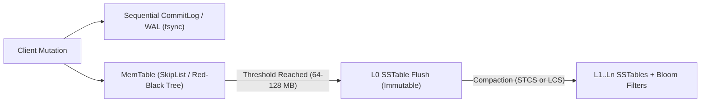
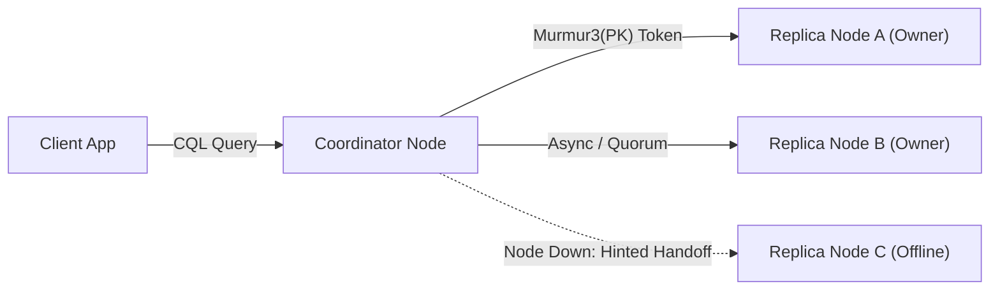
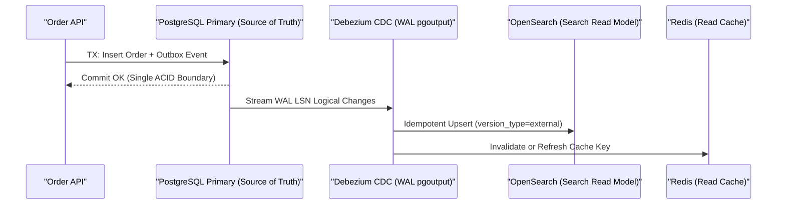

---
tags:
  - software-engineering
  - databases
  - nosql
  - storage-engines
  - lsm-tree
  - redis
  - mongodb
  - cassandra
  - vector-search
created: 2026-01-02
updated: 2026-11-13
status: 🟢
level: mid-to-senior
---
# NoSQL & Specialized Storage Engines

> [!abstract] Vault Navigation
> Storage engine architectures, consistency guarantees, distributed protocols, and selection trade-offs for non-relational databases inside [[Programming/Software Engineering/Database Design/Database Design Complete Guide|Database Design Complete Guide]]. Pairs closely with [[Programming/Software Engineering/Database Design/Data Modeling NoSQL|Data Modeling NoSQL]], [[Programming/Software Engineering/Database Design/Indexing|Indexing]], [[Programming/Software Engineering/Database Design/Replication|Replication]], [[Programming/Software Engineering/Database Design/Sharding|Sharding]], and [[Programming/Software Engineering/System Design/Caching|Caching]].

Non-relational databases abandon general-purpose ad-hoc relational joins and global cross-table normalization in favor of specialized physical storage engines—Log-Structured Merge-Trees (LSM-Trees), copy-on-write or hazard-pointer B+Trees, single-threaded in-memory hash/skiplist loops, time-structured columnar chunks, inverted finite-state indices, and Hierarchical Navigable Small World (HNSW) vector graphs. Choosing and operating these engines in production requires understanding exact memory amplification, disk compaction behavior, tunable quorum overlap, and failure cascades under skew or deletion storms.

---

## 1. First-Principles Mechanics & Complete Architecture

### 1.1 Storage Engine Paradigms: LSM-Tree vs B+Tree vs In-Memory Loops

Every persistent storage engine navigates the **RUM Conjecture**: an engine can optimize at most two of **Read Overhead**, **Update/Write Overhead**, and **Memory/Space Amplification** at the expense of the third.



#### Log-Structured Merge-Tree (LSM-Tree) Internals
Engines such as **RocksDB** (backing CockroachDB, TiKV, MyRocks, Kafka Streams state), **Apache Cassandra**, and **ScyllaDB** convert random updates, inserts, and deletes into purely **sequential append-only I/O**:
1. **Write-Ahead Log (`CommitLog` / `WAL`)**: Every incoming mutation appends sequentially to an on-disk log file with a CRC32 checksum before acknowledgement.
2. **MemTable**: Concurrently, the mutation inserts into an in-memory ordered structure—typically a **Concurrent SkipList** (`O(log N)` lock-free reads/inserts via atomic compare-and-swap pointers) or Red-Black Tree. Updates and deletes overwrite or append newer timestamped versions directly in RAM without touching existing disk blocks.
3. **Immutable Flush (`SSTable`)**: Once the MemTable reaches a memory threshold (e.g., 64 MB–256 MB), it freezes into an immutable MemTable while a fresh MemTable absorbs writes. A background thread flushes the frozen MemTable sequentially to disk as an immutable **Sorted String Table (`SSTable`)** containing sorted key-value blocks (`Data.db`), sparse key offset index (`Index.db`), summary (`Summary.db`), compression metadata (`CompressionInfo.db`), and a **Bloom Filter (`Filter.db`)**.
4. **Bloom Filters & Negative Lookup Math**: Because a key may reside in any overlapping Level-0 SSTable or lower level, checking every SSTable on disk for a missing key would devastate read latency. Each SSTable builds an off-heap bit array of size $m$ bits using $k$ independent hash functions:
   $$m = -\frac{n \ln p}{(\ln 2)^2}, \qquad k = \frac{m}{n}\ln 2$$
   Targeting a $p = 0.01$ ($1\%$) false-positive rate across $n = 10^7$ keys requires $m \approx 9.58\text{ bits/key} \approx 11.4\text{ MB}$ RAM with $k \approx 7$ hashes. A Bloom filter returns **definitive negatives** (`0` means the key is mathematically guaranteed absent from that SSTable) and bounded **false positives** (`1` triggers checking the SSTable index).

#### Compaction Strategies & Amplification Trade-Offs
Because SSTables are immutable, updates create duplicate obsolete keys and deletes append **Tombstone** markers. Background **compaction** merge-sorts SSTables (`K`-way external merge), retaining only the highest-timestamp live version and purging expired tombstones.

| Dimension | B+Tree (PostgreSQL / InnoDB / WiredTiger) | LSM-Tree — Size-Tiered (`STCS`) | LSM-Tree — Leveled (`LCS`) | LSM-Tree — Time-Window (`TWCS`) |
|---|---|---|---|---|
| **Write Amplification (`WA`)** | **High ($10\text{–}30\times$)**: Dirty 8–32 KB page rewrites + WAL + full-page images | **Lowest ($4\text{–}10\times$)**: Merges equal-size SSTables sequentially | **Moderate-High ($10\text{–}30\times$)**: Rewrites 10x larger next level to maintain strict key disjointness | **Very Low ($2\text{–}5\times$)**: Compacts only within fixed time buckets (e.g., 1 day) |
| **Read Amplification (`RA`)** | **Low ($1\text{–}4$ page hops)**: Single root-to-leaf tree traversal | **High**: Key may exist across multiple overlapping unmerged tiers | **Low ($O(L)$)**: Levels $L_1..L_n$ have non-overlapping key ranges; max 1 SSTable per level | **Low for recent time slices**; degrades if query omits partition/time bounds |
| **Space Amplification (`SA`)** | **Moderate ($1.3\text{–}2\times$)**: Internal page fragmentation (`fillfactor`), MVCC dead tuples | **Worst ($2\times$ temporary spike)**: Major compaction requires **50% free disk headroom** | **Best ($1.1\text{–}1.2\times$)**: Minimal obsolete versions; safe up to ~80–85% disk utilization | **Best for TTL telemetry**: Drops whole expired SSTables in $O(1)$ without tombstones |
| **Optimal Workload** | Balanced read/write OLTP, range scans, point updates | Write-heavy append logs, immutable event ingestion | Read-heavy point lookups, frequent `UPDATE` overwrites | Time-series metrics with uniform fixed TTL retention |

#### Tombstone Accumulation & Zombie Data Traps
In an LSM-Tree, executing `DELETE` or inserting `NULL` columns writes a **Tombstone** record bearing a microsecond deletion timestamp. A tombstone **cannot** be physically purged during partial minor compaction until all older SSTables potentially containing the shadowed value are merged together **and** the tombstone's age exceeds `gc_grace_seconds` (default 10 days in Cassandra).
- **Why `gc_grace_seconds` Exists**: If Node A deletes key `k` while Node B is unreachable/down for 2 days, and Node A prematurely purges the tombstone before Node B receives the deletion, subsequent anti-entropy repair from Node B re-propagates the deleted row back onto Node A (**Zombie Data Resurrection**).
- **Read-Path Penalty**: Range queries (`SELECT * FROM inbox WHERE user_id = ? LIMIT 10`) must merge-scan every live cell *and* every tombstone sitting in SSTables before assembling 10 live rows, consuming JVM heap and triggering read timeouts or OOM kills when tombstone density climbs.

#### B+Tree Variants: WiredTiger (MongoDB) vs In-Place / Copy-on-Write
Since MongoDB 3.2, **WiredTiger** replaces legacy mmapv1 collection locks with a B+Tree engine optimized for large documents and multi-core concurrency:
- **Page Structure & Compression**: Internal pages hold routing keys in memory using prefix compression; leaf pages store BSON records (default 32 KB disk pages, 4 KB memory allocation) compressed with **Snappy** (fast CPU, ~2–3x ratio) or **Zstd** (higher compression, ~4–5x ratio).
- **Lock-Free Cache & Hazard Pointers**: Threads traverse B+Tree pages in RAM without reader-writer latches by registering **hazard pointers** to prevent page eviction during traversal. Updates append skip-list modify chains onto in-memory pages and use **MVCC timestamps + optimistic concurrency control** (aborting and transparently retrying internal page-level write conflicts on concurrent mutations to the same document).
- **Checkpoints & 100 ms Journal**: WiredTiger checkpoints a consistent point-in-time B+Tree snapshot every **60 seconds** (or 2 GB dirty data) using copy-on-write block allocation (never overwriting live checkpoint blocks on disk). Between checkpoints, durability relies on the compressed **Write-Ahead Journal** (`fsync()` every **100 ms** by default, or synchronously per operation when `j: true` is requested).

#### In-Memory Hash / SkipList + `fork()` CoW Persistence (Redis / Valkey)
Redis and Valkey eliminate disk seek latency during request execution by keeping the entire dataset in RAM structures (`dict` incremental-rehash hash tables, compact `listpack` arrays replacing legacy `ziplist`, `intset`, and randomized `SkipList`s for `ZSET`s):
- **Single-Threaded Command Loop + Multi-Threaded Socket I/O**: Since Redis 6.0, configurable `io-threads` parse incoming RESP frames from sockets and flush reply buffers across CPU cores, while **every command executes sequentially on one main `epoll`/`kqueue` thread**. Zero mutex locks protect internal data structures, guaranteeing deterministic single-command atomicity (`INCR`, `ZADD`, `EVAL` Lua) at > 200k ops/s per core—at the strict cost that **any $O(N)$ blocking command stalls 100% of clients**.
- **Persistence Mechanics (`RDB` vs `AOF` vs Hybrid)**:
  - **RDB (`BGSAVE`)**: Calls OS `fork()`. The child process walks the frozen virtual page table and writes a compact binary snapshot. Under Linux **Copy-on-Write (CoW)**, parent mutations to keys duplicate the underlying 4 KB physical page—or **2 MB** if Linux **Transparent Huge Pages (`THP`)** is enabled!
  - **AOF (`appendfsync always | everysec | no`)**: Logs every mutating RESP command sequentially. `everysec` flushes via a background bio thread once per second (`RPO <= 1s`), whereas `always` stalls the main thread on disk `fsync()`.
  - **Redis 7+ Multi-Part Hybrid AOF**: Splits AOF into an RDB binary base file (`base.rdb`), incremental AOF segments (`incr.aof`), and a `manifest` file (`aof-use-rdb-preamble yes`), combining fast RDB startup recovery with sub-second AOF delta durability without rewriting the entire log history in place.

---

### 1.2 The Four Major NoSQL Families in Depth

#### Family 1: Key-Value & Strongly Consistent KV (`Redis`, `DynamoDB KV`, `etcd`)
| Engine | Partitioning & Routing | Consistency & Consensus | Transaction Scope | Primary Failure Mode |
|---|---|---|---|---|
| **Redis / Valkey Cluster** | 16,384 hash slots (`CRC16(key) % 16384`); client-cached slot map (`MOVED`/`ASK`) | Async leader-follower replication (**lost acked writes on failover** unless `WAIT` + minority partition risk) | Single-shard `MULTI/EXEC` (no rollback!) or Lua/Function scripts; `{hash_tag}` required for multi-key ops | `fork()` CoW $2\times$ OOM kill; $O(N)$ stall (`KEYS`, huge `HGETALL`); cross-slot errors |
| **Amazon DynamoDB** | Request Router hashes `PK` $\rightarrow$ Paxos storage group (10 GB physical partitions; 3,000 RCU / 1,000 WCU ceiling) | Paxos 3-AZ storage quorum; per-read choice of **Eventually Consistent** (0.5 RCU) vs **Strongly Consistent** (1 RCU leader read) | `TransactWriteItems`: ACID 2PC across up to **100 items / 4 MB**; conditional `ConditionExpression` CAS | Hot-key throttling (`ProvisionedThroughputExceeded`); sudden partition split lag; GSI backpressure |
| **`etcd` / `Consul` (`Raft` KV)** | Single Raft group (all keys replicated across 3 or 5 nodes); RocksDB/bbolt WAL + MVCC snapshots | **Strict Linearizability**: Leader writes via Raft log quorum; reads verify **ReadIndex** / quorum lease | Multi-key `If/Then/Else` (`Txn` Compare-And-Swap) scoped to single cluster | Storage bloat past 8 GB hard cap (`mvcc: database space exceeded`); slow NVMe `fsync` breaking leader election heartbeats |

#### Family 2: Document Stores (`MongoDB`)
MongoDB groups semi-structured BSON documents inside collections managed by WiredTiger, organized in production across **Replica Sets** (1 Primary + $2\text{–}N$ Secondaries using Raft-derived consensus elections) and optional **Sharded Clusters** (`mongos` stateless query routers + Config Server Replica Set `CSRS` + Shard Replica Sets).
- **Schema Governance (`$jsonSchema`)**: Contrary to "schemaless" misconceptions, production MongoDB enforces structural contracts natively at the engine boundary via `validator: { $jsonSchema: ... }` with `validationAction: "error"` and `validationLevel: "strict"` (or `"moderate"` during transitions).
- **Write Concern & Read Concern Matrix**:
  - `{ w: 1, j: false }`: Primary mutates WiredTiger RAM cache and acknowledges immediately. Vulnerable to **silent write rollback** if Primary crashes before journal `fsync` (100 ms) or replication.
  - `{ w: "majority", j: true }`: Primary flushes local journal and awaits majority replica set members persisting to their oplogs + journals. Survives node crash and Primary failover with **zero committed data loss**.
  - `readConcern: "local"` vs `"majority"` vs `"linearizable"` vs `"snapshot"`: `"local"` can read uncommitted data that rolls back on failover; `"majority"` reads from WiredTiger's majority-committed snapshot (immune to rollback, slight staleness vs newest local write); `"linearizable"` checks a majority heartbeat lease on the Primary before returning; `"snapshot"` pins a cluster-wide consistent point-in-time across multi-document ACID transactions.
- **Multi-Document ACID Transaction Overhead**: While MongoDB 4.0+ (replica sets) and 4.2+ (sharded clusters via 2PC across shards) support multi-document ACID transactions, holding transactions open pins WiredTiger's `oldest_timestamp` snapshot window in RAM, degrades cache eviction when long-running, caps total transaction oplog mutations (historically 16 MB per oplog entry; chunked in newer versions but still bound by `transactionLifetimeLimitSeconds = 60s`), and introduces cross-shard 2PC coordinator round-trips. Embedding tightly coupled entities inside a single document remains drastically faster.

#### Family 3: Wide-Column Stores (`Apache Cassandra` / `ScyllaDB`)
Wide-column engines combine Dynamo's masterless peer-to-peer ring with Google Bigtable's sparse, ordered column-family storage model:



1. **Token Ring & Partition Routing**: Each node owns virtual ranges (`vNodes`, e.g., `num_tokens: 16`) across the signed 64-bit `Murmur3Partitioner` ring ($[-2^{63}, 2^{63}-1]$). Any node accepts a request as **Coordinator**, hashes the **Partition Key (`PK`)**, and forwards the request directly to the $N$ (`Replication Factor`) owning replicas—delivering $O(1)$ single-hop routing whenever `PK` is known, and catastrophic **cluster-wide scatter-gather** if queried without `PK`.
2. **Physical Storage Hierarchy**: Within each partition on disk, rows sort physically by **Clustering Columns** (`CK1, CK2`), and each cell stores `(value, writetime_micros, ttl_seconds)`. Last-Write-Wins (LWW) resolves cell conflicts per-column by `writetime`.
3. **Tunable Consistency ($W + R > N$)**: Every individual query specifies a Consistency Level (`ONE`, `LOCAL_QUORUM`, `QUORUM`, `ALL`, `LOCAL_SERIAL`). `LOCAL_QUORUM` ($\lfloor N_{dc}/2 \rfloor + 1$) achieves strong intra-datacenter overlap ($W + R > N$) while isolating cross-region WAN latency via asynchronous inter-DC replication.
4. **Hinted Handoff, Read Repair & Anti-Entropy**:
   - **Hinted Handoff**: If Replica C is briefly unreachable (`max_hint_window_in_ms`, default 3 hours) during a write, the Coordinator buffers a local hint and replays it once C recovers. *(Hints do not count toward `QUORUM` acks!)*
   - **Read Repair**: On `QUORUM`/`ALL` reads, the Coordinator fetches full data from 1 replica and cryptographic digests from $R-1$ replicas; if digests mismatch, it resolves newest cell timestamps across all $R$ copies, repairs stale replicas asynchronously, and returns fresh data.
   - **Anti-Entropy (`nodetool repair`)**: Background Merkle tree exchange repairs cold partitions missed by Read Repair before `gc_grace_seconds` expires.
5. **Lightweight Transactions (LWT) & Paxos Overhead**: `INSERT ... IF NOT EXISTS` or `UPDATE ... IF status = 'pending'` bypasses LWW and runs a **4-RTT Paxos consensus protocol** (`Prepare` $\rightarrow$ `Promise` $\rightarrow$ `Propose` $\rightarrow$ `Commit`) across `SERIAL`/`LOCAL_SERIAL` replicas—incurring **$4\text{–}8\times$ latency and throughput penalty** compared to normal writes. (ScyllaDB optimizes LWT down to 2–3 RTTs via Raft/optimized Paxos; Cassandra 5.0 introduces Accord general transactions).
6. **ScyllaDB Thread-Per-Core (`Seastar`) vs Cassandra JVM**: Cassandra runs on the JVM, where heap allocation churn from large partitions, memtables, and tombstones triggers Garbage Collection (`G1GC` / `ZGC`) pauses that spike `p99` tail latency and cause false Gossip failure detections. ScyllaDB implements the identical CQL wire protocol and SSTable architecture in C++ over **Seastar**: pinning **1 OS thread, dedicated RAM arena, and dedicated NVMe I/O queue per CPU core** (`shared-nothing`), communicating via lock-free SPSC queues and eliminating GC pauses entirely.

#### Family 4: Graph, Time-Series & Search/Vector Engines
1. **Native Graph Databases (`Neo4j`) vs SQL Adjacency Lists**:
   - **Index-Free Adjacency**: Neo4j stores fixed-byte node records (`15 B`) containing a direct physical offset to their first relationship record (`34 B`), forming doubly-linked lists in memory/disk per node. Traversing `User -> Friends -> Friends -> Likes` executes **pointer chasing ($O(1)$ per edge hop)** completely independent of total graph size $V$.
   - **Contrast with RDBMS**: PostgreSQL stores edges in an adjacency table and joins via B+Tree index lookups (`WITH RECURSIVE`), costing **$O(\log E)$ per edge traversed**—meaning a 5-hop graph traversal over 1B edges thrashes B+Tree caches in SQL, whereas Neo4j resolves local neighborhoods in milliseconds.
   - **The Supernode Problem**: If a celebrity node holds 40M `FOLLOWS` edges, even index-free adjacency slows catastrophically when scanning all edges sequentially on a single node. Mitigate via **relationship-type partitioning** (`FOLLOWS_2026_11`), **bidirectional BFS** (expanding from both source and target simultaneously), or offloading supernode analytics to Pregel/Spark GraphX.
2. **Time-Series Engines (`TimescaleDB` vs `InfluxDB`)**:
   - **TimescaleDB**: Built atop PostgreSQL via **Hypertables**, transparently partitioning tables into physical **Chunks** (e.g., 7-day time slices) so active hot chunk B+Trees remain 100% resident in RAM. Background policies compress older frozen chunks into **columnar arrays** using **Delta-of-Delta encoding** on timestamps, **Gorilla/XOR bit-compression** on floats, and **dictionary/LZ4 compression** on tags (90–95% footprint savings), while preserving **full SQL `JOIN`s** with relational OLTP metadata tables.
   - **InfluxDB TSM vs v3**: InfluxDB v1/v2's **Time-Structured Merge Tree (TSM)** indexes every unique `(measurement, tag_set)` pair inside an in-memory **Time Series Index (`TSI`)**—causing catastrophic RAM OOM crashes under high tag cardinality (e.g., placing `request_id` or `user_id` into tags!). InfluxDB v3 replaces TSM with **Apache Arrow + DataFusion + Parquet files** stored directly on object storage (S3), decoupling cardinality from RAM.
3. **Search & Vector Engines (`OpenSearch` / `Elasticsearch` / `Qdrant`)**:
   - **Inverted Index & FST**: Tokenizes text (lowercase, stemming, stop-words), builds an in-memory **Finite State Transducer (`FST`)** mapping term prefixes directly to disk offsets of sorted **Posting Lists** (document ID lists + term positions), compressed via frame-of-reference (`FOR`) integer bit-packing. Evaluates lexical **BM25** relevance scores and caches boolean filters inside **Roaring Bitmaps**.
   - **Doc Values**: Inverted indices map `term -> [docIds]`, which cannot answer `ORDER BY price` or `GROUP BY tenant_id` without scanning every term. Lucene writes **Doc Values**—an immutable on-disk **columnar store** (`docId -> field_value`) mapped into OS page cache—avoiding Java heap `fielddata` OOM kills.
   - **HNSW Vector ANN**: Organizes dense float vectors (`dim = 768..3072`) into a multi-layer proximity graph (`M` edges/node, `ef_construction`, `ef_search`). **Memory Math**: 10M uncompressed `1536-dim float32` vectors require $10^7 \times 1536 \times 4\text{ B} \approx 61.4\text{ GB}$ plus ~16–24 GB for HNSW adjacency lists! Applying **`int8` Scalar Quantization** cuts RAM $4\times$ (~15.4 GB) with $< 1\%$ recall drop via optional top-$k$ `float32` rescoring.

---

## 2. Real-World Use Cases & Quantitative Decision Matrix

### 2.1 Master Storage Paradigm Comparison Matrix

| Requirement / Workload | PostgreSQL (`+ JSONB / Timescale / pgvector`) | DynamoDB | MongoDB | Cassandra / ScyllaDB | Redis / Valkey | Neo4j | OpenSearch / Qdrant |
|---|---|---|---|---|---|---|---|
| **Strict Multi-Row ACID & Complex Joins** | **Best** (`SSI`, FKs, triggers) | Conditional / 100-item `TransactWrite` | Multi-doc TX (cache/perf cost) | None (Paxos LWT single-partition only) | Single-shard Lua atomic only | Full ACID (single-node / cluster) | **No** (eventual segment refresh) |
| **Sustained Write Scale (`> 100k` writes/s)** | Needs Citus / manual sharding | **Seamless** (managed auto-partitioning) | Needs sharded cluster (`hashed` key) | **Best** (linear masterless LSM scale) | **Best** per-core RAM (`> 500k` ops/s) | Bottlenecked on single writer leader | Moderate (heavy segment merge CPU) |
| **Flexible / Evolving Nested Schemas** | Strong (`JSONB` + `GIN` index) | Strong (schemaless attributes) | **Native** (BSON + `$jsonSchema`) | Rigid CQL columns / maps | Unstructured blobs / Hashes | Flexible node/edge properties | Dynamic or strict JSON mappings |
| **Multi-Region Active-Active Low Latency** | Complex (needs Cockroach/Spanner or app conflict resolution) | Global Tables (LWW CRDT async) | Zone sharding (single primary per shard) | **Native** (`LOCAL_QUORUM` per DC) | Active-Active CRDT (Enterprise) | Causal read replicas (single leader writes) | Cross-Cluster Replication (async) |
| **Ad-Hoc Filtering, Full-Text & ANN Search** | Good (`GIN` FTS, `pgvector` $< 10\text{M}$) | **Poor** (must pre-index every `GSI`) | Good (Atlas Search Lucene sync) | **Very Poor** (requires exact `PK`) | RediSearch module | Node label/property indices | **Best** (BM25 + HNSW + Doc Values) |
| **Graph Traversals (3–6+ Hops)** | Slow on deep hops (`RECURSIVE` CTE) | Only 1–2 hops via adjacency table | `$graphLookup` (bounded RAM cap) | **Unsuitable** | Unsuitable | **Best** (index-free adjacency) | Unsuitable |

### 2.2 When to Choose PostgreSQL `JSONB` Over MongoDB (and Vice Versa)
Adopt **PostgreSQL `JSONB`** when 80% of your system is relational (foreign keys, billing ledgers, RBAC permissions, `JOIN`s) and only 20% holds polymorphic attributes (e.g., webhook payloads, integration configs, product metadata) searchable via `GIN (metadata jsonb_path_ops)`. Adopt **MongoDB** when the **core domain aggregate is a deeply nested document** requiring rich atomic in-place array operators (`$push`, `$slice`, `$pull`, `$inc` nested paths), horizontal shard elasticity beyond single-node PG write IOPS, or native Atlas Search integration without maintaining separate relational mapping layers.

### 2.3 Polyglot Persistence Architecture (CQRS + Debezium CDC)
Real production architectures rarely force one database to handle OLTP transactions, full-text vector search, and sub-millisecond rate limiting simultaneously. Instead of executing **Dual Writes** in application code (writing to Postgres and OpenSearch inside an HTTP handler, which leaves databases permanently out of sync when one call fails or crashes mid-flight), use **Transactional Outbox + Change Data Capture (CDC)**:



---

## 3. Step-by-Step Practical Application: Production Polyglot Order & Search Service

Below is a complete, multi-file production implementation illustrating safe polyglot persistence across **MongoDB (WiredTiger durable document store)**, **Redis/Valkey (single-flight cache-aside + distributed locking)**, and **OpenSearch (BM25 + HNSW vector search with monotonic CDC idempotency)**.

### 3.1 Project Layout
```text
polyglot-catalog-service/
├── package.json
├── src/
│   ├── mongo/
│   │   ├── setupCollection.ts     # $jsonSchema strict validation + compound indexes
│   │   └── productRepository.ts   # w:"majority", j:true + multi-doc ACID tx + OCC
│   ├── cache/
│   │   └── singleFlightCache.ts   # Redis cache-aside + stampede lock + SCAN cleanup
│   ├── search/
│   │   ├── indexTemplate.ts       # BM25 + HNSW int8 quantization + Doc Values mapping
│   │   └── cdcSyncConsumer.ts     # Out-of-order safe external_gte versioned upsert
│   └── __tests__/
│       └── polyglotSafety.test.ts # Vitest verification suite
```

### 3.2 MongoDB `$jsonSchema` Contract & Durable Write Concern Repository
```typescript
// src/mongo/setupCollection.ts
import { Db } from "mongodb";

export async function provisionCatalogCollections(db: Db): Promise<void> {
  const validator = {
    $jsonSchema: {
      bsonType: "object",
      required: ["_id", "tenantId", "sku", "title", "priceCents", "stock", "version", "updatedAt"],
      additionalProperties: false,
      properties: {
        _id: { bsonType: "string" },
        tenantId: { bsonType: "string", minLength: 1 },
        sku: { bsonType: "string", pattern: "^[A-Z0-9-]{3,32}$" },
        title: { bsonType: "string", minLength: 1, maxLength: 240 },
        priceCents: { bsonType: ["int", "long"], minimum: 0 },
        stock: { bsonType: ["int", "long"], minimum: 0 },
        attributes: {
          bsonType: "array",
          maxItems: 50,
          items: {
            bsonType: "object",
            required: ["k", "v"],
            properties: {
              k: { bsonType: "string" },
              v: { bsonType: ["string", "int", "double", "bool"] },
            },
          },
        },
        embedding: {
          bsonType: "array",
          items: { bsonType: "double" },
        },
        version: { bsonType: ["int", "long"], minimum: 1 },
        updatedAt: { bsonType: "date" },
      },
    },
  };

  const existing = await db.listCollections({ name: "products" }).toArray();
  if (existing.length === 0) {
    await db.createCollection("products", {
      validator,
      validationLevel: "strict",
      validationAction: "error",
    });
  } else {
    await db.command({
      collMod: "products",
      validator,
      validationLevel: "strict",
      validationAction: "error",
    });
  }

  // Compound index: prefix on tenantId + sku enforces tenant-scoped uniqueness
  await db.collection("products").createIndex(
    { tenantId: 1, sku: 1 },
    { unique: true, background: true }
  );

  // Attribute Pattern compound index for dynamic key-value filtering
  await db.collection("products").createIndex(
    { tenantId: 1, "attributes.k": 1, "attributes.v": 1 },
    { background: true }
  );
}
```

```typescript
// src/mongo/productRepository.ts
import { Collection, MongoClient, ReadConcern, WriteConcern } from "mongodb";

export interface ProductDoc {
  _id: string;
  tenantId: string;
  sku: string;
  title: string;
  priceCents: number;
  stock: number;
  attributes?: Array<{ k: string; v: string | number | boolean }>;
  embedding?: number[];
  version: number;
  updatedAt: Date;
}

export interface OutboxEventDoc {
  _id: string;
  aggregateId: string;
  eventType: "PRODUCT_UPSERTED" | "STOCK_RESERVED";
  version: number;
  payload: Record<string, unknown>;
  createdAt: Date;
}

export class OptimisticLockError extends Error {
  constructor(message: string) {
    super(message);
    this.name = "OptimisticLockError";
  }
}

export class ProductRepository {
  private readonly products: Collection<ProductDoc>;
  private readonly outbox: Collection<OutboxEventDoc>;

  constructor(private readonly client: MongoClient, dbName: string) {
    const db = client.db(dbName);
    this.products = db.collection<ProductDoc>("products");
    this.outbox = db.collection<OutboxEventDoc>("outbox_events");
  }

  /**
   * Reserves stock and appends an Outbox event atomically within one WiredTiger
   * multi-document ACID transaction using majority write concern + journal fsync.
   */
  async reserveStockWithOutbox(
    productId: string,
    tenantId: string,
    qty: number,
    expectedVersion: number,
    eventId: string
  ): Promise<ProductDoc> {
    const session = this.client.startSession();
    try {
      let updatedDoc: ProductDoc | null = null;

      await session.withTransaction(
        async () => {
          const result = await this.products.findOneAndUpdate(
            {
              _id: productId,
              tenantId,
              version: expectedVersion,
              stock: { $gte: qty },
            },
            {
              $inc: { stock: -qty, version: 1 },
              $set: { updatedAt: new Date() },
            },
            {
              session,
              returnDocument: "after",
            }
          );

          if (!result) {
            throw new OptimisticLockError(
              `Concurrent update or insufficient stock for product=${productId} version=${expectedVersion}`
            );
          }
          updatedDoc = result;

          await this.outbox.insertOne(
            {
              _id: eventId,
              aggregateId: productId,
              eventType: "STOCK_RESERVED",
              version: result.version,
              payload: {
                tenantId,
                sku: result.sku,
                stock: result.stock,
                version: result.version,
              },
              createdAt: new Date(),
            },
            { session }
          );
        },
        {
          readConcern: new ReadConcern("snapshot"),
          writeConcern: new WriteConcern("majority", 5000, true), // w: majority, j: true
        }
      );

      if (!updatedDoc) {
        throw new Error("Transaction completed without returning updated product");
      }
      return updatedDoc;
    } finally {
      await session.endSession();
    }
  }
}
```

### 3.3 Redis Stampede-Safe Cache-Aside & Atomic Lock
```typescript
// src/cache/singleFlightCache.ts
import type Redis from "ioredis";
import crypto from "node:crypto";

const RELEASE_LOCK_LUA = `
if redis.call("GET", KEYS[1]) == ARGV[1] then
  return redis.call("DEL", KEYS[1])
else
  return 0
end
`;

export interface CacheClient {
  get(key: string): Promise<string | null>;
  set(key: string, value: string, mode: "EX", ttl: number, flag?: "NX"): Promise<string | null>;
  eval(script: string, numKeys: number, ...args: string[]): Promise<unknown>;
  scan(cursor: string, ...args: string[]): Promise<[string, string[]]>;
  unlink(...keys: string[]): Promise<number>;
}

export class SingleFlightCache {
  constructor(private readonly redis: CacheClient | Redis) {}

  /**
   * Prevents thundering-herd cache stampede on hot expired keys using NX lease locks.
   * Never uses blocking KEYS *; uses incremental SCAN + UNLINK for prefix invalidation.
   */
  async getOrLoad<T>(
    key: string,
    ttlSeconds: number,
    loader: () => Promise<T | null>
  ): Promise<T | null> {
    const cached = await this.redis.get(key);
    if (cached !== null) {
      return cached === "__NULL__" ? null : (JSON.parse(cached) as T);
    }

    const lockKey = `lock:${key}`;
    const ownerToken = crypto.randomUUID();
    // Acquire 5-second short lease lock to elect a single DB loader
    const acquired = await this.redis.set(lockKey, ownerToken, "EX", 5, "NX");

    if (acquired === "OK") {
      try {
        const fresh = await loader();
        if (fresh === null) {
          // Negative caching prevents cache penetration attacks on missing IDs
          await this.redis.set(key, "__NULL__", "EX", Math.min(30, ttlSeconds));
          return null;
        }
        await this.redis.set(key, JSON.stringify(fresh), "EX", ttlSeconds);
        return fresh;
      } finally {
        await this.redis.eval(RELEASE_LOCK_LUA, 1, lockKey, ownerToken);
      }
    }

    // Wait briefly for lock winner to populate cache, then read or fallback once
    for (let attempt = 0; attempt < 4; attempt++) {
      await new Promise((r) => setTimeout(r, 25 * (attempt + 1)));
      const retryVal = await this.redis.get(key);
      if (retryVal !== null) {
        return retryVal === "__NULL__" ? null : (JSON.parse(retryVal) as T);
      }
    }

    // Lock holder crashed or timed out; serve direct fallback safely
    return loader();
  }

  async invalidatePrefix(prefix: string): Promise<number> {
    let cursor = "0";
    let deletedCount = 0;
    do {
      const [nextCursor, keys] = await this.redis.scan(
        cursor,
        "MATCH",
        `${prefix}*`,
        "COUNT",
        200
      );
      cursor = nextCursor;
      if (keys.length > 0) {
        // UNLINK reclaims memory asynchronously off the main single-threaded loop
        deletedCount += await this.redis.unlink(...keys);
      }
    } while (cursor !== "0");
    return deletedCount;
  }
}
```

### 3.4 OpenSearch Hybrid Index (BM25 + Quantized HNSW) & Idempotent CDC Upsert
```typescript
// src/search/indexTemplate.ts
export const PRODUCT_SEARCH_INDEX_MAPPING = {
  settings: {
    index: {
      number_of_shards: 3,
      number_of_replicas: 1,
      knn: true,
      "knn.algo_param.ef_search": 100,
      refresh_interval: "1s",
    },
  },
  mappings: {
    dynamic: "strict", // Prevents unbounded mapping explosion from arbitrary user JSON keys!
    properties: {
      tenantId: { type: "keyword", doc_values: true },
      sku: { type: "keyword", doc_values: true },
      title: {
        type: "text",
        analyzer: "english",
        fields: {
          exact: { type: "keyword", ignore_above: 256 },
        },
      },
      priceCents: { type: "long", doc_values: true },
      stock: { type: "integer", doc_values: true },
      version: { type: "long" },
      // HNSW graph with 8-bit scalar quantization (4x lower RAM than float32)
      embedding: {
        type: "knn_vector",
        dimension: 1536,
        method: {
          name: "hnsw",
          space_type: "cosinesimil",
          engine: "lucene",
          parameters: {
            ef_construction: 128,
            m: 24,
            encoder: {
              name: "sq",
              parameters: {
                clip: true,
              },
            },
          },
        },
      },
    },
  },
};
```

```typescript
// src/search/cdcSyncConsumer.ts
export interface SearchTransport {
  indexDocument(params: {
    index: string;
    id: string;
    version: number;
    versionType: "external_gte";
    body: Record<string, unknown>;
  }): Promise<{ status: number }>;
}

export interface ProductCdcEvent {
  aggregateId: string;
  tenantId: string;
  sku: string;
  title: string;
  priceCents: number;
  stock: number;
  version: number;
  embedding?: number[];
}

export class ProductSearchCdcConsumer {
  constructor(private readonly transport: SearchTransport, private readonly indexName = "products_v1") {}

  /**
   * Uses OpenSearch external_gte versioning: if Kafka delivers version=4 AFTER
   * version=5 due to partition rebalance or retry, OpenSearch rejects version=4
   * with HTTP 409 Conflict, preventing stale state resurrection.
   */
  async handleCdcEvent(event: ProductCdcEvent): Promise<"indexed" | "stale_ignored"> {
    try {
      await this.transport.indexDocument({
        index: this.indexName,
        id: event.aggregateId,
        version: event.version,
        versionType: "external_gte",
        body: {
          tenantId: event.tenantId,
          sku: event.sku,
          title: event.title,
          priceCents: event.priceCents,
          stock: event.stock,
          version: event.version,
          ...(event.embedding ? { embedding: event.embedding } : {}),
        },
      });
      return "indexed";
    } catch (err: unknown) {
      const statusCode = (err as { statusCode?: number })?.statusCode;
      if (statusCode === 409) {
        // Monotonically newer version already indexed; safely acknowledge offset
        return "stale_ignored";
      }
      throw err;
    }
  }
}
```

### 3.5 Automated Verification Suite
```typescript
// src/__tests__/polyglotSafety.test.ts
import { describe, it, expect, vi } from "vitest";
import { SingleFlightCache, type CacheClient } from "../cache/singleFlightCache";
import { ProductSearchCdcConsumer, type SearchTransport } from "../search/cdcSyncConsumer";

function createInMemoryRedisMock(): CacheClient {
  const store = new Map<string, string>();
  return {
    async get(key) {
      return store.get(key) ?? null;
    },
    async set(key, value, _mode, _ttl, flag) {
      if (flag === "NX" && store.has(key)) return null;
      store.set(key, value);
      return "OK";
    },
    async eval(_script, _numKeys, key, expectedVal) {
      if (store.get(key) === expectedVal) {
        store.delete(key);
        return 1;
      }
      return 0;
    },
    async scan(cursor, _m, pattern) {
      const prefix = pattern.replace(/\*$/, "");
      const matched = [...store.keys()].filter((k) => k.startsWith(prefix));
      return [cursor === "0" ? "0" : "0", matched];
    },
    async unlink(...keys) {
      let count = 0;
      for (const k of keys) {
        if (store.delete(k)) count++;
      }
      return count;
    },
  };
}

describe("Polyglot Cache & CDC Safety", () => {
  it("coalesces concurrent cache misses via single-flight NX lock", async () => {
    const redis = createInMemoryRedisMock();
    const cache = new SingleFlightCache(redis);
    const dbLoader = vi.fn(async () => {
      await new Promise((r) => setTimeout(r, 30));
      return { sku: "GPU-90", priceCents: 19900 };
    });

    const results = await Promise.all([
      cache.getOrLoad("prod:1", 60, dbLoader),
      cache.getOrLoad("prod:1", 60, dbLoader),
      cache.getOrLoad("prod:1", 60, dbLoader),
    ]);

    expect(dbLoader).toHaveBeenCalledTimes(1);
    expect(results.every((r) => r?.sku === "GPU-90")).toBe(true);
  });

  it("ignores out-of-order stale CDC events on HTTP 409 external_gte conflict", async () => {
    let storedVersion = 0;
    const transport: SearchTransport = {
      async indexDocument({ version }) {
        if (version <= storedVersion) {
          const err = new Error("Version conflict") as Error & { statusCode: number };
          err.statusCode = 409;
          throw err;
        }
        storedVersion = version;
        return { status: 200 };
      },
    };

    const consumer = new ProductSearchCdcConsumer(transport);
    const newer = await consumer.handleCdcEvent({
      aggregateId: "p1",
      tenantId: "t1",
      sku: "SKU-1",
      title: "Switch",
      priceCents: 5000,
      stock: 4,
      version: 5,
    });
    const stale = await consumer.handleCdcEvent({
      aggregateId: "p1",
      tenantId: "t1",
      sku: "SKU-1",
      title: "Switch",
      priceCents: 5000,
      stock: 9,
      version: 3,
    });

    expect(newer).toBe("indexed");
    expect(stale).toBe("stale_ignored");
    expect(storedVersion).toBe(5);
  });
});
```

---

## 4. Complete Engine Reference, Limits & Security Hardening

### 4.1 Hard Engine Limits & Architectural Traps

| Engine | Hard Limit / Default Threshold | Failure Trap When Violated | Production Mitigation |
|---|---|---|---|
| **MongoDB** | **16 MiB** BSON document size; **64 indexes** max/collection | Unbounded arrays trigger `DocumentTooLarge` and oplog bloat; $>64$ indexes stall writes | Apply **Bucket / Outlier / Subset Patterns** ([[Programming/Software Engineering/Database Design/Data Modeling NoSQL\|Data Modeling NoSQL]]); keep working index set inside WiredTiger RAM (`50% * (RAM - 1 GB)`) |
| **Redis / Valkey** | **512 MB** max String value; single-threaded execution | Large keys (> 1 MB) cause multi-ms network/serialization freezes; `BGSAVE` CoW doubles RAM | Keep values $< 100\text{ KB}$; disable Linux **Transparent Huge Pages (`THP`)**; set `vm.overcommit_memory = 1`; offload persistence to replicas |
| **Cassandra / Scylla** | **100 MB** soft partition cap (hard 2B cells); `tombstone_failure_threshold = 100,000` | Hot/unbounded partitions OOM JVM heap during compaction; queues generate tombstone crashes | Compound bucketed partition keys `(entity_id, day)`; `TWCS` for TTL workloads; never build delete queues |
| **DynamoDB** | **400 KB** item cap; **1,000 WCU / 3,000 RCU** per physical partition; **100 items / 4 MB** Tx cap | Hot partition key throttles despite spare table-wide capacity; large scans exhaust RCU burst | Write sharding (`#0..#K-1`), compress large payloads to S3 (claim-check), use `Query` over `Scan` |
| **OpenSearch / ES** | **1,000 fields** default mapping limit (`index.mapping.total_fields.limit`); `10,000` `from+size` window | Dynamic mapping on arbitrary customer JSON creates thousands of cluster-state fields (**Mapping Explosion**), crashing Master nodes! Deep `from=50000` gathers 50k docs from *every* shard (`O(shards * offset)`) | Set `dynamic: "strict"` or flatten into `nested` / `flattened` field type; use **`search_after` + Point-In-Time (`PIT`)** for deep pagination |
| **Neo4j** | Heap size & pagecache bounds (`dbms.memory.heap.max_size`) | Unbounded traversal across **Supernodes** (millions of edges) triggers JVM `OutOfMemoryError` | Bound traversal depth (`*1..3`), partition edges by direction/year, enforce query timeouts (`db.transaction.timeout`) |

### 4.2 Production Security Hardening Checklist
1. **Redis / Valkey**: Never bind `0.0.0.0` unauthenticated. Enable **Redis 6+ ACLs** (`ACL SETUSER app_worker on >strongpass ~app:* +@read +@write -@dangerous`), enforce **TLS 1.3** (`tls-port`), and strip catastrophic admin commands (`rename-command KEYS ""`, `FLUSHALL ""`, `CONFIG ""`, `DEBUG ""`).
2. **MongoDB**: Require `SCRAM-SHA-256` (or X.509 mTLS) + `net.tls.mode: requireTLS`, disable `javascriptEnabled: false` (prevents `$where` JS injection RCE), enforce `$jsonSchema` validation, and apply Client-Side Field Level Encryption (`CSFLE`) / Queryable Encryption for PII/PCI fields.
3. **Cassandra / ScyllaDB**: Enable `PasswordAuthenticator` + `CassandraAuthorizer` RBAC, enforce internode mTLS (`server_encryption_options: internode_encryption: all`) and client TLS, and restrict JMX (`nodetool`) to `localhost` or authenticated TLS.
4. **OpenSearch**: Enforce fine-grained Document-Level / Field-Level Security (DLS/FLS) mapped to JWT tenant claims so multi-tenant `match_all` bugs never leak cross-tenant indices; require TLS on both transport (9300) and HTTP (9200) ports.

---

## 5. Production Debugging, Profiling & Operations Playbook

### 5.1 Live Diagnostic Command Reference

```bash
# --- REDIS / VALKEY DIAGNOSTICS ---
redis-cli INFO persistence          # Check rdb_last_cow_size (CoW RAM overhead!) and aof_delayed_fsync
redis-cli INFO memory               # Monitor mem_fragmentation_ratio (>1.5 leaks / <1.0 swapping!)
redis-cli LATENCY DOCTOR            # Identifies fork stalls, slow commands, AOF fsync delays
redis-cli SLOWLOG GET 20            # Top 20 slowest commands (>10ms threshold)
redis-cli --hotkeys --memkeys       # Samples keyspace non-blockingly via SCAN for oversized/hot keys (LFU required for hotkeys)

# --- MONGODB MONGOSH DIAGNOSTICS ---
db.currentOp({ "active": true, "secs_running": { $gt: 2 } })           # Find blocking slow queries / lock waiters
db.products.find({ tenantId: "t1", sku: "X" }).explain("executionStats") # Verify IXSCAN vs COLLSCAN and keysExamined/docsReturned ratio
rs.printSecondaryReplicationInfo()                                      # Check oplog window hours & secondary replication lag!
db.serverStatus().wiredTiger.cache                                      # Inspect "bytes currently in the cache" vs "percentage overhead" / eviction stalls

# --- CASSANDRA / SCYLLADB DIAGNOSTICS ---
nodetool tablestats keyspace.table   # Inspect Max Partition Size (>100MB!), Mean/Max Tombstones Per Slice!
nodetool tpstats                     # Identify Dropped Messages (MutationStage / ReadStage backpressure)
nodetool compactionstats             # Detect pending compaction backlog (STCS/LCS falling behind writes)
cqlsh -e "TRACING ON; SELECT * FROM keyspace.table WHERE pk = '...';"  # Exact coordinator/replica microsecond trace + tombstone scan count

# --- OPENSEARCH / ELASTICSEARCH DIAGNOSTICS ---
curl -s "https://localhost:9200/_cat/thread_pool?v&h=node_name,name,active,queue,rejected" # Detect search/write queue rejections
curl -s "https://localhost:9200/_nodes/stats/jvm,breaker" | jq '.nodes[].breaker'         # Check fielddata/parent circuit breaker trips
```

### 5.2 Symptom $\rightarrow$ Root Cause $\rightarrow$ Remediation Matrix

| Observed Production Symptom | Diagnostic Observation | Root Cause | Immediate & Structural Remediation |
|---|---|---|---|
| **Redis latency spikes from `0.5 ms` to `1,800 ms` periodically, or OOM kill at 65% `maxmemory`** | `INFO persistence` shows massive `rdb_last_cow_size`; `cat /sys/kernel/mm/transparent_hugepage/enabled` prints `[always]` | `BGSAVE` / AOF rewrite `fork()` + Linux Copy-on-Write duplicating **2 MB THP pages** on random writes | Disable THP (`never`), set `vm.overcommit_memory = 1`, scale host RAM $\ge 2\times\text{dataset}$, or move `BGSAVE` to dedicated replica |
| **MongoDB write latency climbs $10\times$; WiredTiger cache dirty > 20%** | `db.serverStatus().wiredTiger.cache` shows application threads doing eviction; `explain()` shows `COLLSCAN` | Unindexed queries paging cold data into RAM + eviction threads saturated by dirty pages / long open transactions | Add selective ESR compound indexes (`createIndex(..., {background: true})`); terminate long transactions; scale NVMe IOPS |
| **Cassandra `ReadTimeoutException` & `TombstoneOverwhelmingException` on small result sets** | `nodetool tablestats` / `TRACING ON` shows 150,000+ tombstones scanned for 5 live rows | Delete-heavy / `NULL`-column ingestion inside a single partition accumulating tombstones over `gc_grace_seconds` | Redesign partition bucketing + append-only cursor (avoid deletes); omit `NULL` fields in writes; use `TWCS` + TTL |
| **Cassandra `STCS` cluster runs out of disk at **55% full** during major compaction** | `nodetool compactionstats` stuck; disk hitting 98% and failing writes | Size-Tiered Compaction (`STCS`) writes a full merged copy before deleting old SSTables, needing **50% free space** | Temporarily halt repairs/writes, expand EBS/NVMe or drop expired snapshots (`nodetool clearsnapshot`), migrate suitable tables to **`LCS`** (needs only ~15% overhead) |
| **OpenSearch nodes fail with `CircuitBreakingException` or `ClusterBlockException` (429 / 403)** | `_cat/indices` shows `read_only_allow_delete` or thousands of dynamic fields in `_mapping` | Unbounded `dynamic: true` field explosion exhausting JVM heap, OR disk hit **95% flood-stage watermark** | Enforce `dynamic: "strict"`, delete rogue fields / reindex cleanly, expand storage & clear `index.blocks.read_only_allow_delete` |

---

## 6. Comprehensive Worked Exercises

### Exercise 1: Diagnosing Cassandra Tombstone OOM & STCS Disk Exhaustion
A telemetry service stores fleet events in Cassandra using default **Size-Tiered Compaction Strategy (`STCS`)** and `gc_grace_seconds = 864000` (10 days). Two outages strike during the same week:
1. A worker processes pending jobs from `CREATE TABLE job_queue (bucket text, job_id timeuuid, payload text, PRIMARY KEY (bucket, job_id))` by reading `bucket = 'global' LIMIT 20` and deleting each processed job (`DELETE FROM job_queue ...`). After 5 days, only **12 active jobs** remain, yet every `SELECT` times out with `TombstoneOverwhelmingException` and triggers 6-second JVM G1GC pauses.
2. On a separate 4 TB NVMe node holding **2.3 TB** of compressed SSTables (`57.5%` disk used), triggering `nodetool compact` crashes the node with `No space left on device`.

Explain **both root causes quantitatively** and prescribe the exact architectural and operational fixes.

---

### Solution 1

#### 1. Root Cause Analysis
1. **Tombstone Scan & JVM Heap Exhaustion**: Even though only 12 live jobs remain in `bucket = 'global'`, deleting 100,000+ historical jobs over 5 days created 100,000+ immutable tombstone cells at the head of the single `'global'` partition (`CLUSTERING ORDER BY (job_id ASC)`). Because `gc_grace_seconds = 864000` (10 days), compaction keeps every tombstone alive across SSTables. To serve `LIMIT 20`, the read coordinator scans and deserializes all 100,000+ tombstones into JVM heap before finding the 12 live rows at the tail—exceeding `tombstone_failure_threshold` (`100,000`) and stalling G1GC.
2. **STCS 50% Disk Space Amplification**: Size-Tiered Compaction merges large equal-sized SSTables into one giant SSTable *without deleting the input SSTables until the output SSTable finishes writing and fsyncing*. Merging the top tier totaling 2.0 TB requires **2.0 TB of simultaneous free scratch space** ($2.3 + 2.0 = 4.3\text{ TB} > 4.0\text{ TB}$ capacity), exhausting disk space despite starting at only 57.5% utilization.

#### 2. Fixes
1. **Eliminate the Cassandra Queue Anti-Pattern**: Move FIFO job queues to **Redis Streams** (`XREADGROUP` / `XACK`) or **PostgreSQL (`FOR UPDATE SKIP LOCKED`)**. For append-only telemetry in Cassandra, use time-bucketed partitions `((device_id, day_bucket), event_ts)` with fixed **TTL** + **`TimeWindowCompactionStrategy (TWCS)`** so whole expired SSTables drop cleanly in $O(1)$ without tombstones.
2. **Compaction Strategy & Capacity Rule**: Keep `STCS` clusters **below 50% disk utilization** or switch non-append-only read-heavy tables to **`LeveledCompactionStrategy (LCS)`** (which compacts small 160 MB SSTables incrementally, keeping space amplification down to ~10–15%). Never run manual `nodetool compact` (major compaction) on `STCS` in production unless > 50% free disk is verified.

---

### Exercise 2: Engine Selection Across Three Real Workloads (Postgres JSONB vs MongoDB vs DynamoDB)
Select the optimal primary database for each system and justify against the rejected options using quantitative constraints:
1. **Workload A — B2B Fintech Expense Platform**: 15,000 RPS peak reads, 2,000 RPS writes. Strict double-entry ledger invariants (`SUM(debits) == SUM(credits)`), relational joins across `orgs -> invoices -> ledger_entries`, plus arbitrary custom user metadata fields per receipt (`receipt_extras`) filtered occasionally via JSON key-value queries.
2. **Workload B — High-Traffic Serverless Event Check-In**: 80,000 RPS write burst for 2 hours daily during live ticketed broadcasts (`< 10 ms` p99 latency), zero relational joins, strictly keyed lookup `(event_id, ticket_id)` and `(user_id, created_at)`, zero DevOps headcount to manage database clusters or shard rebalancing.
3. **Workload C — Multi-Tenant CMS & Product Catalog**: 50M deeply nested product documents (average 45 KB, up to 2 MB with localized translations, nested variants, and atomic sub-document array updates), read primarily as whole self-contained aggregates by `tenant_id + slug`, needing horizontal write scaling across 3 shards.

---

### Solution 2

1. **Workload A $\rightarrow$ PostgreSQL (`JSONB` + `GIN` Index)**:
   - **Justification**: Double-entry financial ledgers demand strict multi-row ACID isolation (`SERIALIZABLE` or row locks `FOR NO KEY UPDATE`) and relational foreign-key constraints—both expensive or absent in DynamoDB/MongoDB at complex join depth. Storing `receipt_extras` in a **`JSONB` column with a `GIN (receipt_extras jsonb_path_ops)` index** handles the 20% flexible metadata without introducing a second operational database. At 2,000 RPS writes, a single tuned PostgreSQL primary + read replica handles load comfortably.
2. **Workload B $\rightarrow$ Amazon DynamoDB (On-Demand / Provisioned Auto-Scaling)**:
   - **Justification**: Access patterns are 100% known (`PK`/`SK` + 1 GSI), require zero joins, and demand instant absorption of `80,000 RPS` write bursts at `< 10 ms` p99 without operational sharding overhead. Provided `event_id` writes are write-sharded across $K \ge 80$ buckets (`PK = "EVENT#id#<0..79>"`) to clear the `1,000 WCU/partition` cap, DynamoDB scales elastically with zero cluster administration (unlike self-managed MongoDB/Cassandra or manually sharded Postgres).
3. **Workload C $\rightarrow$ MongoDB (Sharded Cluster on `{ tenantId: 1, _id: "hashed" }` or `{ tenantId: 1, slug: 1 }`)**:
   - **Justification**: Average 45 KB to 2 MB nested documents **violate DynamoDB's hard 400 KB item cap**! Meanwhile, MongoDB stores up to 16 MB BSON cleanly, supports native atomic sub-document mutations (`$set`, `$push`, `$pull` on deep paths) inside WiredTiger, and distributes horizontally across shards keyed by `tenantId` for single-hop whole-document retrieval.

---

### Exercise 3: Quorum Math & Read-Modify-Write Lost Update in Cassandra
A Cassandra cluster uses replication factor **$N = 3$** and runs an inventory service executing this application-level flow at **`LOCAL_QUORUM`** (`W = 2, R = 2`):
```sql
-- Step 1 (Read):
SELECT quantity FROM sku_stock WHERE sku = 'GPU-X'; -- Returns quantity = 5
-- Step 2 (App computes 5 - 1 = 4, then Write):
UPDATE sku_stock SET quantity = 4 WHERE sku = 'GPU-X';
```
1. Even though $W + R = 4 > N = 3$, explain why **two concurrent checkouts still oversell/lose an update** (leaving `quantity = 4` after two purchases!).
2. Show the exact CQL statement fixing this via **Lightweight Transactions (LWT)** and explain the physical latency cost and alternative pattern if throughput exceeds LWT limits.

---

### Solution 3

#### 1. Why $W + R > N$ Does Not Prevent Lost Updates
$W + R > N$ guarantees **read-after-write visibility overlap** across sequential operations, **NOT transactional isolation across concurrent Read-Modify-Write cycles**. Both Checkout A and Checkout B execute `SELECT` simultaneously, each reading `quantity = 5`. Checkout A computes `4` and writes `quantity = 4` (`writetime = t1`); milliseconds later Checkout B computes `4` and writes `quantity = 4` (`writetime = t2 > t1`). Under Cassandra's per-cell Last-Write-Wins, `t2` overwrites `t1` with `4`—losing one purchase decrement completely!

#### 2. Fix via Compare-And-Set Lightweight Transaction (`LWT`)
```sql
-- Linearizable Paxos Compare-And-Set on LOCAL_SERIAL quorum:
UPDATE sku_stock
SET quantity = 4
WHERE sku = 'GPU-X'
IF quantity = 5;
```
- **Mechanism & Cost**: When `IF quantity = 5` is attached, Cassandra switches the write path from normal coordinator replication to a **4-RTT Paxos consensus round** across `LOCAL_SERIAL` replicas (`Prepare -> Promise -> Propose -> Commit`). Checkout A succeeds (`[applied] = True`); Checkout B sees `quantity = 4 != 5` and returns `[applied] = False, quantity = 4`, prompting an optimistic retry.
- **Latency/Scale Caveat**: Paxos LWTs incur $4\text{–}8\times$ latency and heavy intra-cluster RPC overhead; for high-contention flash sales (`> 500` updates/sec on one SKU), shard inventory buckets across `sku#0..sku#15` or route hot-SKU reservations through **PostgreSQL** / **Redis Lua atomic `DECRBY`**.

---

### Exercise 4: Redis `BGSAVE` CoW OOM Kill + THP 2 MB Page Faults
A 32 GB RAM server runs Redis with `maxmemory 24gb` (`21 GB` used), `save 300 100`, and Linux **Transparent Huge Pages (`THP`)** accidentally left at `[always]`. During peak traffic (50,000 random key `SET`s/sec), every 5 minutes `p99` jumps to `2,500 ms` and occasionally the Linux OOM killer kills `redis-server`. Monitoring confirms no `KEYS *` commands are running.

Diagnose the exact OS + kernel memory interaction causing **both** the OOM kill and the `2,500 ms` stall, and list 4 concrete remediation steps.

---

### Solution 4

#### 1. Kernel & Copy-on-Write Mechanics
1. **Why 21 GB Exceeds 32 GB (`THP` + CoW Amplification)**: When `save 300 100` calls `fork()`, the child process snapshots the 21 GB page table. With **Transparent Huge Pages (`THP`) enabled**, Linux allocates physical memory in **2 MB huge pages** instead of **4 KB pages**. At 50,000 random key mutations/sec across 21 GB, almost every 2 MB page receives at least one write during the 30-second RDB disk dump—forcing the kernel to copy an entire **2 MB page** on *each single-byte key mutation* (`512x` CoW amplification vs 4 KB!). Parent + child RSS rapidly explodes to $21 + 18 = 39\text{ GB} > 32\text{ GB}$, triggering the Linux OOM killer.
2. **Why `p99` Spikes to 2,500 ms**: Synchronously copying 2 MB pages inside page-fault handlers stalls the single-threaded Redis command loop during `SET` mutations, compounded by `fork()` scanning large huge-page tables.

#### 2. Four Concrete Remediations
1. **Disable Transparent Huge Pages immediately**: `echo never > /sys/kernel/mm/transparent_hugepage/enabled` (and `madvise`/`never` in `grub` / systemd unit).
2. **Set `vm.overcommit_memory = 1`**: Prevents Linux from prematurely failing `fork()` when free RAM < current RSS.
3. **Offload RDB/AOF Persistence to a Replica (or Disable on Pure Cache)**: Keep `save ""` on the latency-sensitive Primary if cache is rebuildable, OR deploy a dedicated Redis Replica to execute `BGSAVE` while keeping Primary RAM utilization $\le 50\text{–}60\%$ of physical host RAM.
4. **Provision Headroom**: Never set `maxmemory` above **50–60% of host RAM** if `fork()`-based persistence or replication full-resyncs occur on that node.

---

### Exercise 5: MongoDB Write Rollback & Sharded Scatter-Gather Degradation
1. A payment gateway uses a 3-node MongoDB replica set (`P1, S1, S2`) with driver defaults `{ w: 1, j: false }` and `readConcern: "local"`. A service confirms an invoice paid (`200 OK`) and notifies a downstream webhook. Five milliseconds later `P1` loses power; `S1` becomes Primary. When `P1` boots back up, the invoice payment is **missing from the database** even though the customer received a receipt! Trace the exact WiredTiger + oplog rollback and fix it.
2. Separately, a 6-shard MongoDB cluster runs `{ _id: "hashed" }` on the `orders` collection (`1B` docs). Querying `db.orders.find({ tenantId: "acme", createdAt: { $gte: ... } }).sort({ createdAt: -1 }).limit(20)` degrades from `4 ms` to `450 ms` `p99`. Explain why and provide the exact shard key redesign.

---

### Solution 5

#### 1. Silent Rollback Sequence & Fix
- **Sequence**: `{ w: 1, j: false }` lets `P1` acknowledge after mutating its in-memory WiredTiger cache without flushing to `P1`'s disk journal (`100 ms` interval) or waiting for `S1`/`S2`. `P1` crashes before shipping that oplog entry. `S1` wins the election on a timeline lacking the payment. When `P1` recovers (or even had it journaled locally before crashing), `P1`'s oplog is ahead of the majority branch on an un-replicated fork; MongoDB rolls `P1` back to match `S1` (archiving dropped docs to `/rollback/*.bson`), destroying the acknowledged payment.
- **Fix**: Mandate `writeConcern: { w: "majority", j: true, wtimeoutMS: 5000 }` for all financial mutations and `readConcern: { level: "majority" }` for reads verifying committed state.

#### 2. Sharded Scatter-Gather Penalty & Shard Key Fix
- **Why `450 ms p99`**: Because the collection is sharded on `{ _id: "hashed" }`, documents belonging to `tenantId: "acme"` scatter uniformly across **all 6 shards**. `mongos` must broadcast the `find().sort().limit(20)` query to all 6 shards (**scatter-gather**), merge-sort 120 items, and wait for the **slowest shard's `p99`** on every single read!
- **Fix**: Reshard using a **Compound Hashed Shard Key** starting with the isolation tenant prefix: `{ tenantId: 1, _id: "hashed" }` (supported in MongoDB 4.4+) or `{ tenantId: 1, createdAt: 1 }` (avoiding monotonic hotspot if single tenant dominates by prefixing `tenantId` or using bucketed hash). Now `mongos` routes `tenantId: "acme"` queries directly to the **exact owning shard(s)** via targeted routing while maintaining cardinality distribution across tenants!

---

### Exercise 6: OpenSearch Mapping Explosion, Deep Pagination & Out-of-Order CDC
A logging/catalog pipeline indexes raw tenant JSON payloads into OpenSearch (`dynamic: true`), allows users to paginate arbitrarily via `?page=2000&size=50` (`from: 100000, size: 50`), and streams entity updates from Kafka using plain `index({ id, body })` calls without version fields. Over 30 days, three failures emerge:
1. OpenSearch rejects all new documents with `Limit of total fields [1000] has been exceeded`, while cluster master nodes OOM.
2. Requests hitting `?page=2000` trigger `Result window is too large` or cause heap GC storms across data nodes.
3. Occasionally, a product reverts briefly to an **older price** after a Kafka consumer rebalance replays older offsets alongside live writes.

Provide the exact root cause and fix for all three failures.

---

### Solution 6

1. **Mapping Explosion (`dynamic: true`) $\rightarrow$ Fix**: Tenants emit arbitrary unique keys (`attr_uuid_9481`, `custom_tag_xyz`), dynamically appending thousands of fields into Lucene mappings and **Cluster State** JSON held on every Master and Data node (`> 1000` limit + master heap OOM). **Fix**: Set `mappings.dynamic: "strict"` (or store unstructured tenant metadata inside an explicit `flattened` field type or `[ { k, v } ]` `nested` array so Lucene indexes a fixed schema!).
2. **Deep Pagination Scatter-Gather (`from: 100000, size: 50`) $\rightarrow$ Fix**: Across $S = 10$ shards, requesting `from = 100,000, size = 50` forces **every shard** to sort and return **100,050 documents** ($1,000,500$ doc IDs/scores merged by the coordinating node!)—scaling memory/CPU quadratically with page depth. **Fix**: Enforce `index.max_result_window = 10000` and migrate deep pagination to **`search_after`** backed by a **`Point-In-Time (PIT)`** snapshot cursor (`O(1)` per page!).
3. **Out-of-Order CDC Overwrites $\rightarrow$ Fix**: Plain `index()` overwrites unconditionally using arrival order. During consumer retries or parallel partitions, an older event arriving 50 ms after a newer update overwrites live state. **Fix**: Carry a strictly monotonic entity `version` (or Postgres LSN/timestamp) and pass **`version_type: "external_gte"`** (or `external`); OpenSearch atomically rejects stale writes (`incoming_version <= stored_version`) with HTTP `409 Conflict`.

---

## Related Notes
- [[Programming/Software Engineering/Database Design/Data Modeling NoSQL|Data Modeling NoSQL]]
- [[Programming/Software Engineering/Database Design/Indexing|Indexing]]
- [[Programming/Software Engineering/Database Design/Transactions|Transactions]]
- [[Programming/Software Engineering/Database Design/Sharding|Sharding]]
- [[Programming/Software Engineering/Database Design/Replication|Replication]]
- [[Programming/Software Engineering/System Design/Caching|Caching]]
- [[Programming/Software Engineering/Database Design/Database Design Complete Guide|Back to Database Design]]
