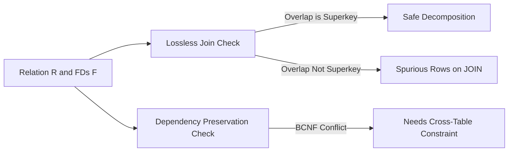
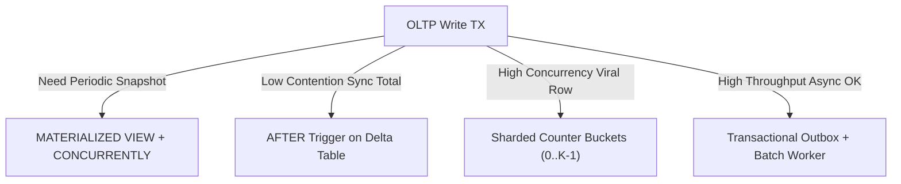

---
tags:
  - software-engineering
  - databases
  - normalization
  - data-modeling
  - postgresql
  - relational-algebra
created: 2026-01-02
updated: 2026-11-13
status: 🟢
level: mid-to-senior
---
# Normalization & Strategic Denormalization

> [!abstract] Vault Navigation
> Relational schema theory, anomaly elimination, temporal modeling, and controlled denormalization inside [[Programming/Software Engineering/Database Design/Database Design Complete Guide|Database Design Complete Guide]]. Pairs directly with [[Programming/Software Engineering/Database Design/Relational Databases|Relational Databases]], [[Programming/Software Engineering/Database Design/Indexing|Indexing]], [[Programming/Software Engineering/Database Design/Transactions|Transactions]], [[Programming/Software Engineering/System Design/ETL|ETL]], and [[Programming/Software Engineering/SDLC/Release Engineering & Migrations|Release Engineering & Migrations]].

Relational normalization is not an aesthetic exercise in splitting tables until queries require ten joins; it is a formal algebraic method for eliminating **modification anomalies** and guaranteeing **single source of truth** on the OLTP write path. Conversely, **strategic denormalization** reintroduces controlled redundancy only when measured read latency, join fanout, or single-row lock contention exceeds hardware capacity, backed by explicit synchronization mechanisms (materialized views, incremental triggers, sharded counters, or transactional outbox workers).

---

## 1. First-Principles Mechanics & Formal Relational Theory

### 1.1 Relations, Tuples & Functional Dependencies ($X \to Y$)

A relation schema $R(A_1, A_2, \dots, A_n)$ defines a finite set of named attributes over typed domains $D_1, \dots, D_n$. Mathematically, a relation instance $r(R)$ is a set of tuples where each tuple maps attributes to scalar values. SQL tables deviate from pure mathematical relations in two critical ways: SQL allows duplicate rows unless a `PRIMARY KEY` or `UNIQUE` constraint is declared, and SQL introduces `NULL` with three-valued logic (`NULL <> NULL` in unique indexes unless PostgreSQL 15+ `UNIQUE NULLS NOT DISTINCT` is specified).

Given attribute subsets $X, Y \subseteq R$:
- **Functional Dependency ($X \to Y$)**: $X$ functionally determines $Y$ if and only if for every legal instance $r(R)$ and every pair of tuples $t_1, t_2 \in r$:
  $$t_1[X] = t_2[X] \implies t_1[Y] = t_2[Y]$$
  Notice that an FD is a **semantic invariant** of the business domain, not a property inferred from a sample of current rows. Two employees sharing a salary today does not imply `salary -> emp_id`.
- **Trivial vs Non-Trivial FD**:
  - **Trivial**: $Y \subseteq X$ (always holds in every relation, e.g., `(emp_id, name) -> name`).
  - **Non-Trivial**: $Y \not\subseteq X$.
  - **Completely Non-Trivial**: $X \cap Y = \varnothing$.

### 1.2 Armstrong's Axioms & Derived Inference Rules

Given a declared set of functional dependencies $F$, its **closure ($F^+$)** is the complete set of all FDs logically implied by $F$. **Armstrong's Axioms** are both **sound** (never derive a false FD) and **complete** (derive every logically implied FD):

1. **Reflexivity**: If $Y \subseteq X$, then $X \to Y$.
2. **Augmentation**: If $X \to Y$, then $XZ \to YZ$ for any attribute set $Z \subseteq R$.
3. **Transitivity**: If $X \to Y$ and $Y \to Z$, then $X \to Z$.

From these three primitives, three high-utility derived rules follow directly:
- **Union**: If $X \to Y$ and $X \to Z$, then $X \to YZ$.
- **Decomposition**: If $X \to YZ$, then $X \to Y$ and $X \to Z$.
- **Pseudotransitivity**: If $X \to Y$ and $WY \to Z$, then $WX \to Z$.

### 1.3 Attribute Closure ($X^+$), Keys & Prime Attributes

Computing the full set $F^+$ is exponential in $|R|$, so database engineers compute the **attribute closure ($X^+$)** with respect to $F$ in polynomial time $O(|F| \cdot |R|)$:

```text
Algorithm AttributeClosure(X, F):
  closure := X
  repeat
    changed := false
    for each FD (A -> B) in F:
      if A subset_of closure and B not_subset_of closure:
        closure := closure union B
        changed := true
  until not changed
  return closure
```

Using attribute closure, key concepts have unambiguous definitions:
- **Superkey**: Any attribute set $K \subseteq R$ such that $K^+ = R$.
- **Candidate Key**: A *minimal* superkey $K$ such that $K^+ = R$, and removing any proper subset breaks closure ($\forall a \in K,\ (K \setminus \{a\})^+ \neq R$).
- **Primary Key**: One designated candidate key selected as the table's canonical row identifier.
- **Prime Attribute**: Any attribute $A \in R$ that belongs to **at least one** candidate key.
- **Non-Prime Attribute**: Any attribute $A \in R$ that belongs to **no** candidate key.

#### Deterministic Method to Find All Candidate Keys

Classify every attribute of $R$ against the left-hand side (LHS) and right-hand side (RHS) of non-trivial FDs in $F$:
1. **Core Attributes ($L$-only + Isolated)**: Attributes that **never appear on any RHS** of $F$ cannot be determined by anything else, so they **must** belong to every candidate key. Compute `Core+`.
2. If `Core+ = R`, `Core` is the **sole candidate key**.
3. Otherwise, expand `Core` with attributes appearing on **both LHS and RHS** (`LR` set) using BFS by subset size, pruning supersets of already-discovered candidate keys. Attributes appearing **strictly on the RHS** (`R`-only) can never help form a minimal key.

### 1.4 Canonical Cover ($F_c$), Lossless Join & Dependency Preservation

A **Canonical Cover ($F_c$)** is a minimal equivalent set of FDs where $(F_c)^+ = F^+$:
1. Every RHS is decomposed to a single attribute ($X \to A$).
2. No FD contains an **extraneous attribute** on the LHS (if $(F \setminus \{X \to A\} \cup \{(X \setminus \{b\}) \to A\})^+ = F^+$, drop $b$).
3. No FD is redundant (if $(F \setminus \{X \to A\})^+ = F^+$, drop $X \to A$).

When decomposing $R$ into sub-relations $R_1, R_2, \dots, R_k$, two mathematical properties govern correctness:



1. **Lossless-Join Property (Heath's Theorem)**: Decomposing $R$ into $R_1$ and $R_2$ guarantees $r = \pi_{R_1}(r) \bowtie \pi_{R_2}(r)$ (zero phantom rows on natural join) if and only if:
   $$(R_1 \cap R_2) \to R_1 \in F^+ \quad \text{OR} \quad (R_1 \cap R_2) \to R_2 \in F^+$$
   **Lossy Decomposition Counterexample**: Take `assignments(emp_id, skill, project)` with `(1, 'SQL', 'Alpha')` and `(2, 'SQL', 'Beta')`. Splitting into `(emp_id, skill)` and `(skill, project)` where overlap `{skill}` is **not** a superkey of either table produces 4 rows upon joining on `skill`, fabricating false tuples `(1, 'SQL', 'Beta')` and `(2, 'SQL', 'Alpha')`!
2. **Dependency Preservation**: Decomposition $\{R_1, \dots, R_k\}$ preserves dependencies iff $(F_1 \cup F_2 \cup \dots \cup F_k)^+ = F^+$, where $F_i$ is the projection of $F^+$ onto attributes of $R_i$. Local `UNIQUE` constraints on each table enforce all business FDs without cross-table triggers or multi-table locks.
   - **3NF** always admits a **lossless-join AND dependency-preserving** decomposition (via Bernstein's Synthesis Algorithm).
   - **BCNF** guarantees a **lossless-join** decomposition with zero FD redundancy, **but does not always preserve every dependency locally** when overlapping candidate keys exist.

### 1.5 Modification Anomalies

Redundancy created by storing non-key functional dependencies inside a wider relation directly causes three operational corruptions:
- **Insertion Anomaly**: Independent entity facts cannot be recorded until an unrelated parent/child event occurs (e.g., cannot create a new training course in `enrollments(student_id, course_id, course_title)` when `student_id` is part of the PK and `NOT NULL`).
- **Update Anomaly**: Changing a single attribute (`dept_budget` or `course_title`) requires updating $N$ duplicated rows; concurrent transactions or partial `WHERE` predicates leave contradictory values in the same table.
- **Deletion Anomaly**: Deleting the last transactional row (`enrollment`) silently erases master entity metadata (`course_title`, `instructor`) with no audit record.

---

## 2. Real-World Use Cases & Decision Matrix

Choosing between strict normalization and bounded denormalization requires evaluating read/write ratio, lock contention profile, consistency SLA, and payload volatility.

### 2.1 Six Production Modeling Scenarios

1. **OLTP Financial Ledgers, Billing & Inventory Core (Use Strict 3NF/BCNF)**: Double-entry journal lines, invoices, and inventory reservations mutate under high concurrency and require strict ACID invariants. Duplicating customer credit limits or account balances across ledger rows causes update anomalies and lost-update races; keep write tables in BCNF/3NF.
2. **Multi-Tenant SaaS with Variable Per-Tenant Custom Attributes (Use Relational Core + Narrow `JSONB`)**: A CRM or ticketing table where 12 core columns (`id`, `tenant_id`, `status`, `assignee_id`, `created_at`) participate in foreign keys, sorts, and filters, while tenants define 15 custom fields. Avoid EAV (`entity_attribute_values`) self-join explosions; place core attributes in typed relational columns and sparse metadata inside a compact `< 2 KB` `JSONB` column with `CHECK` constraints and a `GIN` index.
3. **Executive Reporting & Tenant Billing Dashboards (Use Materialized Summary Tables / Views)**: Aggregating 50M invoice rows on every dashboard page load exhausts buffer pools and CPU. Pre-aggregate into monthly summary materialized views (`REFRESH MATERIALIZED VIEW CONCURRENTLY`) or incremental summary tables updated via triggers or outbox workers.
4. **High-Concurrency Social Counters & Telemetry Ingestion (Use Sharded Counters or Async Outbox, NOT Direct Triggers)**: Updating `posts.likes_count` synchronously inside every `INSERT INTO post_likes` serializes 10,000 concurrent likes behind one row-level exclusive lock on the `posts` tuple. Partition the counter across $K$ shard buckets (`post_like_shards`) or batch deltas asynchronously through a transactional outbox.
5. **Pricing Tier, Tax Rate & Subscription Contract History (Use SCD Type 2 with `tstzrange`)**: Invoices generated in 2025 must forever reflect 2025 SKU pricing and customer billing tiers even after a 2026 price hike. Model historical effective spans using PostgreSQL range types and `EXCLUDE USING gist` so overlapping time windows are physically impossible.
6. **Multi-Terabyte Analytical Scanning (Use CDC to Columnar OLAP, NOT OLTP Denormalization)**: Running wide `GROUP BY` cube scans on the transactional primary evicts hot B+Tree and heap pages from `shared_buffers` and stalls `VACUUM` via long snapshots. Stream OLTP changes via logical CDC (Debezium / `pgoutput`) into a Star Schema inside ClickHouse, DuckDB, or Snowflake (see [[Programming/Software Engineering/System Design/ETL|ETL]]).

### 2.2 Architecture Decision Matrix

| Modeling Strategy | Write Amplification | Read Latency | Consistency Guarantee | When to Adopt | When to Avoid |
|---|---|---|---|---|---|
| **Strict 3NF / BCNF** | Lowest (single source of truth) | Moderate (requires normalized joins) | **Immediate ACID** (`UNIQUE`, `FK`, `CHECK`) | Core OLTP entities, financial state, RBAC, workflows | High-fanout BI aggregations over $10^8+$ rows |
| **Hybrid Core + `JSONB`** | Low if `JSONB` rarely mutates | Fast via `GIN (jsonb_path_ops)` | Partial (`CHECK` constraints, no `FK` inside JSON) | Sparse per-tenant metadata, webhook headers | Frequently updated individual keys ($> 2\text{ KB}$ TOAST rewrite!) |
| **Materialized Summary View** | Zero on OLTP writes; burst on refresh | $O(1)$ pre-computed scan | **Snapshot stale** (refresh interval lag) | Hourly/daily BI dashboards, tenant usage rollups | Sub-second live counters or unindexed ad-hoc slicing |
| **Sync Trigger Summary Table** | High (`2x` writes + parent row lock!) | $O(1)$ point lookup | **Immediate ACID** (same TX) | Low-concurrency parent totals (invoice subtotal from 10 items) | High-concurrency single-parent hot rows (viral posts, global counters) |
| **Sharded Counter / Outbox** | Low lock contention ($K\times$ parallel) | Fast ($K$-row `SUM` or async read) | Strong on sharded write; eventual on async outbox | Viral counters, rate metrics, inventory projections | Strict synchronous balance threshold checks without reservation |
| **SCD Type 2 (`tstzrange`)** | Append-only version inserts | Fast via GiST `@>` point-in-time | **Immediate ACID** (zero gaps/overlaps) | Pricing history, employment/org-chart audit, tax rules | Ephemeral state with zero historical query requirements |

---

## 3. Step-by-Step Practical Application: Schema Evolution (`0NF` to `5NF`)

To demonstrate every normal form rigorously in production PostgreSQL, consider an enterprise **B2B Consulting & Training Platform** ingesting raw engagement records into a staging dump before normalizing into a transactional schema.

### 3.1 Step 0 — `0NF` (Unnormalized Raw Dump)

Raw spreadsheets and webhook payloads typically mix repeating column groups, delimited strings, and nested arrays inside a single unkeyed table:

```sql
-- 0NF: Repeating groups (slot1..slot3), delimited CSV lists, unvalidated JSON blob, no primary key
CREATE TABLE raw_engagements_0nf (
    engagement_ref     TEXT,
    client_name        TEXT,
    client_tier        TEXT,
    consultant_id      INT,
    consultant_name    TEXT,
    consultant_level   TEXT,
    level_hourly_rate  NUMERIC(10, 2),
    course_code        TEXT,
    course_title       TEXT,
    skills_csv         TEXT,       -- e.g. 'postgresql,kubernetes,terraform'
    slot_1_date        DATE,       -- Repeating column group
    slot_2_date        DATE,
    slot_3_date        DATE,
    resources_json     TEXT        -- Unnormalized JSON blob: '{"instructors":[10,14],"labs":["k8s"]}'
);
```

Querying "which engagements used Kubernetes skills or occurred in November" requires fragile string splitting (`STRING_TO_ARRAY`) and `OR` chains across `slot_1_date..slot_3_date`, while adding a 4th training slot forces an `ALTER TABLE` schema change.

### 3.2 Step 1 — `1NF` (Atomic Domains & Primary Key)

**Rule**: Every attribute holds a single atomic value from its declared domain, repeating groups are exploded into rows, and the relation declares a non-null candidate key as `PRIMARY KEY`.

```sql
-- 1NF: Exploded repeating slots and delimited tags into atomic rows with a composite PK
CREATE TABLE engagement_records_1nf (
    engagement_id      BIGINT NOT NULL,
    consultant_id      INT NOT NULL,
    course_code        TEXT NOT NULL,
    session_date       DATE NOT NULL,
    skill_tag          TEXT NOT NULL,
    client_id          BIGINT NOT NULL,
    client_name        TEXT NOT NULL,
    client_tier        TEXT NOT NULL,
    consultant_name    TEXT NOT NULL,
    consultant_level   TEXT NOT NULL,
    level_hourly_rate  NUMERIC(10, 2) NOT NULL CHECK (level_hourly_rate > 0),
    course_title       TEXT NOT NULL,
    PRIMARY KEY (engagement_id, consultant_id, course_code, session_date, skill_tag)
);
```

Although `1NF` eliminates repeating columns and delimited CSV cells, **massive partial, transitive, and multi-valued anomalies remain**:

```sql
-- 1NF Insert Anomaly: Fails because PK columns cannot be NULL when registering an unscheduled course
INSERT INTO engagement_records_1nf (course_code, course_title)
VALUES ('PG-401', 'PostgreSQL Internals'); -- ERROR: null value in column "engagement_id" violates not-null

-- 1NF Update Anomaly: Partial update leaves inconsistent facts across rows
UPDATE engagement_records_1nf
SET consultant_level = 'principal'
WHERE consultant_id = 42 AND session_date = '2026-11-13'; -- Older session rows still say 'senior'!

-- 1NF Delete Anomaly: Removing the sole session for course 'K8S-101' destroys the course title completely
DELETE FROM engagement_records_1nf WHERE engagement_id = 901 AND course_code = 'K8S-101';
```

### 3.3 Step 2 — `2NF` (Eliminate Partial Dependencies on Composite Keys)

**Rule**: Relation is in `1NF`, and **no non-prime attribute is functionally dependent on a proper subset of any candidate key**.

Inspecting the functional dependencies in `engagement_records_1nf`:
- `engagement_id -> client_id, client_name, client_tier` (partial on PK!)
- `consultant_id -> consultant_name, consultant_level, level_hourly_rate` (partial on PK!)
- `course_code -> course_title` (partial on PK!)
- `(engagement_id, consultant_id, course_code, session_date)` represents an actual scheduled session; `skill_tag` is an independent multi-valued tag (decomposed further in 4NF).

Decomposing along partial dependencies into `2NF`:

```sql
CREATE TABLE engagements_2nf (
    engagement_id BIGINT PRIMARY KEY,
    client_id     BIGINT NOT NULL,
    client_name   TEXT NOT NULL,
    client_tier   TEXT NOT NULL
);

CREATE TABLE consultants_2nf (
    consultant_id     INT PRIMARY KEY,
    consultant_name   TEXT NOT NULL,
    consultant_level  TEXT NOT NULL,
    level_hourly_rate NUMERIC(10, 2) NOT NULL CHECK (level_hourly_rate > 0)
);

CREATE TABLE courses_2nf (
    course_code  TEXT PRIMARY KEY,
    course_title TEXT NOT NULL
);

CREATE TABLE engagement_sessions_2nf (
    engagement_id BIGINT NOT NULL REFERENCES engagements_2nf(engagement_id),
    consultant_id INT NOT NULL REFERENCES consultants_2nf(consultant_id),
    course_code   TEXT NOT NULL REFERENCES courses_2nf(course_code),
    session_date  DATE NOT NULL,
    hours_billed  NUMERIC(4, 2) NOT NULL CHECK (hours_billed > 0),
    PRIMARY KEY (engagement_id, consultant_id, course_code, session_date)
);
```

**Anomalies Eliminated**: New courses and consultants can be inserted independently before any engagement exists, and updating `course_title` updates exactly **one row** in `courses_2nf`.

**Remaining Anomalies (`2NF` Violation Proof of Transitive FDs)**:
Inside `engagements_2nf`, `engagement_id -> client_id -> (client_name, client_tier)`. Inside `consultants_2nf`, `consultant_id -> consultant_level -> level_hourly_rate`. Look at what fails in `consultants_2nf`:

```sql
-- 2NF Update Anomaly: Raising the 'principal' hourly rate from $250 to $275
-- forces scanning and updating EVERY principal consultant row; missing one row
-- leaves two 'principal' consultants with contradictory hourly rates!
INSERT INTO consultants_2nf VALUES
    (101, 'Ada Lovelace', 'principal', 250.00),
    (102, 'Alan Turing',  'principal', 275.00); -- Contradictory invariant accepted silently!

-- 2NF Delete Anomaly: Deleting the only 'fellow' consultant erases the 'fellow' rate card.
```

### 3.4 Step 3 — `3NF` (Eliminate Transitive Dependencies)

**Rule**: Relation is in `2NF`, and for every non-trivial FD $X \to A$, **either $X$ is a superkey OR $A$ is a prime attribute**.

Transitive dependencies occur when a non-prime determinant $Y$ sits between a candidate key $K$ and another non-prime attribute $Z$ ($K \to Y \to Z$, where $Y \not\to K$). Splitting out the transitive determinants `client_id` and `consultant_level` produces `3NF`:

```sql
CREATE TABLE clients_3nf (
    client_id   BIGINT GENERATED ALWAYS AS IDENTITY PRIMARY KEY,
    client_name TEXT NOT NULL,
    client_tier TEXT NOT NULL CHECK (client_tier IN ('standard', 'growth', 'enterprise'))
);

CREATE TABLE engagements_3nf (
    engagement_id BIGINT GENERATED ALWAYS AS IDENTITY PRIMARY KEY,
    client_id     BIGINT NOT NULL REFERENCES clients_3nf(client_id),
    created_at    TIMESTAMPTZ NOT NULL DEFAULT NOW()
);

CREATE TABLE consultant_levels_3nf (
    level_code        TEXT PRIMARY KEY,
    level_hourly_rate NUMERIC(10, 2) NOT NULL CHECK (level_hourly_rate > 0)
);

CREATE TABLE consultants_3nf (
    consultant_id    INT GENERATED ALWAYS AS IDENTITY PRIMARY KEY,
    consultant_name  TEXT NOT NULL,
    consultant_level TEXT NOT NULL REFERENCES consultant_levels_3nf(level_code)
);
```

Now updating `'principal'` hourly rate modifies **one row** in `consultant_levels_3nf`, and `level_hourly_rate` contradictions across rows become structurally impossible.

### 3.5 Step 4 — `BCNF` (Multiple Overlapping Candidate Keys Edge Case)

**Rule (Boyce-Codd Normal Form)**: For **every** non-trivial FD $X \to Y$ holding in $R$, **$X$ MUST be a superkey** (dropping the `3NF` escape hatch that allows $Y$ to be a prime attribute).

Consider adding a mentorship rule to the consulting platform: `mentor_assignments(trainee_id, track, mentor_id)` with two business invariants:
1. A trainee has **at most one mentor per technical track**: `(trainee_id, track) -> mentor_id`.
2. Each mentor specializes in **strictly one technical track**: **`mentor_id -> track`**.

Evaluating keys:
- Both **`(trainee_id, track)`** and **`(trainee_id, mentor_id)`** are overlapping candidate keys (every attribute `trainee_id`, `track`, `mentor_id` is **prime**!).
- **Why this passes `3NF`**: In `mentor_id -> track`, the RHS `track` is a **prime attribute**, so `3NF` permits the table as-is!
- **Why it breaks in production (BCNF Violation)**: `mentor_id` is **not a superkey**! Watch the anomaly in PostgreSQL:

```sql
-- 3NF (NOT BCNF): Permits contradictory track assignments for the same mentor!
CREATE TABLE mentor_assignments_3nf (
    trainee_id BIGINT NOT NULL,
    track      TEXT NOT NULL,
    mentor_id  BIGINT NOT NULL,
    PRIMARY KEY (trainee_id, track),
    UNIQUE (trainee_id, mentor_id)
);

INSERT INTO mentor_assignments_3nf VALUES (1, 'distributed-sql', 900);
-- Buggy concurrent write inserts mentor 900 under a SECOND track:
INSERT INTO mentor_assignments_3nf VALUES (2, 'kubernetes', 900); -- SUCCEEDS! Breaks mentor_id -> track!
-- Delete Anomaly: Deleting trainee 1 erases mentor 900's track assignment if trainee 2 doesn't exist.
```

#### BCNF Decomposition + Cross-Table Dependency Preservation in PostgreSQL

Decomposing into BCNF isolates `mentor_id -> track`:
- `mentors(mentor_id PK, track)`
- `trainee_mentors(trainee_id, mentor_id, PRIMARY KEY(trainee_id, mentor_id))`

In naive BCNF decomposition, nothing prevents trainee `1` from being assigned **two different mentors who both teach `'distributed-sql'`** (`(1, 900)` and `(1, 901)` where both `900` and `901` teach `'distributed-sql'`)—the classic **BCNF dependency-preservation loss** for `(trainee_id, track) -> mentor_id`.

Senior PostgreSQL engineering resolves **both** BCNF redundancy AND cross-table `(trainee_id, track)` uniqueness declaratively **without triggers**, using a redundant-free superkey composite FK:

```sql
CREATE TABLE mentors_bcnf (
    mentor_id BIGINT PRIMARY KEY,
    track     TEXT NOT NULL,
    -- Secondary unique key enabling composite foreign-key target
    UNIQUE (mentor_id, track)
);

CREATE TABLE trainee_mentors_bcnf (
    trainee_id BIGINT NOT NULL,
    mentor_id  BIGINT NOT NULL,
    track      TEXT NOT NULL,
    PRIMARY KEY (trainee_id, mentor_id),
    -- Guarantees (trainee_id, track) has at most 1 mentor (preserves FD!)
    UNIQUE (trainee_id, track),
    -- Guarantees track in this table ALWAYS matches mentors_bcnf.track (zero update anomaly!)
    FOREIGN KEY (mentor_id, track)
        REFERENCES mentors_bcnf (mentor_id, track)
        ON UPDATE CASCADE
);
```

Because `(mentor_id, track)` references a `UNIQUE` pair in `mentors_bcnf`, a trainee cannot claim a mentor under the wrong track, `UNIQUE (trainee_id, track)` prevents two mentors per track for one trainee, and updating a mentor's track cascades atomically in one parent row!

### 3.6 Step 5 — `4NF` (Multi-Valued Dependencies)

**Rule**: A relation is in `4NF` iff it is in `BCNF` and for every non-trivial **Multi-Valued Dependency ($X \twoheadrightarrow Y$)**, $X$ is a superkey.

An MVD $X \twoheadrightarrow Y$ holds in $R(X, Y, Z)$ when the set of $Y$-values associated with a given $X$-value is completely independent of $Z$. Consider `course_resources_bcnf(course_code, instructor_id, lab_env_id)` where all three columns form an all-key PK `(course_code, instructor_id, lab_env_id)`:
- No non-trivial FDs exist, so the table is strictly in **BCNF**.
- However, a course has an independent set of certified instructors (`course_code ->> instructor_id`) AND an independent set of cloud lab templates (`course_code ->> lab_env_id`).

```sql
-- BCNF Violation of 4NF: Cartesian product explosion!
CREATE TABLE course_resources_bcnf (
    course_code TEXT NOT NULL,
    instructor_id BIGINT NOT NULL,
    lab_env_id TEXT NOT NULL,
    PRIMARY KEY (course_code, instructor_id, lab_env_id)
);

-- Course 'PG-401' has 3 instructors and 4 lab environments -> MUST insert 3 * 4 = 12 rows!
-- Adding 1 new lab environment forces 3 duplicate inserts; forgetting 1 instructor violates MVD symmetry!
```

**4NF Decomposition**: Split independent multi-valued facts into separate tables:

```sql
CREATE TABLE course_instructors_4nf (
    course_code   TEXT NOT NULL REFERENCES courses_2nf(course_code),
    instructor_id BIGINT NOT NULL,
    PRIMARY KEY (course_code, instructor_id)
);

CREATE TABLE course_lab_envs_4nf (
    course_code TEXT NOT NULL REFERENCES courses_2nf(course_code),
    lab_env_id  TEXT NOT NULL,
    PRIMARY KEY (course_code, lab_env_id)
);
-- Adding 1 new lab environment inserts 1 row (3 + 5 = 8 total rows instead of 3 * 5 = 15!).
```

### 3.7 Step 6 — `5NF` (Project-Join Normal Form)

**Rule**: Every non-trivial **Join Dependency** $\bowtie(R_1, R_2, \dots, R_m)$ is implied by the candidate keys of $R$.

Consider a ternary table `consultant_client_skill(consultant_id, client_id, skill_tag)` recording which consultant is approved to deliver which skill for which client:
- **Case A (No Cyclic Join Constraint)**: Consultant Ada knows PostgreSQL and Kafka, works for Client Acme, and Acme needs both skills—but Acme only approved Ada for PostgreSQL (not Kafka). Splitting into 3 binary tables `(consultant, skill)`, `(consultant, client)`, and `(client, skill)` causes a **lossy join** (`SELECT cs.consultant_id, cc.client_id, cl.skill_tag FROM consultant_skills cs JOIN consultant_clients cc USING (consultant_id) JOIN client_skills cl USING (client_id, skill_tag)`) that falsely fabricates `(Ada, Acme, Kafka)`. Therefore, the ternary table is **already in `5NF`**.
- **Case B (True Cyclic Join Dependency)**: If business policy dictates that *whenever* a consultant holds a skill, is assigned to a client, and that client requires that skill, the consultant is automatically cleared for `(consultant_id, client_id, skill_tag)`, then storing the ternary table duplicates the 3 binary relationships and permits inconsistent updates unless decomposed into the 3 binary tables:

```sql
CREATE TABLE consultant_skills (consultant_id INT, skill_tag TEXT, PRIMARY KEY (consultant_id, skill_tag));
CREATE TABLE consultant_clients (consultant_id INT, client_id BIGINT, PRIMARY KEY (consultant_id, client_id));
CREATE TABLE client_skills (client_id BIGINT, skill_tag TEXT, PRIMARY KEY (client_id, skill_tag));
```

---

## 4. Complete Reference: Strategic Denormalization, `JSONB`, SCDs & Zero-Downtime Constraints

### 4.1 Pre-Aggregated Materialized Summary Tables & Synchronization

PostgreSQL offers two distinct mechanisms for pre-aggregated reads: native `MATERIALIZED VIEW`s (snapshot refresh) and custom summary tables maintained incrementally via triggers or an outbox worker.



#### Pattern A: `MATERIALIZED VIEW` with Non-Blocking Refresh

```sql
CREATE MATERIALIZED VIEW mv_monthly_client_billing AS
SELECT
    e.client_id,
    DATE_TRUNC('month', s.session_date)::date AS billing_month,
    COUNT(*)                                  AS session_count,
    SUM(s.hours_billed * cl.level_hourly_rate) AS total_amount_usd
FROM engagement_sessions s
JOIN engagements e         ON e.engagement_id = s.engagement_id
JOIN consultants c         ON c.consultant_id = s.consultant_id
JOIN consultant_levels cl  ON cl.level_code   = c.consultant_level
GROUP BY e.client_id, DATE_TRUNC('month', s.session_date)::date
WITH DATA;

-- MANDATORY unique index without NULLs so CONCURRENTLY can diff old vs new snapshots
CREATE UNIQUE INDEX idx_mv_monthly_client_billing_pk
    ON mv_monthly_client_billing (client_id, billing_month);

-- Non-blocking refresh: acquires EXCLUSIVE lock (blocks other refreshes, allows concurrent SELECTs!)
REFRESH MATERIALIZED VIEW CONCURRENTLY mv_monthly_client_billing;
```

- **Locking Trap**: Omitting `CONCURRENTLY` acquires **`ACCESS EXCLUSIVE`**, stalling every `SELECT` dashboard query for the entire aggregation runtime. Even with `CONCURRENTLY`, PostgreSQL executes the full underlying query, builds a temp table, diffs every row against the old view, and executes `INSERT`/`UPDATE`/`DELETE`—so `CONCURRENTLY` can be *slower* than a full swap when $> 50\%$ of rows change.

#### Pattern B: Incremental Summary Table via Statement/Row Delta Trigger

When queries require **zero-lag ACID accuracy** on low-to-moderate write rates (e.g., maintaining `invoice_totals` from `invoice_line_items`), maintain a summary table via a clean `AFTER INSERT OR UPDATE OR DELETE` trigger that locks parent rows in deterministic order:

```sql
CREATE TABLE client_billing_summary (
    client_id      BIGINT PRIMARY KEY REFERENCES clients_3nf(client_id),
    total_hours    NUMERIC(12, 2) NOT NULL DEFAULT 0,
    total_sessions BIGINT NOT NULL DEFAULT 0,
    updated_at     TIMESTAMPTZ NOT NULL DEFAULT NOW()
);

CREATE OR REPLACE FUNCTION trg_sync_client_billing_summary()
RETURNS TRIGGER
LANGUAGE plpgsql
AS $$
DECLARE
    v_client_id BIGINT;
    v_delta_hrs NUMERIC(12, 2);
    v_delta_cnt BIGINT;
BEGIN
    IF TG_OP = 'INSERT' THEN
        SELECT client_id INTO v_client_id FROM engagements_3nf WHERE engagement_id = NEW.engagement_id;
        v_delta_hrs := NEW.hours_billed;
        v_delta_cnt := 1;
    ELSIF TG_OP = 'UPDATE' THEN
        -- Handle engagement reassignment cleanly if engagement_id changed
        IF OLD.engagement_id IS DISTINCT FROM NEW.engagement_id THEN
            SELECT client_id INTO v_client_id FROM engagements_3nf WHERE engagement_id = OLD.engagement_id;
            UPDATE client_billing_summary
               SET total_hours = total_hours - OLD.hours_billed,
                   total_sessions = total_sessions - 1,
                   updated_at = NOW()
             WHERE client_id = v_client_id;

            SELECT client_id INTO v_client_id FROM engagements_3nf WHERE engagement_id = NEW.engagement_id;
            v_delta_hrs := NEW.hours_billed;
            v_delta_cnt := 1;
        ELSE
            SELECT client_id INTO v_client_id FROM engagements_3nf WHERE engagement_id = NEW.engagement_id;
            v_delta_hrs := NEW.hours_billed - OLD.hours_billed;
            v_delta_cnt := 0;
        END IF;
    ELSIF TG_OP = 'DELETE' THEN
        SELECT client_id INTO v_client_id FROM engagements_3nf WHERE engagement_id = OLD.engagement_id;
        v_delta_hrs := -OLD.hours_billed;
        v_delta_cnt := -1;
    END IF;

    INSERT INTO client_billing_summary (client_id, total_hours, total_sessions, updated_at)
    VALUES (v_client_id, v_delta_hrs, v_delta_cnt, NOW())
    ON CONFLICT (client_id) DO UPDATE
    SET total_hours    = client_billing_summary.total_hours + EXCLUDED.total_hours,
        total_sessions = client_billing_summary.total_sessions + EXCLUDED.total_sessions,
        updated_at     = NOW();

    RETURN NULL;
END;
$$;

CREATE TRIGGER sync_client_billing_summary_aiud
AFTER INSERT OR UPDATE OR DELETE ON engagement_sessions
FOR EACH ROW EXECUTE FUNCTION trg_sync_client_billing_summary();
```

- **Why Sharded Counters Beat Triggers Under Hot Contention**: Notice the `ON CONFLICT (client_id) DO UPDATE` above acquires an exclusive row lock on `client_billing_summary.client_id`. If 5,000 concurrent requests write to the *same* `client_id`, transactions serialize single-file. For high-write hot keys, replace single-row `client_billing_summary` with **bucketed counter shards**:

```sql
CREATE TABLE entity_counter_shards (
    entity_id BIGINT NOT NULL,
    bucket_id SMALLINT NOT NULL CHECK (bucket_id BETWEEN 0 AND 31),
    delta     BIGINT NOT NULL DEFAULT 0,
    PRIMARY KEY (entity_id, bucket_id)
);

-- Writer picks random bucket 0..31: spreads lock contention across 32 distinct heap tuples
INSERT INTO entity_counter_shards (entity_id, bucket_id, delta)
VALUES ($1, (random() * 31)::smallint, 1)
ON CONFLICT (entity_id, bucket_id)
DO UPDATE SET delta = entity_counter_shards.delta + EXCLUDED.delta;

-- Reader sums 32 contiguous rows (sub-millisecond B+Tree index range scan)
SELECT COALESCE(SUM(delta), 0) AS total_count
FROM entity_counter_shards
WHERE entity_id = $1;
```

#### Pattern C: Transactional Outbox + Batched Worker

When even sharded locks are unnecessary or updates must propagate to Redis/OpenSearch/external summary tables, insert an event row into `outbox_events` **inside the same ACID transaction** as the normalized write, and let a worker batch deltas (`SELECT ... FOR UPDATE SKIP LOCKED` or Debezium CDC) every 500 ms (see [[Programming/Software Engineering/Architectural Patterns/CQRS|CQRS]] and [[Programming/Software Engineering/Database Design/Transactions|Transactions]]):

```sql
CREATE TABLE outbox_events (
    id             BIGINT GENERATED ALWAYS AS IDENTITY PRIMARY KEY,
    aggregate_type TEXT NOT NULL,
    aggregate_id   BIGINT NOT NULL,
    event_type     TEXT NOT NULL,
    payload        JSONB NOT NULL,
    created_at     TIMESTAMPTZ NOT NULL DEFAULT NOW()
);

-- Atomic normalized write + outbox append (zero dual-write inconsistency!)
BEGIN;
INSERT INTO engagement_sessions (engagement_id, consultant_id, course_code, session_date, hours_billed)
VALUES (501, 42, 'PG-401', '2026-11-13', 4.0);

INSERT INTO outbox_events (aggregate_type, aggregate_id, event_type, payload)
VALUES ('engagement_session', 501, 'SessionRecorded', '{"client_id": 88, "hours": 4.0}'::jsonb);
COMMIT;
```

### 4.2 Semi-Structured `JSONB` Extensions, `CHECK` Invariants & TOAST Traps

PostgreSQL stores values exceeding **`TOAST_TUPLE_THRESHOLD` (~2,040 bytes)** out-of-line in a compressed `pg_toast` relation broken into ~2 KB chunks. Because `JSONB` is stored as a single immutable binary object on disk, mutating one key (`jsonb_set`) inside a 30 KB `JSONB` column forces PostgreSQL to decompress, copy, recompress, and write a **brand-new 30 KB TOAST value + ~15 TOAST chunks + new main heap tuple + full-page WAL images**.

**Production Guardrails for `JSONB`**:
1. **Keep `JSONB` Bounded & Rarely Updated**: Extract high-churn timestamps, status flags, foreign keys, and sort keys into typed relational columns so updates execute as inline **HOT updates** (zero TOAST I/O).
2. **Enforce Structural Invariants with `CHECK` Constraints**: Never allow arbitrary malformed shapes into an OLTP `JSONB` column.
3. **Choose `jsonb_path_ops` for Containment (`@>`)**: `jsonb_path_ops` hashes full key-value paths instead of storing separate keys and values, producing `GIN` indexes **2–3x smaller** and significantly faster for `@>` queries (though it does not support `?`, `?|`, or `?&` key-existence operators).
4. **Promote Hot JSON Paths via Generated Columns or Expression Indexes**: If `payload->>'region'` is filtered on every query, promote it to a `GENERATED ALWAYS AS (payload->>'region') STORED` column or expression index so PostgreSQL maintains full MCV/histogram planner statistics!

```sql
CREATE TABLE webhook_subscriptions (
    id             BIGINT GENERATED ALWAYS AS IDENTITY PRIMARY KEY,
    tenant_id      BIGINT NOT NULL REFERENCES clients_3nf(client_id),
    target_url     TEXT NOT NULL,
    is_active      BOOLEAN NOT NULL DEFAULT TRUE,
    -- Generated typed column gives planner exact MCV & histogram statistics
    api_version    TEXT GENERATED ALWAYS AS (config->>'api_version') STORED,
    config         JSONB NOT NULL DEFAULT '{"api_version":"2026-01","retry_max":3}'::jsonb,
    -- Enforce strict JSONB schema invariants natively in PostgreSQL
    CONSTRAINT chk_config_object CHECK (jsonb_typeof(config) = 'object'),
    CONSTRAINT chk_config_required_keys CHECK (config ?& ARRAY['api_version', 'retry_max']),
    CONSTRAINT chk_config_retry_bounds CHECK (
        jsonb_typeof(config->'retry_max') = 'number'
        AND (config->>'retry_max')::int BETWEEN 0 AND 10
    ),
    -- Prevent unbounded JSONB bloat (> 4 KB triggers architectural review)
    CONSTRAINT chk_config_size CHECK (pg_column_size(config) <= 4096)
);

CREATE INDEX idx_webhook_sub_config_gin
    ON webhook_subscriptions USING gin (config jsonb_path_ops);
```

### 4.3 Slowly Changing Dimensions (`SCD` Types 1, 2, 3, 4, 6) & Temporal `tstzrange` Tables

When business entities change attributes over time (`plan_tier`, `tax_rate`, `unit_price`), historical transactions must query the state effective at the event timestamp:

| SCD Type | Mechanism | Historical Accuracy | Storage & Query Cost | Best Production Use Case |
|---|---|---|---|---|
| **Type 1** | Overwrite existing attribute in-place (`UPDATE`) | **None** (history destroyed) | Lowest (1 row per entity) | Typo fixes, non-audited display preferences |
| **Type 2** | Append new versioned row with `[valid_from, valid_to)` validity span | **Complete** (full point-in-time reconstruction) | Moderate ($V$ versions per entity) | Pricing tiers, employee roles, compliance/audit ledgers |
| **Type 3** | Add `previous_value` + `effective_at` columns on current row | **Bounded** (tracks strictly 1 prior state) | Low | One-time migration fallback or prior-year comparison |
| **Type 4** | Separate `entity_current` table (Type 1) + `entity_history` audit table (Type 2) | **Complete** | Fast current reads; separate history join | High-throughput OLTP hot current state + cold compliance archive |
| **Type 6** | Hybrid (`1 + 2 + 3`): Type 2 version rows carrying a `current_flag` AND `current_value` column | **Complete** + current snapshot view | Highest update fanout (must update `current_value` on all prior rows!) | Data warehouse dimensions needing simultaneous as-was and as-is slicing |

#### Production PostgreSQL SCD Type 2 with `tstzrange` + `EXCLUDE USING gist`

Classic SCD Type 2 schemas using `(valid_from TIMESTAMPTZ, valid_to TIMESTAMPTZ)` suffer from race conditions where two concurrent transactions insert overlapping intervals for the same `plan_id`. PostgreSQL's `tstzrange` coupled with `btree_gist` makes overlapping effective windows **physically impossible** at the database engine level:

```sql
CREATE EXTENSION IF NOT EXISTS btree_gist;

CREATE TABLE plan_pricing_history (
    version_id   BIGINT GENERATED ALWAYS AS IDENTITY PRIMARY KEY,
    plan_code    TEXT NOT NULL,
    price_cents  INT NOT NULL CHECK (price_cents >= 0),
    valid_during TSTZRANGE NOT NULL,
    -- Enforce half-open [start, end) semantics and non-empty intervals
    CONSTRAINT chk_valid_half_open CHECK (
        NOT isempty(valid_during)
        AND lower_inc(valid_during)
        AND NOT upper_inc(valid_during)
    ),
    -- Atomically blocks overlapping validity spans for the same plan_code!
    CONSTRAINT excl_plan_no_overlap
        EXCLUDE USING gist (plan_code WITH =, valid_during WITH &&)
);

-- Guarantees at most ONE active unbounded row ('[t, infinity)') per plan_code
CREATE UNIQUE INDEX idx_plan_pricing_active
    ON plan_pricing_history (plan_code)
    WHERE upper_inf(valid_during);

-- Seed initial active pricing effective 2026-01-01
INSERT INTO plan_pricing_history (plan_code, price_cents, valid_during)
VALUES ('pro_monthly', 4900, '[2026-01-01 00:00:00Z, infinity)');

-- Atomic SCD Type 2 price transition at effective timestamp v_effective
CREATE OR REPLACE PROCEDURE rotate_plan_price(
    p_plan_code  TEXT,
    p_new_price  INT,
    p_effective  TIMESTAMPTZ
)
LANGUAGE plpgsql
AS $$
BEGIN
    -- 1. Close current active interval up to p_effective
    UPDATE plan_pricing_history
       SET valid_during = tstzrange(lower(valid_during), p_effective, '[)')
     WHERE plan_code = p_plan_code
       AND upper_inf(valid_during)
       AND lower(valid_during) < p_effective;

    IF NOT FOUND THEN
        RAISE EXCEPTION 'No active pricing version prior to % for plan %', p_effective, p_plan_code;
    END IF;

    -- 2. Insert new open-ended active interval starting at p_effective
    INSERT INTO plan_pricing_history (plan_code, price_cents, valid_during)
    VALUES (p_plan_code, p_new_price, tstzrange(p_effective, NULL, '[)'));
END;
$$;

-- Point-in-time historical lookup uses GiST index directly via '@>' operator
SELECT price_cents
FROM plan_pricing_history
WHERE plan_code = 'pro_monthly'
  AND valid_during @> TIMESTAMPTZ '2026-06-15 12:00:00Z';
```

### 4.4 Polymorphic Associations: Why Polymorphic FKs Fail & Three Clean Alternatives

Storing `(commentable_type TEXT, commentable_id BIGINT)` inside a `comments` table violates relational integrity because PostgreSQL **cannot enforce a `FOREIGN KEY`** conditional on `commentable_type`, allowing orphaned references when parent entities are deleted. Choose one of three sound relational designs:
1. **Separate Foreign Key Columns + Exclusive Arc `CHECK`** *(Best for 2–4 stable parent types)*: Add nullable `invoice_id REFERENCES invoices(id)` and `ticket_id REFERENCES tickets(id)` plus `CHECK (num_nonnulls(invoice_id, ticket_id) = 1)`. Create partial indexes on each non-null FK.
2. **Supertype / Subtype Inheritance** *(Best when parents share core identity)*: Create a base `commentable_entities(id PK)` table; both `invoices` and `tickets` use `entity_id PK REFERENCES commentable_entities(id)`. Then `comments.entity_id` holds a single real `FOREIGN KEY`.
3. **Separate Junction Tables** *(Best when parent types evolve frequently)*: Keep `comments(id PK, body)` isolated and bridge via `invoice_comments(invoice_id FK, comment_id FK)` and `ticket_comments(ticket_id FK, comment_id FK)`.

### 4.5 Zero-Downtime Constraint Additions (`NOT VALID` -> `VALIDATE CONSTRAINT`)

Adding a `CHECK` or `FOREIGN KEY` constraint directly on a 500M-row table (`ALTER TABLE orders ADD CONSTRAINT chk_amt CHECK (amount_cents >= 0);`) acquires **`ACCESS EXCLUSIVE`** (for `CHECK`) or **`SHARE ROW EXCLUSIVE`** (for `FOREIGN KEY`), **blocking all writes and/or reads** while PostgreSQL sequentially scans the entire 500 GB table! Even worse, waiting behind a long-running `SELECT` puts the `ALTER TABLE` at the head of the lock queue, causing **every subsequent incoming `SELECT`/`INSERT` to pile up behind it** (see [[Programming/Software Engineering/SDLC/Release Engineering & Migrations|Release Engineering & Migrations]]).

**Two-Phase Zero-Downtime Pattern**:

```sql
-- Phase 1: Metadata-only lock (milliseconds!) with strict lock_timeout retry guard.
-- Enforces constraint on ALL new/updated rows immediately, skipping historical scan!
SET LOCAL lock_timeout = '2s';
ALTER TABLE orders
    ADD CONSTRAINT chk_orders_positive_total
    CHECK (total_cents >= 0) NOT VALID;

-- Phase 2: Separate transaction acquires SHARE UPDATE EXCLUSIVE lock ONLY!
-- Allows concurrent SELECT, INSERT, UPDATE, and DELETE while scanning table cleanly.
ALTER TABLE orders
    VALIDATE CONSTRAINT chk_orders_positive_total;
```

For **`NOT NULL`** on PostgreSQL `< 18`: `ALTER TABLE ... ALTER COLUMN ... SET NOT NULL` acquires `ACCESS EXCLUSIVE` for a full table scan **unless** a validated `CHECK (col IS NOT NULL)` constraint already exists on the column (PostgreSQL 12+ proves via the validated check constraint that no `NULL`s exist and upgrades `attnotnull` in milliseconds! Note: PostgreSQL 18 also introduces `NOT NULL ... NOT VALID` directly).

---

## 5. Production Debugging, Profiling & Operations Playbook

| Production Symptom | Underlying Root Cause | Exact Diagnostic Command / Query | Production Fix |
|---|---|---|---|
| **Massive lock waits on `INSERT` into child table** | Synchronous `AFTER INSERT` trigger updating a single hot parent summary row | `SELECT wait_event_type, wait_event, count(*) FROM pg_stat_activity WHERE state = 'active' GROUP BY 1,2;` (shows `Lock:tuple` / `transactionid`) | Replace trigger with 32-bucket `entity_counter_shards` or `outbox_events` batched worker |
| **Table size $20\times$ larger than logical rows; heavy WAL** | Frequent partial updates to `> 2 KB` `JSONB` columns rewriting full TOAST chunks | `SELECT relname, pg_size_pretty(pg_relation_size(reltoastrelid)) AS toast_sz FROM pg_class WHERE reltoastrelid <> 0 ORDER BY pg_relation_size(reltoastrelid) DESC LIMIT 10;` | Promote hot mutable keys to inline typed columns + `fillfactor = 80` for HOT updates |
| **Hourly API `503` timeouts on dashboard queries** | Cron runs `REFRESH MATERIALIZED VIEW` without `CONCURRENTLY` (`ACCESS EXCLUSIVE`) | `SELECT pid, mode, relation::regclass, granted FROM pg_locks WHERE mode = 'AccessExclusiveLock';` | Add unique index on grouping keys and switch to `REFRESH MATERIALIZED VIEW CONCURRENTLY` |
| **Deleting 1 parent row stalls for 30s with high disk read** | Child table has a `FOREIGN KEY` without a supporting index (Postgres does NOT auto-index FKs!) | Query `pg_constraint` (`contype = 'f'`) minus leading columns of `pg_index` to find unindexed FKs | Run `CREATE INDEX CONCURRENTLY idx_child_parent_id ON child_table(parent_id);` |
| **Migration `ALTER TABLE ADD CONSTRAINT` freezes entire API** | Inline constraint validation holds `ACCESS EXCLUSIVE` / `SHARE ROW EXCLUSIVE` across scan | `SELECT pid, age(clock_timestamp(), query_start), query FROM pg_stat_activity WHERE wait_event_type = 'Lock';` | Abort migration, set `lock_timeout = '2s'`, apply `ADD CONSTRAINT ... NOT VALID` then `VALIDATE CONSTRAINT` |
| **Query planner picks bad Nested Loop over `JSONB` filter** | Planner lacks column histograms/MCVs on `data->>'key'` expressions | `EXPLAIN (ANALYZE, BUFFERS)` shows `rows=1` estimated vs `actual rows=450000` | Promote attribute to `GENERATED ALWAYS AS (...) STORED` column or expression index + `ANALYZE` |

### Diagnostic SQL Script: Detecting Unindexed Foreign Keys & Heavy TOAST Tables

```sql
-- 1. Detect Foreign Keys lacking a covering leading-column B+Tree index (causes parent DELETE seq scans)
SELECT
    c.conrelid::regclass AS child_table,
    c.conname            AS fk_name,
    string_agg(a.attname, ', ' ORDER BY u.ord) AS fk_columns
FROM pg_constraint c
CROSS JOIN LATERAL unnest(c.conkey) WITH ORDINALITY AS u(attnum, ord)
JOIN pg_attribute a
  ON a.attrelid = c.conrelid AND a.attnum = u.attnum
WHERE c.contype = 'f'
  AND NOT EXISTS (
      SELECT 1
      FROM pg_index i
      WHERE i.indrelid = c.conrelid
        AND i.indisvalid
        AND (i.indkey::int2[])[0:array_length(c.conkey, 1)-1] @> c.conkey
  )
GROUP BY c.conrelid, c.conname
ORDER BY pg_relation_size(c.conrelid) DESC;

-- 2. Inspect main heap vs TOAST storage ratio across largest user tables
SELECT
    c.relname,
    pg_size_pretty(pg_relation_size(c.oid))              AS heap_size,
    pg_size_pretty(pg_relation_size(c.reltoastrelid))    AS toast_size,
    n_tup_upd,
    n_tup_hot_upd
FROM pg_class c
JOIN pg_stat_user_tables s ON s.relid = c.oid
WHERE c.relkind = 'r'
ORDER BY pg_relation_size(c.oid) + COALESCE(pg_relation_size(c.reltoastrelid), 0) DESC
LIMIT 15;
```

---

## 6. Worked Exercises

### Exercise 1: Armstrong Closure, Candidate Keys & Lossless-Join Proof
Given relation $R(A, B, C, D, E, G)$ and functional dependency set:
$$F = \{ A \to BC,\quad CD \to E,\quad B \to D,\quad E \to A \}$$
1. Compute the attribute closures $A^+$ and $(BC)^+$.
2. Find **all candidate keys** of $R$ and list every prime vs non-prime attribute.
3. Determine the highest normal form satisfied by $R$ as-is (`1NF`, `2NF`, `3NF`, or `BCNF`).
4. Suppose an engineer splits $R$ into $R_1(A, B, C, G)$ and $R_2(B, D, E)$. Check whether this decomposition is **lossless** and whether all attributes of $R$ are preserved.

---

### Solution 1

#### 1. Computing Closures
- **$A^+$**:
  - Start: $\{A\}$
  - Apply $A \to BC$: $\{A, B, C\}$
  - Apply $B \to D$: $\{A, B, C, D\}$
  - Apply $CD \to E$: $\{A, B, C, D, E\}$
  - Result: $A^+ = \{A, B, C, D, E\}$ (note: $G$ never appears on any RHS, so $G$ cannot be reached!).
- **$(BC)^+$**:
  - Start: $\{B, C\}$
  - Apply $B \to D$: $\{B, C, D\}$
  - Apply $CD \to E$: $\{B, C, D, E\}$
  - Apply $E \to A$: $\{A, B, C, D, E\}$
  - Result: $(BC)^+ = \{A, B, C, D, E\}$.

#### 2. Candidate Keys & Prime Attributes
- Attribute $G$ never appears on any RHS, so **$G$ must appear in every candidate key**.
- Check $(AG)^+$: Since $A^+ = \{A, B, C, D, E\}$, $(AG)^+ = R$. Thus **`AG`** is a candidate key.
- Check $(EG)^+$: $E \to A \implies E^+ = \{A, B, C, D, E\}$, so **`EG`** is a candidate key.
- Check $(BCG)^+$: $(BC)^+ = \{A, B, C, D, E\}$, so **`BCG`** is a candidate key (neither $BG$ nor $CG$ closes to $R$: $(BG)^+ = \{B, D, G\}$, $(CG)^+ = \{C, G\}$).
- Check $(CDG)^+$: $CD \to E \to A \to BC$, so $(CDG)^+ = R$. Minimal check: $(CG)^+ = \{C, G\}$ and $(DG)^+ = \{D, G\}$, so **`CDG`** is also a candidate key!
- **All Candidate Keys**: $\{AG, EG, BCG, CDG\}$.
- **Prime Attributes**: $\{A, B, C, D, E, G\}$ — **every attribute in $R$ is prime**!
- **Non-Prime Attributes**: $\varnothing$.

#### 3. Highest Normal Form of $R$
- **3NF**: Because **every** attribute on the RHS of every FD in $F$ is a **prime attribute**, $R$ trivially satisfies `3NF` (and `2NF` and `1NF`).
- **Fails BCNF**: In $A \to BC$, $B \to D$, $CD \to E$, and $E \to A$, **none** of the left-hand sides contain $G$, so none of them is a superkey of $R$. Therefore $R$ **fails BCNF**.

#### 4. Lossless Join & Attribute Preservation Check on $R_1(A, B, C, G), R_2(B, D, E)$
- Attribute union: $R_1 \cup R_2 = \{A, B, C, D, E, G\} = R$ (all attributes preserved).
- Overlap: $R_1 \cap R_2 = \{B\}$.
- Compute overlap closure: $B^+ = \{B, D\}$.
- Test Heath's condition: Is $\{B, D\} \supseteq R_1$ (`{A,B,C,G}`)? **No.** Is $\{B, D\} \supseteq R_2$ (`{B,D,E}`)? **No** ($E$ is missing!).
- **Verdict**: Decomposition is **LOSSY**—joining $R_1 \bowtie R_2$ on `B` generates spurious phantom tuples! (To split losslessly, decompose along $B \to D$ into $R_a(B, D)$ and $R_b(A, B, C, E, G)$ where overlap $B \to BD$ holds).

---

### Exercise 2: Full Normal Form Audit (`1NF` to `4NF`) with DDL
Audit the following table for a corporate training platform:

`training_records(emp_id, emp_name, dept_code, dept_budget, skill_tags, cert_code, cert_provider, workshop_id, workshop_room)`

Business constraints:
- `emp_id -> emp_name, dept_code`.
- `dept_code -> dept_budget`.
- `skill_tags` holds comma-separated strings (e.g., `"go,sql,k8s"`).
- Each employee earns multiple certifications (`cert_code -> cert_provider`) AND independently attends multiple workshops (`workshop_id -> workshop_room`), with zero coupling between certifications and workshops.

1. List **every** normal form violation (`1NF`, `2NF`, `3NF`, `4NF`).
2. Write the complete PostgreSQL DDL for the minimal lossless **4NF** decomposition with explicit primary keys and foreign keys.

---

### Solution 2

#### 1. Violations by Normal Form
- **1NF Violation**: `skill_tags` stores non-atomic comma-separated lists instead of atomic scalar values.
- **2NF Violation**: After exploding into atomic rows with composite key `(emp_id, skill_tag, cert_code, workshop_id)`, `emp_name`, `dept_code`, and `dept_budget` depend solely on `emp_id`; `cert_provider` depends solely on `cert_code`; `workshop_room` depends solely on `workshop_id`.
- **3NF Violation**: Within employee attributes, `emp_id -> dept_code -> dept_budget` is a transitive dependency via non-prime `dept_code`.
- **4NF Violation**: `emp_id ->> skill_tag`, `emp_id ->> cert_code`, and `emp_id ->> workshop_id` are three **independent multi-valued dependencies**. Packing them into one composite table produces a Cartesian explosion ($S \times C \times W$ rows per employee).

#### 2. Complete 4NF PostgreSQL DDL

```sql
CREATE TABLE departments (
    dept_code   TEXT PRIMARY KEY,
    dept_budget NUMERIC(14, 2) NOT NULL CHECK (dept_budget >= 0)
);

CREATE TABLE employees (
    emp_id    BIGINT GENERATED ALWAYS AS IDENTITY PRIMARY KEY,
    emp_name  TEXT NOT NULL,
    dept_code TEXT NOT NULL REFERENCES departments(dept_code)
);

CREATE TABLE skills (
    skill_name TEXT PRIMARY KEY
);

CREATE TABLE employee_skills (
    emp_id     BIGINT NOT NULL REFERENCES employees(emp_id) ON DELETE CASCADE,
    skill_name TEXT NOT NULL REFERENCES skills(skill_name),
    PRIMARY KEY (emp_id, skill_name)
);

CREATE TABLE certifications (
    cert_code     TEXT PRIMARY KEY,
    cert_provider TEXT NOT NULL
);

CREATE TABLE employee_certifications (
    emp_id    BIGINT NOT NULL REFERENCES employees(emp_id) ON DELETE CASCADE,
    cert_code TEXT NOT NULL REFERENCES certifications(cert_code),
    PRIMARY KEY (emp_id, cert_code)
);

CREATE TABLE workshops (
    workshop_id   TEXT PRIMARY KEY,
    workshop_room TEXT NOT NULL
);

CREATE TABLE employee_workshops (
    emp_id      BIGINT NOT NULL REFERENCES employees(emp_id) ON DELETE CASCADE,
    workshop_id TEXT NOT NULL REFERENCES workshops(workshop_id),
    PRIMARY KEY (emp_id, workshop_id)
);
```

---

### Exercise 3: BCNF Overlapping Candidate Keys & Cross-Table Uniqueness
A university schedules exam proctoring in `exam_assignments(student_id, course_id, proctor_id)` with rules:
1. Every student takes at most one exam per course and gets one proctor for it: `(student_id, course_id) -> proctor_id`.
2. Every proctor invigilates **strictly one course** across the entire term: `proctor_id -> course_id`.

Explain why `exam_assignments` passes `3NF` yet suffers BCNF anomalies, decompose it into BCNF PostgreSQL tables, and enforce **both** business rules declaratively in SQL without triggers.

---

### Solution 3

#### 1. Why `3NF` Passes & BCNF Breaks
- Candidate keys: `(student_id, course_id)` and `(student_id, proctor_id)`. All three columns are prime attributes.
- Under `proctor_id -> course_id`, `proctor_id` is **not a superkey**, yet `3NF` permits the FD because `course_id` is prime.
- **Anomalies**: Two rows `(student=1, course='CS101', proctor=50)` and `(student=2, course='MATH200', proctor=50)` are legal under `PK(student_id, course_id)` and `UNIQUE(student_id, proctor_id)`—violating `proctor_id -> course_id`! Also, deleting the last student proctored by proctor `50` loses which course proctor `50` teaches.

#### 2. Declarative BCNF Schema Preserving Cross-Table FD

```sql
CREATE TABLE proctors (
    proctor_id BIGINT PRIMARY KEY,
    course_id  TEXT NOT NULL,
    -- Superkey exposed strictly as composite FK target
    UNIQUE (proctor_id, course_id)
);

CREATE TABLE student_exams (
    student_id BIGINT NOT NULL,
    proctor_id BIGINT NOT NULL,
    course_id  TEXT NOT NULL,
    PRIMARY KEY (student_id, proctor_id),
    -- Enforces (student_id, course_id) -> proctor_id globally
    UNIQUE (student_id, course_id),
    -- Enforces proctor_id -> course_id without duplicating an independent fact
    FOREIGN KEY (proctor_id, course_id)
        REFERENCES proctors (proctor_id, course_id)
        ON UPDATE CASCADE
);
```

Both constraints hold unconditionally via native PostgreSQL B+Tree unique indexes and foreign-key checks with zero trigger overhead.

---

### Exercise 4: Hot-Row Trigger Lock Convoy & Blocking Materialized View
An online voting platform normalized `votes(user_id, poll_id, option_id)` and added a denormalized counter `polls.total_votes` maintained by an `AFTER INSERT` trigger (`UPDATE polls SET total_votes = total_votes + 1 WHERE id = NEW.poll_id;`). They also built `CREATE MATERIALIZED VIEW daily_poll_stats AS ...` refreshed hourly by cron via `REFRESH MATERIALIZED VIEW daily_poll_stats;`.

During a broadcast event peaking at 8,000 votes/sec, two failures occur:
1. `INSERT INTO votes` latencies spike to 12 seconds (`Lock:transactionid` / `tuple` wait events on `polls`).
2. Every hour at `:00`, all dashboard `SELECT` queries against `daily_poll_stats` freeze for 45 seconds.

Diagnose both failures and provide concrete production SQL + architecture fixes.

---

### Solution 4

#### 1. Root Cause Analysis
1. **Trigger Row-Lock Serialization**: Every `INSERT INTO votes` updates the **exact same heap tuple** in `polls` (`WHERE id = NEW.poll_id`). PostgreSQL acquires an exclusive row lock (`FOR UPDATE` semantics) on that single tuple until the transaction commits. At 8,000 concurrent inserts/sec, 8,000 transactions serialize single-file behind one lock, collapsing throughput to $1 / \text{tx\_latency}$ and exhausting connection pools.
2. **Blocking `REFRESH MATERIALIZED VIEW`**: Running `REFRESH MATERIALIZED VIEW` without `CONCURRENTLY` acquires an **`ACCESS EXCLUSIVE`** lock for the full 45-second aggregation runtime, queuing every incoming `SELECT` query behind it.

#### 2. Concrete Production Fixes

```sql
-- Fix 1A: Drop synchronous hot-row trigger
DROP TRIGGER IF EXISTS trg_increment_poll_votes ON votes;

-- Fix 1B: Replace single-row counter with 64-bucket sharded counter (64x lock concurrency)
CREATE TABLE poll_vote_shards (
    poll_id  BIGINT NOT NULL REFERENCES polls(id),
    shard_id SMALLINT NOT NULL CHECK (shard_id BETWEEN 0 AND 63),
    delta    BIGINT NOT NULL DEFAULT 0,
    PRIMARY KEY (poll_id, shard_id)
);

-- Application executes in vote TX:
INSERT INTO votes (user_id, poll_id, option_id) VALUES ($1, $2, $3);
INSERT INTO poll_vote_shards (poll_id, shard_id, delta)
VALUES ($2, (random() * 63)::smallint, 1)
ON CONFLICT (poll_id, shard_id)
DO UPDATE SET delta = poll_vote_shards.delta + 1;

-- Fast O(64 rows) read query (or cached asynchronously in Redis for 1s):
SELECT COALESCE(SUM(delta), 0) AS total_votes FROM poll_vote_shards WHERE poll_id = $1;

-- Fix 2: Unique index on grouping key + CONCURRENTLY refresh
CREATE UNIQUE INDEX CONCURRENTLY idx_daily_poll_stats_pk
    ON daily_poll_stats (poll_day, poll_id);

-- Update hourly cron job:
REFRESH MATERIALIZED VIEW CONCURRENTLY daily_poll_stats;
```

---

### Exercise 5: `JSONB` TOAST Write Amplification vs Hybrid Schema
A SaaS integration platform stores workspace configuration and mutable webhook logs inside a single `JSONB` column on `workspaces`:

```sql
CREATE TABLE workspaces (
    id   BIGINT PRIMARY KEY,
    data JSONB NOT NULL -- avg size: 48 KB (billing_tier, owner_id, feature_flags, and 45 KB delivery_log array)
);
```

Every incoming webhook delivery executes:

```sql
UPDATE workspaces
SET data = jsonb_set(data, '{last_delivery_at}', to_jsonb(NOW()))
WHERE id = $1;
```

Within two weeks, the 2M-row table bloats to **480 GB** of WAL and dead TOAST pages, and `WHERE data->>'billing_tier' = 'pro'` runs full sequential scans. Diagnose the storage-engine mechanics behind the bloat and refactor the schema.

---

### Solution 5

#### 1. Root Cause Diagnosis
1. **Full Out-of-Line TOAST Rewrite**: Because `data` averages 48 KB ($> 2,040\text{ B}$), PostgreSQL stores it compressed in `pg_toast`. `JSONB` is immutable on disk: updating a 25-byte `last_delivery_at` key forces PostgreSQL to read, decompress, modify, recompress, and insert a **brand-new 48 KB TOAST value (~24 chunks)**, write a new main heap tuple, and emit full-page WAL images on every webhook!
2. **Unbounded Array Growth**: Appending elements into `delivery_log` continually grows the `JSONB` payload and ruins `shared_buffers` density.
3. **Opaque Schema & Planner Blindness**: `billing_tier` and `owner_id` inside `JSONB` lack foreign-key/check validation and column statistics, forcing full TOAST decompression on unindexed `->>` filters.

#### 2. Refactored Hybrid Relational + Bounded `JSONB` Schema

```sql
CREATE TABLE workspaces (
    id               BIGINT PRIMARY KEY,
    owner_id         BIGINT NOT NULL REFERENCES users(id),
    billing_tier     TEXT NOT NULL CHECK (billing_tier IN ('free', 'pro', 'enterprise')),
    last_delivery_at TIMESTAMPTZ,
    feature_flags    JSONB NOT NULL DEFAULT '{}'::jsonb,
    CONSTRAINT chk_flags_object CHECK (jsonb_typeof(feature_flags) = 'object'),
    CONSTRAINT chk_flags_bounded CHECK (pg_column_size(feature_flags) <= 2048)
) WITH (fillfactor = 80); -- Leaves 20% page headroom for inline HOT updates!

CREATE INDEX CONCURRENTLY idx_workspaces_paid_tier
    ON workspaces (billing_tier)
    WHERE billing_tier <> 'free';

-- Separate unbounded append-only array into a range-partitioned child table
CREATE TABLE webhook_deliveries (
    workspace_id BIGINT NOT NULL,
    delivered_at TIMESTAMPTZ NOT NULL,
    status_code  SMALLINT NOT NULL,
    payload      JSONB
) PARTITION BY RANGE (delivered_at);
```

Updating `last_delivery_at` now executes an inline **HOT update** (~90 bytes on the same 8 KB page, zero index updates, zero TOAST writes), slashing WAL generation by over $400\times$.

---

### Exercise 6: Temporal SCD Type 2 & Zero-Downtime Constraint Migration
You manage a 600M-row `subscriptions` table in production under 24/7 OLTP traffic.
1. You must add `CHECK (seat_count > 0)` and a `FOREIGN KEY (plan_code) REFERENCES subscription_plans(code)` without blocking live `SELECT` or `INSERT` traffic during validation.
2. You must replace an overwrite-only `plan_price_cents` column with a temporal SCD Type 2 history table `plan_rate_history` ensuring zero overlapping effective spans per `plan_code` and fast point-in-time invoice billing lookups.

Provide the exact production SQL and execution steps.

---

### Solution 6

#### 1. Zero-Downtime Two-Phase Constraint Migration

```sql
-- Step 1: Pre-create supporting index on child FK column concurrently (zero table lock blocking writes)
CREATE INDEX CONCURRENTLY idx_subscriptions_plan_code
    ON subscriptions (plan_code);

-- Step 2: Add constraints as NOT VALID under a strict lock_timeout retry loop.
-- Acquires brief metadata lock only; immediately enforces rules on new/modified rows.
SET LOCAL lock_timeout = '1500ms';
ALTER TABLE subscriptions
    ADD CONSTRAINT chk_subscriptions_seat_pos CHECK (seat_count > 0) NOT VALID,
    ADD CONSTRAINT fk_subscriptions_plan FOREIGN KEY (plan_code)
        REFERENCES subscription_plans(code) NOT VALID;

-- Step 3: Validate existing 600M rows in separate transactions.
-- Acquires SHARE UPDATE EXCLUSIVE: concurrent SELECT/INSERT/UPDATE/DELETE run unblocked!
ALTER TABLE subscriptions VALIDATE CONSTRAINT chk_subscriptions_seat_pos;
ALTER TABLE subscriptions VALIDATE CONSTRAINT fk_subscriptions_plan;
```

*(Note: If an asynchronous `lock_timeout` expires while waiting behind a slow analytics `SELECT`, the script safely aborts and retries with exponential backoff instead of queuing incoming API queries behind the `ALTER TABLE`.)*

#### 2. Temporal SCD Type 2 Pricing Table (`tstzrange` + `EXCLUDE USING gist`)

```sql
CREATE EXTENSION IF NOT EXISTS btree_gist;

CREATE TABLE plan_rate_history (
    id           BIGINT GENERATED ALWAYS AS IDENTITY PRIMARY KEY,
    plan_code    TEXT NOT NULL REFERENCES subscription_plans(code),
    price_cents  INT NOT NULL CHECK (price_cents >= 0),
    valid_during TSTZRANGE NOT NULL,
    CONSTRAINT chk_rate_span CHECK (
        NOT isempty(valid_during)
        AND lower_inc(valid_during)
        AND NOT upper_inc(valid_during)
    ),
    -- Atomically eliminates overlapping rate spans under concurrent edits
    CONSTRAINT excl_plan_rate_no_overlap
        EXCLUDE USING gist (plan_code WITH =, valid_during WITH &&)
);

CREATE UNIQUE INDEX idx_plan_rate_current
    ON plan_rate_history (plan_code)
    WHERE upper_inf(valid_during);

-- Point-in-time billing lookup indexed via GiST
SELECT price_cents
FROM plan_rate_history
WHERE plan_code = $1
  AND valid_during @> $2::timestamptz;
```

---

## Related Notes
- [[Programming/Software Engineering/Database Design/Relational Databases|Relational Databases]]
- [[Programming/Software Engineering/Database Design/Indexing|Indexing]]
- [[Programming/Software Engineering/Database Design/Transactions|Transactions]]
- [[Programming/Software Engineering/Database Design/Data Modeling NoSQL|Data Modeling NoSQL]]
- [[Programming/Software Engineering/Architectural Patterns/CQRS|CQRS]]
- [[Programming/Software Engineering/System Design/ETL|ETL]]
- [[Programming/Software Engineering/SDLC/Release Engineering & Migrations|Release Engineering & Migrations]]
- [[Programming/Software Engineering/Database Design/Database Design Complete Guide|Back to Database Design]]
